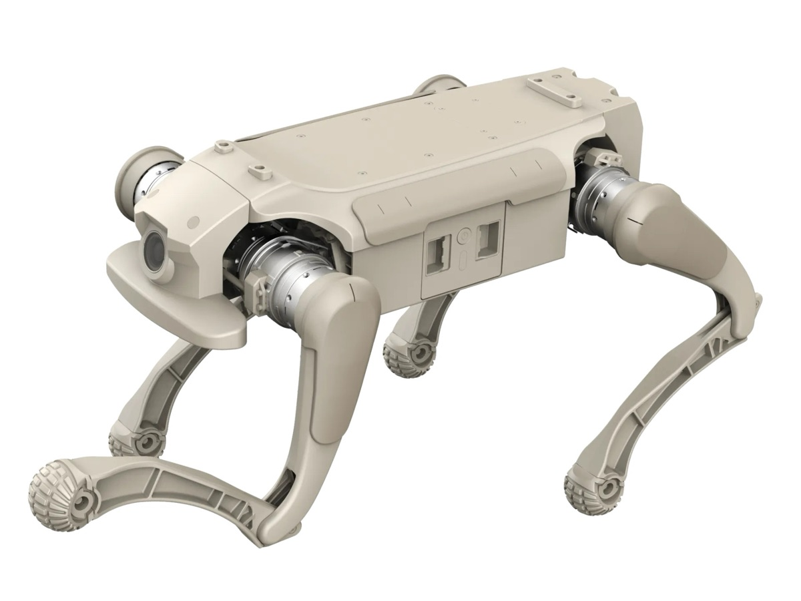
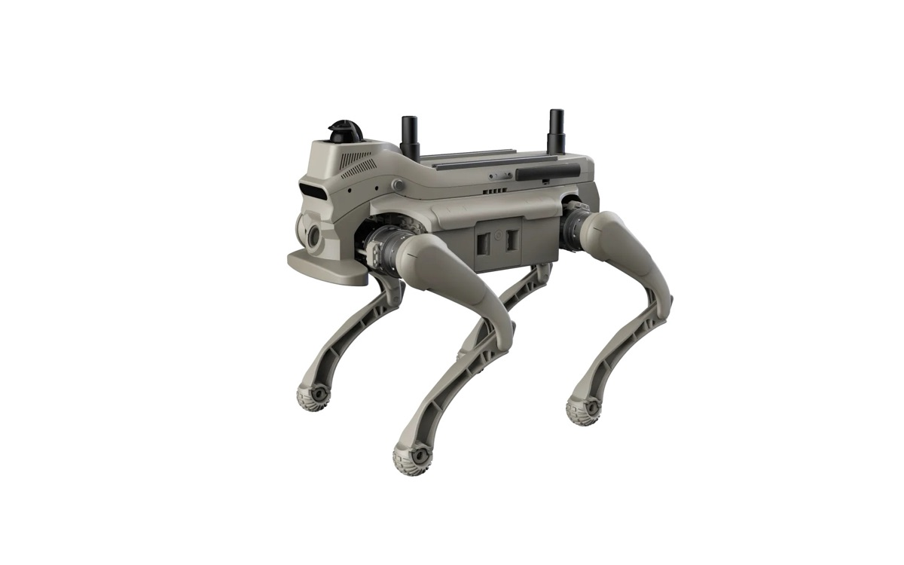
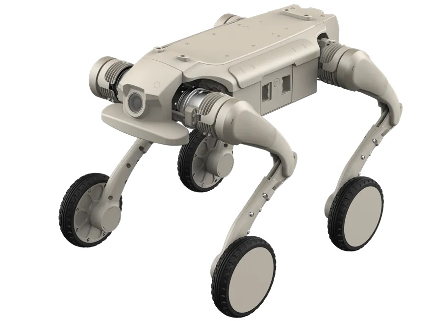
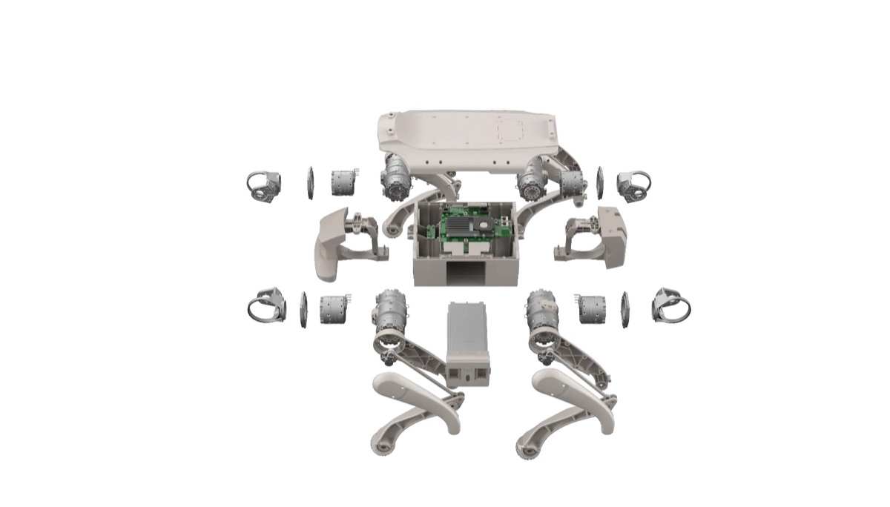
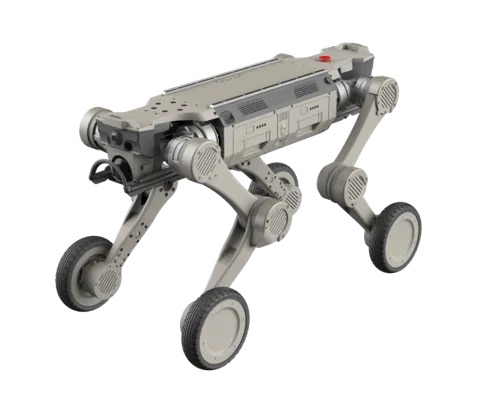
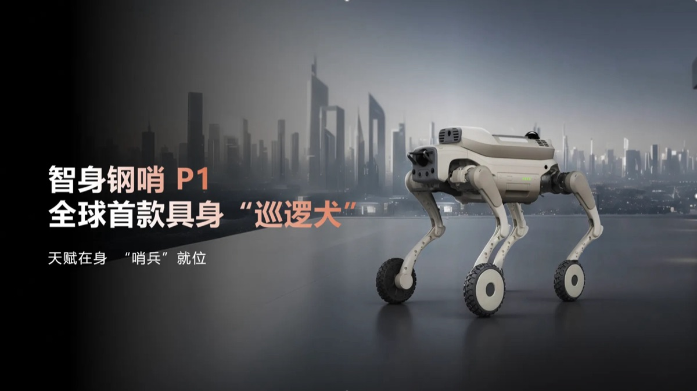
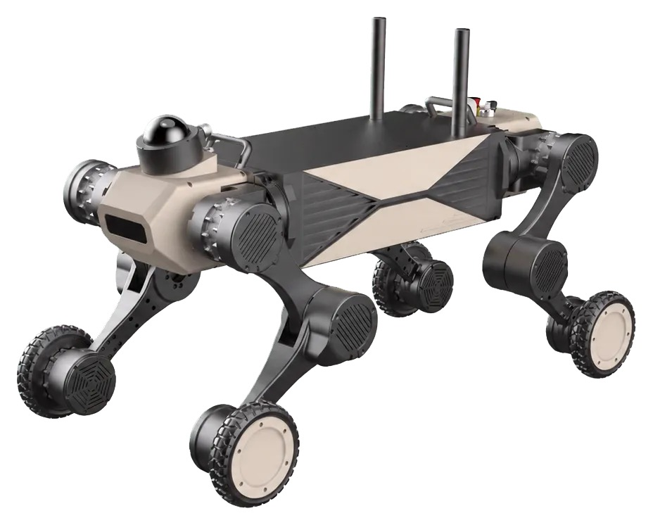
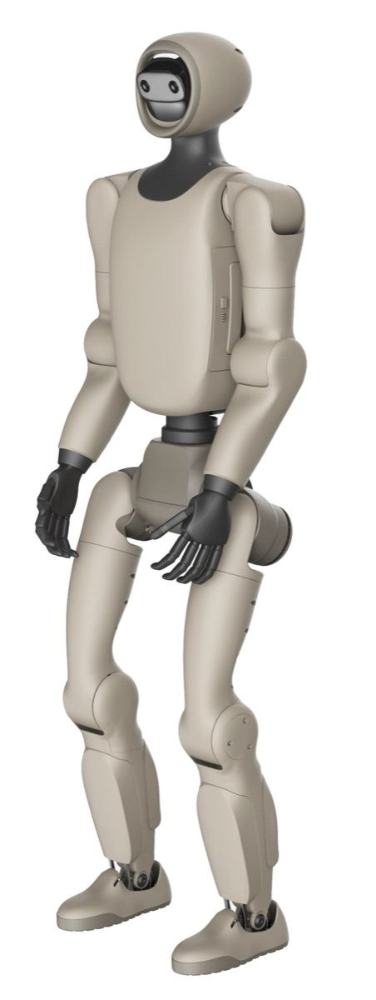
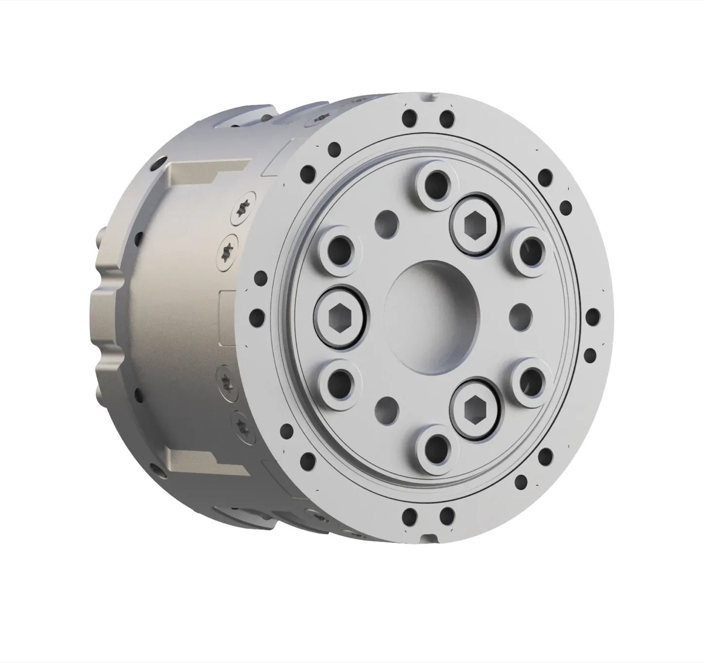
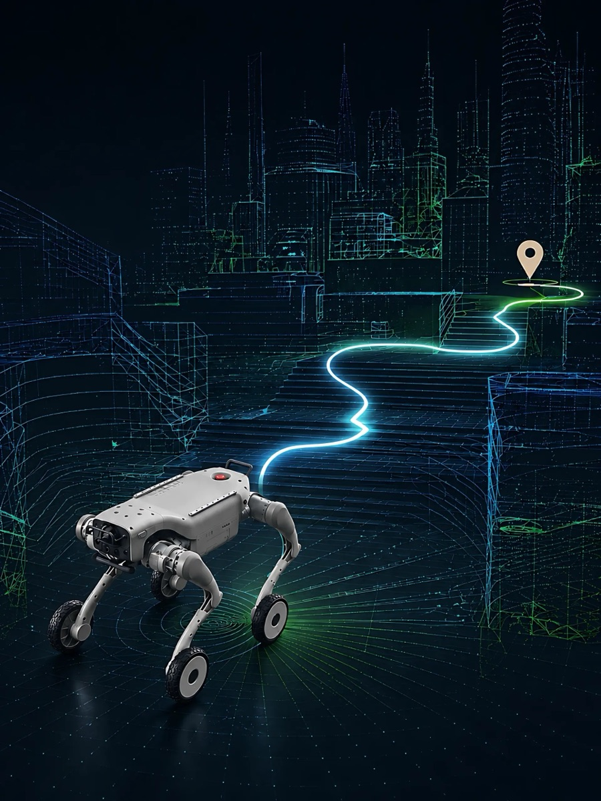

# Genisom AI — Product Portfolio

⬆ [Genisom AI profile](Genisom-AI.md) · [Developer guide](Genisom-AI-Developer-Guide.md) · [Roadmap and strategy](Genisom-AI-Roadmap-and-Strategy.md) · [Solutions and projects](Genisom-AI-Solutions-and-Projects.md)

**How to read this file.** All numbers are company-stated laboratory figures taken from the spec tables and text of the official product pages (fetched 2026-11-14), unless a row says otherwise. Chinese product nicknames are given once because the SDK, the app and the Chinese site use them. No official price list exists: every price cell is "not public".

**Corrections against the first-pass profile** (found on the official pages in this pass):

- **New product:** the **Gangshao P1 "patrol dog"** was launched on **2026-11-03** and is not in the profile table.
- **NE01 specs are now public** (three variants, 24–28 DoF, about 37 kg) although the page still says "Coming soon".
- **L2 is three variants** (L2, L2-W, L2-W Ultra). Only the **Ultra** has LiDAR, RTK and autonomous navigation in the spec table.
- **M1 weight:** the spec table says **41 kg including battery**; the "about 30 kg" figure is headline text on the same page.
- **P85MAX-S peak torque is 220 N·m** on its product page (the profile says 180 N·m, which is the M1 "maximum joint torque" value).

## Lineup map

Track relevance: ● strong · ◐ partial · ○ none.

| Product | Category | Status | Launched | Price (if public) | Positioning (one line) | T01 | T02 | T03 | T04 |
|---|---|---|---|---|---|---|---|---|---|
| [Genisom L1](#genisom-l1) | Small quadruped | ✅ | 2024-10 (mass production 2025-06) | not public | 15 kg rugged legged base with open SDK and joint-level control | ◐ | ◐ | ◐ | ◐ |
| [Genisom L1 EDU](#genisom-l1-edu) | Small quadruped, research build | ✅ | date not public | not public | L1 plus Orin NX, 3D LiDAR, depth camera, GNSS, 5G | ● | ● | ◐ | ◐ |
| [Genisom L1-W](#genisom-l1-w) | Small wheel-legged quadruped | ✅ | 2025-04 | not public | Faster, quieter L1 on wheels, 10 kg payload | ● | ◐ | ◐ | ◐ |
| [Genisom L1 Maker](#genisom-l1-maker) | Assemble-it-yourself teaching quadruped | 🧪 | shown 2026-08 (WRC), international debut 2026-10 (IROS) | not public | L1 as a kit: component-level assembly and factory calibration software | ○ | ○ | ○ | ○ |
| [Genisom L2 / L2-W / L2-W Ultra](#genisom-l2) | Compact industrial quadruped | ✅ ⚠️ unverified delivery status | 2026-06-29 | not public | 16 kg payload, 5.5 h, IP66, person-following; Ultra adds LiDAR navigation | ● | ● | ◐ | ◐ |
| [Genisom M1 / M1 Pro / M1 Ultra](#genisom-m1) | Mid-size industrial quadruped | ✅ | 2025 (mass production) | not public | 30 kg payload, IP67, −20 to 55 °C, 45° slopes, hot-swap batteries | ◐ | ● | ◐ | ◐ |
| [Gangshao P1](#gangshao-p1) | Purpose-built security patrol robot | 🧪 | 2026-11-03 | not public | Wheel-legged patrol unit with five integrated patrol payloads, 3-year warranty | ◐ | ● | ○ | ○ |
| [Genisom SP1](#genisom-sp1) | Explosion-proof wheel-legged quadruped | 🧪 | 2026-06 (debut), 2026-07 (release) | not public | Ex d IIC T6 Gb inspection robot for Zone 1 / Zone 2 gas areas | ○ | ● | ◐ | ○ |
| [Genisom NE01](#genisom-ne01) | Humanoid | 🧪 | first shown 2026-07; "Coming soon" | not public | 1.33 m, about 37 kg, high-dynamic humanoid; Pro / Ultra have SDK | ◐ | ◐ | ○ | ◐ |
| [TA01 robotic arm](#ta01-robotic-arm) | Arm for mobile manipulation | 🧪 | demoed 2026-08 | not public | Arm mounted on M1; only manipulation option in the range | ◐ | ◐ | ◐ | ◐ |
| [CHAMP joint modules](#champ-joint-modules) | Actuators and wheel-hub motors | ✅ | 2025-09 | not public | Six integrated modules, 26 to 220 N·m peak | ○ | ○ | ○ | ○ |
| [MATRiX](#matrix) | Simulation and training platform | ✅ | 2025 (open-sourced), 2.0 in 2026-07 | free, open source | MuJoCo physics + Unreal rendering, multi-robot, sensor simulation | ● | ● | ◐ | ◐ |
| [RoamerX](#roamerx) | Navigation stack | ✅ | date not public | Lite version free | Mapping, localisation, planning, multi-floor; ROS 2 Lite version on GitHub | ● | ● | ◐ | ◐ |
| [SomaMind](#somamind) | Embodied agent system | 🧪 | 2025-12 | not public | Task-to-skill layer above navigation; no public SDK | ◐ | ◐ | ◐ | ◐ |

**Likely on site (guess, not confirmed):** L1 / L1 EDU first, then L1-W or L2; M1 possible. Ask the booth for the exact **variant**, because sensors and autonomy differ sharply between variants of the same model.

## Products

### Genisom L1

Small "industry-grade" quadruped (Chinese nickname 钢镚, model code ZSL-1). Reinforcement-learning locomotion is standard. It is the company's volume product and the platform behind the L1 EDU, L1-W and L1 Maker.

| Spec | Value |
|---|---|
| Size standing / lying | about 630 × 360 × 415 mm / 670 × 425 × 145 mm |
| Weight with battery | **15 kg** |
| Payload | about **8 kg** continuous (limit about 10 kg) |
| Speed | **3.7 m/s** max, 5 m/s limit |
| Slope / stairs | 30° standard, **40°** limit · 16 cm continuous stairs |
| Runtime / range / charge | **1–2 h** · 6 km (at 1 m/s, no load) · 1 h charge |
| Battery | 43.2 V, 5 Ah nominal (4.6 Ah rated) |
| Actuators | 12 × CHAMP P65, **48 N·m** peak, calibration-free |
| Sensors | IMU · 8 MP wide-angle camera (HFOV 111°, VFOV 70°) |
| Compute | 8-core CPU (no AI accelerator listed) |
| Interfaces | 7 open hardware interfaces: Ethernet, USB 3.0 / 2.0, 24 V / 12 V power |
| Protection / temperature | **IP54** · **0 to 40 °C** |
| Software features | Target recognition and tracking, real-time video, OTA, secondary development (SDK) |
| In the box | Charger, charging dock, remote controller with screen; flight case optional |

- **Variants:** the page's hidden tab bar names **ZSL-1 Air / Pro / Max**, but only one spec table is published ⚠️ unverified what differs. Research build: [L1 EDU](#genisom-l1-edu). Wheeled build: [L1-W](#genisom-l1-w).
- **Developer access:** `genisom_L1_sdk` (C++ over UDP); joint-level control exists for the L1 only. Details: [Developer guide](Genisom-AI-Developer-Guide.md).
- **Typical applications (company):** security patrol, research and education, competitions, entertainment shows, emergency / fire support. Also multi-robot formations and drone–dog cooperation demos.
- **Hackathon notes:** rated **0 °C minimum**, so indoor arena work only in November. Base unit has one camera and no LiDAR, so autonomy needs the EDU build or your own sensor (T01.6, T02.6).
- Official page: [genisomai.com/en/product-robot/L1](https://www.genisomai.com/en/product-robot/L1)

### Genisom L1 EDU

Research and teaching configuration of the L1 with on-board AI compute and a full navigation sensor set. There is no separate product page; it is described on the L1 and L1-W pages and sold in the education line as the "L1 EDU Navigation Kit". An **L1-W EDU** with the same additions exists.

| Spec | Value |
|---|---|
| Added compute | NVIDIA **Jetson Orin NX, up to 100 TOPS** |
| Added sensors | Built-in **3D LiDAR**, **depth camera**, **GNSS** module |
| LiDAR model | Livox Mid-360 ⚠️ unverified (trade press; the MATRiX simulator ships a Mid-360 model) |
| Connectivity | **5G** module |
| Perception | Fusion of visible light, depth and LiDAR point cloud |
| Base platform | As L1 (or L1-W for the L1-W EDU) |
| Weight, runtime with the kit | not public |

- **What EDU unlocks:** hardware for autonomy (compute + LiDAR + depth + GNSS). The API is the same L1 SDK; RoamerX navigation runs on the added computer ⚠️ unverified whether the full RoamerX is pre-installed on loan units.
- **Typical applications:** navigation and SLAM courses, VLN research, competitions (the IROS 2025 legged challenge winner used an L1), multi-robot work (the company's collaborative-transport demo used L1-W EDU units).
- **Hackathon notes:** best all-round unit for T01.4, T01.5, T01.6, T02.3, T02.6 and T03.2 / T03.7 sensing projects.
- Official source: [L1 page, "Genisom L1 EDU" block](https://www.genisomai.com/en/product-robot/L1) · [Education & Research Solutions](https://www.genisomai.com/en/solutions) · the page links an official [EDU brochure PDF](https://qiniu.mfdemo.cn/zhishen/2026/05/25/eTwmg4zDlrTOU.pdf) (not opened in this pass).

### Genisom L1-W

Wheel-legged version of the L1 (钢镚 L1-W; the English firmware download list calls it "Steel Sword L1-W"). Wheels for fast, quiet travel on flat ground; legs for stairs and obstacles.

| Spec | Value |
|---|---|
| Size standing / lying | about 630 × 430 × 485 mm / 690 × 540 × 165 mm |
| Weight with battery | **22 kg** |
| Payload | about **10 kg** continuous (limit about 12 kg) |
| Speed | 3.7 m/s max, **5.5 m/s** limit |
| Obstacles | **65 cm** maximum obstacle height (headline) · 16 cm continuous stairs · 30° standard / 40° limit slope |
| Runtime / range / charge | 1–2 h · **9 km** (at 1 m/s, no load) · 1 h charge |
| Actuators | 12 joint motors (48 N·m peak) + **4 hub motors** |
| Sensors | IMU · 8 MP wide-angle camera |
| Compute | 8-core CPU |
| Interfaces | 7 open hardware interfaces (Ethernet, USB 3.0 / 2.0, 24 V / 12 V) |
| Protection / temperature | IP54 · 0 to 40 °C |
| Noise | as low as **55 dB** |

- **Variants:** **L1-W EDU** (Orin NX up to 100 TOPS, 3D LiDAR, depth camera, GNSS, 5G).
- **Developer access:** same `genisom_L1_sdk` as the L1; no low-level joint control on the wheeled model (see [Developer guide](Genisom-AI-Developer-Guide.md)).
- **Typical applications (company):** search and rescue, emergency / fire support, research and education, security patrol. Good fit for indoor delivery and guidance (T01.1, T01.3, T01.5) because of speed and low noise.
- Official page: [genisomai.com/en/product-robot/L1-W](https://www.genisomai.com/en/product-robot/L1-W)

### Genisom L1 Maker

Teaching kit built on the mass-produced L1: students assemble the robot from components, calibrate it with the factory software and then program it.

| Spec | Value |
|---|---|
| Platform | L1 (same size, 15 kg, 12 joints at 48 N·m) |
| Payload / slope / stairs | about 8 kg (limit about 10 kg) · 40° limit · 16 cm stairs |
| Assembly | Component-level; key structural parts and connectors rated for **≥30 assembly cycles** |
| Software | Access to production calibration software (zero-position calibration, joint test, commissioning) · open APIs · MATRiX workflow |
| Expansion | Open hardware interfaces for sensors and peripherals |

- **Status:** shown at WRC 2026 (August) and internationally at IROS 2026 (October); price and delivery date not public.
- **Hackathon relevance:** low. Assembly is the point of the product; once built it behaves like an L1.
- Official page: [genisomai.com/en/product-robot/L1maker](https://www.genisomai.com/en/product-robot/L1maker)

### Genisom L2

*Picture shows the wheel-legged version (L2-W).*

Second-generation compact industrial quadruped (钢镚 L2), released 2026-06-29. Roughly twice the L1's payload and endurance, IP66, and navigation and following designed into the standard product. The spec table lists **three variants** — check which one you get.

| Spec | L2 (legged) | L2-W (wheel-legged) | L2-W Ultra (wheel-legged, surround view) |
|---|---|---|---|
| Size standing | about 720 × 390 × 480 mm | about 760 × 450 × 500 mm | about 760 × 450 × 500 mm |
| Weight with battery | **21 kg** | **27 kg** | **27 kg** |
| Continuous payload | about **16 kg** (static 150 kg) | about 16 kg | about 16 kg |
| Speed max / peak | 3.2 / 5 m/s | 3.7 / 5 m/s | 3.2 / 5 m/s |
| Stairs / slope | 22 cm / 40° | 25 cm / 40° | 25 cm / 40° |
| Runtime no load / full load | **5.5 h** / 3.5 h | 5.5 h / 3.5 h | 4.5 h / 3 h |
| Range no load / full load | **20 km** / 12 km | 20 km / 12 km | 16 km / 10 km |
| Cameras | Stereo, 2 × 2.07 MP | Stereo, 2 × 2.07 MP | Front stereo + surround fisheye array |
| 3D LiDAR | — | — | **2 × industrial 96-line LiDAR** |
| RTK positioning | — | — | Supported |
| Autonomous navigation | — | — | **LiDAR + vision fusion** |
| Following | UWB autonomous following | UWB autonomous following | **GLUE omnidirectional following** (UWB + vision) |
| Target tracking / live video | — / — | — / — | Supported / Supported |
| Cellular | 4G | 4G | **5G** |
| Remote controller | Without display | Without display | With display |

Common to all three:

| Spec | Value |
|---|---|
| Battery | **756 Wh** (15,000 mAh) · 1.5 h charge |
| Actuators | 12 joints, **95 N·m** peak |
| Compute | 8-core CPU standard; headline claim "up to **86 TOPS**" of AI compute (which variant carries it is not broken down) |
| Expansion | 5 interfaces: 2 × USB 3.0, M12 17-pin, M12 18-pin, 4G SIM slot · Wi-Fi / Bluetooth |
| Protection / temperature | **IP66** · **−20 to 55 °C** |
| Other | 70 cm vertical obstacle clearance (headline) · intelligent obstacle avoidance · OTA · custom development supported |
| Options | Autonomous-recharging station, flight case, storage unit |

- **Developer access:** `genisom_robot_sdk` ("GEN2", C++17, shared with M1). See [Developer guide](Genisom-AI-Developer-Guide.md).
- **Typical applications (company):** security patrol of parks, communities and public spaces, short-distance delivery, research and education, emergency / fire support. With thermal camera, microphone and loudspeaker top-loads it acts as a mobile security node.
- **Hackathon notes:** cold-rated and rain-proof, so the best outdoor demo unit. Person-following out of the box suits T01.1, T04.4 and T04.5 ideas; only the Ultra navigates by itself (T01.6, T02.6).
- Official page: [genisomai.com/en/product-robot/L2](https://www.genisomai.com/en/product-robot/L2)

### Genisom M1

Mid-size industrial quadruped (铜锤 "Copper Hammer" M1) for inspection, patrol, firefighting support and load carrying in harsh weather. The published spec table describes a build with **4 hub motors** (wheel-legged); a point-foot version also exists (raced at Mount Tai, November 2026).

| Spec | M1 | M1 Pro |
|---|---|---|
| Size standing | 930 × 480 × 585 mm | 930 × 480 × 595 mm |
| Weight with battery | **41 kg** (headline text on the same page says "about 30 kg") | 41 kg |
| Payload | **30 kg** | 30 kg |
| Speed max / limit | **6 m/s** / 8 m/s | 6 / 8 m/s |
| Stairs / slope / obstacle | 25 cm / **45°** / 80 cm (headline) | same |
| Runtime no load / full load | **5 h** / 3.5 h | same |
| Range no load / full load | **29 km** / 18 km | same |
| Battery | 2 × 54 V 9.35 Ah, **dual hot-swap** · charge < 2 h | same |
| Actuators | 12 joints, **180 N·m** max + 4 hub motors | same |
| Compute | 8-core CPU (**100 TOPS**) | same |
| Sensors | 2 × 8 MP wide-angle cameras, IMU, 3D LiDAR, depth camera, RTK | + ultrasonic sensor |
| Autonomous navigation | **Optional** "Smart Navigation Pro" (mapping, localisation, navigation, obstacle avoidance) | **Included** |
| Following | — | **UWB + laser-vision following** |
| Voice | — | Voice dialogue, recording and broadcast |
| Storage | 256 GB | 256 GB + 512 GB TF card |
| Interfaces | 2 × Gigabit Ethernet, 2 × USB 3.0, RS232, RS485, 2 × SBUS, PPS (page claims 15 open interfaces) | same |
| Protection / temperature | **IP67** · **−20 to 55 °C** · fill light | same |
| In the box | Charger, charging dock, RC remote, flight case | same |
| Options | Autonomous charging station, landing-gear kit | same |

- **M1 Ultra:** adds four fisheye cameras and a forward stereo camera for **720° surround perception** (the company's "Omni-Panorama" system: surround view, BEV fusion, 3D occupancy). No separate spec table is published.
- **Developer access:** `genisom_robot_sdk` ("GEN2"). The phone app outranks the SDK for control. See [Developer guide](Genisom-AI-Developer-Guide.md).
- **Proof points (company):** autonomous-following pacer for a 21 km half marathon (M1 Pro, April 2026); first place in the quadruped autonomous-navigation category at the 2026 Beijing Yizhuang robot challenge; carried a load up 3,100+ steps of Mount Tai with full autonomous navigation (November 2026).
- **Typical applications (company):** forest and petrochemical fire protection, power inspection, park patrol, logistics transport. Direct match for T02.1, T02.2, T02.3, T02.4, T02.6; load-carrying and following for T01.1 and T04.4.
- Official page: [genisomai.com/en/product-robot/M1](https://www.genisomai.com/en/product-robot/M1)

### Gangshao P1

"Patrol dog" (钢哨 P1, roughly "Steel Sentry"), launched **2026-11-03** at Security China 2026 in Beijing. A wheel-legged robot designed and delivered as a finished security-patrol unit instead of a general platform plus add-on payloads. Source is the company's Chinese launch articles; there is no product page or English material yet.

| Spec | Value |
|---|---|
| Locomotion | Wheel-legged: wheels on flat ground, legs for stairs, ramps and thresholds |
| Cameras | Visible light + **infrared thermal** |
| Integrated patrol payloads (5) | Thermal imaging · remote loudspeaker · strobe warning light · one-touch call · temperature / humidity sensing |
| Navigation | **RoamerX**, three modes: open-area navigation, preset road-network navigation, 3D navigation |
| Operation | Scheduled autonomous patrols by route and checkpoint · optional auto-charging dock for **24/7** duty · central management of routes, tasks and patrol records |
| Protection / temperature | **IP66** · **−20 to 55 °C** |
| Warranty | **3-year whole-machine warranty** (company calls it an industry first) |
| Size, weight, payload, runtime, compute | not found in the sources read ⚠️ unverified |
| Base platform | Looks like the L2-W ⚠️ unverified |

- **Target sites (company):** industrial parks and plants, residential communities, public venues, key protected areas.
- **Hackathon relevance:** unlikely to be on site (launched 11 days ago, China only), but it is the company's own reference design for T02.5 and T01.4 — copy the payload set and the "route + checkpoint + record" workflow.
- Official sources: [launch article (Chinese)](https://mp.weixin.qq.com/s/1SoQQMvEVpWVl1cpcgZ5WA) · [3-year warranty article (Chinese)](https://mp.weixin.qq.com/s/YCdai1P5xamSswPVSd26iQ)

### Genisom SP1

Explosion-proof wheel-legged inspection quadruped (铅球 "Shot Put" SP1) for oil, gas and chemical sites. First shown at CTEF Shanghai (June 2026), released at WAIC (July 2026). Product page is Chinese only.

| Spec | Value |
|---|---|
| Explosion protection | **Ex d IIC T6 Gb**, for Zone 1 / Zone 2 explosive gas atmospheres (flameproof joints, housing and sensor window) |
| Size | 1190 × 640 × 925 mm |
| Weight | **≤ 100 kg** |
| Payload | **50 kg** |
| Speed | 1.2 m/s |
| Slope / stairs | **35°** / 23 cm continuous stairs |
| Runtime | **≥ 4 h** (full load, per page headline) |
| Charging | Wireless or wired; autonomous return to charger |
| Motion modes | Crawl (low spaces), wheel (flat ground), leg (stairs and obstacles) |
| Sensors / payloads | LiDAR, explosion-proof pan-tilt unit, HD visible camera, gas detection, broadcast intercom; supports visual, infrared, gas and acoustic inspection payloads |
| Autonomy | SLAM + IMU + AI decision-making: autonomous navigation, obstacle avoidance, data return |
| Protection / temperature | **IP66** · **−20 to 55 °C** |
| Connectivity | Wi-Fi / 4G / 5G |
| Secondary development | Supported |

- **Target sites (company):** refinery units, chemical tank farms, gas / LNG stations, oil and gas pipelines.
- **Hackathon relevance:** not expected on site (100 kg, no use at the venue). Useful as a reference for T02.2 concepts.
- Official page: [genisomai.com/product-robot/sp1 (Chinese)](https://www.genisomai.com/product-robot/sp1)

### Genisom NE01

High-dynamic humanoid (银毅 NE01). First shown at WAIC 2026; the official page still reads "Coming soon" but already carries a three-variant spec table. In November 2026 it won both humanoid race stages of the CMG Mount Tai robot climbing event (company-stated).

| Spec | NE 01 | NE 01 Pro | NE 01 Ultra |
|---|---|---|---|
| Height × width × depth | 1328 × 403 × 185 mm | same | same |
| Weight with battery | about **37 kg** | same | same |
| Total DoF | **24** | 24 | **28** |
| DoF per leg / arm / waist | 6 / 5 / 2 | 6 / 5 / 2 | 6 / **7** / 2 |
| Max joint torque | 120 N·m | **180 N·m** | 180 N·m |
| Arm payload | 2 kg | 2 kg | **3 kg** |
| Speed | 2.5 m/s max | same | same |
| Battery / runtime | **540 Wh** · about 2 h at 1 m/s | same | same |
| Core processor | 8-core CPU | 8-core CPU | 8-core CPU |
| Expansion processor | none | Jetson Orin Nano (**67 TOPS**) | Jetson Orin NX (**157 TOPS**) |
| Secondary development (SDK) | **No** | **Yes** | **Yes** |
| Sensors and I/O | 1080p stereo camera, microphone, speaker, Wi-Fi, Bluetooth, remote controller | same | same |
| Temperature | −10 to 40 °C | same | same |

- Notes from the page: peak torque is the largest value among all joints; arm payload depends strongly on arm pose.
- No hands / end-effector details and no public SDK repository found.
- **Hackathon relevance:** not expected on site. If it is, only Pro / Ultra can be programmed.
- Official page: [genisomai.com/en/product-robot/NE01](https://www.genisomai.com/en/product-robot/NE01)

### TA01 robotic arm

No picture available from an official source.

Robotic arm (铁臂 "Iron Arm" TA01) shown mounted on an M1 at WRC 2026 (Beijing, August 2026). The demo kept the end-effector steady while the robot's legs and body were moving; the Chinese show report describes it as a VLA (vision-language-action) manipulation demo.

| Item | Status |
|---|---|
| DoF, reach, payload, weight, gripper | not public |
| Product page / SDK / price | none found |
| Compatible base | M1 (shown); other bases not stated |

- An M1 with an arm was also used by the NTU team that won the fully autonomous category of the IROS 2026 legged challenge, and in a course with HKUST (Guangzhou) ⚠️ unverified whether those arms were TA01 units.
- **Hackathon relevance:** the only manipulation path in the range (T01.2, T03.1, T04.1). Ask the booth whether an arm is on site before planning around it.
- Official source: [GENISOM AI at WRC 2026](https://www.genisomai.com/en/newsdetail/GENISOM-AI-at-WRC-2026)

### CHAMP joint modules

*Picture shows the P85MAX-S.*

In-house integrated actuators (motor, planetary gearbox, encoders, driver) and wheel-hub motors, sold as components and used in the company's robots. Series released September 2025; stated production capacity above one million modules per year.

| Model | Type | Outer diameter | Weight | Peak torque | Other verified facts |
|---|---|---|---|---|---|
| P55 | Joint | 57 mm | 344 g | **26 N·m** | about 75.6 N·m/kg · planetary gearbox · IP54 (sealed rear cover) |
| P65 | Joint | not stated on page | 520 g | **48 N·m** | about 92.3 N·m/kg · dual encoders, frameless torque motor · IP54 (IP55 when integrated) · **the L1 joint** |
| P65MAX-S | Joint | 65 mm | 585 g | **95 N·m** | about 162.4 N·m/kg · IP67 |
| P85MAX-S | Joint | 86 mm | 1.01 kg | **220 N·m** | about 217.8 N·m/kg · 39:1 planetary gearbox · dual encoders · brake · IP67 · −20 to 55 °C |
| W150-S | Wheel-hub motor | not stated | about 1.18 kg | **13 N·m** (3.1 N·m rated) | Direct drive, up to 1,700 rpm · CAN FD · IP67 · −20 to 55 °C |
| W190-S | Wheel-hub motor | not stated | not stated | **35 N·m** (11.2 N·m rated) | 6:1 planetary gearbox · CAN FD |

- Each page links a "CHAMP Series Joint Module Parameter Sheet" (PDF, not opened in this pass) with voltage, speed and encoder data.
- The L2 lists 95 N·m and the M1 180 N·m peak joint torque ⚠️ unverified which module each robot uses.
- **Hackathon relevance:** none unless a team builds its own mechanism.
- Official pages: [P55](https://www.genisomai.com/en/product-joint/P55) · [P65](https://www.genisomai.com/en/product-joint/P65) · [P65MAX-S](https://www.genisomai.com/en/product-joint/P65MAX-S) · [P85MAX-S](https://www.genisomai.com/en/product-joint/P85MAX-S) · [W150-S](https://www.genisomai.com/en/product-joint/W150-S) · [W190-S](https://www.genisomai.com/en/product-joint/W190-S)

### MATRiX

Open-source "open-world" simulation and training platform. Open-sourced in 2025; version 2.0 announced July 2026.

| Item | Value |
|---|---|
| Physics | MuJoCo at **500 Hz** |
| Rendering | Unreal Engine (photorealistic urban roads, waterfront, warehouse, stairs) |
| Sensors simulated | RGB, infrared, depth, fisheye and panoramic cameras · LiDAR incl. Mid-360 · IMU · GPS · odometry; switchable at run time |
| Scenes | Downloadable map DLCs · drag-and-drop editor · AI-assisted generation · **3DGS import** of real scenes · dynamic obstacles, vehicles, pedestrians |
| Multi-robot | Distributed, concurrent multi-robot simulation (formation, RL, navigation) |
| Built-in locomotion | Motion-control cores `xgb`, `xg2`, `xgw`, `zsl-1`; shared-memory link emulation; one-click SIL / HIL switch |
| Sim-to-real | Company states policies deploy to L1 and M1 |
| Platforms | Linux and Windows; graphical start-up, no ROS installation needed |
| Licence / price | Free; BSD-3-Clause per the repository (see [Developer guide](Genisom-AI-Developer-Guide.md)) |

- **Hackathon notes:** lets a team start before it gets robot time, and gives a fallback demo if hardware slots are short. Relevant to every direction that needs navigation or perception (T01.6, T02.6, T03.7).
- Official page: [genisomai.com/en/product-robot/MATRiX](https://www.genisomai.com/en/product-robot/MATRiX) · [GitHub](https://github.com/zsibot/matrix)

### RoamerX

The company's navigation system: autonomous mapping, route planning, localisation and obstacle avoidance indoors, outdoors and across floors.

| Item | Value |
|---|---|
| Localisation | LiDAR + GNSS fusion, "centimetre-level" (company claim) |
| Environments | Indoor, outdoor, multi-floor |
| Modes (on P1) | Open-area navigation · preset road-network navigation · 3D navigation |
| Ships on | L2 (headline feature; LiDAR navigation in the spec table only for L2-W Ultra) · M1 as "Smart Navigation Pro" (optional on M1, included on M1 Pro) · P1 |
| Open version | `genisom_roamerx_open` ("Lite") on GitHub: ROS 2 Humble + Nav2; details in the [Developer guide](Genisom-AI-Developer-Guide.md) |
| Price | Lite version free; full version bundled with robots, price not public |

- No standalone product page; described on the L2 page and in the open-source list.
- Official sources: [L2 page, RoamerX block](https://www.genisomai.com/en/product-robot/L2) · [Official Open Source page](https://www.genisomai.com/en/opensource) · [GitHub](https://github.com/zsibot/genisom_roamerx_open)

### SomaMind

No picture available from an official source.

"Embodied agent system" announced December 2025 (About-page timeline: "embodied brain SomaMind intelligent system"). The company positions it as the third layer of its software chain: **MATRiX** (simulation) → **RoamerX** (navigation) → **SomaMind** (task execution).

| Item | Status |
|---|---|
| Public SDK / repository / docs | none found |
| Supported robots, model details, pricing | not public |

- **Hackathon relevance:** do not plan on it. Use your own LLM / VLM layer on top of the SDK or the open `genisom_vln` baseline.
- Official source: [About Genisom](https://www.genisomai.com/en/aboutus.html)

## Accessories and ecosystem

**Education line** ([Education & Research Solutions](https://www.genisomai.com/en/solutions))

| Item | What it is | Status |
|---|---|---|
| L1 EDU Navigation Kit | L1 with the navigation sensor set, for real-robot learning and secondary development | ✅ |
| L1 EDU DESK Training Platform | Classroom / lab bench with a mounted L1 for embodied-AI courses | ✅ ⚠️ unverified details (no spec published) |
| L1 Maker | See [L1 Maker](#genisom-l1-maker) | 🧪 |
| Genisom EAI Academy | Courses, competitions, certification | ✅ |
| Genisom AI Gravity | Application program giving researchers and developers access to robots | ✅ |

**Hardware accessories listed in the spec tables**

| Accessory | For | Standard or optional |
|---|---|---|
| Charging dock and power adapter | L1, L1-W, L2, M1 | Standard |
| Autonomous charging station (low-battery return) | L2, M1, P1 | Optional |
| Remote controller | L1 / L1-W (with screen) · L2 / L2-W (no display) · L2-W Ultra (with display) · M1 (RC remote) · NE01 | Standard |
| Flight case | L1, L1-W, L2 (optional) · M1 (standard) | see left |
| Storage unit | L2 (optional) · M1 256 GB · M1 Pro 256 GB + 512 GB TF | see left |
| Landing-gear kit | M1 | Optional |
| UWB module, microphone, speaker | M1 Pro; UWB on all L2 variants | Standard on those variants |
| Expansion modules (compute boards, perception, positioning, 4G, long-range video link) | L1 family | Third-party / optional |

**Technology features sold inside the robots**

| Feature | What it does | Where |
|---|---|---|
| GLUE omnidirectional following | UWB + vision person-following without blind spots | L2-W Ultra; M1 Pro (UWB + laser-vision following) |
| 720° surround perception ("Omni-Panorama") | Fisheye surround view, BEV temporal fusion, 3D occupancy | M1 Ultra, L2-W Ultra |
| GSD (Genisom Self-Driving) | Data-driven autonomous navigation trained on deployment data | 🧪 shown at WRC 2026 |
| PITA "Multi-Legged Collaborative Transport" | Several robots carry one object through unmapped space; demo used L1-W EDU units, goal set in VR | 🧪 announced 2026-09 |
| RL locomotion controller | Standard on every quadruped | ✅ |

**Software and downloads**

| Item | Purpose | Link |
|---|---|---|
| `genisom_L1_sdk` | SDK for L1 / L1-W | [GitHub](https://github.com/zsibot/genisom_l1_sdk) |
| `genisom_robot_sdk` | "GEN2" SDK for M1 and later platforms (L2) | [GitHub](https://github.com/zsibot/genisom_robot_sdk) |
| `genisom_model` | URDF and meshes (RViz, Gazebo) | [GitHub](https://github.com/zsibot/genisom_model) |
| `genisom_roamerx_open` | Open navigation stack | [GitHub](https://github.com/zsibot/genisom_roamerx_open) |
| `genisom_vln` | Vision-language navigation on MATRiX | [GitHub](https://github.com/zsibot/genisom_vln) |
| Firmware upgrade packages | L1, L1-W, M1 (hosted on Feishu) | [Official Open Source page](https://www.genisomai.com/en/opensource) |
| Manuals and joint-module files | L1, M1, joint modules | [Download Center](https://www.genisomai.com/en/download.html) |

**Partner top-loads.** Industry kits (firefighting, disinfection, guide-dog, power inspection, bomb disposal) are built with partners on M1 / L1-W bases; they are covered in [Solutions and projects](Genisom-AI-Solutions-and-Projects.md).

## Legacy and discontinued

| Item | Note |
|---|---|
| Windbreaker RX (破风者 RX) | Running humanoid built in about two months by a five-person team; finished the Beijing Yizhuang robot half marathon on 2026-04-19. A race prototype, not a catalogue product; the NE01 followed three months later. |
| Full-size humanoid (2024) | About-page timeline lists a full-size humanoid launched in June 2024; no product page today. |
| `genisom_l1_sdk_old` | Legacy L1 SDK (C++ and Python), no longer maintained. |

## Image credits

All pictures come from the image store used by the official genisomai.com pages (qiniu.mfdemo.cn/zhishen/…). Files other than the two marked "this pass" were already in the folder; their sources were identified by matching pixel dimensions against the official images.

| file | shows | source URL |
|---|---|---|
| genisom-ai-l1.jpg | Genisom L1, render | [image](https://qiniu.mfdemo.cn/zhishen/2026/05/20/JWiqlC0witLYW.webp) · [page](https://www.genisomai.com/en/product-robot/L1) |
| genisom-ai-l1-edu.jpg (this pass) | L1 with LiDAR and antennas ("L1 EDU Navigation Kit") | [image](https://qiniu.mfdemo.cn/zhishen/2026/09/20/7jwHoPf8jBsA0.webp) · [page](https://www.genisomai.com/en/solutions) |
| genisom-ai-l1-w.jpg | Genisom L1-W, render | [image](https://qiniu.mfdemo.cn/zhishen/2026/05/24/d0Jz0Rkqjdq7p.webp) · [page](https://www.genisomai.com/en/product-robot/L1-W) |
| genisom-ai-l1-maker.jpg | L1 Maker, exploded view of components | [image](https://qiniu.mfdemo.cn/zhishen/2026/08/18/DGmklCuGUCB3A.webp) · [page](https://www.genisomai.com/en/product-robot/L1maker) |
| genisom-ai-l2.jpg | Genisom L2, wheel-legged version, menu thumbnail | [image](https://qiniu.mfdemo.cn/zhishen/2026/06/29/cWpR0EXnqNQAr.webp) · [page](https://www.genisomai.com/en/product-robot/L2) |
| genisom-ai-m1.jpg | Genisom M1, wheel-legged build, render | [image](https://qiniu.mfdemo.cn/zhishen/2026/05/24/n9zpFnC6h3lgl.webp) · [page](https://www.genisomai.com/en/product-robot/M1) |
| genisom-ai-p1.jpg (this pass) | Gangshao P1 launch visual (Chinese caption) | [image](https://qiniu.mfdemo.cn/zhishen/2026/11/09/WyS6dnjp28P8u.webp) · [page](https://www.genisomai.com/news.html) |
| genisom-ai-sp1.jpg | Genisom SP1, render | [image](https://qiniu.mfdemo.cn/zhishen/2026/07/23/f3DRUTweEXtIl.webp) · [page](https://www.genisomai.com/product-robot/sp1) |
| genisom-ai-ne01.jpg | Genisom NE01, render | [image](https://qiniu.mfdemo.cn/zhishen/2026/09/03/EYnoF0Lf5zxKQ.webp) · [page](https://www.genisomai.com/en/product-robot/NE01) |
| genisom-ai-champ-joints.jpg | CHAMP P85MAX-S joint module | [image](https://qiniu.mfdemo.cn/zhishen/2026/08/31/FpDf7y8DeFfE1.webp) · [page](https://www.genisomai.com/en/product-joint/P85MAX-S) |
| genisom-ai-matrix.jpg | MATRiX wordmark | [image](https://qiniu.mfdemo.cn/zhishen/2026/09/17/U1k0aokT3IHrO.webp) · [page](https://www.genisomai.com/en/product-robot/MATRiX) |
| genisom-ai-roamerx.jpg | RoamerX navigation visual (L2-W planning a route) | [image](https://qiniu.mfdemo.cn/zhishen/2026/08/31/OqeIZoS5i1mzs.webp) · [page](https://www.genisomai.com/en/product-robot/L2) |

## Sources

Official product pages
- [Genisom L1](https://www.genisomai.com/en/product-robot/L1)
- [Genisom L1-W](https://www.genisomai.com/en/product-robot/L1-W)
- [Genisom L1 Maker](https://www.genisomai.com/en/product-robot/L1maker)
- [Genisom L2](https://www.genisomai.com/en/product-robot/L2)
- [Genisom M1](https://www.genisomai.com/en/product-robot/M1)
- [Genisom NE01](https://www.genisomai.com/en/product-robot/NE01)
- [Genisom SP1 (Chinese)](https://www.genisomai.com/product-robot/sp1)
- [MATRiX](https://www.genisomai.com/en/product-robot/MATRiX)
- [CHAMP P55](https://www.genisomai.com/en/product-joint/P55) · [P65](https://www.genisomai.com/en/product-joint/P65) · [P65MAX-S](https://www.genisomai.com/en/product-joint/P65MAX-S) · [P85MAX-S](https://www.genisomai.com/en/product-joint/P85MAX-S) · [W150-S](https://www.genisomai.com/en/product-joint/W150-S) · [W190-S](https://www.genisomai.com/en/product-joint/W190-S)

Other official pages
- [Genisom AI home (English)](https://www.genisomai.com/en/)
- [Official Open Source page](https://www.genisomai.com/en/opensource)
- [Download Center](https://www.genisomai.com/en/download.html)
- [Education & Research Solutions](https://www.genisomai.com/en/solutions)
- [About Genisom (timeline)](https://www.genisomai.com/en/aboutus.html)
- [News list (Chinese)](https://www.genisomai.com/news.html)
- [GENISOM AI at WAIC 2026 (2026-07-19)](https://www.genisomai.com/en/newsdetail/GENISOM-AI-at-WAIC-2026)
- [GENISOM AI at WRC 2026 (2026-08-23)](https://www.genisomai.com/en/newsdetail/GENISOM-AI-at-WRC-2026)
- [IROS 2026 press release (PR Newswire, 2026-10-01)](https://www.prnewswire.com/news-releases/genisom-ai-showcases-embodied-intelligence-and-debuts-worlds-first-industry-grade-educational-quadruped-at-iros-2026-302896049.html)

Company WeChat articles (Chinese, linked from the official news list)
- [Gangshao P1 patrol dog launch (2026-11-05)](https://mp.weixin.qq.com/s/1SoQQMvEVpWVl1cpcgZ5WA)
- [Three-year warranty announcement (2026-11-05)](https://mp.weixin.qq.com/s/YCdai1P5xamSswPVSd26iQ)
- [NE01 and M1 at the CMG Mount Tai robot climb (2026-11-03)](https://mp.weixin.qq.com/s/MyjCnuwpuuWazKJnC_uvXA)
- [PITA multi-legged collaborative transport (2026-09-19)](https://mp.weixin.qq.com/s/hvxHUHl72obO9cvIJaCJag)
- [WRC 2026 show report: M1 + TA01, L1 Maker, P85MAX-S (2026-08-26)](https://mp.weixin.qq.com/s/e_RY3t347rIPhdoHAylCxA)
- [WAIC 2026 show report: L2, SP1, NE01, MATRiX 2.0](https://mp.weixin.qq.com/s/WJPqz7-AoHwgXJ3g1Src8w)
- [M1 "application state" article: software chain MATRiX, RoamerX, SomaMind (2026-07-15)](https://mp.weixin.qq.com/s/osC9U1fNXSBDqJsiFqRbLQ)
- [MATRiX 2.0 release (2026-07-14)](https://mp.weixin.qq.com/s/GXo0ZkCv_MP2x8t_RtexoA)
- [L2 offline debut, China property-management expo (2026-07-03)](https://mp.weixin.qq.com/s/ajGH7Ow3t06tJEQovRjRWA)
- [SP1 debut at CTEF Shanghai (2026-06-11)](https://mp.weixin.qq.com/s/-RMJOPuiKP_Ldpyb-1_Hew)
- [Windbreaker RX at the Yizhuang half marathon (2026-04-19)](https://mp.weixin.qq.com/s/mv9U55s6crldkp0yabHZEw)

GitHub
- [zsibot organisation](https://github.com/zsibot/)
- [matrix](https://github.com/zsibot/matrix)
- [genisom_roamerx_open](https://github.com/zsibot/genisom_roamerx_open)
