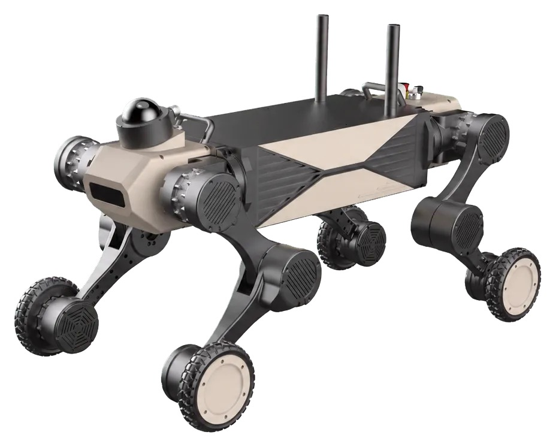
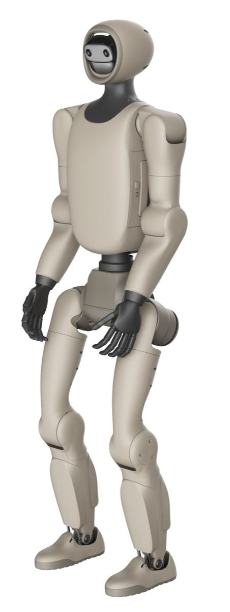

# Genisom AI — Roadmap and Strategy

⬆ [Genisom AI profile](Genisom-AI.md) · [Product portfolio](Genisom-AI-Products.md) · [Developer guide](Genisom-AI-Developer-Guide.md) · [Solutions and projects](Genisom-AI-Solutions-and-Projects.md)

> **Coverage note:** built from the official site (English and Chinese: About, news lists, Series B page, channel-conference article, product pages), the GitHub organisation `zsibot`, two press pieces on ICRA and IROS 2026, and the dated entries already collected in the [solutions and projects register](Genisom-AI-Solutions-and-Projects.md) (official WeChat articles, not re-opened here). One web search was available; it returned only company press releases. **No independent reporting on founders, valuation or a European distributor was found.** Figures are company-stated unless noted.

**In one paragraph:** Genisom AI (智身科技, founded December 2023) went from first product to **15,000+ robots** in under two years by selling rugged quadrupeds through channel partners who add the payload and the application. 2026 was the year it widened the line (L2, SP1, P1, NE01 humanoid, L1 Maker), raised a **Series B led by a UAE investor**, and started showing up abroad (ICRA Vienna, IROS Pittsburgh). The stated next step is moving from robots that navigate to robots that **finish tasks**, alone and in groups.

## Company trajectory

| Date | Milestone |
|---|---|
| 2023-12 | Company founded (Beijing; factory in Suzhou) |
| 2024-10 | L1 small industrial quadruped launched |
| 2025-06 | L1 volume production starts |
| 2025-09 | CHAMP integrated joint-module series released |
| 2025-10 | University of Manchester team wins the IROS 2025 quadruped challenge on an L1 |
| 2025-12 | **5,000th** robot; SomaMind agent system, swarm-intelligence results and the 720° surround-perception system announced (About-page timeline) |
| 2025-12-23 | First commercial robot-dog parkour arenas open (Beijing, Suzhou) |
| 2026-01-04 | Consecutive funding rounds announced (hundreds of millions RMB; AgiBot, Gui'an Kunpeng Fund, Golden Horse, Keli, Highpower) |
| 2026-03-25 | Global Channel Ecosystem Conference, Sanya: **19 partners sign, RMB 800 million** total; 2026 targets set (see strategy) |
| 2026-04-18 / 19 | Beijing Yizhuang: M1 takes six awards at the Robot Warrior Challenge; M1 Pro paces a half marathon by autonomous following; in-house humanoid runner finishes the race |
| 2026-05-28 | **10,000th** robot, about 10 months after volume production began |
| 2026-06 | **ICRA 2026, Vienna — first international exhibition** (theme: from simulation to real-world deployment) |
| 2026-06-09 | Joint-module plant opens in Gui'an; company states 3 bases and 4 factories (Suzhou, Xiamen, Gui'an) |
| 2026-06-11 | SP1 explosion-proof wheel-leg robot debuts (CTEF, Shanghai) |
| 2026-06-22 | New L1 SDK v1.0.0 published on GitHub (long-term-support line) |
| 2026-06-29 | L2 launched |
| 2026-07-14 | MATRiX 2.0 simulation platform released (open source) |
| 2026-07-17 to 20 | WAIC Shanghai: L2, SP1 and first public showing of the **NE01 humanoid** |
| 2026-08-13 | Strategic cooperation with D-Robotics (edge-compute chips and developer kits) |
| 2026-08-20 to 23 | WRC Beijing: M1 + TA01 arm mobile manipulation, "dual-brain" architecture, GSD navigation |
| 2026-09-19 | "Multi-Legged Collaborative Transport" shown under the new PITA brand |
| 2026-09-20 | **Series B** announced, led by Stone Venture (UAE); **15,000+ robots** produced as of June 2026 |
| 2026-10 | IROS 2026, Pittsburgh: L1 Maker international debut; NTU Singapore team wins the fully autonomous category of the legged challenge on an M1 with arm |
| 2026-10-28 | Strategic cooperation agreement with Tencent Cloud |
| 2026-11-02 | Mount Tai climbing competition: NE01 wins both humanoid stages; M1 wheel-leg completes the loaded 3,100-step climb autonomously |
| 2026-11-03 | **P1 "Patrol Dog"** launched with a **3-year whole-machine warranty** (Security China expo, Beijing) |
| 2026-11-14 to 16 | Listed among the robot companies at the Leukerbad Robotics Hackathon — the only Swiss activity identified |

## Current focus projects

| Project | What is happening now | Status | Tracks |
|---|---|---|---|
| Security patrol at scale (P1, L2) | P1 is the first model built only for patrol: wheel-leg body, RoamerX navigation, five built-in patrol payloads, sold as one unit with a 3-year warranty. L2 targets campuses, communities and property management with partner Yingdun | 🧪 P1 launched 2026-11-03, delivery date not public · ✅ L2 | T02 T01 |
| Hazardous-area inspection (SP1) | Explosion-proof wheel-leg robot plus inspection solution for oil, gas and chemical sites | 🧪 | T02 |
| Power and energy inspection | Partner-led solutions (Rongzhitong and others); company states **100+** power projects | ✅ | T02 T03 |
| Emergency response | Firefighting robot-dog line with Beijing Lingtian; air-ground search-and-rescue drills | ✅ drill-proven | T02 |
| Loaded mountain and stair logistics (M1 wheel-leg) | Mount Tai run used as proof; stated targets: mountain supply, scenic-area resupply, forward delivery for fire crews | 🧪 | T01 T02 |
| Navigation: RoamerX → GSD / ZSD | RoamerX ships on products (open-area, road-network and multi-floor modes). GSD is the planned data-driven replacement for map-then-waypoint set-up, trained on field data from partner sites | ✅ RoamerX · 🧪 GSD | T01 T02 |
| Mobile manipulation (M1 + TA01 arm) | Demoed at WRC and used in the IROS 2026 challenge; no product page, price or SDK | 🧪 | T01 T04 |
| Swarm work (PITA, collaborative transport) | Several robots carry one load through an unmapped area; operator sets only the goal in VR | 🧪 | T02 T01 |
| Humanoid (NE01) | Shown racing and performing; site still says "coming soon"; no application announced | 🧪 | — |
| Developer and education ecosystem | MATRiX 2.0, L1 Maker, L1 EDU kits and bench, EAI Academy, Gravity programme, university courses (HKUST Guangzhou, Peking University) | ✅ / 🧪 | — |
| Manufacturing scale | Joint-module capacity stated above **1 million units per year**; monthly robot capacity up more than tenfold on the previous year's average | ✅ | — |

## Announced and upcoming products

| Product / capability | What was announced | Date announced | Status and timing |
|---|---|---|---|
| P1 "Patrol Dog" (钢哨 P1; no official English name yet) | Purpose-built patrol robot + 3-year warranty + China service network (4-hour on-site response in main cities) | 2026-11-03 | 🧪 delivery date not stated; no product page yet |
| NE01 humanoid (银毅 NE01) | First shown at WAIC; specs disclosed in November: **133 cm, about 37 kg, 180 N·m peak joint torque**, layered SDK | 2026-07-19, specs 2026-11-03 | 🧪 "coming soon"; no date |
| SP1 explosion-proof quadruped | Ex-rated wheel-leg robot, **50 kg** payload, gas / thermal / acoustic payloads | 2026-06-11 | 🧪 rollout timing not stated; English product page not found |
| L1 Maker | Assemble-it-yourself L1 for teaching; production calibration software included | 2026-10 (IROS) | 🧪 price and shipping date not stated |
| TA01 robotic arm for M1 | Loco-manipulation demo; used by the NTU team at IROS 2026 | 2026-08 | 🧪 no product page; purchasability ⚠️ unverified |
| GSD / ZSD end-to-end navigation | Learned navigation trained on field data (company cites 300+ partner sites) | 2026-08-23 | 🔭 no release date |
| PITA product family | General robot model, differentiable physics engine, video world model, cross-robot compute terminal | 2026-09-19 | 🔭 no dates |
| SomaMind agent system | Task understanding to skill execution | 2025-12 | 🧪 no public SDK |
| Quadrupeds on D-Robotics chips | Lower-power compute options for power inspection, agriculture, **home service**, research, education | 2026-08-13 | 🔭 no date |
| Standard solutions with Tencent Cloud | Cloud training and joint solutions for security inspection and industrial maintenance | 2026-10-28 | 🔭 no date |
| `genisom_vln` fine-tuned agents | Folder exists, marked "todo" | — | 🔭 |
| RoamerX Lite hardware deployment guide | README section still "TODO" | — | 🔭 |
| L2 network documentation in the GEN2 SDK | Docs say it "will be documented in a future release" | — | 🔭 |
| Joint lab with HKUST (Guangzhou) | Embodied AI, multi-robot collaboration, sim-to-real | 2026-09-14 | 🔭 |

## Strategic direction and markets

**Positioning**

- **"Full-chain" supplier:** own joint modules → own robots → own motion control, navigation and simulation. Joints (CHAMP P-series, W-series hub motors) are also sold to other robot makers.
- **Partner-first go-to-market:** Genisom supplies the robot body, locomotion and navigation; integrators add payloads and business software. The company says it has **500+ ecosystem partners** and does not compete with them for end scenarios.
- **Stated guiding line:** put robots where people do not want to go, cannot go or should not go — and deliver "repeatable operational value" rather than one-off demos.
- **Four-stage technology roadmap:** locomotion → spatial → interaction (cognitive) → swarm intelligence. Architecture is described as a "large brain" (perception, navigation, decisions) over a "small brain" (real-time motion control).
- **Data loop:** deployment → data → model iteration → product improvement; GSD is the first product of that loop.

**2026 targets (set 2026-03-25 by co-executive president Jin Liang, company article)**

1. Number one in quadruped unit sales and revenue above **RMB 1 billion**.
2. Lead the industry on real application deployment.
3. Build the partner ecosystem.

Co-founder and co-executive president **Liu Yulong** presented the strategy at the same event. No CEO is named on the public pages used.

**Markets**

| Market | Evidence | Maturity |
|---|---|---|
| Security patrol (campus, community, police, public spaces) | "Thousands" of units; P1 and L2 aimed here | ✅ core |
| Power, energy, petrochemical inspection | 100+ power projects; SP1 for hazardous zones | ✅ core |
| Firefighting and emergency response | Partner product lines and national-level drills | ✅ |
| Education and research | L1 EDU, L1 Maker, IROS challenge platform two years running | ✅ |
| Entertainment and tourism | Parkour arenas, fun runs | ✅ niche |
| Logistics on stairs and slopes, agriculture, accessibility, home service | Pilots or stated future focus | 🧪 / 🔭 |

**Funding and scale**

| Item | Detail |
|---|---|
| Early 2026 rounds | Consecutive rounds, hundreds of millions RMB; investors named by the company include **AgiBot**, Gui'an Kunpeng Fund, Golden Horse, Keli and Highpower |
| Series B (2026-09-20) | Led by **Stone Venture (UAE)**; Neusoft and Highpower Technology named as participants. Size: "tens of millions USD" on the company's English page, "hundreds of millions of RMB" in the IROS press release. The solutions register also lists Hongshan Capital, Yueke Finance and Wuzhong funds ⚠️ unverified in the pages opened for this file |
| Use of funds | Robot hardware, embodied-AI models, autonomous navigation, industrial applications, global expansion |
| Channel contracts | RMB 800 million signed with 19 partners in March 2026 (industry 400 M, sector 300 M, regional distributors 100 M); Seres, Lenovo (Shanghai) and AgiBot named |
| Production | 5,000 (Dec 2025) → 10,000 (May 2026) → **15,000+** (June 2026) |
| People | About **500 staff, 70 % R&D** (Chinese About page) |
| Valuation, revenue to date | Not public |

**International, Europe and Switzerland**

- **Middle East is the only region named** as an expansion target (energy, oil and gas, security, inspection, emergency response), tied to the UAE lead investor.
- **Europe:** ICRA 2026 in Vienna was the first exhibition outside China. The company site lists a French firefighting robot dog ("Rex" by POK) as a partner application; the French TV report on it does not name Genisom and gives 2027 for commercial release. Third-party resellers list the L1 and M1 (per the company profile; countries and prices not checked).
- **North America:** IROS 2026 in Pittsburgh.
- **Switzerland:** no office, distributor, customer or deployment found. Participation in this hackathon is the only Swiss link identified ⚠️ unverified whether a local partner is involved — ask at the booth.
- **Certification for Europe:** nothing published on CE marking or machinery-directive compliance ⚠️ unverified. Relevant if a team wants to continue with a pilot after the event.
- **Service:** the 3-year warranty and the 4-hour response network are announced for China only.

**Partnership map (2026)**

| Partner | Type | What it adds |
|---|---|---|
| Stone Venture | Lead investor | Middle East access |
| AgiBot | Investor + channel partner | Humanoid-industry tie; signed at the March channel conference |
| Tencent Cloud | Cloud | Training compute, joint solutions |
| D-Robotics | Compute | Edge chips and developer kits for quadruped and humanoid lines |
| Qi-Anxin | Cybersecurity | Security baseline, hardware encryption, vulnerability sharing |
| Rongzhitong, Beijing Lingtian, Yingdun (Xiaogu AI), Dalian Huigao, Qihang, Tiantu | Solution integrators | Power inspection, firefighting, security, oil-and-gas fire response, disinfection, drones |
| HKUST (Guangzhou), Peking University, HIT Suzhou, NTU Singapore, University of Manchester | Academic | Courses, field classes, guide-dog research, competition teams |
| MIIT humanoid and embodied-AI standards committee | Standards | Member of working groups WG1–WG7 |

## Research and open-source activity

- **Engineering-led, light on papers.** One company-authored paper is confirmed: a JEPA-style world model with code (`gawm`) and checkpoints, accepted to an IROS 2026 workshop. Details in [Papers and research](Genisom-AI-Papers-and-Research.md).
- **Open-source release cadence (last push dates on GitHub, checked 2026-11-14):**

| Repo | Purpose | Licence | Last push |
|---|---|---|---|
| `genisom_robot_sdk` | M1 / L2 SDK | none stated | 2026-10-27 |
| `matrix` | Simulator (about 450 stars) | BSD-3 | 2026-09-23 |
| `gawm` | World model | MIT | 2026-09-23 |
| `genisom_L1_sdk` | L1 SDK (long-term support) | MIT | 2026-08-07 |
| `MATRiX_Python_SDK` | Python control for the simulator | none stated | 2026-05-18 |
| `genisom_roamerx_open` | Navigation stack (Lite) | BSD-3 | 2026-04-23 |
| `genisom_model` | URDFs for L1, L1-W | BSD-3 | 2026-04-23 |
| `genisom_vln` | Vision-language navigation | BSD-3 | 2026-01-27 |

- **What the pattern says:** the SDKs and the simulator are actively maintained; the navigation and VLN repos have not moved since spring and still reference an older simulator layout. Locomotion policies, the full RoamerX, GSD, SomaMind and PITA stay closed.
- **Gaps the community could fill:** no ROS 2 driver, no Python binding for the current SDKs, no M1 / L2 URDF, no dataset, no LeRobot integration.
- **Competitions as R&D channel:** the company uses the IROS legged challenge (2025 on L1, 2026 on M1 + arm) and Chinese robot challenges as public proof, and ships the IROS 2025 course maps in MATRiX.
- **Standards and security work:** national standards working groups; a security cooperation with Qi-Anxin.
- **Announced but unpublished research directions:** end-to-end navigation (GSD), video world model and differentiable physics (PITA), perception-in-the-loop stair climbing on wheel-legs, VLA control of the M1 + arm.

## What would impress this company at the hackathon

**Inference — not stated by the company.** Derived from its stated priorities: task completion over navigation, repeatable results, partner-built applications on top of its robot body, sim-to-real, and swarm work.

| Track | What would likely land well | Why it fits their agenda |
|---|---|---|
| T02 Resilient & Safe City | A patrol or inspection run in and around the arena that **detects something and acts on it** (thermal anomaly, blocked exit, person down, gas reading) and files a report — run three times in a row without help. Bonus: air-ground or two-robot cooperation | Core market; "repeatable operational value" is their own phrase; multi-robot is stage four of their roadmap |
| T01 Autonomous Urban Services | Short-haul delivery up real stairs and snowy ramps in an alpine village, with a hand-over step; or a language-directed guide ("take me to the thermal baths entrance") that moves `genisom_vln` from simulation to a real robot | Mount Tai logistics story transfers directly to a mountain resort; their VLN stack has no public real-robot result yet |
| T03 Sustainable City | The robot as a **mobile sensing node** for water or energy assets (thermal-water pipes, heating plant, PV) with an automatic audit log; a low-power on-board vision model | Mirrors their smart-energy solution; low-power edge compute is the D-Robotics theme |
| T04 Elderly Care & Rehabilitation | A follow-and-carry or guide companion with clear, tested safety limits (speed cap, stop distance, no body contact); builds on their guide-dog cases | "Home service" and accessibility are named future areas, but they have no product — a credible, safe prototype is new ground for them |
| Any track | Developed in **MATRiX first, then shown on the robot**; a reusable **ROS 2 bridge or Python wrapper** published for their SDK; payload + software that a partner could resell | Their ICRA theme was simulation to real deployment; the missing ROS 2 / Python layer is a real gap; their business model depends on partners adding exactly this |

What probably will **not** impress: remote-controlled demos, stunts (they already sell back flips), or a navigation-only demo — the company says navigation alone is no longer the goal.

## Sources

Opened for this file

- [About Genisom (English)](https://www.genisomai.com/en/aboutus.html)
- [About Genisom (Chinese, timeline, staff figures)](https://www.genisomai.com/aboutus.html)
- [Series B announcement (2026-09-20)](https://www.genisomai.com/en/newsdetail/genisom-ai-series-b-funding-embodied-ai-robots)
- [2026 Global Channel Ecosystem Conference (Chinese)](https://www.genisomai.com/newsdetail/128.html)
- [News list (English)](https://www.genisomai.com/en/news.html)
- [News list (Chinese)](https://www.genisomai.com/news.html)
- [GENISOM AI at WAIC 2026 (headline and date only; body not readable)](https://www.genisomai.com/en/newsdetail/GENISOM-AI-at-WAIC-2026)
- [GENISOM AI at WRC 2026 (headline and date only; body not readable)](https://www.genisomai.com/en/newsdetail/GENISOM-AI-at-WRC-2026)
- [IROS 2026 press release (PR Newswire, 2026-10-01)](https://www.prnewswire.com/news-releases/genisom-ai-showcases-embodied-intelligence-and-debuts-worlds-first-industry-grade-educational-quadruped-at-iros-2026-302896049.html)
- [Robotics and Automation News — ICRA 2026 (2026-06-10)](https://roboticsandautomationnews.com/2026/06/10/genisom-ai-steps-into-the-global-robotics-spotlight-at-icra-2026-with-real-world-ready-robots/102436/)
- [D-Robotics strategic cooperation (WeChat, 2026-08-13)](https://mp.weixin.qq.com/s/D1-OJyVuJWUJ3xnQNZnvVg)
- [Education and research ecosystem](https://www.genisomai.com/en/education-research)
- [Genisom NE01 product page](https://www.genisomai.com/en/product-robot/NE01)
- [MATRiX product page](https://www.genisomai.com/en/product-robot/MATRiX)
- [GitHub organisation zsibot (repo list, licences, push dates)](https://github.com/zsibot/)
- [genisom_L1_sdk changelog](https://github.com/zsibot/genisom_L1_sdk/blob/main/CHANGELOG.md)
- [genisom_robot_sdk changelog](https://github.com/zsibot/genisom_robot_sdk/blob/main/CHANGELOG.md)
- [matrix release notes v1.1.2](https://github.com/zsibot/matrix/blob/main/docs/Release_Notes.md)
- [genisom_roamerx_open README](https://github.com/zsibot/genisom_roamerx_open)
- [genisom_vln README](https://github.com/zsibot/genisom_vln)

Carried over from the solutions and projects register (official WeChat articles and partner pages, not re-opened)

- [P1 "Patrol Dog" launch](https://mp.weixin.qq.com/s/1SoQQMvEVpWVl1cpcgZ5WA)
- [Three-year warranty](https://mp.weixin.qq.com/s/YCdai1P5xamSswPVSd26iQ)
- [NE01 and M1 at the Mount Tai competition](https://mp.weixin.qq.com/s/MyjCnuwpuuWazKJnC_uvXA)
- [Tencent Cloud strategic cooperation](https://mp.weixin.qq.com/s/Zb-lfAbXgAc_MShXXPalzg)
- [PITA Multi-Legged Collaborative Transport](https://mp.weixin.qq.com/s/hvxHUHl72obO9cvIJaCJag)
- [HKUST (Guangzhou) cooperation](https://mp.weixin.qq.com/s/xK2067Nd3H_lu-t6P9XLBw)
- [WRC 2026 article](https://mp.weixin.qq.com/s/e_RY3t347rIPhdoHAylCxA)
- [WAIC 2026 article](https://mp.weixin.qq.com/s/WJPqz7-AoHwgXJ3g1Src8w)
- [MATRiX 2.0 release](https://mp.weixin.qq.com/s/GXo0ZkCv_MP2x8t_RtexoA)
- [SP1 debut at CTEF](https://mp.weixin.qq.com/s/-RMJOPuiKP_Ldpyb-1_Hew)
- [Gui'an factory opening](https://mp.weixin.qq.com/s/_WzpV7eMaizCeNO0dZrYaw)
- [10,000th robot](https://mp.weixin.qq.com/s/An_RcGR7D72KM8XyAmgJIg)
- [Qi-Anxin agreement](https://mp.weixin.qq.com/s/qfDbB9PqjlhI5QqJrtxMXw)
- [Yingdun signing, L2 at the property-management expo](https://mp.weixin.qq.com/s/ajGH7Ow3t06tJEQovRjRWA)
- [L2 launch](https://mp.weixin.qq.com/s/SX2f5gbf7mjJGtPLRA1hxA)
- [Consecutive funding rounds (2026-01-04)](https://mp.weixin.qq.com/s/Tfi6bAtDeak9gG2my4LZ7g)
- [Robot Warrior Challenge](https://mp.weixin.qq.com/s/2AANr6QPhuGr8zFwpfU6Xg)
- [M1 Pro marathon pacer](https://mp.weixin.qq.com/s/lV_dL0J1WDadsdFYbom4Rw)
- [Robot-dog parkour arena](https://mp.weixin.qq.com/s/TPD2MSNDYWPKyiGiP3J3CA)
- [Standards week](https://mp.weixin.qq.com/s/NV0Pe07wI8wu9_Y8HteuRg)
- [TF1 Info — firefighting robot dogs in France](https://www.tf1info.fr/high-tech/ils-seront-interessants-en-complement-des-equipes-humaines-voici-a-quoi-va-ressembler-les-futurs-outils-contre-les-incendies-2457306.html)
