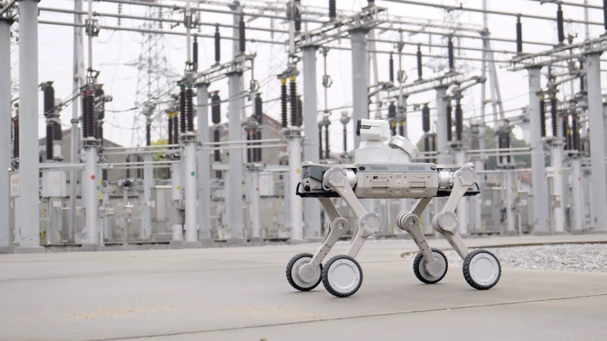
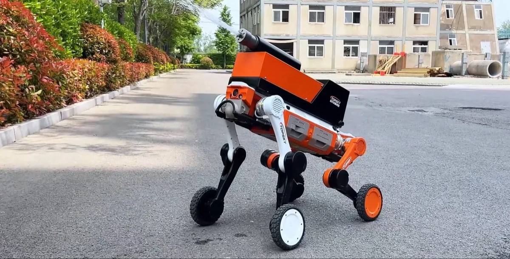
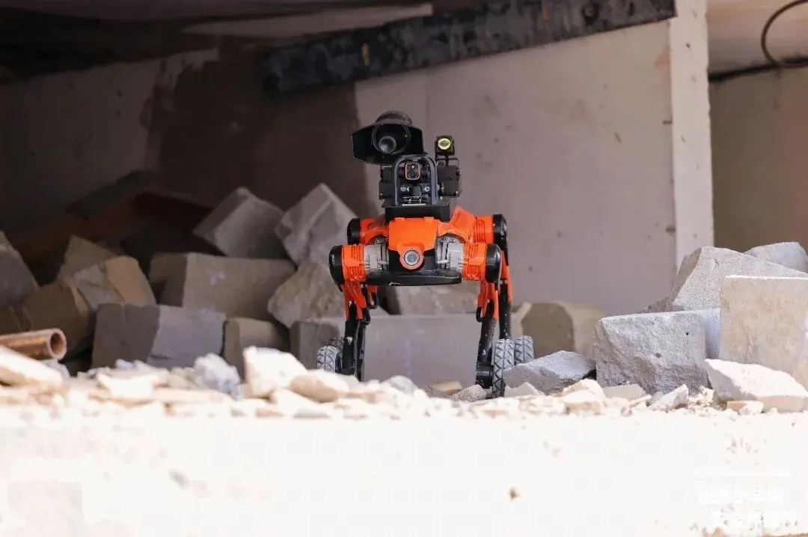
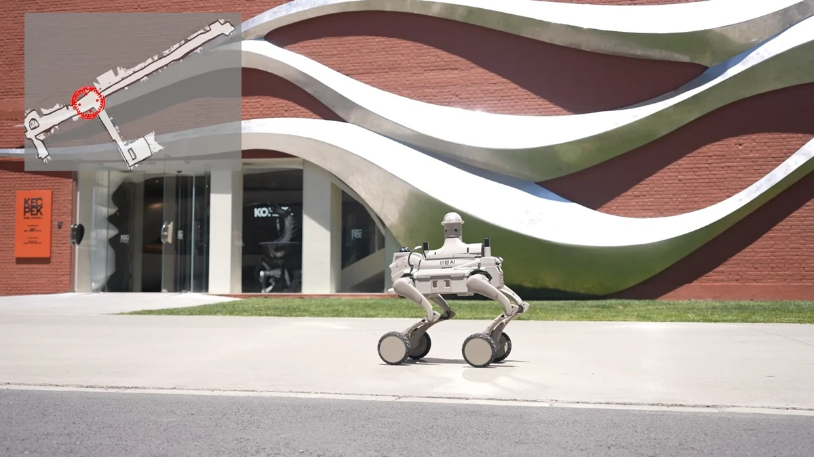
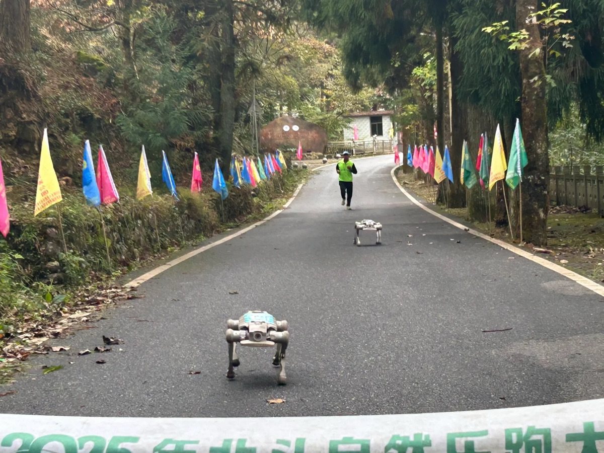
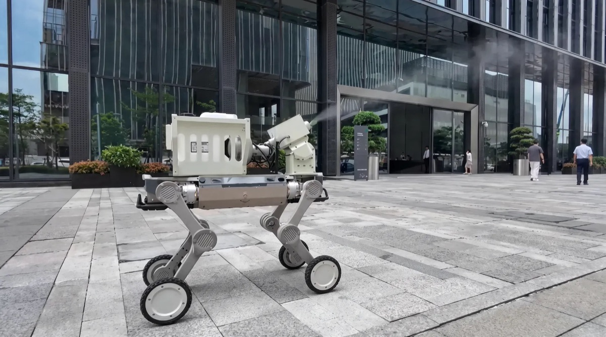
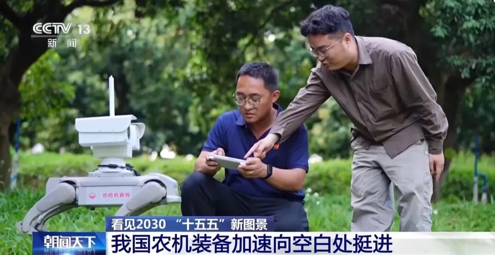
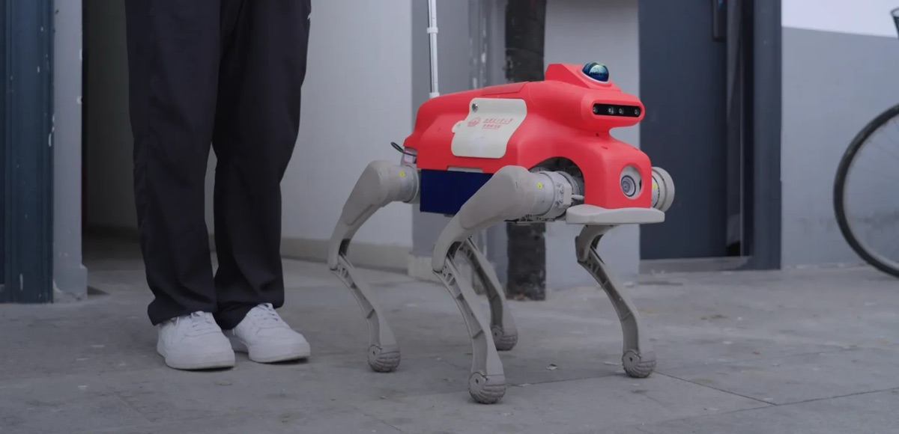
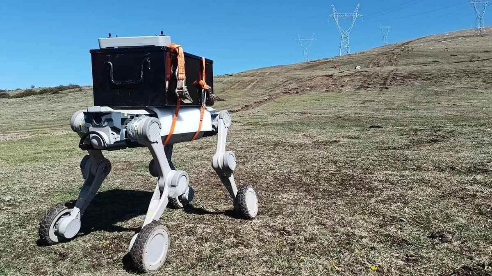

# Genisom AI — Solutions and Projects Register

⬆ [Genisom AI profile](Genisom-AI.md) · [Product portfolio](Genisom-AI-Products.md) · [Papers and research](Genisom-AI-Papers-and-Research.md) · [Roadmap and strategy](Genisom-AI-Roadmap-and-Strategy.md)

> **Coverage note:** Walked the official site in English and Chinese (genisomai.com): home, **Industry** (overview + all 5 solution pages with their "Application Cases"), **Solutions** (education and research), **Education & Research**, **About** (timeline, honours), **News** (Chinese list, all 7 pages, about 33 items from **2026-01-04 to 2026-11-09**; English list, 5 items) and sitemap.xml (stale, last modified 2026-06-12). Read **35 official WeChat articles** and 3 partner / press pages that the site links to. Chinese names used below: 智身科技 = Genisom AI, 钢镚 = L series, 铜锤 = M1, 铅球 = SP1, 银毅 = NE01, 钢哨 = P1.
> **Not accessed:** the web-search quota for this run was exhausted, so **no independent news search** was possible — everything here comes from the official site and pages it links to; third-party coverage and anything the company has not posted itself may be missing. Case links that point to Bilibili / WeChat Channels videos were not opened. The Series B WeChat article is image-only (English version used instead). The new P1 has no product page yet. GitHub API was rate-limited (repo list taken from the company profile). Most site cases are **undated and unnamed** ("a substation", "a museum in Shanghai"); they are listed as the site gives them.
> **Reading rule:** almost every "solution" is a Genisom robot plus a partner's payload and software. The company says it supplies the robot body, motion control and navigation and does not compete with partners for scenarios. Numbers are company-stated unless noted.

## Solutions catalogue — everything they offer

| # | Solution / application | What it does | Products used | Maturity | Tracks | Source link |
|---|---|---|---|---|---|---|
| 1 | Industrial inspection (umbrella) | Autonomous rounds in factories, energy and chemical sites, metallurgy and mining, utility tunnels and confined spaces: meter reading, thermal checks, anomaly alerts, auto-recharge, task dispatch to archive | M1, L2, L1 EDU + visible, thermal, gas, acoustic payloads | ✅ | T02 T03 | [site](https://www.genisomai.com/en/industry/industrial-inspection) |
| 2 | Power inspection solution (with Rongzhitong 融智通) | Covers generation, transmission, substation and distribution; five tailored scenes (substation, transmission corridor, distribution room, power plant, utility / cable tunnel); AI meter reading, infrared hot-spot diagnosis, partial-discharge and grounding-current sensing; multi-floor 3D navigation | M1 series (legged and wheel-leg), optional arm, RoamerX | ✅ (**100+** power projects) | T02 T03 | [WeChat 2026-04-27](https://mp.weixin.qq.com/s/gR2f45WH40IP2mIDzpTEew) |
| 3 | Smart energy solution (with partners) | Robot as a "mobile sensing node" in energy sites (PV plants, storage stations, wind farms, booster stations): HD camera, infrared, gas, sound, temperature / humidity, partial discharge; automatic anomaly log for audits | M1, L1 EDU navigation edition | ✅ | T03 T02 | [WeChat 2026-05-28](https://mp.weixin.qq.com/s/eElalkv_PvYnMQ6HWeIP3A) |
| 4 | Explosion-proof inspection solution | SP1 + AI middle platform + business application: equipment rounds, gas-leak detection, rule-violation and worker-safety recognition, alarms, analytics for oil, chemical, gas and LNG sites | SP1 (Ex IIC T6 Gb, IP66, **>4 h**, self-docking charge), explosion-proof joint module | 🧪 (debuted 2026-06) | T02 | [WeChat 2026-06-11](https://mp.weixin.qq.com/s/-RMJOPuiKP_Ldpyb-1_Hew) |
| 5 | Emergency response (umbrella) | Reconnaissance, life detection, hazardous-gas monitoring, comms relay and material transport in earthquakes and collapses, fires, hazmat incidents, mines and tunnels | M1, L1, L1-W + gas, life-detector, thermal, relay, firefighting payloads | ✅ | T02 | [site](https://www.genisomai.com/en/industry/emergency-response) |
| 6 | Emergency firefighting robot-dog line (with Beijing Lingtian 北京凌天) | Team covering "recon – search – disposal – assessment": heat-resistant recon dog, firefighting dog (water cannon, water-mist gun, inert-gas and pulse-jet modules), search-and-rescue dog (360° camera + thermal) | M1, L1 series + Lingtian payloads | ✅ (**20+** emergency variants; **100+** fire brigades) | T02 | [WeChat 2026-05-08](https://mp.weixin.qq.com/s/bSBSs-4q7wFSnudlbsYA1w) |
| 7 | Air-ground collaborative search and rescue ("robot dog + drone", "robot dog + off-road vehicle") | Small dog enters voids and maps them in 3D, large dog guards the perimeter with 720° view + LiDAR, drone covers upper floors and wide area | L1-W, M1, partner drones | ✅ (drills) | T02 | [WeChat 2026-05-14](https://mp.weixin.qq.com/s/kComeFaeB8r_72edq0Sg4Q) |
| 8 | Oil-and-gas fire response (with Dalian Huigao 大连汇高) | Recon dog with dual-spectrum gimbal + gas detector, firefighting dog with remotely operated high-pressure water cannon | M1 | ✅ (drill) | T02 | [WeChat 2025-12-18](https://mp.weixin.qq.com/s/Tt6m4U76A8Q1ZasPREQ4xg) |
| 9 | Disaster rehearsal and after-action review in simulation | Field data from the robots rebuilt as a high-fidelity virtual scene for mission rehearsal, incident investigation and replay | MATRiX 2.0 | 🧪 | T02 | [site](https://www.genisomai.com/en/industry/emergency-response) |
| 10 | Security patrol (umbrella) | Scheduled autonomous patrols of campuses, residential communities, public spaces and limited-access areas; live video, two-way audio, public address, anomaly records | L2, M1, L1-W, P1 | ✅ (**thousands** of units in security) | T02 T01 | [site](https://www.genisomai.com/en/industry/security-patrol) |
| 11 | P1 "Patrol Dog" (钢哨 P1; official English name not yet published) | First Genisom robot designed only for security patrol: wheel-leg body, RoamerX navigation and five built-in patrol payloads delivered as one unit, with a 3-year warranty | P1, optional charging dock | 🧪 (launched 2026-11-03; delivery date not public) | T02 T01 | [WeChat 2026-11-05](https://mp.weixin.qq.com/s/1SoQQMvEVpWVl1cpcgZ5WA) |
| 12 | L2 mobile-security robot for smart campus, smart community and property management (with Yingdun 盈盾 "Xiaogu AI" workflow platform) | Patrol with thermal imager, microphone and loudspeaker; partner platform plans tasks, assigns them and tracks work orders | L2 | ✅ | T01 T02 | [WeChat 2026-07-03](https://mp.weixin.qq.com/s/ajGH7Ow3t06tJEQovRjRWA) |
| 13 | Multi-machine security network (partner solution) | Robot dog as mobile node combined with patrol drones and fixed CCTV; six uses: area monitoring, patrol, public order, community security, escort, emergency | L and M series | ✅ | T02 | [WeChat 2026-07-19](https://mp.weixin.qq.com/s/WJPqz7-AoHwgXJ3g1Src8w) |
| 14 | Safe-campus air-ground patrol (with Tiantu 天途) | "Drone + robot dog" indoor / outdoor campus patrol with anomaly alerts | L1, M1 | 🧪 (shown 2026-05) | T02 | [WeChat 2026-05-25](https://mp.weixin.qq.com/s/15bOd3RR4sQMTfynjSteTg) |
| 15 | Bomb-disposal (EOD) payload robot dog | Industry build displayed at WRC 2026; no details published | not stated | 🧪 ⚠️ unverified details | T02 | [WeChat 2026-08-23](https://mp.weixin.qq.com/s/e_RY3t347rIPhdoHAylCxA) |
| 16 | Robotics entertainment (umbrella) | Robot battles, parkour, parade runs, performances for science centres, theme parks, malls and school events; configurable routes and motion sequences | L1 + battle, sound, light payloads | ✅ | T01 | [site](https://www.genisomai.com/en/industry/robotics-entertainment) |
| 17 | Commercial robot-dog parkour arena and "钢镚大冲关" family attraction | Visitors steer an L1 by gamepad on a custom course; racing, scoring and versus modes | L1 | ✅ | T01 | [WeChat 2025-12-23](https://mp.weixin.qq.com/s/TPD2MSNDYWPKyiGiP3J3CA) |
| 18 | Event service robot (marathon pacer) | Follows a person autonomously at fixed pace for hours; company lists course patrol, sweep support and medical assistance as next roles | M1 Pro (UWB + LiDAR / vision following) | 🧪 (one event) | T01 | [WeChat 2026-04-19](https://mp.weixin.qq.com/s/lV_dL0J1WDadsdFYbom4Rw) |
| 19 | Mining inspection and mine surveying | Remote inspection, environment monitoring and mapping in mines | M1 | ✅ (case listed) | T02 | [site](https://www.genisomai.com/en/industry/emerging-applications) |
| 20 | Water utilities inspection | Remote rounds and anomaly reporting in water plants, pump stations and utility tunnels | L2, M1 | 🧪 ⚠️ no case published | T02 T03 | [site](https://www.genisomai.com/en/industry/emerging-applications) |
| 21 | Public health and disinfection (with Qihang 奇航) | Route-based or fixed-point spraying with remote status view | M1 wheel-leg + spray payload | ✅ (partner product) | T01 | [site](https://www.genisomai.com/en/industry/emerging-applications) |
| 22 | Agriculture: orchard, farm and greenhouse inspection | Patrol, environment monitoring, data collection and light-duty work; orchard build adds soil-nutrient, pest and growth modules | L series | 🧪 (under test) | T03 | [site](https://www.genisomai.com/en/industry/emerging-applications) |
| 23 | Grain depot patrol and inspection | Patrol rounds in grain storage | not stated | ✅ (case listed) ⚠️ no details | T02 T03 | [site](https://www.genisomai.com/en/industry/emerging-applications) |
| 24 | Accessibility: robotic guide dog | Voice-commanded guidance for visually impaired people, obstacle and stair awareness | L1 (partner builds) | 🧪 (pilots) | T04 T01 | [site](https://www.genisomai.com/en/industry/emerging-applications) |
| 25 | Plateau and mountain short-haul logistics | Carries supplies on high-altitude or stair routes, autonomously | M1 (legged and wheel-leg) | 🧪 | T01 T02 | [WeChat 2026-11-03](https://mp.weixin.qq.com/s/MyjCnuwpuuWazKJnC_uvXA) |
| 26 | Other listed scenarios: forestry and grassland, railway, production-line, tunnel and gas-pipeline inspection | Named as application areas, no solution pages | M1 | ⚠️ unverified details | T02 T03 | [WeChat 2026-08-23](https://mp.weixin.qq.com/s/e_RY3t347rIPhdoHAylCxA) |
| 27 | Education and research solutions (Research, Higher Education, Vocational, K-12) | Robots + courses + training platforms + competitions and certification | L1 Maker, L1 EDU Navigation Kit, L1 EDU DESK, M1, MATRiX | ✅ | — | [site](https://www.genisomai.com/en/solutions) |
| 28 | Embodied-AI training bench (L1 EDU DESK) | Classroom bench: SDK motion control, ROS 2 mapping and navigation, MATRiX validation, disassembly practice | L1 EDU DESK | ✅ | — | [WeChat 2026-05-25](https://mp.weixin.qq.com/s/15bOd3RR4sQMTfynjSteTg) |
| 29 | Joint curricula and industry colleges with universities | Co-developed courses (robot dog + arm, navigation), "embodied intelligence industry college" | L1 EDU, M1 | ✅ | — | [WeChat 2026-09-14](https://mp.weixin.qq.com/s/xK2067Nd3H_lu-t6P9XLBw) |
| 30 | Genisom EAI Academy | Portal for courses, simulation, tools and competitions | — | 🧪 (no public link) | — | [site](https://www.genisomai.com/en/education-research) |
| 31 | Genisom AI Gravity program | Access to robots, projects and resources for researchers, developers and partners | — | 🧪 (application form) | — | [site](https://www.genisomai.com/en/education-research) |
| 32 | RoamerX navigation | Open-area, preset road-network and 3D navigation modes; mapping, obstacle avoidance, auto-recharge | L2, M1, P1; open Lite version | ✅ | T01 T02 | [WeChat 2026-11-05](https://mp.weixin.qq.com/s/1SoQQMvEVpWVl1cpcgZ5WA) |
| 33 | ZSD "Genisom Drive" / GSD "Genisom Self-Driving" | Data-driven end-to-end navigation model meant to replace map-then-waypoint SLAM | — | 🧪 | T01 T02 | [WeChat 2026-08-23](https://mp.weixin.qq.com/s/e_RY3t347rIPhdoHAylCxA) |
| 34 | PITA (Physics InTeraction AI) and "Multi-Legged Collaborative Transport" | Several robots carry one object through an unmapped area; operator sets the goal in VR | L1-W EDU | 🧪 (debut 2026-09) | T02 T01 | [WeChat 2026-09-19](https://mp.weixin.qq.com/s/hvxHUHl72obO9cvIJaCJag) |
| 35 | SomaMind agent system | Task understanding to skill execution | — | 🧪 | — | [WeChat 2026-07-15](https://mp.weixin.qq.com/s/osC9U1fNXSBDqJsiFqRbLQ) |
| 36 | MATRiX 2.0 simulation platform | Open-source MuJoCo + Unreal Engine 5 simulator; 1:1 digital twins of sites for training and rehearsal | — | ✅ | T02 | [WeChat 2026-07-14](https://mp.weixin.qq.com/s/GXo0ZkCv_MP2x8t_RtexoA) |
| 37 | Mobile manipulation: M1 + TA01 arm | Arm tip stays stable while the dog moves; vision-language-action demo | M1, TA01 | 🧪 (demo) | T01 T04 (potential only) | [WeChat 2026-08-23](https://mp.weixin.qq.com/s/e_RY3t347rIPhdoHAylCxA) |
| 38 | Perception-in-the-loop locomotion | Wheel-leg robot sees and climbs open-riser stairs | L2 | 🧪 | — | [WeChat 2026-08-23](https://mp.weixin.qq.com/s/e_RY3t347rIPhdoHAylCxA) |
| 39 | Open-source research code | Vision-language navigation baseline (`genisom_vln`), lightweight world model (`gawm`) | MATRiX | ✅ | T01 | [GitHub](https://github.com/zsibot/) |
| 40 | Component supply and partner enablement | CHAMP joint modules sold to others; "customisation + production + solution + technology sharing" for integrators and own-brand partners | CHAMP joints, wheel-hub motors | ✅ | — | [WeChat 2026-07-15](https://mp.weixin.qq.com/s/osC9U1fNXSBDqJsiFqRbLQ) |
| 41 | Three-year whole-machine warranty and service network | 3-tier service sites, 4-hour on-site response in main cities, 24/7 remote diagnosis (China) | P1 | 🧪 (announced 2026-11-03) | — | [WeChat 2026-11-05](https://mp.weixin.qq.com/s/YCdai1P5xamSswPVSd26iQ) |
| 42 | NE01 humanoid platform | 133 cm, about 37 kg, 180 N·m peak joint torque, layered SDK; shown as performer and mountain racer, no application yet | NE01 | 🧪 | — | [WeChat 2026-11-03](https://mp.weixin.qq.com/s/MyjCnuwpuuWazKJnC_uvXA) |

### Industrial inspection (umbrella)
- Robot walks a planned route over stairs, thresholds and narrow passages, reads gauges, measures temperature, reports anomalies and returns to charge.
- Sensor options: visible light, thermal, gas, acoustic; navigation uses 2D / 3D LiDAR plus vision.
- Listed cases: a substation, a Zhejiang electrolysis plant and liquid-chlorine tank area, a State Grid research-institute pilot platform, a Guangxi wind farm, a Henan converter station, Jiuquan Satellite Launch Center.
- [Industrial Inspection Solutions](https://www.genisomai.com/en/industry/industrial-inspection)

### Power inspection solution (with Rongzhitong)

- Built around M1 with LiDAR, front stereo, 720° fisheye and ultrasonic sensing; payloads for visible light, infrared, grounding current and partial discharge.
- M1 series is on duty at an **800 kV AC substation** (unnamed): pebble ground, raised platforms, cross-floor stairs; self-following and auto-recharge for round-the-clock rounds.
- Company claims **100+ delivered power projects** (substations of all levels, storage stations, PV stations, plant booster stations, railway substations) and a role in drafting the industry standard for power-inspection quadrupeds.
- [Company article, 2026-04-27](https://mp.weixin.qq.com/s/gR2f45WH40IP2mIDzpTEew)

### Smart energy solution (with partners)

- Targets energy sites where fixed sensors leave gaps: PV plants, wind farms, storage and booster stations.
- Company-stated effect: inspection efficiency **5–6×**, anomaly detection **+60%**, cost per round **−68%**.
- Stated direction: from inspection only to "inspect and operate", platform integration and service at scale.
- [Company article, 2026-05-28](https://mp.weixin.qq.com/s/eElalkv_PvYnMQ6HWeIP3A)

### Explosion-proof inspection solution
- SP1 is a wheel-leg robot for Zone 1 / Zone 2 gas areas: LiDAR, explosion-proof gimbal, HD camera, gas detection, broadcast intercom.
- Tasks: pump, heat-exchanger and tower monitoring, tank wall temperature, level and valve checks, leak detection; in accidents also life detection and transport.
- Partner software adds violation and worker-safety recognition and alarms.
- [Company article, 2026-06-11](https://mp.weixin.qq.com/s/-RMJOPuiKP_Ldpyb-1_Hew)

### Emergency response (umbrella)
- Robot goes in first and sends back video, gas readings and maps so rescuers decide before entering.
- Payload list on the site: multispectral life detection, hazardous-gas monitoring, two-way audio, communication relay, firefighting modules.
- Multi-robot operation and MATRiX rehearsal are named as differentiators.
- [Emergency Response Solutions](https://www.genisomai.com/en/industry/emergency-response)

### Emergency firefighting robot-dog line (with Beijing Lingtian)

- Genisom is Lingtian's "joint promotion partner" for putting firefighting quadrupeds into service equipment (announced 2026-05-07, Shanghai).
- Variants (from the Shenzhen drill): recon dog rated for **200 °C** surroundings, firefighting dog with water cannon reaching **80 m**, IP67 search dog with 360° camera and thermal imager.
- Company-stated reach: **20+** emergency robot variants, used by **100+** fire brigades in Beijing, Tianjin, Gansu, Zhejiang, Shanghai, Jiangsu, Shandong, Hebei.
- [Company article, 2026-05-08](https://mp.weixin.qq.com/s/bSBSs-4q7wFSnudlbsYA1w)

### Air-ground collaborative search and rescue

- Earthquake drill pattern: L1-W crawls into a second-floor void, checks gas and builds a local 3D map (Gaussian-splatting reconstruction); M1 outside scans the structure with 720° view + LiDAR for collapse risk; drone covers the third floor.
- Workflow shown: "robot scouts first, rescue dogs supplement, people do the precise work".
- Also offered with an off-road vehicle as carrier.
- [Company article, 2026-05-14](https://mp.weixin.qq.com/s/kComeFaeB8r_72edq0Sg4Q)

### Oil-and-gas fire response (with Dalian Huigao)
- Scenario: full-surface tank fire and hazmat leak.
- Recon dog locates hidden fire points and reads gas concentration; firefighting dog sprays under remote control, IP67, works at −20 °C.
- [Company article, 2025-12-18](https://mp.weixin.qq.com/s/Tt6m4U76A8Q1ZasPREQ4xg)

### Disaster rehearsal and after-action review in simulation
- Scene data collected by the robots is rebuilt in MATRiX for investigation and full replay of the operation.
- Same method used before the Yizhuang challenge: course rebuilt 1:1, strategy trained in simulation.
- [Emergency Response Solutions](https://www.genisomai.com/en/industry/emergency-response)

### Security patrol (umbrella)

- Routes and checkpoints are configured per site; robot streams video and anomaly data to the control room; optional night lighting, recognition module, loudspeaker.
- Company says **thousands** of its quadrupeds work in residential communities, shopping districts, industrial parks and scenic coastlines.
- Ten cases listed: historic town and OPC industrial park (Suzhou), police patrol (Chengdu, Suzhou Wuzhong), urban park (Chongqing), museum (Shanghai), 798 Art District (Beijing), two campuses (Hangzhou), China Mobile campus (Changzhou).
- [Security Patrol Solutions](https://www.genisomai.com/en/industry/security-patrol)

### P1 "Patrol Dog"
- Wheels on flat ground, legs on stairs and thresholds; **IP66**, **−20 to 55 °C**; visible + infrared thermal cameras.
- Five integrated payloads: thermal imaging, remote loudspeaker, strobe warning, one-key call, temperature / humidity sensing.
- Runs scheduled patrols, returns to an optional charging dock for 24/7 duty; open interfaces to the customer's systems and own AI models.
- Launched at Security China 2026 (Beijing) with a **3-year whole-machine warranty**. [Company article](https://mp.weixin.qq.com/s/1SoQQMvEVpWVl1cpcgZ5WA)

### L2 mobile-security robot for campus, community and property management
- L2 carries thermal imager, microphone and loudspeaker; **5.5 h / 20 km** covers a full shift; GLUE following (UWB + vision) lets it accompany a guard.
- Yingdun's Xiaogu AI platform supplies task planning, assignment and work-order tracking for property management and city services.
- Positioned at WRC 2026 as the "smart patrol robot" for smart campus, smart community and light inspection.
- [Company article, 2026-07-03](https://mp.weixin.qq.com/s/ajGH7Ow3t06tJEQovRjRWA)

### Multi-machine security network (partner solution)
- Robot dog, patrol drone and fixed cameras work as one layered system; payloads swap for indoor or outdoor duty.
- Aimed at police and community security: more visible presence, evidence capture, fewer repetitive shifts.
- [Company article, 2026-07-19](https://mp.weixin.qq.com/s/WJPqz7-AoHwgXJ3g1Src8w)

### Safe-campus air-ground patrol (with Tiantu)
- Drone + robot dog cover large campuses and blind spots indoors and outdoors.
- Shown at the 64th China Higher Education Expo; described as ready for campus deployment, no named site.
- [Company article, 2026-05-25](https://mp.weixin.qq.com/s/15bOd3RR4sQMTfynjSteTg)

### Bomb-disposal (EOD) payload robot dog
- Appeared in the "industry application" display at WRC 2026 next to disinfection, power, security, guide and explosion-proof builds.
- No specification or customer published. ⚠️ unverified
- [Company article, 2026-08-23](https://mp.weixin.qq.com/s/e_RY3t347rIPhdoHAylCxA)

### Robotics entertainment (umbrella)

- Turns the robot into an attraction: battles, parkour, parade runs, performances; routes, motion sequences and interaction flows are configurable for one or many robots.
- Listed cases: cultural-tourism fun run (Wuyishan), parkour (Suzhou Bay), robot battle "squad" at a Guangzhou aquarium.
- [Robotics Entertainment Solutions](https://www.genisomai.com/en/industry/robotics-entertainment)

### Commercial robot-dog parkour arena
- Visitors, including children, drive an L1 with a gamepad over ramps and obstacles; single, versus and team modes with automatic scoring.
- First sites announced: Century Golden Resources mall B1 (Beijing) and Gelin Park west, Suzhou Bay.
- "钢镚大冲关" family version is said to run in several shopping districts in China.
- [Company article, 2025-12-23](https://mp.weixin.qq.com/s/TPD2MSNDYWPKyiGiP3J3CA)

### Event service robot (marathon pacer)
- M1 Pro followed a runner for **21 km in about 3 h 10 min** with no remote control and no battery swap; pace target ±5 s per km.
- Uses UWB tag following plus LiDAR / vision obstacle avoidance in crowds.
- Future roles named by the company: course patrol, accompanying exhausted runners, linking with medical teams, city inspection.
- [Company article, 2026-04-19](https://mp.weixin.qq.com/s/lV_dL0J1WDadsdFYbom4Rw)

### Mining inspection and mine surveying
- Site lists a "smart mine" case; the Chinese page describes it as mine surveying for a natural-resources customer (unnamed).
- [Emerging Application Solutions](https://www.genisomai.com/en/industry/emerging-applications)

### Water utilities inspection
- Offered for water plants, pump stations and utility tunnels; no case or customer published. ⚠️ unverified deployment
- [Emerging Application Solutions](https://www.genisomai.com/en/industry/emerging-applications)

### Public health and disinfection (with Qihang)

- Wheel-leg dog with a spray unit works a fixed route or point; operators see task and status remotely.
- Partner Qihang Information Technology added the robot to its work-order software in April 2026 (work orders received automatically by mini-program, per the article title).
- [Emerging Application Solutions](https://www.genisomai.com/en/industry/emerging-applications)

### Agriculture: orchard, farm and greenhouse inspection

- Lychee-orchard patrol dog in Zengcheng (Guangzhou): soil-nutrient test, pest and disease recognition, growth monitoring, automatic report; works with spraying drones.
- Shown on national TV news on 2026-04-02 as "under test"; the local report does not name the robot maker — Genisom lists it as its case.
- [Emerging Application Solutions](https://www.genisomai.com/en/industry/emerging-applications)

### Grain depot patrol and inspection
- One unnamed grain-depot case on the site; no technical detail. ⚠️ unverified details
- [Emerging Application Solutions](https://www.genisomai.com/en/industry/emerging-applications)

### Accessibility: robotic guide dog

- "Xiao Su" guide dog led by the Harbin Institute of Technology Suzhou research institute, built on the **L1** and its open interfaces.
- Mianyang (Sichuan): permanent trial point with **2** "Qiming-Q2" guide robot dogs in a shopping street; user says a destination, robot plans the route and guides by voice. Built by two local firms; Genisom lists it as its case, the news report does not name Genisom.
- Stage: research and public trials, not a certified assistive device.
- [Emerging Application Solutions](https://www.genisomai.com/en/industry/emerging-applications)

### Plateau and mountain short-haul logistics

- Tibet: M1 carries loads on high-altitude routes (site case, no numbers).
- Mount Tai, 2026-11-02: M1 wheel-leg carried eggs, melon and water, then rescue kit and medicine box, up **3,100+ steps / about 600 m climb** with full autonomous navigation.
- Company names the follow-on jobs: mountain supply, scenic-area resupply, forward delivery for forest-fire crews, loaded substation rounds.
- [Company article, 2026-11-03](https://mp.weixin.qq.com/s/MyjCnuwpuuWazKJnC_uvXA)

### Other listed scenarios (forestry, railway, production line, tunnels, gas pipelines)
- Named in company articles as areas where M1 is being validated; no solution page, partner or customer given. ⚠️ unverified
- [Company article, 2026-07-15](https://mp.weixin.qq.com/s/osC9U1fNXSBDqJsiFqRbLQ)

### RoamerX navigation
- Three modes on P1: free navigation in open areas, preset road network, 3D (multi-floor) navigation.
- On M1 it is described as an end-to-end model: LiDAR terrain recognition directly to motion commands, automatic mode switching.
- Open "Lite" version on GitHub (ROS 2 Humble / Nav2).
- [Company article, 2026-11-05](https://mp.weixin.qq.com/s/1SoQQMvEVpWVl1cpcgZ5WA)

### ZSD / GSD end-to-end navigation
- Chinese name ZSD (智身 Drive), English name GSD (Genisom Self-Driving): learns from field data so a new site needs no map-and-waypoint setup.
- Training data loop is said to come from **300+** partner sites. No release or SDK.
- [Company article, 2026-08-23](https://mp.weixin.qq.com/s/e_RY3t347rIPhdoHAylCxA)

### PITA and Multi-Legged Collaborative Transport
- Several L1-W EDU robots share a map built on the fly, carry one load together and change formation around people, low obstacles and stairs.
- Operator stays in a safe zone with a VR headset showing the live point cloud and only sets the goal point ("task-level command").
- Intended uses: carrying breaking tools or a stretcher in rubble, moving hazardous items in chemical or radiation areas, long or heavy parts in plants and the field.
- PITA also names a general robot model, a differentiable physics engine, a video world model and a compute terminal — no public release. [Company article, 2026-09-19](https://mp.weixin.qq.com/s/hvxHUHl72obO9cvIJaCJag)

### MATRiX 2.0 simulation platform
- Free and open source; pairs accurate physics with photoreal rendering, multi-robot scenes and imported real scenes.
- Useful for T02 digital-twin work: rebuild a site, test navigation and rehearse a mission before touching the robot.
- [Company article, 2026-07-14](https://mp.weixin.qq.com/s/GXo0ZkCv_MP2x8t_RtexoA)

### Mobile manipulation: M1 + TA01 arm
- WRC 2026 demo: arm end stays steady while legs and body keep moving; vision-language-action control.
- An arm-equipped M1 was also shown reading power equipment (Qingdao, April 2026) and used in the IROS 2026 challenge.
- No product page, price or SDK for the arm; treat as a demo.
- [Company article, 2026-08-23](https://mp.weixin.qq.com/s/e_RY3t347rIPhdoHAylCxA)

### Open-source research code
- `genisom_vln`: language-directed navigation baseline running in MATRiX; `gawm`: small world model. Details in [Papers and research](Genisom-AI-Papers-and-Research.md).
- [github.com/zsibot](https://github.com/zsibot/)

## Projects register — past and current

| Date | Project / deployment / pilot / partnership | Partner or customer | Location | What happened (one line) | Tracks | Source link |
|---|---|---|---|---|---|---|
| 2026-11-03 | P1 "Patrol Dog" launch + 3-year warranty | Security China 2026 expo | Beijing | First purpose-built patrol robot and first 3-year whole-machine warranty announced | T02 T01 | [WeChat](https://mp.weixin.qq.com/s/YCdai1P5xamSswPVSd26iQ) |
| 2026-11-02 | CMG World Robot Mount Tai Climbing Competition | China Media Group, Tai'an city | Mount Tai, Shandong | NE01 won both humanoid race stages (27 min 26 s and 55 min 34 s); M1 wheel-leg finished the loaded 3,100-step climb first with full autonomy; point-foot M1 finished in 50 min without battery swap | T01 T02 | [WeChat](https://mp.weixin.qq.com/s/MyjCnuwpuuWazKJnC_uvXA) |
| 2026-10-28 | Strategic cooperation agreement | Tencent Cloud | Tencent Global Digital Ecosystem Summit, China | Cloud GPU, storage and TI-ONE training platform for model training and simulation; joint solutions for security inspection and industrial maintenance | T02 | [WeChat](https://mp.weixin.qq.com/s/Zb-lfAbXgAc_MShXXPalzg) |
| 2026-10 | IROS 2026 exhibition | IEEE / RSJ | Pittsburgh, USA | L1 Maker debut, MATRiX 2.0, coordinated multi-robot demo; NTU Singapore team won the autonomous category of the legged challenge on an M1 (per company profile) | — | [PR Newswire](https://www.prnewswire.com/news-releases/genisom-ai-showcases-embodied-intelligence-and-debuts-worlds-first-industry-grade-educational-quadruped-at-iros-2026-302896049.html) |
| 2026-09-20 | Series B financing (hundreds of millions RMB) | Stone Venture (UAE, lead), Hongshan Capital, Yueke Finance, Wuzhong funds, Neusoft, Highpower, others | — | Funds for hardware, models, navigation, applications and global expansion | — | [site](https://www.genisomai.com/en/newsdetail/genisom-ai-series-b-funding-embodied-ai-robots) |
| 2026-09-19 | "Multi-Legged Collaborative Transport" debut under new PITA brand | — | — | Several L1-W EDU carry one load through an unmapped area under VR goal command | T02 T01 | [WeChat](https://mp.weixin.qq.com/s/hvxHUHl72obO9cvIJaCJag) |
| 2026-09-14 | University cooperation: courses now, joint lab planned | HKUST (Guangzhou), Prof. Xu Renjing's team | Guangzhou | Courses on robot dog + arm and navigation using L1 EDU and M1 | — | [WeChat](https://mp.weixin.qq.com/s/xK2067Nd3H_lu-t6P9XLBw) |
| 2026-09 ⚠️ date unverified | Freshman-welcome robots | Shenzhen Polytechnic University | Shenzhen | Title of a company post only; details not read | T01 | [WeChat (title listed in footer)](https://mp.weixin.qq.com/s/xK2067Nd3H_lu-t6P9XLBw) |
| 2026 ⚠️ date unverified | Joint "World Model guide from an embodied-AI view" | Shanghai Jiao Tong University | — | Title of a company post only; details not read | — | [WeChat (title listed in footer)](https://mp.weixin.qq.com/s/xK2067Nd3H_lu-t6P9XLBw) |
| 2026 ⚠️ date unverified | Skills competition: quadruped installation and commissioning event | 2026 machinery-industry advanced manufacturing skills contest | China | Event launched with Genisom platform; title only | — | [WeChat (title listed in footer)](https://mp.weixin.qq.com/s/xK2067Nd3H_lu-t6P9XLBw) |
| 2026-08-20 to 23 | World Robot Conference 2026 | — | Beijing | L2 launch event for smart campus and community; M1 + TA01 arm demo; EOD, disinfection, power, security, guide and explosion-proof builds displayed | T01 T02 | [WeChat](https://mp.weixin.qq.com/s/e_RY3t347rIPhdoHAylCxA) |
| 2026-08-13 | Strategic cooperation framework | D-Robotics (地瓜机器人) | Shenzhen | Sunrise chips and developer kits as compute for Genisom humanoid and quadruped lines; joint courses and competitions | T03 | [WeChat](https://mp.weixin.qq.com/s/D1-OJyVuJWUJ3xnQNZnvVg) |
| 2026-07 | "Mars-analog terrain exploration and sampling" field course | Peking University, School of Earth and Space Sciences | Lenghu Mars camp, Qinghai | **50** undergraduates ran L1 mapping, VR arm sampling, transport and analysis in desert terrain at 2,800 m | T02 | [WeChat](https://mp.weixin.qq.com/s/wYzgB_oHPcp1lypbdDjkyw) |
| 2026-07-17 to 20 | WAIC 2026 | — | Shanghai | L2, SP1, NE01 and MATRiX 2.0 shown together; 36Kr investor-attention award | — | [WeChat](https://mp.weixin.qq.com/s/WJPqz7-AoHwgXJ3g1Src8w) |
| 2026-07-15 to 17 | National standards week | MIIT humanoid and embodied-AI standards committee | Shaoxing, Zhejiang | Member of working groups WG1–WG6, joined new WG7 (data) | — | [WeChat](https://mp.weixin.qq.com/s/NV0Pe07wI8wu9_Y8HteuRg) |
| 2026-07-01 to 03 | L2 trade-show debut + strategic signing | Shanghai Yingdun Technology (Xiaogu AI) | China Property Management Expo, Shanghai | Ecosystem partnership and investment intent for security-patrol rollout | T01 T02 | [WeChat](https://mp.weixin.qq.com/s/ajGH7Ow3t06tJEQovRjRWA) |
| 2026-07-02 | Guide-robot-dog public trial point | Mianyang 58 Robot Technology, Chengdu Chuqian Technology | Mianyang Sci-Tech City New Area, Sichuan | 2 "Qiming-Q2" guide robot dogs open for daily trials by visually impaired users (Genisom-listed case) | T04 T01 | [Sichuan News Radio](https://mp.weixin.qq.com/s/Ny4LGIFmy-7BOOIQTmnsvQ) |
| 2026-06-29 | L2 product launch | — | — | New small industrial quadruped announced | — | [WeChat](https://mp.weixin.qq.com/s/SX2f5gbf7mjJGtPLRA1hxA) |
| 2026-06-23 | Production-safety emergency drill | Sichuan Gas Group | Meishan Tianfu New Area, Sichuan | Explosion-proof detection robot dog and drone surveyed a simulated pipeline leak (Genisom-listed case; operator's report does not name the maker) | T02 | [Sichuan Gas Group](https://www.scrqw.com/news/company-news/479.html) |
| 2026-06-11 | SP1 world debut | CTEF 2026 chemical-equipment expo | Shanghai | SP1, explosion-proof joint module and explosion-proof inspection solution shown | T02 | [WeChat](https://mp.weixin.qq.com/s/-RMJOPuiKP_Ldpyb-1_Hew) |
| 2026-06-09 | Gui'an factory opening | Gui'an Optics Valley computing park | Gui'an, Guizhou | About 3,600 m² joint-module plant; company now has 3 bases and 4 factories (Suzhou, Xiamen, Gui'an) | — | [WeChat](https://mp.weixin.qq.com/s/_WzpV7eMaizCeNO0dZrYaw) |
| 2026-06 | ICRA 2026, first international show | — | Vienna, Austria | Full stack shown: joints, robots, developer tools, applications | — | [WeChat](https://mp.weixin.qq.com/s/5EqfQMnZg52ypq3kxvUx0g) |
| 2026-06-02 | Strategic agreement on embodied-AI security | Qi-Anxin (奇安信) | BCS 2026, Beijing | Joint work on security baseline, hardware encryption chips, vulnerability sharing | — | [WeChat](https://mp.weixin.qq.com/s/qfDbB9PqjlhI5QqJrtxMXw) |
| 2026-05-28 | 10,000th robot produced | — | — | Reached in 10 months of mass production; monthly output value above 100 million RMB | — | [WeChat](https://mp.weixin.qq.com/s/An_RcGR7D72KM8XyAmgJIg) |
| 2026-05-27 | Smart energy solution shown | 2026 Smart Energy Technology Forum | Beijing | M1 and L1 EDU with partner energy solution | T03 T02 | [WeChat](https://mp.weixin.qq.com/s/eElalkv_PvYnMQ6HWeIP3A) |
| 2026-05-24 | 64th China Higher Education Expo | Tiantu (drone partner) | Nanchang, Jiangxi | Education solution, training bench, safe-campus drone + dog patrol | T02 | [WeChat](https://mp.weixin.qq.com/s/15bOd3RR4sQMTfynjSteTg) |
| 2026-05-15 | Fire-rescue event of the Hangzhou international embodied-robot application competition (hosted by Genisom) | — | Yunqi Town, Hangzhou | Announced in advance; result ⚠️ unverified | T02 | [WeChat](https://mp.weixin.qq.com/s/kComeFaeB8r_72edq0Sg4Q) |
| 2026-05-12 | Air-ground earthquake search-and-rescue drill | Beijing Lingtian; National Earthquake Emergency Rescue Training Base | Beijing | L1-W in rubble void, M1 on perimeter, drone above; covered by national TV news; base stated intent to cooperate further | T02 | [WeChat](https://mp.weixin.qq.com/s/kComeFaeB8r_72edq0Sg4Q) |
| 2026-05-07 | Joint emergency-firefighting solution release | Beijing Lingtian | Yangtze River Delta emergency expo, Shanghai | Genisom named Lingtian's joint promotion partner for firefighting robots | T02 | [WeChat](https://mp.weixin.qq.com/s/bSBSs-4q7wFSnudlbsYA1w) |
| 2026-04 | Disinfection robot added to partner's work-order software | Qihang Information Technology | — | Partner's April release connects the robot scenario (Genisom-listed case) | T01 | [Qihang (WeChat)](https://mp.weixin.qq.com/s/xhNhwBVTau0lt-RV8en24A) |
| 2026-04-24 | Power inspection solution shown; 800 kV substation duty reported | Rongzhitong | Air-space-ground inspection conference, Qingdao | M1 with arm and power sensors; M1 series working at an 800 kV AC substation | T02 T03 | [WeChat](https://mp.weixin.qq.com/s/gR2f45WH40IP2mIDzpTEew) |
| 2026-04-19 | Half-marathon pacer and humanoid finisher | Beijing Yizhuang robot half marathon | Beijing | M1 Pro paced 21 km by autonomous following; "破风者 RX" humanoid (built in 2 months) finished with no fall or swap | T01 | [WeChat](https://mp.weixin.qq.com/s/lV_dL0J1WDadsdFYbom4Rw) |
| 2026-04-18 | Robot Warrior Challenge | Beijing Yizhuang | Beijing | M1 took six awards, first in quadruped autonomous navigation on a disaster-rescue course (water crossing, pipe traverse) | T02 | [WeChat](https://mp.weixin.qq.com/s/2AANr6QPhuGr8zFwpfU6Xg) |
| 2026-04-02 | Lychee-orchard patrol robot dog on national TV news | Zengcheng district researchers | Guangzhou, Guangdong | Soil, pest and growth monitoring dog under test with spraying drones (Genisom-listed case) | T03 | [Zengcheng media centre](https://mp.weixin.qq.com/s/XF2VAdK7wiOSTih8DMpjQg) |
| 2026-03-25 | Global Channel Ecosystem Conference | Seres Group, Lenovo (Shanghai), AgiBot and 16 others | Sanya, Hainan | 19 partners signed, total **800 million RMB** (industrial 400 M, sector 300 M, distributors 100 M) | — | [site](https://www.genisomai.com/newsdetail/128.html) |
| 2026-03-13 | AWE 2026 | — | Shanghai | L1 won the AWE (Appliance & Electronics World Expo) product innovation award | — | [WeChat](https://mp.weixin.qq.com/s/I-ed6rwdoY93GxEoQj-iWg) |
| 2026-02-28 | National humanoid / embodied-AI standards annual meeting | MIIT standards committee | Beijing | Took part in building the first national standards system | — | [WeChat](https://mp.weixin.qq.com/s/31zwoIBC-FGQIT0r1WLhHA) |
| 2026-01-04 | Consecutive funding rounds (hundreds of millions RMB) | AgiBot, Gui'an Kunpeng Fund, Golden Horse, Keli, Highpower | — | Money for mass production, new products, channels, supply chain | — | [WeChat](https://mp.weixin.qq.com/s/Tfi6bAtDeak9gG2my4LZ7g) |
| 2025-12 | 5,000th robot delivered | — | — | Milestone at end of December 2025 | — | [WeChat](https://mp.weixin.qq.com/s/Tfi6bAtDeak9gG2my4LZ7g) |
| 2025-12-23 | First commercial robot-dog parkour arenas | Century Golden Resources mall; Suzhou Bay Gelin Park | Beijing; Suzhou | Public pay-to-play courses with L1 | T01 | [WeChat](https://mp.weixin.qq.com/s/TPD2MSNDYWPKyiGiP3J3CA) |
| 2025-12 | Oil-tank fire and hazmat drill | Daqing Oilfield fire brigade; Dalian Huigao | National hazardous-chemicals rescue training base, Daqing | Fire-point detection, gas survey and firefighting by robot dogs | T02 | [WeChat](https://mp.weixin.qq.com/s/Tt6m4U76A8Q1ZasPREQ4xg) |
| 2025-12 | Shenzhen 2025 forest-fire emergency drill | Shenzhen forest fire command; Hunan Kulisi (库里斯) | Shenzhen | Recon, firefighting and search dogs with drones through the full drill | T02 | [WeChat](https://mp.weixin.qq.com/s/p6-uCiBgwjy9Uug5f5uu-g) |
| 2025-10 / 11 | Power inspection during the Shenzhou-21 launch | Jiuquan Satellite Launch Center | Gansu / Inner Mongolia | Robot dog did unmanned power rounds at the launch site | T02 | [WeChat](https://mp.weixin.qq.com/s/Tfi6bAtDeak9gG2my4LZ7g) |
| 2025-10 | IROS 2025 quadruped challenge | University of Manchester team | Hangzhou | Winning team used an L1 | — | [WeChat](https://mp.weixin.qq.com/s/Tfi6bAtDeak9gG2my4LZ7g) |
| 2025-09 | CHAMP joint series released | — | — | Integrated joint modules launched | — | [site](https://www.genisomai.com/aboutus.html) |
| 2025-06 | L1 mass production | — | Suzhou | Volume production started | — | [site](https://www.genisomai.com/aboutus.html) |
| 2024-10 | L1 launched | — | — | First small industrial quadruped | — | [site](https://www.genisomai.com/aboutus.html) |
| 2023-12 | Company founded | — | Beijing / Suzhou | — | — | [site](https://www.genisomai.com/aboutus.html) |
| undated (on site 2026-09) | Substation inspection | unnamed | China | Power inspection case | T02 T03 | [site](https://www.genisomai.com/en/industry/industrial-inspection) |
| undated | Converter station inspection | unnamed | Henan | Smart power inspection case (video) | T02 T03 | [site](https://www.genisomai.com/en/industry/industrial-inspection) |
| undated | Wind farm inspection | unnamed | Guangxi | Wind-power inspection project | T03 T02 | [site](https://www.genisomai.com/en/industry/industrial-inspection) |
| undated | Pilot testing platform | a State Grid electric power research institute (unnamed) | China | Robot used on a pilot-test platform | T02 | [site](https://www.genisomai.com/en/industry/industrial-inspection) |
| undated | Plant operator rounds | unnamed | Zhejiang | Electrolysis plant and liquid-chlorine tank area | T02 | [site](https://www.genisomai.com/en/industry/industrial-inspection) |
| undated | Flood-control emergency drill | State Grid Northeast region | Northeast China | Robot dog in flood drill | T02 | [site](https://www.genisomai.com/en/industry/emergency-response) |
| undated | Multifunction firefighting quadruped, joint application | French firm POK (robot "Rex"); tested with Aube fire service per TF1 | France | Hose-carrying firefighting robot dog prototype; TF1 does not name Genisom, the Genisom site lists it as its case | T02 | [TF1 Info](https://www.tf1info.fr/high-tech/ils-seront-interessants-en-complement-des-equipes-humaines-voici-a-quoi-va-ressembler-les-futurs-outils-contre-les-incendies-2457306.html) |
| undated | Security patrol: historic-town scenic area; OPC industrial park | unnamed; OPC Industrial Park | Suzhou | Patrol projects | T02 T01 | [site](https://www.genisomai.com/en/industry/security-patrol) |
| undated | Police patrol | local police | Chengdu; Suzhou Wuzhong | Police-use patrol projects | T02 | [site](https://www.genisomai.com/en/industry/security-patrol) |
| undated | Security patrol: urban park; museum; 798 Art District | unnamed | Chongqing; Shanghai; Beijing | Public-space patrol projects | T02 T01 | [site](https://www.genisomai.com/en/industry/security-patrol) |
| undated | Campus patrol (two projects); China Mobile campus security | unnamed; China Mobile Changzhou | Hangzhou; Changzhou | Campus patrol and inspection | T02 | [site](https://www.genisomai.com/en/industry/security-patrol) |
| undated | Cultural-tourism fun run; robot battle at an aquarium | unnamed | Wuyishan; Guangzhou | Robots run with participants; visitor battle game | T01 | [site](https://www.genisomai.com/en/industry/robotics-entertainment) |
| undated | Guide dog "Xiao Su" | HIT Suzhou research institute | Suzhou | Guide robot on L1, shown at WAIC and WRC 2026 | T04 | [site](https://www.genisomai.com/en/industry/emerging-applications) |
| undated | Grain depot patrol; mine surveying; plateau short-haul transport | unnamed | China; Tibet | Three cases without details | T02 T03 T01 | [site](https://www.genisomai.com/en/industry/emerging-applications) |
| undated | STEM study camp | Greater Bay Area "Blue Bay Future" camp | Guangzhou | K-12 robotics camp | — | [site](https://www.genisomai.com/en/solutions) |

## Future projects and announced plans

| Announced | Planned for | What | Confidence (official / reported / inferred) | Tracks | Source link |
|---|---|---|---|---|---|
| 2026-11-03 | not stated | P1 "Patrol Dog" deliveries and the 3-year whole-machine warranty | official | T02 T01 | [WeChat](https://mp.weixin.qq.com/s/YCdai1P5xamSswPVSd26iQ) |
| 2026-11-03 | not stated | Mountain supply, scenic-area resupply, forward delivery for forest-fire crews, loaded substation rounds with M1 wheel-leg | official (intent) | T01 T02 | [WeChat](https://mp.weixin.qq.com/s/MyjCnuwpuuWazKJnC_uvXA) |
| 2026-10-28 | not stated | With Tencent Cloud: standardised solutions for security inspection and industrial maintenance, demonstration projects with key customers | official | T02 | [WeChat](https://mp.weixin.qq.com/s/Zb-lfAbXgAc_MShXXPalzg) |
| 2026-09-20 | after Series B | Global expansion, Middle East named (energy, oil and gas, security, inspection, emergency response) | official | T02 | [site](https://www.genisomai.com/en/newsdetail/genisom-ai-series-b-funding-embodied-ai-robots) |
| 2026-09-20 | ongoing | Investment in four stages: locomotion, spatial, interaction, swarm intelligence — goal is robots that finish tasks, not only navigate | official | — | [site](https://www.genisomai.com/en/newsdetail/genisom-ai-series-b-funding-embodied-ai-robots) |
| 2026-09-20 | "launching" | Gravity initiative: robots and resources for developers, universities, partners | official | — | [site](https://www.genisomai.com/en/newsdetail/genisom-ai-series-b-funding-embodied-ai-robots) |
| 2026-09-19 | not stated | PITA products: general robot model, differentiable physics engine, video world model, cross-robot compute terminal | official (no dates) | — | [WeChat](https://mp.weixin.qq.com/s/hvxHUHl72obO9cvIJaCJag) |
| 2026-09-19 | not stated | Collaborative transport in real jobs: tools and stretchers in rubble, hazardous items, long or heavy parts | official (intent) | T02 T01 | [WeChat](https://mp.weixin.qq.com/s/hvxHUHl72obO9cvIJaCJag) |
| 2026-09-14 | not stated | Joint laboratory with HKUST (Guangzhou): embodied AI, multi-robot collaboration, sim-to-real; more modular courses | official | — | [WeChat](https://mp.weixin.qq.com/s/xK2067Nd3H_lu-t6P9XLBw) |
| 2026-08-23 | ongoing | ZSD / GSD end-to-end navigation model trained on partner-site data | official (no release date) | T01 T02 | [WeChat](https://mp.weixin.qq.com/s/e_RY3t347rIPhdoHAylCxA) |
| 2026-08-13 | not stated | Quadrupeds with D-Robotics chips marketed for power inspection, agriculture, **home service**, research, education — called Genisom's future focus areas | official | T03 T04 | [WeChat](https://mp.weixin.qq.com/s/D1-OJyVuJWUJ3xnQNZnvVg) |
| 2026-07-19 | "coming soon" | NE01 humanoid as a product (specs partly disclosed 2026-11) | official | — | [WeChat](https://mp.weixin.qq.com/s/WJPqz7-AoHwgXJ3g1Src8w) |
| 2026-07-03 | not stated | Scaled security-patrol deployment with Yingdun Xiaogu AI; investment intent between the two | official | T01 T02 | [WeChat](https://mp.weixin.qq.com/s/ajGH7Ow3t06tJEQovRjRWA) |
| 2026-06-11 | not stated | SP1 rollout in oil, chemical and gas sites | official | T02 | [WeChat](https://mp.weixin.qq.com/s/-RMJOPuiKP_Ldpyb-1_Hew) |
| 2026-06-09 | H2 2026 | **1 million+** joint modules per year; first automated line in Gui'an by end of August 2026 (WRC article in August says the capacity is reached) | official | — | [WeChat](https://mp.weixin.qq.com/s/_WzpV7eMaizCeNO0dZrYaw) |
| 2026-05-28 | not stated | Energy: from inspection to "inspect and operate", platform integration, service at scale | official (direction) | T03 | [WeChat](https://mp.weixin.qq.com/s/eElalkv_PvYnMQ6HWeIP3A) |
| 2026-05-14 | not stated | Further cooperation with the National Earthquake Emergency Rescue Training Base (intent stated by the base, per Genisom) | reported | T02 | [WeChat](https://mp.weixin.qq.com/s/kComeFaeB8r_72edq0Sg4Q) |
| 2026-04-19 | not stated | Event robots beyond pacing: course patrol, accompanying exhausted runners, link to medical teams, city inspection | official (vision) | T01 T04 | [WeChat](https://mp.weixin.qq.com/s/lV_dL0J1WDadsdFYbom4Rw) |
| 2026-03-25 | 2026 | Targets: number one in quadruped sales, revenue above **1 billion RMB** | official | — | [site](https://www.genisomai.com/newsdetail/128.html) |
| 2026-08 / 10 | not stated | TA01 arm and L1 Maker kit as purchasable products | inferred (demoed, no sales page) | T01 | [WeChat](https://mp.weixin.qq.com/s/e_RY3t347rIPhdoHAylCxA) |
| undated (TF1 report) | 2027 | Commercial release of POK's "Rex" firefighting robot dog in France (partner product) | reported | T02 | [TF1 Info](https://www.tf1info.fr/high-tech/ils-seront-interessants-en-complement-des-equipes-humaines-voici-a-quoi-va-ressembler-les-futurs-outils-contre-les-incendies-2457306.html) |

## Solutions by track — quick index

### T01 Autonomous Urban Services
- **L2 mobile-security / smart-patrol robot** for campus, community, property management (#12) — closest to a municipal service robot.
- **P1 "Patrol Dog"** (#11) — scheduled patrol with loudspeaker and call button; usable as a roaming info / help point.
- **RoamerX navigation** (#32) and **`genisom_vln`** language navigation (#39) — the building blocks for guide and delivery behaviour.
- **Plateau and mountain logistics** (#25) — carrying goods up stairs and slopes; Mount Tai run is the reference.
- **Event service robot / pacer** (#18) — person-following for hours in crowds.
- **Disinfection** (#21) — only cleaning-type offering, via partner payload.
- **Robotics entertainment and parkour arena** (#16, #17) — tourism and visitor attractions (Wuyishan fun run, malls).
- **Robotic guide dog** (#24) — guiding people to destinations by voice.
- **Collaborative transport** (#34) — several robots carrying one large item. 🧪
- **M1 + TA01 arm** (#37) — only route to manipulation. 🧪

### T02 Resilient & Safe City
- **Emergency firefighting robot-dog line** with Beijing Lingtian (#6) and **air-ground search and rescue** (#7) — most mature, drill-proven.
- **Security patrol** (#10), **P1** (#11), **multi-machine security network** (#13), **safe-campus patrol** (#14).
- **Power inspection** (#2), **industrial inspection** (#1), **smart energy** (#3) — infrastructure inspection with 100+ projects.
- **Explosion-proof inspection with SP1** (#4) and **oil-and-gas fire response** (#8) — hazardous environments.
- **PITA collaborative transport with VR task-level command** (#34) — hazardous-environment teleoperation. 🧪
- **MATRiX 2.0 digital twins and disaster rehearsal** (#36, #9); L1-W Gaussian-splatting 3D mapping in rubble (#7).
- **Mining, water utilities, tunnels, railway, grain depots** (#19, #20, #23, #26).
- **EOD payload dog** (#15) — shown only.
- Reference events: Yizhuang Robot Warrior Challenge (rescue course), National Earthquake Rescue base drill, Daqing and Shenzhen fire drills.

### T03 Sustainable City
- **Smart energy solution** (#3) — PV, wind, storage sites; company-stated 5–6× efficiency and −68% cost per round.
- **Power inspection** (#2) — keeps grid assets running; wind farm (Guangxi) and 800 kV substation cases.
- **Agriculture inspection** (#22) — orchard soil, pest and growth monitoring.
- **Water utilities** (#20), **grain depots** (#23), **forestry and grassland** (#26) — environmental and resource monitoring, thin evidence.
- **Environmental sensing payloads** — gas, temperature / humidity, sound, thermal (#1, #3, #11).
- **D-Robotics partnership** — low-power edge compute for quadrupeds (future).
- Nothing specific found for waste sorting, litter picking, recycling or EV charging.

### T04 Elderly Care & Rehabilitation
- **Robotic guide dog** (#24) — the only assistive application: HIT Suzhou "Xiao Su" on L1; Mianyang public trial point.
- **Person-following and carrying** — L2 GLUE following, M1 Pro pacer (#18, #12): walking companion or load carrier for a slow walker (inferred use).
- **Disinfection** (#21) — could serve care-home hygiene (inferred use).
- **M1 + TA01 arm** (#37) — fetch-and-carry potential only; demo stage.
- **"Home service"** named as a future focus with D-Robotics (future plans table).
- Nothing specific found for rehabilitation, physiotherapy, massage, fall detection, medication delivery, companionship, telepresence, exoskeletons or EMG.

## What they do NOT offer

- **No care or rehab product.** No physiotherapy, massage, fall detection, companion robot, exoskeleton or EMG interface. Guide-dog work is partner research on L1.
- **No waste or recycling solution.** No sorting, litter picking, EV charging or street cleaning. Disinfection spraying by a partner is the only cleaning-type function.
- **No delivery product.** Robots carry loads (8–50 kg by model), but there is no locked compartment, hand-over mechanism or delivery software.
- **No shipping manipulator.** TA01 arm is a demo without sales page or SDK; no grippers or hands offered.
- **No own business platform published.** Task dispatch, AI analytics and work-order systems come from partners (Rongzhitong, Yingdun, Lingtian, Qihang). No public fleet-management API was found.
- **Humanoid has no application yet.** NE01 has raced and danced; no service use case.
- **No European deployment by Genisom itself.** One French partner prototype (POK "Rex") and the ICRA Vienna show are the only European links found.
- **Evidence is thin on named customers.** Most cases are unnamed, undated, and described in one line; several linked reports do not mention Genisom.
- **Not built for close physical contact with people.** Outdoor industrial machines; nothing published on safe physical assistance.

## Image credits

All pictures were saved from the image store used by the official genisomai.com pages (qiniu.mfdemo.cn/zhishen/…), where they illustrate the "Application Cases".

| file | shows | source URL |
|---|---|---|
| genisom-ai-sol-security-patrol.jpg | Wheel-leg robot on patrol, case "798 Art District · Beijing" | [image](https://qiniu.mfdemo.cn/zhishen/2026/09/16/lQWrX9sQvtYq5.webp) · [page](https://www.genisomai.com/en/industry/security-patrol) |
| genisom-ai-sol-earthquake-rescue.jpg | Orange robot dog in rubble, case "Air-Ground Rescue · National Earthquake Rescue Base" | [image](https://qiniu.mfdemo.cn/zhishen/2026/09/17/yVWZBIrOo3I07.webp) · [page](https://www.genisomai.com/en/industry/emergency-response) |
| genisom-ai-sol-firefighting.jpg | Firefighting wheel-leg robot dog, case "Firefighting · Beijing Lingtian" | [image](https://qiniu.mfdemo.cn/zhishen/2026/09/17/SI5eBuazZURqL.webp) · [page](https://www.genisomai.com/en/industry/emergency-response) |
| genisom-ai-sol-substation-inspection.jpg | Wheel-leg robot in a substation, case "Substation Inspection" | [image](https://qiniu.mfdemo.cn/zhishen/2026/09/17/Cud08GxUpbsV4.webp) · [page](https://www.genisomai.com/en/industry/industrial-inspection) |
| genisom-ai-sol-wind-farm.jpg | Robot with sensor mast below wind turbines, case "Wind Farm Inspection · Guangxi" | [image](https://qiniu.mfdemo.cn/zhishen/2026/09/17/3kSi0pKMgdCNG.webp) · [page](https://www.genisomai.com/en/industry/industrial-inspection) |
| genisom-ai-sol-guide-dog.jpg | Red guide robot dog beside a person, case "Smart Guide Dog · HIT Suzhou" | [image](https://qiniu.mfdemo.cn/zhishen/2026/09/16/3XOdFYDArGEm0.webp) · [page](https://www.genisomai.com/en/industry/emerging-applications) |
| genisom-ai-sol-orchard.jpg | Orchard robot dog with two researchers (frame from a national TV news report), case "Orchard Inspection · Guangdong" | [image](https://qiniu.mfdemo.cn/zhishen/2026/09/16/SAJVPvNsAVTeJ.webp) · [page](https://www.genisomai.com/en/industry/emerging-applications) |
| genisom-ai-sol-disinfection.jpg | Wheel-leg robot spraying disinfectant in a plaza, case "Disinfection Solution · Qihang" | [image](https://qiniu.mfdemo.cn/zhishen/2026/09/16/quk4THUIB0zaX.webp) · [page](https://www.genisomai.com/en/industry/emerging-applications) |
| genisom-ai-sol-plateau-logistics.jpg | Wheel-leg robot carrying a strapped crate on grassland, case "Plateau Logistics · Tibet" | [image](https://qiniu.mfdemo.cn/zhishen/2026/09/16/5RrSlaMfsYxP7.webp) · [page](https://www.genisomai.com/en/industry/emerging-applications) |
| genisom-ai-sol-tourism-fun-run.jpg | Two small robot dogs on a flagged road course, case "Cultural Tourism Fun Run · Wuyishan" | [image](https://qiniu.mfdemo.cn/zhishen/2026/09/16/mWcY42lkF9N7G.webp) · [page](https://www.genisomai.com/en/industry/robotics-entertainment) |

## Sources

Official site
- [Industry overview](https://www.genisomai.com/en/industry)
- [Industrial Inspection Solutions](https://www.genisomai.com/en/industry/industrial-inspection)
- [Emergency Response Solutions](https://www.genisomai.com/en/industry/emergency-response)
- [Security Patrol Solutions](https://www.genisomai.com/en/industry/security-patrol)
- [Robotics Entertainment Solutions](https://www.genisomai.com/en/industry/robotics-entertainment)
- [Emerging Application Solutions](https://www.genisomai.com/en/industry/emerging-applications)
- [Education & Research Solutions](https://www.genisomai.com/en/solutions)
- [Education & Research Ecosystem](https://www.genisomai.com/en/education-research)
- [About (Chinese, timeline and honours)](https://www.genisomai.com/aboutus.html)
- [News list (Chinese, 7 pages)](https://www.genisomai.com/news.html) · [News list (English)](https://www.genisomai.com/en/news.html)
- [Series B announcement (English, 2026-09-20)](https://www.genisomai.com/en/newsdetail/genisom-ai-series-b-funding-embodied-ai-robots)
- [2026 Global Channel Ecosystem Conference (Chinese)](https://www.genisomai.com/newsdetail/128.html)
- [sitemap.xml](https://www.genisomai.com/sitemap.xml)
- [GitHub organisation zsibot](https://github.com/zsibot/)

Official WeChat articles (Chinese)
- [P1 "Patrol Dog" launch (2026-11-05)](https://mp.weixin.qq.com/s/1SoQQMvEVpWVl1cpcgZ5WA)
- [Three-year warranty (2026-11-05)](https://mp.weixin.qq.com/s/YCdai1P5xamSswPVSd26iQ)
- [NE01 and M1 at the Mount Tai competition (2026-11-03)](https://mp.weixin.qq.com/s/MyjCnuwpuuWazKJnC_uvXA)
- [Tencent Cloud strategic cooperation (2026-10-29)](https://mp.weixin.qq.com/s/Zb-lfAbXgAc_MShXXPalzg)
- [PITA Multi-Legged Collaborative Transport (2026-09-19)](https://mp.weixin.qq.com/s/hvxHUHl72obO9cvIJaCJag)
- [HKUST (Guangzhou) cooperation (2026-09-14)](https://mp.weixin.qq.com/s/xK2067Nd3H_lu-t6P9XLBw)
- [WRC 2026 (2026-08-23)](https://mp.weixin.qq.com/s/e_RY3t347rIPhdoHAylCxA)
- [D-Robotics strategic cooperation (2026-08-13)](https://mp.weixin.qq.com/s/D1-OJyVuJWUJ3xnQNZnvVg)
- [Peking University Mars-analog course (2026-07-21)](https://mp.weixin.qq.com/s/wYzgB_oHPcp1lypbdDjkyw)
- [WAIC 2026 (2026-07-19)](https://mp.weixin.qq.com/s/WJPqz7-AoHwgXJ3g1Src8w)
- [M1 "application state" article (2026-07-15)](https://mp.weixin.qq.com/s/osC9U1fNXSBDqJsiFqRbLQ)
- [MATRiX 2.0 release (2026-07-14)](https://mp.weixin.qq.com/s/GXo0ZkCv_MP2x8t_RtexoA)
- [L2 at the property-management expo, Yingdun signing (2026-07-03)](https://mp.weixin.qq.com/s/ajGH7Ow3t06tJEQovRjRWA)
- [SP1 debut at CTEF (2026-06-11)](https://mp.weixin.qq.com/s/-RMJOPuiKP_Ldpyb-1_Hew)
- [Gui'an factory opening (2026-06-09)](https://mp.weixin.qq.com/s/_WzpV7eMaizCeNO0dZrYaw)
- [BCS 2026, Qi-Anxin agreement (2026-06-03)](https://mp.weixin.qq.com/s/qfDbB9PqjlhI5QqJrtxMXw)
- [Smart Energy Technology Forum (2026-05-28)](https://mp.weixin.qq.com/s/eElalkv_PvYnMQ6HWeIP3A)
- [64th Higher Education Expo (2026-05-25)](https://mp.weixin.qq.com/s/15bOd3RR4sQMTfynjSteTg)
- [National disaster-prevention day drill (2026-05-14)](https://mp.weixin.qq.com/s/kComeFaeB8r_72edq0Sg4Q)
- [Beijing Lingtian joint firefighting solution (2026-05-08)](https://mp.weixin.qq.com/s/bSBSs-4q7wFSnudlbsYA1w)
- [Air-space-ground inspection conference (2026-04-27)](https://mp.weixin.qq.com/s/gR2f45WH40IP2mIDzpTEew)
- [M1 Pro marathon pacer (2026-04-19)](https://mp.weixin.qq.com/s/lV_dL0J1WDadsdFYbom4Rw)
- ["破风者 RX" humanoid half marathon (2026-04-19)](https://mp.weixin.qq.com/s/mv9U55s6crldkp0yabHZEw)
- [Robot Warrior Challenge (2026-04-18)](https://mp.weixin.qq.com/s/2AANr6QPhuGr8zFwpfU6Xg)
- [AWE 2026 award (2026-03-13)](https://mp.weixin.qq.com/s/I-ed6rwdoY93GxEoQj-iWg)
- [Consecutive funding rounds (2026-01-04)](https://mp.weixin.qq.com/s/Tfi6bAtDeak9gG2my4LZ7g)
- [Robot-dog parkour arena (2025-12-23)](https://mp.weixin.qq.com/s/TPD2MSNDYWPKyiGiP3J3CA)
- [Daqing oilfield drill with Dalian Huigao (2025-12-18)](https://mp.weixin.qq.com/s/Tt6m4U76A8Q1ZasPREQ4xg)
- [Shenzhen forest-fire drill with Kulisi (2025-12-11)](https://mp.weixin.qq.com/s/p6-uCiBgwjy9Uug5f5uu-g)

Read as news-list summaries only (article body not opened)
- [Standards week (2026-07)](https://mp.weixin.qq.com/s/NV0Pe07wI8wu9_Y8HteuRg)
- [L2 launch (2026-06-29)](https://mp.weixin.qq.com/s/SX2f5gbf7mjJGtPLRA1hxA)
- [ICRA 2026 (2026-06-06)](https://mp.weixin.qq.com/s/5EqfQMnZg52ypq3kxvUx0g)
- [10,000th robot (2026-05-28)](https://mp.weixin.qq.com/s/An_RcGR7D72KM8XyAmgJIg)
- [Standards annual meeting (2026-03-03)](https://mp.weixin.qq.com/s/31zwoIBC-FGQIT0r1WLhHA)
- [IROS 2026 press release (PR Newswire, linked from the official news page)](https://www.prnewswire.com/news-releases/genisom-ai-showcases-embodied-intelligence-and-debuts-worlds-first-industry-grade-educational-quadruped-at-iros-2026-302896049.html)

Partner and press pages linked from the official site
- [Sichuan Gas Group — 2026 emergency drill](https://www.scrqw.com/news/company-news/479.html)
- [TF1 Info — firefighting robot dogs in France](https://www.tf1info.fr/high-tech/ils-seront-interessants-en-complement-des-equipes-humaines-voici-a-quoi-va-ressembler-les-futurs-outils-contre-les-incendies-2457306.html)
- [Sichuan News Radio — Mianyang guide robot dog trial point (2026-07-02)](https://mp.weixin.qq.com/s/Ny4LGIFmy-7BOOIQTmnsvQ)
- [Zengcheng media centre — orchard robot dog on national TV news (2026-04-03)](https://mp.weixin.qq.com/s/XF2VAdK7wiOSTih8DMpjQg)
- [Qihang Information Technology — April 2026 feature release (title only readable)](https://mp.weixin.qq.com/s/xhNhwBVTau0lt-RV8en24A)

Context carried over, not re-opened in this pass
- [Genisom AI company profile in this knowledge base](Genisom-AI.md)
