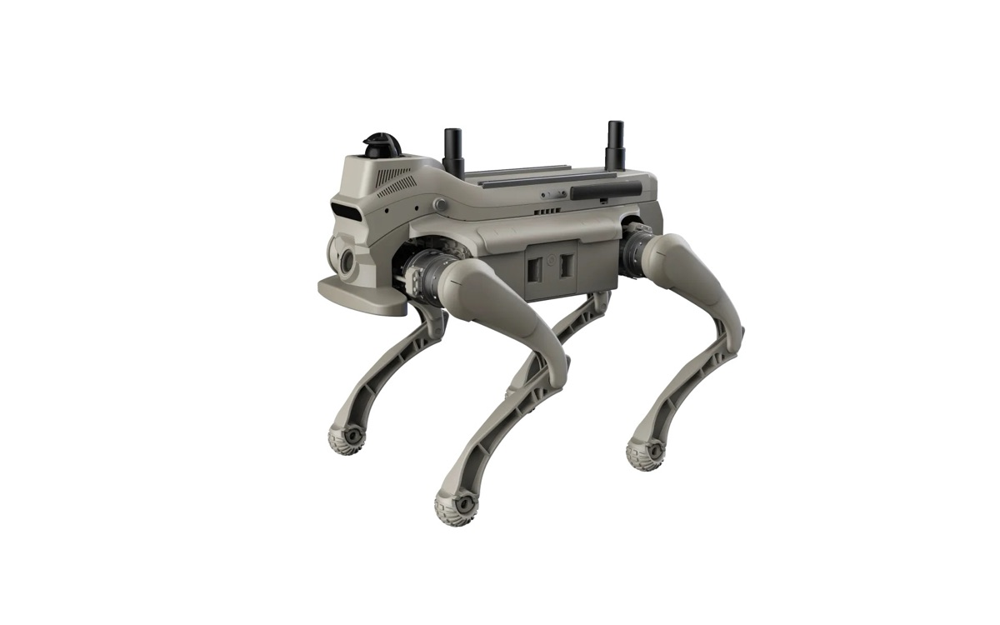
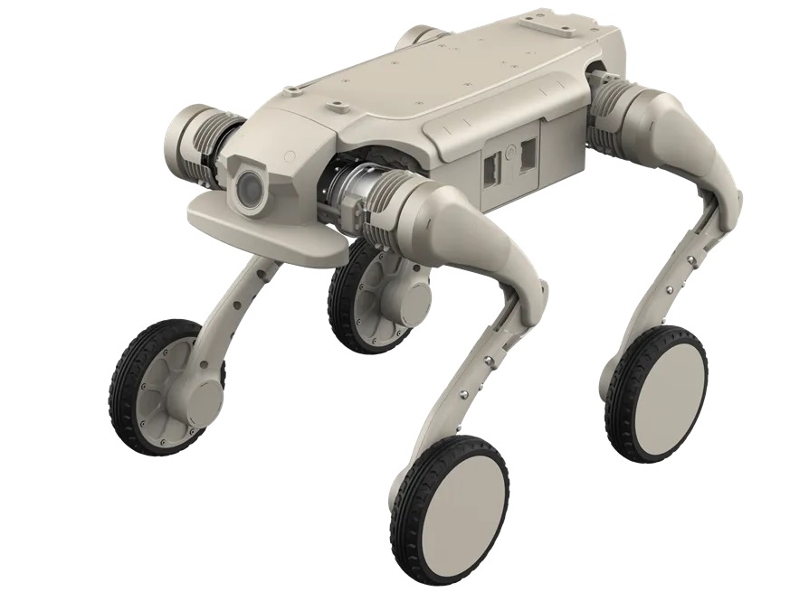
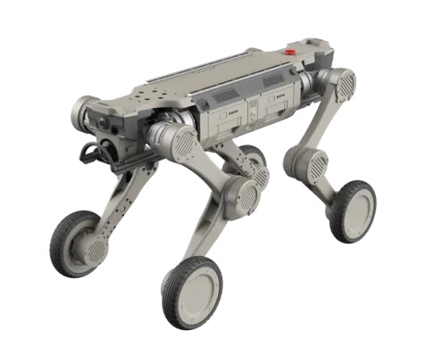
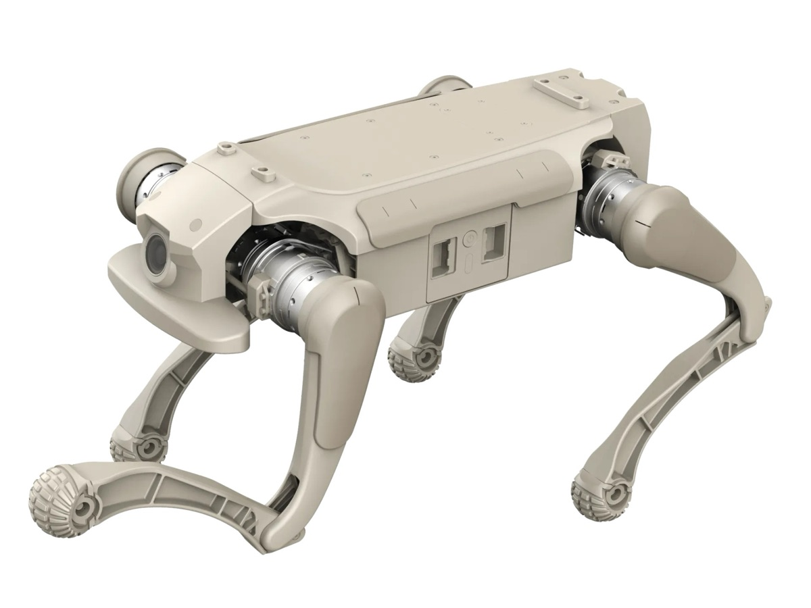

# Genisom AI × T01 — Products and Solutions

⬆ [Genisom AI profile](../Genisom-AI.md) · [Brief](Genisom-AI-T01-1-Brief.md) · [Playbook](Genisom-AI-T01-3-Playbook.md)

**Read this first:** which Genisom models are physically at the hackathon is **not confirmed**. Rank below is by track fit, not by likelihood of being on site (L1 / L1 EDU is the most likely). All specs are company-stated figures from the official product pages. No official prices are published.

| Rank | Product | Role in T01 | Status |
|---|---|---|---|
| 1 | Genisom L2 | All-weather courier / porter with navigation and following built in | ✅ (launched July 2026; ⚠️ unverified shipping date) |
| 2 | Genisom L1 EDU | Most hackable carrier: Orin NX + LiDAR + depth + GNSS | ✅ |
| 3 | Genisom L1-W | Fast, quiet wheel-legged courier for paved routes with kerbs and stairs | ✅ |
| 4 | Genisom M1 (Pro / Ultra) | Heavy carrier for snow, ice and steep paths; following and voice on Pro | ✅ |
| 5 | RoamerX | Navigation stack (mapping, localisation, waypoints) | ✅ (open Lite version) |
| 6 | MATRiX (2.0) | Simulator to build and test before hardware access | ✅ |
| 7 | TA01 robotic arm | Only manipulation option (on M1) | 🧪 |
| 8 | Genisom L1 | Base carrier, needs your own sensors and compute | ✅ |
| 9 | SomaMind | Agent layer — not usable by teams today | 🧪 |

Not relevant for T01: SP1 (explosion-proof), NE01 (humanoid, not released), CHAMP joints and wheel-hub motors (components), L1 Maker (assembly kit).

## Relevant products (ranked for this track)

### Genisom L2

**Role:** the best T01 machine in the range. The official page lists **short-distance delivery** as an application, and the WAIC release positions it for smart parks and communities.

| Spec | Value |
|---|---|
| Continuous walking payload | **16 kg** (150 kg static) |
| Runtime / range | about **5.5 h** / about **20 km** (756 Wh; tested at 1 m/s, no load) |
| Terrain | 40° slope · 70 cm vertical obstacle |
| Weather | **IP66** · **−20 to 55 °C** |
| Sensors | Forward stereo camera + 4 fisheye cameras + LiDAR ("720°" coverage) |
| Autonomy | RoamerX built in: mapping, route planning, LiDAR + GNSS localisation, indoor / outdoor / multi-floor navigation |
| Following | GLUE: UWB + vision person-following |
| On-board compute | up to **86 TOPS** |
| Top speed | not public |

- **Status / price:** ✅ launched at WAIC, July 2026 · price not public · on-site availability not confirmed.
- **Developer interface:** `genisom_robot_sdk` (GEN2, C++17, Ubuntu 22.04, UDP 8082). Public README covers motion control, state / fault / sensor telemetry, camera bitrate, recharge / undock tasks, LEDs. **Navigation goals, map handling and GLUE following are not documented in the public SDK** — ask the booth how to trigger them (app only, or API).
- **Elevator riding and door opening:** not mentioned anywhere.

### Genisom L1 EDU

**Role:** the realistic default. Small, safe to handle, and carries everything needed to run your own Nav2 stack on board.

| Spec | Value |
|---|---|
| Continuous walking payload | **8 kg** |
| Terrain | 40° slope · 16 cm continuous stairs |
| Weather | **IP54** · **0–40 °C** (marginal outdoors in November at 1,400 m) |
| Compute | NVIDIA Jetson **Orin NX**, up to 100 TOPS |
| Sensors | 3D LiDAR (Livox Mid-360 per trade press) · depth camera · GNSS · 5G module |
| Expansion | 7 open interfaces: Ethernet, USB 3.0 / 2.0, 24 V / 12 V power |
| Battery / runtime / speed | not captured from the official page — do not assume |

- **Status / price:** ✅ shipping · price not public.
- **Developer interface:** `genisom_L1_sdk` (C++, MIT, UDP). High-level only in the public README: remote-style velocity commands, stand / lock / balance modes, RoamerX mode, plus IMU, odometry, joint state and battery. **No Python bindings and no low-level joint control are described**; LiDAR / camera access is not covered by the SDK README (the product page mentions a video-stream interface).

### Genisom L1-W

**Role:** wheel-legged variant — rolls on pavement, steps over kerbs and stairs. The most efficient form for a paved village route.

| Spec | Value |
|---|---|
| Continuous walking payload | **10 kg** |
| Speed | **> 5.5 m/s** sprint (far above any safe pedestrian-area speed) |
| Terrain | 65 cm max obstacle · 40° slope · 16 cm continuous stairs |
| Noise | as low as **55 dB** |
| Weather | IP54 · 0–40 °C |
| Battery / runtime | not public on the page |

- **Status / price:** ✅ shipping · price not public.
- **Developer interface:** same L1-series SDK (README lists point-foot, wheel-foot and high-speed wheel-foot models). EDU sensor kit (LiDAR, depth, GNSS, Orin NX) is offered for this model too.

### Genisom M1 (variants M1 Pro, M1 Ultra)

**Role:** the heavy carrier for real alpine conditions. The official page lists park patrol and **logistics and transportation** among its scenarios.

| Spec | Value |
|---|---|
| Body weight / payload | about **30 kg** / about **30 kg** continuous |
| Runtime / range | up to **5 h / 29 km** no load · dual hot-swap batteries · optional charging station with auto-return |
| Terrain | **45°** slope · 25 cm continuous stairs · 80 cm obstacle |
| Weather | **IP67** · **−20 to 55 °C** |
| M1 Pro | UWB module, microphone, speaker: voice dialogue, UWB + laser-vision person-following |
| M1 Ultra | 4 fisheye + forward stereo cameras, 720° perception |
| Expansion | 15 open hardware interfaces |

- **Status / price:** ✅ shipping · price not public.
- **Developer interface:** GEN2 SDK as for L2 (M1 Wi-Fi access point commonly `192.168.234.1:8082`). Control ownership is arbitrated between app and SDK — a connection alone does not let you move the robot.
- **Caution:** a 30 kg machine among pedestrians needs a safety operator and a clear zone.

### RoamerX

**Role:** the shortcut to "go to waypoint" behaviour.

| Item | Value |
|---|---|
| Open version | RoamerX Lite, BSD-3-Clause, 73 GitHub stars |
| Base | ROS 2 **Humble** + Nav2 (NavFn planner, MPPI controller, behaviour trees), Ubuntu 22.04 |
| Mapping / localisation | 3D point-cloud (PCD) map or 2D occupancy grid; localisation by point-cloud registration (fast_gicp, ndt_omp) |
| Task API | ROS 2 actions `/navigate_to_pose`, `/navigate_through_poses`; services to load maps and switch SLAM state; multi-waypoint patrol example |
| Targets | Gazebo, MATRiX, and "NX / 3588" on-board computers |
| Compute need | x86_64 or ARM64, 4 GB RAM minimum (8 GB recommended) |

- **Limits:** the README marks **real-hardware deployment instructions as TODO** and does not mention multi-floor in the Lite version. The full version ships on robots (L2 page: multi-floor, LiDAR + GNSS fusion).

### MATRiX (2.0)

**Role:** develop the whole delivery pipeline in simulation while waiting for robot time.

| Item | Value |
|---|---|
| Engine | MuJoCo physics (500 Hz) + Unreal Engine 5 rendering (+ CARLA) |
| Simulated sensors | camera, LiDAR (Mid-360), IMU, GPS |
| Features | multi-robot, 3DGS scene import, Linux and Windows, Python SDK |
| License / price | BSD-3-Clause, free |

- **Developer interface:** works with RoamerX Lite and `genisom_vln` launch scripts. Needs a GPU workstation for UE5 rendering.

### TA01 robotic arm

**Role:** the only way to add pick-up, hand-over or button pressing to a Genisom dog.

- **Status:** 🧪 demoed on M1 at WRC (August 2026, stable end-effector control while walking). The IROS 2026 challenge-winning M1 also operated an arm (model not named). **Reach, payload, API: not public.** No product page.
- Plan as if it is **not** available unless the booth confirms.

### Genisom L1

**Role:** base carrier if the EDU kit is not provided. Same body: **8 kg** payload, 40° slope, 16 cm stairs, IP54, 0–40 °C, 7 expansion interfaces. You must add your own compute and sensors (for example a D-Robotics RDK X5 plus a camera) for any autonomy.

### SomaMind

**Role:** company's task-to-skill agent layer. 🧪 announced December 2025; **no public SDK or repo** — treat as unavailable and bring your own LLM agent.

## What Genisom AI already does in this domain

**Honest summary: no named delivery, cleaning, hospitality or municipal-service deployment is public.** The company's stated core markets are inspection, security patrol and emergency response. Evidence closest to T01:

| Date | What | Relevance | Source |
|---|---|---|---|
| 2026 (exact date not stated) | M1 ran the Beijing Yizhuang half marathon as an autonomous-following pacer: 21 km, about 3 h, 9 min/km, no remote control | Long-distance person-following outdoors in a public event | [M1 page](https://www.genisomai.com/en/product-robot/M1) |
| 2026 | M1 won the quadruped autonomous-navigation category at the Yizhuang robot challenge (only entry to finish the course; water and pipe obstacles) | Autonomous navigation over hard terrain | [M1 page](https://www.genisomai.com/en/product-robot/M1) |
| 2026-07 | WAIC Shanghai: L2 launched for "smart parks, communities, inspection"; application areas shown include **logistics** and **accessibility** (no detail, no partner names) | Official positioning toward community services | [WAIC news](https://www.genisomai.com/en/newsdetail/GENISOM-AI-at-WAIC-2026) |
| 2026-07 | L2 product page lists **short-distance delivery** as an application scenario | Vendor-stated use case, not a deployment | [L2 page](https://www.genisomai.com/en/product-robot/L2) |
| 2026-08 | WRC Beijing: perception-based stair climbing on industrial open-riser stairs; M1 + TA01 walking manipulation | Stairs and mobile manipulation | [WRC news](https://www.genisomai.com/en/newsdetail/GENISOM-AI-at-WRC-2026) |
| 2026-10 | IROS Pittsburgh: multi-robot collaborative transport demo (video only, no details); NTU Singapore won the fully autonomous Legged Robot Challenge category on M1 with navigation plus arm tasks | Multi-robot carrying; third-party autonomy on the platform | [IROS release](https://technode.global/prnasia/genisom-ai-showcases-embodied-intelligence-and-debuts-worlds-first-industry-grade-educational-quadruped-at-iros-2026/) |

- Europe / Switzerland: nothing found beyond the ICRA 2026 booth in Vienna (June 2026).

## What they are building next in this domain

- **GSD (Genisom Self-Driving)** — data-driven autonomous navigation that learns from deployment data (WRC, August 2026). 🧪 No release date or API.
- **"Dual-brain" architecture** — high-level perception / navigation / task decisions over real-time motion control (WRC 2026). Terrain-aware foothold selection on stairs is the first shown result.
- **Loco-manipulation** — M1 + TA01 arm. 🧪 Would open delivery hand-over and door / button tasks.
- **Swarm stage** — multi-robot collaboration is the fourth step of the stated strategy (locomotion → spatial → cognitive → swarm); the IROS 2026 transport demo and MATRiX 2.0 multi-robot training point there.
- **International expansion** — Series B (hundreds of millions of RMB, led by Stone Venture, UAE; company press release, October 2026) is earmarked partly for it.
- *Inference:* L2's "communities / smart parks / short-distance delivery" wording suggests the company is testing demand outside inspection, but there is no announced delivery product or service.

## Software, models and data that help for this track

| Asset | What it gives a T01 team | Access |
|---|---|---|
| [genisom_roamerx_open](https://github.com/zsibot/genisom_roamerx_open) | Nav2-based mapping, localisation, waypoint and patrol navigation | BSD-3-Clause |
| [matrix](https://github.com/zsibot/matrix) | Simulated robot + sensors in UE5 scenes; multi-robot | BSD-3-Clause |
| [genisom_vln](https://github.com/zsibot/genisom_vln) | Zero-shot vision-language navigation baseline (UniGoal-based): text goal ("green plant") or image goal. Examples use SmolVLM2, gemma3:4b via Ollama, or a cloud API. **Shown in MATRiX only; needs a CUDA GPU (RTX 4090 recommended for local models)** | BSD-3-Clause |
| [genisom_L1_sdk](https://github.com/zsibot/genisom_L1_sdk) | Velocity / mode control and telemetry for L1 series | MIT, C++ |
| [genisom_robot_sdk](https://github.com/zsibot/genisom_robot_sdk) | Control, telemetry, recharge tasks for M1 and L2 | C++17 |
| `genisom_model` (in the [zsibot org](https://github.com/zsibot/)) | URDF + meshes for RViz / Gazebo | open |

- No public dataset, no delivery- or service-specific model, no fleet-management software found.

## Gaps and limits for this track

- **No manipulation by default.** Loading, unloading, doors, lift buttons and cleaning need a human, a passive mechanism, or another vendor's arm.
- **API depth is unclear.** Public SDKs are C++ and high-level. Navigation-goal, map and following control for L2 / M1 are not documented publicly; low-level joint control and Python bindings for the current L1 SDK are ⚠️ unverified.
- **RoamerX Lite on real hardware is marked TODO** in its README — budget time for bring-up, or ask the engineers for the on-robot version.
- **Weather rating of the L1 family:** 0–40 °C, IP54. November in Leukerbad can be below 0 °C with snow; only L2 / M1 are rated for it.
- **No lift / elevator integration** mentioned anywhere; multi-floor means stairs.
- **No cargo accessory** (locked box, tray) found — build your own mount on the robot's back (check mounting points and the expansion manual with the booth).
- **Public-space safety:** no published pedestrian-safety certification; legged robots near elderly guests need a supervisor and low speed.
- **Runtime of L1 / L1-W** is not published on the pages read — measure on site.
- This doc could not run fresh web searches (search quota exhausted during research); findings rest on the official pages and GitHub repos listed below.

## Sources

- [Genisom AI profile (internal)](../Genisom-AI.md)
- [Genisom L2 product page](https://www.genisomai.com/en/product-robot/L2)
- [Genisom L1 product page](https://www.genisomai.com/en/product-robot/L1)
- [Genisom L1-W product page](https://www.genisomai.com/en/product-robot/L1-W)
- [Genisom M1 product page](https://www.genisomai.com/en/product-robot/M1)
- [MATRiX product page](https://www.genisomai.com/en/product-robot/MATRiX)
- [GENISOM AI at WAIC 2026 (company news, 2026-07-19)](https://www.genisomai.com/en/newsdetail/GENISOM-AI-at-WAIC-2026)
- [GENISOM AI at WRC 2026 (company news, 2026-08-23)](https://www.genisomai.com/en/newsdetail/GENISOM-AI-at-WRC-2026)
- [IROS 2026 press release via TNGlobal (2026-10-01)](https://technode.global/prnasia/genisom-ai-showcases-embodied-intelligence-and-debuts-worlds-first-industry-grade-educational-quadruped-at-iros-2026/)
- [genisom_roamerx_open (GitHub)](https://github.com/zsibot/genisom_roamerx_open)
- [genisom_robot_sdk (GitHub)](https://github.com/zsibot/genisom_robot_sdk)
- [genisom_L1_sdk (GitHub)](https://github.com/zsibot/genisom_L1_sdk)
- [genisom_vln (GitHub)](https://github.com/zsibot/genisom_vln)
- [matrix (GitHub)](https://github.com/zsibot/matrix)
- [GitHub organisation zsibot](https://github.com/zsibot/)
