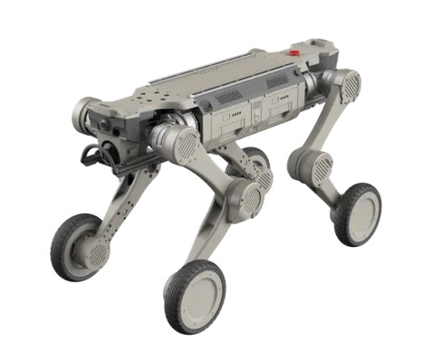
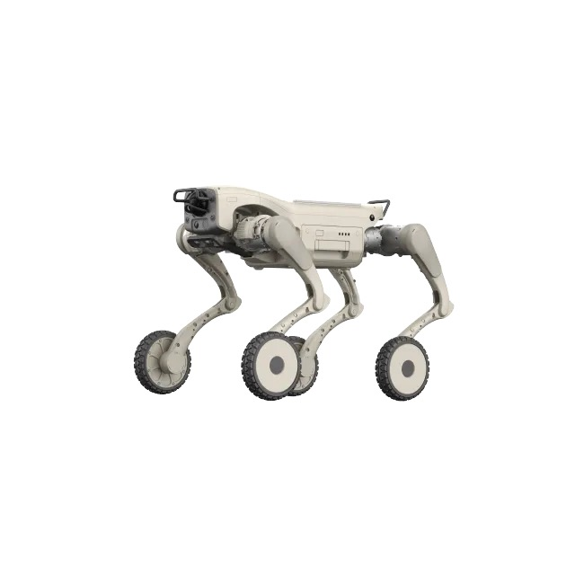
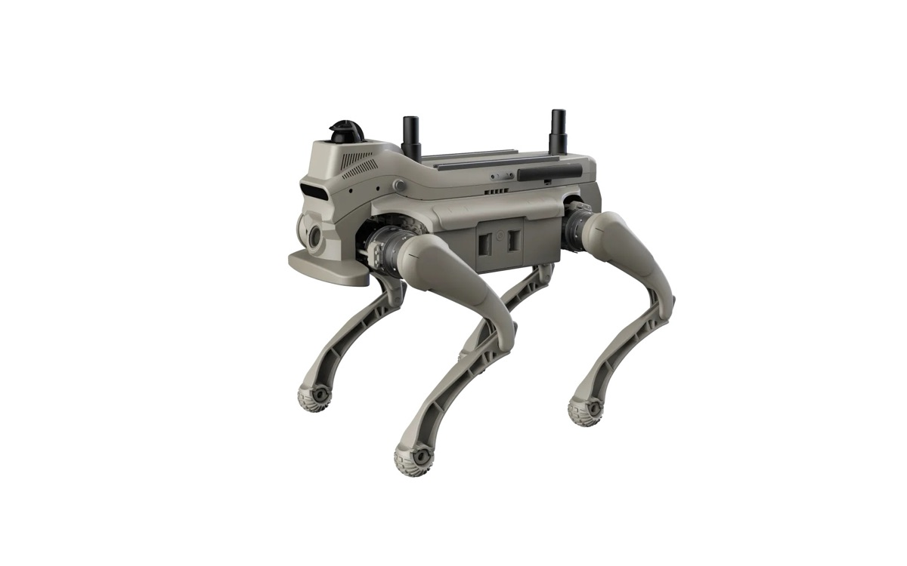
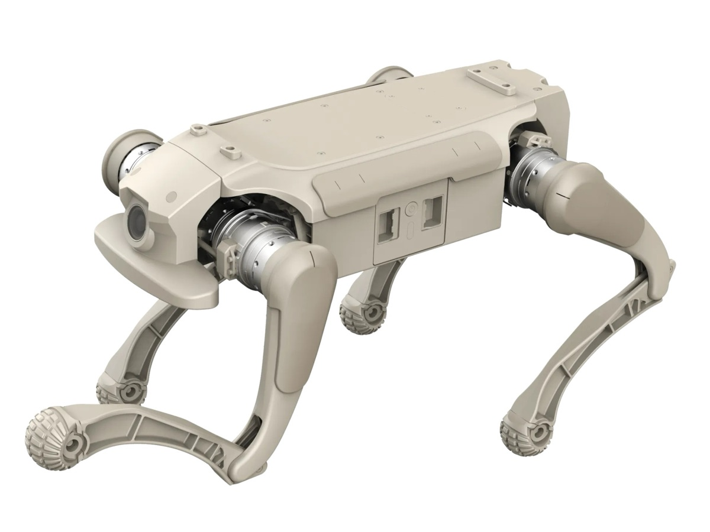
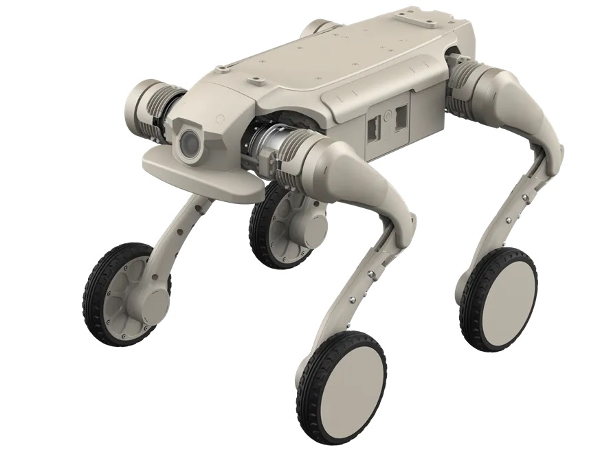
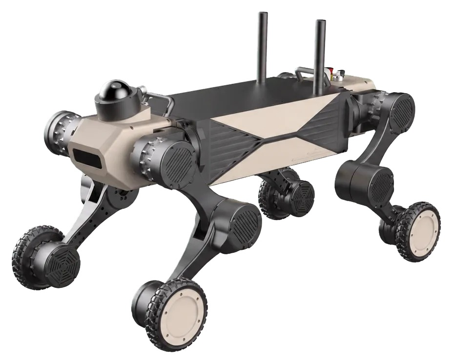

# Genisom AI × T02 — Products and Solutions

⬆ [Genisom AI profile](../Genisom-AI.md) · [Brief](Genisom-AI-T02-1-Brief.md) · [Playbook](Genisom-AI-T02-3-Playbook.md)

All specs are company-stated laboratory figures from the official product pages. Prices are not public. **Which models are on site is not confirmed** — ask the booth before choosing a concept.

## Relevant products (ranked for this track)

| Rank | Product | Role in T02 | Outdoor in November? | Status |
|---|---|---|---|---|
| 1 | Genisom M1 | Heavy-duty patrol / inspection / response platform | Yes (IP67, −20 °C) | ✅ |
| 2 | Genisom L2 | Compact patrol dog with navigation and sensors built in | Yes (IP66, −20 °C) | ✅ ⚠️ unverified shipping date |
| 3 | Genisom L1 EDU | Development platform, most likely on site | Limited (IP54, 0–40 °C) | ✅ |
| 4 | Genisom L1-W | Fast responder on roads and paths | Limited (IP54) | ✅ |
| 5 | Genisom SP1 | Explosion-proof inspection (reference only) | Not relevant on site | 🧪 |
| 6 | RoamerX | Mapping, localisation, waypoint patrol | — | ✅ (Lite) |
| 7 | MATRiX (2.0) | Rehearse missions in simulation | — | ✅ |

### Genisom M1 (variants M1 Pro, M1 Ultra)

**Role:** the company's main machine for patrol, power / petrochemical inspection and emergency response. The only model with published snow / ice and water-fording tests.

| Spec | Value |
|---|---|
| Body weight / continuous payload | about **30 kg** / about **30 kg** |
| Protection / temperature | **IP67** / **−20 to 55 °C** |
| Terrain | **45°** slope · 25 cm continuous stairs · 80 cm vertical obstacle |
| Endurance | up to **5 h / 29 km** no load at 1 m/s · dual hot-swap batteries |
| Charging | optional charging station with automatic return on low battery |
| Perception | M1 Ultra: 4 fisheye + forward stereo camera ("720°" perception) · M1 Pro: voice dialogue, UWB + laser / vision following |
| Expansion | **15** open hardware interfaces (communication, power, control) |
| Max speed | not stated on the product page |

- **Status / price:** ✅ shipping · price not public.
- **Developer interface:** `genisom_robot_sdk` (GEN2), C++17, Ubuntu 22.04, UDP port 8082. Examples cover state / fault / sensor subscription, keyboard motion control, take-control handover, recharge / undock tasks, dock pairing, LED, camera bitrate. Low-level joint control and Python bindings are not mentioned in the README (⚠️ unverified).

### Genisom L2

**Role:** smallest model with weather rating and navigation sensors as standard — the best "patrol dog out of the box" if it is on site.

| Spec | Value |
|---|---|
| Continuous payload | **16 kg** (150 kg static) |
| Protection / temperature | **IP66** / **−20 to 55 °C** |
| Terrain | **40°** slope · 70 cm vertical obstacle |
| Endurance | **756 Wh** · up to about **5.5 h / 20 km** (no load, 1 m/s) |
| Perception | forward wide-angle stereo camera · 4 fisheye cameras · 1 industrial LiDAR |
| Navigation | RoamerX mapping and route planning; LiDAR + GNSS fusion; indoor, outdoor and multi-floor (company-stated) |
| Following | GLUE: UWB + vision person-following |
| Compute | up to **86 TOPS** on board |
| Thermal camera | not mentioned |

- **Status / price:** launched at WAIC, July 2026 · shipping date ⚠️ unverified · price not public.
- **Developer interface:** same GEN2 SDK as M1 (README lists L2 system version v0.0.9 as supported).

### Genisom L1 EDU

**Role:** the research configuration of the L1 and the most probable hackathon unit. Good for indoor or dry-weather patrol and search demos; not rated for sub-zero or wet conditions.

| Spec | Value |
|---|---|
| Continuous payload | **8 kg** |
| Protection / temperature | **IP54** / **0–40 °C** |
| Terrain | **40°** slope · 16 cm continuous stairs |
| Compute | NVIDIA Jetson **Orin NX** (up to 100 TOPS) |
| Sensors | 3D LiDAR (Livox Mid-360 per trade press) · depth camera · GNSS · 5G |
| Expansion | **7** open interfaces (Ethernet, USB 3.0 / 2.0, 24 V / 12 V) |
| Body weight, battery, runtime, speed | not captured from the official page — ask on site |

- **Status / price:** ✅ shipping · price not public.
- **Developer interface:** `genisom_L1_sdk` (C++, MIT, Linux x86_64 / ARM64). High-level control over UDP: stand up, velocity via `SetRemote`, balance-stand, lock and other modes, switch between RoamerX mode and SDK mode. Reads IMU, odometry, joint states, battery, temperature, faults. Low-level joint control and Python are not mentioned in the current README (⚠️ unverified).

### Genisom L1

**Role:** base L1 without the EDU sensor kit. Usable as a teleoperated scout or as a carrier for your own camera and compute. Same body specs and SDK as L1 EDU above (8 kg payload, IP54, 0–40 °C, 12 joints at 48 N·m peak). ✅ shipping · price not public.

### Genisom L1-W

**Role:** wheel-legged variant for fast response on roads, paths and corridors.

| Spec | Value |
|---|---|
| Continuous payload | **10 kg** |
| Sprint speed | **>5.5 m/s** |
| Terrain | 65 cm max obstacle · 40° slope |
| Protection | IP54 |
| Noise | as low as 55 dB |

- **Status / price:** ✅ shipping · price not public. Developer interface: L1 SDK (README lists wheel-legged robot types).

### Genisom SP1

**Role:** shows where the company is going in hazardous-area inspection. No use case at the venue and very unlikely to be on site.

| Spec | Value |
|---|---|
| Explosion-protection marking | **Ex d IIC T6 Gb** (Zone 1 / Zone 2 gas environments); no certificate number published |
| Continuous payload | **50 kg** |
| Protection | IP66 |
| Slope | 35° |
| Endurance | **4 h** at full load |
| Modes | crawl, wheel, leg |
| Payload options | visual, infrared, gas, acoustic inspection |

- **Status / price:** 🧪 unveiled at WAIC, July 2026; Chinese product page only; price and availability not public.

### RoamerX

**Role:** the patrol backbone — build a map, localise, walk waypoints.

| Item | Open "Lite" community version |
|---|---|
| Stack | ROS 2 **Humble**, Ubuntu 22.04, Nav2 behaviour-tree navigator |
| Mapping | 3D point-cloud (PCD) map + 2D occupancy grid; start / save mapping commands |
| Localisation | fast_gicp and ndt_omp against a PCD map |
| Planning / control | NavFn global planner + MPPI local controller, costmap obstacle avoidance |
| Patrol | multi-waypoint navigation with a patrol task example |
| Robot link | UDP or LCM through a separately installed robot-forward package |
| Simulation | Gazebo and MATRiX |
| Hardware deployment | listed as **"TODO"** in the README |
| License | BSD-3-Clause |

- **Status:** ✅ Lite is free; the full version ships on the robots (feature differences not documented).

### MATRiX (2.0)

**Role:** develop and rehearse a patrol or search mission before you get robot time; fallback demo if hardware fails. MuJoCo physics + Unreal Engine 5 rendering, simulated camera / LiDAR / IMU / GPS, multi-robot, 3DGS scene import. ✅ free, open source.

### SomaMind

**Role:** agent layer (task understanding to skill execution). 🧪 announced December 2025; **no public SDK or repo**, so do not plan a build around it.

### TA01 robotic arm

**Role:** would enable door / valve / sample tasks on an M1. 🧪 demo only (WRC, August 2026); specs not public; availability on site unlikely.

## What Genisom AI already does in this domain

**Honest summary:** this is the company's home market, and its site lists many case titles, but none comes with a date, description, robot model or outcome. Treat them as company claims, not verified deployments.

| Area | What is public | Date | Evidence level |
|---|---|---|---|
| Emergency response | Case titles: Rescue Drill · Sichuan Gas Group; Firefighting Robot · France; Flood Drill · State Grid Northeast; Forest Fire Drill · Shenzhen; Air-Ground Rescue · National Earthquake Rescue Base; Firefighting · Beijing Lingtian; Rescue Drill · Daqing Oilfield ([page](https://www.genisomai.com/en/industry/emergency-response)) | undated | Titles only; mostly drills |
| Emergency payloads claimed | Multispectral life detection, hazardous-gas monitoring, thermal imaging, communication relay, two-way audio, firefighting and transport payloads | undated | Listed, no specs or models |
| Security patrol | Case titles: Police Patrol · Chengdu; Police Patrol · Suzhou; Historic Town · Suzhou; OPC Industrial Park · Suzhou; Urban Park · Chongqing; Museum · Shanghai; 798 Art District · Beijing; Campus Patrol · Hangzhou; China Mobile Campus · Changzhou ([page](https://www.genisomai.com/en/industry/security-patrol)) | undated | Titles only |
| Patrol functions claimed | Route and checkpoint configuration, mission dispatch, live video and anomaly data to a control centre, two-way audio / public address, optional lighting | undated | No named software product |
| Industrial inspection | Case titles: Substation Inspection; Plant Inspection · Zhejiang; Pilot Testing Platform · State Grid EPRI; Wind Farm Inspection · Guangxi; Converter Station Inspection · Henan; Power Inspection · Jiuquan Satellite Launch Center; Air-Space-Ground Inspection · 2026 Conference ([page](https://www.genisomai.com/en/industry/industrial-inspection)) | undated | Titles only |
| Autonomy in rough terrain | M1 won the quadruped autonomous-navigation category at the Beijing Yizhuang robot challenge (wet grass, pipe traverse, water obstacles); M1 followed a runner for 21 km without remote control | 2026 | Company-stated on M1 page |
| Trade-show demos | WAIC Shanghai: power inspection (visual + thermal + acoustic), emergency response (enter fire / smoke / structural-hazard areas before people), security patrol | 2026-07-19 | Company news |
| Third-party autonomy on the platform | NTU Singapore won the fully autonomous category of the IROS 2026 Legged Robot Challenge on an M1 with arm tasks; University of Manchester won in 2025 on an L1 | 2026-10 / 2025-10 | Company press release |

- **Europe / Switzerland:** nothing found beyond the undated "Firefighting Robot · France" case title and the ICRA 2026 booth in Vienna.
- **Alpine hazards (avalanche, rockfall):** nothing found.

## What they are building next in this domain

- 🧪 **SP1 explosion-proof quadruped** (WAIC, July 2026) — a move into certified hazardous-area inspection (oil and gas, LNG, chemical tank farms).
- 🧪 **M1 + TA01 arm** (WRC, August 2026) — loco-manipulation; relevant to inspection tasks that need touching things. No specs yet.
- 🧪 **GSD (Genisom Self-Driving)** data-driven navigation and a "dual-brain" architecture (WRC 2026, per the company profile).
- 🧪 **Multi-legged collaborative transport** demo (IROS, October 2026) — the company's stated fourth stage is swarm intelligence. *Inference:* multi-robot patrol or response fleets are a likely direction; no product announced.
- 🔭 **International expansion** is a stated use of the Series B funds (October 2026 press release). *Inference:* European pilots are possible; none announced.
- "Air-ground" and "air-space-ground" appear in case titles — *inference:* drone + quadruped teaming is being explored with partners; no product or partner named.

## Software, models and data that help for this track

| Asset | What it gives a T02 team | Notes |
|---|---|---|
| [genisom_L1_sdk](https://github.com/zsibot/genisom_L1_sdk) | Velocity / posture commands and IMU, odometry, battery, fault telemetry for L1 family | C++, MIT, two examples (`remote_control`, `sdk_control`) |
| [genisom_robot_sdk](https://github.com/zsibot/genisom_robot_sdk) | Same for M1 / L2, plus recharge / undock tasks and control-ownership handling | C++17, Boost 1.74, UDP 8082; M1 Wi-Fi access point commonly 192.168.234.1 |
| [genisom_roamerx_open](https://github.com/zsibot/genisom_roamerx_open) | Mapping, localisation, waypoint patrol on ROS 2 Humble | Real-hardware deployment marked "TODO" |
| [matrix](https://github.com/zsibot/matrix) | Simulated robot with LiDAR / camera / GPS for mission rehearsal | MuJoCo + UE5 |
| [genisom_vln](https://github.com/zsibot/genisom_vln) | Language- or image-goal navigation baseline ("find the green plant") built on UniGoal; works with SmolVLM2, Ollama (Gemma 3 4b) or a cloud VLM | BSD-3-Clause; targets MATRiX; real-robot use described as "adaptable", extent untested in the README; wants an NVIDIA GPU for local models |
| `genisom_model` (GitHub org) | URDF + meshes for RViz / Gazebo | — |
| Datasets | none found for patrol, inspection or rescue | — |

## Gaps and limits for this track

- **On-site hardware unknown.** If only L1-class units are present, outdoor November demos are outside the rated envelope (**0–40 °C, IP54**).
- **Sensor access is the main technical unknown.** Neither SDK README documents LiDAR point-cloud or camera-frame APIs; GEN2 mentions sensor data and camera bitrate only. Plan a fallback camera on the payload rail.
- **No thermal, gas or life-detection payload with a model number or spec.** These are listed as options on the industry pages only.
- **No manipulation** in practice (TA01 not released).
- **High-level control only, C++ only**, as far as the current READMEs show.
- **Control ownership:** the phone app and SDK arbitrate control; a lost handover stops your program from moving the robot.
- **SomaMind and the full RoamerX are closed**; the open RoamerX Lite is not documented for real hardware.
- **Evidence quality:** every deployment listed is a title on a company page; no independent case study, no European reference, no public safety certification for use around the public.
- **Research limit:** web search was unavailable during this track-specific pass, so findings rely on official pages and GitHub fetched directly; trade-press coverage of deployments was not re-checked.

## Sources
- [Genisom AI — Emergency Response industry page](https://www.genisomai.com/en/industry/emergency-response)
- [Genisom AI — Security Patrol industry page](https://www.genisomai.com/en/industry/security-patrol)
- [Genisom AI — Industrial Inspection industry page](https://www.genisomai.com/en/industry/industrial-inspection)
- [Genisom M1 product page](https://www.genisomai.com/en/product-robot/M1)
- [Genisom L2 product page](https://www.genisomai.com/en/product-robot/L2)
- [Genisom L1 product page](https://www.genisomai.com/en/product-robot/L1) (specs taken via the company profile)
- [Genisom L1-W product page](https://www.genisomai.com/en/product-robot/L1-W) (specs taken via the company profile)
- [Genisom SP1 product page (Chinese)](https://www.genisomai.com/product-robot/sp1)
- [GENISOM AI at WAIC 2026 (company news, 2026-07-19)](https://www.genisomai.com/en/newsdetail/GENISOM-AI-at-WAIC-2026)
- [GENISOM AI at IROS 2026 (PR Newswire, 2026-10-01)](https://www.prnewswire.com/news-releases/genisom-ai-showcases-embodied-intelligence-and-debuts-worlds-first-industry-grade-educational-quadruped-at-iros-2026-302896049.html)
- [genisom_L1_sdk (GitHub)](https://github.com/zsibot/genisom_L1_sdk)
- [genisom_robot_sdk (GitHub)](https://github.com/zsibot/genisom_robot_sdk)
- [genisom_roamerx_open (GitHub)](https://github.com/zsibot/genisom_roamerx_open)
- [matrix — MATRiX simulator (GitHub)](https://github.com/zsibot/matrix)
- [genisom_vln (GitHub)](https://github.com/zsibot/genisom_vln)
- [Genisom AI company profile (this repository)](../Genisom-AI.md)
