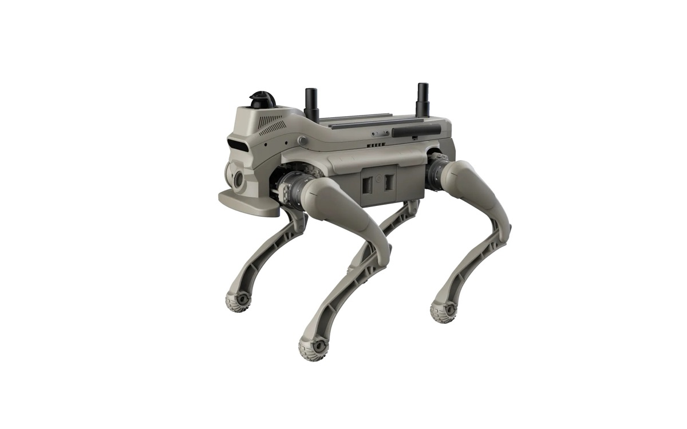
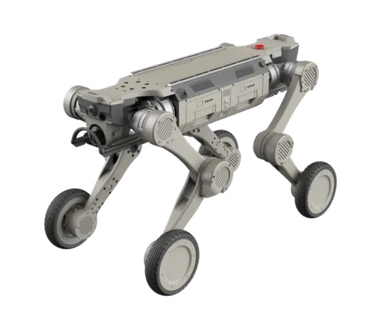
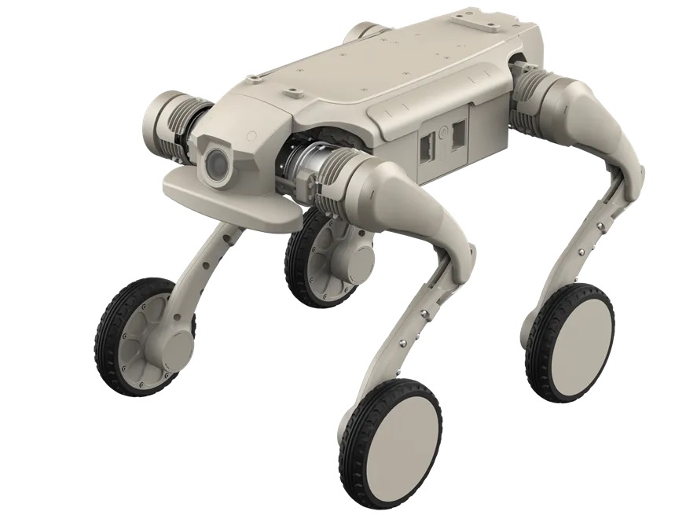

# Genisom AI × T03 — Products and Solutions

⬆ [Genisom AI profile](../Genisom-AI.md) · [Brief](Genisom-AI-T03-1-Brief.md) · [Playbook](Genisom-AI-T03-3-Playbook.md)

**In one line:** Genisom sells walking sensor carriers plus open navigation and simulation tools. For T03 that means **monitoring, auditing and carrying** — not sorting, picking or repairing.

All specs are company-stated laboratory figures from official pages. Prices are **not public** for any product. Which models are physically at Leukerbad is ⚠️ unverified — ask the booth first.

## Relevant products (ranked for this track)

### Genisom L2

**Role in T03:** best outdoor patrol base for November in Leukerbad — weather-sealed, cold-rated, long runtime, navigation built in. Use it for energy-loss rounds, bin and litter surveys, environmental sensing.

| Spec | Value |
|---|---|
| Continuous walking payload | **16 kg** (150 kg static) |
| Battery / runtime / range | **756 Wh** · about **5.5 h** · **20 km** (no load, 1 m/s) |
| Energy per km (derived from the two figures above, not a company claim) | about **38 Wh/km** |
| Protection / temperature | **IP66** · **−20 to 55 °C** |
| Terrain | 40° slope · 70 cm obstacle |
| On-board AI compute | up to **86 TOPS** |
| Sensors | wide-angle stereo camera · 4 fisheye cameras · industrial LiDAR · GNSS · UWB (GLUE person-following) |
| Navigation | RoamerX on board: mapping, route planning, obstacle avoidance, indoor / outdoor / multi-floor |
| Thermal or gas sensor | not listed on the product page |

- **Status:** ✅ launched at WAIC, July 2026 (⚠️ unverified shipping date) · price not public.
- **Developer interface:** `genisom_robot_sdk` ("GEN2") — C++17, Ubuntu 22.04, x86_64 / aarch64, UDP. Examples cover state / fault / sensor data streams, motion and device control, taking control from the app, **recharge and undock tasks**, dock pairing, LED, camera bitrate. No Python binding found. Capabilities vary by model and firmware — check the repo's capability matrix.

### Genisom L1 EDU

**Role in T03:** most likely unit on site and the most hackable. Good for indoor or dry-weather audits (hotel corridors, spa plant rooms, car parks) and as a carrier for your own sensor box.

| Spec | Value |
|---|---|
| Continuous walking payload | **8 kg** |
| Compute | NVIDIA Jetson **Orin NX**, up to 100 TOPS |
| Built-in sensors | 3D LiDAR (Livox Mid-360 per trade press) · depth camera · HD camera · GNSS · 5G module |
| Expansion | 7 hardware interfaces: Ethernet, USB 3.0 / 2.0, **24 V / 12 V** power |
| Terrain | 40° slope · 16 cm continuous stairs |
| Protection / temperature | **IP54** · **0–40 °C** (not rated for sub-zero outdoor use) |
| Battery, runtime, weight, speed | not captured — spec table is an image; do not assume |

- **Status:** ✅ shipping · price not public.
- **Developer interface:** `genisom_L1_sdk` (MIT, C++): high-level control over UDP — stand, velocity commands, modes, "RoamerX mode"; state for **battery (charge %, voltage, current, temperature)**, IMU, odometry, joints, faults. The product page also lists a video-stream interface. No Python binding and no low-level joint API found in the current repo.

### Genisom M1 (variants M1 Pro, M1 Ultra)

**Role in T03:** the heavy carrier for snow, ice and steep paths; the only base that has been shown with an arm. Overkill for a simple sensor round, and less likely to be on site.

| Spec | Value |
|---|---|
| Body / continuous payload | about 30 kg / about **30 kg** |
| Runtime / range | up to **5 h / 29 km** (no load) · dual **hot-swap** batteries |
| Auto-recharge | optional smart charging station, returns automatically when battery is low |
| Protection / temperature | **IP67** · **−20 to 55 °C** |
| Terrain | 45° slope · 25 cm continuous stairs · 80 cm obstacle · snow and ice |
| Expansion | 15 hardware interfaces |
| Perception | Ultra: 4 fisheye + stereo, 720° perception · Pro: UWB following, voice |

- **Status:** ✅ shipping · price not public.
- **Developer interface:** same GEN2 SDK as L2.

### TA01 robotic arm

**Role in T03:** would unlock litter picking or valve / switch operation from an M1. Treat as unavailable unless the booth confirms.

| Spec | Value |
|---|---|
| Payload, reach, DoF, gripper | not public |
| Shown | WRC Beijing, August 2026; IROS 2026 challenge arm tasks on M1 |

- **Status:** 🧪 demo only, no product page · developer interface not public.

### RoamerX

**Role in T03:** turns "walk this audit loop every hour" into configuration rather than code.

| Item | Value |
|---|---|
| Open version | RoamerX Lite — ROS 2 **Humble**, Nav2, NavFn + MPPI, behaviour trees |
| Included | SLAM (3D point cloud + 2D grid map), localisation on a PCD map, waypoint and multi-point **patrol** demos |
| Goals | RViz2 "2D Goal Pose" or `NavigateToPose` / `NavigateThroughPoses` actions |
| Compute | x86_64 or ARM64, 4 GB RAM minimum (8 GB recommended) |
| Simulation | MATRiX and Gazebo |

- **Status:** ✅ open community version (BSD-3-Clause per repo metadata); the full version ships on the robots.
- **Caveat:** the open repo marks **real-hardware deployment as "TODO"**. Ask whether you can send goals to the on-robot RoamerX instead of deploying Lite yourself.

### MATRiX (2.0)

**Role in T03:** develop and rehearse the patrol before you get robot time; also a credible "digital twin" element for the pitch.

| Item | Value |
|---|---|
| Engines | MuJoCo physics at 500 Hz + Unreal Engine rendering |
| Simulated sensors | RGB, **infrared**, depth, fisheye, panoramic cameras · LiDAR (Mid-360) · IMU · GPS · odometry |
| Scenes | **3DGS real-scene import**, drag-and-drop maps, downloadable map packs |
| Robots | L1 and M1 named for sim-to-real |
| Other | multi-robot simulation · Linux and Windows · graphical, no ROS needed to start |

- **Status:** ✅ free, open source (BSD-3-Clause per the company profile research).

### Genisom L1-W

**Role in T03:** faster, quieter wheel-legged variant for long flat rounds (promenades, car parks) or light carrying: **10 kg** continuous payload, **>5.5 m/s** sprint, noise as low as 55 dB, IP54. ✅ shipping · price not public · L1-series SDK. Runtime not captured.

**Not relevant here:** SP1 (explosion-proof, no use case at the venue), NE01 humanoid (unreleased, no specs), CHAMP joints (component sales; no 48-hour role unless you build a mechanism from scratch).

## What Genisom AI already does in this domain

There is **no dedicated "sustainability" product or programme**. What exists is inspection work in energy, water and agriculture settings. The official industry pages list the following as case titles — **no dates, customer statements or results are published**, so treat each as company-stated.

| Area | What is listed | Source |
|---|---|---|
| Renewable energy | Wind-farm inspection, Guangxi | [Industrial Inspection](https://www.genisomai.com/en/industry/industrial-inspection) |
| Power grid | State Grid EPRI pilot testing platform · converter-station inspection, Henan · a substation case · power inspection at Jiuquan Satellite Launch Center · "air-space-ground" inspection shown at a 2026 conference | same page |
| Industry | Plant inspection, Zhejiang | same page |
| Water | Water utilities named as a scenario: plants, pump stations, utility tunnels (no named case) | [Emerging Applications](https://www.genisomai.com/en/industry/emerging-applications) |
| Agriculture / food | Orchard inspection, Guangdong · grain-depot inspection | same page |
| Mining | Smart-mine inspection incl. environmental monitoring | same page |
| Light logistics | "Plateau Logistics · Tibet" (title only) | same page |

- **Payloads the company names for inspection:** visible-light, thermal, gas and acoustic sensors; meter reading and temperature detection; autonomous charging; anomaly alerts and result archiving. These are solution-level claims, not a list of what is on site.
- **2026-07, WAIC Shanghai:** power-inspection demo combining visual inspection, thermal imaging and acoustic sensing; L2 positioned for smart parks, communities and light industry ([company news](https://www.genisomai.com/en/newsdetail/GENISOM-AI-at-WAIC-2026)).
- **Not found:** anything on waste sorting, recycling, litter collection, EV charging, building automation or circular-economy tasks. No deployment in Europe.

## What they are building next in this domain

- **Announced:** L2 for parks and communities (July 2026); M1 + TA01 arm loco-manipulation (August 2026); multi-robot collaborative transport demo and MATRiX 2.0 (October 2026); "GSD" data-driven navigation; SomaMind agent system (no public SDK).
- **Stated strategy:** locomotion → spatial → cognitive → swarm intelligence; international expansion funded by the Series B.
- **Inference (not announced):** an arm on a quadruped plus an agent layer is the path to litter picking or simple maintenance tasks, but nothing public says Genisom targets waste or sustainability applications specifically. Expect the company to stay an inspection-platform supplier and leave vertical applications to partners.

## Software, models and data that help for this track

| Asset | What it gives you in 48 hours | Link |
|---|---|---|
| `genisom_L1_sdk` | Velocity control and battery telemetry in a few lines of C++ — battery current / voltage lets you **log energy per patrol** | [GitHub](https://github.com/zsibot/genisom_L1_sdk) |
| `genisom_robot_sdk` (GEN2) | M1 / L2 control, sensor streams, recharge / undock tasks | [GitHub](https://github.com/zsibot/genisom_robot_sdk) |
| `genisom_roamerx_open` | Mapping, localisation, waypoint patrol on ROS 2 Humble | [GitHub](https://github.com/zsibot/genisom_roamerx_open) |
| `matrix` | Simulator with infrared camera and LiDAR models; test patrol logic without a robot | [GitHub](https://github.com/zsibot/matrix) |
| `genisom_vln` | Zero-shot "go to the &lt;object&gt;" navigation with a VLM (SmolVLM2 locally, or Ollama e.g. gemma3:4b, or cloud API); documented in simulation only; BSD-3-Clause | [GitHub](https://github.com/zsibot/genisom_vln) |
| `genisom_model` | URDF + meshes for RViz / Gazebo | [GitHub org](https://github.com/zsibot/) |

- **Datasets:** none public. No waste, litter or thermal-anomaly model from Genisom — bring an open detector or a VLM.

## Gaps and limits for this track

- **No manipulation** in the shipping line-up. Anything that must grasp needs another vendor or the unconfirmed TA01.
- **No sustainability-specific sensors confirmed on site.** Thermal, gas or air-quality sensing means bringing your own hardware and mounting it on the 12 V / 24 V + USB / Ethernet rails (current limits not captured).
- **C++ only.** No Python or ROS 2 driver package found in the current SDKs; budget a few hours for a bridge.
- **L1 weather envelope:** 0–40 °C, IP54. Outdoor snow demos need L2 or M1.
- **Open navigation is not plug-and-play on hardware** (deployment "TODO" in RoamerX Lite); the VLN baseline wants a strong GPU for local models.
- **Proof is thin:** case titles without dates or numbers; unit counts are company-stated.
- **SomaMind** has no public interface; do not plan around it.
- Research note: web search was unavailable during this pass, so findings rely on the official site and GitHub; trade-press coverage of energy or environmental deployments may exist but was not checked.

## Sources
- [Genisom AI company profile (internal research doc)](../Genisom-AI.md)
- [Genisom L2 product page](https://www.genisomai.com/en/product-robot/L2)
- [Genisom L1 product page](https://www.genisomai.com/en/product-robot/L1)
- [Genisom L1-W product page](https://www.genisomai.com/en/product-robot/L1-W)
- [Genisom M1 product page](https://www.genisomai.com/en/product-robot/M1)
- [MATRiX product page](https://www.genisomai.com/en/product-robot/MATRiX)
- [Industry page — Industrial Inspection](https://www.genisomai.com/en/industry/industrial-inspection)
- [Industry page — Emerging Applications](https://www.genisomai.com/en/industry/emerging-applications)
- [GENISOM AI at WAIC 2026 (company news, 2026-07-19)](https://www.genisomai.com/en/newsdetail/GENISOM-AI-at-WAIC-2026)
- [GENISOM AI at WRC 2026 (company news, via profile)](https://www.genisomai.com/en/newsdetail/GENISOM-AI-at-WRC-2026)
- [genisom_L1_sdk](https://github.com/zsibot/genisom_L1_sdk)
- [genisom_robot_sdk](https://github.com/zsibot/genisom_robot_sdk)
- [genisom_roamerx_open](https://github.com/zsibot/genisom_roamerx_open)
- [genisom_vln](https://github.com/zsibot/genisom_vln)
- [matrix (MATRiX simulator)](https://github.com/zsibot/matrix)
- [GitHub organisation zsibot](https://github.com/zsibot/)
