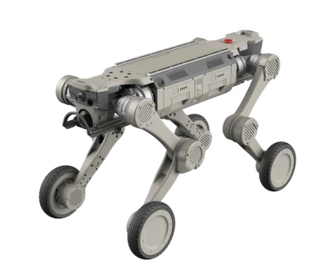
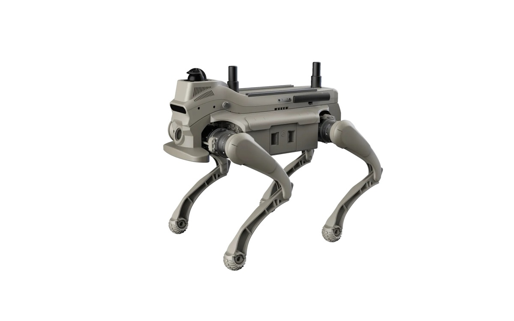
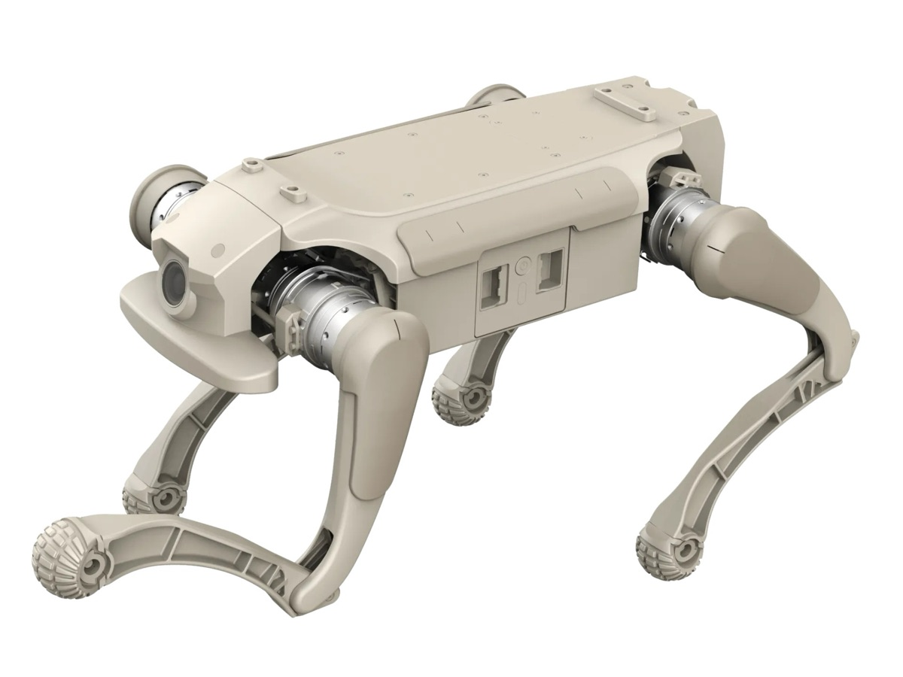
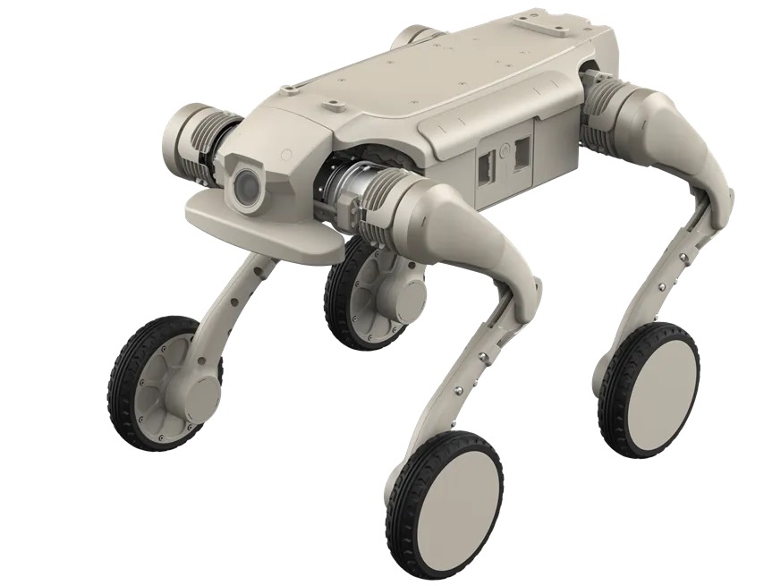

# Genisom AI × T04 — Products and Solutions

⬆ [Genisom AI profile](../Genisom-AI.md) · [Brief](Genisom-AI-T04-1-Brief.md) · [Playbook](Genisom-AI-T04-3-Playbook.md)

**Read this first:** Genisom AI sells industrial quadrupeds. Nothing in the range is a care product. The useful roles in T04 are **follow and carry, guide, patrol and observe, and pace a walk**. Which models are on site is not confirmed — ask the booth before planning. All specs are company-stated laboratory figures.

## Relevant products (ranked for this track)

### Genisom L2

**Role in T04:** best all-round choice — follows a person without a remote, carries a bag or supplies, navigates between floors.

| Spec | Value |
|---|---|
| Person-following | **GLUE**: fused UWB + vision, omnidirectional. Range and accuracy not public |
| Payload | **16 kg** continuous (150 kg static) |
| Runtime | about **5.5 h / 20 km** at 1 m/s, no load (**756 Wh**) |
| Environment | **IP66**, **−20 to 55 °C**, 40° slope, 70 cm obstacle |
| Perception | stereo camera + 4 fisheye cameras + LiDAR; GNSS |
| Compute | up to **86 TOPS** on board |
| Navigation | RoamerX: mapping, route planning, obstacle avoidance, indoor / outdoor / multi-floor |
| Voice, noise, body weight, top speed | not public |

- **Status:** ✅ launched at WAIC, July 2026 (⚠️ unverified shipping date). Price not public.
- **Developer interface:** `genisom_robot_sdk` (GEN2), C++17, Ubuntu 22.04, UDP. Streams state, fault and sensor data; motion commands; recharge / undock tasks; status LED; camera bitrate. ⚠️ unverified: whether GLUE following and navigation goals can be started from the SDK.

### Genisom M1 (variants M1 Pro, M1 Ultra)

**Role in T04:** outdoor walking companion and pacer on snow, slopes and stairs; the **M1 Pro** is the only model with documented voice dialogue.

| Spec | Value |
|---|---|
| Voice (M1 Pro) | voice dialogue, voice recording and broadcast |
| Person-following (M1 Pro) | fused UWB + laser-vision tracking. Range not public |
| Payload / body | about **30 kg** continuous / about **30 kg** body |
| Runtime | up to **5 h / 29 km** no load; dual hot-swap batteries; optional dock with automatic return to charge |
| Environment | **IP67**, **−20 to 55 °C**, 45° slope, 25 cm continuous stairs |
| Perception (M1 Ultra) | 4 fisheye + forward stereo, 720° coverage |
| Proven pace | about 9 min/km for 21 km (half-marathon pacer, 2026) |

- **Status:** ✅ shipping. Price not public.
- **Developer interface:** same GEN2 SDK as L2 (15 open hardware interfaces on the body).
- **Caution:** a 30 kg machine near frail people needs a wide safety margin and a human on the stop button.

### Genisom L1 EDU

**Role in T04:** most likely unit on site; small enough for indoor corridors; enough sensors and compute to run your own person detection, fall detection and navigation.

| Spec | Value |
|---|---|
| Compute | NVIDIA Jetson **Orin NX, up to 100 TOPS** |
| Sensors | built-in 3D LiDAR, depth camera, GNSS, 5G |
| Payload | **8 kg** continuous (L1 platform) |
| Environment | **IP54**, **0–40 °C** only — indoor or mild weather |
| Mobility | 40° slope, 16 cm continuous stairs |
| Battery, runtime, weight | not captured from the official page — ask on site |

- **Status:** ✅ shipping. Price not public.
- **Developer interface:** `genisom_L1_sdk` (C++, MIT), JSON over UDP. High-level only: stand up, velocity-style motion command, modes (balance stand, locked, entertainment, RoamerX, unloading squat); reads IMU, odometry, joint state, battery, temperature, faults. The product page also lists a video-stream interface. No Python bindings and no joint-level command interface are described in the current repo.

### Genisom L1

**Role in T04:** base L1 without the EDU sensor kit. Has an HD camera with a monocular target-tracking model (company-stated) and 7 open interfaces (Ethernet, USB 3.0 / 2.0, 24 V / 12 V), so a laptop or an added board must supply the intelligence. Same SDK and limits as L1 EDU. ✅ shipping, price not public.

### Genisom L1-W

**Role in T04:** quieter, smoother indoor courier on flat floors (wheels), **10 kg** payload, noise as low as **55 dB**, IP54. Legs still handle thresholds. ✅ shipping, price not public. Following feature not documented.

### RoamerX

**Role in T04:** route patrol and goal navigation for night rounds and deliveries. Open "Lite" version: ROS 2 Humble + Nav2 (NavFn + MPPI), behaviour trees, talks to the robot over UDP or LCM. ✅ free community version; the full version ships on robots.

### TA01 robotic arm

**Role in T04:** would enable fetch and hand-over on an M1, but it is 🧪 demo-only (WRC, August 2026), with no product page, no public specs and no SDK found. Do not plan around it unless the booth has one and offers an interface.

## What Genisom AI already does in this domain

Very little, and none of it is documented in detail.

| When | What | Evidence level |
|---|---|---|
| Undated (page live November 2026) | Official "Emerging Applications" page lists **Accessibility & Public Services**: smart guidance, accessible mobility, human-robot collaboration — worded as "explore". Application cases named **Smart Guide Dog · Mianyang** and **Smart Guide Dog · HIT Suzhou** | Case titles only; no partner details, dates, user numbers or results public |
| Undated | Same page: **Public Health & Disinfection** — remote inspection and automated disinfection with payloads; case "Disinfection Solution · Qihang" | Title only |
| 2026-07-19 | WAIC 2026 news: **accessibility** listed among demonstrated application areas, alongside partner-built applications | One word in a company news post |
| 2026 | M1 followed a runner autonomously for a full half marathon (21 km, about 3 h) | Company product page; shows long-duration human-following, not care use |

- No elderly-care, hospital, rehabilitation-clinic or home-care deployment was found.
- No named healthcare partner or customer.
- No presence in Switzerland or Europe beyond ICRA 2026 in Vienna.
- Web search was not available for this track-specific pass; third-party coverage of the guide-dog cases was therefore not checked. ⚠️ unverified beyond the official page.

## What they are building next in this domain

- **Stated direction:** four stages — locomotion, spatial, cognitive (interaction), swarm. The "cognitive / interaction" stage and **SomaMind** (🧪 agent system, no public SDK) point toward voice-driven task robots.
- **NE01 humanoid** (🧪 "coming soon") and **TA01 arm** (🧪) add manipulation to the roadmap. No care positioning announced.
- **Inference, not announced:** the guide-dog cases and the accessibility wording suggest partner-led projects on robotic guidance. Nothing indicates a dedicated elderly-care product.

## Software, models and data that help for this track

| Asset | Use in T04 | Access |
|---|---|---|
| [genisom_L1_sdk](https://github.com/zsibot/genisom_L1_sdk) | Drive L1 / L1 EDU from your own follow, guide or patrol logic | C++, MIT |
| [genisom_robot_sdk](https://github.com/zsibot/genisom_robot_sdk) | Same for M1 / L2; recharge tasks for unattended night rounds | C++17 |
| [genisom_roamerx_open](https://github.com/zsibot/genisom_roamerx_open) | Waypoint patrol, go-to-room, multi-floor | ROS 2 Humble |
| [genisom_vln](https://github.com/zsibot/genisom_vln) | "Find the green plant"-style open-vocabulary goal search from a text prompt; works with a local SmolVLM2, Ollama (gemma3:4b) or a cloud API | BSD-3-Clause; built around the MATRiX simulator, real-robot use not documented; RTX 4090 recommended for local models |
| [MATRiX](https://github.com/zsibot/matrix) | Test navigation and following in simulation while waiting for robot time | BSD-3-Clause |

Not available from Genisom: fall-detection or pose models, speech stack for L1 / L2, care datasets, manipulation models. Bring your own (for example an open pose-estimation model on the Orin NX or a laptop).

## Gaps and limits for this track

- **No manipulation** in any shipping product. No force or torque-controlled contact with people.
- **No safety certification for close human contact** found; legged robots can stumble or kick. Keep distance, low speed and a stop button.
- **L1 is 0–40 °C, IP54** — not for a November evening outdoors at 1,400 m. L2 or M1 only for outdoor demos.
- **C++ only** SDKs; no Python in the current repos; L1 SDK is high-level only.
- **Following and voice via SDK are unconfirmed** — they may be app-only features.
- **Speaker / microphone on L1 and L2 not documented** — plan a USB speaker-microphone on the open USB port.
- **Leg noise and appearance** may unsettle elderly users; noise figure is public only for L1-W.
- **Evidence in care is thin:** two guide-dog case titles and one word in a press post.

## Sources
- [Genisom AI — Emerging Applications (Accessibility & Public Services, Public Health & Disinfection, case list)](https://www.genisomai.com/en/industry/emerging-applications)
- [Genisom AI — Robotics Entertainment (voice interaction, interactive payloads)](https://www.genisomai.com/en/industry/robotics-entertainment)
- [Genisom L2 product page](https://www.genisomai.com/en/product-robot/L2)
- [Genisom M1 product page](https://www.genisomai.com/en/product-robot/M1)
- [Genisom L1 product page](https://www.genisomai.com/en/product-robot/L1)
- [GENISOM AI at WAIC 2026 (company news, 2026-07-19)](https://www.genisomai.com/en/newsdetail/GENISOM-AI-at-WAIC-2026)
- [GENISOM AI at WRC 2026 (company news, 2026-08-23)](https://www.genisomai.com/en/newsdetail/GENISOM-AI-at-WRC-2026)
- [genisom_L1_sdk (GitHub)](https://github.com/zsibot/genisom_L1_sdk)
- [genisom_robot_sdk (GitHub)](https://github.com/zsibot/genisom_robot_sdk)
- [genisom_vln (GitHub)](https://github.com/zsibot/genisom_vln)
- [genisom_roamerx_open (GitHub; facts taken from the company profile)](https://github.com/zsibot/genisom_roamerx_open)
- [matrix (GitHub; facts taken from the company profile)](https://github.com/zsibot/matrix)
- [Genisom AI company profile (general research)](../Genisom-AI.md)
