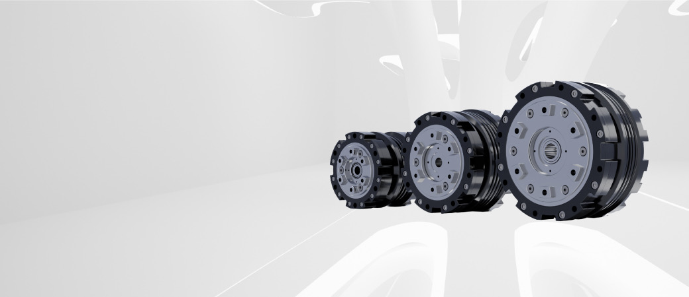
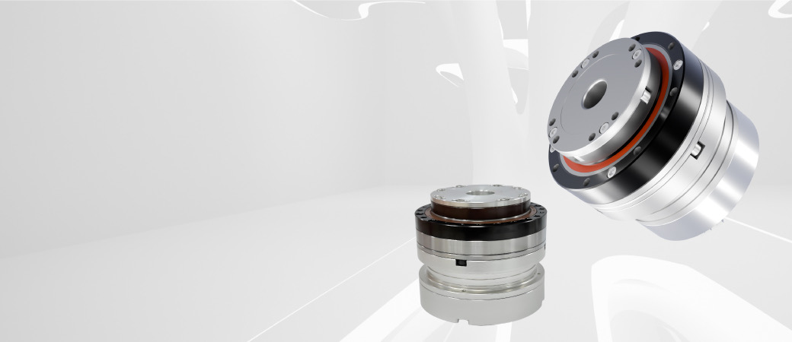
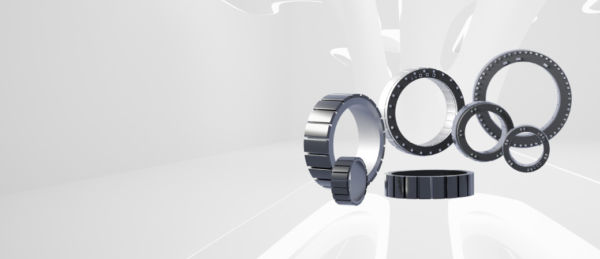
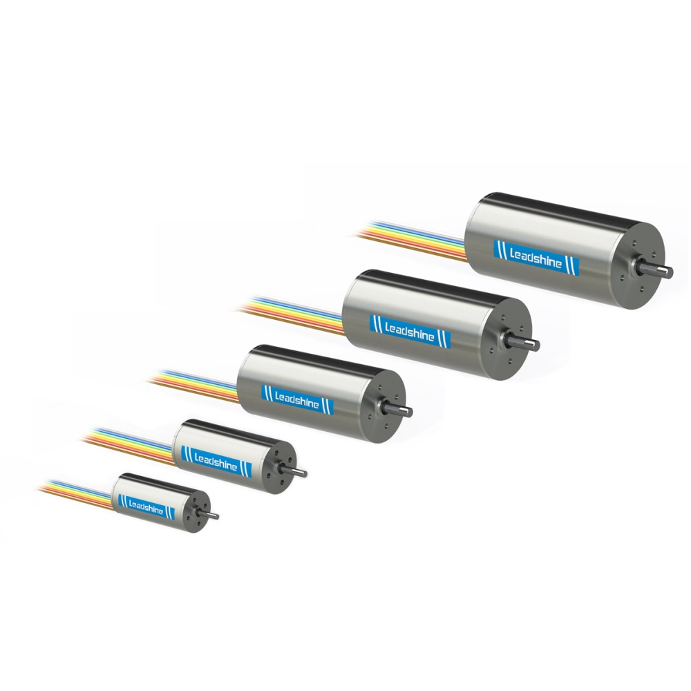
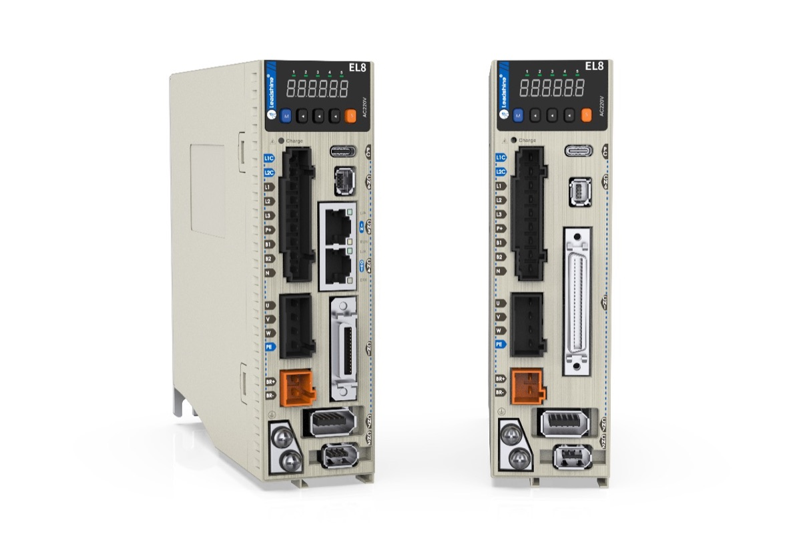
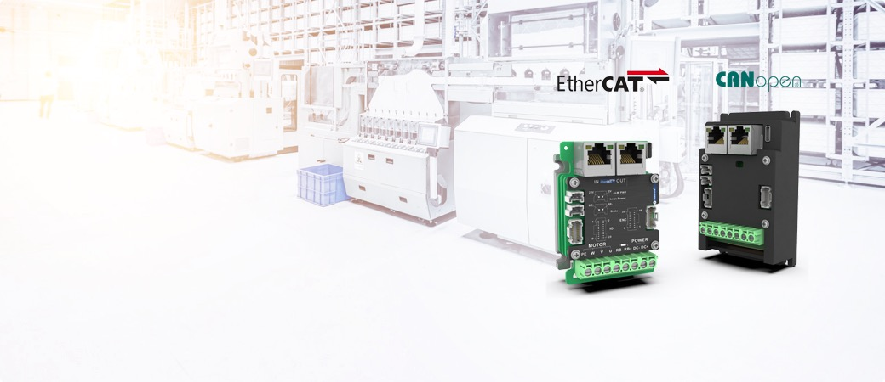
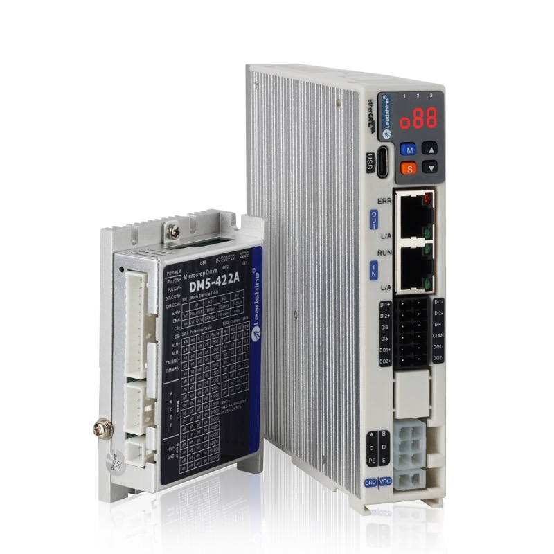
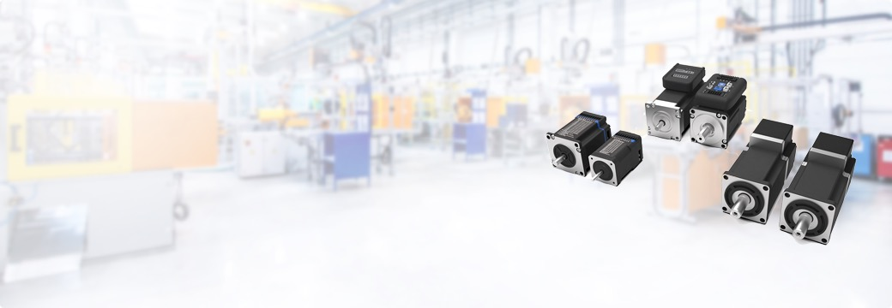
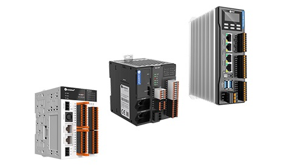

# Leadshine Technology Co., Ltd. — Product Portfolio

⬆ [Leadshine Technology Co., Ltd. profile](Leadshine.md) · [Developer guide](Leadshine-Developer-Guide.md) · [Roadmap and strategy](Leadshine-Roadmap-and-Strategy.md) · [Solutions and projects](Leadshine-Solutions-and-Projects.md)

> **Read this first.** Leadshine (雷赛智能, SZSE 002979) sells **parts, not robots**: dexterous hands, joint actuators, frameless and coreless motors, plus a large industrial motion-control catalogue. For a 48-hour build only the **hands** (SDK + ROS 2 + URDF) are plug-and-code; everything else needs a fieldbus master and mechanical work.
> The hands and their software are developed by Leadshine's hand unit **Leadtron / 灵巧驱控** (the manuals name "Shenzhen Lingqiao Drive and Control Technology Co., Ltd." and "Shenzhen Leadtron Technology Co., Ltd."); ownership share ⚠️ unverified.
> Prices are **USD list / sale prices from Leadshine's own web store as captured on 2026-11-14** — they change often.

## Lineup map

Track relevance: ● strong · ◐ partial · ○ none. Status: ✅ shipping · 🧪 announced / shown · 🔭 planned.

| Product | Category | Status | Launched | Price (if public) | Positioning (one line) | T01 | T02 | T03 | T04 |
|---|---|---|---|---|---|---|---|---|---|
| [DH116 series](#dh116-series) | Five-finger dexterous hand, 11 DoF | ✅ | DH series announced Mar 2025; DH116 = 2nd-generation volume model | **USD 2,199** (no sensors) · **USD 2,799** (tactile -M) | Robust, strong workhorse hand: 545 g, 30 kg hook load | ● | ◐ | ◐ | ● |
| [DH116S series](#dh116s-series) | Compact five-finger hand, 11 DoF | ✅ | Manual first issued Dec 2025; presented as newly launched at WAIC, Jul 2026 | **USD 2,299** (CAN FD or RS485, no sensors) | Ultra-thin 359 g hand for small / mid-size humanoids, education, research | ● | ◐ | ◐ | ● |
| [DH2116 series](#dh2116-series) | High-DoF hand, 21 DoF (16 active) | ✅ | 2025–2026 (successor of the 20-DoF DH2015 shown May 2025) | **USD 12,999** | Flagship research hand with finger abduction; fine manipulation, not heavy loads | ● | ◐ | ◐ | ● |
| [PJ3 series](#pj3-series) | Planetary integrated joint actuator | ✅ | 2025–2026 (store listings from May 2026) | **USD 339–499** | Low-cost back-drivable joint for legs, small arms, exoskeleton-type joints | ◐ | ◐ | ◐ | ◐ |
| [HJ2 series](#hj2-series) | Harmonic integrated joint actuator | ✅ | 2025–2026 (store listings from Apr 2026) | **USD 599–929** | Precise hollow-shaft joint for arms / cobot-style mechanisms | ◐ | ◐ | ◐ | ◐ |
| [FM2 series (FM family)](#fm2-series-fm-family) | Frameless torque motor | ✅ | 2025 (FM1 earlier) | **USD 79–239** | Motor kit for people who design their own joints | ○ | ○ | ◐ | ○ |
| [CD / CDH ring servo drives](#cd--cdh-ring-servo-drives) | Hollow ring-shaped joint drive | ✅ (Chinese site only) | 2025 | not public | Drive board that sits inside a custom joint; EtherCAT + STO | ○ | ○ | ○ | ○ |
| [RJ1 / RJH joint modules](#rj1--rjh-collaborative-robot-joint-modules) | Cobot joint module (harmonic) | ✅ (Chinese site only) | 2025 | not public | Bigger joints for collaborative arms, up to 762 N·m peak | ○ | ◐ | ○ | ○ |
| [iW series](#iw-series) | Wheel module / low-voltage integrated wheel drive | 🧪 | Shown Jun–Jul 2026 | not public | Drive wheel for AGV / AMR bases; no product page yet | ◐ | ◐ | ◐ | ○ |
| [Coreless motors, micro servo drives, encoders](#coreless-motors-micro-servo-drives-and-encoders) | Hand / small-joint actuation components | ✅ | First shown Nov 2023 (SPS) | not public | The motor + drive + encoder inside the hands, sold separately | ○ | ○ | ○ | ◐ |
| [EL7 / EL8 / EL8S AC servo + ELM motors](#el7--el8--el8s-ac-servo-drives-and-elm-motors) | Mains-voltage servo systems | ✅ | EL7 / EL8 current generation; EL8S shown 2026 | via distributors | Factory-grade servo axes, 50 W–7.5 kW | ○ | ○ | ○ | ○ |
| [ELD3 / ELD3 MINI / 2ELD2 low-voltage servo](#eld3--eld3-mini--2eld2-low-voltage-servo-drives) | DC servo drives and integrated servo motors | ✅ | current | via distributors | 24–60 V servo for mobile robots and compact machines | ◐ | ○ | ◐ | ◐ |
| [Stepper and closed-loop stepper drives](#stepper-and-closed-loop-stepper-drives) | Stepper drives | ✅ | current | via distributors | Cheap positioning axes; EtherCAT and EtherNet/IP versions | ○ | ○ | ◐ | ○ |
| [Integrated motors](#integrated-motors) | Motor + drive + encoder in one | ✅ | current (ISS1 shown 2026) | via distributors | One-cable axis for conveyors, sorters, simple mechanisms | ◐ | ○ | ◐ | ○ |
| [PLCs, remote I/O, HMIs](#plcs-remote-io-and-hmis) | Controllers | ✅ | current | via distributors | EtherCAT motion PLCs from 6 to 256 axes | ○ | ○ | ○ | ○ |

**How to read the track columns:** hands are rated ● for T01 / T04 because a five-finger hand on a host arm or humanoid is directly usable for service tasks (T01.3, T01.7) and for assistance, hand-over and rehab-mirroring demos (T04.1, T04.3, T04.5). For T02 / T03 they are a supporting end-effector (T02.1 valve / switch / debris handling, T03.1 / T03.6 sorting). Joint modules and motors only matter if a team builds its own mechanism.

## Products

### DH116 series

Second-generation, volume-produced five-finger hand. Brushless coreless servo motors with worm-gear transmission (self-locking), FOC current loop and hybrid force / position control. The strongest and most widely demonstrated Leadshine hand — the most likely loan unit on site (best guess).

| Spec | Value (source: user manual unless noted) |
|---|---|
| Degrees of freedom | **11 total, 6 active** |
| Active joint ranges | Thumb side swing 0–60° · thumb flexion 0–30° · index / middle / ring / little flexion 0–80° each |
| Weight | **545 g ± 10 g** |
| Load | Hook grip **≤ 30 kg** · single finger max **5 kg** (product page) |
| Lateral (side) grip | **≤ 50 N** (product page: "exceeds 50 N") |
| Open / close time | 0.5 s (manual lists "≥ 0.5 s") |
| Repeatability | ± 0.2 mm |
| Power | **12–48 V DC @ 2.5 A** |
| Interfaces | CAN FD (DH116), EtherCAT 100 Mbit (DH116EC), RS485 (DH116RS — store listing) |
| Connector | 8-pin cable: VDC, GND, EtherCAT RX± / TX±, CANH, CANL |
| Tactile sensing (-M models) | "Multimodal" tactile sensors, **6 as standard**: normal force, tangential force and its direction, proximity; soft-landing behaviour |
| Lifetime | **1 million** grasp cycles (vendor claim) |
| Environment | −10 to 40 °C, 85 % RH in the spec table; the usage notes say operate at **0–40 °C**. Not for dusty / oily / wet use; no IP rating stated |
| Software | Windows 10+, Linux, ROS 2; C++ and Python; x86 and ARM |
| Warranty | 12 months |

**Variants (what each unlocks)**

| Model | Bus | Tactile sensors | Hand | Store price (sale / list) |
|---|---|---|---|---|
| DH116-L1 / DH116-R1 | CAN FD | none | left / right | USD 2,199 / 2,299 |
| DH116EC-L1 / DH116EC-R1 | EtherCAT | none | left / right | USD 2,199 / 2,299 |
| DH116RS-L1 / DH116RS-R1 | RS485 | none | left / right | USD 2,199 / 2,299 |
| DH116-L1-M / DH116-R1-M | CAN FD | multimodal tactile | left / right | USD 2,799 / 2,999 |
| DH116EC-L1-M / DH116EC-R1-M | EtherCAT | multimodal tactile | left / right | USD 2,799 / 2,999 |
| DH116P | — | — | — | Enhanced variant named in the manual title and shown at CES 2026; no separate spec sheet found ⚠️ unverified |

- **No EDU / developer edition exists.** Every variant uses the same SDK ("LHandProLib"), the same Windows GUI tool ("LHandPro") and the same URDF / MJCF. What changes is the bus and whether you get force feedback.
- **Downloads listed in the manual:** GUI debug tool, SDK, URDF + MJCF, ROS 2 workspace (`lhandpro_ws_116_2026_02_10`), EtherCAT ESI file (`LSLQ_DH116.xml`), protocol spreadsheet (EtherCAT / CAN FD / RS485), STEP model.
- **Version trap:** hands manufactured **before 10 Feb 2026** use an older SDK, URDF and protocol set (listed separately in the manual). Ask which generation you are holding.
- **Typical applications:** carrying and handling (hook grip), tool and door-handle grasping, parcel hand-over, tactile pick-and-place, teleoperation targets.
- Official pages: [DH116 series](https://www.leadshine.com/robots/dextrous-hands/dh116-series.html) · [store listing DH116-R1](https://store.leadshine.com/products/dh116-r1-dexterous-hand) · [user manual (PDF)](https://store.leadshine.com/cdn/shop/files/DH116_DH116P_Series_Dexterous_User_Manual.pdf)

### DH116S series

Ultra-thin "small hand" built for small and mid-size humanoids (the first-pass profile cites 1.1–1.4 m robots). Same 11-DoF / 6-active layout and worm-gear drive as DH116 in a much smaller, lighter body. Positioned by Leadshine for entertainment, display, **education and research**.

| Spec | Value (source: user manual unless noted) |
|---|---|
| Degrees of freedom | **11 total, 6 active** |
| Active joint ranges | Thumb lateral swing 0–91° · thumb flexion 0–59° · index / middle / ring 0–72° · little finger 0–74° |
| Size | **147.54 × 73.53 × 26.35 mm** |
| Weight | **359 g ± 10 g** (the first-pass profile quotes "< 380 g" from the store) |
| Load | Hook grip max **15 kg** (manual and store); the product page says "light-load handling of 10 kg" — sources differ |
| Five-finger side grip | **50 N** |
| Min. open / close time | **0.4 s** |
| Repeatability | ± 0.2 mm |
| Power | **12–48 V DC** (−10 % / +10 %) · static 0.1 A · max 2.0 A |
| Interfaces | CAN FD (DH116S), EtherCAT (DH116SEC), RS485 (DH116SRS) |
| Connector | 6-pin: VDC ×2, GND ×2, CANH / 485+, CANL / 485− (CAN FD or RS485, choose one) |
| Tactile options | none · **-S** standard piezoresistive · **-M** multimodal. Palm: normal force 0–25 N at 0.1 N resolution. Five fingers: normal force 0–20 N at 0.01 N resolution, tangential force at 0.01 N with direction 0–360° at 1° |
| Lifetime | 1 million no-load cycles and 1 million full-load side-grip cycles; design life 3 years (vendor figures) |
| Environment | Working −10 to 45 °C, 10–90 % RH · storage −10 to 70 °C · **IP30** |
| Colours | Ceramic White, Obsidian Black, Cloud Pattern Silver, Black Jade Gray |
| Software | Windows, Linux, ROS 2; C++ and Python; x86 and ARM; GUI tool; SDK and demos described as open-source |
| Warranty | 12 months |

**Variants**

| Model family | Bus | Sensor suffix | Hand / colour | Store price (sale / list) |
|---|---|---|---|---|
| DH116S-L1 / -R1 | CAN FD | none, -S, -M | left / right | USD 2,299 / 2,399 (no-sensor units: DH116S-LG1, -LW1, -RG1, -RW1) |
| DH116SRS-L1 / -R1 | RS485 | none, -S, -M | left / right | USD 2,299 / 2,399 (no-sensor units: DH116SRS-LG1, -LW1, -RG1, -RW1) |
| DH116SEC-L1 / -R1 | EtherCAT | none, -S, -M | left / right | not in the store capture |

- In store part numbers the letter before the final "1" is the colour (**G** = gray, **W** = white).
- **Optional accessories named in the manual:** KJS-1509 variable power supply (3–24 V @ 2.5 A), 0.5 m EtherCAT debug cable, **MINI USB-CANFD-I** USB-to-CAN-FD debugger, and **6248XL "Super Sensing" data gloves** for data acquisition / teleoperation.
- **Downloads listed in the manual:** GUI tool, SDK + demo, URDF + MJCF, ROS 2 workspace (`lhandpro_ws_DH116S_2026_1_6`), CAN FD protocol, STEP model.
- **Typical applications:** end-effector for small humanoids and light arms, gesture / HRI demos, glove teleoperation, education.
- Official pages: [DH116S series](https://en.leadshine.com/robots/dextrous-hands/dh116s-series.html) · [store listing DH116S-RG1](https://store.leadshine.com/products/dh116s-rg1-dexterous-hand) · [user manual (PDF)](https://store.leadshine.com/cdn/shop/files/DH116S_Series_Dexterous_User_Manual.pdf) · [ROS 2 example description (PDF)](https://store.leadshine.com/cdn/shop/files/DH116S_LHandPro_ROS2_Example_Project_Description.pdf)

### DH2116 series

Flagship high-DoF hand: 16 brushless coreless motors plus 5 passive joints, trapezoidal-screw drive. Each finger has side-to-side (abduction) motion, so it can do in-hand and fine manipulation the 11-DoF hands cannot. Heavier, far more expensive and rated for much lower loads.

| Spec | Value (source: user manual unless noted) |
|---|---|
| Degrees of freedom | **21 total: 16 active + 5 passive** |
| Finger kinematics | A finger is driven by 3 motors controlling 4 joints: joint 1 (abduction) −20° to +20°; joints 2–4 flexion 0–90° (motor-commanded range about 0–75°); joint 4 follows joint 3. Motor commands 0–4095 |
| Size | **218 × 119 × 80.5 mm** |
| Weight | **850 g ± 10 g** |
| Max recommended load | **5 kg** |
| Five-finger grip force | **150 N** max in the manual; **94 N** max whole-hand grip on the product page and store — sources differ, treat 94 N as the safe figure |
| Min. open / close time | 0.6 s |
| Repeatability | ± 0.6 mm |
| Power | **24–60 V DC** · quiescent 0.16 A, rated 1 A, max 5 A (all at 24 V) |
| Interfaces | CAN 1 Mbps · CAN FD 1 / 5 Mbps · RS485 5 Mbps (no EtherCAT) |
| Lifetime | 300,000 no-load cycles and 300,000 full-load side-grip cycles; design life 2 years (vendor figures) |
| Colour | Ink Jade Gray |
| Software | Windows, Linux, ROS 2 (claimed); C++ and Python; x86 and ARM; GUI tool; SDK and demos |
| In the box | Hand (DH2116-L1 left or DH2116-R1 right), M9 communication debug cable, **PCAN-USB** USB-to-CAN module |

- **Variants and price:** DH2116-L1, DH2116-R1 — **USD 12,999** sale / 14,999 list in the store.
- **Downloads listed in the manual:** GUI tool, SDK, STEP, URDF (`DH2116_URDF_Files_2026_3_16`), protocol spreadsheet. The manual lists **no ROS 2 workspace and no MJCF** for DH2116 — confirm with staff before planning a ROS 2 pipeline around it.
- **Typical applications:** dexterous-manipulation research, imitation-learning targets, fine object handling (T04 assistance, T01 service tasks).
- Official pages: [DH2116 series](https://www.leadshine.com/robots/dextrous-hands/dh2116-series.html) · [store listing DH2116-R1](https://store.leadshine.com/products/dh2116-r1-dexterous-hand) · [user manual (PDF)](https://store.leadshine.com/cdn/shop/files/DH2116_Series_Dexterous_Hand_User_Manual.pdf)

**Hand chooser**

| Need | Pick |
|---|---|
| Carry or pull something heavy, robust demo | DH116 (30 kg hook grip) |
| Light host robot or arm with small payload | DH116S (359 g) |
| Force feedback / gentle grasp | DH116-…-M or DH116S-…-S / -M |
| Finger abduction, in-hand manipulation | DH2116 |
| Fastest bring-up on a laptop | CAN FD variant + USB-CAN-FD adapter + LHandPro GUI, then SDK |

### PJ3 series

Planetary ("quasi-direct-drive" style) integrated joint: frameless brushless motor, planetary gearbox, encoder and drive in one housing. Gears are vacuum-nitrided; the drive uses GaN devices (lower noise and vibration, per vendor) and offers a monitoring port (for example temperature). Marketed for humanoid legs and arms, robot dogs, cobots and automation.

| Model | Outer Ø | Bus | Rated torque | Peak torque | Output speed | Weight | Store price (sale / list) |
|---|---|---|---|---|---|---|---|
| PJ3-60CAN29 | 60 mm | CAN FD | **9.5 N·m** | 28 N·m | 200 rpm | 530 g | USD 339 / 349 |
| PJ3-60EC29 | 60 mm | EtherCAT | 9.5 N·m | 28 N·m | 200 rpm | 530 g | USD 369 / 379 |
| PJ3-75CAN42 | 75 mm | CAN FD | **14 N·m** | 42 N·m | 155 rpm | 800 g | USD 399 / 419 |
| PJ3-75EC42 | 75 mm | EtherCAT | 14 N·m | 42 N·m | 155 rpm | 800 g | USD 439 / 459 |
| PJ3-97CAN140 | 97 mm | CAN FD | **44 N·m** | 140 N·m | 130 rpm | 1,200 g | USD 489 / 509 |
| PJ3-97EC140 | 97 mm | EtherCAT | 44 N·m | 140 N·m | 130 rpm | 1,200 g | USD 499 / 529 |

- Values are from the store listings; supply voltage, encoder resolution and gear ratio are not stated there. (The older PJ2 generation on the Chinese site runs on 24 / 48 V with a 17-bit encoder — see [Legacy](#legacy-and-discontinued).)
- **Developer access:** no public SDK, ROS 2 driver or protocol document found. EtherCAT versions should behave as CiA 402 drives ⚠️ unverified — ask staff for the object dictionary / CAN FD frame format.
- **Typical applications:** leg and arm joints of small / mid humanoids, quadrupeds, pan-tilt units, assistive or exoskeleton-type joints (T04.3 / T04.4, custom mechanics only).
- Official pages: [PJ3 series](https://www.leadshine.com/robots/integrated-actuators/PJ3-Series.html) · [store collection](https://store.leadshine.com/collections/pj3-planetary-integrated-actuators) · [Chinese PJ module page](https://www.leisai.com/product/product_details_1321.html)

### HJ2 series

Harmonic-drive integrated joint with hollow shaft: FM2 frameless motor, 101:1 harmonic reducer, **24-bit** encoder and drive in one package; optional holding brake. Vendor claims versus its earlier design: 65 % lighter, 20 % smaller, double torque density, about 30 % cheaper.

| Model (NK = no brake, BK = brake) | Outer Ø × length | Hollow shaft | Rated torque | Peak torque | Peak output speed | Weight | Store price (sale / list) |
|---|---|---|---|---|---|---|---|
| HJ2-52H101D24-NK-EC | 52 × 56.6 mm | 10 mm | **5 N·m** | 11 N·m | 50 rpm | 0.29 kg | USD 599 / 609 |
| HJ2-52H101D24-BK-EC | 52 × 74.1 mm | 10 mm | 6.5 N·m | 11 N·m | 59 rpm | 0.38 kg | USD 669 / 679 |
| HJ2-70F101D24-NK-EC | 70 × 61.3 mm | 12 mm | **9.6 N·m** | 34 N·m | 64 rpm | 0.60 kg | USD 669 / 679 |
| HJ2-70F101D24-BK-EC | 70 × 82.3 mm | 12 mm | 9.6 N·m | 34 N·m | 49 rpm | 0.80 kg | USD 729 / 749 |
| HJ2-80F101D24-NK-EC | 80 × 68.2 mm | 17 mm | **30 N·m** | 66 N·m | 48 rpm | 0.96 kg | USD 729 / 749 |
| HJ2-80F101D24-BK-EC | 80 × 84.2 mm | 17 mm | 30 N·m | 66 N·m | 41 rpm | 1.17 kg | USD 799 / 809 |
| HJ2-90F101D24-NK-EC | 90 × 71.2 mm | 18 mm | **50 N·m** | 102 N·m | 50 rpm | 1.23 kg | USD 799 / 809 |
| HJ2-90F101D24-BK-EC | 90 × 88.3 mm | 18 mm | 50 N·m | 102 N·m | 40 rpm | 1.60 kg | USD 859 / 889 |
| HJ2-110F101D24-NK-EC | 110 × 80.2 mm | 25 mm | **84 N·m** | 194 N·m | 40 rpm | 1.98 kg | USD 859 / 889 |
| HJ2-110F101D24-BK-EC | 110 × 97.6 mm | 25 mm | 84 N·m | 194 N·m | 36 rpm | 2.60 kg | USD 929 / 949 |

- Common to all: **48 V** supply, gear ratio **101**, backlash ≤ 10 arcsec, 24-bit encoder, bus **EtherCAT / CAN / CAN FD** (Chinese spec table; store units are sold as EtherCAT). Rated torque is quoted at 2000 rpm motor speed. Store listings give near-identical weights (for example 326 g for the 52 mm no-brake unit).
- **Developer access:** same caveat as PJ3 — no public SDK or ROS 2 driver found.
- **Typical applications:** arm, wrist and waist joints, cobot-style manipulators, precise pan-tilt / camera gimbals.
- Official pages: [HJ2 series](https://www.leadshine.com/robots/integrated-actuators/hj2-series.html) · [store listing HJ2-52](https://store.leadshine.com/products/hj2-52h101d24-nk-ec-harmonic-integrated-actuator) · [Chinese HJ module page](https://www.leisai.com/product/product_details_1321.html)

### FM2 series (FM family)

Frameless torque motor kits (stator + rotor, no housing, bearings or encoder) for teams that design their own joints. All listed models are wound for **48 V DC**, 3-phase. FM2 is the current "ultra-high-density" generation; FM1 is the earlier one, still on the Chinese site.

**Frame sizes — sources disagree:** English product page: five sizes 43 / 50 / 60 / 70 / 85 mm. Chinese product page: eight sizes 28 / 43 / 50 / 60 / 70 / 85 / 104 / 127 mm. Chinese spec table: 50, 60, 69, 85, 94 and 127 mm stator diameters. Automate 2026 release: six sizes, 50–127 mm. Customisation offered.

Models sold in the web store (store figures):

| Model | Stator Ø | Rated power | Rated / peak torque | Rated / max speed | Weight | Store price |
|---|---|---|---|---|---|---|
| FM2-04308 | 43 mm | 77 W | 0.20 / 0.82 N·m | 3,700 / 5,500 rpm | 54 g | USD 89 |
| FM2-05008 | 50 mm | 207 W | 0.36 / 1.26 N·m | 5,500 / 6,500 rpm | 92 g | USD 79 |
| FM2-05014 | 50 mm | 211 W | 0.60 / 2.50 N·m | 3,360 / 3,970 rpm | 136 g | USD 109 |
| FM2-06008 | 60 mm | 251 W | 0.48 / 1.43 N·m | 5,000 / 6,500 rpm | 135 g | USD 89 |
| FM2-06011 | 60 mm | 259 W | 0.65 / 1.95 N·m | 3,800 / 5,000 rpm | 175 g | USD 109 |
| FM2-07010 | 70 mm | 183 W | 0.70 / 3.00 N·m | 2,500 / 3,110 rpm | 211 g | USD 129 |
| FM2-07013 | 70 mm | 272 W | 1.0 / 3.5 N·m | 2,600 / 4,600 rpm | 264 g | USD 149 |
| FM2-07018 | 70 mm | 400 W | 1.40 / 4.90 N·m | 3,000 / 4,000 rpm | 330 g | USD 169 |
| FM2-08513 | 85 mm | 471 W | 1.80 / 7.00 N·m | 2,500 / 3,000 rpm | 330 g | USD 179 |
| FM2-08523 | 85 mm | 1,063 W | 2.90 / 10.80 N·m | 2,500 / 3,550 rpm | 500 g | USD 239 |

- **Larger models (Chinese spec table only):** FM2-06026, FM2-09408 / 09413 / 09416 / 09426 (94 mm, up to 4 N·m rated / 10 N·m max) and FM2-12718 / 12725 (127 mm, up to **6.4 N·m rated / 19.2 N·m max**, 1.42 kg).
- ⚠️ The store and the Chinese spec table give **different numbers for the same model** (for example FM2-08523: store 2.9 / 10.8 N·m and 500 g; Chinese table 2.86 / 7.8 N·m and 0.629 kg). Use the datasheet of the exact part number before sizing anything.
- Vendor claims for FM2 versus FM1: about 10 % more torque at the same current, 20 % lower loss, lower temperature rise. Shipments of frameless motors exceeded 120,000 units in 2025 (company figure).
- **Typical applications:** custom joint modules for humanoids and cobots, gimbals, direct-drive stages; needs a drive (CD / CDH or ELD3) and an encoder.
- Official pages: [FM2 series](https://www.leadshine.com/robots/frameless-motors/fm2-series.html) · [store listing FM2-07013](https://store.leadshine.com/products/fm2-07013-frameless-motor) · [Chinese frameless motor page](https://www.leisai.com/product/product_details_1325.html)

### CD / CDH ring servo drives

Ring-shaped ("hollow") servo drive boards that mount inside a joint around the hollow shaft. Listed only on the Chinese site under robot core components; not in the English catalogue or web store.

| Series | Models (outer Ø) | Rated / peak current | Supply | Key functions |
|---|---|---|---|---|
| CD (cobot joints) | CD-EC4810-65 (Ø65), CD-EC4810-70 (Ø70), CD-EC4820-100 (Ø100), CD-EC4820-115 (Ø115); bore Ø15–20 mm | 10 / 30 A rms (65, 70) · 20 / 60 A rms (100, 115) | 48 V ± 10 % | EtherCAT in / out (CoE, DS402, FoE, **FSoE**), CAN, RS485, USB; **2-channel STO**; 2 absolute-encoder inputs (BiSS-C / RS485); optional 2 × 19-bit integrated encoders; torque-sensor port; brake output; PT1000 motor and gearbox temperature inputs |
| CDH (humanoid joints) | CDH-EC4805-058 (Ø58), CDH-EC4810-066 (Ø66), CDH-EC4820-099 (Ø99); bore Ø15 mm | 5 / 15 A · 10 / 30 A · 20 / 60 A rms | 48 V ± 10 % | EtherCAT in / out (CoE, DS402, FoE, FSoE), CAN, RS485, USB; optional 2 × 19-bit integrated encoders; torque-sensor port; brake output; motor temperature input; STO only on the Ø58 model |

- Supports dual-encoder full closed loop and open / closed-loop torque control with a torque sensor (vendor description).
- Official page: [robot ring drives (Chinese)](https://www.leisai.com/product/product_details_1324.html)

### RJ1 / RJH collaborative-robot joint modules

Harmonic joint modules aimed at collaborative arms and automation equipment (motor + harmonic reducer + encoder, RJ1 with drive on EtherCAT). Chinese site only.

| Series | Sizes | Supply / bus | Peak torque range | Rated torque range | Weight range | Encoder |
|---|---|---|---|---|---|---|
| RJ1 ("economy") | 14 / 17 / 20 / 25 / 32 (Ø70–142 mm) | 48 V · EtherCAT | 34 – **411 N·m** | 9.6 – 169 N·m | 1.3 – 6.6 kg | 19–20 bit |
| RJH ("high-voltage") | 20 / 25 / 32 / 40 (Ø90–170 mm) | 220 V · RS485 | 102 – **762 N·m** | 50 – 363 N·m | 2.8 – 11.5 kg | 23 bit |

- Too large and too slow to integrate for a hackathon build; listed for completeness.
- Official page: [collaborative joint modules (Chinese)](https://www.leisai.com/product/product_details_1320.html)

### iW series

Wheel modules for mobile robots. Leadshine listed "iW Series wheel modules" among its WAIC 2026 exhibits (July 2026) and described a "low-voltage integrated wheel solution" for AGV / AMR at Automate 2026 (June 2026).

- **No product page, datasheet, model list or price found** on the English site, the Chinese site or the web store — every spec is ⚠️ unverified. No picture saved.
- Related shipping products for mobile bases: iSV2 integrated servo motors (24–60 V), LVM low-voltage servo motors (IP65), LD2 / 2LD2 CANopen drives — see [low-voltage servo](#eld3--eld3-mini--2eld2-low-voltage-servo-drives).
- Sources: [WAIC 2026 recap](https://en.leadshine.com/newsEvent/details/leadshine-successfully-concludes-waic-2026,-showcasing-next-generation-robotics-solutions.html) · [Automate 2026 recap](https://www.leadshine.com/newsEvent/details/automate-2026-concludes-successfully-%7C-leadshine-drives-global-industrial-automation-and-humanoid-robotics-innovation-with-core-motion-control-technologies.html)

### Coreless motors, micro servo drives and encoders

The small-actuator building blocks Leadshine uses inside its hands and sells to other hand and joint makers.

| Item | What is confirmed |
|---|---|
| Coreless (hollow-cup) brushless motors | Chinese site lists three families: **EC** (standard), **ECH** (high-speed), **ECT** (high-torque). No public spec table. The "coreless micro servo system" first shown at SPS Nuremberg, Nov 2023, covered motor diameters **10–35 mm** |
| Micro servo drive ELD3 MINI (Chinese name LD3M-EC) | EtherCAT micro low-voltage drive, described as smaller than a business card; **3.0 kHz** speed-loop bandwidth; direct brake drive; runs rotary, linear, voice-coil, coreless and brushed DC motors; supports full closed loop |
| Kit encoders | Split magnetic: 17-bit (M17M, M17MP) and 23-bit (M23M). Split optical: 23-bit (B23M, B23MP) and 25-bit (B25M). Integrated optical types for 80 mm+ servo motors |

- English product pages do not exist for the coreless motors; treat detailed specs as "ask on site".
- Official pages: [coreless motors — high-speed type (Chinese)](https://www.leisai.com/product/product_details_1381.html) · [LD3 Mini drive (Chinese)](https://www.leisai.com/product/product_details_1006.html) · [SPS 2023 news](https://www.leadshine.com/newsEvent/details/Leadshine%20coreless%20micro%20servo%20system%20made%20a%20shocking%20debut%20at%20the%202023%20SPS%20exhibition.html)

### EL7 / EL8 / EL8S AC servo drives and ELM motors

Mains-powered industrial servo systems. Not hackathon material (mains wiring, tuning software), listed for completeness.

| Series | Confirmed facts |
|---|---|
| EL8 | Frequency response up to **3.5 kHz**; EtherCAT, Modbus RTU, pulse + direction, analogue; **STO SIL3** available; drives 400 W–2 kW; matching motors 50 W–2 kW with 23-bit magnetic / optical encoders; second-encoder input; motor auto-recognition |
| EL8S | Higher-response update shown at Automate 2026; UL-certified with STO (company release) |
| EL7 | EtherCAT, Modbus RTU / pulse, **Profinet**; 220 VAC range 400 W–2 kW; 400 VAC range **750 W–7.5 kW**; 23-bit encoders incl. battery-free type |
| ELM1 / ELM2 | Matching AC servo motors |
| Multi-axis | 2EL6 dual-axis and 4EL7 four-axis drives are listed in the English catalogue |

- Official pages: [EL8 series](https://www.leadshine.com/products/servo/servo-drive/el8-series.html) · [EL7 series](https://www.leadshine.com/products/servo/servo-drive/el7-series.html)

### ELD3 / ELD3 MINI / 2ELD2 low-voltage servo drives

DC-bus servo drives and matching low-voltage motors — the part of the industrial range closest to mobile robots.

| Item | Confirmed facts |
|---|---|
| ELD3 | EtherCAT, CANopen, Modbus RTU, plus pulse and analogue control; full closed-loop control; **Safe Torque Off**; drives slotless motors, ELVM DC servo motors, brushed motors, hall-sensor motors, voice coils, linear motors |
| ELD3 MINI | Compact high-power-density version (see coreless section) |
| 2ELD2 | Dual-axis low-voltage drive with STO (CANopen and RS485 versions on the Chinese site as 2LD2) |
| 4LD3-EC (Chinese site) | Four axes in one EtherCAT drive; any axis can run a low-voltage servo or a stepper; STO |
| ELVM / LVM motors | Low-voltage servo motors; LVM: short body, magnetic encoder, **IP65** |
| iSV2 integrated servo motors | **24–60 V DC**, up to 5,000 rpm, 17-bit absolute encoder; CANopen (iSV2-CAN) or Modbus RTU (iSV2-RS); optional brake |
| Servo rollers (Chinese site) | Motorised conveyor rollers for cross-belt and narrow-belt sorters |

- **Typical applications:** AGV / AMR traction, conveyors and sorters, compact gantries. CANopen / EtherCAT CiA 402 profiles make them drivable from generic masters.
- Official pages: [ELD3 series](https://www.leadshine.com/products/servo/servo-drive/eld3-series.html) · [low-voltage servo tree (Chinese)](https://www.leisai.com/product/product_details_1007.html)

### Stepper and closed-loop stepper drives

Leadshine's original business. Open-loop (DM, EM, DM5 five-phase) and closed-loop (CS, CS-M motors) lines with fieldbus versions.

| Series | Confirmed facts |
|---|---|
| EM3E (open loop) / CS3E (closed loop) | EtherCAT; EM3E modes: Profile Position, Profile Velocity, Homing, Cyclic Synchronous Position; works with common EtherCAT masters (Beckhoff, Omron, Trio, Keyence named) |
| 2CS3EIP / 2EM3EIP | Dual-axis **EtherNet/IP** drives, highlighted for North America at Automate 2026 |
| 2EM3E / 2CS3E | Dual-axis EtherCAT |
| EM2RS / CS2RS | Modbus RTU (RS485) |
| DM, EM, EM1, DM5 | Pulse / direction drives (DM5 = five-phase) |
| CM, 3S, CS-M | Stepper and closed-loop stepper motors |

- Official page: [stepper drives](https://www.leadshine.com/products/stepper/stepper-drive.html)

### Integrated motors

Motor, drive and encoder in one body — one power cable plus one bus cable per axis.

| Family | Type | Notes |
|---|---|---|
| iEM / iEM-RS | Integrated stepper | pulse or Modbus RTU |
| iCS / iCS-RS | Integrated closed-loop stepper | pulse or Modbus RTU |
| iSV / iSV2-CAN / iSV2-RS | Integrated servo | iSV2: 24–60 V DC, CANopen or Modbus RTU |
| ISS1 | Cost-optimised integrated stepper system | shown at Automate 2026; standard mounting dimensions |

- Official page: [integrated motors](https://www.leadshine.com/products/integrated-motor.html)

### PLCs, remote I/O and HMIs

| Series | Confirmed facts |
|---|---|
| SCnU (small PLC) | Up to 12 pulse axes + 32 EtherCAT axes (Automate 2026 release) |
| S series | Quad-core up to 1.6 GHz; 32 axes at 2 ms bus cycle, up to 64 axes; E-cam, G-code, interpolation; **OPC UA, MQTT, EtherNet/IP**, web visualisation; expands with up to 32 R3S I/O modules |
| MC500 (mid-range) | 6 local pulse axes, up to 32 EtherCAT axes; IEC 61131-3 languages (ST, LD, SFC, CFC, FBD, IL); PLCopen motion library |
| MC family | Up to 64 bus axes (Automate 2026 release) |
| LC family (line controller) | Up to 256 synchronised axes |
| R2 / R3 | Remote I/O modules |
| LT2000 | HMI panels |
| PC-based (Chinese site) | DMC / EMC motion-control cards, PAC1000 |

- Official pages: [MC500 series](https://www.leadshine.com/products/control/plc/mc500-series.html) · [controls overview](https://www.leadshine.com/products/control.html)

## Accessories and ecosystem

| Item | What it is | Where |
|---|---|---|
| **LHandPro** GUI tool | Windows host tool for jogging fingers, reading sensors, running preset gestures — first thing to run on a new hand | Download page linked from each hand manual |
| **LHandProLib** SDK | C++ / Python library with demos for Windows and Linux (x86, ARM); described as open-source | Download page linked from each hand manual |
| ROS 2 workspaces | `lhandpro_ws` for DH116 and DH116S (state publisher, interfaces, service node, sequence demos) | Zip archives linked from the manuals |
| URDF + MJCF | Simulation models for DH116 / DH116S; URDF only for DH2116 | Download page linked from the manuals |
| STEP models, EtherCAT ESI XML, protocol spreadsheets | Mechanical integration and bus bring-up | Linked from the manuals |
| MINI USB-CANFD-I | USB-to-CAN-FD debugger (optional accessory for DH116S) | DH116S manual |
| PCAN-USB + M9 cable | USB-to-CAN adapter and debug cable shipped with DH2116 | DH2116 manual |
| KJS-1509 power supply | Variable 3–24 V @ 2.5 A bench supply (optional) | DH116S manual |
| 6248XL data gloves | "Super Sensing" data gloves for data acquisition / teleoperation (optional; maker not stated) | DH116S manual |
| Cables, LSP / SPS power supplies, PLF planetary gearboxes, training kit | Industrial accessories | [Accessories](https://www.leadshine.com/products/accessories.html) |
| Tuning software, manuals, 3D models | Industrial drive tooling (Windows) | [Software downloads](https://www.leadshine.com/download/Software.html) |
| Web store | Single-unit purchase of hands, PJ3, HJ2, FM2 (46 listings on 2026-11-14) | [store.leadshine.com](https://store.leadshine.com/collections/all) |

**Not offered:** complete robots, arms, mobile bases, on-board computers, cameras, AI models, datasets, a public GitHub organisation.

## Legacy and discontinued

| Item | Status | Notes |
|---|---|---|
| DH2015 20-DoF hand | Superseded by DH2116 | Announced Apr 2025 for Automate 2025: 15 active + 5 passive DoF, 650 g, 15 kg hook payload, 1 million grip cycles, 26 preset gestures, tactile sensors standard |
| First-generation DH hand | Superseded | DH116 is described as the second-generation volume version; no first-generation spec sheet found |
| PJ2 planetary modules | Previous generation (still in the Chinese spec table) | PJ2-56 (36:1, 36 N·m peak, 24 V, 0.377 kg), PJ2-88 (25:1, 60 N·m, 48 V, 0.604 kg), PJ2-105 (18:1, 90 N·m, 48 V, 0.83 kg); CAN, 17-bit encoder |
| FM1 frameless motors | Previous generation, still listed | 50 / 70 / 85 / 115 mm frames, eight models, up to 9.51 N·m rated / 28.5 N·m max (FM1-11550) |
| EL6, ELD2, older DM / EM drives | Older industrial generations | English site keeps "Legacy Products" and "Discontinued Products" sections |

## Image credits

| File | Shows | Source URL |
|---|---|---|
| assets/leadshine-dh116.jpg | DH116 series banner | https://www.leadshine.com/upfiles/series/71273b454cd0d9277fd390c901a63dec_1777283240517.jpg |
| assets/leadshine-dh116s.jpg | DH116S series banner | https://www.leadshine.com/upfiles/series/bc3dedf482a8ccddd46a6ba58abf65dc_1777283837299.jpg |
| assets/leadshine-dh2116.jpg | DH2116 series banner | https://www.leadshine.com/upfiles/series/1ddc05caa952f74c35ce78d77f86fb85_1777283314247.jpg |
| assets/leadshine-pj3.jpg | PJ3 series banner | https://www.leadshine.com/upfiles/series/26db8defa9ecd2ef254a0189999d77f7_1777283471176.jpg |
| assets/leadshine-hj2.jpg | HJ2 series banner | https://www.leadshine.com/upfiles/series/be491e432e7b6532a52db73e2b23daf3_1777283400701.jpg |
| assets/leadshine-fm2.jpg | FM2 series banner | https://www.leadshine.com/upfiles/series/ba95e65fa099c44043e25813c723df26_1777283028919.jpg |
| assets/leadshine-coreless.jpg | Coreless brushless motors, five sizes | https://www.leisai.com/upload/image/2025/08/20/%E7%A9%BA%E5%BF%83%E6%9D%AF.png |
| assets/leadshine-el8.jpg | Two EL8 AC servo drives (EtherCAT and pulse versions) | Leadshine official EL8 imagery; not saved in this pass, exact file URL not recorded ⚠️ — series page: https://www.leadshine.com/products/servo/servo-drive/el8-series.html |
| assets/leadshine-eld3.jpg | ELD3 series banner | https://www.leadshine.com/upfiles/series/c5f3d645ebc6ae3adc0d3f1e26db6131_1782196861368.png |
| assets/leadshine-stepper-drives.jpg | Stepper drive series image | https://www.leadshine.com/upfiles/series/cd810d3a4266a8d4d5027439e270d5f8_1761550720025.png |
| assets/leadshine-integrated-motors.jpg | Integrated motors category image | https://www.leadshine.com/upfiles/category/70b9f16bf942fffeebbdc0ff59df5bcc_1744960552818.png |
| assets/leadshine-plc.jpg | Controls / PLC category image | https://www.leadshine.com/upfiles/category/edddc64a08d189aee98fa968ebf7a572_1708845191928.png |

Ten of the eleven pictures saved before this pass were re-identified by file hash against the official site (all except the EL8 picture); `leadshine-coreless.jpg` was added in this pass. No official picture exists yet for the iW series.

## Sources

- [Leadshine robot components overview](https://www.leadshine.com/robot/index.html)
- [DH116 series product page](https://www.leadshine.com/robots/dextrous-hands/dh116-series.html)
- [DH116S series product page](https://en.leadshine.com/robots/dextrous-hands/dh116s-series.html)
- [DH2116 series product page](https://www.leadshine.com/robots/dextrous-hands/dh2116-series.html)
- [PJ3 series product page](https://www.leadshine.com/robots/integrated-actuators/PJ3-Series.html)
- [HJ2 series product page](https://www.leadshine.com/robots/integrated-actuators/hj2-series.html)
- [FM2 series product page](https://www.leadshine.com/robots/frameless-motors/fm2-series.html)
- [DH116 / DH116P user manual (PDF)](https://store.leadshine.com/cdn/shop/files/DH116_DH116P_Series_Dexterous_User_Manual.pdf)
- [DH116S user manual (PDF)](https://store.leadshine.com/cdn/shop/files/DH116S_Series_Dexterous_User_Manual.pdf)
- [DH2116 user manual (PDF)](https://store.leadshine.com/cdn/shop/files/DH2116_Series_Dexterous_Hand_User_Manual.pdf)
- [Leadshine web store — all products (models and prices)](https://store.leadshine.com/collections/all)
- [Store: PJ3 planetary integrated actuators](https://store.leadshine.com/collections/pj3-planetary-integrated-actuators)
- [Leadshine China (雷赛智能) — DH series hand page, with full product menu](https://www.leisai.com/product/product_details_1288.html)
- [Leadshine China — frameless motors FM2 / FM1 (spec tables)](https://www.leisai.com/product/product_details_1325.html)
- [Leadshine China — humanoid joint modules PJ / HJ (spec tables)](https://www.leisai.com/product/product_details_1321.html)
- [Leadshine China — collaborative joint modules RJ1 / RJH](https://www.leisai.com/product/product_details_1320.html)
- [Leadshine China — robot ring drives CD / CDH](https://www.leisai.com/product/product_details_1324.html)
- [Leadshine China — coreless motors](https://www.leisai.com/product/product_details_1381.html)
- [Leadshine China — LD3 Mini micro servo drive](https://www.leisai.com/product/product_details_1006.html)
- [Leadshine China — LD2 low-voltage servo drives](https://www.leisai.com/product/product_details_1007.html)
- [EL8 series servo drives](https://www.leadshine.com/products/servo/servo-drive/el8-series.html)
- [EL7 series servo drives](https://www.leadshine.com/products/servo/servo-drive/el7-series.html)
- [ELD3 series servo drives](https://www.leadshine.com/products/servo/servo-drive/eld3-series.html)
- [EM3E series stepper drives](https://www.leadshine.com/products/stepper/stepper-drive/em3e-series.html)
- [MC500 series PLC](https://www.leadshine.com/products/control/plc/mc500-series.html)
- [S series PLC](https://www.leadshine.com/products/control/plc/s-series.html)
- [Automate 2026 recap (Leadshine news)](https://www.leadshine.com/newsEvent/details/automate-2026-concludes-successfully-%7C-leadshine-drives-global-industrial-automation-and-humanoid-robotics-innovation-with-core-motion-control-technologies.html)
- [WAIC 2026 recap (Leadshine news)](https://en.leadshine.com/newsEvent/details/leadshine-successfully-concludes-waic-2026,-showcasing-next-generation-robotics-solutions.html)
- [20-DoF dexterous hand at Automate 2025 (Leadshine news, Apr 2025)](https://www.leadshine.com/newsEvent/details/leadshine-debuts-20dof-dexterous-hand-at-automate-2025:-redefining-humanoid-robotics-precision.html)
- [Coreless micro servo system at SPS 2023 (Leadshine news)](https://www.leadshine.com/newsEvent/details/Leadshine%20coreless%20micro%20servo%20system%20made%20a%20shocking%20debut%20at%20the%202023%20SPS%20exhibition.html)
- [Leadshine profile in this knowledge base (first-pass facts: launch dates, CES 2026, DH116P)](Leadshine.md)
