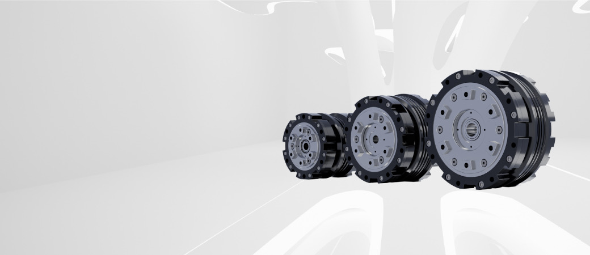
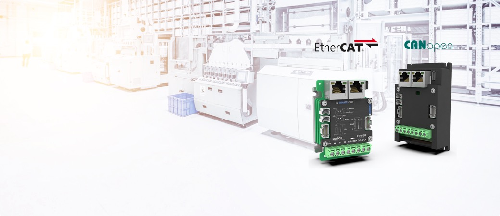

# Leadshine Technology Co., Ltd. × T01 — Products and Solutions

⬆ [Leadshine Technology Co., Ltd. profile](../Leadshine.md) · [Brief](Leadshine-T01-1-Brief.md) · [Playbook](Leadshine-T01-3-Playbook.md)

**Read this first:** Leadshine sells components. For T01 it contributes **manipulation at the end of someone else's arm** (hands) and, on paper, **drivetrain parts** (wheel module, low-voltage servo drives, joint actuators). Only the hands come with an SDK a team can use within 48 hours. What is physically on site is a best guess — confirm at the booth.

## Relevant products (ranked for this track)

### DH116 series

**Role in T01:** the default choice. Sturdy general-purpose hand for the contact tasks that stop delivery and service robots: lift buttons, door handles, parcel and bag hand-over, picking up litter, holding a tool.

| Spec | Value |
|---|---|
| Degrees of freedom | **11** (6 actively driven) |
| Weight | **545 g** (±10 g) |
| Load | Whole hand up to **30 kg**; single finger up to **5 kg** |
| Lateral grip | > 50 N |
| Drive | Brushless coreless motor + worm gear; FOC current loop, hybrid force-position control |
| Interfaces | EtherCAT (DH116EC), CAN FD, RS485 |
| Tactile option | -M variants: 6 sensors (fingertips and palm); normal force, tangential force and direction, proximity |
| Rated life | 1 million grasp cycles |
| Open/close speed, supply voltage, IP rating, temperature range | Not on the product page — check the user manual / ask on site |

- **Status / price:** ✅ shipping. Store price **USD 2,199** (no sensors) / **USD 2,799** (tactile -M). An enhanced DH116P variant was shown at CES 2026.
- **Developer control:** per-finger position, speed and force / current targets and state read-back through the LHandProLib SDK (C++ / Python); tactile read-out on -M variants. A Windows GUI jogs fingers for hardware checks. ⚠️ unverified: the exact API surface was not read in this pass (manual PDF could not be parsed).

### DH116S series

**Role in T01:** the light option when the host arm or small humanoid has little spare payload. Same 11-DoF / 6-active layout in a thinner body.

| Spec | Value |
|---|---|
| Degrees of freedom | **11** (6 active) |
| Size | 147.54 × 73.53 × 26.35 mm |
| Weight | **< 380 g** (store figure) |
| Load | "Light-load handling" up to **10 kg** |
| Interfaces | EtherCAT, CAN FD, RS485 |
| Tactile option | Configurable on five fingers and palm |
| Software | Windows, Linux, ROS 2; x86 and ARM; C++ and Python |
| IP rating, voltage, speed | Not public on the product page |

- **Status / price:** ✅ launched at WAIC, July 2026. Price not captured (listed in the store).
- **Developer control:** same SDK family, plus the official **LHandPro ROS 2 example** (state publisher, interfaces, service node, C++ / Python sequence demos; RViz2 mirrors the real hand). ROS 2 Humble on Ubuntu 22.04 ⚠️ unverified.
- **Note:** Leadshine's own page positions it for entertainment, display, education and research — not heavy service work.

### DH2116 series

**Role in T01:** only if the task truly needs in-hand dexterity (operating a spray trigger, turning a key, handling a card). More joints means more bring-up time and less grip force than DH116.

| Spec | Value |
|---|---|
| Degrees of freedom | **21** (16 active + 5 passive) |
| Max whole-hand grip | **94 N** |
| Drive | Brushless coreless motors + precision screw drive |
| Interfaces | CAN 1 Mbps, CAN FD 1 / 5 Mbps, RS485 5 Mbps (no EtherCAT listed) |
| Software | Windows, Linux, ROS 2; x86 and ARM; C++ and Python; SDK and demos |
| Weight, load, IP rating | Not public on the product page |

- **Status / price:** ✅ shipping; price not captured.

### PJ3 series

**Role in T01:** a building block for a custom mechanism on a mobile base — tilting cargo bed, parcel-box lid, pan-tilt sensor head. Not a drivetrain you can finish in 48 hours without vendor help.

| Model | Rated torque | Bus options |
|---|---|---|
| PJ3-60 | **9.5 N·m** | CAN FD or EtherCAT |
| PJ3-75 | **14 N·m** | CAN FD or EtherCAT |
| PJ3-97 | **44 N·m** | CAN FD or EtherCAT |

- Integrates motor, planetary gearbox, encoder and drive; expansion port for monitoring (e.g. temperature rise). Product page lists material handling among suitable tasks.
- **Status / price:** ✅ shipping. Store prices **USD 329–479** ⚠️ unverified (from search snippets, not a direct page read).
- **Developer control:** **no public SDK, ROS 2 driver or protocol document found.** Usable only if Leadshine staff hand over the CAN FD protocol or a library on site.

### iW series

**Role in T01:** the one Leadshine product aimed squarely at wheeled service robots — an integrated low-voltage wheel drive for AGV / AMR.

- **Status:** 🧪 shown at WAIC (Jul 2026); Automate (Jun 2026) recap mentions a "low-voltage integrated wheel solution" for rapid AGV / AMR deployment. **No product page, specs, price or SDK are public.**
- Treat as a conversation topic with the engineers, not as a build option, unless units and a protocol are on the table.

### ELD3 / ELD3 MINI / 2ELD2 low-voltage servo drives

**Role in T01:** the battery-voltage servo drives Leadshine recommends for AGV / AMR traction. Relevant for product thinking after the hackathon; unlikely to be on site.

| Spec | Value |
|---|---|
| Supply | **24–70 VDC** |
| Power range | **50–750 W** |
| Fieldbus | EtherCAT, CANopen, Modbus RTU (plus pulse and analog variants) |
| Safety | Safe Torque Off |
| Variants | ELD3 MINI (compact), 2ELD2 (dual-axis with STO — one drive for a differential base) |

- **Status / price:** ✅ shipping via distributors; prices not public.
- **Developer control:** standard drive profiles over the fieldbus (CiA 402 on EtherCAT), so a generic master can command velocity / position. Needs motors, wiring and Windows tuning software — too slow for a 48-hour build.

## What Leadshine Technology Co., Ltd. already does in this domain

**Short answer: nothing under its own name in urban service robotics.** No delivery, cleaning, concierge or municipal deployment, pilot or demo was found.

| When | What | Relevance to T01 |
|---|---|---|
| Undated (page assets suggest ~2022 — inference) | [Logistics industry solution page](https://www.leadshine.com/solution/logistics-industry.html) recommends DC servo drives for **AGV & AMR**, multi-shuttle vehicles and cross-belt sorters, and EL7 servos for steerable-wheel sorters. No named customers or figures. | Shows drivetrain supply into warehouse mobile robots — the industrial cousin of urban delivery. |
| Jun 2026 | [Automate 2026](https://www.leadshine.com/newsEvent/details/automate-2026-concludes-successfully-%7C-leadshine-drives-global-industrial-automation-and-humanoid-robotics-innovation-with-core-motion-control-technologies.html): 2ELD2 and ELD3 MINI low-voltage drives and a low-voltage integrated wheel solution for AGV / AMR. | Component offer for mobile bases. |
| Jul 2026 | [WAIC 2026](https://en.leadshine.com/newsEvent/details/leadshine-successfully-concludes-waic-2026,-showcasing-next-generation-robotics-solutions.html): iW wheel modules shown beside PJ and HJ actuators; DH116S launched. | Wheel module exists as hardware; no data. |
| 2026 (company claims) | Hands and joint modules supplied to "multiple robotics companies"; AGIBOT supplier award (see [profile](../Leadshine.md)). | Its parts may already sit inside service-capable robots from other vendors on site — worth asking which. |

## What they are building next in this domain

- **Stated strategy (2026):** become a platform supplier of robot core components, centred on joint modules and dexterous hands, with planetary modules prioritised for volume.
- **Wheeled-robot components:** the iW wheel module and "low-voltage integrated wheel solution" appeared at two 2026 shows without a product page. **Inference:** a formal AGV / AMR wheel-drive product line is being prepared; no date announced.
- **Hands:** DH116 → DH2116 → DH116S (Jul 2026). No next model, service-robot variant or weather-sealed version announced.
- **Not public:** any autonomy software, navigation stack, AI model or service-robot reference design. **Inference:** none is planned — Leadshine stays below the software layer.

## Software, models and data that help for this track

| Asset | What it gives you | Where |
|---|---|---|
| LHandProLib SDK | C++ / Python control of the hands; Windows and Linux; x86 and ARM (so it can run on an ARM edge board) | Download archive linked from the hand user manuals (no GitHub org) |
| LHandPro ROS 2 example (DH116S) | State publisher, interfaces, service node, sequence demos, RViz2 mirror — a ready ROS 2 node to call from a task planner | PDF description on the store + archive |
| URDF / MJCF hand models | Attach the hand to a host arm's model for motion planning and simulation | Linked from the user manuals |
| Windows debugging GUI | Verify wiring, jog fingers, read sensors before writing code | Leadshine downloads |
| CAN FD protocol document | Raw bus control if the SDK does not fit | Feishu link in the manual |

- **Version trap:** the DH116 manual marks downloads dated before **2026-02-10** as old — keep SDK, firmware and URDF from the same generation.
- **Not offered:** navigation, perception, grasp-planning models, datasets, teleoperation stack, on-board compute. Bring these from the host robot's vendor or from open-source (Nav2, MoveIt 2, open grasp-pose and VLA models).

## Gaps and limits for this track

- **No mobility, no autonomy, no sensors beyond optional tactile.** Leadshine alone cannot produce a T01 demo.
- **Weather:** no IP rating or operating-temperature range is published for any hand. Assume **indoor only**; Leukerbad in November means snow and wet surfaces.
- **Integration cost:** mechanical flange, power feed and a CAN FD / RS485 / EtherCAT link to a host arm are on you. Budget about half a day.
- **Six active motors (DH116 / DH116S):** enough for power, pinch and button-press grasps; not for fine in-hand manipulation.
- **Drivetrain parts are not self-serve:** PJ3, HJ2 and iW have no public SDK or protocol; industrial drives need tuning tools and wiring.
- **No T01 reference case:** judges will not see a proven Leadshine deployment behind your project.
- **Research limits of this note:** web search was unavailable in this pass; findings rest on Leadshine's own pages and the company profile. The hand manuals (PDF) could not be parsed, so API details, supply voltage and speeds are unconfirmed.

## Sources

- [Leadshine company profile (this vault) — specs, prices and developer-stack summary](../Leadshine.md)
- [DH116 series product page](https://www.leadshine.com/robots/dextrous-hands/dh116-series.html)
- [DH116S series product page](https://www.leadshine.com/robots/dextrous-hands/dh116s-series.html)
- [DH2116 series product page](https://www.leadshine.com/robots/dextrous-hands/dh2116-series.html)
- [PJ3 series product page](https://www.leadshine.com/robots/integrated-actuators/PJ3-Series.html)
- [ELD3 series product page](https://www.leadshine.com/products/servo/servo-drive/eld3-series.html)
- [Leadshine robot components overview](https://www.leadshine.com/robot/index.html)
- [Logistics industry solution page](https://www.leadshine.com/solution/logistics-industry.html)
- [Automate 2026 recap (Leadshine news)](https://www.leadshine.com/newsEvent/details/automate-2026-concludes-successfully-%7C-leadshine-drives-global-industrial-automation-and-humanoid-robotics-innovation-with-core-motion-control-technologies.html)
- [WAIC 2026 recap (Leadshine news)](https://en.leadshine.com/newsEvent/details/leadshine-successfully-concludes-waic-2026,-showcasing-next-generation-robotics-solutions.html)
- [Leadshine web store — DH116-R1 dexterous hand (price)](https://store.leadshine.com/products/dh116-r1-dexterous-hand)
- [DH116S LHandPro ROS 2 example project description (PDF; referenced, not parsed in this pass)](https://store.leadshine.com/cdn/shop/files/DH116S_LHandPro_ROS2_Example_Project_Description.pdf)
