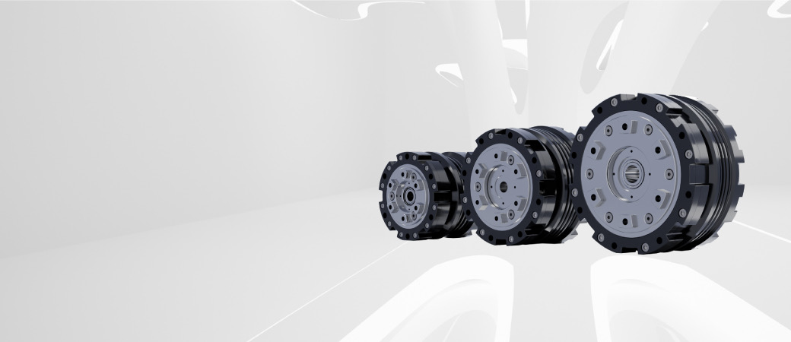
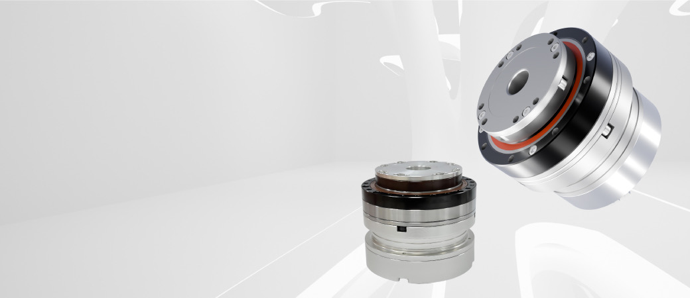

# Leadshine Technology Co., Ltd. × T02 — Products and Solutions

⬆ [Leadshine Technology Co., Ltd. profile](../Leadshine.md) · [Brief](Leadshine-T02-1-Brief.md) · [Playbook](Leadshine-T02-3-Playbook.md)

**Bottom line:** Leadshine is a component supplier. For T02 it contributes the **manipulation end** of a response or inspection robot (a hand) and, for teams building mechanics, actuators. Everything else — mobility, sensing, mapping, autonomy, ruggedisation — must come from another vendor.

> Research note: general web search was unavailable in this pass; findings come from Leadshine's official product pages, store PDFs and news pages plus the company profile. Absence of T02 deployments means "none found on official pages", not a proven negative.

## Relevant products (ranked for this track)

### DH116 series

**Role in T02:** human-style end-effector for a host arm, humanoid or mobile manipulator, to operate things built for people — valves, breakers, levers, door handles, hand tools — in a zone a responder should not enter. The strongest and best-documented Leadshine hand.

| Spec | Value | Why it matters for T02 |
|---|---|---|
| DoF | **11 total, 6 active** (thumb swing 0–60°, thumb flexion 0–30°, four fingers 0–80° each) | Enough for power, hook, pinch and lateral grasps; no finger abduction |
| Weight | **545 g ± 10 g** | Fits small cobot and humanoid wrist payloads |
| Hook-grip load | **≤ 30 kg** whole hand; 5 kg per finger (product page) | Carry or drag a bag, hose or handle |
| Lateral grip | about **50 N** (page: "> 50 N"; manual: "≤ 50 N") | Key-style grasps, switches |
| Drive | Brushless coreless servo + worm gear, **self-locking** | Holds a grip without holding current; do not back-drive by force |
| Open / close time | about **0.5 s** (manual lists "≥ 0.5 s") | Fast enough for live teleoperation |
| Repeatability | **± 0.2 mm** | Preset grasps are reproducible |
| Power | **12–48 V, 2.5 A** | Runs off a robot battery rail or a bench supply |
| Environment | Manual table: −10 to 40 °C, 85% RH; precautions section: **0–40 °C**, not for dusty, humid, oily or corrosive settings | **Indoor demo only** — no IP rating published |
| Bus | **CAN FD** (DH116-L1 / R1) or **EtherCAT** (DH116EC-L1 / R1) | Pick the variant your host computer can talk to |
| Tactile (-M variants) | 6 sensors; normal force, tangential force and direction, proximity | Contact feedback for a remote operator; soft-landing |
| Life / warranty | 1 million grasp cycles (vendor rating); 12 months | — |

- **Status:** ✅ shipping. **Price:** store sale prices **USD 2,199** (no sensors) / **USD 2,799** (tactile -M) per the company profile. Availability on site: not confirmed.
- **Developer interface:** LHandProLib SDK (C++ / Python; Windows 10+, Linux), ROS 2 example workspace, URDF + MJCF, EtherCAT XML (ESI) file, protocol spreadsheets for EtherCAT / CAN FD / RS485, STEP model, Windows jog tool (LHandPro). You command the six active joints (position, with force-position hybrid control inside the hand) and read joint state and tactile data. Exact API calls and feedback fields: check the SDK archive — ⚠️ unverified here.

### DH116S series

**Role in T02:** lighter alternative when the host robot's wrist payload is tight (small humanoid or light arm). Lower load than DH116.

| Spec | Value |
|---|---|
| DoF | 11 total, 6 active |
| Size / weight | 147.54 × 73.53 × 26.35 mm; **< 380 g** (store figure, per profile) |
| Load | light-load handling, **10 kg** class (per profile) |
| Bus | EtherCAT / CAN FD / RS485 |
| ROS 2 | Official example project: **Ubuntu 22.04 + ROS 2 Humble**, connects over an EtherCAT network interface |

- **Status:** ✅ (launched WAIC, July 2026). **Price:** not public.
- **Developer interface:** same LHandProLib stack as DH116; this is the hand the official ROS 2 walkthrough is written for.

### DH2116 series

**Role in T02:** only if the task needs fine in-hand dexterity (small connectors, tool re-grasp). Weaker and more complex — not the first choice for response tasks.

| Spec | Value |
|---|---|
| DoF | **21: 16 active + 5 passive** |
| Drive | Brushless coreless motors + screw drive |
| Max whole-hand grip | **94 N** |
| Bus | CAN 1 Mbps, CAN FD 1 / 5 Mbps, RS485 5 Mbps (no EtherCAT listed) |
| Software | Windows / Linux / ROS 2, x86 and ARM, C++ / Python, debug GUI |
| Weight, voltage, IP | not on the product page |

- **Status:** ✅. **Price:** not public.

### PJ3 series

**Role in T02:** actuator for a team-built mechanism — sensor mast pan-tilt, door-opener, small winch, tracked or legged prototype joint. Leadshine markets PJ3 for robot dogs, small and mid humanoids and exoskeletons.

| Model | Rated torque | Bus | Store price (per profile, from search snippets ⚠️ unverified) |
|---|---|---|---|
| PJ3-60 | **9.5 N·m** | CAN FD | USD 329 |
| PJ3-75 | **14 N·m** | CAN FD / EtherCAT | USD 399 / 429 |
| PJ3-97 | **44 N·m** | CAN FD | USD 479 |

- Speed, weight, voltage, gear ratio, IP rating: **not on the product page**.
- **Status:** ✅. **Developer interface:** CAN FD or EtherCAT, monitoring port (temperature rise). **No public SDK, ROS 2 driver or protocol document found** — usable in 48 hours only with Leadshine engineers handing over the protocol.

### HJ2 series

**Role in T02:** precision joint for a custom arm or inspection gimbal. Sizes 52 / 70 / 80 / 90 / 110 mm, 24-bit encoder, EtherCAT and CAN FD. Torque, weight and IP: not public. Same developer-access gap as PJ3. Status ✅, price not public.

### iW series

**Role in T02:** drive wheels for a custom patrol or inspection cart. 🧪 Shown at WAIC and Automate 2026 for AGV / AMR; **no specs, product page or developer information public**. Treat as unavailable unless it is physically on the Leadshine table.

**Not ranked (poor 48-hour fit):** FM2 frameless motors, coreless motors, EL / ELD servo drives, stepper drives, integrated motors, PLCs — these need mechanical design, mains or drive wiring and tuning; no T02-specific advantage.

## What Leadshine Technology Co., Ltd. already does in this domain

**Nothing found under its own name.** No public emergency-response, inspection, security, hazard-monitoring or teleoperation deployments, pilots or application pages.

| Date | What | Relevance to T02 |
|---|---|---|
| 2026-01 | CES: hands, joint modules, motors shown; booth visits (not contracts) from large robot makers | Generic component showcase ([release](https://en.prnasia.com/releases/global/leadshine-achieves-great-success-at-ces-2026-entering-us-and-european-robotics-supply-chain-518892.shtml), via profile) |
| 2026-04/05 | FAIR plus Shenzhen: hand demo zone; PJ3 positioned for robot dogs, small / mid humanoids, exoskeletons, e-scooters; iW for AGVs and wheeled robots | Indirect: quadrupeds and wheeled robots are the usual inspection / patrol platforms, but no such customer or use case is named ([blog](https://store.leadshine.com/blogs/news/leadshine-dexterous-hands-and-joint-modules-shine-at-the-shenzhen-fair-plus-2026)) |
| 2026-07 | WAIC: DH116S launch; iW wheel modules; work with Fourier and Tiangong on humanoid components | No safety or inspection scenario mentioned ([news](https://en.leadshine.com/newsEvent/details/leadshine-successfully-concludes-waic-2026,-showcasing-next-generation-robotics-solutions.html)) |

- Its parts may sit inside other makers' quadrupeds or humanoids used for patrol or inspection, but no specific robot or deployment is publicly attributed. Do not claim one.
- Core industrial business (servo / stepper / PLC) keeps factory machines running; that is not city infrastructure resilience in the T02 sense.

## What they are building next in this domain

- **Stated direction (company):** become a platform supplier of robot core parts — joint modules and dexterous hands — with frameless-motor capacity scaling to the million-unit level and 2 million units/year automated capacity under construction.
- **Stated (WAIC 2026):** continued humanoid-component development with Fourier and Tiangong.
- **Nothing announced for T02 specifically:** no ruggedised or IP-rated hand, no teleoperation kit, no inspection or rescue program.
- **Inference (not a company statement):** as PJ3 goes into robot dogs and iW into wheeled robots, Leadshine parts will increasingly end up in patrol and inspection platforms built by its customers — as an invisible supplier, not as a solution owner.

## Software, models and data that help for this track

| Asset | What you get | T02 use |
|---|---|---|
| **LHandProLib SDK** | C++ / Python library (`libLHandProLib.so` on Linux), demos | Direct joint control from your teleop or autonomy node |
| **ROS 2 example workspace** (`lhandpro_ws`) | Packages: `lhandpro_description` (URDF, meshes, RViz launch), `lhandpro_interfaces` (service definitions), `lhandpro_service` (control node), `sequence_demo_cpp`, `sequence_demo_py`; state publisher feeds `/joint_states` | Start from `sequence_demo_py` and replace the fixed sequence with operator commands |
| **URDF + MJCF** | Hand models for RViz and MuJoCo | Rehearse a valve or switch grasp in simulation; live digital twin of the hand for the operator |
| **LHandPro GUI (Windows)** | Jog fingers, check sensors | Hardware check in the first hour |
| **Protocol sheets / ESI XML** | EtherCAT, CAN FD, RS485 maps | Fallback if the SDK does not fit your compute board |

- Setup facts from the official ROS 2 note: Ubuntu 22.04, ROS 2 Humble, `colcon build`, copy the `.so` to `/usr/local/lib`, grant the service node raw-socket capability, set the **EtherCAT network interface name in code and rebuild**.
- Distribution: download archives linked from the PDF manuals (some on Feishu) — **get them on a USB stick from Leadshine staff**; venue internet may not reach them quickly. Use resources dated on or after **2026-02-10** for current DH116 units.
- **Not available from Leadshine:** teleoperation / retargeting software, perception, policies or foundation models, datasets, simulation scenes. Bring your own (for example open-source hand tracking and retargeting tools) — not Leadshine products.

## Gaps and limits for this track

- **No platform:** no mobility, sensors, compute, mapping or autonomy. Leadshine alone cannot produce a T02 demo.
- **No domain track record:** zero public safety, rescue or inspection references.
- **Environment:** 0–40 °C, no dust / humidity / oil, no IP rating — unsuitable for outdoor November conditions at 1,400 m without protection.
- **Self-locking fingers:** good for holding, but a collision cannot be absorbed by back-driving; plan approach paths and use force limits.
- **6 active joints** on DH116 / DH116S: no independent fingertip dexterity; tool use is limited to grasps you pre-shape.
- **Integration cost:** flange adapter to the host wrist, 12–48 V supply, EtherCAT or CAN FD adapter — budget half a day.
- **Joint modules:** specs incomplete on public pages and no public software — high risk for 48 hours.
- **No teleoperation stack and no hand-arm coordination** — you write the mapping from operator input to six joint targets.

## Sources
- [Leadshine company profile (internal, general research)](../Leadshine.md)
- [DH116 series product page](https://www.leadshine.com/robots/dextrous-hands/dh116-series.html)
- [DH116 / DH116P user manual (PDF)](https://store.leadshine.com/cdn/shop/files/DH116_DH116P_Series_Dexterous_User_Manual.pdf)
- [DH116S LHandPro ROS2 example project description (PDF)](https://store.leadshine.com/cdn/shop/files/DH116S_LHandPro_ROS2_Example_Project_Description.pdf)
- [DH2116 series product page](https://www.leadshine.com/robots/dextrous-hands/dh2116-series.html)
- [PJ3 series product page](https://www.leadshine.com/robots/integrated-actuators/PJ3-Series.html)
- [FAIR plus 2026 recap (Leadshine store blog)](https://store.leadshine.com/blogs/news/leadshine-dexterous-hands-and-joint-modules-shine-at-the-shenzhen-fair-plus-2026)
- [WAIC 2026 recap (Leadshine news)](https://en.leadshine.com/newsEvent/details/leadshine-successfully-concludes-waic-2026,-showcasing-next-generation-robotics-solutions.html)
- [Leadshine at CES 2026 (PR Newswire Asia; cited via the company profile)](https://en.prnasia.com/releases/global/leadshine-achieves-great-success-at-ces-2026-entering-us-and-european-robotics-supply-chain-518892.shtml)
