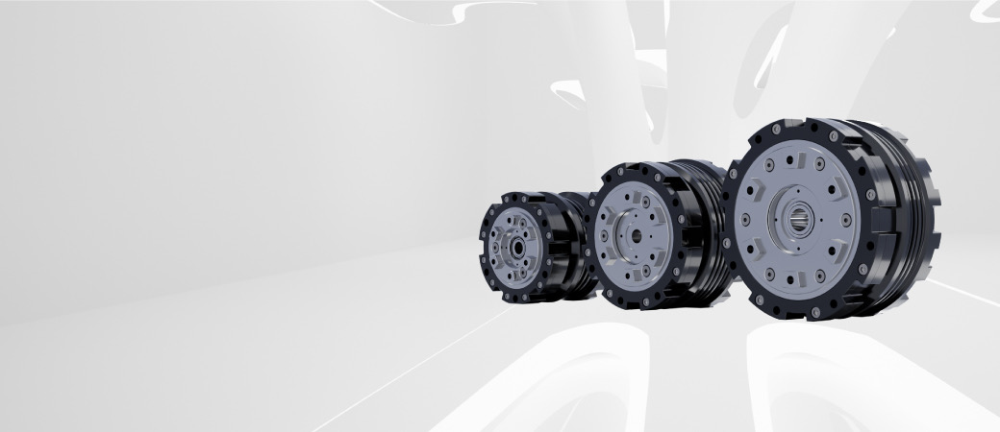

# Leadshine Technology Co., Ltd. × T03 — Products and Solutions

⬆ [Leadshine Technology Co., Ltd. profile](../Leadshine.md) · [Brief](Leadshine-T03-1-Brief.md) · [Playbook](Leadshine-T03-3-Playbook.md)

> **Read this first:** Leadshine is a component supplier. Nothing below is a sustainability product; the ranking reflects how quickly each part can be put to work in a T03 build (waste sorting, repair / disassembly, efficient custom mechanisms). What Leadshine actually brings on site is **not confirmed**.
> **Research note:** track-specific web search was unavailable in this pass (search quota exhausted). Findings rely on official Leadshine pages fetched directly on 2026-11-14 plus the company profile. Absence of evidence below means "not found on official pages", not "proven absent".

## Relevant products (ranked for this track)

### DH116 series

**Role in T03:** end-effector for a waste-sorting, litter-handling or reuse cell on another vendor's arm. Handles irregular objects (bottles, cans, cartons, bags) that defeat a parallel gripper; the tactile variant adds a material "squeeze check".

| Spec | Value |
|---|---|
| Degrees of freedom | **11** (6 actively driven) |
| Weight | **545 g** (±10 g) |
| Load | Whole hand up to **30 kg**; single finger **5 kg** |
| Lateral grip | **> 50 N** |
| Drive | Brushless coreless motor + worm gear; FOC current loop, hybrid force-position control |
| Tactile (‑M variant) | 6 sensors standard (fingertips / palm options): normal force, tangential force and its direction; proximity sensing, "soft landing" |
| Rated life | **1 million** grasp cycles (vendor figure) |
| Interfaces | EtherCAT (DH116EC), CAN FD, RS485 |
| Supply voltage, power draw, IP rating, operating temperature | **Not on the product page** — check the manual or ask on site |

- **Status:** ✅ shipping. **Price:** store **USD 2,199** (no sensors) / **USD 2,799** (tactile ‑M), sale prices per the company profile.
- **Developer interface:** LHandProLib SDK (C++ / Python, Windows / Linux, x86 / ARM); ROS 2 example package; URDF / MJCF; Windows GUI for jogging fingers. You command finger positions / grasp sequences and read back joint state; exact tactile-data and force-setpoint API ⚠️ unverified — confirm on site.
- **T03 caveat:** no IP rating published — treat it as a **dry, clean-object** hand. Wet, sticky or sharp waste is a risk to a USD 2k device.

### DH116S series

**Role in T03:** lighter alternative when the host arm has low payload (small cobot, desktop arm).

| Spec | Value |
|---|---|
| Degrees of freedom | **11**, **6 active** |
| Size | 147.54 × 73.53 × 26.35 mm |
| Weight | **< 380 g** (store figure) |
| Load | Light-load handling, **10 kg** |
| Interfaces | EtherCAT / CAN FD / RS485 |
| Tactile | Optional, fingers and palm |

- **Status:** ✅ (launched WAIC, July 2026). **Price:** not public.
- **Developer interface:** same SDK family; the official ROS 2 example project ("LHandPro": state publisher, interfaces, service node, C++ / Python sequence demos, RViz2 mirror) was written for this model.

### DH2116 series

**Role in T03:** fine manipulation for circular-economy demos (opening a battery cover, unplugging a connector, handling small parts), typically under teleoperation.

| Spec | Value |
|---|---|
| Degrees of freedom | **21** (16 active + 5 passive) |
| Max whole-hand grip | **94 N** |
| Drive | Brushless coreless motors + precision screw drive |
| Interfaces | CAN 1 Mbps, CAN FD 1/5 Mbps, RS485 5 Mbps |

- **Status:** ✅. **Price:** not public.
- **Developer interface:** SDK for Windows / Linux / ROS 2, C++ and Python. More joints means more retargeting work — only choose it if the task truly needs in-hand dexterity.

### PJ3 series

**Role in T03:** actuator for a custom mechanism (bin-lid opener, sorting flap, sun-tracking panel mount, valve or cover drive). Only viable if Leadshine staff provide the control protocol.

| Spec | Value |
|---|---|
| Models (outer diameter) | **PJ3-60** (9.5 N·m rated), **PJ3-75** (14 N·m rated), **PJ3-97** (44 N·m rated) |
| Contents | Motor + planetary gearbox + encoder + drive in one unit |
| Bus | CAN FD or EtherCAT versions |
| Monitoring | Expansion port for real-time parameters such as temperature rise |
| Listed applications | Collaborative robots, industrial automation, machine tools, humanoids |
| Voltage, speed, weight, efficiency, IP rating | **Not on the product page** |

- **Status:** ✅. **Price:** store sale prices **USD 329–479** depending on size and bus ⚠️ unverified (from search snippets in the profile pass; store page could not be re-fetched today).
- **Developer interface:** **no public SDK, ROS 2 driver or protocol document found.** Budget for a protocol hand-over from Leadshine engineers, or skip.

### FM2 series

**Role in T03:** talking point for an energy-efficiency narrative; not a 48-hour building block (a frameless motor needs housing, bearings, encoder and drive).

| Spec | Value |
|---|---|
| Efficiency claim | **20% lower loss** and 10% higher torque density vs previous generation (vendor claim) |
| Sizes | 43 / 50 / 60 / 70 / 85 mm on the product page (a 2026 trade-show release says six sizes, 50–127 mm — sources disagree) |

- **Status:** ✅. **Price:** not public. **Developer interface:** none (bare motor).

### Integrated motors (ISS1 and integrated servo / closed-loop stepper)

**Role in T03:** simplest Leadshine actuator for a non-robot mechanism (conveyor, diverter, tracker) *if* any are on site — which is unlikely.

| Spec | Value |
|---|---|
| Families on the official page | Integrated stepper (iEM, iEM-RS), integrated closed-loop stepper (iCS, iCS-RS), integrated servo (iSV, iSV2-CAN, iSV2-RS) |
| Fieldbus | Modbus RTU (all three families); CANopen (integrated servo) |
| Voltage / power ranges | Not on the category page |

- **Status:** ✅ via distributors. **Developer interface:** Modbus RTU from any laptop or SBC with an RS485 adapter is realistic in 48 hours; tuning uses Leadshine's Windows software.

### iW series

**Role in T03:** low-voltage integrated wheel drive for a small AMR (resource-efficient logistics). 🧪 shown at WAIC and Automate 2026; **no product page, specs or price public**. Do not plan around it.

## What Leadshine Technology Co., Ltd. already does in this domain

**Nothing found under a sustainability label.** No public deployments, pilots or partnerships in waste sorting, recycling, energy management, EV charging, environmental monitoring or urban farming.

Adjacent, loosely relevant facts:

| When | What | Relevance to T03 | Source |
|---|---|---|---|
| Undated (site content) | Logistics solution page lists four unnamed case studies: DC servo drive in a multi-shuttle vehicle, in AGV / AMR, in a cross-belt sorter, and EL7 servo drive in a steerable-wheel sorter | Sorting and intralogistics machinery; the cross-belt sorter case claims "low power consumption" — **no figures, no customer names** | [Logistics solution page](https://www.leadshine.com/solution/logistics-industry.html) |
| Undated (site content) | Electronics and semiconductor solution page mentions LED and lithium-battery test equipment among motion-control applications | Shows presence in clean-tech manufacturing equipment, as a parts supplier only | [Solutions overview](https://www.leadshine.com/solutions.html) |
| 2026-01 (CES) | Company release mentions talks with e-bike, exoskeleton and medical-equipment prospects; no deals named | Weak hint at light-electric-mobility interest | Via [company profile](../Leadshine.md) |
| 2026-06 / 2026-07 (Automate, WAIC) | Low-voltage integrated wheel solution (iW) for AGV / AMR shown | Battery-powered mobile platforms | Via [company profile](../Leadshine.md) |

## What they are building next in this domain

- **Stated direction (company):** become a platform supplier of robot core components, concentrating on **joint modules and dexterous hands**; frameless-motor capacity to the million-unit level. Nothing sustainability-specific.
- **Inference:** the FM2 "lower loss" and PJ3 GaN-drive messaging suggests efficiency is a selling point of the hardware generation, but there is **no announced energy, recycling or green-city programme**.
- **Not public:** any ESG-linked product roadmap, any software or AI plans, any European pilot.

## Software, models and data that help for this track

| Asset | What it gives you | Access |
|---|---|---|
| LHandProLib SDK | Finger position / grasp control and state read-back from C++ or Python | Download archive linked from the hand user manuals (no official GitHub org) |
| LHandPro ROS 2 example | State publisher, service node, sequence demos, RViz2 mirror | Download archive; ROS 2 Humble / Ubuntu 22.04 ⚠️ unverified |
| URDF / MJCF hand models | Grasp rehearsal in MuJoCo or RViz before hardware time | Linked from the manuals |
| Windows debugging GUI | Verify the hand and sensors before writing code | Leadshine download |
| CAN FD protocol document | Bare-metal control without the SDK | Hosted on Feishu, linked from the manual |

**Leadshine offers no models, datasets, perception or task software.** For the sorting side you must bring your own: an open-vocabulary detector or VLM for item classification, and public litter / waste image sets (for example TACO or TrashNet — third-party, not checked in this pass) if you fine-tune.

**Version trap:** downloads dated before **2026-02-10** are marked "old version" in the DH116 manual — keep SDK, firmware and URDF from the same generation.

## Gaps and limits for this track

- **No robot, no arm, no mobility, no perception, no compute** — every T03 concept needs a host platform from another vendor.
- **No domain proof**: zero public sustainability deployments; do not claim otherwise in a pitch.
- **Environmental robustness unknown**: no IP rating, temperature range or chemical resistance published for the hands — poor match for wet, dirty, outdoor or sub-zero waste handling.
- **Over-specification risk**: a five-finger hand is slower and costlier than a suction cup or parallel gripper for plain pick-and-place sorting.
- **Joint modules are closed for a hackathon**: PJ3 / HJ2 have no public SDK or protocol.
- **Energy data missing**: no published power draw for hands or joint modules, so any "low-energy" claim must come from your own measurement.
- **Mounting**: flange pattern, cable and power supply for a given host arm are not documented publicly — confirm before committing.

## Sources

Fetched in this pass (2026-11-14):
- [DH116 series product page](https://www.leadshine.com/robots/dextrous-hands/dh116-series.html)
- [PJ3 series product page](https://www.leadshine.com/robots/integrated-actuators/PJ3-Series.html)
- [Leadshine solutions overview](https://www.leadshine.com/solutions.html)
- [Leadshine logistics industry solution page](https://www.leadshine.com/solution/logistics-industry.html)
- [Leadshine integrated motors category page](https://www.leadshine.com/products/integrated-motor.html)

Carried over from the company profile (not re-fetched in this pass):
- [Leadshine company profile (internal)](../Leadshine.md)
- [DH116S series product page](https://en.leadshine.com/robots/dextrous-hands/dh116s-series.html)
- [DH2116 series product page](https://www.leadshine.com/robots/dextrous-hands/dh2116-series.html)
- [FM2 series product page](https://www.leadshine.com/robots/frameless-motors/fm2-series.html)
- [Store: DH116-R1 dexterous hand (price)](https://store.leadshine.com/products/dh116-r1-dexterous-hand)
- [Store: PJ3 planetary integrated actuators](https://store.leadshine.com/collections/pj3-planetary-integrated-actuators)
- [DH116S LHandPro ROS2 example project description (PDF)](https://store.leadshine.com/cdn/shop/files/DH116S_LHandPro_ROS2_Example_Project_Description.pdf)
- [DH116 / DH116P user manual (PDF)](https://store.leadshine.com/cdn/shop/files/DH116_DH116P_Series_Dexterous_User_Manual.pdf)
- [WAIC 2026 recap (Leadshine news)](https://en.leadshine.com/newsEvent/details/leadshine-successfully-concludes-waic-2026,-showcasing-next-generation-robotics-solutions.html)
- [Leadshine at CES 2026 release (PR Newswire Asia)](https://en.prnasia.com/releases/global/leadshine-achieves-great-success-at-ces-2026-entering-us-and-european-robotics-supply-chain-518892.shtml)
