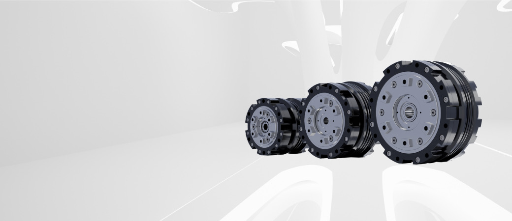
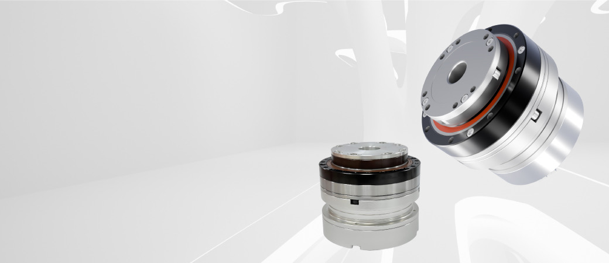

# Leadshine Technology Co., Ltd. × T04 — Products and Solutions

⬆ [Leadshine Technology Co., Ltd. profile](../Leadshine.md) · [Brief](Leadshine-T04-1-Brief.md) · [Playbook](Leadshine-T04-3-Playbook.md)

**Bottom line:** for care and rehab, Leadshine = **a robot hand you add to something else**. Only the dexterous hands have a usable developer stack. Joint modules are marketed for exoskeletons but have no public SDK. What is physically on site is **not confirmed** — check at the booth first.

**Research note:** web search was unavailable in this pass; everything below comes from Leadshine's product pages, user manuals (PDF), official show recaps and the company profile. Store pages were rate-limited, so prices are taken from the profile.

## Relevant products (ranked for this track)

### DH116S series

**Role in T04:** the lightest hand and the one with the clearest ROS 2 example — best choice for a desk-mounted therapy / mirror demo or as an end-effector on a small arm.

| Spec | Value |
|---|---|
| DoF | **11 total, 6 active** (thumb swing 0–91°, thumb flex 0–59°, index / middle / ring 0–72°, little 0–74°) |
| Size / weight | 147.54 × 73.53 × 26.35 mm · **359 g ± 10 g** (manual; store says < 380 g) |
| Speed | Minimum open / close time **0.4 s** |
| Force / load | Side grip **50 N**; hook-grip load 15 kg in the parameter table (overview text says 10 kg) |
| Repeatability | ± 0.2 mm |
| Power | **12–48 V**, 0.1 A idle, **2.0 A max** |
| Tactile options | none · **-S** piezoresistive · **-M** multimodal. Fingers: normal force 0–20 N (0.01 N resolution) + tangential direction 0–360° (1°); palm: normal force 0–25 N (0.1 N) |
| Bus variants | DH116S (CAN FD) · DH116SEC (EtherCAT) · DH116SRS (RS485); left and right |
| Environment | **IP30**, −10 to 45 °C; surface can be wiped with alcohol |
| Life | 1 million open / close cycles; 12-month warranty |

- **Status:** ✅ shipping (launched at WAIC, July 2026). **Price:** not public / not captured.
- **Developer control:** LHandProLib SDK (C++ / Python, Windows / Linux, x86 / ARM); official ROS 2 workspace `lhandpro_ws` (state publisher → `/joint_states`, service node, C++ and Python sequence demos, RViz2 mirror); URDF + MJCF; CAN FD protocol document; Windows GUI for jogging.
- **Vendor's stated use:** entertainment, display, education, research — **not** medical or care.
- **Optional accessories listed in the manual:** USB-CAN FD debugger, EtherCAT debug cable, variable power supply, and a "6248XL" data glove for data acquisition (on-site availability unknown).

### DH116 series

**Role in T04:** the sturdier hand; the **-M tactile variant** is the pick for gentle hand-overs (detect contact, slip and a person pulling on the object).

| Spec | Value |
|---|---|
| DoF | **11 total, 6 active** (thumb swing 0–60°, thumb flex 0–30°, four fingers 0–80°) |
| Weight | **545 g ± 10 g** |
| Speed | Open / close time ≥ 0.5 s |
| Force / load | Lateral grip up to **50 N**; hook-grip load up to **30 kg**; single finger 5 kg |
| Sensing (-M) | Multimodal tactile: normal force, tangential force, **proximity sensing** ("soft landing"); 6 sensors standard on -M |
| Control | Brushless coreless servo, FOC current loop, hybrid force-position control inside the hand |
| Power | **12–48 V @ 2.5 A** |
| Bus variants | DH116 (CAN FD) · DH116EC (EtherCAT); RS485 also supported per product page |
| Environment | −10 to 40 °C / 85 % RH (manual precautions say operate at 0–40 °C) |
| Life | 1 million grasp cycles; 12-month warranty |

- **Status:** ✅ shipping. **Price:** **USD 2,199** (no sensors) / **USD 2,799** (-M tactile), store sale prices per company profile.
- **Developer control:** same LHandProLib SDK, ROS 2 workspace (`lhandpro_ws_116`, dated 2026-02-10), URDF / MJCF, EtherCAT + CAN FD + RS485 protocol sheet, EtherCAT XML device file.
- **Version trap:** resources for units built before **2026-02-10** are listed separately as "old version" — match SDK, URDF and firmware generation.

### DH2116 series

**Role in T04:** finger-level realism — each finger has 3 motors driving 4 joints including sideways spread (± 20°). Best for sign / gesture mirroring, fine pinch tasks, or an EMG "prosthesis trainer" demo. Heavier and more fragile than the DH116 family.

| Spec | Value |
|---|---|
| DoF | **21 total: 16 active + 5 passive** |
| Size / weight | 218 × 119 × 80.5 mm · **850 g ± 10 g** |
| Speed | Minimum open / close time 0.6 s |
| Force / load | Recommended load **≤ 5 kg**; five-finger grip max **150 N** in the manual (product page says 94 N — sources disagree) |
| Repeatability | ± 0.6 mm |
| Power | **24–60 V**; 1 A rated, **5 A max** at 24 V |
| Bus | CAN, CAN FD, RS485 (no EtherCAT). Ships with M9 debug cable + PCAN-USB adapter |
| Command model | Motor position 0–4095 per motor; manual gives the motor → joint-angle mapping |
| Tactile | Not mentioned in the manual or product page |
| Life | 300,000 cycles; design life 2 years |

- **Status:** ✅ shipping. **Price:** not public / not captured.
- **Developer control:** LHandProLib SDK, URDF, protocol sheet, Windows GUI. The product page claims ROS 2 support, but the manual lists **no ROS 2 workspace download** ⚠️ unverified — ask on site.

### PJ3 series

**Role in T04:** the only Leadshine part positioned for wearable / assistive joints — Leadshine's own FAIR plus recap lists **exoskeletons** among PJ3 targets. Realistic hackathon use: a bench-top single-joint exerciser, not something worn by a person.

| Spec | Value |
|---|---|
| Type | Planetary gearbox + motor + encoder + drive in one unit |
| Models (rated torque) | PJ3-60 **9.5 N·m** · PJ3-75 **14 N·m** · PJ3-97 **44 N·m** (per company profile) |
| Bus | CAN FD or EtherCAT versions |
| Extras | Monitoring port (e.g. temperature) |
| Peak torque, speed, weight, backdrivability, torque-control mode | **not on the product page** — ask for the datasheet |

- **Status:** ✅ shipping. **Price:** **USD 329–479** on the store (per company profile, from search snippets ⚠️ unverified).
- **Developer control:** **no public SDK, ROS 2 driver or protocol document found.** Usable only if Leadshine engineers hand over the protocol and a USB-CAN adapter.

### HJ2 series

**Role in T04:** harmonic joint for precise, low-backlash arm-type joints. Marginal for a 48-hour care build.

| Spec | Value |
|---|---|
| Sizes | 52 / 70 / 80 / 90 / 110 mm |
| Encoder | Built-in **24-bit** |
| Bus | EtherCAT and CAN FD |
| Torque / weight | not on product page |

- **Status:** ✅ shipping. **Price:** not public. **Developer control:** same gap as PJ3 — no public SDK or protocol.

**Not ranked (little T04 value in 48 h):** FM2 frameless motors, coreless motors, iW wheel modules, industrial servo / stepper drives and PLCs — component-level parts that need custom mechanics, wiring and tuning.

## What Leadshine Technology Co., Ltd. already does in this domain

**Nothing public under its own name.** No elderly-care, rehabilitation, prosthetics or medical deployment, pilot or partnership was found.

| Date | What | Relevance | Source |
|---|---|---|---|
| 2026-01 (CES, 6–9 Jan) | Company says makers of **exoskeletons, e-assist bicycles and high-end medical equipment** approached it to "discuss cooperation" on frameless motors and joint modules. No customer or contract named | Interest only — not a deployment | [PR Newswire Asia](https://en.prnasia.com/releases/global/leadshine-achieves-great-success-at-ces-2026-entering-us-and-european-robotics-supply-chain-518892.shtml) |
| 2026-04/05 (FAIR plus, Shenzhen) | PJ3 planetary joints described as covering robot dogs, small / mid humanoids, **exoskeletons** and electric scooters; hand demo zone showed "anthropomorphic" grasping (no task detail) | Positioning statement | [Leadshine store blog](https://store.leadshine.com/blogs/news/leadshine-dexterous-hands-and-joint-modules-shine-at-the-shenzhen-fair-plus-2026) |
| 2026-07 (WAIC, Shanghai) | DH116S launched for small humanoids; cited supplier ties with AGIBOT, Galaxea ⚠️ unverified, Fourier and Tiangong (per company profile). Fourier is known for rehabilitation robotics, but no care-related joint project is stated | Indirect at best | [Leadshine news](https://en.leadshine.com/newsEvent/details/leadshine-successfully-concludes-waic-2026,-showcasing-next-generation-robotics-solutions.html) |

- Its hands and joints sit inside other companies' humanoids (company claim: supply chains of 80 % of leading Chinese humanoid makers). Any care use happens through those customers, not Leadshine.

## What they are building next in this domain

- **Announced strategy (2026):** become a "platform" supplier of robot core components, focused on joint modules and dexterous hands, with planetary modules prioritised for volume (per company profile).
- **No care- or medical-specific roadmap is public.** No medical certification, prosthetic hand, exoskeleton kit or care software has been announced.
- **Inference (not announced):** exoskeleton and medical-equipment interest reported at CES plus the PJ3 "exoskeleton" positioning suggest Leadshine wants wearable-robot makers as component customers. Expect parts, not finished assistive products.

## Software, models and data that help for this track

| Asset | What it gives you | Notes |
|---|---|---|
| **LHandProLib SDK** | C++ / Python API for finger position / motion and sensor read-out on all DH hands | Download page linked from each manual; no GitHub. Windows and Linux, x86 and ARM |
| **ROS 2 workspace `lhandpro_ws`** (DH116S, DH116) | `lhandpro_description` (URDF + meshes, RViz2 launch), `lhandpro_interfaces`, `lhandpro_service` (service node wrapping the API), `sequence_demo_cpp` / `sequence_demo_py` | Official doc states **Ubuntu 22.04 + ROS 2 Humble**. Example drives the hand over **EtherCAT** (needs raw-socket permission and the right network interface set in code, then rebuild) |
| **URDF + MJCF** | Simulation and retargeting before you get hardware time | DH116, DH116S, DH2116 (DH2116: URDF listed) |
| **LHandPro GUI (Windows)** | Jog fingers, check sensors — fastest hardware sanity check | Bring a Windows laptop or VM |
| **Protocol sheets** | CAN FD / EtherCAT / RS485 register maps | Fallback if the SDK fails on your OS |
| **Joint-coupling tables** | Passive-vs-driven joint angle relations (DH2116 gives 5th-order polynomials) | Needed for accurate camera-to-hand retargeting |
| Data glove ("6248XL") | Listed as an optional data-acquisition accessory | Availability on site unknown; glove SDK not seen |

- **Not offered:** no AI models, no datasets, no teleoperation stack, no speech / perception, no on-board compute. Bring your own hand tracking (camera-based), retargeting and task logic.

## Gaps and limits for this track

- **No robot.** A hand alone cannot fetch, carry or move — it needs another vendor's arm or mobile base, plus a flange adapter.
- **Not a medical device.** No medical or body-contact safety certification is stated; vendor lists entertainment, display, education and research as uses.
- **Do not grasp people.** DH116 / DH116S use worm-gear drives, and the manual warns against forcing the fingers under the "self-locking function" — a closed grip may not be openable by the person (inference from the manual). Side grip reaches 50 N.
- **IP30 only** (DH116S): no water, steam or spa environments; dry objects only.
- **Tactile depends on the variant.** Only -S / -M models sense force; a plain unit gives position and current only.
- **Bring-up overhead:** 12–48 V supply (24–60 V for DH2116), bus adapter (USB-CAN FD, PCAN-USB or an EtherCAT-capable NIC), SDK from download archives, old / new resource generations.
- **Joint modules:** no public SDK, torque-control details or safety functions — unsuitable for anything worn by a person in 48 hours.
- **No Swiss / European support** channel identified; rely on engineers at the booth.

## Sources

Fetched in this pass:
- [DH116 series product page](https://www.leadshine.com/robots/dextrous-hands/dh116-series.html)
- [DH116S series product page](https://en.leadshine.com/robots/dextrous-hands/dh116s-series.html)
- [DH2116 series product page](https://www.leadshine.com/robots/dextrous-hands/dh2116-series.html)
- [PJ3 series product page](https://www.leadshine.com/robots/integrated-actuators/PJ3-Series.html)
- [DH116S user manual (PDF)](https://store.leadshine.com/cdn/shop/files/DH116S_Series_Dexterous_User_Manual.pdf)
- [DH116 / DH116P user manual (PDF)](https://store.leadshine.com/cdn/shop/files/DH116_DH116P_Series_Dexterous_User_Manual.pdf)
- [DH2116 user manual (PDF)](https://store.leadshine.com/cdn/shop/files/DH2116_Series_Dexterous_Hand_User_Manual.pdf)
- [DH116S LHandPro ROS2 example project description (PDF)](https://store.leadshine.com/cdn/shop/files/DH116S_LHandPro_ROS2_Example_Project_Description.pdf)
- [Leadshine at CES 2026 — supply-chain release (PR Newswire Asia)](https://en.prnasia.com/releases/global/leadshine-achieves-great-success-at-ces-2026-entering-us-and-european-robotics-supply-chain-518892.shtml)
- [FAIR plus 2026 recap (Leadshine store blog)](https://store.leadshine.com/blogs/news/leadshine-dexterous-hands-and-joint-modules-shine-at-the-shenzhen-fair-plus-2026)

Taken from the company profile (not re-fetched):
- [Leadshine company profile](../Leadshine.md)
- [WAIC 2026 recap (Leadshine news)](https://en.leadshine.com/newsEvent/details/leadshine-successfully-concludes-waic-2026,-showcasing-next-generation-robotics-solutions.html)
- [HJ2 series product page](https://www.leadshine.com/robots/integrated-actuators/hj2-series.html)
- [Store: DH116-R1 dexterous hand (price)](https://store.leadshine.com/products/dh116-r1-dexterous-hand)
- [Store: PJ3 planetary integrated actuators (prices)](https://store.leadshine.com/collections/pj3-planetary-integrated-actuators)
