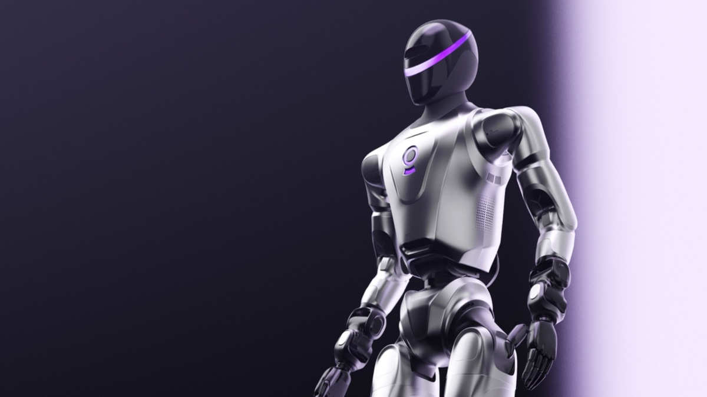
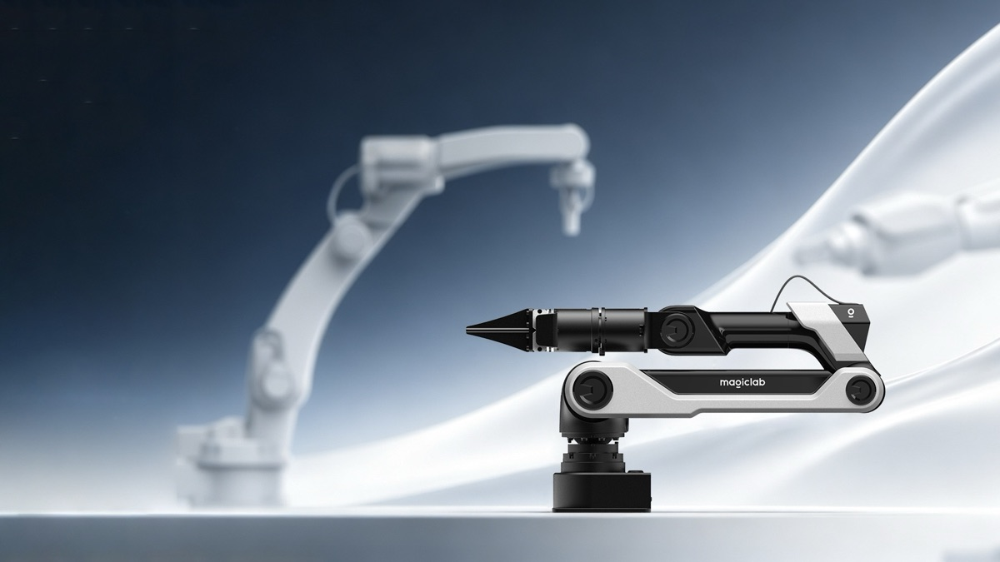
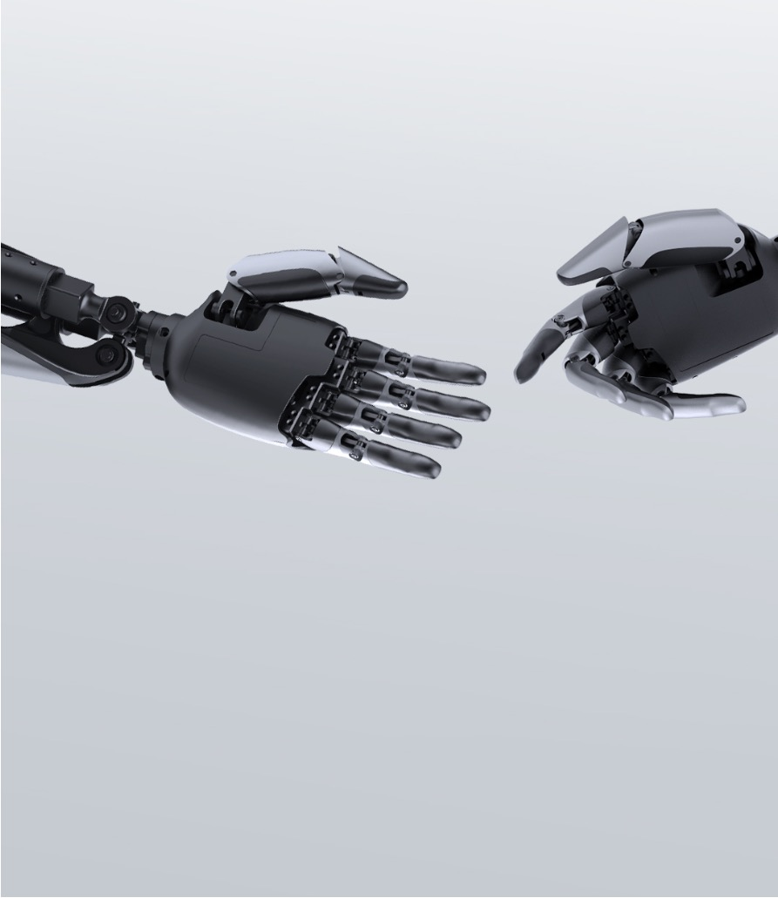
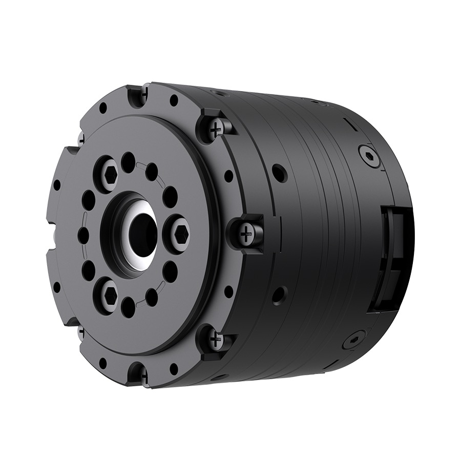

# Magiclab Robotics — Product Portfolio

⬆ [Magiclab Robotics profile](Magiclab.md) · [Developer guide](Magiclab-Developer-Guide.md) · [Roadmap and strategy](Magiclab-Roadmap-and-Strategy.md)

> **Read this first**
> - **Only some editions are programmable.** SDK / secondary development: MagicDog **EDU** (not PRO), MagicBot Z1 **Development Version** (not base), MagicBot X1 **Ultra** (not X1), Gen1, D1. Ask at the booth which edition is on the table.
> - **No prices are public** on either official site (all "Contact us" / "Purchase" enquiry).
> - All speed, payload, slope and runtime figures are the vendor's **lab values**.
> - What is physically at Leukerbad is **not confirmed**; best guess is MagicDog EDU and MagicBot Z1 Development Version (see profile).

## Lineup map

Status: ✅ shipping/available · 🧪 announced/preview · 🔭 roadmap/concept. Track relevance: ● strong · ◐ partial · ○ none.

| Product | Category | Status | Launched | Price (if public) | Positioning (one line) | T01 | T02 | T03 | T04 |
|---|---|---|---|---|---|---|---|---|---|
| MagicBot Z1 (base / Development Version) | Compact biped humanoid | ✅ | 2025 ⚠️ unverified (shown CES Jan 2026) | not public | 1.37 m, 40 kg research / show humanoid; dev version has SDK | ◐ | ◐ | ○ | ● |
| MagicBot Gen1 | Full-size biped humanoid | ✅ | Late 2024 ⚠️ unverified | not public | 1.74 m, 42-DoF worker / guide humanoid with 11-DoF hands | ◐ | ◐ | ◐ | ◐ |
| MagicBot X1 / X1 Ultra | Flagship full-size humanoid | 🧪 | Apr 2026 (unveiled) | not public | 1.80 m, hot-swap batteries; Ultra = developer edition up to Jetson AGX Thor | ◐ | ◐ | ○ | ○ |
| MagicBot D1 | Wheeled industrial humanoid | 🧪 | Jul 2026 (WAIC) | not public | 150 kg omni-base dual-arm mobile manipulator for factory and logistics | ● | ◐ | ● | ◐ |
| MagicDog (PRO / EDU) | Small quadruped | ✅ | 2025 ⚠️ unverified | not public | 15.8 kg companion dog; EDU is the hackable one (SDK, ROS 2) | ● | ● | ◐ | ● |
| MagicDog-W | Wheel-legged quadruped | ✅ | not confirmed (shown CES Jan 2026) | not public | 22.5 kg, wheels + legs, 10 kg payload, 4G | ● | ● | ◐ | ◐ |
| MagicDog-Y1 | Industrial quadruped | ✅ | not confirmed (shown CES Jan 2026) | not public | 70 kg, IP67, −20 to 55 °C, 45 kg dynamic payload | ◐ | ● | ◐ | ○ |
| MagicDog T1 | Light-industry modular quadruped | 🧪 | Jul 2026 (WAIC) | not public | One-person-deployable inspection dog that can carry an arm | ◐ | ● | ● | ○ |
| Magic Panda | Companion / collectible quadruped | ✅ (limited edition) | Feb 2026 (Spring Festival Gala edition) | not public | Fur-covered panda performer; not a development platform | ○ | ○ | ○ | ◐ |
| MagicArm R1 | Force-controlled 6-DoF arm | ✅ ⚠️ unverified status | not public | not public | 5.5 kg desktop arm, 4 kg payload, joint torque sensing, open SDK | ◐ | ○ | ● | ◐ |
| MagicHand S01 | Dexterous hand | ✅ | not public | not public | 11-DoF tactile hand, 5 kg whole-hand payload | ○ | ○ | ◐ | ◐ |
| H01 dexterous hand (MagicHand H01) | Dexterous hand, new generation | 🧪 | Apr 2026 (announced) | not public | 20 DoF, 44 3D tactile sensors, proximity sensing | ○ | ○ | ○ | ◐ |
| Joint modules (P60N30, D90, P90N20, P110, H60, H70, T28) | Actuator components | ✅ | not public | not public | Integrated motor + reducer + driver units, CAN / EtherCAT | ○ | ○ | ○ | ◐ |
| Magic-VLA K02 | Vision-language-action model | 🧪 | Apr 2026 (per press) | n/a | In-house manipulation model; no public weights found | ◐ | ○ | ◐ | ◐ |
| Magic-Mix | World model | 🧪 | Apr 2026 (announced) | n/a | World-action model (WAM) plus offline data generator (Creator) | ○ | ○ | ○ | ○ |

## Products

### MagicBot Z1 (base / Development Version)

Compact, fall-tolerant biped humanoid aimed at research, education and stage shows. The most likely Magiclab humanoid to be hackable on site — **but only the Development Version**.

| Spec | Z1 (base) | Z1 Development Version |
|---|---|---|
| Size standing (H × W × D) | 1369 × 422 × 200 mm | same |
| Size folded | 730 × 422 × 395 mm | same |
| Weight with battery | ~**40 kg** | ~40 kg+ |
| Total DoF | **24** | **24–50** |
| DoF breakdown | leg 6, arm 5, waist 1, head 1 | arm 5 **+ 2 optional wrist DoF**; optional **11-DoF tactile hand** |
| Max arm load | **2 kg** | **3 kg** |
| Max knee torque | 100 N·m | 130 N·m |
| Arm span | ~0.5 m | ~0.5 m |
| Waist yaw range | ±160° | ±160° |
| Compute | 8-core CPU | 8-core CPU + **optional high-compute module** |
| Sensors | 3D LiDAR, depth camera, stereo fisheye, head touch sensor | same |
| Audio | microphone array, 5 W speaker | same |
| Connectivity | WiFi 6, Bluetooth 5.2 | same |
| Battery / runtime | 15-cell quick-release, 10,000 mAh; ~**2 h** | same |
| Charger | 62 V 5 A | same |
| **Secondary development (SDK)** | **No** | **Yes** |

- **Variants:** base = remote-controlled demo robot (no SDK). Development Version unlocks the SDK, wrist DoF, tactile hands and the compute add-on.
- **Software on GitHub:** `magicbot-z1_sdk`, `magicbot-z1_description` (URDF), motion retargeting and imitation repos (see developer guide).
- **Typical applications:** research and education, VLM-based conversation, navigation demos, performances.
- **Hackathon notes:** 2–3 kg arm payload limits it to light fetch-and-hand-over tasks; plan around ~2 h per battery.
- Official page: [magiclab.top/en/z1](https://www.magiclab.top/en/z1)

### MagicBot Gen1

Full-size general-purpose humanoid with two dexterous hands; used for factory multi-robot work and guided tours.

| Spec | Value |
|---|---|
| Size standing | 1740 × 580 × 280 mm |
| Weight | ~**70 kg** |
| Active DoF | **42** (neck 2, arm 7 each, hand 11 each [6 active + 5 passive], waist 2, leg 6 each) |
| Arm reach | 800 mm shoulder to fingertip |
| Payload | **7.5 kg** per arm; 40 kg whole-body static |
| Max joint torque | ≥ 350 N·m |
| Walking speed | ≥ **4 km/h** |
| Compute | 8-core CPU + **100 TOPS** AI processor |
| Sensors | 3D LiDAR, 2 depth cameras, 3 fisheye cameras |
| Audio | omnidirectional microphone array, speakers |
| Connectivity | WiFi 6, **5G**, Bluetooth 5.2 |
| Battery | 25 Ah (1.35 kWh); **3–5 h** runtime; 3 h charge |
| Built-in functions | autonomous navigation, obstacle avoidance, manual mapping, face recognition, voice chat and guide narration |
| Secondary development | **Yes** |
| Control devices | phone / tablet app (Android, iOS), controller |

- **Variants:** single model on the product page.
- **Software on GitHub:** `magicbot-gen1_sdk`, `magicbot-gen1_description`, a pi0 VLA demo repo.
- **Typical applications:** guided tours (showrooms, museums, scenic spots), flexible manufacturing, service demos.
- Official page: [magiclab.top/en/human](https://www.magiclab.top/en/human)

### MagicBot X1 / X1 Ultra

New flagship full-size humanoid (unveiled April 2026). Shipping status not confirmed; unlikely as a hackable unit on site.

| Spec | X1 | X1 Ultra |
|---|---|---|
| Size (H × W × D) | 180 × 55.4 × 28 cm | same |
| Weight | **70 kg** | 70 kg |
| Arm span / leg length | 158 cm / 92 cm | same |
| Active DoF | **31** (head 2, arm 7 each, waist 3, leg 6 each) | same |
| Joint torque | peak ≥ 350 N·m, maximum ≥ 400 N·m | same |
| Power | dual **hot-swappable** batteries, 18 Ah | same |
| Base compute | 8-core CPU (locked) | 8-core CPU (unlocked, open motion-control board) |
| AI compute | Orin NX | up to **NVIDIA Jetson AGX Thor** |
| Sensors | stereo camera module | stereo module + head RGB-D + waist RGB-D + optional LiDAR |
| Connectivity | WiFi 6, Bluetooth 5.2 | same |
| **Secondary development** | **Not supported** | **Supported** |

- Runtime, payload and walking speed: not stated on the page.
- **Typical applications (vendor):** patrol and security, public safety, campus delivery, guided tours, performances, research, factory material transfer.
- Official page: [magiclab.top/en/x1](https://www.magiclab.top/en/x1)

### MagicBot D1

Wheeled-base dual-arm "industrial embodied operation" robot: humanoid torso on an omni-directional chassis with a lifting body. The most capable Magiclab manipulator, but 150 kg and industrial — more likely a demo than a hackathon unit.

| Spec | Value |
|---|---|
| Size | **1190–1800 mm** (H, adjustable) × 620 mm (W) × 670 mm (L) |
| Weight | **150 kg** |
| Active DoF | **25** (neck 2, arms 7 × 2, waist 3, leg 2, chassis 4–6 as listed by vendor) |
| Payload per arm | **5 kg** |
| Reach per arm | **858 mm** (without end effector) |
| Force control | torque sensing on all joints; 0.5 N force-control accuracy |
| End effector | 2-finger gripper included; multi-tool wrist; dexterous-hand compatible |
| Chassis | omni-directional, zero-radius turn, **1.5 m/s** |
| Navigation | cm-level mapping, point-to-point navigation |
| Compute | base edition 500 TOPS; high-compute edition 2070 TOPS (vendor-listed modules) |
| Sensors | head RGB ×1, head stereo ×1, head fisheye ×3, wrist RGB-D ×2, chassis 3D LiDAR ×2, ultrasonic ×3 |
| Battery | 2 packs, **1652 Wh** total; **4 h** runtime; 2 h charge; hot-swap; optional auto-dock |
| Connectivity | WiFi, Bluetooth, 4G; 10 GbE wired |
| Protection | **IP42** overall, IP50 arms |
| Secondary development | **Yes**; VR teleoperation device and handheld terminal supported |

- **Typical applications:** line loading, material handling, parcel sorting, retail shelf picking.
- Official page: [magiclabglobal.com — MagicBot D1](https://www.magiclabglobal.com/magicbots/magicbot-d1/)

### MagicDog (PRO / EDU)

Small consumer / education quadruped with an expressive head. **The EDU edition is the most likely hackable Magiclab robot on site** and the only MagicDog edition with SDK support.

| Spec | PRO and EDU (identical hardware table) |
|---|---|
| Size standing (L × W × H) | 670 × 350 × 560 mm |
| Weight | **15.8 kg** without battery |
| DoF | **13** (12 leg joint motors + head) |
| Max joint torque | ~37.5 N·m |
| Max speed | **3.0 m/s** |
| Payload | ~**5 kg** (max ~10 kg) |
| Obstacle / slope | **15 cm** step, **40°** slope |
| Compute | 8-core CPU |
| Sensors | 2D LiDAR, dual camera, depth camera, 4K camera, fisheye camera, ultrasonic, microphone array, touch |
| Battery | 29.6 V 8200 mAh quick-release; **1.5–3.0 h**; charging dock included |
| Built-in functions | smart following, patrol mode, obstacle avoidance, human recognition, motion imitation, graphical programming, voice interaction (LLM chat may need a paid subscription), real-time video |
| **SDK support** | **PRO: No · EDU: Yes** |

- **What EDU unlocks:** `magicdog_sdk` (C++ / Python, high-level and low-level joint control), `magicdog_ros2_sdk` (topics / services with SLAM and navigation), `magicdog_motion_sdk` for custom controllers.
- **Typical applications:** follow-me carrier, patrol, guide or companion robot, education.
- **Hackathon notes:** only a **2D** LiDAR — fine for flat indoor mapping, weak for 3D outdoor terrain; ~5 kg payload covers a small sensor or delivery box. No IP rating published — treat snow and wet ground as untested.
- Official page: [magiclab.top/en/dog](https://www.magiclab.top/en/dog)

### MagicDog-W

Wheel-legged version of MagicDog: rolls on flat ground, steps over obstacles, drives in both directions.

| Spec | Value |
|---|---|
| Size standing | 670 × 350 × 650 mm |
| Weight | **22.5 kg** with battery |
| Motors | 16 + 1 head motor |
| Wheels | 7-inch pneumatic tyres |
| Max joint torque | 37.5 N·m |
| Speed | 0–**3 m/s** |
| Payload | up to **10 kg** |
| Slope | ≤ **40°** |
| On-board AI compute | **6 TOPS**; high-performance accelerator module listed as expansion |
| Sensors | 2D LiDAR, dual camera, depth camera, 4K camera, fisheye camera, ultrasonic, touch |
| Connectivity | WiFi 5, **4G**, Bluetooth 5.0 |
| Battery | 29.6 V 8200 mAh; **2–4 h**; standby up to 8 h |
| Operating temperature | **−5 to 40 °C** |
| Expansion | back plate + expansion dock for LiDAR, gimbal and other payloads |

- **Variants:** single model. SDK and URDF exist on GitHub (`magicdog-w_sdk`, `magicdog-w_description`); whether every unit is unlocked is not stated ⚠️ unverified.
- **Typical applications:** fast delivery and patrol on paved routes, sensor carrier.
- **Hackathon notes:** the −5 °C lower limit is close to November conditions at 1,400 m; wheels on snow or ice are untested.
- Official page: [magiclab.top/en/dog-w](https://www.magiclab.top/en/dog-w)

### MagicDog-Y1

Industrial quadruped for inspection and emergency work; the only Magiclab robot with a published weather rating.

| Spec | Value |
|---|---|
| Size (L × W × H) | 1050 × 458 × 810 mm |
| Weight | **70 kg** with battery |
| Payload | **45 kg** dynamic; 150 kg maximum (static) |
| Max speed | **6 m/s** |
| Obstacle / slope | step ≥ **60 cm**, slope ≥ **45°** |
| Protection | **IP67**; operating **−20 to 55 °C** |
| Battery | 54 V 45 Ah (2400 Wh); **4–6 h** (> 4 h walking with 20 kg) |
| Compute | 8-core CPU; optional **157 TOPS** module |
| Sensors | 3D LiDAR ×1, depth cameras ×2, optical cameras ×2 (varies by configuration) |
| Connectivity | WiFi 6, Bluetooth 5.2, optional 5G |
| User interfaces | 4× 24 V + RS-485, 4× USB 3.0, 3× 12 V + Ethernet, 1× EtherCAT |
| Supported payloads | thermal imager, dual-light PTZ camera, gas sensor, acoustic imager, partial-discharge sensor |

- **Software:** `magicdog-y1_sdk` on GitHub.
- **Typical applications:** energy and plant inspection, security patrol, emergency response (the vendor lists a flood-relief deployment case).
- **Hackathon notes:** best technical fit for Leukerbad's snow and slopes, but heavy and costly — ask whether one is on site and whether teams may operate it.
- Official page: [magiclab.top/en/dog-y](https://www.magiclab.top/en/dog-y)

### MagicDog T1

Lightweight, modular inspection quadruped shown at WAIC 2026; sits between MagicDog and Y1.

| Spec | Value |
|---|---|
| Concept | one-person rapid deployment; modular chassis |
| Payload options | robot arm, vision sensors, industry-specific sensors |
| Demo task | patrol a zone, detect empty bottles, pick them with a rear-mounted gripper arm, drop into an on-board basket |
| Weight, payload, runtime, IP rating | **not public** |

- **Typical applications:** park, campus and light-industrial inspection with light manipulation; litter collection demo is directly relevant to T03.
- No product page yet; official article: [MagicDog T1 debuts at WAIC 2026](https://www.magiclabglobal.com/magicdog-t1-debuts-at-waic-2026-a-single-person-deployable-robot-for-distributed-industrial-and-park-inspection.html)

### Magic Panda

Fur-covered panda-shaped quadruped sold as a limited, serial-numbered collector's edition tied to the 2026 Spring Festival Gala.

| Spec | Value |
|---|---|
| Size standing | L 110 cm × H 65 cm × W 46 cm |
| Head | fixed-head version on sale (stage version had a movable head) |
| Limitation | wool exterior — vendor warns against prolonged continuous operation (overheating) |
| SDK / development access | not stated; assume none |

- **Typical applications:** entertainment, gifts, companionship. Not a build platform.
- Official page: [magiclab.top/en/panda](https://www.magiclab.top/en/panda)

### MagicArm R1

Lightweight force-controlled desktop arm aimed at data collection, model training and mounting on quadrupeds.

| Spec | Value |
|---|---|
| DoF | **6** |
| Reach | **700 mm**; 180° forearm bend |
| Weight | **5.5 kg** |
| Payload | **4 kg** |
| Repeatability | ±0.1 mm |
| Sensing | real-time torque sensing in every joint; drag teaching |
| Mounting | upright, side or inverted |
| End effectors | grippers, dexterous hands, suction cups |
| Developer features | open SDK, URDF, teleoperation and data-collection tooling, real-world RL / DAgger support |

- Availability and a public SDK repository were not confirmed ⚠️ unverified.
- **Typical applications:** sorting and assembly demos, imitation-learning data collection, arm-on-dog builds.
- Official page: [magiclab.top/en/magicarm-r1](https://www.magiclab.top/en/magicarm-r1)

### MagicHand S01

In-house tactile dexterous hand, fitted to Gen1 and optional on Z1 Development Version.

| Spec | Value |
|---|---|
| DoF per hand | **11** (6 active + 5 passive per the Gen1 page) |
| Weight | 580 (unit not printed; grams implied) incl. pressure sensors |
| Tactile sensors | **5**, 0.1 N resolution |
| Grip force | 2.5 kg single finger; **9.1 kg** four-finger |
| Whole-hand payload | **5 kg** |
| Speeds | four-finger flexion 150°/s; thumb flexion 56°/s; open/close 1.2 s |
| Repeatability | 0.2 mm at fingertip |
| Power | 12 V; 0.2 A static, 3 A max |

- Official page: [magiclab.top/en/parts/hand](https://www.magiclab.top/en/parts/hand)

### H01 dexterous hand

Next-generation hand ("MagicHand H01") announced at the company's Silicon Valley summit in April 2026. No product page, price or availability.

| Spec (company statement) | Value |
|---|---|
| DoF | **20** |
| Tactile sensing | **44** 3D tactile sensors |
| Proximity sensing | 0–40 mm pre-touch range |
| Control loop | 5 ms hardware closed-loop response |

- Vendor names industrial and caregiving collaboration as targets. Not independently verified.

### Joint modules (P60N30, D90, P90N20, P110, H60, H70, T28)

Integrated actuators (motor + reducer + driver + encoders) sold as components. Useful only if you build custom mechanisms.

| Model | Type | Size (mm) | Weight | Rated / max torque | Max speed | Voltage | Encoder | Bus |
|---|---|---|---|---|---|---|---|---|
| P110 | Planetary | φ112 × 71.5 | 1900 g | 90 / **360 N·m** | 120 rpm | 48–54 V | dual, 15-bit | CAN / EtherCAT |
| P90N20 | Planetary | φ92 × 63.4 | 1100 g | 35 / **130 N·m** | 300 rpm | 48–54 V | dual, 18-bit | CAN / EtherCAT |
| D90 | Planetary | φ98 × 48.5 | 590 g | 9 / **25 N·m** | 180 rpm | 24–36 V | dual, 12-bit | CAN |
| P60N30 | Planetary | φ64 × 57.1 | 532 g | 20 / **60 N·m** | 175 rpm | 48–54 V | dual, 15-bit | CAN / EtherCAT |
| H60, H70 | Harmonic | not checked | not checked | not checked | — | — | — | — |
| T28 | Linear (ball screw) | not checked | not checked | not checked | — | — | dual | — |

- P60N30 extras: 25 kHz control frequency; feedback of torque, angle, velocity, temperature; commands for torque, angle, velocity, stiffness, damping; recommended −5 to 40 °C.
- Official pages: [P60N30](https://www.magiclab.top/en/parts/p60n30) · [Servo joint module overview](https://www.magiclabglobal.com/products/servo-joint-module/)

### Magic-VLA K02

Vision-language-action model for manipulation. Released April 2026 according to press; **no public weights or API found**. Company-reported **>90%** success on long-horizon demo tasks (box stacking, clothes sorting, packing) — not independently verified. Do not plan a hackathon build around it unless staff provide access.

### Magic-Mix

World model announced April 2026, described by the company as two engines:

| Part | Role (company description) |
|---|---|
| Magic-Mix WAM | scene understanding, spatial reasoning and action decisions |
| Magic-Mix Creator | offline data-generation engine |

- Related research: a paper titled "Magic-W0: A Structured World-Action Foundation Model for Physical Intelligence" is on arXiv and a `Magic-W0` repository exists in the company's GitHub org; how it maps to the Magic-Mix product is not stated ⚠️ unverified.
- Access for participants: not public.

## Accessories and ecosystem

| Item | What it is | Status | Notes |
|---|---|---|---|
| MagicHand S01 | 11-DoF tactile hand | ✅ | Optional on Z1 Development Version; standard on Gen1 |
| MagicHand H01 | 20-DoF hand | 🧪 | Announced only |
| 2-finger gripper | D1 end effector | 🧪 | Included with D1 |
| Z1 wrist option | +2 DoF per arm | ✅ | Development Version only |
| High-compute modules | AI add-ons | ✅ | Z1 dev (optional), Gen1 100 TOPS, Y1 157 TOPS, MagicDog-W accelerator, X1 Ultra up to AGX Thor |
| Charging dock | MagicDog battery dock | ✅ | Included with MagicDog PRO / EDU |
| Auto-dock charging station | D1 | 🧪 | Optional |
| Expansion dock / back plate | MagicDog-W payload mount | ✅ | LiDAR, gimbal and similar |
| Y1 payload kit | Rails, plates, powered ports | ✅ | Thermal, PTZ, gas, acoustic, partial-discharge sensors supported |
| Hand accessories | Mounting interface kit, tactile sensor module | ✅ ⚠️ unverified detail | Listed on the global site |
| VR teleoperation | PICO headset teleop (`pico_teleoperate`); D1 VR device | ✅ | Data collection and remote operation |
| Mobile app and remote | Phone / tablet app, handheld controller | ✅ | Gen1, Z1, MagicDog |
| SDKs and simulation | Per-robot SDKs, URDFs, MuJoCo, RL lab | ✅ | See [Developer guide](Magiclab-Developer-Guide.md) |

## Legacy and discontinued

- None announced. The global storefront no longer lists **Magic Panda** or **MagicArm R1**, and the main site does not list **D1** or **T1** — the two sites are out of sync, so check both.

## Image credits

All images © Magiclab Robotics, downloaded from the company's official sites on 2026-11-14 and converted to JPEG.

| File | Shows | Source URL |
|---|---|---|
| assets/magiclab-magicbot-z1.jpg | MagicBot Z1 banner | https://www.magiclab.top/imgs/z1/z1-banner.jpg |
| assets/magiclab-magicbot-gen1.jpg | MagicBot Gen1 | https://www.magiclab.top/imgs/human/humanMb.jpg |
| assets/magiclab-magicbot-x1.jpg | MagicBot X1 banner | https://www.magiclab.top/imgs/x1/x1-banner.png |
| assets/magiclab-magicbot-d1.jpg | MagicBot D1 | https://www.magiclabglobal.com/uploads/image/20260907/magicbot-d1-robot-wholesale-supplier-from-china-3.webp |
| assets/magiclab-magicdog.jpg | MagicDog | https://www.magiclab.top/imgs/dog/dog.jpg |
| assets/magiclab-magicdog-w.jpg | MagicDog-W banner | https://www.magiclab.top/imgs/dog-w/dog-w-banner.jpg |
| assets/magiclab-magicdog-y1.jpg | MagicDog-Y1 banner | https://www.magiclab.top/imgs/dog-y/dog-y1-banner.jpg |
| assets/magiclab-magicdog-t1.jpg | MagicDog T1 with gripper arm at WAIC 2026 | https://www.magiclabglobal.com/uploads/image/20260826/lightweight-industrial-robot.webp |
| assets/magiclab-magic-panda.jpg | Magic Panda | https://www.magiclab.top/imgs/panda/panda-v2.png |
| assets/magiclab-magicarm-r1.jpg | MagicArm R1 | https://www.magiclab.top/imgs/magicarm/home.png |
| assets/magiclab-magichand-s01.jpg | MagicHand S01 | https://www.magiclab.top/imgs/parts/hand/hand.png |
| assets/magiclab-joint-modules.jpg | P60N30 joint module | https://www.magiclab.top/imgs/parts/p60n30/P60N30-45.png |

## Sources

- [MagicBot Z1 product page](https://www.magiclab.top/en/z1)
- [MagicBot Gen1 product page](https://www.magiclab.top/en/human)
- [MagicBot X1 product page](https://www.magiclab.top/en/x1)
- [MagicBot D1 product page (global site)](https://www.magiclabglobal.com/magicbots/magicbot-d1/)
- [MagicDog product page](https://www.magiclab.top/en/dog)
- [MagicDog-W product page](https://www.magiclab.top/en/dog-w)
- [MagicDog-Y1 product page](https://www.magiclab.top/en/dog-y)
- [MagicDog T1 debuts at WAIC 2026 (global site)](https://www.magiclabglobal.com/magicdog-t1-debuts-at-waic-2026-a-single-person-deployable-robot-for-distributed-industrial-and-park-inspection.html)
- [Magic Panda product page](https://www.magiclab.top/en/panda)
- [MagicArm R1 product page](https://www.magiclab.top/en/magicarm-r1)
- [MagicHand S01 product page](https://www.magiclab.top/en/parts/hand)
- [In-house developed dexterous hand (global site)](https://www.magiclabglobal.com/products/in-house-developed-dexterous-hand/)
- [P60N30 joint module page](https://www.magiclab.top/en/parts/p60n30)
- [Servo joint module overview (global site)](https://www.magiclabglobal.com/products/servo-joint-module/)
- [Accessories overview (global site)](https://www.magiclabglobal.com/products/accessories/)
- [Global Embodied AI Innovation Conference recap — Magic-Mix, MagicHand H01, X1 (global site)](https://www.magiclabglobal.com/blog/the-magiclab-global-embodied-ai-innovation-conference-concludes-in-silicon-valley-spearheading-the-next-decade-of-embodied-ai.html)
- [Magiclab global site home](https://www.magiclabglobal.com/)
- [GitHub — MagiclabRobotics](https://github.com/MagiclabRobotics)
- [arXiv 2609.39870 — Magic-W0](https://arxiv.org/abs/2609.39870)
- [Gasgoo — WAIC 2026: MagicLab launches three new robot products](https://autonews.gasgoo.com/articles/news/waic-2026-magiclab-launches-three-new-robot-products-embodied-intelligence-accelerates-entry-into-factories-and-public-scenarios-2079099620004175873)
- [AAP / Cision — Silicon Valley summit release, 29 Apr 2026](https://www.aap.com.au/aapreleases/cision20260429ae46475/)
- [Magiclab Robotics profile (this vault)](Magiclab.md)
