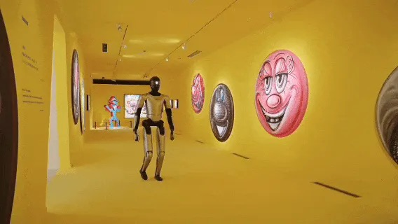
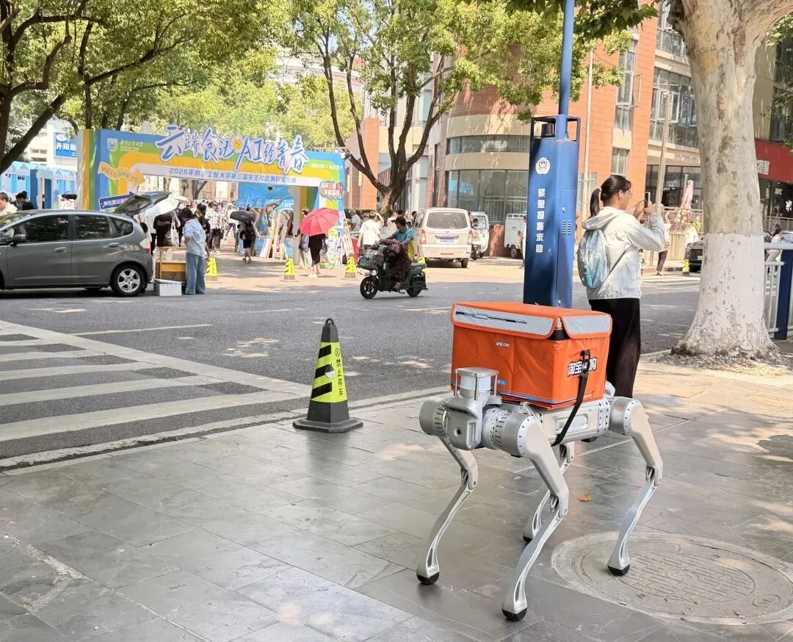
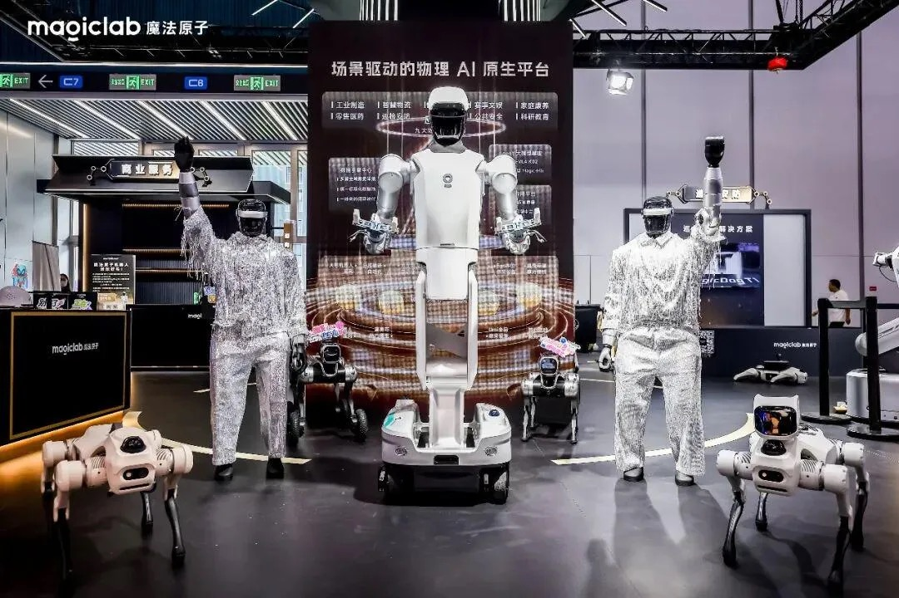
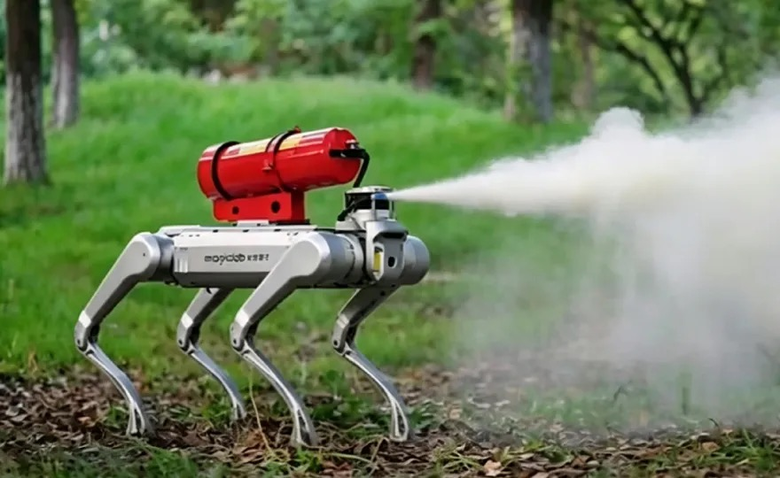
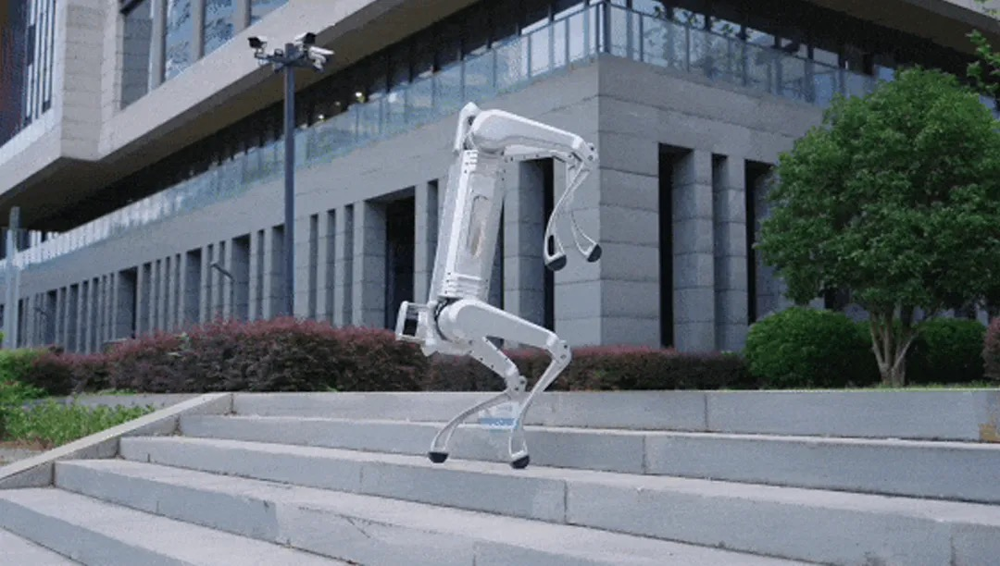
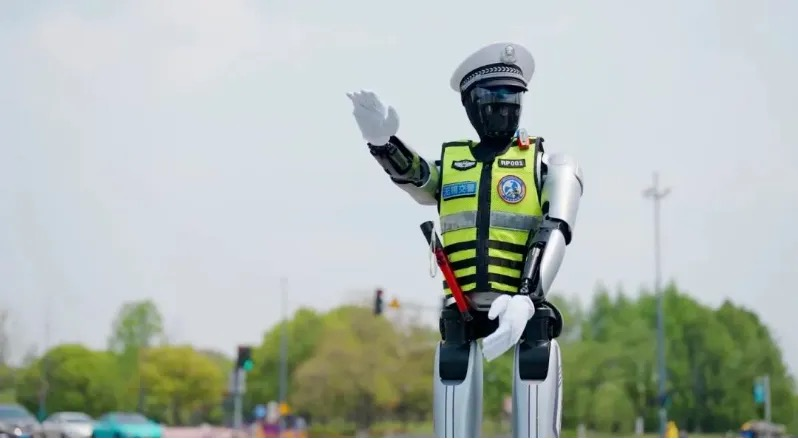
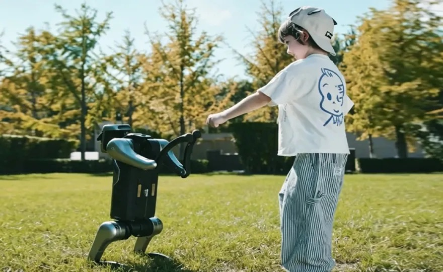
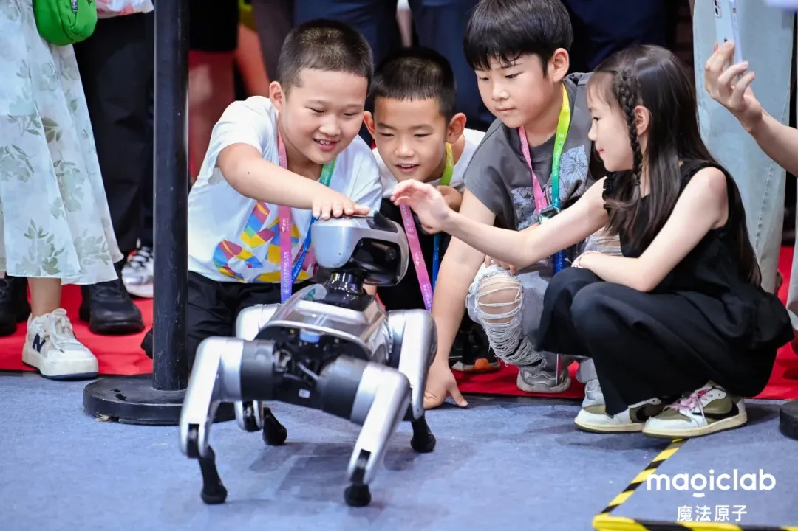
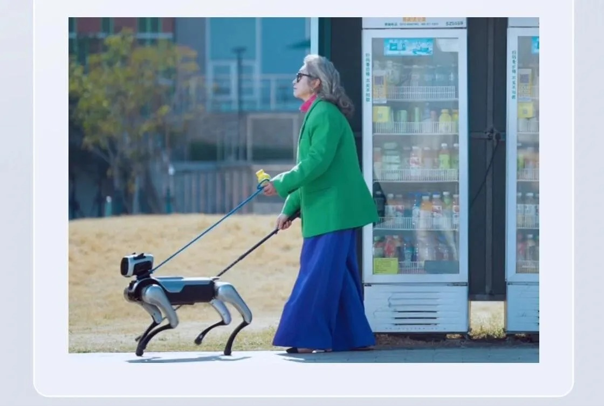

# Magiclab Robotics — Solutions and Projects Register

⬆ [Magiclab Robotics profile](Magiclab.md) · [Product portfolio](Magiclab-Products.md) · [Papers and research](Magiclab-Papers-and-Research.md) · [Roadmap and strategy](Magiclab-Roadmap-and-Strategy.md)

> **Coverage note:** Walked on 2026-11-14: (1) the China site **magiclab.top** — Industry / Applications page, About, and **all 34 news articles** (IDs 29–65, Jul 2024 → Sep 2026, Chinese and English); (2) the global site **magiclabglobal.com** — **every HTML page in its sitemap (134 pages)**: the 9 industry pages, ~65 case studies, News, Events, Blog, Partnership & Procurement, Data Collection, ESG, Services, MagicBot D1; (3) trade press already used in the profile (EqualOcean, QbitAI) and the GitHub repo `Magic-W0`.
> **Not accessible / not done:** the web-search budget for this run was exhausted, so **no fresh keyword searches** (English or Chinese) were possible — third-party-only news (local Chinese press, distributor announcements) may be missing. The Gasgoo WAIC 2026 article returned HTTP 468 and was not re-read. The solution-brochure PDFs listed in the sitemap were not opened. WeChat / Douyin / Bilibili channels were not walked.
> **Read with care:** almost everything below is **company-reported**. Many global-site "case studies" are one-paragraph capability demos, not customer deployments — the Maturity column separates them. Several case pages carry no date.

Names used below: **Xiaomai (小麦)** = the full-size humanoid MagicBot Gen1. **Qianjing plan** = 千景共创计划 ("Co-Create 1000 Initiative": 1,000 partners, 1,000 scenarios).

## Solutions catalogue — everything they offer

The company markets **nine verticals** (official list, Apr 2026): healthcare / home health, industrial flexible manufacturing, inspection and security, smart guided tours, public safety, smart logistics, sports and entertainment, research and education, home life. The global site re-labels them as nine "Industries" (adds "Retail & Pharmaceuticals"). Rows below break these into the concrete offerings found.

| # | Solution / application | What it does | Products used | Maturity | Tracks | Source link |
|---|---|---|---|---|---|---|
| 1 | Smart guided-tour solution (智慧导览) | Humanoid walks, narrates and points; zero-code app for mapping, waypoints, scripts, gestures; **160+ voices**, multilingual, face-recognition greeting, synced screens | MagicBot Gen1, Z1 | ✅ deployed in several venues, long-term contract at Beidou park | T01 | [Guided tours](https://www.magiclabglobal.com/magiclab-embodied-ai-robotics-for-smart-hospitality-guiding/) |
| 2 | Reception, wayfinding and concierge | Greeting, VIP reception, bilingual directions, Q&A, bell / refreshment service at summits, showrooms, service halls, airports, campuses | Gen1, Z1 | ✅ repeated event deployments | T01 | [Finance-summit case](https://www.magiclabglobal.com/magicbot-xiaomai-becomes-the-first-chinese-humanoid-to-deliver-live-service-at-a-top-tier-global-finance-summit.html) |
| 3 | Retail shopping guide (stores, car showrooms) | In-store reception, product introduction, hand-over to sales staff; "international shopping guide" in Spanish / English at MWC | Gen1 | ✅ in selected home-appliance stores (company statement) | T01 | [Applications page](https://www.magiclab.top/en/applications) |
| 4 | Robot instant delivery (外卖配送) | Order pickup → route planning → building-level delivery; LiDAR 3D mapping, multi-map switching, rear cargo basket | MagicDog (courier), Gen1 / Z1, MagicHand S01 | 🧪 2-day live pilot on two campuses | T01 | [Taobao Shangou case](https://www.magiclabglobal.com/order-to-doorstep-in-minutes-magiclab-x-taobao-shangou-complete-chinas-first-closed-loop-robotic-campus-food-delivery.html) |
| 5 | Reception-to-delivery service loop | Z1 greets and guides, Y1 carries luggage / items from entrance to destination | MagicBot Z1 + MagicDog Y1 | 🧪 event deployments | T01 | [Service-loop case](https://www.magiclabglobal.com/magicbot-z1-and-magicdog-y1-form-a-complete-reception-to-delivery-service-loop.html) |
| 6 | Smart logistics (in-facility) | Line-side replenishment, tote / turnover-box transfer, barcode scanning, picking / packing, last-metre delivery, uneven-terrain and emergency logistics | Gen1, D1, MagicDog Y1 | ✅ factory use (Dreame) / 🧪 elsewhere | T01 | [Smart logistics](https://www.magiclabglobal.com/magiclab-embodied-ai-robotics-for-smart-logistics/) |
| 7 | Flexible parcel / postal sorting | "Receive → sort → transport": D1 picks from mixed piles, **HyperBot** sorting robots run at up to **2.5 m/s**, **XGZ1** flexible workstation (6 s tool change), RCS fleet scheduler | MagicBot D1, HyperBot, XGZ1, RCS | 🧪 demo at WRC / IFA 2026; agreement with Pošta Slovenije | T01 | [IFA 2026 release](https://www.magiclabglobal.com/magiclab-brings-physical-ai-to-europes-factory-floors-at-ifa-2026-debuting-full-stack-embodied-intelligence-stack.html) |
| 8 | Postal-outlet solution ("smart logistics + smart tour") | Sorting, induction, material transfer, last-mile delivery in postal hubs; reception and business guidance in postal halls and parcel stations | MagicDog, Gen1, Z1 | 🔭 positioning shown to State Post Bureau delegation | T01 | [State Post Bureau visit](https://www.magiclabglobal.com/state-post-bureau-inspects-magiclab-for-smart-postal-ai.html) |
| 9 | Retail shelf picking and in-store delivery | Wheeled humanoid picks across shelf heights (**80–230 cm**) with vision + **0.5 N** force control, no fixtures | MagicBot D1 | 🧪 trade-show demos | T01 | [D1 retail case](https://www.magiclabglobal.com/magicbot-d1-navigates-retail-shelves-with-vision-guided-force-controlled-precision-picking.html) |
| 10 | "Unmanned store" series (无人门店) | Robot-run coffee, milk-tea, ice-cream, **pharmacy** and bookstore units, combinable per site | Humanoids (Gen1 / D1 class) | 🧪 announced Jan 2026; 🔭 10,000-store plan | T01 | [Partner conference](https://www.magiclab.top/news/57) |
| 11 | Beverage and food service (latte art, bartending, noodle scooping) | Dual-hand pouring, latte art, serving guests | Gen1 + MagicHand S01 | 🧪 demos (Cannes, Spring Festival Gala) | T01 | [Cannes case](https://www.magiclabglobal.com/dual-hand-precision-service-on-the-world-stage-magicbot-gen1-pours-drinks-and-greets-guests-at-cannes.html) |
| 12 | Inspection and security (巡检安防) | Autonomous patrol with payloads: thermal, dual-light PTZ, gas, acoustic imager, partial-discharge; power / utility, petrochemical, tunnels, construction, campus | MagicDog Y1 (IP67, −20 to 55 °C) | ✅ product shipping; European energy-site use reported, no site named | T02 T03 | [Inspection & security](https://www.magiclabglobal.com/magiclab-embodied-ai-robotics-for-inspection-security/) |
| 13 | Light-industry / park inspection with manipulation | One-person-deployable quadruped; inspection, anomaly detection, equipment monitoring, light manipulation with rear arm (bottle pick-up, button pressing, debris clearing) | MagicDog T1 (+ arm) | 🧪 launched mid-2026; testing at Dreame factory | T02 T03 T01 | [T1 case](https://www.magiclabglobal.com/magicdog-t1-debuts-at-waic-2026-a-single-person-deployable-robot-for-distributed-industrial-and-park-inspection.html) |
| 14 | App-configured indoor patrol | User maps rooms and sets patrol routes in the app; robot follows them and observes | MagicDog | ✅ product feature | T02 | [Indoor patrol](https://www.magiclabglobal.com/app-configured-autonomous-indoor-patrol.html) |
| 15 | Public safety / emergency response | Disaster-site reconnaissance, hazardous-gas detection, tunnel / confined-space support, flood assessment, emergency payload delivery (**45 kg** dynamic, 150 kg standing), remote dispatch, 5G option | MagicDog Y1 | ✅ product; 🧪 one real flood-relief donation | T02 | [Public safety](https://www.magiclabglobal.com/magiclab-embodied-ai-robotics-for-public-safety/) |
| 16 | Smart policing "humanoid + quadruped" (智慧警务) | Traffic direction, crowd guidance, patrol, public-service desk; humanoids for public-facing duty, quadrupeds for higher-risk response | Gen1 (police variant), MagicDog Y1, smaller quadrupeds | ✅ in use with Wuxi police (company statement) | T02 T01 | [Wuxi police case](https://www.magiclabglobal.com/magiclab-x-wuxi-police-a-humanoid-traffic-officer-goes-on-duty-at-a-major-public-sporting-event.html) |
| 17 | Smart-policing equipment line | Evidence-collection devices co-developed with Wuxi PSB, portable law-enforcement gear, monitoring systems | Non-robot devices + robots | 🧪 exhibited 2026 | T02 | [Security fleet](https://www.magiclabglobal.com/magiclab-unveils-security-fleet-for-smart-policing.html) |
| 18 | Heterogeneous fleet coordination | Patrol dog, service humanoid and photo robot share one scheduling layer, yield to each other, adapt to crowd density | MagicDog Y1, Gen1, MagicPanda | 🧪 first outdoor validation (Cannes) | T02 T01 | [Fleet case](https://www.magiclabglobal.com/heterogeneous-robot-fleet-coordination-autonomous-beach-patrol-bartending-and-guest-service-in-one-live-environment.html) |
| 19 | Healthcare and wellness (non-clinical) | Hospital / health-centre reception, health education, **closed-route supply and document delivery**, lab bottle handling, wellness interaction (conversation, music, movement demos, reminders) | Gen1, Z1, MagicDog | 🧪 solution page; cases are demos | T04 T01 | [Home & Healthcare](https://www.magiclabglobal.com/magiclab-embodied-ai-robotics-for-home-healthcare/) |
| 20 | Home smart-health / companion-care package | Customised hardware + home health programme + experience showrooms for in-home health management and companion care | Not specified | 🧪 **RMB 150M** order signed Apr 2026; delivery status not public | T04 | [RMB 150M deal](https://www.magiclabglobal.com/news/magiclab-signs-rmb-150-million-deal.html) |
| 21 | Household services | Folding clothes, organising, supervised kitchen / beverage tasks, plant watering, reminders, exercise and stretching demos, smart-home interface | Gen1, Magic-VLA K02 | 🧪 demos | T04 | [Household page](https://www.magiclabglobal.com/magiclab-embodied-ai-robotics-for-retail-pharmaceuticals/) |
| 22 | Family companionship | Voice (30+ commands), touch and vision interaction, auto-follow, 4K "dog view" camera, app control | MagicDog, Magic Panda, Z1 | ✅ consumer product | T04 | [Companion case](https://www.magiclabglobal.com/magicdog-brings-companionship-home-consumer-quadruped-debuts-voice-and-app-controlled-family-interaction.html) |
| 23 | Guide-dog robot for visually impaired people ("Guangyin 001", 光引001) | Route guidance, obstacle and crossing warnings by voice, shopping help, ordering and payment, ride hailing | MagicDog-class quadruped | 🧪 project shown Mar 2025; no product | T04 T01 | [Guide-robot case](https://www.magiclabglobal.com/independence-automated-magiclabs-quadruped-guide-robot-helps-visually-impaired-users-navigate-shop-and-hail-rides.html) |
| 24 | Hospital specimen / medication transport | Quadruped carries lab samples and emergency medicines in hospitals | MagicDog T1 | 🔭 planned for Europe | T04 T01 | [IFA 2026 release](https://www.magiclabglobal.com/magiclab-brings-physical-ai-to-europes-factory-floors-at-ifa-2026-debuting-full-stack-embodied-intelligence-stack.html) |
| 25 | Biopharma / lab bottle picking | Vision-guided picking and placing of bottles in repetitive lab workflows | Gen1 + hand | 🧪 demo | — | [Bottle picking](https://www.magiclabglobal.com/biopharmaceutical-bottle-picking-demonstration.html) |
| 26 | Industrial flexible manufacturing | Machine loading / unloading, material handling, inspection, picking / packaging, barcode scanning; 3-tier stack (WMS/WCS → RCS scheduler → robots) | Gen1, D1, hands | ✅ Dreame factory; field tests in auto parts, 3C, equipment | — | [Industrial manufacturing](https://www.magiclabglobal.com/magiclab-embodied-ai-robotics-for-industrial-manufacturing/) |
| 27 | Dual-arm dispensing workstation | Two motors glued every **20 s**, **1–2 mm** accuracy, 4 h+ continuous | Gen1 | ✅ factory task / show demo | — | [Dispensing case](https://www.magiclabglobal.com/dual-arm-precision-dispensing-magicbot-gen-1-completes-a-20-second-industrial-cycle-without-missing-a-beat.html) |
| 28 | Warehouse-to-line material flow | Multi-D1 fleet links warehouse retrieval, transport and line-side delivery; connects to WMS / MES | MagicBot D1, RCS | ✅ in operation at Dreame | — | [D1 at Dreame](https://www.magiclabglobal.com/magicbot-d1-closes-the-loop-between-warehouse-line-and-fleet-intelligence-at-dreames-smart-factory.html) |
| 29 | Enterprise warehouse task automation (SAP) | Humanoid executes tasks generated by SAP Business AI; integrated with SAP LGM and Capsio ATC agent | Gen1 | 🧪 showroom scenario | — | [SAP case](https://www.magiclabglobal.com/magiclab-sap-bringing-enterprise-warehouse-intelligence-to-the-factory-floor.html) |
| 30 | Events and entertainment performance | Modular show package: group choreography, stunts, hosts; delivery in about **one week**; all-weather | Z1, Gen1, MagicDog, Magic Panda | ✅ standardised product | — | [Events](https://www.magiclabglobal.com/magiclab-embodied-ai-robotics-for-sports-entertainment/) |
| 31 | Research and education | Labs, teaching classrooms, training centres, dexterous-hand training, data-collection workstation, competition training, bootcamp; open interfaces | Z1 dev, Gen1, MagicDog EDU, hands | ✅ sold to universities | T01 T02 T03 T04 (as dev platform) | [Research & education](https://www.magiclabglobal.com/magiclab-embodied-ai-robotics-for-research-education/) |
| 32 | Data collection and datasets | VR teleoperation rigs, data-collection robots, annotated multimodal datasets ("Data Universe"), provincial data centre | Gen1, teleop kits, MagicData engine | ✅ operating / 🧪 dataset offer | — | [Data collection](https://www.magiclabglobal.com/data-collection/) |
| 33 | Embodied-AI model stack | Magic-VLA K02 (long-horizon manipulation, **92 %** reported), Magic-Brain (VLM agent + visual guidance), Magic-Mix world model, **Magic-W0** open model | Software | 🧪 K02 demos; ✅ Magic-W0 code and weights public | — (useful for all) | [Magic-W0 repo](https://github.com/MagiclabRobotics/Magic-W0) |
| 34 | Device-ecosystem scenarios | Robot + smart kitchen appliances (CES 2026); "robot dog + car" link with a smart-cockpit team | MagicDog, humanoids | 🧪 demos | — | [Partner conference](https://www.magiclab.top/news/57) |
| 35 | Components and services | Joint modules, hands, arm for third parties; after-sales, OTA, training, distributor programme | Components | ✅ | — | [Services](https://www.magiclabglobal.com/services/) |

### Smart guided-tour solution

- **How it works:** staff map the hall with a joystick, set waypoints, type the script and edit gestures in an app — no code. The robot then navigates, avoids people, narrates while walking and points at exhibits; speech, motion and screen content are synchronised.
- **Numbers:** 160+ selectable voices, real-time language switching, "buy and use" positioning.
- **Where used:** Modern Art Museum Shanghai (launch Sep 2025), Beidou demonstration industrial park exhibition centre (long-term service contract), a low-altitude-economy exhibition centre, conference reception (Hong Kong, Shanghai).
- **Hackathon angle:** the same pattern (map → waypoints → script) is what a Leukerbad village or thermal-bath guide would need. Official: [guided tours](https://www.magiclabglobal.com/magiclab-embodied-ai-robotics-for-smart-hospitality-guiding/) · [museum case](https://www.magiclabglobal.com/worlds-first-synchronized-voice-and-gesture-museum-guide-magicbot-gen1-at-modern-art-museum-shanghai.html)

### Robot instant delivery

- **How it works:** student orders in a Taobao Shangou storefront; the robot picks up, plans the route and delivers to the building. Stack: LiDAR 3D mapping with one-tap map switching, multi-sensor fusion, terrain-adaptive navigation.
- **Robot:** consumer MagicDog with a rear cargo box (5–10 kg class payload); the company also describes humanoids with MagicHand S01 in the wider solution.
- **Scale:** two days (16–17 Apr 2026), two Beijing campuses. It is a pop-up pilot, not a running service.
- Official: [campus delivery case](https://www.magiclabglobal.com/order-to-doorstep-in-minutes-magiclab-x-taobao-shangou-complete-chinas-first-closed-loop-robotic-campus-food-delivery.html)

### Reception-to-delivery service loop and reception / concierge
- Z1 recognises and greets guests and gives directions; MagicDog Y1 carries luggage or items behind them — first run at the Inclusion·Bund Summit (Sep 2025).
- Xiaomai (Gen1) has done bilingual reception, meeting bells and refreshment hand-outs at the JPMorgan Global China Summit and the Hong Kong World Young Scientists Summit (2025).
- Official: [service loop](https://www.magiclabglobal.com/magicbot-z1-and-magicdog-y1-form-a-complete-reception-to-delivery-service-loop.html) · [Inclusion summit](https://www.magiclabglobal.com/magiclab-robot-fleet-powers-a-full-reception-to-guidance-service-loop-at-the-2025-inclusion-bund-summit.html)

### Flexible parcel / postal sorting and postal-outlet solution
- **How it works:** D1 uses 3D vision to pick parcels from unstructured piles and feeds **HyperBot** sorting robots (up to 2.5 m/s); the in-house **RCS** scheduler coordinates humanoids, arms and AGVs. An **XGZ1** flexible workstation with 6-second tool change was shown at WRC 2026.
- **Customer:** agreement with **Pošta Slovenije** for a flexible sorting system (international mail, e-commerce parcels, standard post). Value, site and go-live date are not public.
- HyperBot and XGZ1 have no public product page or spec sheet ⚠️ unverified beyond show reports.
- Official: [IFA 2026 release](https://www.magiclabglobal.com/magiclab-brings-physical-ai-to-europes-factory-floors-at-ifa-2026-debuting-full-stack-embodied-intelligence-stack.html) · [postal positioning](https://www.magiclabglobal.com/state-post-bureau-inspects-magiclab-for-smart-postal-ai.html)

### Retail shelf picking and "unmanned store" series

- **MagicBot D1:** wheeled humanoid, 150 kg, two 7-DoF force-controlled arms (**5 kg** each, 0.5 N force accuracy), omnidirectional base 1.5 m/s, 4 h runtime with hot-swap batteries, IP42.
- Demonstrated picking across shelf heights at WAIC and WRC 2026; a first wheeled prototype was previewed at the partner conference (Jan 2026).
- **Unmanned stores** (coffee, milk tea, ice cream, pharmacy, bookstore) were announced as a solution family in Jan 2026; no opened store was found ⚠️ unverified.
- Official: [D1 product page](https://www.magiclabglobal.com/magicbots/magicbot-d1/) · [D1 retail case](https://www.magiclabglobal.com/magicbot-d1-navigates-retail-shelves-with-vision-guided-force-controlled-precision-picking.html)

### Inspection and security

- **How it works:** MagicDog Y1 patrols repeatable routes using LiDAR, depth and optical cameras; payload bays take thermal imaging, dual-light PTZ, gas sensors, acoustic imagers or partial-discharge sensors; alarms and video feed into the customer's platform.
- **Numbers:** IP67, −20 to 55 °C, 45 kg dynamic payload, 6 m/s, quick battery swap and low-power return.
- **Use:** power / utility sites, petrochemical zones, tunnels, construction sites, campus patrol. The company says Y1 already inspects **European energy sites and power stations** — no site, customer or date is given.
- **T03 link:** gas, thermal and acoustic payloads make it an environmental-monitoring carrier; there is no dedicated environmental product.
- Official: [inspection & security](https://www.magiclabglobal.com/magiclab-embodied-ai-robotics-for-inspection-security/) · [sensor modules](https://www.magiclabglobal.com/modular-industrial-sensor-inspection.html)

### Light-industry / park inspection with manipulation (MagicDog T1)

- **Demo that matters for T03:** T1 patrolled a zone, spotted **empty plastic bottles**, picked them with a rear-mounted gripper arm and dropped them in an on-board basket — a complete litter-picking loop.
- **Numbers (show reports):** about **18–19 kg**, **15 kg** continuous payload, IP54, up to 5 m/s, 40° slopes, about 3 h runtime. Launch is given as WAIC (Jul 2026) on the case page and as August 2026 in the IFA release ⚠️ dates conflict.
- Being tested at the Dreame factory with an arm for debris clearing and button pressing (reported by QbitAI).
- Official: [T1 case](https://www.magiclabglobal.com/magicdog-t1-debuts-at-waic-2026-a-single-person-deployable-robot-for-distributed-industrial-and-park-inspection.html)

### Public safety / emergency response

- **Scenarios listed:** disaster-site reconnaissance, hazardous-gas and chemical detection, tunnel and confined-space support, flood and storm assessment, emergency tool / supply delivery, large-event support.
- **Real use:** three robot dogs worth **RMB 1.8M** were donated for flood relief in Guangxi and worked beside rescue teams on inspection and supply delivery (date not stated on the page).
- **Partner signal:** Beijing Lingtian Intelligent Equipment (emergency / firefighting equipment maker) is in the first "Juguang" partner group (Jan 2026).
- Official: [public safety](https://www.magiclabglobal.com/magiclab-embodied-ai-robotics-for-public-safety/) · [Guangxi case](https://www.magiclabglobal.com/built-for-20c-to-55c-magicdog-y1-deployed-for-24-7-flood-relief-operations-in-guangxi.html)

### Smart policing "humanoid + quadruped"

- **How it works:** a Gen1-based traffic robot stands at command points and directs traffic and crowds; quadrupeds patrol and fill gaps. Functions covered: traffic, public order, emergency response, public-service desk.
- **Proof:** 2026 Wuxi Marathon (**35,000 runners**) — described as the first biped robot approved for traffic duty at a large sports event. Strategic partnership with Wuxi Public Security Bureau; a provincial key lab for public-safety embodied robots was set up in Jul 2026.
- Official: [Wuxi police case](https://www.magiclabglobal.com/magiclab-x-wuxi-police-a-humanoid-traffic-officer-goes-on-duty-at-a-major-public-sporting-event.html) · [marathon case](https://www.magiclabglobal.com/35000-runners-one-integrated-response-system-how-magiclab-robots-helped-police-the-wuxi-marathon.html)

### Heterogeneous fleet coordination
- One scheduling layer ran an industrial quadruped on beach patrol, Gen1 at a bar and MagicPanda at a photo spot (Cannes, May 2026); robots yielded to each other and adjusted patrol frequency to crowd density.
- First outdoor validation claimed; no software product name or API is published.
- Official: [fleet case](https://www.magiclabglobal.com/heterogeneous-robot-fleet-coordination-autonomous-beach-patrol-bartending-and-guest-service-in-one-live-environment.html)

### Healthcare and wellness (non-clinical)

- **Scope the company itself sets:** reception, wayfinding, health education, closed-route supply delivery, lab handling, wellness interaction — **diagnosis, treatment and clinical decisions are explicitly excluded**.
- **Evidence level:** the listed "cases" (wellness companion interaction, controlled supply-delivery workflow, reception and wayfinding for health centres) are one-line capability statements, not named hospital or care-home deployments.
- **Planned:** MagicDog T1 for specimen and emergency-medication transport in European hospitals.
- Official: [Home & Healthcare](https://www.magiclabglobal.com/magiclab-embodied-ai-robotics-for-home-healthcare/) · [supply-delivery validation](https://www.magiclabglobal.com/controlled-supply-delivery-workflow-validation.html) · [wellness companion demo](https://www.magiclabglobal.com/wellness-companion-interaction-demonstration.html)

### Home smart-health / companion-care package
- **Deal:** **RMB 150M** (~USD 21M) procurement agreement announced 21 Apr 2026, described as the largest single robot order in China's health sector. Covers customised hardware, home health programmes and experience showrooms for in-home health management and companion care.
- **Scale target:** reach **10,000 high-net-worth households** and feed usage data back into products.
- **Unknowns:** customer name, robot models, delivery schedule ⚠️ not disclosed.
- **Earlier thread:** since Dec 2024 the company is a robot partner in China Telecom's home-robot ecosystem programme and said in Apr 2025 it is exploring **in-home elderly care and daily assistance** with China Telecom.
- Official: [deal release](https://www.magiclabglobal.com/news/magiclab-signs-rmb-150-million-deal.html) · [Chinese release](https://www.magiclab.top/news/63)

### Household services
- Gen1 demos: folding clothes, grilling, watering plants, latte art; **Magic-VLA K02** demos: box folding and sealing (**90 %+**), garment folding with interruption recovery, suitcase packing.
- The household page also lists reminders and **exercise / stretching demonstrations** — the closest thing to activity coaching; no rehab claims are made.
- Official: [household page](https://www.magiclabglobal.com/magiclab-embodied-ai-robotics-for-retail-pharmaceuticals/) · [K02 case](https://www.magiclabglobal.com/magic-vla-k02-hits-a-90-success-rate-on-an-industry-first-long-horizon-box-folding-and-sealing-task.html)

### Family companionship

- MagicDog: 13 DoF, head-and-tail motion, voice / vision / touch interaction, 30+ voice commands, auto-follow with distance keeping, 4K camera, app.
- Z1 reacts to head touch and is positioned for "family companionship"; Magic Panda adds a 3-DoF head for expressive motion.
- Official: [companion case](https://www.magiclabglobal.com/magicdog-brings-companionship-home-consumer-quadruped-debuts-voice-and-app-controlled-family-interaction.html) · [family interaction](https://www.magiclabglobal.com/magicdog-family-interaction-experience.html)

### Guide-dog robot for visually impaired people ("Guangyin 001")

- Shown on 26 Mar 2025: quadruped on a harness leads a user outdoors, warns by voice at obstacles and crossings, helps pick a drink at a vending machine, orders and pays at a shop, hails rides.
- Status: project video and case page only; no product, price or pilot users published.
- **Hackathon angle:** a direct template for a walking-escort or mobility-support demo with MagicDog EDU.
- Official: [guide-robot case](https://www.magiclabglobal.com/independence-automated-magiclabs-quadruped-guide-robot-helps-visually-impaired-users-navigate-shop-and-hail-rides.html) · [launch report](https://www.magiclab.top/news/49)

### Research and education (the hackathon-relevant offer)
- Teaching-grade hardware, open interfaces, secondary development, data-collection workstation, competition training; partners include Tsinghua, Peking, Zhejiang, Nanjing, Shanghai Jiao Tong, Soochow and Tiangong universities.
- "Real Robot, Real Skills" bootcamp with the Xbotics community: data collection → model training → real-robot deployment.
- Official: [research & education](https://www.magiclabglobal.com/magiclab-embodied-ai-robotics-for-research-education/) · [bootcamp](https://www.magiclabglobal.com/magiclab-launches-a-hands-on-embodied-ai-bootcamp-to-close-the-industrys-theory-to-deployment-gap.html)

## Projects register — past and current

Dates are as published; "n.d." = the page gives no date. All items are company-reported unless a third-party source is linked.

| Date | Project / deployment / pilot / partnership | Partner or customer | Location | What happened (one line) | Tracks | Source link |
|---|---|---|---|---|---|---|
| 2026-10-30 | Magic-W0 open release | — | GitHub / Hugging Face | Structured world–action foundation model: pretraining, fine-tuning and inference code plus checkpoints, MIT; reports 99.05 % on LIBERO | — | [Magic-W0](https://github.com/MagiclabRobotics/Magic-W0) |
| 2026-09-23 | Magic-Brain visual-guidance write-up | — | — | VLM agent draws a box, segmentation mask is overlaid for the VLA; grasp success **70 % → 94.4 %** on MolmoSpaces-Bench | — | [News 65](https://www.magiclab.top/en/news/65) |
| 2026-09-04/08 | IFA Berlin | AliExpress Brand+ pavilion | Berlin, DE | European debut of X1, D1, T1; K02 shown overseas; D1 + HyperBot sorting demo; RMB 1.1B signed and pipeline orders reported | T01 | [IFA release](https://www.magiclabglobal.com/magiclab-brings-physical-ai-to-europes-factory-floors-at-ifa-2026-debuting-full-stack-embodied-intelligence-stack.html) |
| 2026-09 | Flexible sorting system agreement | Pošta Slovenije | Slovenia | Agreement to build flexible automated sorting for distribution centres; value and go-live not public | T01 | [EqualOcean](https://equalocean.com/news/2026090822169-magiclab-targets-european-logistics-robotics-showcase-slovenia-postal) |
| 2026 (reported Sep) | Energy-site inspection | Not named | Europe | MagicDog Y1 said to run automated inspections at energy sites and power stations ⚠️ no site or date | T02 T03 | [IFA release](https://www.magiclabglobal.com/magiclab-brings-physical-ai-to-europes-factory-floors-at-ifa-2026-debuting-full-stack-embodied-intelligence-stack.html) |
| 2026-08-19/23 | WRC 2026 + own forum | Jiangsu alliance, TÜV SÜD, TÜV Rheinland | Beijing | D1 shelf picking, XGZ1 + HyperBot sorting loop, K02 demos (woodblock rubbing, zero-shot polo-shirt folding, box sealing), T1 with arm; alliance signs with both TÜVs | T01 | [QbitAI](https://www.qbitai.com/2026/08/477155.html) |
| 2026-07 | Jiangsu Provincial Key Laboratory for Public Safety Embodied Robots | Universities, police, industry (not named) | Jiangsu | Company-led lab established | T02 | [QbitAI](https://www.qbitai.com/2026/08/477155.html) |
| 2026-07 | Rotating chair, Jiangsu Embodied Intelligence Robot Industry Alliance | 300+ members | Jiangsu | Succeeds Estun; priorities: scenarios, data loop, standards, overseas, industry–academia | — | [QbitAI](https://www.qbitai.com/2026/08/477155.html) |
| 2026-07 | WAIC 2026 | — | Shanghai | X1, D1, T1 shown; K02 long-horizon household demos; T1 bottle-collection patrol demo | T03 T02 | [T1 case](https://www.magiclabglobal.com/magicdog-t1-debuts-at-waic-2026-a-single-person-deployable-robot-for-distributed-industrial-and-park-inspection.html) |
| 2026 (by Jul) | D1 in production use | Dreame | China (factory) | In-shop material transport and line-side loading / unloading; data feeds back to development | — | [D1 at Dreame](https://www.magiclabglobal.com/magicbot-d1-closes-the-loop-between-warehouse-line-and-fleet-intelligence-at-dreames-smart-factory.html) |
| 2026-06-28 | University open day | Jianghan University, School of Intelligent Manufacturing | Wuhan | Humanoid, quadruped and panda robots at admissions event | — | [Jianghan case](https://www.magiclabglobal.com/magiclab-robots-headline-jianghan-universitys-smart-manufacturing-open-day.html) |
| 2026-05 | Strategic partnership (smart policing) | Wuxi Public Security Bureau | Wuxi | Custom development, joint R&D, field tests and deployment across five policing domains (already mentioned in the 21 Apr release) | T02 | [Security fleet](https://www.magiclabglobal.com/magiclab-unveils-security-fleet-for-smart-policing.html) |
| 2026 (n.d., after May) | China Political-Legal Equipment Exhibition | Wuxi PSB (co-developer) | Beijing | Policing robots plus evidence-collection devices and monitoring systems shown | T02 | [Security fleet](https://www.magiclabglobal.com/magiclab-unveils-security-fleet-for-smart-policing.html) |
| 2026-05 | Cannes "China Night" (79th Cannes Film Festival) | Event organisers (chief partner) | Cannes, FR | Gen1 pours drinks; Y1 beach patrol; MagicPanda photo service; first outdoor mixed-fleet coordination | T01 T02 | [Cannes fleet case](https://www.magiclabglobal.com/heterogeneous-robot-fleet-coordination-autonomous-beach-patrol-bartending-and-guest-service-in-one-live-environment.html) |
| 2026-04-29 | Global Embodied Intelligence Summit (GEIS) | Openmind, PrismaX AI, Cosmicbrain AI, Physis | Silicon Valley, US | Magic-Mix, H01 hand, MagicBot X1 unveiled; collaborations with four US AI firms | — | [GEIS recap](https://www.magiclabglobal.com/news/event-recap-geis-2026-hosting-the-global-embodied-intelligence-summit-in-silicon-valley.html) |
| 2026-04-21 | Home smart-health order | Not named | China | RMB 150M procurement agreement for in-home health management and companion care | T04 | [News 63](https://www.magiclab.top/news/63) |
| 2026-04-16/17 | Campus food delivery pilot | Taobao Shangou | Renmin Univ. and Beijing Sport Univ., Beijing | Real student orders delivered by robots end to end | T01 | [Campus delivery](https://www.magiclabglobal.com/order-to-doorstep-in-minutes-magiclab-x-taobao-shangou-complete-chinas-first-closed-loop-robotic-campus-food-delivery.html) |
| 2026-04-11 | Su Chao (Jiangsu football league) opening show | League organisers | Jiangsu | **300** humanoids and quadrupeds perform in rain with zero errors; five days on-site preparation | — | [Su Chao case](https://www.magiclabglobal.com/magiclab-sets-benchmark-for-event-entertainment-tech.html) |
| 2026 spring (before 21 Apr) | Wuxi Marathon traffic duty | Wuxi traffic police | Wuxi | Gen1-based traffic robot directs traffic and crowds; quadrupeds patrol; 35,000 runners | T02 T01 | [Marathon case](https://www.magiclabglobal.com/35000-runners-one-integrated-response-system-how-magiclab-robots-helped-police-the-wuxi-marathon.html) |
| 2026 (n.d.) | 5G-A cooperation | China Mobile Lianyungang | Lianyungang | Network infrastructure for traffic management, emergency response and government-service robots | T02 | [QbitAI](https://www.qbitai.com/2026/08/477155.html) |
| n.d. | Flood-relief donation | Local authorities (not named) | Guangxi | Three professional robot dogs (RMB 1.8M) plus supplies; inspection and supply delivery in flooded zones | T02 | [Guangxi case](https://www.magiclabglobal.com/built-for-20c-to-55c-magicdog-y1-deployed-for-24-7-flood-relief-operations-in-guangxi.html) |
| 2026 (n.d.) | Strategic cooperation agreement | JD.com | China | Joint R&D, co-created consumer robots, education / inspection / guided-tour solutions; **RMB 1B** sales target on JD; JoyInside interaction integration | T04 | [JD case](https://www.magiclabglobal.com/magiclab-jd-embodied-ai-commercialization-partnership.html) |
| 2026 (n.d.) | State Post Bureau delegation visit | State Post Bureau | Suzhou | MagicDog courier demo; logistics and guided-tour solutions pitched for postal network | T01 | [Postal visit](https://www.magiclabglobal.com/state-post-bureau-inspects-magiclab-for-smart-postal-ai.html) |
| n.d. | Industry–academia symposium | Tsinghua University, Dept. of Automation | Beijing | Exchange on embodied AI research and joint innovation | — | [Tsinghua case](https://www.magiclabglobal.com/magiclab-tsinghua-embodied-ai-industry-academia-collaboration.html) |
| n.d. | "Real Robot, Real Skills" bootcamp | Xbotics community, Jingchi Intelligent | China | Hands-on course: data collection → training → deployment on real robots | — | [Bootcamp](https://www.magiclabglobal.com/magiclab-launches-a-hands-on-embodied-ai-bootcamp-to-close-the-industrys-theory-to-deployment-gap.html) |
| n.d. | Provincial data-collection and training centre | Tianqi Co., Ltd. | Wuxi, Jiangsu | Jiangsu Provincial Embodied AI Robotics Industrial Data Collection and Training Center; VR teleoperation rigs | — | [Data centre case](https://www.magiclabglobal.com/inside-the-data-engine-behind-the-robots-wuxis-embodied-ai-industrial-data-collection-training-center.html) |
| By 2026-04 | Guided-tour long-term contract | Beidou demonstration industrial park exhibition centre | China | Gen1 gives standing tours, VIP reception, Q&A, check-in interaction | T01 | [Deal release](https://www.magiclabglobal.com/news/magiclab-signs-rmb-150-million-deal.html) |
| 2026-03-02/05 | MWC Barcelona | — | Barcelona, ES | European debut; humanoid "shopping guide" in Spanish and English; MagicPanda | T01 | [MWC recap](https://www.magiclabglobal.com/news/event-recap-mwc-barcelona-2026-magiclabs-global-debut.html) |
| 2026-02-16 | CCTV Spring Festival Gala | China Media Group (strategic robot partner) | Beijing / Yibin | 6 Z1 + 2 Gen1 dance; 100+ panda-costume MagicDogs; Gen1 scoops noodles and pours for seniors, Z1 delivers food | T01 | [News 62](https://www.magiclab.top/news/62) |
| 2026-02-04 ⚠️ year inferred | Concert performance | Jam Hsiao concert | Suzhou | Z1 and MagicDog dance to live vocals | — | [Concert case](https://www.magiclabglobal.com/silicon-based-backup-dancers-magicbot-z1-and-magicdog-perform-live-alongside-pop-star-jam-hsiao.html) |
| 2026-01-23 | Global Partner Conference | Juguang partners: Xingkong Jihua auto tech, Zhiyue Youchuang, Qingting Intelligent, Chinalco Research Institute, Alibaba Cloud, Beijing Lingtian Intelligent Equipment, China Mobile Wuxi | Suzhou | "1+2+N" strategy; open-source plan; Qimingxing research plan; unmanned-store series; "robot dog + car" scenario; wheeled-humanoid preview | T01 | [News 57](https://www.magiclab.top/news/57) |
| 2026-01-04 | CES debut | — | Las Vegas, US | Gen1, Z1, MagicDog; robot + smart-kitchen-appliance scenario; RMB 500M letters of intent, RMB 130M signed reported | — | [News 58](https://www.magiclab.top/news/58) |
| 2025-12 | December event series | DQ ice-cream stores, Suzhou shopping festival, Shenzhen culture-tourism robot festival, Shanghai home-appliance summit, Fudan forum | Shanghai, Suzhou, Shenzhen | Robots as store "staff", brand recommenders, tour guides and parade performers | T01 | [News 59](https://www.magiclab.top/news/59) |
| 2025-12 (showroom since 2025-10) | Warehouse task automation with SAP Business AI | SAP China Labs, Yingshu Intelligent (Capsio) | Shanghai showroom | Xiaomai executes SAP-generated tasks in a simulated pharma warehouse; top-3 best case at AHK Innovation Night; 670+ customer visits in two months | — | [News 61](https://www.magiclab.top/news/61) |
| 2025-09-10/13 | Inclusion·Bund Summit | Summit organisers | Shanghai | Z1 greeting and wayfinding + Y1 luggage transport; Y1 as "transporter" | T01 | [Inclusion case](https://www.magiclabglobal.com/magiclab-robot-fleet-powers-a-full-reception-to-guidance-service-loop-at-the-2025-inclusion-bund-summit.html) |
| 2025-09 | Guided-tour solution launch | Modern Art Museum (Shanghai) | Shanghai | Gen1 as synchronised voice-and-gesture museum guide | T01 | [Museum case](https://www.magiclabglobal.com/worlds-first-synchronized-voice-and-gesture-museum-guide-magicbot-gen1-at-modern-art-museum-shanghai.html) |
| 2025-08-20 | Youth cyber-safety summer camp | Suzhou PSB, Wuzhong branch | Suzhou | Xiaomai and MagicDog as education guests | — | [Summer camp](https://www.magiclabglobal.com/teaching-kids-cyber-safety-magiclab-robots-join-a-suzhou-police-summer-camp.html) |
| 2025-08-16 | World Humanoid Robot Games | — | Beijing | Z1 bronze in standing high jump on unmodified hardware; MagicDog crosses sand course | — | [Games case](https://www.magiclabglobal.com/magicbot-z1-wins-bronze-in-standing-high-jump-at-the-world-humanoid-robot-games-on-unmodified-hardware.html) |
| 2025-08-08 | WRC 2025 | — | Beijing | MagicDog Y1 debut; guided-tour solution and app launched; dual-arm dispensing demo; MagicDog gift delivery in crowds; Qianjing partners 50+ | T01 T02 | [News 52](https://www.magiclab.top/news/52) |
| 2025-07-26 | WAIC 2025 | — | Shanghai | Z1 and MagicDog-W offline debut; factory "handling + dispensing" demo; full family goes on sale globally | — | [News 51](https://www.magiclab.top/news/51) |
| 2025-07-08 | MagicBot Z1 launch | — | — | 24–50 DoF compact humanoid released | — | [News 50](https://www.magiclab.top/news/50) |
| 2025 | University projects | Nanjing Univ. (Jiangsu major S&T project 2025), Shanghai Jiao Tong (humanoid football competition system), Peking Univ. (teleoperation), Zhejiang Univ., Soochow Univ. (campus events, load tests), Tiangong Univ. (joint modules) | China | Joint research, campus services and competitions | — | [Partnership page](https://www.magiclabglobal.com/partnership-procurement/) |
| 2025-05-31 | Youth football final kick-off | Dreame Cup / China Football Development Foundation | Rongjiang, Guizhou | MagicDog co-kicks off with former national goalkeeper | — | [News 45](https://www.magiclab.top/news/45) |
| 2025-05-26 | Summit reception service | JPMorgan Global China Summit, Goldman Sachs TechNet | Shanghai | Xiaomai: bilingual reception, meeting bell, refreshment distribution | T01 | [News 43](https://www.magiclab.top/news/43) |
| 2025-05 | Sales start and Qianjing uptake | 20+ firms (auto chain, semiconductors, 3C, medical, nuclear chemistry) | China | Humanoid validation in loading, QC, handling; funding round of several hundred million RMB | — | [News 38](https://www.magiclab.top/news/38) |
| 2025-04-25 | Strategic cooperation and purchase intent | Wuxi municipal government; Liangxi district and Liangxi Science City | Wuxi | Purchase agreement; first batch of **dozens** of Gen1 for demo scenes (aerospace, low-altitude economy, education, inspection); gait award at first Embodied AI Robot Games | T02 | [News 40](https://www.magiclab.top/news/40) |
| 2025-04-25 | Humanoid Robot Ecosystem Conference | Jiading auto-city firms; VSTECS; Zhongke Kaichuang | Shanghai | Talks on car-museum guiding, car-making collaboration, and quadruped inspection / logistics / education | T01 T02 | [News 41](https://www.magiclab.top/news/41) |
| 2025-04-15/19 | 137th Canton Fair | China Mobile Cloud Capability Center, Seentao; China Telecom (home services) | Guangzhou | Robot staffs its own booth; cooperation intents; states it is exploring in-home elderly care with China Telecom | T04 | [News 42](https://www.magiclab.top/news/42) |
| 2025-04-13 | Hong Kong World Young Scientists Summit | Summit organisers | Hong Kong | Xiaomai as greeter and usher at opening ceremony | T01 | [News 48](https://www.magiclab.top/news/48) |
| 2025-03-26 | Scenario strategy launch | — | China | Humanoid and quadruped launched; "Atom Wanxiang" model; Qianjing plan; mall job demos (parking guidance, car sales, waiter, hairdresser); guide-dog project "Guangyin 001" | T04 T01 | [News 49](https://www.magiclab.top/news/49) |
| 2025-02-19 | MagicHand S01 release | — | — | 11-DoF hand, 5 kg hand payload | — | [News 34](https://www.magiclab.top/news/34) |
| 2024-12-06 | Conference reception robots; industrial cooperation | Wuxi International AI Innovation Application Conference; Foton Cummins | Wuxi | MagicBot and MagicDog as sole reception robots; cooperation with Foton Cummins on line automation | T01 | [News 31](https://www.magiclab.top/news/31) |
| 2024-12-04 | Home-robot ecosystem signing | China Telecom (Tianyi Digital Life) | China | Partner in "Beautiful Home robot ecosystem" programme for family service robots | T04 | [News 33](https://www.magiclab.top/news/33) |
| 2024-12-02 | Factory training with multi-robot collaboration | Dreame | China (factory) | Several Gen1 do inspection, handling, pick-and-place, barcode scanning; later dispensing and packing | — | [News 30](https://www.magiclab.top/news/30) |

## Future projects and announced plans

| Announced | Planned for | What | Confidence (official / reported / inferred) | Tracks | Source link |
|---|---|---|---|---|---|
| 2026-09 | Q4 2026 | **CE-RED certification** via TÜV SÜD and TÜV Rheinland — prerequisite for European industrial bids | official | — | [IFA release](https://www.magiclabglobal.com/magiclab-brings-physical-ai-to-europes-factory-floors-at-ifa-2026-debuting-full-stack-embodied-intelligence-stack.html) |
| 2026-09 | not stated | Build the flexible sorting system at Pošta Slovenije distribution centres | official | T01 | [IFA release](https://www.magiclabglobal.com/magiclab-brings-physical-ai-to-europes-factory-floors-at-ifa-2026-debuting-full-stack-embodied-intelligence-stack.html) |
| 2026-09 | not stated | Deploy MagicDog T1 in **European hospitals** for specimen and emergency-medication transport | official (plan only) | T04 T01 | [IFA release](https://www.magiclabglobal.com/magiclab-brings-physical-ai-to-europes-factory-floors-at-ifa-2026-debuting-full-stack-embodied-intelligence-stack.html) |
| 2026-09 | Oct 2026 | Open-source the foundation model — ✅ appears delivered as **Magic-W0** (code and weights 30 Oct 2026) | official | — | [Magic-W0](https://github.com/MagiclabRobotics/Magic-W0) |
| 2026-09 | end 2026 | **50,000+ hours** of real-robot training data from data facilities in Yuhuan, Wuxi and Chengdu | official | — | [IFA release](https://www.magiclabglobal.com/magiclab-brings-physical-ai-to-europes-factory-floors-at-ifa-2026-debuting-full-stack-embodied-intelligence-stack.html) |
| 2026-09 | FY 2026 | Revenue about RMB 500M; overseas share to 50 % | official (projection) | — | [IFA release](https://www.magiclabglobal.com/magiclab-brings-physical-ai-to-europes-factory-floors-at-ifa-2026-debuting-full-stack-embodied-intelligence-stack.html) |
| 2026-09 | ongoing | Consumer robots sold cross-border via AliExpress Brand+ | official | T04 | [EqualOcean](https://equalocean.com/news/2026090822169-magiclab-targets-european-logistics-robotics-showcase-slovenia-postal) |
| 2026-08 | not stated | **Service robots for hotels, laundries and shopping malls**: reception, item sorting, unmanned operation, last-mile delivery | reported | T01 | [QbitAI](https://www.qbitai.com/2026/08/477155.html) |
| 2026-08 | long term | Scale from hundreds to thousands of units; goal 10,000+ | reported | — | [QbitAI](https://www.qbitai.com/2026/08/477155.html) |
| 2026 | cooperation period | JD.com: RMB 1B sales target; co-developed next-generation consumer robots for home service and educational companionship | official | T04 | [JD case](https://www.magiclabglobal.com/magiclab-jd-embodied-ai-commercialization-partnership.html) |
| 2026 | not stated | Postal hubs: flexible sorting, automated induction, last-mile delivery; robots in postal service halls | official (positioning) | T01 | [Postal visit](https://www.magiclabglobal.com/state-post-bureau-inspects-magiclab-for-smart-postal-ai.html) |
| 2026-05 | not stated | Replicate the Wuxi smart-policing model with other police forces in China | official | T02 | [Security fleet](https://www.magiclabglobal.com/magiclab-unveils-security-fleet-for-smart-policing.html) |
| 2026-04-29 | next 5 years | Invest **USD 1B** in a robotics developer ecosystem | official | — | [GEIS recap](https://www.magiclabglobal.com/news/event-recap-geis-2026-hosting-the-global-embodied-intelligence-summit-in-silicon-valley.html) |
| 2026-04-29 | 2036 | USD 14B annual revenue pathway | official (aspiration) | — | [GEIS recap](https://www.magiclabglobal.com/news/event-recap-geis-2026-hosting-the-global-embodied-intelligence-summit-in-silicon-valley.html) |
| 2026-04-21 | not stated | Roll home smart-health service out to **10,000 households**; extend humanoids into health, logistics services, public safety, home life | official | T04 | [News 63](https://www.magiclab.top/news/63) |
| 2026-01-23 | 1–2 years | Global store plan: **10,000 robot stores** in 1,000 cities with 1,000+ channel partners (coffee, milk tea, ice cream, pharmacy, bookstore) | official | T01 | [News 57](https://www.magiclab.top/news/57) |
| 2026-01-23 | ongoing | Open-source plan: low-code development, data tools, training and deployment platform for industrial, commercial and consumer developers | official | — | [News 57](https://www.magiclab.top/news/57) |
| 2026-01-23 | ongoing | "Qimingxing" research plan with Tsinghua, Peking, Stanford and UC Berkeley (spatial, behavioural and interaction intelligence, motors) | official | — | [News 57](https://www.magiclab.top/news/57) |
| 2025-08 | not stated | Strengthen quadruped line-up for industrial inspection and **emergency rescue** | official | T02 | [News 52](https://www.magiclab.top/news/52) |
| 2025-04 | not stated | Home-service solution with China Telecom, exploring **in-home elderly care** and daily assistance | official (exploratory) | T04 | [News 42](https://www.magiclab.top/news/42) |
| 2025-04-25 | long term | Wuxi region: sales goal on the order of 10,000 units to local firms and commercial spaces | official (aspiration) | — | [News 40](https://www.magiclab.top/news/40) |
| 2025-03-26 | ongoing | Qianjing plan: 1,000 partners and 1,000 humanoid application scenarios (50+ partners by Aug 2025) | official | — | [News 49](https://www.magiclab.top/news/49) |
| 2025 | not stated | Humanoid robot football competitions with Shanghai Jiao Tong University and other universities | official | — | [Partnership page](https://www.magiclabglobal.com/partnership-procurement/) |
| 2026-03 | not stated | RMB 10B embodied-AI industry fund; IPO preparation | reported (see profile) | — | [Company profile](Magiclab.md) |

## Solutions by track — quick index

### T01 Autonomous Urban Services
- **Robot instant delivery** (#4) — MagicDog courier pilot with Taobao Shangou, Apr 2026.
- **Smart guided-tour solution** (#1) — museum, industrial-park and showroom guides; zero-code app.
- **Reception, wayfinding and concierge** (#2) and **reception-to-delivery loop** (#5) — Z1 greets, Y1 carries luggage.
- **Flexible parcel / postal sorting** (#7) and **postal-outlet solution** (#8) — Pošta Slovenije agreement.
- **Retail shelf picking** (#9), **shopping guide** (#3), **unmanned stores** (#10), **beverage service** (#11).
- **Smart logistics in facilities** (#6) — last-metre delivery between corridors, lifts and service points.
- **Smart policing traffic and crowd guidance** (#16) — municipal service angle.
- **Guide-dog robot** (#23) — urban navigation, shopping and ride hailing for blind users.
- **T1 litter pick-up demo** (#13) — park maintenance angle.
- Planned: hotel / laundry / mall service robots; 10,000-store plan; T1 hospital transport.

### T02 Resilient & Safe City
- **Inspection and security** (#12) — Y1 with thermal, gas, acoustic, partial-discharge payloads; European energy sites reported.
- **Public safety / emergency response** (#15) — reconnaissance, gas detection, supply transport; Guangxi flood-relief donation.
- **Smart policing "humanoid + quadruped"** (#16) and **policing equipment** (#17) — Wuxi Marathon, Wuxi PSB partnership, provincial key lab.
- **MagicDog T1 light inspection** (#13) — one-person deployment, arm for button pressing and debris clearing.
- **Heterogeneous fleet coordination** (#18) — patrol frequency adapted to crowd density.
- **App-configured indoor patrol** (#14) — the feature most likely available on a MagicDog at the hackathon.
- Partnerships: China Mobile Lianyungang (5G-A), Beijing Lingtian Intelligent Equipment, Wuxi government (inspection scenes).
- 3D mapping / digital twins: only on-robot LiDAR mapping for navigation; no mapping product.

### T03 Sustainable City
- **MagicDog T1 bottle-collection demo** (#13) — detect, pick and bin plastic bottles: the only waste-related item found.
- **Inspection payloads** (#12) — gas, thermal and acoustic sensing usable for environmental and energy-infrastructure monitoring.
- **Plant watering** (#21) — household demo only.
- **K02 sorting / packing skills** (#33) — garment and box handling could be repurposed for sorting; not marketed for recycling.
- ESG page: general statements on efficiency and energy-saving joints, no product or metric.
- Otherwise: nothing specific found (no recycling, EV charging, building-energy or agriculture offering).

### T04 Elderly Care & Rehabilitation
- **Home smart-health / companion-care package** (#20) — RMB 150M order, 10,000-household target; details undisclosed.
- **Healthcare and wellness, non-clinical** (#19) — reception, closed-route supply delivery, wellness interaction, reminders.
- **Guide-dog robot "Guangyin 001"** (#23) — mobility and daily-life support for visually impaired users.
- **Family companionship** (#22) — MagicDog, Magic Panda, Z1 touch and voice interaction.
- **Household services** (#21) — folding, serving, plant care, exercise / stretching demos; Spring Gala scene of serving seniors.
- **Hospital specimen / medication transport** (#24) — planned with T1 in Europe.
- Partnerships: China Telecom home-robot ecosystem (elderly home care explored), JD.com (home companions).
- Teleoperation exists as a data-collection tool (PICO headset kit), not as a telepresence care product.

## What they do NOT offer

- **No clinical or therapy robotics:** no rehabilitation, physiotherapy or massage robot, no exoskeleton, prosthetic or EMG interface, no medical-device certification. The health pages state that diagnosis and treatment stay with professionals.
- **No fall-detection, vital-sign or medication-dispensing product;** "companion care" is a signed order with undisclosed content, not a catalogue item.
- **No cleaning, sanitation, waste-sorting or recycling product;** the T1 bottle pick-up is a trade-show demo.
- **No EV-charging, building-automation, energy-management or agriculture solution.**
- **No dedicated delivery vehicle or lift / door integration documented;** delivery relies on a quadruped with a basket and was piloted for two days.
- **No drone, no firefighting-certified or explosion-proof (ATEX) robot stated** ⚠️ unverified; hazardous-area use is described only generically.
- **No 3D-mapping / digital-twin product** beyond navigation maps.
- **Europe:** CE-RED still pending (target Q4 2026); the Slovenian postal project and hospital transport are agreements / plans, not running systems. No Swiss activity found.
- **Evidence gaps:** customer of the RMB 150M deal, European energy sites, HyperBot / XGZ1 specs and unmanned-store locations are not public.

## Image credits

| file | shows | source URL |
|---|---|---|
| assets/magiclab-sol-campus-delivery.jpg | MagicDog with an orange delivery box on a street during the Taobao Shangou campus delivery pilot | https://www.magiclabglobal.com/uploads/image/20260826/robotic-last-mile-delivery.webp |
| assets/magiclab-sol-guided-tour.jpg | MagicBot Gen1 walking through a gallery as museum guide (Modern Art Museum Shanghai case) | https://www.magiclabglobal.com/uploads/image/20260826/museum-guide-robot.webp |
| assets/magiclab-sol-inspection.jpg | MagicLab quadruped carrying an extinguisher-type payload outdoors (illustration on the Inspection & Security page) | https://www.magiclabglobal.com/uploads/image/20260827/robots-life-size.webp |
| assets/magiclab-sol-t1-inspection.jpg | Quadruped with rear gripper arm picking an object from the floor (MagicDog T1 case) | https://www.magiclabglobal.com/uploads/image/20260826/lightweight-industrial-robot.webp |
| assets/magiclab-sol-flood-relief.jpg | MagicDog Y1 on outdoor steps (image from the Guangxi flood-relief case page; not a flood scene) | https://www.magiclabglobal.com/uploads/image/20260826/built-for-20c-to-55c-magicdog-y1-deployed-for-24-7-flood-relief-operations-in-guangxi.webp |
| assets/magiclab-sol-smart-policing.jpg | Humanoid in traffic-police vest and cap giving a hand signal (Wuxi police case) | https://www.magiclabglobal.com/uploads/image/20260826/humanoid-robot-police-deployment.webp |
| assets/magiclab-sol-guide-dog.jpg | Quadruped guide robot on a harness leading a woman past vending machines | https://www.magiclabglobal.com/uploads/image/20260826/assistive-robotics.webp |
| assets/magiclab-sol-companion.jpg | Children touching a MagicDog at an event | https://www.magiclabglobal.com/uploads/image/20260826/consumer-companion-robot.webp |
| assets/magiclab-sol-home-healthcare.jpg | Child interacting with a MagicDog on a lawn (illustration on the Home & Healthcare page) | https://www.magiclabglobal.com/uploads/image/20260827/industrial-robot-company.webp |
| assets/magiclab-sol-d1-retail.jpg | MagicBot D1 wheeled humanoid (centre) with humanoids and quadrupeds at a 2026 MagicLab show booth | https://www.magiclabglobal.com/uploads/image/20260826/retail-shelf-picking-robot.webp |

## Sources
- [MagicLab China site — Industry / Applications](https://www.magiclab.top/en/applications)
- [MagicLab China site — News list](https://www.magiclab.top/en/news)
- [News 63 — RMB 150M health-sector order, nine scenarios (Chinese)](https://www.magiclab.top/news/63)
- [News 62 — Spring Festival Gala (Chinese)](https://www.magiclab.top/news/62)
- [News 61 — AHK Innovation Night, SAP warehouse case (Chinese)](https://www.magiclab.top/news/61)
- [News 59 — December 2025 events (Chinese)](https://www.magiclab.top/news/59)
- [News 58 — CES debut (Chinese)](https://www.magiclab.top/news/58)
- [News 57 — 2026 Global Partner Conference (Chinese)](https://www.magiclab.top/news/57)
- [News 52 — WRC 2025 (Chinese)](https://www.magiclab.top/news/52)
- [News 51 — WAIC 2025 (Chinese)](https://www.magiclab.top/news/51)
- [News 50 — MagicBot Z1 launch (Chinese)](https://www.magiclab.top/news/50)
- [News 49 — 2025 scenario strategy launch, Qianjing plan, Guangyin 001 (Chinese)](https://www.magiclab.top/news/49)
- [News 48 — Hong Kong World Young Scientists Summit (Chinese)](https://www.magiclab.top/news/48)
- [News 45 — Guizhou kick-off (Chinese)](https://www.magiclab.top/news/45)
- [News 43 — JPMorgan / Goldman summit service (Chinese)](https://www.magiclab.top/news/43)
- [News 42 — Canton Fair (Chinese)](https://www.magiclab.top/news/42)
- [News 41 — Humanoid Robot Ecosystem Conference (Chinese)](https://www.magiclab.top/news/41)
- [News 40 — Wuxi government cooperation (Chinese)](https://www.magiclab.top/news/40)
- [News 38 — funding round and Qianjing progress (Chinese)](https://www.magiclab.top/news/38)
- [News 34 — MagicHand S01 (Chinese)](https://www.magiclab.top/news/34)
- [News 33 — China Telecom home-robot ecosystem (Chinese)](https://www.magiclab.top/news/33)
- [News 31 — Wuxi AI conference, Foton Cummins (Chinese)](https://www.magiclab.top/news/31)
- [News 30 — factory training video (Chinese)](https://www.magiclab.top/news/30)
- [News 65 — In-Context Visual Guidance with Magic-Brain](https://www.magiclab.top/en/news/65)
- [MagicLab global site — sitemap](https://www.magiclabglobal.com/sitemap.xml)
- [Industries overview](https://www.magiclabglobal.com/magiclab-embodied-ai-robotics-for-different-industries/)
- [Industrial Manufacturing](https://www.magiclabglobal.com/magiclab-embodied-ai-robotics-for-industrial-manufacturing/)
- [Smart Logistics](https://www.magiclabglobal.com/magiclab-embodied-ai-robotics-for-smart-logistics/)
- [Inspection & Security](https://www.magiclabglobal.com/magiclab-embodied-ai-robotics-for-inspection-security/)
- [Smart Hospitality & Guiding](https://www.magiclabglobal.com/magiclab-embodied-ai-robotics-for-smart-hospitality-guiding/)
- [Public Safety](https://www.magiclabglobal.com/magiclab-embodied-ai-robotics-for-public-safety/)
- [Sports & Entertainment](https://www.magiclabglobal.com/magiclab-embodied-ai-robotics-for-sports-entertainment/)
- [Research & Education](https://www.magiclabglobal.com/magiclab-embodied-ai-robotics-for-research-education/)
- [Home & Healthcare](https://www.magiclabglobal.com/magiclab-embodied-ai-robotics-for-home-healthcare/)
- [Retail & Pharmaceuticals (household services)](https://www.magiclabglobal.com/magiclab-embodied-ai-robotics-for-retail-pharmaceuticals/)
- [Case studies index](https://www.magiclabglobal.com/case-studies/)
- [Partnership & Procurement](https://www.magiclabglobal.com/partnership-procurement/)
- [Data Collection](https://www.magiclabglobal.com/data-collection/)
- [ESG & Sustainability](https://www.magiclabglobal.com/esg-sustainability/)
- [Services](https://www.magiclabglobal.com/services/)
- [About MagicLab Robotics](https://www.magiclabglobal.com/about-us/)
- [MagicBot D1 product page](https://www.magiclabglobal.com/magicbots/magicbot-d1/)
- [IFA 2026 release](https://www.magiclabglobal.com/magiclab-brings-physical-ai-to-europes-factory-floors-at-ifa-2026-debuting-full-stack-embodied-intelligence-stack.html)
- [GEIS 2026 recap](https://www.magiclabglobal.com/news/event-recap-geis-2026-hosting-the-global-embodied-intelligence-summit-in-silicon-valley.html)
- [MWC Barcelona 2026 recap](https://www.magiclabglobal.com/news/event-recap-mwc-barcelona-2026-magiclabs-global-debut.html)
- [RMB 150M deal release (English)](https://www.magiclabglobal.com/news/magiclab-signs-rmb-150-million-deal.html)
- [Case: Taobao Shangou campus delivery](https://www.magiclabglobal.com/order-to-doorstep-in-minutes-magiclab-x-taobao-shangou-complete-chinas-first-closed-loop-robotic-campus-food-delivery.html)
- [Case: MagicDog T1](https://www.magiclabglobal.com/magicdog-t1-debuts-at-waic-2026-a-single-person-deployable-robot-for-distributed-industrial-and-park-inspection.html)
- [Case: Guangxi flood relief](https://www.magiclabglobal.com/built-for-20c-to-55c-magicdog-y1-deployed-for-24-7-flood-relief-operations-in-guangxi.html)
- [Case: Wuxi police traffic officer](https://www.magiclabglobal.com/magiclab-x-wuxi-police-a-humanoid-traffic-officer-goes-on-duty-at-a-major-public-sporting-event.html)
- [Case: Wuxi Marathon](https://www.magiclabglobal.com/35000-runners-one-integrated-response-system-how-magiclab-robots-helped-police-the-wuxi-marathon.html)
- [Case: smart-policing equipment](https://www.magiclabglobal.com/magiclab-unveils-security-fleet-for-smart-policing.html)
- [Case: heterogeneous fleet at Cannes](https://www.magiclabglobal.com/heterogeneous-robot-fleet-coordination-autonomous-beach-patrol-bartending-and-guest-service-in-one-live-environment.html)
- [Case: Gen1 service at Cannes](https://www.magiclabglobal.com/dual-hand-precision-service-on-the-world-stage-magicbot-gen1-pours-drinks-and-greets-guests-at-cannes.html)
- [Case: guide robot for visually impaired users](https://www.magiclabglobal.com/independence-automated-magiclabs-quadruped-guide-robot-helps-visually-impaired-users-navigate-shop-and-hail-rides.html)
- [Case: MagicDog companionship](https://www.magiclabglobal.com/magicdog-brings-companionship-home-consumer-quadruped-debuts-voice-and-app-controlled-family-interaction.html)
- [Case: Magic-VLA K02 long-horizon task](https://www.magiclabglobal.com/magic-vla-k02-hits-a-90-success-rate-on-an-industry-first-long-horizon-box-folding-and-sealing-task.html)
- [Case: museum guide, Modern Art Museum Shanghai](https://www.magiclabglobal.com/worlds-first-synchronized-voice-and-gesture-museum-guide-magicbot-gen1-at-modern-art-museum-shanghai.html)
- [Case: Inclusion·Bund Summit service loop](https://www.magiclabglobal.com/magiclab-robot-fleet-powers-a-full-reception-to-guidance-service-loop-at-the-2025-inclusion-bund-summit.html)
- [Case: D1 at Dreame smart factory](https://www.magiclabglobal.com/magicbot-d1-closes-the-loop-between-warehouse-line-and-fleet-intelligence-at-dreames-smart-factory.html)
- [Case: D1 retail shelf picking](https://www.magiclabglobal.com/magicbot-d1-navigates-retail-shelves-with-vision-guided-force-controlled-precision-picking.html)
- [Case: SAP warehouse integration](https://www.magiclabglobal.com/magiclab-sap-bringing-enterprise-warehouse-intelligence-to-the-factory-floor.html)
- [Case: Wuxi data-collection and training centre](https://www.magiclabglobal.com/inside-the-data-engine-behind-the-robots-wuxis-embodied-ai-industrial-data-collection-training-center.html)
- [Case: JD.com partnership](https://www.magiclabglobal.com/magiclab-jd-embodied-ai-commercialization-partnership.html)
- [Case: State Post Bureau visit](https://www.magiclabglobal.com/state-post-bureau-inspects-magiclab-for-smart-postal-ai.html)
- [Case: Su Chao 300-robot show](https://www.magiclabglobal.com/magiclab-sets-benchmark-for-event-entertainment-tech.html)
- [Case: Tsinghua symposium](https://www.magiclabglobal.com/magiclab-tsinghua-embodied-ai-industry-academia-collaboration.html)
- [Case: embodied-AI bootcamp](https://www.magiclabglobal.com/magiclab-launches-a-hands-on-embodied-ai-bootcamp-to-close-the-industrys-theory-to-deployment-gap.html)
- [EqualOcean — MagicLab targets European logistics, Slovenia postal partnership](https://equalocean.com/news/2026090822169-magiclab-targets-european-logistics-robotics-showcase-slovenia-postal)
- [QbitAI — MagicLab at WRC 2026 (Chinese)](https://www.qbitai.com/2026/08/477155.html)
- [GitHub — MagiclabRobotics/Magic-W0](https://github.com/MagiclabRobotics/Magic-W0)
