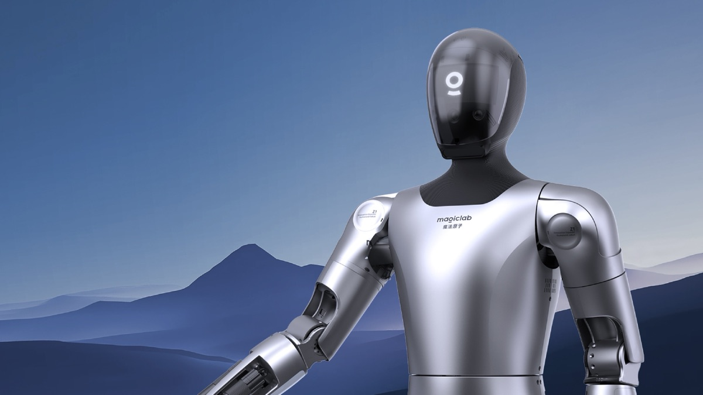

# Magiclab Robotics × T01 — Products and Solutions

⬆ [Magiclab Robotics profile](../Magiclab.md) · [Brief](Magiclab-T01-1-Brief.md) · [Playbook](Magiclab-T01-3-Playbook.md)

**Read this first:** which Magiclab units are on site is **not confirmed**. The ranking below is by usefulness for T01 *if available with developer access*. All speed, payload and runtime values are vendor lab figures. **No prices are public.**

## Relevant products (ranked for this track)

### MagicDog (PRO / EDU)

**Role in T01:** the realistic build platform — small delivery runner, guide dog for visitors, mobile sensor for public-space checks. Only the **EDU** edition has SDK access; PRO is app-only.

| Spec | Value |
|---|---|
| Weight | **15.8 kg** (excl. battery) |
| Payload | ~**5 kg** continuous, ~10 kg max |
| Speed | up to **3.0 m/s** |
| Terrain | **15 cm** obstacle, **40°** slope; all-terrain and gravel modes |
| Runtime | **1.5–3 h**; quick-release 29.6 V 8,200 mAh battery; charging dock included |
| Sensors | 2D LiDAR, depth camera, stereo / fisheye cameras, 4K camera, ToF, ultrasonic, mic array, head touch |
| Compute | 8-core CPU on board (AI module: not stated) |
| IP rating / temperature | **not listed** |
| Built-in behaviours | obstacle avoidance (7 obstacle classes), patrol mode, smart following, offline voice commands, LLM chat (may need a paid subscription) |

- **Status:** ✅ shipping · **Price:** not public · **Availability on site:** likely but unconfirmed.
- **Developer interface (EDU):**
  - `magicdog_sdk` — C++20 with Python 3.10 bindings; high-level motion plus low-level joint control (per docs). PC on **192.168.55.x**, multicast enabled, Ethernet preferred, Ubuntu 22.04+.
  - `magicdog_ros2_sdk` — sensors as topics (`/scan`, depth, fisheye, stereo, ToF, ultrasonic, battery), TTS and volume services, **SLAM** (`/set_slam_model` 1 = map, 3 = localise; `/save_map`), **navigation** (`/switch_navigate_mode`; inputs `/goal_pose`, `/vel_app`, `/intelligence_goal_pose`; result on `/ab_navigation_complete`).
  - ROS 2 SDK targets **Foxy / Ubuntu 20.04** (Iron / 22.04 also listed), CycloneDDS, `ROS_DOMAIN_ID=25`, PC wired to the control board. Velocity control from ROS 2 needs `magicdog_motion_sdk` installed.

### MagicDog-W

**Role in T01:** faster, longer-range runner for flat streets and corridors, with legs for kerbs. The better choice for an outdoor "last 100 m" delivery story — if it is on site.

| Spec | Value |
|---|---|
| Weight | **22.5 kg** with battery |
| Payload | up to **10 kg** |
| Speed | 0–**3 m/s** |
| Terrain | **40°** slope; 7-inch pneumatic tyres; obstacle clearance figure on the page is ambiguous ("under 60 cm") ⚠️ unverified |
| Runtime | **2–4 h**, up to 8 h standby |
| Sensors | 2D LiDAR, depth, dual cameras, 4K, fisheye, ultrasonic, touch |
| Compute | **6 TOPS** on board plus accelerator module |
| Connectivity | Wi-Fi 5, **4G**, Bluetooth 5.0 |
| Temperature | **−5 to 40 °C**; IP rating not listed |

- **Status:** ✅ shipping · **Price:** not public.
- **Developer interface:** own SDK repo (`magicdog-w_sdk`) and URDF (`magicdog-w_description`); the product page also lists the Motion and ROS 2 SDKs. Expansion docks for extra LiDAR or a gimbal. Whether the ROS 2 SLAM / nav stack runs unchanged on the W: ⚠️ unverified — ask.

### MagicDog T1

**Role in T01:** the product Magiclab itself positions for transport and light maintenance (hospital sample runs, debris pick-up, button pressing with a back-mounted gripper). Best technical match, least likely to be hackable this weekend.

| Spec (press-reported, QbitAI Aug 2026) | Value |
|---|---|
| Weight | ~**18 kg** |
| Payload | up to **15 kg** |
| Speed | up to **5 m/s** |
| Terrain | **18 cm** step, **40°** slope |
| Runtime | ~**3 h** unloaded |
| Sensors | RGB, RGB-D, **16-line 3D LiDAR** |
| Expansion | back interface for gripper / arm and sensors |

- **Status:** 🧪 launched Jul–Aug 2026 (WAIC / WRC); in validation at a Dreame factory per the company. No official product page or SDK repo found. **Price:** not public.

### MagicBot Z1 (base / Development Version)

**Role in T01:** human-facing front end — concierge, greeter, wayfinding host, light hand-over of small items. Not a delivery vehicle.

| Spec | Value |
|---|---|
| Size | **1.37 m**, ~**40 kg** |
| DoF | **24** (Development Version 24–50 with wrists and tactile hands) |
| Arm payload | **2 kg** (dev **3 kg**) |
| Runtime | ~**2 h** |
| Sensors | 3D LiDAR, depth, stereo fisheye |

- **Status:** ✅ shipping · **Price:** not public · **SDK only on the Development Version.**
- **Developer interface:** `magicbot-z1_sdk` (C++20 / Python 3.10, BSD-3; PC on **192.168.54.x**, multicast; OpenCV ≥ 4.5). Most actively maintained Magiclab repo. API surface (locomotion, arms, hands, audio, sensors) is in PDF docs inside the repo — read them before committing. No ROS 2 nav package found for the humanoids ⚠️ unverified.

### MagicBot D1

**Role in T01:** the company's logistics workhorse (parcel feeding, material transfer). Relevant as proof of direction; unlikely as a hackathon unit.

| Spec (press-reported, QbitAI Aug 2026) | Value |
|---|---|
| Arms | 7-DoF, **5 kg** per arm, 0.5 N force-control accuracy |
| Working envelope | **80–230 cm** height, 90 cm grasp radius |
| Operation | hot-swap battery, 24/7 unattended operation claimed |

- **Status:** 🧪 launched Jul 2026; company reports use at a Dreame factory. No public SDK found. **Price:** not public.

### MagicBot Gen1

**Role in T01:** full-size service humanoid used by the company for guide and crowd-management showcases. **1.74 m**, ~70 kg, **7.5 kg** per arm, **3–5 h**, 100 TOPS AI module, SDK (`magicbot-gen1_sdk`) plus a pi0 VLA demo repo. ✅ shipping; price not public; heavy and costly — probably demo-only on site.

### MagicDog-Y1

**Role in T01:** the only Magiclab robot rated for alpine weather — **IP67**, **−20 to 55 °C**, **45 kg** payload, **4–6 h**, steps ≥ 60 cm. ✅ shipping; SDK repo exists (`magicdog-y1_sdk`). At 70 kg it is an inspection machine rather than a street-service robot, and unlikely to be available to teams.

## What Magiclab Robotics already does in this domain

Short version: **showcases and announcements, no confirmed routine urban-service operation.** Everything below is company-sourced unless stated.

| Date | What | Relevance | Source |
|---|---|---|---|
| 2026 (Wuxi Marathon) | Biped humanoid used for traffic direction and crowd guidance with the Wuxi Public Security Bureau; event had ~35,000 runners | Public-space service showcase | [QbitAI](https://www.qbitai.com/2026/08/477155.html), [TechTimes](https://www.techtimes.com/articles/326650/20260904/magiclab-humanoid-robots-reach-ifa-2026-vla-models-deployed-spy-law-applies.htm) |
| 2026-03 (MWC Barcelona) | Gen1 acted as a bilingual (Spanish / English) shopping guide on the stand | Retail / concierge demo | [PR Newswire](https://tools.prnewswire.com/en-us/live/20823/release/20260303EN00016) |
| 2026-06 | Strategic cooperation with **JD.com**: consumer products plus education, inspection and **guided-tour** scenarios; JD brings its JoyInside interaction stack | Channel and scenario partner; no deployments named | [Sina Finance](https://cj.sina.com.cn/articles/view/2118746300/7e4980bc02001mle4) |
| 2026-08 (WRC Beijing) | Logistics-sorting solution: wheeled humanoid feeds HyperBot sorters; MagicDog T1 shown for debris clean-up and button pressing | Logistics and light maintenance | [QbitAI](https://www.qbitai.com/2026/08/477155.html) |
| 2026-09 (IFA Berlin) | D1 + HyperBot parcel feeding / sorting demo; announced work with **Pošta Slovenije** on a flexible sorting system (value, go-live not public) | Postal logistics — indoor, not last-mile | [EqualOcean](https://equalocean.com/news/2026090822169-magiclab-targets-european-logistics-robotics-showcase-slovenia-postal) |
| 2026-09 | MagicDog T1 for hospital lab-sample and emergency-medicine transport described as **prospective** | Indoor delivery intent | [EqualOcean](https://equalocean.com/news/2026090822169-magiclab-targets-european-logistics-robotics-showcase-slovenia-postal) |

- A Z1 food-serving routine with autonomous navigation at the 2026 Spring Festival Gala is mentioned in Chinese coverage ⚠️ unverified (seen in a search summary only).
- Street delivery, cleaning, waste collection, hotel or resort operations: **nothing found.** Switzerland: nothing found.

## What they are building next in this domain

- **Service-robot expansion** (stated at WRC, Aug 2026): hotels, laundry rooms and shopping malls first — reception and guidance, item sorting, unattended operation and **last-mile delivery**. No dates or unit numbers. 🔭
- **Postal sorting in Europe** with Pošta Slovenije. 🧪 announced, not commissioned.
- **Hospital transport** with MagicDog T1. 🔭 prospective.
- **European certification** targeted for Q4 2026; retail channel via AliExpress Brand+. 🧪
- **One model across bodies:** Magic-VLA K02 is pitched as running on humanoids, wheeled humanoids and quadrupeds. 🧪 no public weights.
- *Inference:* the T1 (light, 15 kg payload, 3D LiDAR, accessory interface) looks like the intended body for future delivery and facility-service products; the consumer MagicDog is the developer stand-in today.

## Software, models and data that help for this track

| Asset | What it gives you for T01 | Caveat |
|---|---|---|
| [magicdog_ros2_sdk](https://github.com/MagiclabRobotics/magicdog_ros2_sdk) | Ready SLAM, localisation, goal-pose navigation, obstacle avoidance, tracking mode, TTS, all sensors as topics | Single commit, Foxy-era; wired link; verify on current firmware |
| [magicdog_sdk](https://github.com/MagiclabRobotics/magicdog_sdk) | High-level motion and state from Python — quickest way to script behaviours | API detail only in repo PDFs |
| [magicbot-z1_sdk](https://github.com/MagiclabRobotics/magicbot-z1_sdk) | Humanoid front-end control from Python / C++ | Development Version only |
| `magicdog_description`, `magicdog-w_description`, `magiclab_mujoco` | URDF and MuJoCo models to test logic before robot time | Simulation of nav stack not provided |
| `pico_teleoperate` | XR teleoperation as a remote-operator fallback | Needs a PICO headset; humanoid-oriented |
| `magicbot-gen1_pi0_demo`, `Inference` | Starting point for VLA manipulation | Gen1-specific; too heavy for 48 h unless you know pi0 |
| Magic-VLA K02, Magic-Mix | Not usable — no public weights or API found | 🧪 |

Datasets: none public found.

## Gaps and limits for this track

- **Weather:** MagicDog and MagicDog-W list no IP rating; W is rated only to −5 °C. Mid-November Leukerbad streets (snow, slush, salt) are outside the documented envelope. Plan indoor or dry-ground demos.
- **Navigation is 2D-LiDAR based** on the small dogs: fine for corridors and lobbies, weak on open squares, ramps between floors, glass walls and stairs between map levels.
- **Tether:** the ROS 2 path expects a PC wired to the control board. An untethered demo needs a backpack computer (see cross-vendor options in the playbook) and a power source — whether the dog offers a payload power outlet is not confirmed.
- **No manipulation on the quadrupeds** available to developers (T1 gripper is not a public product). Loading and unloading needs a person, a passive basket or another vendor's arm.
- **No fleet / dispatch software** is public; the scheduling system shown with D1 and HyperBot is not open.
- **Documentation depth and community** are small (repos with single-digit stars). Budget time for trial and error, and lean on the on-site engineers.
- **Edition lock-in:** MagicDog PRO and base Z1 cannot be programmed.
- **Privacy:** camera, face / emotion features and voice in public space raise data-protection questions (flagged by trade press for the EU). Keep demo data local and avoid recording bystanders.

## Sources
- [MagicDog product page](https://www.magiclab.top/en/dog)
- [MagicDog-W product page](https://www.magiclab.top/en/dog-w)
- [GitHub — magicdog_ros2_sdk](https://github.com/MagiclabRobotics/magicdog_ros2_sdk)
- [GitHub — magicdog_sdk](https://github.com/MagiclabRobotics/magicdog_sdk)
- [GitHub — magicbot-z1_sdk](https://github.com/MagiclabRobotics/magicbot-z1_sdk)
- [GitHub — MagiclabRobotics organisation](https://github.com/MagiclabRobotics)
- [QbitAI — MagicLab at WRC 2026 (Chinese)](https://www.qbitai.com/2026/08/477155.html)
- [EqualOcean — MagicLab targets European logistics, Slovenia postal partnership](https://equalocean.com/news/2026090822169-magiclab-targets-european-logistics-robotics-showcase-slovenia-postal)
- [TechTimes — MagicLab humanoid robots reach IFA 2026](https://www.techtimes.com/articles/326650/20260904/magiclab-humanoid-robots-reach-ifa-2026-vla-models-deployed-spy-law-applies.htm)
- [PR Newswire — MagicLab at MWC 2026](https://tools.prnewswire.com/en-us/live/20823/release/20260303EN00016)
- [Sina Finance — JD.com and MagicLab strategic cooperation (Chinese)](https://cj.sina.com.cn/articles/view/2118746300/7e4980bc02001mle4)
- [Magiclab Robotics profile](../Magiclab.md) (Z1, Gen1 and Y1 specs, repo list)
