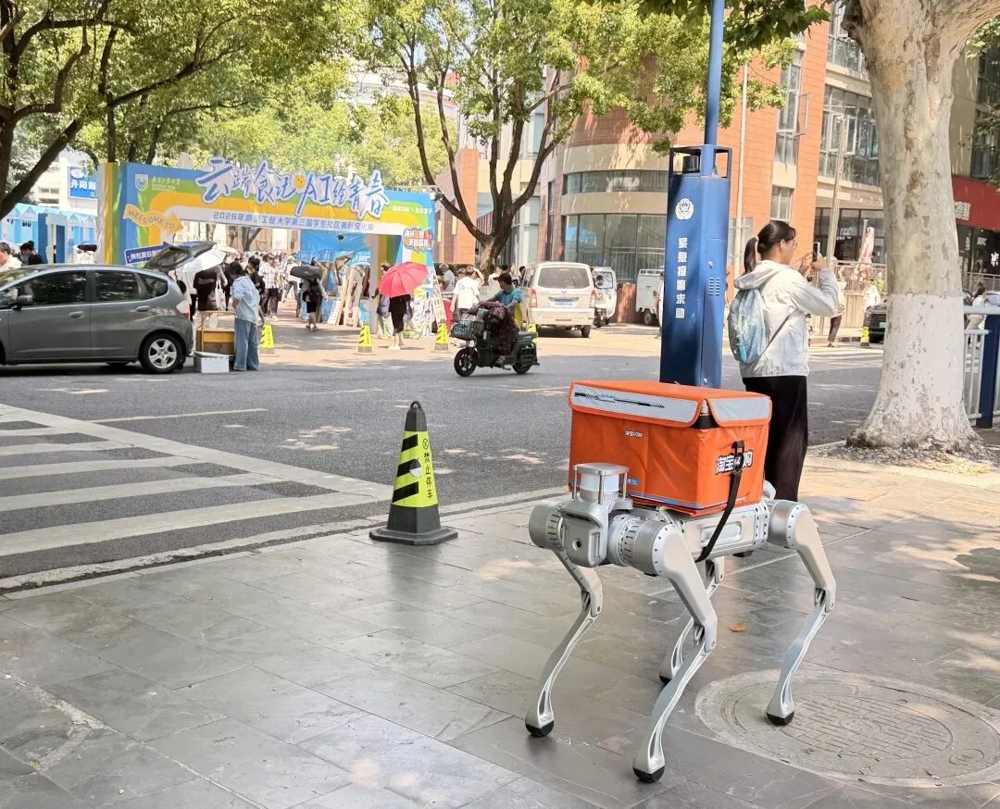
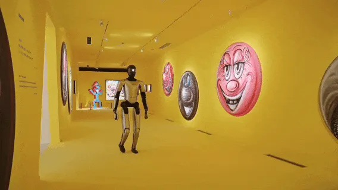
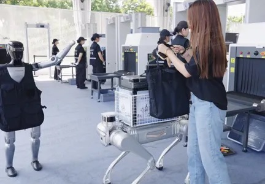
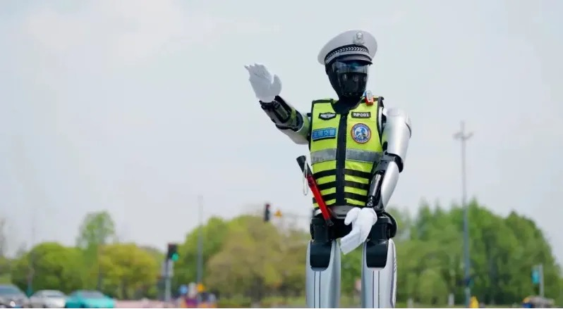
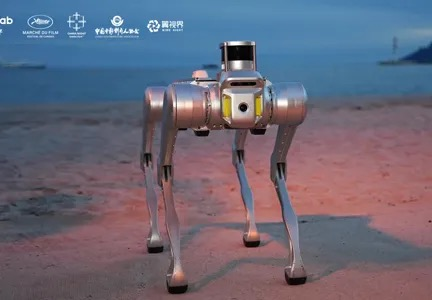
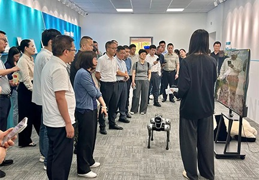
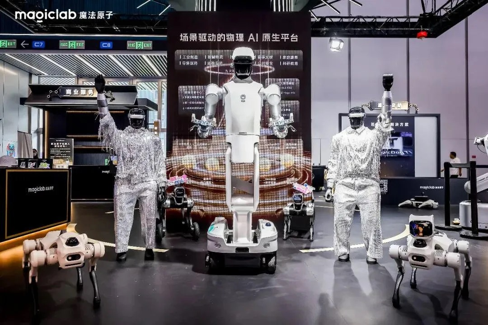
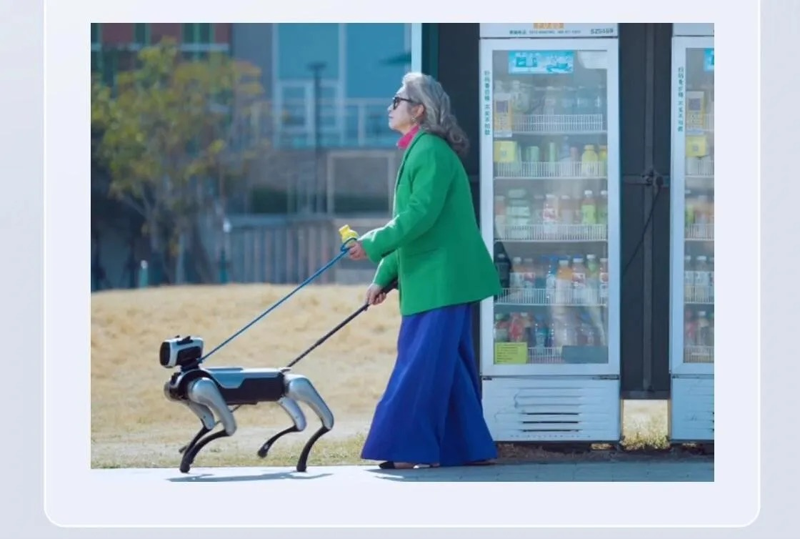
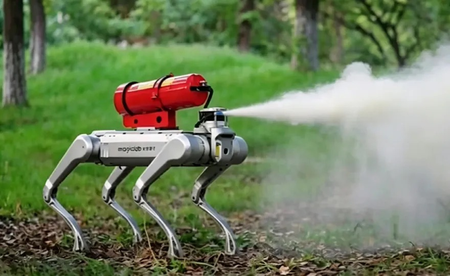
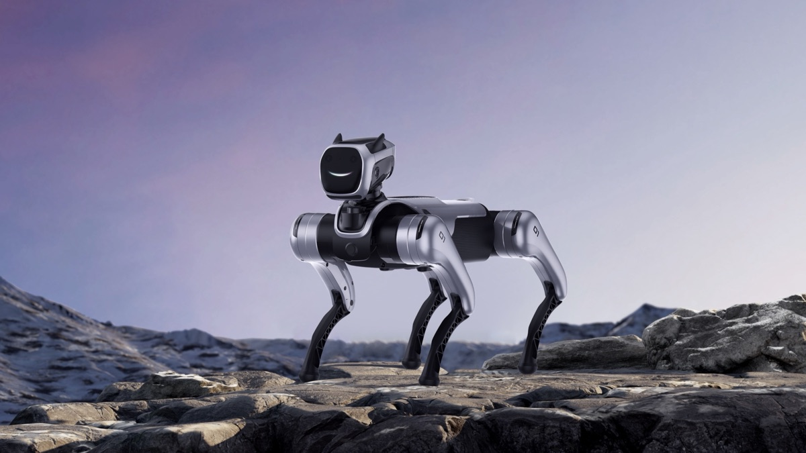

# Magiclab Robotics × T01 — Solutions Register, Projects and Papers

⬆ [Magiclab Robotics profile](../Magiclab.md) · [Brief](Magiclab-T01-1-Brief.md) · [Products and solutions](Magiclab-T01-2-Products-and-Solutions.md) · [Playbook](Magiclab-T01-3-Playbook.md) · [Track overview](../../../Challenges/T01-Autonomous-Urban-Services/T01-0-Track-Overview.md)

> **Second-pass audit (2026-11-14):** this register lists **27 solutions, 25 projects, 17 future items and 4 papers**. Against the three first-pass T01 docs (Brief, Products and solutions, Playbook), **18 solutions, 18 projects and 11 future items are new**; the first-pass T01 docs listed no papers. Against the whole Magiclab knowledge base (including the company-wide solutions register), **3 solutions, 2 projects and 4 future items are new**. **Web search was available** for this doc (2 extended queries, English and Chinese), followed by direct reads of ~30 official and press pages. Limits: the two Gasgoo articles returned HTTP 468 and were not read; no third-party paper search was possible beyond the two queries; almost all evidence is **company-reported**.

Names: **Xiaomai (小麦)** = the full-size humanoid MagicBot Gen1. Chinese company name: **魔法原子** (MagicLab / "Magic Atom"), incubated in the Dreame ecosystem, founded Jan 2024.

## Coverage of the official directions

| Direction | What Magiclab Robotics has for it | Evidence | Maturity | Strength |
|---|---|---|---|---|
| T01.1 Autonomous delivery & urban logistics | **Robot instant delivery** (MagicDog with rear cargo basket, order → pickup → building-level drop-off); reception-to-delivery loop (MagicDog Y1 carries luggage); last-metre delivery inside facilities; flexible parcel sorting (MagicBot D1 + HyperBot + RCS); planned hospital transport with MagicDog T1 | [Taobao Shangou campus food-delivery pilot, 16–17 Apr 2026](https://www.magiclabglobal.com/order-to-doorstep-in-minutes-magiclab-x-taobao-shangou-complete-chinas-first-closed-loop-robotic-campus-food-delivery.html) (real student orders, two Beijing campuses, two days); [Pošta Slovenije sorting agreement](https://www.magiclabglobal.com/magiclab-brings-physical-ai-to-europes-factory-floors-at-ifa-2026-debuting-full-stack-embodied-intelligence-stack.html) | 🧪 | ◐ |
| T01.2 Smart cleaning & facility maintenance | No cleaning or facility-maintenance product. Closest: MagicDog T1 with rear gripper arm — litter (plastic-bottle) pick-up into an on-board basket, debris clearing, button pressing — shown at trade shows only | [MagicDog T1 WAIC 2026 demo](https://www.magiclabglobal.com/magicdog-t1-debuts-at-waic-2026-a-single-person-deployable-robot-for-distributed-industrial-and-park-inspection.html) | 🧪 | ○ |
| T01.3 Public-space service robots | Reception and concierge humanoids (Gen1, Z1); retail shopping guide; "unmanned store" series (coffee, milk tea, ice cream, pharmacy, bookstore); beverage / food service; humanoid traffic and crowd guidance with police; rental-ready service robots; community-robot programme (new, agreement stage) | [Wuxi Marathon traffic duty, 35,000 runners](https://www.magiclabglobal.com/35000-runners-one-integrated-response-system-how-magiclab-robots-helped-police-the-wuxi-marathon.html); [summit reception service](https://www.magiclabglobal.com/magicbot-xiaomai-becomes-the-first-chinese-humanoid-to-deliver-live-service-at-a-top-tier-global-finance-summit.html); [DQ stores and other Dec 2025 events](https://www.magiclab.top/news/59) | ✅ | ● |
| T01.4 Autonomous urban inspection | MagicDog Y1 inspection and security (IP67, thermal / gas / acoustic payloads) — shipping, but used on industrial sites, not city streets; MagicDog T1 for parks and campuses (🧪); app-configured indoor patrol on the consumer MagicDog; community security patrol and public-facility inspection (agreement stage) | [T1 park-inspection case](https://www.magiclabglobal.com/magicdog-t1-debuts-at-waic-2026-a-single-person-deployable-robot-for-distributed-industrial-and-park-inspection.html); [Cannes beach patrol in a mixed fleet](https://www.magiclabglobal.com/heterogeneous-robot-fleet-coordination-autonomous-beach-patrol-bartending-and-guest-service-in-one-live-environment.html) | ✅ | ◐ |
| T01.5 Smart guidance & information services | **Smart guided-tour solution** with zero-code app (map → waypoints → script → gestures), **160+ voices**, live language switching, walk-narrate-point synchronisation; reception and wayfinding; postal-hall guidance; guide-dog robot project for blind users | [Modern Art Museum Shanghai launch, Sep 2025](https://www.magiclabglobal.com/worlds-first-synchronized-voice-and-gesture-museum-guide-magicbot-gen1-at-modern-art-museum-shanghai.html); [same platform at four venues](https://www.magiclabglobal.com/one-solution-four-venues-how-magicbot-gen1s-standardized-guided-tour-platform-scales-from-hong-kong-to-a-beidou-industrial-park.html) | ✅ | ● |
| T01.6 Autonomous navigation & path planning | On-robot LiDAR SLAM, relocalisation and go-to-pose exposed in `magicdog_sdk` and `magicbot-z1_sdk` (since v1.2.0) and in the frozen `magicdog_ros2_sdk`; LiDAR 3D mapping with one-tap multi-map switching (delivery stack); patrol routes set in the app; mixed-fleet scheduling layer (not public). No navigation paper, no open nav source code | [SDK SLAM / navigation docs](https://support.magiclab.top/en/docs/dog/ros2_sdk); [campus delivery stack description](https://www.magiclabglobal.com/order-to-doorstep-in-minutes-magiclab-x-taobao-shangou-complete-chinas-first-closed-loop-robotic-campus-food-delivery.html) | ✅ | ● |
| T01.7 Human-robot interaction in complex cities | Multilingual voice, Q&A, face-recognition greeting, synchronised speech and gesture (humanoids); TTS, streaming ASR, LLM chat, touch and smart-following on MagicDog; hand-signal traffic direction in crowds; fleet behaviour that adapts to crowd density; guide-dog voice warnings at crossings | [Museum guide case](https://www.magiclabglobal.com/worlds-first-synchronized-voice-and-gesture-museum-guide-magicbot-gen1-at-modern-art-museum-shanghai.html); [Wuxi police case](https://www.magiclabglobal.com/magiclab-x-wuxi-police-a-humanoid-traffic-officer-goes-on-duty-at-a-major-public-sporting-event.html); [guide-robot case](https://www.magiclabglobal.com/independence-automated-magiclabs-quadruped-guide-robot-helps-visually-impaired-users-navigate-shop-and-hail-rides.html) | ✅ | ● |

**Reading the table:** strong where a humanoid or a small dog talks to and guides people (T01.3 / T01.5 / T01.7) and where the SDK already gives you mapping and goal navigation (T01.6); pilot-level for delivery; nothing for cleaning.

## All solutions relevant to T01

Markers after a name: **🆕** = not anywhere in the first-pass knowledge base · **＋** = missing from the first-pass T01 docs (but present in the company-wide register) · no marker = already covered.

| Solution / capability | What it does for this track | Direction(s) served | Products used | Maturity | Source link |
| --- | --- | --- | --- | --- | --- |
| Robot instant delivery (外卖配送) ＋ | Order intake → pickup → route planning → building-level delivery; LiDAR 3D mapping, one-tap switching between delivery-zone maps, terrain-adaptive walking | T01.1 T01.6 | MagicDog + rear cargo basket (company also names Gen1 / Z1 and MagicHand S01) | 🧪 two-day live pilot | [Campus delivery case](https://www.magiclabglobal.com/order-to-doorstep-in-minutes-magiclab-x-taobao-shangou-complete-chinas-first-closed-loop-robotic-campus-food-delivery.html) |
| Reception-to-delivery service loop ＋ | Humanoid greets and gives directions; quadruped carries luggage / items from entrance to destination | T01.1 T01.3 T01.5 | MagicBot Z1 + MagicDog Y1 | 🧪 event deployments | [Service-loop case](https://www.magiclabglobal.com/magicbot-z1-and-magicdog-y1-form-a-complete-reception-to-delivery-service-loop.html) |
| Last-metre delivery inside facilities (smart logistics) ＋ | Moves goods between lifts, corridors, workshops, show areas and service points; quadrupeds for slopes, steps, mixed indoor-outdoor routes | T01.1 | Humanoids and quadrupeds (models not tied) | ✅ factory use at Dreame / 🧪 elsewhere | [Smart logistics page](https://www.magiclabglobal.com/magiclab-embodied-ai-robotics-for-smart-logistics/) |
| Controlled supply-delivery workflow ＋ | Fixed routes, approved items; lets an institution test delivery efficiency, hand-over and safety | T01.1 | Not specified | 🧪 one-paragraph capability statement | [Supply-delivery page](https://www.magiclabglobal.com/controlled-supply-delivery-workflow-validation.html) |
| Flexible parcel / postal sorting | D1 picks parcels from mixed piles and feeds **HyperBot** sorters (up to **2.5 m/s**); **XGZ1** workstation (6 s tool change); RCS fleet scheduler | T01.1 | MagicBot D1, HyperBot, XGZ1, RCS | 🧪 show demos; customer agreement | [IFA 2026 release](https://www.magiclabglobal.com/magiclab-brings-physical-ai-to-europes-factory-floors-at-ifa-2026-debuting-full-stack-embodied-intelligence-stack.html) |
| Postal-outlet solution ("smart logistics + smart tour") ＋ | Sorting, induction, material transfer and last-mile delivery in postal hubs; reception and business guidance in postal halls and parcel stations | T01.1 T01.5 | MagicDog, Gen1, Z1 | 🔭 positioning shown to regulator | [State Post Bureau visit](https://www.magiclabglobal.com/state-post-bureau-inspects-magiclab-for-smart-postal-ai.html) |
| Hospital specimen / medication transport | Light quadruped carries lab samples and emergency medicines inside hospitals | T01.1 | MagicDog T1 | 🔭 planned for Europe | [IFA 2026 release](https://www.magiclabglobal.com/magiclab-brings-physical-ai-to-europes-factory-floors-at-ifa-2026-debuting-full-stack-embodied-intelligence-stack.html) |
| Smart guided-tour solution (智慧导览) + app ＋ | Robot walks, narrates and points; staff set map, waypoints, script and gestures in an app without code; remote content updates; multi-floor / multi-venue fleet management | T01.5 T01.6 T01.7 | MagicBot Gen1 (Z1 as receptionist) | ✅ museum, exhibition centres, standing contract | [Guided-tour industry page](https://www.magiclabglobal.com/magiclab-embodied-ai-robotics-for-smart-hospitality-guiding/) |
| Reception, wayfinding and concierge ＋ | Greeting, VIP reception, bilingual directions, seat guidance, meeting bell, refreshment hand-out; listed venues: showrooms, museums, trade shows, scenic spots, airports, campuses, libraries, public-service halls | T01.3 T01.5 T01.7 | Gen1, Z1 | ✅ repeated event deployments | [Finance-summit case](https://www.magiclabglobal.com/magicbot-xiaomai-becomes-the-first-chinese-humanoid-to-deliver-live-service-at-a-top-tier-global-finance-summit.html) |
| Retail shopping guide | In-store reception, product explanation, brand recommendation; bilingual guide at MWC; car-dealership guide in 2025 demo video | T01.3 T01.5 | Gen1 | ✅ event-scale (stores, festivals) | [December 2025 events](https://www.magiclab.top/news/59) |
| Retail shelf picking and in-store delivery ＋ | Wheeled humanoid picks across shelf heights (**80–230 cm**) with vision and force control, no fixtures | T01.3 T01.1 | MagicBot D1 | 🧪 trade-show demos | [D1 retail case](https://www.magiclabglobal.com/magicbot-d1-navigates-retail-shelves-with-vision-guided-force-controlled-precision-picking.html) |
| "Unmanned store" series (无人门店) ＋ | Robot-run coffee, milk-tea, ice-cream, pharmacy and bookstore units, combinable per site | T01.3 | Humanoids (models not stated) | 🧪 announced Jan 2026; no opened store found ⚠️ unverified | [Partner conference](https://www.magiclab.top/news/57) |
| Beverage and food service ＋ | Pouring, bartending, noodle scooping, serving guests; Z1 as food runner | T01.3 | Gen1 + MagicHand S01, Z1 | 🧪 demos (Spring Festival Gala, Cannes) | [Spring Festival Gala report](https://www.magiclab.top/news/62) |
| Smart policing — traffic and crowd guidance | Humanoid at command points directs traffic and crowds and answers questions; quadrupeds patrol and fill gaps; also public-service desk duty | T01.3 T01.7 | Gen1 (police variant), MagicDog Y1, smaller quadrupeds | ✅ in use with Wuxi police (company statement) | [Wuxi police case](https://www.magiclabglobal.com/magiclab-x-wuxi-police-a-humanoid-traffic-officer-goes-on-duty-at-a-major-public-sporting-event.html) |
| Public-event patrol and interaction 🆕 | Mobile presence, audience interaction and guiding at large public events | T01.3 T01.4 | Quadrupeds and humanoids | 🧪 one-paragraph capability statement | [Event patrol page](https://www.magiclabglobal.com/public-event-patrol-and-interaction-deployment.html) |
| Heterogeneous fleet coordination ＋ | Patrol dog, service humanoid and photo robot share one scheduling layer, yield to each other, adapt patrol frequency and service radius to crowd density | T01.3 T01.6 | MagicDog Y1, Gen1, MagicPanda | 🧪 first outdoor validation; no product name or API | [Fleet case](https://www.magiclabglobal.com/heterogeneous-robot-fleet-coordination-autonomous-beach-patrol-bartending-and-guest-service-in-one-live-environment.html) |
| Inspection and security (巡检安防) ＋ | Repeatable patrol routes with thermal, dual-light PTZ, gas, acoustic payloads; campus patrol listed among uses | T01.4 | MagicDog Y1 (IP67, −20 to 55 °C) | ✅ product; European energy-site use reported without names | [IFA 2026 release](https://www.magiclabglobal.com/magiclab-brings-physical-ai-to-europes-factory-floors-at-ifa-2026-debuting-full-stack-embodied-intelligence-stack.html) |
| Light-industry / park inspection with manipulation | One-person-deployable dog: patrol, anomaly detection, equipment checks, light manipulation (bottle pick-up, debris clearing, button pressing) | T01.4 T01.2 | MagicDog T1 + rear gripper arm | 🧪 launched mid-2026; tested at Dreame factory | [T1 case](https://www.magiclabglobal.com/magicdog-t1-debuts-at-waic-2026-a-single-person-deployable-robot-for-distributed-industrial-and-park-inspection.html) |
| App-configured indoor patrol | User maps rooms and sets patrol routes in the app; dog follows the sequence and observes | T01.4 T01.6 | MagicDog | ✅ product feature | [Indoor patrol page](https://www.magiclabglobal.com/app-configured-autonomous-indoor-patrol.html) |
| Community robots (社区机器人) 🆕 | Residential-community services: security patrol, public-facility inspection, convenience services, elderly companionship, family interaction; partners supply channels and on-site maintenance | T01.3 T01.4 | Humanoids and quadrupeds (models not stated) | 🔭 strategic agreement, no deployment numbers | [NetEase / Dahe report](https://www.163.com/dy/article/KVNVMB430550B6IS.html) |
| Rental-ready service robots 🆕 | Rental-optimised humanoids and standard scenario packages: mall greeting, park parades, exhibitions, corporate reception, family tourism | T01.3 T01.5 | Humanoids, quadrupeds, MagicPanda | 🧪 partnership signed Apr 2026 | [GeekPark release](https://www.geekpark.net/news/363868) |
| Guide-dog robot "Guangyin 001" (光引001) ＋ | Leads a blind user outdoors, warns by voice at obstacles and crossings, helps choose a drink, orders and pays, hails rides | T01.5 T01.7 | MagicDog-class quadruped | 🧪 project video (Mar 2025); no product | [Strategy launch report](https://www.magiclab.top/news/49) |
| On-robot SLAM and navigation via SDK | Mapping, relocalisation, grid-map go-to-pose, task status, pause / cancel; ROS 2 topics `/goal_pose`, `/scan`, map save | T01.6 | MagicDog EDU, MagicBot Z1 Development Version | ✅ in SDK (ROS 2 package frozen) | [Docs centre](https://support.magiclab.top/en/docs/dog/ros2_sdk) |
| Voice and multimodal interaction stack | Humanoids: 160+ voices, live language switching, face-recognition greeting. MagicDog: TTS, streaming ASR, offline voice commands, LLM chat, head touch, smart following | T01.7 T01.5 | Gen1, Z1, MagicDog | ✅ | [Museum guide case](https://www.magiclabglobal.com/worlds-first-synchronized-voice-and-gesture-museum-guide-magicbot-gen1-at-modern-art-museum-shanghai.html) |
| Magic-Brain agent framework ＋ | Navigation, grasping, interaction and "sentinel" agents over a task graph with re-planning; separate stop and steering channels; safety gate for physical tools | T01.6 T01.7 | Software (robot not named) | 🧪 technical article, no code | [Magic-Brain article](https://embodied.magiclab.top/works/brain/en.html) |
| Event and cultural-tourism performance package ＋ | Parades, stage shows, photo and greeting robots for festivals and tourist sites | T01.3 | Z1, Gen1, MagicDog, MagicPanda | ✅ standard offer | [December 2025 events](https://www.magiclab.top/news/59) |
| Developer platform (research and education) | Programmable editions, SDKs, URDF / MuJoCo models — the part a hackathon team can actually use | all | MagicDog EDU, Z1 Development Version, Gen1 | ✅ | [GitHub organisation](https://github.com/MagiclabRobotics) |

### Robot instant delivery (MagicDog courier)

- **What ran:** students ordered in a dedicated Taobao Shangou storefront; robots handled pickup, live path planning and delivery to the building. **16–17 Apr 2026**, Renmin University of China and Beijing Sport University. It was a pop-up, not a standing service.
- **Stack named by the company:** LiDAR rapid 3D mapping, one-tap switching between several delivery-zone maps, multi-sensor fusion, terrain-adaptive navigation, learned locomotion controller. Company claims on the postal page (100+ terrain types, ~600 recognisable item types, "100 % accuracy") are marketing figures ⚠️ unverified.
- **Not shown:** lift riding, door opening, handover without a person. A company blog (Sep 2026) says its robots interface with elevator control systems; no product, document or SDK interface backs this ⚠️ unverified.
- **Hackathon read:** the same shape as a MagicDog EDU demo — basket, saved map, named goals, spoken arrival.

### Smart guided-tour solution

- **How it works:** staff map the hall, set waypoints, type the script and edit gestures in an app; the robot then navigates, avoids people, narrates while walking and points at exhibits, with screen content kept in sync. Navigation uses LiDAR, RGB-D and IMU.
- **Numbers:** **160+** selectable voices; language can change between tours without any swap. Launched with the app at WRC 2025 (8 Aug 2025) as "buy and use".
- **Where used:** Modern Art Museum Shanghai (Sep 2025); Beidou satellite-navigation demonstration park (long-term service contract per the company); a low-altitude-economy exhibition centre; Hong Kong World Young Scientists Summit; a "Two Sessions" news-anchor appearance.
- **Limit:** built around Gen1; the tour app is not part of the public SDKs. A MagicDog guide has to be rebuilt from the SLAM / navigation and audio APIs.

### Reception-to-delivery service loop

- Z1 recognises and greets guests and gives route guidance; Y1 carries luggage or items behind them — "reception → guidance → item transport" as one flow.
- First run at the Inclusion·Bund Summit, Shanghai, **10–13 Sep 2025** (Robot Town reception area).
- Good template for a two-robot hackathon demo (greeter + carrier), also across vendors.

### Smart policing — traffic and crowd guidance

- 2026 Wuxi Marathon (**35,000 runners**): Gen1-based "Xiaomai" at command points for traffic direction and spectator questions; quadrupeds patrolled beside officers. QbitAI repeats the company claim that it was the first biped robot on traffic duty at a large sports event.
- The company states the units are in scaled use within Wuxi's police force (crowd flow, traffic control, patrol, public-service assistance); no unit numbers are published.
- Relevance: the clearest example of a Magiclab robot giving instructions to people in a dense public space.

### Heterogeneous fleet coordination

- Cannes "China Night", May 2026: a quadruped on beach patrol, Gen1 at the bar and MagicPanda at a photo spot shared one spatial-awareness and scheduling layer, yielded to each other's work zones and changed patrol frequency with crowd density.
- Claimed as the first outdoor validation; no software name, API or documentation is public.

### MagicDog T1 — park inspection and litter pick-up

- The only maintenance-type capability: patrol a zone, detect empty bottles, pick them with a rear gripper, drop them in an on-board basket (WAIC 2026); debris clearing and button pressing (WRC 2026).
- Reported figures: ~**18–19 kg**, **15 kg** continuous payload, **IP54**, 5 m/s, 18 cm steps, 40° slopes, ~3 h, 16-line LiDAR.
- No public product page, SDK or price; unlikely to be hackable on site.

### Community robots and rental channel (new in this pass)
- **Community robots:** reported 18 Jun 2026 — Magiclab, **Anxing Energy (安行能源)** and **Jingchi Intelligent (憬驰智能)** signed a strategic agreement in Suzhou. Magiclab supplies robots; Anxing brings a residential-community channel network; Jingchi handles on-site operation, repair and spare parts. Target uses: security patrol, public-facility inspection, convenience services, elderly companionship, family interaction. No volumes, sites or dates. The source article's text is garbled in places (partner name spelled three ways) ⚠️.
- **Rental:** 28 Apr 2026 — strategic agreement with the rental platform **WanJi Yizu (万机易租)** in Songjiang, Shanghai: rental-specific humanoids and replicable scenario packages (mall greeting, park parades, exhibitions, corporate reception, family tourism incl. a 130+ store children's-park chain, industrial inspection). Partner press release; figures are company-reported.

### On-robot navigation and interaction you can program
- `magicdog_sdk` and `magicbot-z1_sdk` (C++ / Python) expose SLAM mapping, relocalisation, grid-map navigation targets and task status since **v1.2.0 (Nov 2025)**; MagicDog also has streaming ASR and expression control. Only **MagicDog EDU** and **Z1 Development Version** are programmable.
- `magicdog_ros2_sdk` offers `/scan`, map save, `/goal_pose` and TTS but is frozen (last push May 2025, Foxy / Iron). Details: [Developer guide](../Magiclab-Developer-Guide.md).
- GitHub check on 2026-11-14: **22 repositories**, none dedicated to navigation, delivery, tour or fleet software.

## Projects, deployments and pilots in this domain

Newest first. "n.d." = source gives no date. All company-reported unless the source is press. Markers after the project name: **🆕** = not anywhere in the first-pass knowledge base · **＋** = missing from the first-pass T01 docs.

| Date | Project | Partner / customer | Location | What happened | Direction(s) | Source link |
| --- | --- | --- | --- | --- | --- | --- |
| 2026-09-04/08 | IFA Berlin | AliExpress Brand+ | Berlin, DE | European debut of X1, D1, T1; D1 + HyperBot parcel-sorting demo | T01.1 | [IFA release](https://www.magiclabglobal.com/magiclab-brings-physical-ai-to-europes-factory-floors-at-ifa-2026-debuting-full-stack-embodied-intelligence-stack.html) |
| 2026-09 | Flexible sorting system agreement | Pošta Slovenije | Slovenia | Agreement to build automated sorting for distribution centres (international mail, e-commerce parcels, standard post); value and go-live not public | T01.1 | [IFA release](https://www.magiclabglobal.com/magiclab-brings-physical-ai-to-europes-factory-floors-at-ifa-2026-debuting-full-stack-embodied-intelligence-stack.html) |
| 2026-08-19/23 | WRC 2026 "Magic Town" | Jiangsu alliance, TÜV SÜD, TÜV Rheinland | Beijing | Sorting loop (XGZ1 + HyperBot), D1 shelf picking, T1 with arm clearing debris and pressing buttons | T01.1 T01.2 T01.3 | [QbitAI](https://www.qbitai.com/2026/08/477155.html) |
| 2026-07 | WAIC 2026 ＋ | — | Shanghai | T1 debut with bottle-collection patrol demo; D1 picking across store shelves | T01.2 T01.4 T01.3 | [T1 case](https://www.magiclabglobal.com/magicdog-t1-debuts-at-waic-2026-a-single-person-deployable-robot-for-distributed-industrial-and-park-inspection.html) |
| 2026-06 (reported 18 Jun) | Community-robot strategic agreement 🆕 | Anxing Energy, Jingchi Intelligent | Suzhou | Three-party deal covering R&D, delivery, channels, operation and after-sales for robots in residential communities | T01.3 T01.4 | [NetEase / Dahe report](https://www.163.com/dy/article/KVNVMB430550B6IS.html) |
| 2026-06 | Strategic cooperation | JD.com | China | Consumer robots plus education, inspection and guided-tour solutions; JoyInside interaction stack; no deployments named | T01.5 T01.7 | [Sina Finance](https://cj.sina.com.cn/articles/view/2118746300/7e4980bc02001mle4) |
| 2026-05 | Smart-policing partnership and scaled use ＋ | Wuxi Public Security Bureau | Wuxi | Humanoid + quadruped units for crowd flow, traffic control, patrol and public-service assistance | T01.3 T01.7 | [Wuxi police case](https://www.magiclabglobal.com/magiclab-x-wuxi-police-a-humanoid-traffic-officer-goes-on-duty-at-a-major-public-sporting-event.html) |
| 2026-05 | Cannes "China Night" ＋ | Event organisers | Cannes, FR | Gen1 bartending, quadruped beach patrol, MagicPanda photo service under one scheduling layer | T01.3 T01.4 T01.6 | [Fleet case](https://www.magiclabglobal.com/heterogeneous-robot-fleet-coordination-autonomous-beach-patrol-bartending-and-guest-service-in-one-live-environment.html) |
| 2026-04-28 | Robot-rental strategic agreement 🆕 | WanJi Yizu (万机易租) | Songjiang, Shanghai | Rental-specific humanoids; standard packages for mall greeting, parades, reception, family tourism | T01.3 T01.5 | [GeekPark](https://www.geekpark.net/news/363868) |
| 2026-04-16/17 | Campus food-delivery pilot ＋ | Taobao Shangou | Renmin Univ. and Beijing Sport Univ., Beijing | Real student orders delivered end to end by MagicDog couriers | T01.1 T01.6 | [Campus delivery case](https://www.magiclabglobal.com/order-to-doorstep-in-minutes-magiclab-x-taobao-shangou-complete-chinas-first-closed-loop-robotic-campus-food-delivery.html) |
| 2026 spring (date n.d.) | Wuxi Marathon traffic duty | Wuxi traffic police | Wuxi | Humanoid directs traffic and crowds, quadrupeds patrol; 35,000 runners | T01.3 T01.7 | [Marathon case](https://www.magiclabglobal.com/35000-runners-one-integrated-response-system-how-magiclab-robots-helped-police-the-wuxi-marathon.html) |
| by 2026-04 (n.d.) | Guided-tour platform at four venues ＋ | Beidou demonstration park (long-term contract), low-altitude-economy exhibition centre, HK summit, broadcast | China | Same Gen1 tour platform redeployed without bespoke builds | T01.5 | [Four-venues case](https://www.magiclabglobal.com/one-solution-four-venues-how-magicbot-gen1s-standardized-guided-tour-platform-scales-from-hong-kong-to-a-beidou-industrial-park.html) |
| 2026 (n.d.; page asset dated Jul) | State Post Bureau delegation visit ＋ | State Post Bureau | Suzhou | MagicDog courier with rear basket delivers water to guests; Z1 as receptionist; postal solutions pitched | T01.1 T01.5 | [Postal visit](https://www.magiclabglobal.com/state-post-bureau-inspects-magiclab-for-smart-postal-ai.html) |
| 2026-03-02/05 | MWC Barcelona | — | Barcelona, ES | Gen1 as Spanish / English shopping guide on the stand | T01.3 T01.5 | [PR Newswire](https://tools.prnewswire.com/en-us/live/20823/release/20260303EN00016) |
| 2026-02-16 | CCTV Spring Festival Gala (Yibin venue) | China Media Group | Yibin / Beijing | Gen1 scoops noodles and pours for seniors; Z1 delivers the dish ("last mile" leg). Article does not say the Z1 run was autonomous ⚠️ | T01.3 T01.1 | [News 62](https://www.magiclab.top/news/62) |
| 2026-01-23 | Global Partner Conference ＋ | Juguang partners incl. Alibaba Cloud, China Mobile Wuxi | Suzhou | "Unmanned store" series announced; wheeled humanoid previewed doing in-store picking and delivery; "robot dog + car" link | T01.3 | [News 57](https://www.magiclab.top/news/57) |
| 2025-12 (5–28 Dec) | December service-event series ＋ | DQ ice-cream stores (3 Shanghai shops, 12–14 Dec); Suzhou shopping festival; Shenzhen culture-tourism robot festival; Shanghai appliance carnival; Fudan forum | Shanghai, Suzhou, Shenzhen | Robots as store staff, brand recommender, tour-guide demo, parade, booth guide, check-in greeter | T01.3 T01.5 | [News 59](https://www.magiclab.top/news/59) |
| 2025-09-10/13 | Inclusion·Bund Summit ＋ | Summit organisers | Shanghai | Z1 greeting and wayfinding + Y1 luggage transport | T01.1 T01.5 | [Inclusion case](https://www.magiclabglobal.com/magiclab-robot-fleet-powers-a-full-reception-to-guidance-service-loop-at-the-2025-inclusion-bund-summit.html) |
| 2025-09 | Guided-tour solution launch ＋ | Modern Art Museum (Shanghai) | Shanghai | Gen1 as synchronised voice-and-gesture museum guide | T01.5 T01.7 | [Museum case](https://www.magiclabglobal.com/worlds-first-synchronized-voice-and-gesture-museum-guide-magicbot-gen1-at-modern-art-museum-shanghai.html) |
| 2025-08-08 | WRC 2025 ＋ | — | Beijing | Guided-tour solution and app launched; MagicDog as "smart waiter" delivers gifts through dense crowds with own route planning; Y1 debut | T01.1 T01.5 T01.6 | [News 52](https://www.magiclab.top/news/52) |
| 2025-05-26 (reported) | Summit reception service ＋ | JPMorgan Global China Summit, Goldman Sachs TechNet | Shanghai | Xiaomai: bilingual reception and guidance, meeting bell, tea-break hand-out | T01.3 T01.5 | [News 43](https://www.magiclab.top/news/43) |
| 2025-04-25 | Humanoid Robot Ecosystem Conference ＋ | Jiading auto-city firms; VSTECS; Zhongke Kaichuang | Shanghai | Talks on car-museum narration and on quadruped inspection / logistics / education — intent only | T01.5 T01.4 | [News 41](https://www.magiclab.top/news/41) |
| 2025-04-13 | Hong Kong World Young Scientists Summit ＋ | Summit organisers | Hong Kong | Xiaomai as greeter; guides guests to seats along a planned route | T01.5 | [News 48](https://www.magiclab.top/news/48) |
| 2025-03-26 | Scenario strategy launch ＋ | — | China | Video of mall jobs: car-park traffic guidance, car-dealership guide, waiter, hairdresser; guide-dog project "Guangyin 001" revealed | T01.3 T01.5 T01.7 | [News 49](https://www.magiclab.top/news/49) |
| 2024-12-06 | Conference reception robots ＋ | Wuxi International AI Innovation Application Conference | Wuxi | MagicBot and MagicDog as the designated reception robots | T01.5 | [News 31](https://www.magiclab.top/news/31) |

**What is still missing:** no long-running street or sidewalk delivery service, no cleaning or waste-collection deployment, no named hotel or resort customer, nothing in Switzerland.

## Future projects and announced plans in this domain

Markers at the end of "What": **🆕** = not anywhere in the first-pass knowledge base · **＋** = missing from the first-pass T01 docs.

| Announced | Planned for | What | Confidence (official / reported / inferred) | Source link |
| --- | --- | --- | --- | --- |
| 2026-09 | not stated | Build the flexible sorting system at Pošta Slovenije distribution centres | official | [IFA release](https://www.magiclabglobal.com/magiclab-brings-physical-ai-to-europes-factory-floors-at-ifa-2026-debuting-full-stack-embodied-intelligence-stack.html) |
| 2026-09 | not stated | MagicDog T1 in European hospitals: lab specimens and emergency medication | official (plan only) | [IFA release](https://www.magiclabglobal.com/magiclab-brings-physical-ai-to-europes-factory-floors-at-ifa-2026-debuting-full-stack-embodied-intelligence-stack.html) |
| 2026-09 | Q4 2026 | **CE-RED** certification via TÜV SÜD / TÜV Rheinland — precondition for European public deployments | official | [IFA release](https://www.magiclabglobal.com/magiclab-brings-physical-ai-to-europes-factory-floors-at-ifa-2026-debuting-full-stack-embodied-intelligence-stack.html) |
| 2026-08 | not stated | Service robots starting with **hotels, laundry rooms and shopping malls**: reception and shopping guidance, item sorting, unattended operation, last-mile delivery | reported | [QbitAI](https://www.qbitai.com/2026/08/477155.html) |
| 2026-06 | not stated | Community robots at scale with Anxing Energy and Jingchi Intelligent: patrol, public-facility inspection, convenience services 🆕 | reported | [NetEase / Dahe report](https://www.163.com/dy/article/KVNVMB430550B6IS.html) |
| 2026-06 | cooperation period | JD.com: jointly built education, inspection and guided-tour solutions | reported | [Sina Finance](https://cj.sina.com.cn/articles/view/2118746300/7e4980bc02001mle4) |
| 2026-04-28 | not stated | Rental-specific humanoid models and replicable rental scenarios (commercial service, family tourism, inspection) with WanJi Yizu 🆕 | reported (partner release) | [GeekPark](https://www.geekpark.net/news/363868) |
| 2026-04 | not stated | Campus pilot presented as a replicable template for city-wide instant delivery ＋ | official (positioning) | [Campus delivery case](https://www.magiclabglobal.com/order-to-doorstep-in-minutes-magiclab-x-taobao-shangou-complete-chinas-first-closed-loop-robotic-campus-food-delivery.html) |
| 2026 (n.d.) | not stated | Postal hubs: flexible sorting, induction, last-mile delivery; reception robots in postal halls and smart parcel stations ＋ | official (positioning) | [Postal visit](https://www.magiclabglobal.com/state-post-bureau-inspects-magiclab-for-smart-postal-ai.html) |
| 2026-05 | not stated | Replicate the Wuxi smart-policing model with other police forces ＋ | official | [Security-fleet page](https://www.magiclabglobal.com/magiclab-unveils-security-fleet-for-smart-policing.html) |
| 2026-01-23 | 1–2 years | Global store plan: **10,000** robot stores, 1,000 cities, 1,000+ channel partners (coffee, milk tea, ice cream, pharmacy, bookstore) ＋ | official | [News 57](https://www.magiclab.top/news/57) |
| 2026-01 | 2026 | Coffee experience stations in **10 Chinese cities** 🆕 | reported | [Sina Finance](https://finance.sina.com.cn/jjxw/2026-01-25/doc-inhinypx9169124.shtml) |
| 2026-01 | 2026 | Standard guided-tour / shopping-guide units, cultural performance and cultural-tourism rental named as 2026 growth drivers; Europe demand described as shopping guides 🆕 | reported | [Sina Finance](https://finance.sina.com.cn/jjxw/2026-01-25/doc-inhinypx9169124.shtml) |
| 2026-01-23 | ongoing | Open-source plan: low-code development, data tools, training and deployment platform for commercial and consumer developers ＋ | official | [News 57](https://www.magiclab.top/news/57) |
| 2025-04-25 | not stated | Car-museum narration with Jiading auto-city firms; quadruped inspection / logistics / education with VSTECS and Zhongke Kaichuang ＋ | official (talks only) | [News 41](https://www.magiclab.top/news/41) |
| 2025-03-26 | ongoing | Qianjing plan: 1,000 partners, 1,000 humanoid application scenarios ＋ | official | [News 49](https://www.magiclab.top/news/49) |
| — | — | MagicDog T1 (light, 15 kg payload, 3D LiDAR, accessory interface) looks like the intended body for future delivery and facility-service products | inferred | [QbitAI](https://www.qbitai.com/2026/08/477155.html) |

## Research papers relevant to T01

**No directly relevant paper found** — nothing company-authored or third-party on navigation, delivery, cleaning, guiding or public-space HRI with Magiclab hardware. The company's five arXiv preprints (autumn 2026) are about manipulation policies and were run on AgileX Piper arms, not on MagicBot or MagicDog. The rows below are the nearest useful reading; all four were opened on arXiv today. No third-party paper using MagicDog / MagicBot was confirmed (search coverage limited to two queries).

| Paper (title as a link) | Authors / organisation | Venue, year | Why it matters here | Code / data |
|---|---|---|---|---|
| [Toward Real-Time VLAs: Stage-Aware Two-Step Flow Denoising and System-Level Evaluation](https://arxiv.org/abs/2609.39822) | Di Wu, Rongtian Shen, Ping Liu, Yan Shen, Zhenhan Yin, Shun Zuo, Xuhua Chen, He Zheng, Lingfeng Zhang, Jianglin Zhang, Tao Zhang — Magiclab Robotics and university co-affiliations | arXiv preprint, 30 Sep 2026 | Method for measuring the full camera-to-motion delay chain; useful to judge whether a remote-inference or teleoperation link is fast enough for a service robot among people | [Inference runtime, Apache-2.0](https://github.com/MagiclabRobotics/Inference) |
| [Magic-W0: A Structured World-Action Foundation Model for Physical Intelligence](https://arxiv.org/abs/2609.39870) | Xuhua Chen, Zhenhan Yin, Yuan Zhang, Lingfeng Zhang, He Zheng … Tao Zhang (18 authors) — Magic-Lab Team, Magiclab Robotics | arXiv preprint, 30 Sep 2026 | The company's open manipulation foundation model; only relevant if your service demo needs a learned pick / place / hand-over skill and you have a GPU and demonstrations | [Code, MIT](https://github.com/MagiclabRobotics/Magic-W0) |
| [Dual-Stream Memory for Vision-Language-Action Policies](https://arxiv.org/abs/2610.13262) | Yang Wang, Ping Liu, Ruiyu Wang, Xuhua Chen, Lingfeng Zhang, Tao Zhang — Magiclab Robotics; UCLA | arXiv preprint, 9 Oct 2026 | Task-progress memory for policies ("have I already done this?") — idea transferable to multi-stop delivery or tour state tracking | none found |
| [BeyondMimic: From Motion Tracking to Versatile Humanoid Control via Guided Diffusion](https://arxiv.org/abs/2508.08241) | Qiayuan Liao, Takara E. Truong, Xiaoyu Huang, Yuman Gao, Guy Tevet, Koushil Sreenath, C. Karen Liu (third-party; not Magiclab hardware in the original) | arXiv preprint, Aug 2025 | Magiclab ports it to MagicBot Z1 — the documented route to convincing waving, pointing and greeting motions for a guide robot | [magicbot-mimic, MIT](https://github.com/MagiclabRobotics/magicbot-mimic) |

Also read (not a paper): [In-Context Visual Guidance with Magic-Brain](https://embodied.magiclab.top/works/brain/en.html) — company technical article describing an agent stack with navigation, grasping, interaction and sentinel agents, a task graph with up to three re-plans, and separate interrupt (pause / abort / e-stop) and steering channels. A ready architecture sketch for a concierge or delivery robot; no code released. More detail and the full paper list: [Papers and research](../Magiclab-Papers-and-Research.md).

## Media gallery

Image sources for the three new files (official site CDN): [service loop](https://www.magiclabglobal.com/uploads/image/20260826/autonomous-item-delivery.webp) · [postal visit](https://www.magiclabglobal.com/uploads/image/20260731/state-post-bureau-inspects-magiclab-for-smart-postal-ai.png) · [fleet](https://www.magiclabglobal.com/uploads/image/20260826/heterogeneous-robot-deployment.webp).

## What changed versus the first pass

**New items (not in any first-pass doc)**
- **Community-robot agreement** with Anxing Energy and Jingchi Intelligent (reported 18 Jun 2026, Suzhou): patrol, public-facility inspection and convenience services in residential communities.
- **Robot-rental partnership** with WanJi Yizu (28 Apr 2026): rental-specific humanoids and standard packages for mall greeting, parades, reception.
- **Coffee experience stations in 10 cities**, and guided-tour / shopping-guide units plus cultural-tourism rental named as 2026 growth drivers (Sina Finance, Jan 2026).
- **"Public event patrol and interaction"** capability page on the global site.
- Detail on the delivery stack: one-tap multi-map switching, the postal-page claims (100+ terrains, ~600 item types), and an unbacked blog claim of elevator integration.

**Corrections to the first-pass T01 docs**
- The Brief and the Products doc said there were *no* urban-service deployments ("showcases and announcements"; "street delivery … nothing found"). That is wrong: the company-wide register already held a **real-order campus delivery pilot** (Apr 2026), a **shipping guided-tour product** with a museum launch and a standing exhibition-centre contract, **summit reception service**, a **reception-to-delivery loop** and **store-staff events** — 18 solutions and 18 projects in this register were missing from the T01 docs.
- The Brief's table row "Strongest proof point … No street, hotel or municipal deployment found" is outdated (that row could not be edited in this pass): the strongest proof points are the Taobao Shangou campus pilot and the guided-tour deployments; municipal use exists via Wuxi police.
- The Spring Festival Gala food-serving item, previously "seen in a search summary only", is confirmed in the official report (Gen1 noodle scooping and pouring, Z1 delivering the dish). The report does **not** state that the Z1 navigated autonomously.
- Navigation interface: the maintained path is the **C++ / Python SDK** (SLAM + navigation since v1.2.0); the ROS 2 package named in the Brief is frozen. Wireless use is possible only in gRPC-only mode for high-level motion and navigation (see Developer guide).
- China-site news still ends at ID 65 (23 Sep 2026); nothing newer was published there.
- Date conflict left open: the global site calls the wheeled-humanoid preview event the "2025 Global Partner Conference"; the China site dates that conference 23 Jan 2026.

**Fit score:** stays **4/5**. The verdict text changed: the Brief's "**Fit: 4/5**" line was rewritten to state that real, company-reported service proof exists (campus delivery pilot, guided-tour product, Wuxi Marathon traffic duty) while long-running street delivery and cleaning are absent. The frontmatter `fit: 4` was left as is. Not raised to 5 because the deployments are short, event-scale and company-reported, the guided-tour app is not exposed to developers, and there is no cleaning offer.

## Sources

Opened in this pass:
- [Case: Taobao Shangou campus food delivery](https://www.magiclabglobal.com/order-to-doorstep-in-minutes-magiclab-x-taobao-shangou-complete-chinas-first-closed-loop-robotic-campus-food-delivery.html)
- [Case: guided-tour platform at four venues](https://www.magiclabglobal.com/one-solution-four-venues-how-magicbot-gen1s-standardized-guided-tour-platform-scales-from-hong-kong-to-a-beidou-industrial-park.html)
- [Case: museum guide, Modern Art Museum Shanghai](https://www.magiclabglobal.com/worlds-first-synchronized-voice-and-gesture-museum-guide-magicbot-gen1-at-modern-art-museum-shanghai.html)
- [Case: Xiaomai summit reception service](https://www.magiclabglobal.com/magicbot-xiaomai-becomes-the-first-chinese-humanoid-to-deliver-live-service-at-a-top-tier-global-finance-summit.html)
- [Case: Z1 + Y1 reception-to-delivery service loop](https://www.magiclabglobal.com/magicbot-z1-and-magicdog-y1-form-a-complete-reception-to-delivery-service-loop.html)
- [Case: Inclusion·Bund Summit service loop](https://www.magiclabglobal.com/magiclab-robot-fleet-powers-a-full-reception-to-guidance-service-loop-at-the-2025-inclusion-bund-summit.html)
- [Case: State Post Bureau visit](https://www.magiclabglobal.com/state-post-bureau-inspects-magiclab-for-smart-postal-ai.html)
- [Case: heterogeneous fleet at Cannes](https://www.magiclabglobal.com/heterogeneous-robot-fleet-coordination-autonomous-beach-patrol-bartending-and-guest-service-in-one-live-environment.html)
- [Case: Wuxi police humanoid traffic officer](https://www.magiclabglobal.com/magiclab-x-wuxi-police-a-humanoid-traffic-officer-goes-on-duty-at-a-major-public-sporting-event.html)
- [Case: Wuxi Marathon](https://www.magiclabglobal.com/35000-runners-one-integrated-response-system-how-magiclab-robots-helped-police-the-wuxi-marathon.html)
- [Case: MagicDog T1 at WAIC 2026](https://www.magiclabglobal.com/magicdog-t1-debuts-at-waic-2026-a-single-person-deployable-robot-for-distributed-industrial-and-park-inspection.html)
- [Case: D1 retail shelf picking](https://www.magiclabglobal.com/magicbot-d1-navigates-retail-shelves-with-vision-guided-force-controlled-precision-picking.html)
- [Case: wheeled humanoid for in-store picking and delivery](https://www.magiclabglobal.com/magiclab-debuts-a-wheeled-humanoid-for-in-store-picking-and-delivery-at-its-global-partner-conference.html)
- [Case: guide robot for visually impaired users](https://www.magiclabglobal.com/independence-automated-magiclabs-quadruped-guide-robot-helps-visually-impaired-users-navigate-shop-and-hail-rides.html)
- [Case: controlled supply-delivery workflow](https://www.magiclabglobal.com/controlled-supply-delivery-workflow-validation.html)
- [Case: app-configured indoor patrol](https://www.magiclabglobal.com/app-configured-autonomous-indoor-patrol.html)
- [Case: intelligent reception and wayfinding](https://www.magiclabglobal.com/intelligent-reception-and-wayfinding-solution.html)
- [Case: public event patrol and interaction](https://www.magiclabglobal.com/public-event-patrol-and-interaction-deployment.html)
- [Industry page: Smart Hospitality & Guiding](https://www.magiclabglobal.com/magiclab-embodied-ai-robotics-for-smart-hospitality-guiding/)
- [Industry page: Smart Logistics](https://www.magiclabglobal.com/magiclab-embodied-ai-robotics-for-smart-logistics/)
- [Blog: quadruped mobility and multi-scenario service robotics](https://www.magiclabglobal.com/blog/beyond-the-factory-floor-quadruped-mobility-and-multi-scenario-service-robotics.html)
- [IFA 2026 release](https://www.magiclabglobal.com/magiclab-brings-physical-ai-to-europes-factory-floors-at-ifa-2026-debuting-full-stack-embodied-intelligence-stack.html)
- [MagicLab global site — sitemap](https://www.magiclabglobal.com/sitemap.xml)
- [News 62 — Spring Festival Gala (Chinese)](https://www.magiclab.top/news/62)
- [News 59 — December 2025 events (Chinese)](https://www.magiclab.top/news/59)
- [News 57 — 2026 Global Partner Conference (Chinese)](https://www.magiclab.top/news/57)
- [News 52 — WRC 2025 (Chinese)](https://www.magiclab.top/news/52)
- [News 49 — 2025 scenario strategy launch (Chinese)](https://www.magiclab.top/news/49)
- [News 48 — Hong Kong World Young Scientists Summit (Chinese)](https://www.magiclab.top/news/48)
- [News 43 — JPMorgan / Goldman summit service (Chinese)](https://www.magiclab.top/news/43)
- [News 41 — Humanoid Robot Ecosystem Conference (Chinese)](https://www.magiclab.top/news/41)
- [News 31 — Wuxi AI conference (Chinese)](https://www.magiclab.top/news/31)
- [MagicLab China site — news list](https://www.magiclab.top/en/news)
- [MagicLab docs centre — MagicDog SDK navigation menu](https://support.magiclab.top/en/docs/dog/ros2_sdk)
- [GitHub — MagiclabRobotics organisation](https://github.com/MagiclabRobotics)
- [Magic-Brain technical article](https://embodied.magiclab.top/works/brain/en.html)
- [arXiv 2609.39822 — Toward Real-Time VLAs](https://arxiv.org/abs/2609.39822)
- [arXiv 2609.39870 — Magic-W0](https://arxiv.org/abs/2609.39870)
- [arXiv 2610.13262 — Dual-Stream Memory](https://arxiv.org/abs/2610.13262)
- [arXiv 2508.08241 — BeyondMimic](https://arxiv.org/abs/2508.08241)
- [QbitAI — MagicLab at WRC 2026 (Chinese)](https://www.qbitai.com/2026/08/477155.html)
- [China.com Tech — MagicLab forum at WRC 2026 (Chinese)](https://m.tech.china.com/redian/2026/0821/082026_1946501.html)
- [NetEase / Dahe News — community-robot agreement with Anxing Energy and Jingchi Intelligent (Chinese)](https://www.163.com/dy/article/KVNVMB430550B6IS.html)
- [GeekPark — WanJi Yizu × MagicLab rental agreement (Chinese)](https://www.geekpark.net/news/363868)
- [Sina Finance — commercialisation and IPO plans, Jan 2026 (Chinese)](https://finance.sina.com.cn/jjxw/2026-01-25/doc-inhinypx9169124.shtml)

Carried over from first-pass docs (not re-opened in this pass):
- [Sina Finance — JD.com and MagicLab strategic cooperation (Chinese)](https://cj.sina.com.cn/articles/view/2118746300/7e4980bc02001mle4)
- [PR Newswire — MagicLab at MWC 2026](https://tools.prnewswire.com/en-us/live/20823/release/20260303EN00016)
- [Case: smart-policing equipment line](https://www.magiclabglobal.com/magiclab-unveils-security-fleet-for-smart-policing.html)
- [Magiclab solutions and projects register](../Magiclab-Solutions-and-Projects.md) · [Developer guide](../Magiclab-Developer-Guide.md) · [Papers and research](../Magiclab-Papers-and-Research.md)
