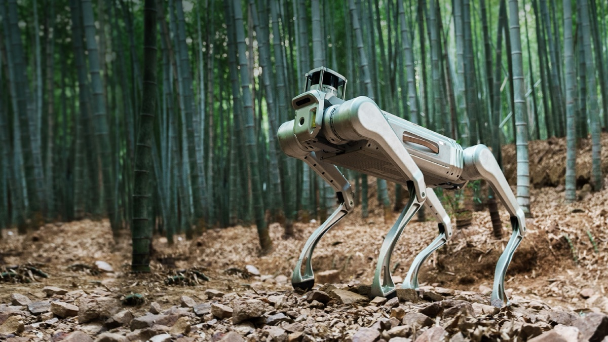
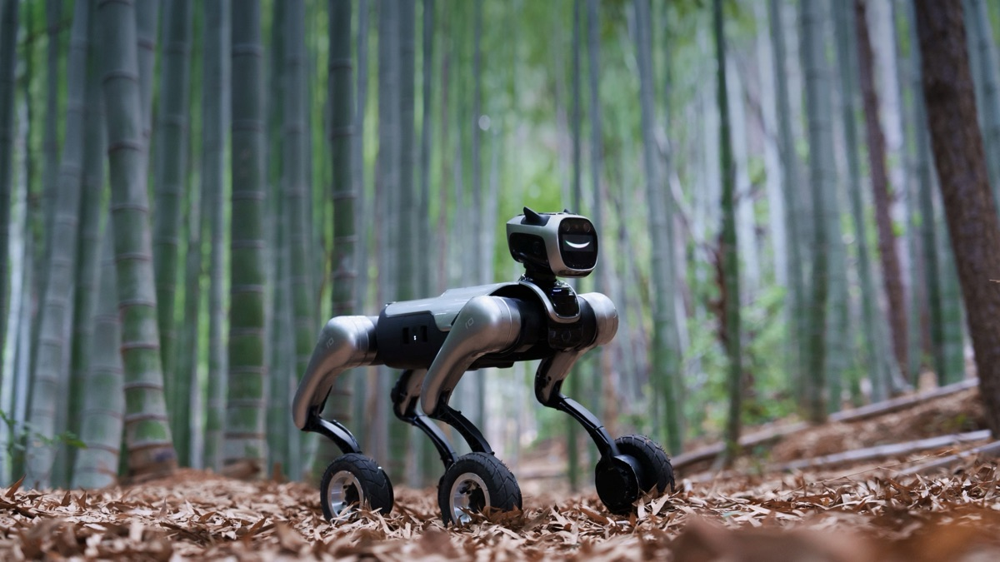

# Magiclab Robotics × T02 — Products and Solutions

⬆ [Magiclab Robotics profile](../Magiclab.md) · [Brief](Magiclab-T02-1-Brief.md) · [Playbook](Magiclab-T02-3-Playbook.md)

## Relevant products (ranked for this track)

Ranking is by suitability for patrol, inspection and response. **Which units are on site is not confirmed** — check the last column before you commit.

| Rank | Product | Role in T02 | Status | Hackable on site? (best guess) |
|---|---|---|---|---|
| 1 | MagicDog-Y1 | Rugged inspection / response carrier | ✅ | Possible as demo unit; SDK exists |
| 2 | MagicDog T1 | Light patrol + light intervention | 🧪 | Unlikely; no public SDK repo found |
| 3 | MagicDog EDU | Realistic 48-hour build base | ✅ | **Most likely** |
| 4 | MagicDog-W | Fast patrol on paved ground, 4G link | ✅ | Possible |
| 5 | MagicBot Z1 (Development Version) | Human-facing marshal / guidance | ✅ | Likely |
| 6 | MagicBot Gen1 | Teleoperated humanoid for hazardous tasks | ✅ | Less likely |

Vendor note: speed, payload and endurance figures are lab values. **No prices are public.**

### MagicDog-Y1

**Role:** the only Magiclab robot with stated weather and temperature ratings; the right body for outdoor inspection, tunnel or plant patrol and carrying response payloads.

| Spec | Value |
|---|---|
| Weight / size | **70 kg** with battery; 1050 × 458 × 810 mm |
| Protection / temperature | **IP67**; **−20 to 55 °C** |
| Payload | **45 kg** dynamic; 150 kg maximum static load |
| Speed / terrain | up to **6 m/s**; step ≥ **60 cm**; slope ≥ **45°**; page mentions stairs, rocky ground, shallow water |
| Runtime | **4–6 h**; over 4 h walking with 20 kg |
| Sensors | 1× 3D LiDAR, 2× depth cameras, 2× optical cameras (configuration varies) |
| Compute | 8-core CPU; optional **157 TOPS** module |
| Comms | Wi-Fi 6, Bluetooth 5.2; **5G optional** on some versions |
| Payload interfaces | 4× 24 V + RS-485, 3× 12 V + Ethernet, 4× USB 3.0, 1× EtherCAT; rails, screw mounts, payload platform |
| Listed payload options | infrared thermal imager, gas sensor, acoustic imager, partial-discharge sensor |

- **Status / price / availability:** ✅ shipping; price not public; on-site availability not confirmed.
- **Developer interface:** `magicdog-y1_sdk` (C++20 + Python 3.10, BSD-3-Clause). Docs list services for main control, **high-level motion**, **low-level motion**, sensors, audio, monitoring and a **SLAM navigation service**. API details of the navigation service were not readable from the docs site ⚠️ unverified.
- **Caution:** 70 kg at 6 m/s is a safety matter indoors — expect the vendor to restrict speed and supervise.

### MagicDog T1

**Role:** light-industry quadruped pitched as "inspection plus light intervention on one platform" (can carry an arm on a standard rear interface).

| Spec (trade press, QbitAI, Aug 2026 — not from an official spec page) | Value |
|---|---|
| Weight / payload | about **18 kg**; up to **15 kg** payload |
| Speed / terrain | up to **5 m/s**; **18 cm** steps; **40°** slope |
| Runtime | about **3 h** unloaded; dock recharge or battery swap |
| Sensors | RGB camera, RGB-D, **16-line LiDAR** |

- **Status / price / availability:** 🧪 launched summer 2026 (WAIC / WRC); price not public; no official product page or dedicated SDK repo found.
- **Developer interface:** not public.

### MagicDog (PRO / EDU)

**Role:** the most probable hackable unit. Small enough to run safely in a corridor, with a ROS 2 SDK that already provides mapping and navigation.

| Spec | Value |
|---|---|
| Weight / size | **15.8 kg** excl. battery; 670 × 350 × 560 mm standing |
| Payload | about **5 kg** (max about 10 kg) |
| Speed / terrain | **3.0 m/s**; **15 cm** obstacle; **40°** slope |
| Runtime | **1.5–3 h** (29.6 V, 8200 mAh quick-release battery) |
| Sensors | **2D (single-line) LiDAR**, depth camera, stereo camera, 4K camera, fisheye, ultrasonic, mic array |
| Compute | 8-core CPU |
| IP rating / temperature / comms | not stated on the product page |
| Built-in features | patrol mode, obstacle avoidance, following, human recognition, live video transmission |

- **Status / price / availability:** ✅ shipping; price not public. **Only the EDU edition has SDK access** (PRO shares the hardware).
- **Developer interface:**
  - `magicdog_sdk` (C++ / Python): high-level motion, low-level joints, sensors, audio. Wired link on **192.168.55.x** with **multicast enabled**.
  - `magicdog_ros2_sdk` (Foxy on Ubuntu 20.04, Iron on 22.04, CycloneDDS, `ROS_DOMAIN_ID=25`): `/scan`, RGB-D, fisheye and stereo image topics, TOF, ultrasonic, battery; **SLAM** (`/set_slam_model` map / localise, `/save_map`, `/map`, `/tracked_pose`); **navigation** (`/switch_navigate_mode`, `/goal_pose`, `/ab_navigation_complete`, velocity input `/vel_app`).
  - The ROS 2 SDK does **not** do motion control itself; that goes through the motion SDK.

### MagicDog-W

**Role:** faster, longer-running patrol on paved streets and indoor floors, with a built-in cellular link.

| Spec | Value |
|---|---|
| Weight | **22.5 kg** with battery |
| Payload | up to **10 kg** |
| Speed / terrain | 0–**3 m/s**; **40°** slope; 7-inch pneumatic tyres |
| Runtime | **2–4 h**; standby up to 8 h |
| Temperature | **−5 to 40 °C**; IP rating not stated |
| Sensors | 2D LiDAR, depth, stereo, 4K, fisheye, ultrasonic, touch, omnidirectional mic |
| Compute / comms | **6 TOPS** on board; Wi-Fi 5, **4G module**, Bluetooth 5.0 |
| Expansion | back plate and expansion dock for extra LiDAR or gimbal |

- **Status / price / availability:** ✅ shipping; price not public.
- **Developer interface:** `magicdog-w_sdk` and URDF repo exist; whether the ROS 2 SLAM / nav SDK works unchanged on the W is ⚠️ unverified.

### MagicBot Z1 (base / Development Version)

**Role:** human-facing part of a response system — marshal, guide or announcer — echoing the company's traffic-police demo. Not a rough-terrain robot.

| Spec | Value |
|---|---|
| Height / weight | **1.37 m**, about **40 kg** |
| DoF | **24** (Development Version 24–50) |
| Arm payload | **2 kg** (Development Version **3 kg**) |
| Runtime | about **2 h** |
| Sensors | 3D LiDAR, depth, stereo fisheye |

- **Status / price / availability:** ✅ shipping; price not public. **SDK only on the Development Version.**
- **Developer interface:** `magicbot-z1_sdk` (most actively maintained repo, pushed 29 Oct 2026), URDF, `Magiclab_GMR` motion retargeting. No ROS 2 nav repo found for humanoids ⚠️ unverified.

### MagicBot Gen1

**Role:** only relevant here as a **teleoperated** body for hazardous-environment tasks.

| Spec | Value |
|---|---|
| Height / weight | **1.74 m**, about **70 kg** |
| Arm payload | **7.5 kg** per arm; two 11-DoF hands |
| Runtime | **3–5 h** |
| Compute | 8-core CPU + **100 TOPS** module |

- **Status / price / availability:** ✅ shipping; price not public; unlikely as a hackable unit.
- **Developer interface:** `magicbot-gen1_sdk`; `pico_teleoperate` gives body-tracked teleoperation with a **PICO 4 Ultra** headset plus three trackers (Gen1 only, same Wi-Fi network).

## What Magiclab Robotics already does in this domain

All items are company-sourced or trade-press reports; none independently verified.

| Date | What | Evidence |
|---|---|---|
| 2026 (race date not checked) | Bipedal traffic robot worked with the **Wuxi Public Security Bureau** at the **2026 Wuxi Marathon** on traffic command and crowd guidance | [QbitAI](https://www.qbitai.com/2026/08/477155.html) |
| 2026-07 | Led the founding of a **Jiangsu provincial key laboratory for public-safety embodied robots** with police academies | [QbitAI](https://www.qbitai.com/2026/08/477155.html) |
| 2026-08 (WRC, 19–23 Aug) | Showed a **"smart policing" solution**: traffic management, patrol and incident response, government services; MagicDog T1 demo of inspection plus light intervention | [QbitAI](https://www.qbitai.com/2026/08/477155.html) |
| 2026 (undated) | Joint work with **China Mobile Lianyungang** on 5G-A networking for traffic, emergency-response and government-service police scenarios | [QbitAI](https://www.qbitai.com/2026/08/477155.html) |
| 2026 (undated) | T1 with an arm tested at a Dreame factory for floor-debris clearing and button pressing | [QbitAI](https://www.qbitai.com/2026/08/477155.html) |
| stated 2026-09 | Company says **MagicDog Y1 has inspected European energy facilities**; no site, customer or date named | [EqualOcean](https://equalocean.com/news/2026090822169-magiclab-targets-european-logistics-robotics-showcase-slovenia-postal) |

- **Not found:** search-and-rescue, firefighting, avalanche / rockfall / flood monitoring, tunnel or cable-car inspection, or any Switzerland activity.
- Reseller pages describe Y1 as suitable for disaster response and security; that is positioning, not a deployment.

## What they are building next in this domain

- **European certification** work targeted for completion in **Q4 2026** (company statement) — a precondition for selling inspection robots to European operators.
- **Public-safety line:** the provincial lab (Jul 2026) and the WRC policing solution suggest continued investment in traffic, patrol and incident-response robots. *Inference:* expect police-style patrol to stay China-first.
- **T1 as an "inspect and act" platform:** arm-on-dog intervention is the announced direction; hospital sample and emergency-medicine transport with T1 is described as prospective.
- **One model stack across bodies** (Magic-VLA K02, Magic-Mix): pitched at factories and public spaces. *Inference:* not something you can use this weekend — no public weights found.
- No announced roadmap for natural-hazard monitoring or search-and-rescue.

## Software, models and data that help for this track

| Asset | What it gives you | Notes |
|---|---|---|
| [magicdog_ros2_sdk](https://github.com/MagiclabRobotics/magicdog_ros2_sdk) | Sensor topics + built-in SLAM and goal navigation | Foxy / Iron, CycloneDDS; last pushed May 2025 — verify against current firmware |
| [magicdog_sdk](https://github.com/MagiclabRobotics/magicdog_sdk) | High- and low-level control, sensors, audio in C++ / Python | Ubuntu 22.04+, GCC ≥ 11.4, Python 3.10; multicast required |
| [magicdog-y1_sdk](https://github.com/MagiclabRobotics/magicdog-y1_sdk) | Same service model for Y1 plus a SLAM navigation service | Docs: [Y1 docs](https://support.magiclab.top/en/docs/y1/faq) |
| `magicdog_motion_sdk`, `magiclab_rl_lab`, `magiclab_mujoco`, `magiclab_deploy` | Custom gait / RL policy path and simulation | Too deep for 48 h unless locomotion is your project |
| `magicdog_description`, `magicdog-w_description` | URDF for simulation and visualisation | Useful for a digital-twin view |
| [pico_teleoperate](https://github.com/MagiclabRobotics/pico_teleoperate) | XR teleoperation of Gen1 | Needs PICO 4 Ultra + 3 trackers; Gen1 only |
| Datasets / perception models for hazards | none published | Bring your own detector or VLM |

## Gaps and limits for this track

- **Edition lock:** no SDK on MagicDog PRO or base Z1.
- **MagicDog EDU is an indoor-grade sensor set:** 2D LiDAR means flat-floor maps; stairs, slopes and outdoor snow will break 2D SLAM. No IP or temperature rating published.
- **No thermal, gas or acoustic sensors on the small dogs** — those are Y1 options; bring a USB thermal camera or sensor board yourself.
- **Comms:** only MagicDog-W (4G) and Y1 (optional 5G) list cellular; MagicDog comms are not stated. Plan for your own Wi-Fi.
- **Manipulation:** no arm on a hackable dog; Z1 arms carry 2–3 kg.
- **ROS 2 SDK age** (May 2025) and old distros (Foxy / Iron) — budget time for environment setup; Docker bridge and Wi-Fi must be off during wired connection.
- **Proof points are company-reported**; no named inspection customer.
- **Y1 is heavy and fast** — if present, expect restricted operation.

## Sources

- [Magiclab Robotics profile (this repo)](../Magiclab.md)
- [MagicDog-Y1 product page](https://www.magiclab.top/en/dog-y)
- [MagicDog product page](https://www.magiclab.top/en/dog)
- [MagicDog-W product page](https://www.magiclab.top/en/dog-w)
- MagicBot Z1 and Gen1 figures are taken from the profile above (official pages: [Z1](https://www.magiclab.top/en/z1), [Gen1](https://www.magiclab.top/en/human))
- [GitHub — magicdog_ros2_sdk](https://github.com/MagiclabRobotics/magicdog_ros2_sdk)
- [GitHub — magicdog_sdk](https://github.com/MagiclabRobotics/magicdog_sdk)
- [GitHub — magicdog-y1_sdk](https://github.com/MagiclabRobotics/magicdog-y1_sdk)
- [GitHub — pico_teleoperate](https://github.com/MagiclabRobotics/pico_teleoperate)
- [GitHub — MagiclabRobotics organisation](https://github.com/MagiclabRobotics)
- [MagicLab Docs Center — MagicDog-Y1](https://support.magiclab.top/en/docs/y1/faq)
- [QbitAI — MagicLab at WRC 2026 (Chinese)](https://www.qbitai.com/2026/08/477155.html)
- [EqualOcean — MagicLab targets European logistics (IFA 2026)](https://equalocean.com/news/2026090822169-magiclab-targets-european-logistics-robotics-showcase-slovenia-postal)
