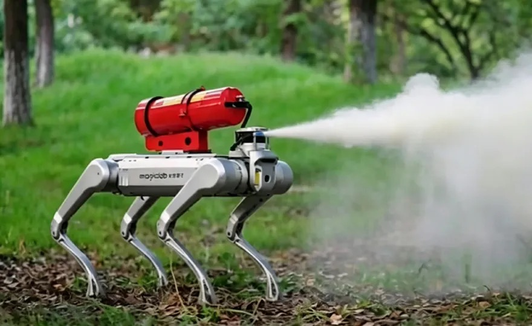
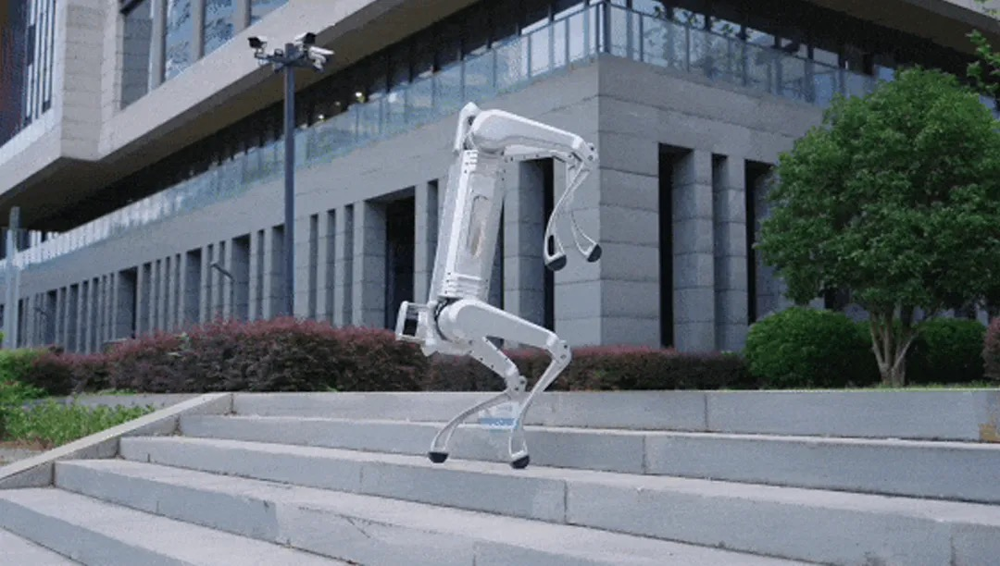
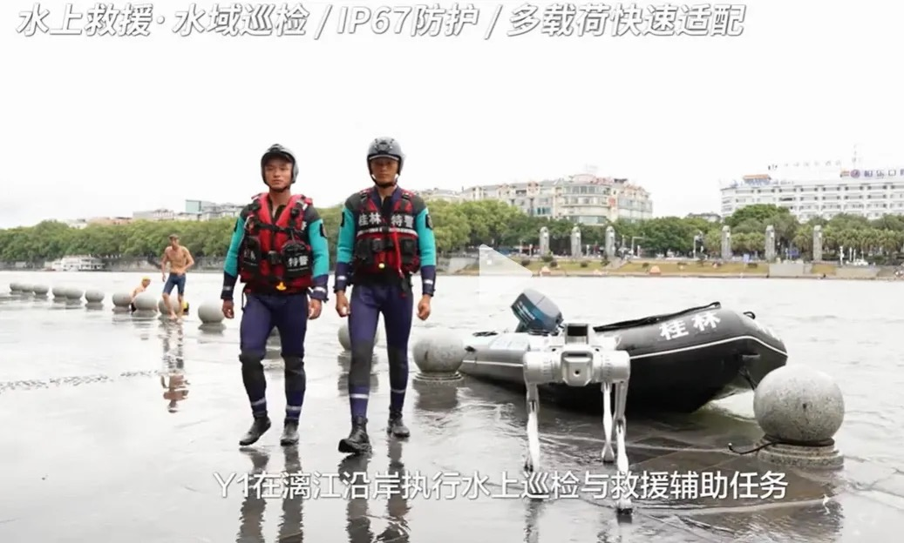
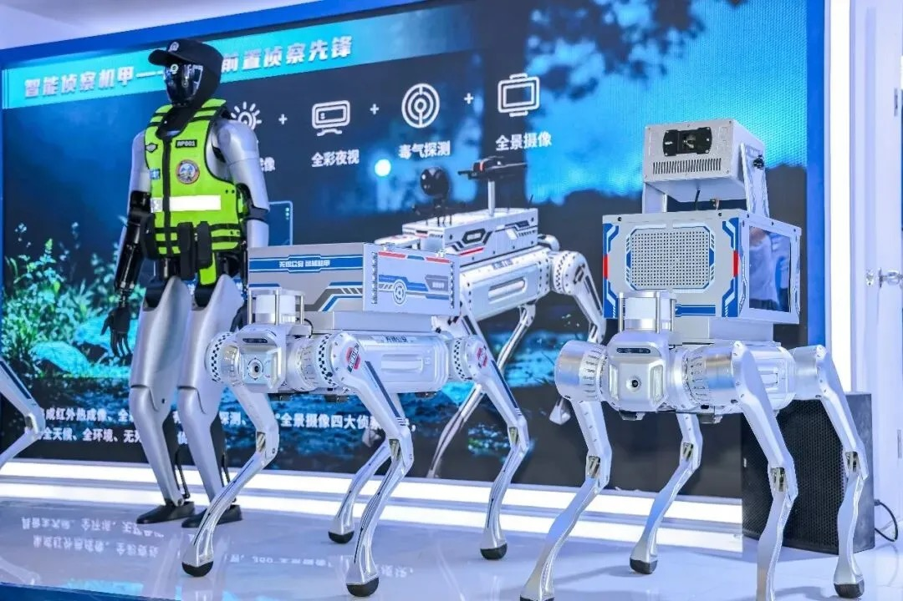
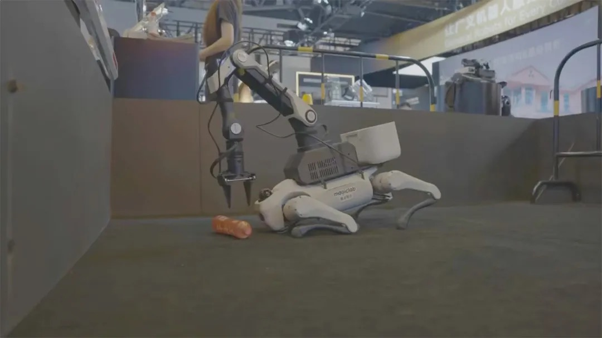
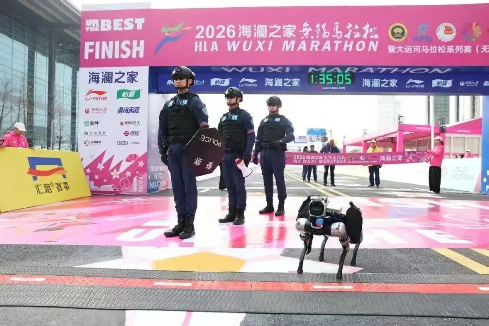

# Magiclab Robotics × T02 — Solutions Register, Projects and Papers

⬆ [Magiclab Robotics profile](../Magiclab.md) · [Brief](Magiclab-T02-1-Brief.md) · [Products and solutions](Magiclab-T02-2-Products-and-Solutions.md) · [Playbook](Magiclab-T02-3-Playbook.md) · [Track overview](../../../Challenges/T02-Resilient-and-Safe-City/T02-0-Track-Overview.md)

> **Second-pass audit (2026-11-14):** **13 items** below were NOT in any first-pass doc (5 solutions / capabilities, 5 project rows, 3 future items — all marked 🆕), plus 5 corrections. Web search **was available** for this doc (2 extended queries, one English and one Chinese, both used); everything else comes from direct fetches of the official global site (all T02 case pages, both industry pages, the Y1 product page), the Y1 SDK example code on GitHub, the WRC 2026 exhibitor listing and Chinese trade press. Not reachable: Gasgoo WAIC article (HTTP 468), Baidu Baike (HTTP 403), the JS-rendered Y1 docs pages. Almost all evidence is **company-reported**; no independent verification of any deployment was found.

Naming: **魔法原子** = MagicLab / Magiclab Robotics (Wuxi; incubated by Dreame). **Xiaomai (小麦)** = MagicBot Gen1. Full company-wide register: [Solutions and projects](../Magiclab-Solutions-and-Projects.md).

## Coverage of the official directions

| Direction | What Magiclab Robotics has for it | Evidence | Maturity | Strength |
|---|---|---|---|---|
| T02.1 Emergency rescue robots | **MagicDog Y1** as rescue-support carrier (IP67, **45 kg** moving payload, supply and tool delivery, reconnaissance ahead of responders); water-rescue support configuration with police. No victim-detection payload, no rescue manipulator, no firefighting or explosion-proof certification stated | [Guangxi flood-relief case](https://www.magiclabglobal.com/built-for-20c-to-55c-magicdog-y1-deployed-for-24-7-flood-relief-operations-in-guangxi.html) — 3 donated robot dogs worked beside rescue teams; video stills show a Y1 with Guilin special police on the Li River | 🧪 | ◐ |
| T02.2 Autonomous inspection in hazardous environments | **Inspection & security solution**: Y1 autonomous patrol with plug-in thermal imager, dual-light PTZ, gas sensor, acoustic imager, partial-discharge sensor; petrochemical / hazardous-gas zones, tunnels, confined spaces listed as target scenes. **MagicDog T1** for light-industry sites | [Inspection & security page](https://www.magiclabglobal.com/magiclab-embodied-ai-robotics-for-inspection-security/) · [IFA 2026 release](https://www.magiclabglobal.com/magiclab-brings-physical-ai-to-europes-factory-floors-at-ifa-2026-debuting-full-stack-embodied-intelligence-stack.html) (Y1 said to inspect European energy sites and power stations; no site named) | ✅ | ● |
| T02.3 Infrastructure safety monitoring | Same Y1 payload set aimed at substations, equipment rooms, cable corridors, pipelines, tunnels, construction sites; alarms and video can feed a customer platform. **No monitoring / analytics platform, no change-detection or digital-twin product** | [Modular sensor inspection case](https://www.magiclabglobal.com/modular-industrial-sensor-inspection.html) · [Y1 product page](https://www.magiclabglobal.com/products/magicdog-y1/) | ✅ | ◐ |
| T02.4 Disaster response & environment sensing | Y1 with gas, thermal, acoustic and visual sensing for first-look assessment (flood, storm, hazardous gas); police reconnaissance dog with thermal, colour night vision, toxic-gas detection, panoramic camera. Ground robots only; no drone, no fixed sensor network | [Public safety page](https://www.magiclabglobal.com/magiclab-embodied-ai-robotics-for-public-safety/) · [Hazardous-environment payload demo](https://www.magiclabglobal.com/hazardous-environment-sensor-payload-demonstration.html) | 🧪 | ◐ |
| T02.5 Smart security monitoring | **Smart policing "humanoid + quadruped"** with Wuxi Public Security Bureau (traffic duty, patrol, crowd guidance); smart-policing equipment line; app-configured indoor patrol on the small MagicDog; MagicDog-W positioned for park patrol | [Wuxi police case](https://www.magiclabglobal.com/magiclab-x-wuxi-police-a-humanoid-traffic-officer-goes-on-duty-at-a-major-public-sporting-event.html) · [Wuxi Marathon case](https://www.magiclabglobal.com/35000-runners-one-integrated-response-system-how-magiclab-robots-helped-police-the-wuxi-marathon.html) | ✅ | ● |
| T02.6 Autonomous navigation in complex terrain | Y1: **≥45°** slope, **≥60 cm** step, gravel, stairs, shallow water, **6 m/s**, 3D LiDAR + depth; SLAM / grid-map navigation in the Y1 and MagicDog SDKs; MagicDog EDU: 40° slope, 15 cm obstacle, 2D LiDAR | [Y1 all-terrain field validation](https://www.magiclabglobal.com/magicdog-y1-all-terrain-field-validatio.html) · [Y1 SDK examples](https://github.com/MagiclabRobotics/magicdog-y1_sdk/tree/main/example/python) | ✅ | ● |
| T02.7 Human-robot collaborative emergency response | Police officers + humanoid + quadrupeds working one event; remote dispatch with 5G option; one scheduling layer across different robots (first outdoor test); PICO-headset teleoperation for the Gen1 humanoid. No published operator console or API for the dispatch layer | [Wuxi Marathon case](https://www.magiclabglobal.com/35000-runners-one-integrated-response-system-how-magiclab-robots-helped-police-the-wuxi-marathon.html) · [Fleet coordination case](https://www.magiclabglobal.com/heterogeneous-robot-fleet-coordination-autonomous-beach-patrol-bartending-and-guest-service-in-one-live-environment.html) | 🧪 | ◐ |

## All solutions relevant to T02

🆕 = not in any first-pass doc. Directions use the official numbering.

| Solution / capability | What it does for this track | Direction(s) served | Products used | Maturity | Source link |
|---|---|---|---|---|---|
| Inspection & security solution (巡检安防) | Repeatable autonomous patrol routes, dynamic avoidance, low-power return, remote monitoring, central task dispatch, hand-over of video / alarms to the customer's platform | T02.2 T02.3 T02.5 | MagicDog Y1 | ✅ | [Inspection & security](https://www.magiclabglobal.com/magiclab-embodied-ai-robotics-for-inspection-security/) |
| Modular inspection payloads | Infrared thermal imager, dual-light PTZ camera, gas sensor, acoustic imager, partial-discharge sensor on standard power / Ethernet / RS-485 / USB / EtherCAT ports | T02.2 T02.3 T02.4 | Y1 | ✅ (options) | [Modular sensor inspection](https://www.magiclabglobal.com/modular-industrial-sensor-inspection.html) |
| Public safety / emergency response solution (公共安全) | Robot enters first: disaster-site reconnaissance, hazardous-gas check, tunnel / confined-space support, flood and storm assessment, large-event support | T02.1 T02.4 T02.7 | Y1 | ✅ product · 🧪 use | [Public safety](https://www.magiclabglobal.com/magiclab-embodied-ai-robotics-for-public-safety/) |
| Remote reconnaissance and payload transport | Carries sensors, tools or emergency supplies (**45 kg** moving) into areas people cannot reach | T02.1 T02.4 | Y1 | 🧪 capability demo | [Case page](https://www.magiclabglobal.com/remote-reconnaissance-and-payload-transport.html) |
| Emergency transport and obstacle crossing | Equipment / supply haul over damaged routes; **150 kg** maximum standing load, ≥60 cm step | T02.1 T02.6 | Y1 | 🧪 capability demo | [Case page](https://www.magiclabglobal.com/emergency-transport-and-obstacle-crossing-demonstration.html) |
| All-terrain, all-weather mobility | IP67 body, **−20 to 55 °C**, slopes, steps, rocky ground, shallow water; hot-swap **2400 Wh** battery, **4–6 h**, range stated as **>20 km**, auto-recharge | T02.6 T02.1 | Y1 | ✅ | [Y1 product page](https://www.magiclabglobal.com/products/magicdog-y1/) |
| 🆕 Water rescue / water-area patrol configuration | Y1 rides in a police rescue boat and patrols the river bank; captioned "water rescue · water-area patrol / IP67 / fast multi-payload fitting" | T02.1 T02.5 | Y1 (unit marked Guilin special police) | 🧪 | [Guangxi case page (video stills)](https://www.magiclabglobal.com/built-for-20c-to-55c-magicdog-y1-deployed-for-24-7-flood-relief-operations-in-guangxi.html) |
| Smart policing "humanoid + quadruped" (智慧警务) | Humanoid at command points for traffic and crowd direction; quadrupeds patrol and take higher-risk tasks; covers traffic, street patrol, emergency response, public-service desk | T02.5 T02.7 | MagicBot Gen1 (police variant), Y1, smaller quadrupeds | ✅ in use with Wuxi police (company statement) | [Wuxi police case](https://www.magiclabglobal.com/magiclab-x-wuxi-police-a-humanoid-traffic-officer-goes-on-duty-at-a-major-public-sporting-event.html) |
| 🆕 Police reconnaissance quadruped ("intelligent reconnaissance mecha") | Forward scout with four functions: infrared thermal imaging, full-colour night vision, **toxic-gas detection**, panoramic camera; sister units carry a loudspeaker / screen box and a PTZ mast | T02.4 T02.5 T02.2 | Y1-class quadrupeds in Wuxi police livery | 🧪 exhibited | [Wuxi police case (exhibit photo)](https://www.magiclabglobal.com/magiclab-x-wuxi-police-a-humanoid-traffic-officer-goes-on-duty-at-a-major-public-sporting-event.html) |
| Smart-policing equipment line | Evidence-collection devices co-developed with Wuxi PSB, portable law-enforcement gear, monitoring systems | T02.5 | Non-robot devices | 🧪 exhibited 2026 | [Security fleet](https://www.magiclabglobal.com/magiclab-unveils-security-fleet-for-smart-policing.html) |
| Large-event patrol and crowd guidance | Route patrol, mobile observation, information broadcast, crowd guidance at public events | T02.5 T02.7 | Gen1, quadrupeds | ✅ done at events | [Public event patrol](https://www.magiclabglobal.com/public-event-patrol-and-interaction-deployment.html) |
| MagicDog T1 light inspection + light intervention | One-person-deployable dog (**18–19 kg**, **15 kg** payload, IP54, 16-line LiDAR); patrol, anomaly detection, equipment monitoring; rear arm presses buttons and clears debris | T02.2 T02.3 T02.5 | MagicDog T1 (+ arm) | 🧪 launched mid-2026 | [T1 case](https://www.magiclabglobal.com/magicdog-t1-debuts-at-waic-2026-a-single-person-deployable-robot-for-distributed-industrial-and-park-inspection.html) |
| App-configured indoor patrol | Map rooms and set a patrol route in the phone app; robot walks it and observes | T02.5 | MagicDog | ✅ product feature | [Indoor patrol](https://www.magiclabglobal.com/app-configured-autonomous-indoor-patrol.html) |
| Wheel-leg patrol platform | Officially positioned for park patrol, smart security and industry inspection; 4G module, remote control, open interfaces | T02.5 T02.6 | MagicDog-W | ✅ | [WRC 2026 exhibitor listing](https://www.worldrobotconference.com/expo/company/450.html) |
| Remote dispatch and connectivity | Remote control, optional 5G, "one-click dispatch" integration, central mission dispatch; 5G-A network work with China Mobile Lianyungang for police scenes | T02.7 T02.5 | Y1 + network partners | ✅ option · 🧪 5G-A | [Y1 product page](https://www.magiclabglobal.com/products/magicdog-y1/) |
| Heterogeneous fleet coordination | One scheduling layer for a patrol dog, a service humanoid and a photo robot; robots yield to each other and adapt patrol frequency to crowd density | T02.7 T02.5 | Y1, Gen1, MagicPanda | 🧪 first outdoor test | [Fleet case](https://www.magiclabglobal.com/heterogeneous-robot-fleet-coordination-autonomous-beach-patrol-bartending-and-guest-service-in-one-live-environment.html) |
| 🆕 MagicNet multi-robot coordination (named Dec 2024) | Shared perception data and maps, task planning, **re-assignment when a robot fails**, links to factory systems; described as "in development" then — current status unknown ⚠️ unverified | T02.7 | Software | 🔭 | [News 54](https://www.magiclab.top/news/54) |
| SLAM + navigation in the SDKs | Y1 SDK: mapping, map save, localisation, grid-map navigation to a target pose, pause / resume / cancel, odometry; 3D LiDAR point cloud, front / rear RGB-D and fisheye streams. Same service model on MagicDog EDU; older ROS 2 SDK for MagicDog | T02.6 (enabler for all) | Y1, MagicDog EDU | ✅ | [Y1 SDK examples](https://github.com/MagiclabRobotics/magicdog-y1_sdk/tree/main/example/python) |
| 🆕 Y1 option versions for research and engineering surveying | Launch material lists optional Y1 versions for research / education and engineering surveying (工程测绘); no surveying payload or product page found | T02.3 | Y1 | ✅ stated · details ⚠️ unverified | [Tencent News — Y1 launch](https://news.qq.com/rain/a/20251010A041N400) |
| Whole-body teleoperation of a humanoid | PICO 4 Ultra + trackers drive Gen1 remotely; built for data collection, reusable for hazardous-task teleoperation | T02.7 | MagicBot Gen1 | ✅ code public | [pico_teleoperate](https://github.com/MagiclabRobotics/pico_teleoperate) |
| 🆕 MagicBot X1 positioned for inspection and public safety | Full-size humanoid listed for "smart inspection" and "public safety" among its uses; no T02 demo found | T02.5 | MagicBot X1 | 🔭 positioning | [WRC 2026 exhibitor listing](https://www.worldrobotconference.com/expo/company/450.html) |
| Magic-Brain agent framework | Navigation, grasping, interaction and "sentinel" (trigger-based) agents with task re-planning and e-stop channels; article only, no code | T02.7 (architecture idea) | Software | 🧪 | [News 64](https://www.magiclab.top/news/64) |

**Not offered:** drones or aerial sensing; avalanche / rockfall / landslide monitoring; firefighting robot; explosion-proof (ATEX) rating ⚠️ unverified; victim-detection or life-sign payload; inspection analytics / digital-twin software; any Swiss reference.

### Inspection & security solution (MagicDog Y1)

- **What you get:** a **70 kg**, IP67, −20 to 55 °C dog with 3D LiDAR, 2 depth and 2 optical cameras, 8-core CPU plus optional **157 TOPS** module, and ports for thermal, PTZ, gas, acoustic and partial-discharge payloads.
- **Target scenes named by the company:** substations and cable corridors, petrochemical zones, factory / campus patrol, tunnels and pipelines, construction sites, perimeter observation.
- **Evidence gap:** "already inspecting European energy sites and power stations" (IFA release, Sep 2026) has no site, customer or photo. Chinese press (AWE, Mar 2026) says projects run in **Wuxi, Nanjing and Suzhou** covering guiding and industrial inspection — also unnamed.

### Public safety / emergency response (MagicDog Y1)

- **Pitch:** robot goes in first to collect visual, thermal, acoustic or gas data, then hauls tools, radios or supplies over debris, steps and damaged roads.
- **Real use reported:** three "professional-grade" robot dogs worth **RMB 1.8M** were donated with relief supplies after flooding in Guangxi and used for inspection and supply delivery beside rescue teams. The page names "Typhoon Mesak" and gives no date ⚠️ unverified.
- **Launch-day claims (Oct 2025):** equipment delivery, environment detection and person search in fire and emergency rescue — claims, not shown deployments.

### Water rescue / water-area patrol with Guilin special police 🆕

- Stills from an official video ("MagicLab × Guangxi Public Security") show a Y1 in **Guilin special police** livery in a rescue boat and on a flooded river bank; the caption says Y1 carries out water patrol and rescue-support tasks along the Li River.
- Only the captions exist as evidence: **no date, no task description, no outcome** ⚠️ unverified beyond the images.
- Relevance for Leukerbad: the nearest thing to a "robot beside a rescue crew in bad terrain" reference; useful in a pitch, not as a technical recipe.

### Smart policing "humanoid + quadruped" (Wuxi)

- **Model:** a Gen1-based traffic robot stands at command points; smaller quadrupeds fill coverage gaps and patrol with officers.
- **Proof:** 2026 Wuxi Marathon (**35,000 runners**); strategic partnership with Wuxi Public Security Bureau since **May 2026** across traffic, street patrol, emergency response, public service, investigation support and facility control.
- **Caveat:** "scaled deployment within Wuxi's police force" is the company's wording; unit counts are not published.

### Police reconnaissance quadrupeds 🆕

- The exhibit board (read from the official photo) presents an "intelligent reconnaissance" dog as forward scout with **thermal imaging, full-colour night vision, toxic-gas detection and panoramic camera**.
- Other units carry a loudspeaker / display box and a camera mast — i.e. a broadcast dog and an observation dog.
- No spec sheet, price or product name is published for these police configurations ⚠️ unverified.

### MagicDog T1 — inspect and act

- About **18 kg** (QbitAI) / **19 kg** (IFA release), **15 kg** continuous payload, **IP54**, up to 5 m/s, 18 cm steps, 40° slopes, about 3 h; RGB, RGB-D, 16-line LiDAR; dock recharge or battery swap.
- Demos: patrol a zone, spot and pick up bottles with a rear arm (WAIC); debris clearing and button pressing at a Dreame factory; live inspection demos at IFA Berlin.
- No official product page, spec sheet or SDK repo yet; launch date is given as WAIC (Jul 2026), WRC (Aug 2026) or "August 2026" depending on the source.

### SLAM and navigation in the SDKs (the 48-hour enabler)

- **Y1 SDK (verified from example code):** `get_slam_nav_controller()`, `activate_slam_mode(MAPPING / LOCALIZATION / IDLE)`, `save_map`, `init_pose`, `activate_nav_mode(GRID_MAP)`, `set_nav_target`, `get_nav_task_status`, pause / resume / cancel; sensor calls for LiDAR point cloud, LiDAR IMU, front / rear RGB-D and fisheye. Examples default to local IP `192.168.54.111`.
- Navigation is **grid-map based** even on the 3D-LiDAR Y1; the repo was published on **1 Jun 2026** and has only two commits.
- MagicDog EDU has the same service model (see the [Developer guide](../Magiclab-Developer-Guide.md)); its 2D LiDAR limits it to flat-floor maps.

## Projects, deployments and pilots in this domain

Newest first. "n.d." = the source gives no date. All company-reported unless the source is trade press.

| Date | Project | Partner / customer | Location | What happened | Direction(s) | Source link |
|---|---|---|---|---|---|---|
| 2026-09-04/08 | IFA Berlin | AliExpress Brand+ pavilion | Berlin, DE | European debut of MagicDog T1 with live inspection demos | T02.2 | [IFA release](https://www.magiclabglobal.com/magiclab-brings-physical-ai-to-europes-factory-floors-at-ifa-2026-debuting-full-stack-embodied-intelligence-stack.html) |
| stated 2026-09 | Energy-site inspection | Not named | Europe | Y1 said to run automated inspections at energy sites and power stations ⚠️ no site, date or customer | T02.2 T02.3 | [IFA release](https://www.magiclabglobal.com/magiclab-brings-physical-ai-to-europes-factory-floors-at-ifa-2026-debuting-full-stack-embodied-intelligence-stack.html) |
| 2026-08-19/23 | WRC 2026, booth C323 | — | Beijing | "Smart policing" solution shown; T1 with arm demonstrates equipment check, button pressing, debris clearing; Y1 listed for industrial inspection, park security, emergency rescue | T02.5 T02.2 | [QbitAI](https://www.qbitai.com/2026/08/477155.html) |
| by 2026-08 | T1 factory validation | Dreame | China | T1 with arm clears floor debris and presses equipment buttons in a working factory | T02.2 | [QbitAI](https://www.qbitai.com/2026/08/477155.html) |
| 2026-07 | Jiangsu Provincial Key Laboratory for Public Safety Embodied Robots | Police academies (not named) | Jiangsu | Company-led lab being set up as an industry + police-academy consortium | T02.5 T02.7 | [QbitAI](https://www.qbitai.com/2026/08/477155.html) |
| 2026-07 | WAIC 2026 | — | Shanghai | T1 unveiled; patrol-and-pick-up demo with rear arm | T02.2 | [T1 case](https://www.magiclabglobal.com/magicdog-t1-debuts-at-waic-2026-a-single-person-deployable-robot-for-distributed-industrial-and-park-inspection.html) |
| 2026 (n.d., after May) | China Political-Legal Equipment Exhibition | Wuxi PSB (co-developer) | Beijing | Policing robots, evidence-collection devices, monitoring systems exhibited | T02.5 | [Security fleet](https://www.magiclabglobal.com/magiclab-unveils-security-fleet-for-smart-policing.html) |
| 🆕 2026-06-01 | Y1 SDK made public | — | GitHub | C++ / Python SDK with SLAM and navigation examples released (BSD-3-Clause) | T02.6 | [magicdog-y1_sdk](https://github.com/MagiclabRobotics/magicdog-y1_sdk) |
| 2026-05 | Strategic partnership, smart policing | Wuxi Public Security Bureau | Wuxi | Custom development, joint R&D, field tests and deployment across five policing domains | T02.5 T02.7 | [Security fleet](https://www.magiclabglobal.com/magiclab-unveils-security-fleet-for-smart-policing.html) |
| 2026-05 | Cannes "China Night" | Event organisers | Cannes, FR | Industrial quadruped on continuous beach patrol inside a mixed fleet; first outdoor test of the shared scheduling layer | T02.5 T02.7 | [Fleet case](https://www.magiclabglobal.com/heterogeneous-robot-fleet-coordination-autonomous-beach-patrol-bartending-and-guest-service-in-one-live-environment.html) |
| 2026 spring (race date not checked) | Wuxi Marathon traffic and patrol duty | Wuxi traffic police | Wuxi | Gen1-based traffic robot at command points; quadrupeds patrol with officers; **35,000 runners** | T02.5 T02.7 | [Marathon case](https://www.magiclabglobal.com/35000-runners-one-integrated-response-system-how-magiclab-robots-helped-police-the-wuxi-marathon.html) |
| 🆕 2026-03-12 | AWE 2026 | — | Shanghai | Y1 shown for construction sites and disaster scenes (inspection, emergency supply drop); company says projects run in Wuxi, Nanjing and Suzhou, including industrial inspection | T02.1 T02.2 | [Tencent News — AWE 2026](https://news.qq.com/rain/a/20260314A00FY700) |
| 2026-01-23 | Partner conference ("Juguang" partners) | Beijing Lingtian Intelligent Equipment (emergency equipment maker), China Mobile Wuxi, others | Suzhou | Emergency-equipment and telecom partners join the first partner group | T02.1 T02.7 | [News 57](https://www.magiclab.top/news/57) |
| 2026 (n.d.) | 5G-A cooperation | China Mobile Lianyungang | Lianyungang | Joint work on 5G-A networking for traffic, emergency-response and public-service police scenes | T02.7 T02.5 | [QbitAI](https://www.qbitai.com/2026/08/477155.html) |
| 🆕 n.d. | Water patrol and rescue support on the Li River | Guilin special police ("MagicLab × Guangxi Public Security") | Guilin, Guangxi | Y1 in police livery in a rescue boat and on the river bank; known only from captioned video stills ⚠️ | T02.1 T02.5 | [Guangxi case page](https://www.magiclabglobal.com/built-for-20c-to-55c-magicdog-y1-deployed-for-24-7-flood-relief-operations-in-guangxi.html) |
| n.d. | Flood-relief donation | Local authorities (not named) | Guangxi | Wuxi subsidiary donates 3 robot dogs (**RMB 1.8M**) plus supplies; inspection and supply delivery in waist-deep water and collapse-risk zones beside rescuers | T02.1 T02.4 | [Guangxi case page](https://www.magiclabglobal.com/built-for-20c-to-55c-magicdog-y1-deployed-for-24-7-flood-relief-operations-in-guangxi.html) |
| 🆕 n.d. (pages online 2026) | Five Y1 capability "case studies" | — | — | One-paragraph demos: all-terrain field validation, inspection / rescue protection validation (slopes, steps, rock, shallow water), remote reconnaissance + payload transport, hazardous-environment payload demo, emergency transport + obstacle crossing. **Not customer deployments** | T02.1 T02.2 T02.4 T02.6 | [All-terrain field validation](https://www.magiclabglobal.com/magicdog-y1-all-terrain-field-validatio.html) |
| 🆕 2025-10-10 | MagicDog Y1 official release | — | China | First industry quadruped released for inspection, security and rescue; thermal + multi-gas options, remote-platform alarms | T02.1 T02.2 | [Tencent News — Y1 launch](https://news.qq.com/rain/a/20251010A041N400) |
| 2025-08-20 | Youth cyber-safety summer camp | Suzhou PSB, Wuzhong branch | Suzhou | Robots as education guests — a police relationship, not a security deployment | — | [Summer camp](https://www.magiclabglobal.com/teaching-kids-cyber-safety-magiclab-robots-join-a-suzhou-police-summer-camp.html) |
| 2025-08-08 | WRC 2025 | — | Beijing | Y1 first shown; company states it will strengthen quadrupeds for industrial inspection and emergency rescue | T02.1 T02.2 | [News 52](https://www.magiclab.top/news/52) |
| 2025-04-25 | Government cooperation | Wuxi municipal government, Liangxi district | Wuxi | Purchase intent for demo scenes that include inspection | T02.2 | [News 40](https://www.magiclab.top/news/40) |
| 2025-04-25 | Humanoid Robot Ecosystem Conference | VSTECS, Zhongke Kaichuang | Shanghai | Talks on quadruped inspection, logistics and education use | T02.2 | [News 41](https://www.magiclab.top/news/41) |

**Not found:** any avalanche, rockfall, landslide, earthquake, wildfire, tunnel or cable-car project; any firefighting-brigade deployment; any Swiss or Alpine activity; any named inspection customer.

## Future projects and announced plans in this domain

| Announced | Planned for | What | Confidence (official / reported / inferred) | Source link |
|---|---|---|---|---|
| 2026-09 | Q4 2026 | **CE-RED certification** with TÜV SÜD and TÜV Rheinland — precondition for selling inspection robots to European operators | official | [IFA release](https://www.magiclabglobal.com/magiclab-brings-physical-ai-to-europes-factory-floors-at-ifa-2026-debuting-full-stack-embodied-intelligence-stack.html) |
| 🆕 2026-09 | not stated | Turn the heterogeneous multi-robot model from live demos into repeatable solutions across Europe | official | [IFA release](https://www.magiclabglobal.com/magiclab-brings-physical-ai-to-europes-factory-floors-at-ifa-2026-debuting-full-stack-embodied-intelligence-stack.html) |
| 2026-09 | not stated | MagicDog T1 in European hospitals for specimen and **emergency-medication** transport (emergency logistics, edge of T02) | official (plan only) | [IFA release](https://www.magiclabglobal.com/magiclab-brings-physical-ai-to-europes-factory-floors-at-ifa-2026-debuting-full-stack-embodied-intelligence-stack.html) |
| 2026-08 | not stated | T1 as "inspect and act" platform: arm and sensor modules on the standard rear interface | reported | [QbitAI](https://www.qbitai.com/2026/08/477155.html) |
| 2026-07 | not stated | Build out the Jiangsu provincial key lab for public-safety embodied robots (still described as "being set up") | reported | [QbitAI](https://www.qbitai.com/2026/08/477155.html) |
| 2026 | not stated | Joint R&D with China Mobile Lianyungang on 5G-A for traffic, emergency-response and public-service policing | reported | [QbitAI](https://www.qbitai.com/2026/08/477155.html) |
| 2026 (after May) | ongoing | Extend the Wuxi smart-policing model to other public-security and legal agencies in China; next equipment generations for patrol, traffic, safety inspection, emergency response | official | [Security fleet](https://www.magiclabglobal.com/magiclab-unveils-security-fleet-for-smart-policing.html) |
| 2026-04-21 | not stated | Extend humanoids into public safety (one of nine target scenarios) | official | [News 63](https://www.magiclab.top/news/63) |
| 🆕 2026-08 | not stated | MagicBot X1 listed for smart inspection and public safety — no product or demo yet | inferred | [WRC 2026 exhibitor listing](https://www.worldrobotconference.com/expo/company/450.html) |
| 2025-08 | not stated | Strengthen the quadruped line for industrial inspection and emergency rescue — partly delivered (Y1 release Oct 2025, T1 2026) | official | [News 52](https://www.magiclab.top/news/52) |
| 🆕 2024-12 | not stated | MagicNet: shared maps, task scheduling and failover between robots — status today unknown ⚠️ | official | [News 54](https://www.magiclab.top/news/54) |

No announced plan for natural-hazard monitoring, search and rescue products, firefighting or explosion-proof variants.

## Research papers relevant to T02

**No directly relevant paper found.** The company's five arXiv preprints (Sep–Oct 2026) are all about manipulation models on table-top arms; none covers legged locomotion, navigation, SLAM, inspection, patrol or rescue. An arXiv metadata query for "MagicDog" and "MagicBot" returned **no third-party paper**. The two items below are the nearest useful reading (both opened on arXiv in this run).

| Paper (title as a link) | Authors / organisation | Venue, year | Why it matters here | Code / data |
|---|---|---|---|---|
| [Toward Real-Time VLAs: Stage-Aware Two-Step Flow Denoising and System-Level Evaluation](https://arxiv.org/abs/2609.39822) | Di Wu, Rongtian Shen, Ping Liu, …, Tao Zhang — Magiclab Robotics with university co-authors | arXiv 2609.39822, Sep 2026 (preprint) | Company-authored. Its camera-to-motion latency measurement transfers directly to checking whether a teleoperation or remote-inference link is fast enough for a response robot | [Inference runtime, Apache-2.0](https://github.com/MagiclabRobotics/Inference) |
| [TWIST: Teleoperated Whole-Body Imitation System](https://arxiv.org/abs/2505.02833) | Yanjie Ze, Zixuan Chen, João Pedro Araújo, Zi-ang Cao, Xue Bin Peng, Jiajun Wu, C. Karen Liu (Stanford / SFU) | arXiv 2505.02833, May 2025 | Third-party, **not** on MagicLab hardware; cited by MagicLab's motion-retargeting repo. Background for whole-body humanoid teleoperation in hazardous tasks | [pico_teleoperate (MagicLab tooling)](https://github.com/MagiclabRobotics/pico_teleoperate) |

Full list of company papers and repos: [Papers and research](../Magiclab-Papers-and-Research.md).

## Media gallery

Picture sources for the three new files (official CDN, magiclabglobal.com): `magiclab-t02-guilin-water-rescue.jpg` and `magiclab-t02-wuxi-marathon.jpg` and `magiclab-t02-police-recon-dogs.jpg` come from the Guangxi, Wuxi Marathon and Wuxi police case pages listed under Sources.

## What changed versus the first pass

**New items**
- **Guilin special police × Y1 on the Li River** (water patrol and rescue support) — seen only in captioned official video stills; adds a second police force and a water-rescue use to the record.
- **Police reconnaissance dog configuration** (thermal, colour night vision, toxic-gas detection, panoramic camera) plus broadcast and observation dogs — read from an official exhibit photo.
- **Five Y1 capability "case study" pages** on the global site (all-terrain validation, rescue-protection validation, remote reconnaissance + transport, hazardous-environment payloads, emergency transport) — they are one-paragraph demos, not deployments.
- **AWE 2026** (12 Mar 2026): Y1 pitched for disaster scenes; projects claimed in Wuxi, Nanjing, Suzhou.
- **Y1 official release date 10 Oct 2025**; range **>20 km**, auto-recharge, optional surveying / research versions.
- **Y1 SDK publication date (1 Jun 2026)** and its SLAM / navigation API, now verified from example code.
- **MagicNet** (2024) and the IFA statement on scaling the mixed-fleet model in Europe; **MagicBot X1** and **MagicDog-W** official positioning for inspection / security.

**Corrections**
- First-pass T02 docs said "search-and-rescue … not found" and omitted the Guangxi flood relief: there **is** a reported flood-relief use and a police water-rescue pairing (both company-sourced, undated).
- First-pass marked the Y1 navigation API "not readable ⚠️": it is now confirmed (grid-map navigation, target pose, task status, 3D LiDAR point-cloud stream).
- The provincial public-safety lab is described in the source as **being set up** (筹建) in Jul 2026, not as an operating lab.
- **T1 launch date conflict:** WAIC Jul 2026 (case page), "August 2026" (IFA release), WRC debut (QbitAI). Weight **18 kg** vs **19 kg**; **IP54** from the IFA release.
- **Y1 step height conflict:** official page **≥60 cm**; launch-day press gives 40 cm (Tencent) or 60 cm (DoNews). Use the official figure.

**Fit score:** unchanged at **4/5** — the Brief was not edited. The evidence for a purpose-built product with reported police and flood-relief use is stronger than the first pass showed, but every deployment is company-reported and the deciding constraint is the same: whether a Y1 (or only a 2D-LiDAR MagicDog EDU) is hackable on site.

## Sources

- [MagicLab global site — sitemap](https://www.magiclabglobal.com/sitemap.xml)
- [Industry page — Inspection & Security](https://www.magiclabglobal.com/magiclab-embodied-ai-robotics-for-inspection-security/)
- [Industry page — Public Safety](https://www.magiclabglobal.com/magiclab-embodied-ai-robotics-for-public-safety/)
- [MagicDog Y1 product page (global)](https://www.magiclabglobal.com/products/magicdog-y1/)
- [Case: Guangxi flood relief](https://www.magiclabglobal.com/built-for-20c-to-55c-magicdog-y1-deployed-for-24-7-flood-relief-operations-in-guangxi.html)
- [Case: MagicDog Y1 all-terrain field validation](https://www.magiclabglobal.com/magicdog-y1-all-terrain-field-validatio.html)
- [Case: all-terrain inspection and rescue protection validation](https://www.magiclabglobal.com/all-terrain-inspection-and-rescue-protection-validation.html)
- [Case: remote reconnaissance and payload transport](https://www.magiclabglobal.com/remote-reconnaissance-and-payload-transport.html)
- [Case: hazardous-environment sensor payload demonstration](https://www.magiclabglobal.com/hazardous-environment-sensor-payload-demonstration.html)
- [Case: emergency transport and obstacle-crossing demonstration](https://www.magiclabglobal.com/emergency-transport-and-obstacle-crossing-demonstration.html)
- [Case: public event patrol and interaction deployment](https://www.magiclabglobal.com/public-event-patrol-and-interaction-deployment.html)
- [Case: modular industrial sensor inspection](https://www.magiclabglobal.com/modular-industrial-sensor-inspection.html)
- [Case: app-configured autonomous indoor patrol](https://www.magiclabglobal.com/app-configured-autonomous-indoor-patrol.html)
- [Case: MagicLab x Wuxi Police](https://www.magiclabglobal.com/magiclab-x-wuxi-police-a-humanoid-traffic-officer-goes-on-duty-at-a-major-public-sporting-event.html)
- [Case: Wuxi Marathon](https://www.magiclabglobal.com/35000-runners-one-integrated-response-system-how-magiclab-robots-helped-police-the-wuxi-marathon.html)
- [Case: security fleet for smart policing](https://www.magiclabglobal.com/magiclab-unveils-security-fleet-for-smart-policing.html)
- [Case: heterogeneous robot fleet coordination (Cannes)](https://www.magiclabglobal.com/heterogeneous-robot-fleet-coordination-autonomous-beach-patrol-bartending-and-guest-service-in-one-live-environment.html)
- [Case: MagicDog T1 at WAIC 2026](https://www.magiclabglobal.com/magicdog-t1-debuts-at-waic-2026-a-single-person-deployable-robot-for-distributed-industrial-and-park-inspection.html)
- [Case: Suzhou police summer camp](https://www.magiclabglobal.com/teaching-kids-cyber-safety-magiclab-robots-join-a-suzhou-police-summer-camp.html)
- [IFA 2026 release](https://www.magiclabglobal.com/magiclab-brings-physical-ai-to-europes-factory-floors-at-ifa-2026-debuting-full-stack-embodied-intelligence-stack.html)
- [Blog: quadruped mobility and multi-scenario service robotics](https://www.magiclabglobal.com/blog/beyond-the-factory-floor-quadruped-mobility-and-multi-scenario-service-robotics.html)
- [WRC 2026 notice (booth C323)](https://www.magiclabglobal.com/news/upcoming-wrc-2026-join-magiclab-at-the-world-robot-conference-in-beijing.html)
- [World Robot Conference 2026 — exhibitor listing, Magiclab (Chinese)](https://www.worldrobotconference.com/expo/company/450.html)
- [Tencent News — MagicDog Y1 launch, 10 Oct 2025 (Chinese)](https://news.qq.com/rain/a/20251010A041N400)
- [Tencent News — MagicDog Y1 launch, second report (Chinese)](https://news.qq.com/rain/a/20251010A07N4P00)
- [DoNews — MagicDog Y1 launch (Chinese)](https://www.donews.com/news/detail/4/6172520.html)
- [Tencent News — MagicLab at AWE 2026 (Chinese)](https://news.qq.com/rain/a/20260314A00FY700)
- [QbitAI — MagicLab at WRC 2026 (Chinese)](https://www.qbitai.com/2026/08/477155.html)
- [MagicLab news 54 — angel round, MagicNet](https://www.magiclab.top/news/54)
- [MagicLab news 64 — In-Context Visual Guidance with Magic-Brain (Chinese)](https://www.magiclab.top/news/64)
- [MagicLab news 52 — WRC 2025 (Chinese)](https://www.magiclab.top/news/52), [news 57 — partner conference](https://www.magiclab.top/news/57), [news 40](https://www.magiclab.top/news/40), [news 41](https://www.magiclab.top/news/41), [news 63](https://www.magiclab.top/news/63) — taken from the first-pass register, not re-read in this run
- [GitHub — magicdog-y1_sdk](https://github.com/MagiclabRobotics/magicdog-y1_sdk) · [Python examples](https://github.com/MagiclabRobotics/magicdog-y1_sdk/tree/main/example/python) · [commit history](https://github.com/MagiclabRobotics/magicdog-y1_sdk/commits/main/)
- [GitHub — MagiclabRobotics organisation](https://github.com/MagiclabRobotics) · [pico_teleoperate](https://github.com/MagiclabRobotics/pico_teleoperate) · [Inference](https://github.com/MagiclabRobotics/Inference)
- [MagicLab Docs Center — MagicDog-Y1](https://support.magiclab.top/en/docs/y1/faq)
- [arXiv 2609.39822 — Toward Real-Time VLAs](https://arxiv.org/abs/2609.39822)
- [arXiv 2505.02833 — TWIST](https://arxiv.org/abs/2505.02833)
- First-pass docs in this repo: [Solutions and projects](../Magiclab-Solutions-and-Projects.md) · [Papers and research](../Magiclab-Papers-and-Research.md) · [Developer guide](../Magiclab-Developer-Guide.md)
