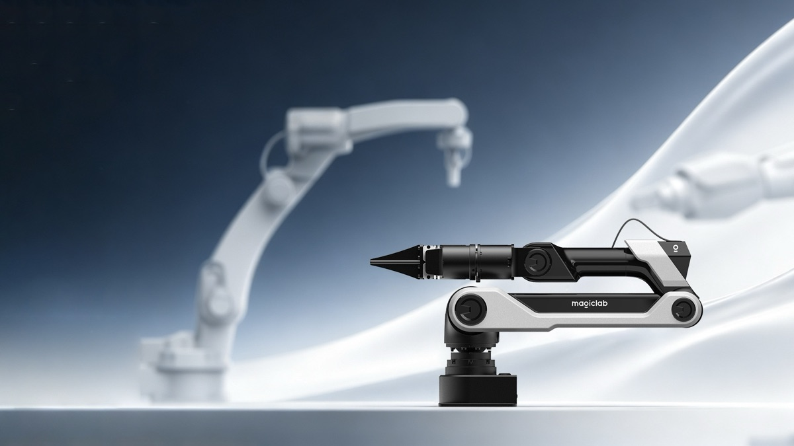

# Magiclab Robotics × T03 — Products and Solutions

⬆ [Magiclab Robotics profile](../Magiclab.md) · [Brief](Magiclab-T03-1-Brief.md) · [Playbook](Magiclab-T03-3-Playbook.md)

**Bottom line:** Magiclab has **no product, application page or deployment aimed at sustainability**. Its value for T03 is mobility (a programmable quadruped that can carry your sensors on a repeatable route) and, to a lesser degree, manipulation for sorting. Which units are on site is **not confirmed** — check at the booth first. All spec values below are vendor figures; the vendor states that speed, payload, slope and endurance are lab measurements.

## Relevant products (ranked for this track)

### MagicDog (PRO / EDU)

**Role in T03:** mobile sensor carrier for indoor energy / air-quality audits, litter or waste-point scouting, green-space or snow-condition rounds on easy ground. Most likely hackable unit on site (best guess).

| Spec | Value |
|---|---|
| Weight | **15.8 kg** (excl. battery) |
| Payload | ~**5 kg** typical, ~10 kg max |
| Speed / slope / obstacle | **3.0 m/s** · **40°** · 15 cm |
| Runtime | **1.5–3 h** (29.6 V, 8200 mAh; charging dock included) |
| Sensors | 2D LiDAR, depth camera, 4K camera, fisheye, dual camera, ultrasonic, mic array |
| Compute | 8-core CPU (no AI accelerator listed) |
| IP rating / temperature range | **not public** (not listed on the product page) |
| Expansion ports | not listed on the product page ⚠️ unverified — ask |

- **Status:** ✅ shipping · **Price:** not public · **Availability on site:** not confirmed.
- **Developer interface:** **EDU only** (PRO has no SDK). `magicdog_sdk` (C++ with Python bindings): high-level gaits / postures / velocity, low-level per-joint control, sensor streams, state, audio. `magicdog_ros2_sdk`: sensors as topics (`/scan`, depth and colour images, fisheye, stereo, `/odom_chassis`, battery, ToF, ultrasonic), services for TTS, device start / stop, **Cartographer SLAM** (mapping, save map, localisation) and **navigation** (obstacle avoidance, tracking; input as velocity, global goal pose or local goal pose — one type at a time).

### MagicDog-W

**Role in T03:** same sensor-carrier role with more payload, longer runtime and 4G for remote data upload; efficient on flat village streets and corridors.

| Spec | Value |
|---|---|
| Weight | **22.5 kg** incl. battery |
| Payload | up to **10 kg** |
| Speed / slope | 0–**3 m/s** · up to **40°** |
| Runtime | **2–4 h**; standby up to 8 h |
| Wheels | 7-inch pneumatic tyres |
| Compute | **6 TOPS** on board; optional compute accelerator module |
| Connectivity | WiFi 5, **4G**, Bluetooth 5.0 |
| Operating temperature | **−5 to 40 °C** |
| IP rating | not public |
| Expansion | docks for LiDAR / gimbal, backplate |

- **Status:** ✅ shipping · **Price:** not public · **On site:** possible, not confirmed.
- **Developer interface:** own SDK repo `magicdog-w_sdk` and URDF `magicdog-w_description` exist on GitHub. Whether the ROS 2 SLAM / navigation package covers the W is ⚠️ unverified.

### MagicDog-Y1

**Role in T03:** the only Magiclab robot built for outdoor, all-weather utility inspection — the right body for district-heating, thermal-water, snow and energy-site monitoring. Unlikely to be a hackable unit at the event.

| Spec | Value |
|---|---|
| Weight | **70 kg** with battery |
| Payload | **45 kg** dynamic |
| Protection / temperature | **IP67** · **−20 to 55 °C** |
| Runtime | **4–6 h** (>4 h walking with 20 kg; 54 V, 2400 Wh) |
| Mobility | up to 6 m/s · step ≥60 cm · slope ≥45° |
| Sensors | 3D LiDAR, 2 depth cameras, 2 optical cameras |
| Supported add-ons | thermal imager, dual-light PTZ camera, **gas sensor**, acoustic imager, partial-discharge sensor |
| Ports | 24 V + RS-485 ×4, 12 V + Ethernet ×3, USB 3.0 ×4, EtherCAT ×1 |
| Compute | 8-core CPU + optional **157 TOPS** module |
| Connectivity | Wi-Fi 6, Bluetooth 5.2, optional 5G |

- **Status:** ✅ shipping · **Price:** not public.
- **Developer interface:** `magicdog-y1_sdk` on GitHub; the user ports above make sensor integration straightforward. Auto-charging is not mentioned on the product page.

### MagicArm R1

**Role in T03:** sorting, disassembly or pick tasks (recyclables, small e-waste) on a bench or mounted on a quadruped. Presence on site not confirmed.

| Spec | Value |
|---|---|
| DoF | **6** |
| Payload / reach | **4 kg** · **700 mm** |
| Weight | **5.5 kg** |
| Repeatability | ±0.1 mm |
| Force control | torque sensing in every joint; drag teaching |
| End effectors | gripper, dexterous hand, suction cup |
| Mounting | upright, side, inverted; quadruped mounting mentioned |

- **Status:** listed on the official site with a purchase link; shipping status ⚠️ unverified · **Price:** not public.
- **Developer interface:** page mentions an open SDK, URDF, teleoperation and data collection, but **no R1-specific SDK repo was found** ⚠️ unverified.

### MagicBot Z1 (base / Development Version)

**Role in T03:** light sorting or "sustainability ambassador" interaction demo. Weak on throughput; strong on stage presence.

| Spec | Base | Development Version |
|---|---|---|
| Height / weight | 1.37 m · ~40 kg | same |
| DoF | 24 | **24–50** |
| Arm payload | 2 kg | **3 kg** |
| Hands | none listed | optional 11-DoF tactile hand |
| Runtime | ~**2 h** | ~2 h |
| Sensors | 3D LiDAR, depth camera, stereo fisheye, mic array | same |
| Compute | 8-core CPU | + optional high-compute module |
| Secondary development | **no** | **yes** |

- **Status:** ✅ shipping · **Price:** not public.
- **Developer interface:** `magicbot-z1_sdk` (most active repo, pushed 29 Oct 2026), `magicbot-z1_description` (URDF), `Magiclab_GMR` (motion retargeting), `pico_teleoperate` (XR teleop). Vendor's stated use cases are research, exhibitions and performances — not industrial work.

### MagicHand S01

**Role in T03:** gripping mixed, irregular items (bottles, cans, cartons) where a parallel gripper struggles.

| Spec | Value |
|---|---|
| DoF | **11** per hand |
| Grip force | 2.5 kg single finger · **9.1 kg** four fingers |
| Tactile | **5 sensors**, 0.1 N resolution |
| Open / close | 1.2 s |
| Supply | 12 V, max 3 A |

- **Status:** ✅ · **Price:** not public. Communication interface and stand-alone SDK are not listed on the page ⚠️ unverified.

### MagicBot D1

**Role in T03:** the body Magiclab itself uses for sorting and material handling — conceptually the best match for waste or parcel sorting, but 🧪 (launched Jul 2026), **specs not public**, no SDK repo found, and unlikely to be on a hackathon table.

## What Magiclab Robotics already does in this domain

**Nothing sustainability-specific was found** — no waste, recycling, energy-efficiency, EV-charging, farming or environmental-monitoring product, pilot or customer case. Adjacent activity only:

| Date | What | Relevance to T03 | Evidence level |
|---|---|---|---|
| 2026-07 | MagicBot D1 reported doing material handling and line loading at a Dreame factory in China | Handling skill, not sustainability | Company-sourced ([profile](../Magiclab.md)) |
| 2026-09 (IFA Berlin) | MagicBot D1 working with HyperBot sorting robots under a shared scheduler: parcel feeding, sorting, transfer | Sorting workflow that could be re-targeted to recyclables | Trade-show demo ([EqualOcean](https://equalocean.com/news/2026090822169-magiclab-targets-european-logistics-robotics-showcase-slovenia-postal)) |
| 2026-09 | Partnership with Pošta Slovenije on a flexible sorting system for postal centres | Resource-efficient logistics, loosely | Announced; value and go-live not public |
| 2026-09 | Company states MagicDog-Y1 has inspected European energy facilities | Closest link to energy infrastructure | Company claim; **no sites, countries or facility types named** |

## What they are building next in this domain

- **Announced direction** is factories, parcel logistics, inspection and hospital logistics in Europe, with European certification targeted for **Q4 2026**. Sustainability is not a stated theme.
- **Inference:** the Y1 add-on list (thermal imager, gas sensor, acoustic imager, partial-discharge sensor) and the new modular MagicDog T1 🧪 point to utility and energy-site inspection as the nearest future overlap with T03 (leak, heat-loss and fault detection).
- **Inference:** the "one model stack across several bodies" strategy (Magic-VLA K02, Magic-Mix, MagicW0) could later cover sorting of recyclables, but nothing of the kind is announced.

## Software, models and data that help for this track

| Asset | What it gives you | Caveat |
|---|---|---|
| `magicdog_ros2_sdk` (BSD-3) | Sensor topics, Cartographer SLAM, goal-pose navigation, joystick and nav example nodes | ROS 2 **Foxy** (Ubuntu 20.04) or Iron; needs the motion SDK installed first, CycloneDDS, `ROS_DOMAIN_ID=25`, and a **data cable from PC to the control board**; last pushed May 2025; supported editions not stated |
| `magicdog_sdk` (BSD-3) | C++ / Python high- and low-level control, sensors, audio | EDU edition only; multicast must be enabled on the network interface |
| `magicdog_description`, `magicdog-w_description`, `magicbot-z1_description` | URDFs for simulation and for designing a sensor mount | — |
| `magiclab_mujoco`, `magiclab_rl_lab`, `magiclab_deploy` | Simulation, RL training and policy deployment | Not needed for a sensing demo; too slow for 48 h unless you already know the stack |
| `pico_teleoperate` | PICO XR teleoperation and data collection | Needs a PICO headset |
| `magicbot-gen1_pi0_demo` (Apache-2.0) | pi0 fine-tuning pipeline: HDF5 teleop data → LeRobot v2.0 → LoRA or full fine-tune → policy server | Built for **Gen1**, not Z1; needs an NVIDIA GPU |
| `Magic-W0` (MIT) | Open robot foundation model (world prediction + action); pretrained and RoboDojo-fine-tuned checkpoints on Hugging Face; README reports 94.6% on five real-robot tasks (company figure) | Supported real robots not listed; Linux + NVIDIA GPU; fine-tuning in 48 h is a stretch |
| Magic-VLA K02, Magic-Mix | — | 🧪 No public weights found |

No sustainability dataset (waste classes, thermal imagery, air quality) is offered — bring your own model (e.g. an open waste-detection or thermal-anomaly model) and run it on a laptop or a low-power edge board.

## Gaps and limits for this track

- **No domain content:** no environmental sensors, no waste / energy application, no reference customer in sustainability.
- **Access depends on edition:** MagicDog PRO and base Z1 cannot be programmed. Confirm EDU / Development Version before committing.
- **Weather:** MagicDog and MagicDog-W publish **no IP rating**; MagicDog-W is rated only to −5 °C. Leukerbad in mid-November is snowy — plan an **indoor** demo unless a Y1 is available.
- **Payload interfaces:** power and data ports for add-on sensors are not documented on the MagicDog page; assume a self-powered sensor pack.
- **Compute:** no AI accelerator on MagicDog; vision models run off-board or on an added edge board.
- **Manipulation:** Z1 arm payload 2–3 kg, ~2 h runtime, and no Z1-specific VLA pipeline; MagicArm R1 SDK and on-site presence unconfirmed.
- **Robot energy use** itself is undocumented (no Wh/km figures) — hard to argue a net-emissions benefit with numbers.
- **Research note:** the shared web-search quota for this run was exhausted, so this doc relies on official product pages, GitHub repos and one trade-press article fetched directly. A wider press search for sustainability pilots could not be run; "nothing found" means nothing on those sources.

## Sources

- [Magiclab Robotics company profile (this vault)](../Magiclab.md)
- [MagicDog product page](https://www.magiclab.top/en/dog)
- [MagicDog-W product page](https://www.magiclab.top/en/dog-w)
- [MagicDog-Y1 product page](https://www.magiclab.top/en/dog-y)
- [MagicBot Z1 product page](https://www.magiclab.top/en/z1)
- [MagicArm R1 product page](https://www.magiclab.top/en/magicarm-r1)
- [MagicHand S01 product page](https://www.magiclab.top/en/parts/hand)
- [GitHub — MagiclabRobotics organisation](https://github.com/MagiclabRobotics)
- [GitHub — magicdog_ros2_sdk](https://github.com/MagiclabRobotics/magicdog_ros2_sdk)
- [GitHub — Magic-W0](https://github.com/MagiclabRobotics/Magic-W0)
- [GitHub — magicbot-gen1_pi0_demo](https://github.com/MagiclabRobotics/magicbot-gen1_pi0_demo)
- [EqualOcean — MagicLab targets European logistics, Slovenia postal partnership (Sep 2026)](https://equalocean.com/news/2026090822169-magiclab-targets-european-logistics-robotics-showcase-slovenia-postal)
