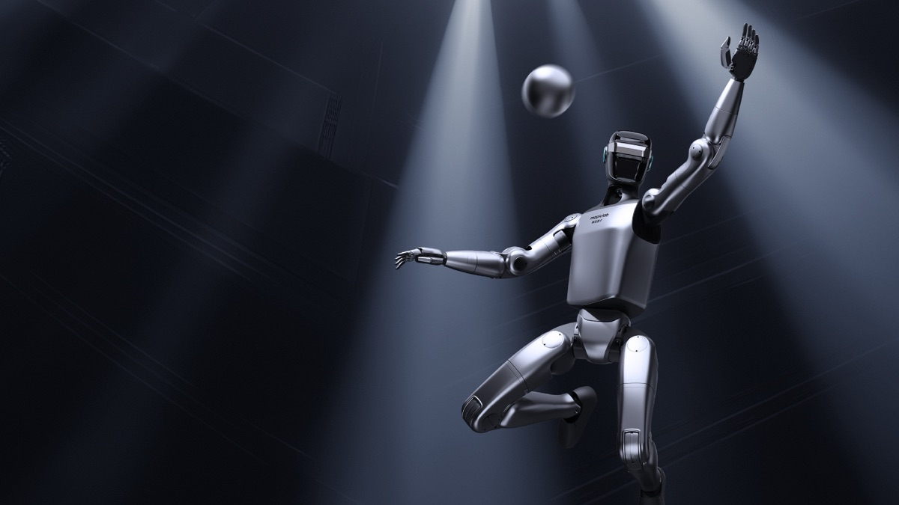
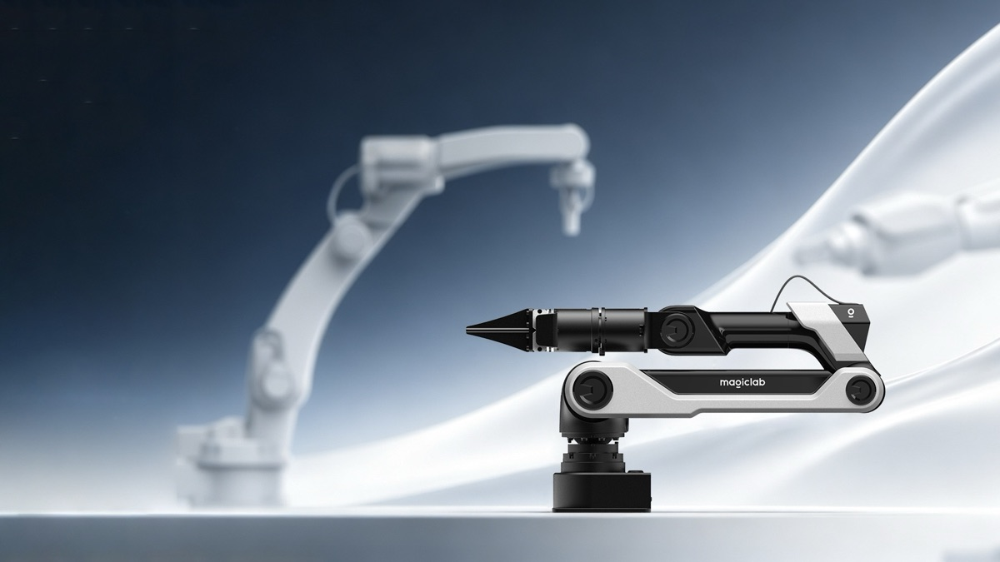
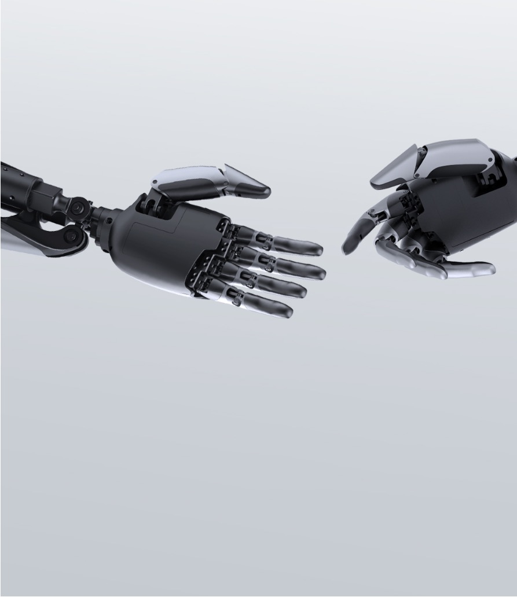

# Magiclab Robotics × T04 — Products and Solutions

⬆ [Magiclab Robotics profile](../Magiclab.md) · [Brief](Magiclab-T04-1-Brief.md) · [Playbook](Magiclab-T04-3-Playbook.md)

**Read this first:** Magiclab has **no elderly-care or rehabilitation product and no care deployment** that could be found. Everything below is general-purpose hardware judged for how well it can be bent to T04 in 48 hours. Which units are on site is **not confirmed** — check editions at the booth (only **EDU** and **Development Version** units are programmable).

## Relevant products (ranked for this track)

### MagicDog (PRO / EDU)

**Role in T04:** walking-escort companion, medication / small-item runner, night-round and fall-check patrol. The lowest-risk Magiclab platform near people because it is light and low to the ground.

| Spec | Value |
|---|---|
| Weight | **15.8 kg** (excl. battery) |
| Payload | about **5 kg** (max about 10 kg) |
| Speed | up to **3.0 m/s** (run it far slower near people) |
| Terrain | **15 cm** obstacle, **40°** slope |
| Runtime | **1.5–3 h**, quick-release battery, charging dock |
| Sensors | 2D LiDAR, depth camera, stereo camera, 4K camera, fisheye, ultrasonic, mic array |
| Built-in behaviours | Smart Following, human recognition, obstacle avoidance, patrol mode, voice commands, LLM conversation (may need a paid subscription), touch and "emotion engine" |
| IP rating | not public |

- **Status / price:** ✅ shipping · price not public.
- **Developer access:** **EDU only** (PRO has identical hardware but no SDK). [`magicdog_sdk`](https://github.com/MagiclabRobotics/magicdog_sdk) (C++ and Python, last pushed 28 Sep 2026) has examples for high-level motion, low-level joints, audio, display, sensors, state monitoring, **SLAM and navigation**. A separate ROS 2 SDK exists but was last pushed May 2025.
- **Unknown:** whether the built-in follow mode can be started or read from the SDK ⚠️ unverified — ask on site.

### MagicBot Z1 (base / Development Version)

**Role in T04:** exercise-demonstrating rehab coach, talking companion, light fetch-and-hand-over at a safe distance. A humanoid makes the demo relatable, but it is the riskier body.

| Spec | Base Z1 | Development Version |
|---|---|---|
| Height / weight | **1.37 m** standing (0.73 m folded) / about **40 kg** | same, slightly heavier |
| DoF | **24** (arms 5 each, legs 6 each, waist 1, head 1) | **24–50** (optional 2-DoF wrists, optional 11-DoF tactile hands) |
| Arm payload | **2 kg** | **3 kg** (lab values) |
| Runtime | about **2 h** | about 2 h |
| Sensors | 3D LiDAR, depth camera, stereo fisheye, head touch sensor | same |
| Voice | mic array, 5 W speaker, VLM-based conversation | same |
| Compute | 8-core CPU | plus optional high-compute module |
| Programmable | **No** | **Yes** |

- **Status / price:** ✅ shipping · price not public. Official scenarios are research, exhibitions and entertainment — not care.
- **Developer access (Development Version):** [`magicbot-z1_sdk`](https://github.com/MagiclabRobotics/magicbot-z1_sdk) (BSD-3-Clause, C++20 and Python 3.10, pushed 29 Oct 2026). Example programs show what you can drive:
  - **Audio:** play TTS, set volume, start / stop dialog, wake-up status, raw and beam-formed microphone streams, dialog-intent callback.
  - **High-level motion:** gait selection, velocity (joystick-style) commands, preset "trick" actions, head movement.
  - **Low-level and hybrid motion:** per-joint control; a hybrid example exists (exact split between built-in balance and user-controlled joints ⚠️ unverified).
  - **Sensors:** LiDAR point cloud and IMU, head RGB-D colour and depth, stereo images.
  - **SLAM / navigation:** mapping mode, localisation, initial pose, set / pause / cancel navigation target, odometry stream.
- **Setup cost:** Ubuntu 22.04+, wired to the robot switch on the 192.168.54.x subnet, multicast enabled.

### MagicArm R1

**Role in T04:** the only Magiclab product with joint torque sensing — in principle a bench-top assistive arm (hand-over, drag-taught motions, guided range-of-motion exercise). Treat as a bonus: on-site presence is unknown and no public SDK repo was found.

| Spec | Value |
|---|---|
| DoF / reach | **6 DoF** / **700 mm** |
| Payload / own weight | **4 kg** / **5.5 kg** |
| Force control | torque sensing in every joint; drag teaching |
| Repeatability | ±0.1 mm |
| Mounting | upright, side, inverted; can be mounted on a quadruped |
| End effectors | grippers, dexterous hands, suction cups |

- **Status / price:** listed on the official site with a purchase link; shipping status ⚠️ unverified · price not public.
- **Developer access:** the product page promises an open SDK, URDF, teleoperation and data-collection tools; **no MagicArm repo is public** on the GitHub org as of today. Healthcare, massage or rehab are **not** mentioned as applications.

### MagicBot Gen1

**Role in T04:** stronger arms and real hands for fetch-and-carry or tele-operated care tasks — if a hackable unit is present, which is unlikely.

| Spec | Value (from the company profile) |
|---|---|
| Height / weight | **1.74 m** / about **70 kg** |
| DoF | **42**, incl. two 11-DoF hands |
| Arm payload | **7.5 kg** per arm |
| Runtime | **3–5 h** |
| Compute | 8-core CPU + **100 TOPS** AI module |

- **Status / price:** ✅ shipping · price not public.
- **Developer access:** `magicbot-gen1_sdk`; XR teleoperation with a PICO 4 Ultra and body trackers ([`pico_teleoperate`](https://github.com/MagiclabRobotics/pico_teleoperate)); a pi0 VLA training pipeline for dual-arm dexterous manipulation ([`magicbot-gen1_pi0_demo`](https://github.com/MagiclabRobotics/magicbot-gen1_pi0_demo)).
- **Caution:** 70 kg biped — never near patients without a gantry and a spotter.

### MagicHand S01

**Role in T04:** gentle grasping of cups, pill boxes and towels when fitted to a Z1 Development Version or Gen1.

| Spec | Value (from the company profile) |
|---|---|
| DoF | **11** (6 active + 5 passive) |
| Tactile | 5 sensors, 0.1 N resolution |
| Grip | four-finger grip 9.1 kg |

- **Status / price:** ✅ · price not public. Control path is through the host robot's SDK ⚠️ unverified.

### MagicDog-W

**Role in T04 (low priority):** wheel-legged alternative for indoor delivery rounds; rolling on wheels is likely smoother on flat corridors (inference). No extra care capability.

| Spec | Value (from the company profile) |
|---|---|
| Weight / payload | **22.5 kg** / up to **10 kg** |
| Runtime | **2–4 h** |
| Connectivity | WiFi 5 + 4G |

- **Status / price:** ✅ shipping · price not public. **Developer access:** own SDK (`magicdog-w_sdk`) and URDF.

### Magic Panda

**Role in T04: none.** It sounds like a companion robot, but the official page describes a **limited-edition collectible replica** of the Spring Festival Gala panda (110 × 65 × 46 cm standing) that replays stage movements. No interaction features, sensors, SDK or price are listed. Not a hackathon platform.

### MagicBot D1

**Role in T04 (unlikely on site as a hackable unit):** a wheeled mobile manipulator is, on paper, the best body for care logistics, but D1 is aimed at factories and sorting. 🧪 launched Jul 2026 · specs, price and SDK: not public.

### MagicDog T1

**Role in T04 (unlikely on site as a hackable unit):** the one product Magiclab itself links to hospital transport (prospective, see below). 🧪 launched Jul 2026 · specs, price and SDK: not public.

## What Magiclab Robotics already does in this domain

**Nothing confirmed in elderly care or rehabilitation.** No deployment, pilot, clinical partner or care-specific application page was found on the official site or in the sources used for the company profile. (A dedicated web search for this track could not be run today, so treat "nothing" as ⚠️ unverified rather than proven.)

Closest adjacent facts:

| Date | What | Relevance to T04 | Source |
|---|---|---|---|
| Sep 2026 (IFA Berlin) | Company describes **prospective** hospital use of MagicDog T1: carrying laboratory samples and emergency medicines. No hospital customer named. | Care logistics, not patient care | [EqualOcean](https://equalocean.com/news/2026090822169-magiclab-targets-european-logistics-robotics-showcase-slovenia-postal) |
| Ongoing | MagicDog marketed as "first intelligent companion" with emotion engine, voice, touch and person following. Target users are not specified; elderly users are not mentioned. | Companion features exist, consumer-oriented | [MagicDog page](https://www.magiclab.top/en/dog) |
| Ongoing | MagicBot Z1 positioned for research, exhibitions and entertainment. | No care positioning | [Z1 page](https://www.magiclab.top/en/z1) |

## What they are building next in this domain

- **Announced:** European certification work targeted for completion in **Q4 2026** (planned milestone, not confirmed) — a precondition for any European care or clinic use ([EqualOcean](https://equalocean.com/news/2026090822169-magiclab-targets-european-logistics-robotics-showcase-slovenia-postal)).
- **Announced direction:** one model stack (Magic-VLA K02, Magic-Mix world model) across several robot bodies, aimed at factories, logistics and public spaces (see the [company profile](../Magiclab.md)).
- **Inference:** hospital logistics with MagicDog T1 is the nearest stated ambition to T04; patient-facing elderly care is not on any public roadmap. A good T04 project would be showing Magiclab a use case, not extending one of theirs.

## Software, models and data that help for this track

| Asset | What it gives a T04 team | Notes |
|---|---|---|
| [`magicdog_sdk`](https://github.com/MagiclabRobotics/magicdog_sdk) | Python examples for navigation, SLAM, audio, display, sensors | EDU only; fastest path to a delivery or escort demo |
| [`magicbot-z1_sdk`](https://github.com/MagiclabRobotics/magicbot-z1_sdk) | Python examples for TTS / dialog, RGB-D, LiDAR, SLAM / navigation, gait and trick actions | Development Version only; most actively maintained repo |
| [`Magiclab_GMR`](https://github.com/MagiclabRobotics/Magiclab_GMR) | Retargets human motion-capture data onto the Z1 skeleton (exports robot trajectories) | Route to make Z1 demonstrate physio exercises; the downstream tracking policy ([`magicbot-mimic`](https://github.com/MagiclabRobotics/magicbot-mimic)) needs Isaac Lab training — too slow for 48 h unless pre-trained motions exist |
| [`pico_teleoperate`](https://github.com/MagiclabRobotics/pico_teleoperate) | Whole-body XR teleoperation of **Gen1** with a PICO 4 Ultra | Tele-care avatar idea; Gen1 only, needs PICO hardware (not an on-site vendor) |
| [`magicbot-gen1_pi0_demo`](https://github.com/MagiclabRobotics/magicbot-gen1_pi0_demo) | Data conversion and pi0 fine-tuning pipeline for Gen1 dual-arm tasks | Needs demonstrations and GPU time; risky inside 48 h |
| [`Magic-W0`](https://github.com/MagiclabRobotics/Magic-W0) | World–action foundation model with checkpoints released 30 Oct 2026 | Research code evaluated on a benchmark; no care data; not a 48-hour shortcut |
| URDF repos, `magiclab_mujoco` | Simulation models for Z1, Gen1, MagicDog | Useful to rehearse arm motions before running on hardware |

- **Care-specific datasets or models from Magiclab:** none public.
- **Magic-VLA K02 weights:** not public as far as found.
- Bring your own: pose estimation, fall detection, speech recognition and an LLM, running on a laptop next to the robot.

## Gaps and limits for this track

- **No care track record**: no clinical partner, no medical-device certification, no safety case for operating near frail people.
- **No safe physical human contact**: no humanoid or quadruped here is designed to support body weight, assist transfers or apply therapeutic force. MagicArm R1 has torque sensing but no documented contact-therapy use.
- **Low manipulation payload**: Z1 arms carry **2–3 kg**; the base Z1 has no hands at all.
- **Short runtime**: Z1 about 2 h, MagicDog 1.5–3 h — plan demos around battery swaps.
- **Edition lock**: base Z1 and MagicDog PRO are not programmable.
- **Fall risk of the robot itself**: a 40 kg biped falling is a hazard in a care setting; keep distance and use a spotter.
- **Voice in German / French**: language coverage of the built-in dialog system is not public; LLM conversation on MagicDog may need a paid subscription. Plan your own speech pipeline.
- **Privacy**: cameras and microphones in care rooms raise data-protection questions; process on a local laptop and say so in the pitch.
- **Thin public docs for the newest products** (D1, T1, H01, MagicArm R1 SDK).

## Sources

Fetched for this document:
- [MagicBot Z1 product page](https://www.magiclab.top/en/z1)
- [MagicDog product page](https://www.magiclab.top/en/dog)
- [Magic Panda product page](https://www.magiclab.top/en/panda)
- [MagicArm R1 product page](https://www.magiclab.top/en/magicarm-r1)
- [GitHub — MagiclabRobotics organisation](https://github.com/MagiclabRobotics)
- [GitHub — magicbot-z1_sdk](https://github.com/MagiclabRobotics/magicbot-z1_sdk)
- [GitHub — magicdog_sdk](https://github.com/MagiclabRobotics/magicdog_sdk)
- [GitHub — Magiclab_GMR](https://github.com/MagiclabRobotics/Magiclab_GMR)
- [GitHub — magicbot-mimic](https://github.com/MagiclabRobotics/magicbot-mimic)
- [GitHub — pico_teleoperate](https://github.com/MagiclabRobotics/pico_teleoperate)
- [GitHub — magicbot-gen1_pi0_demo](https://github.com/MagiclabRobotics/magicbot-gen1_pi0_demo)
- [GitHub — Magic-W0](https://github.com/MagiclabRobotics/Magic-W0)
- [EqualOcean — MagicLab targets European logistics, Slovenia postal partnership](https://equalocean.com/news/2026090822169-magiclab-targets-european-logistics-robotics-showcase-slovenia-postal)

Taken from the company profile (not re-fetched): Gen1, MagicHand S01, MagicDog-W specs and roadmap items — see [Magiclab Robotics profile](../Magiclab.md), which cites the [Gen1 page](https://www.magiclab.top/en/human), [MagicHand S01 page](https://www.magiclab.top/en/parts/hand) and [MagicDog-W page](https://www.magiclab.top/en/dog-w).
