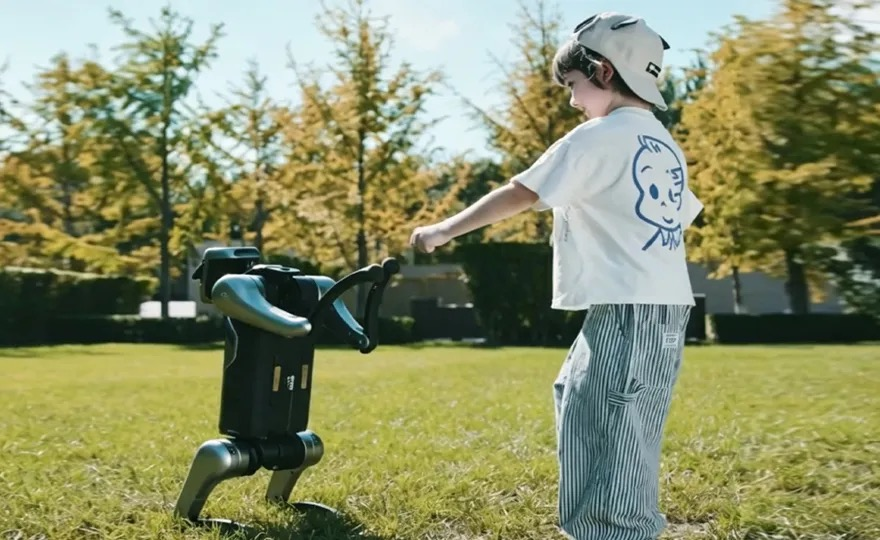
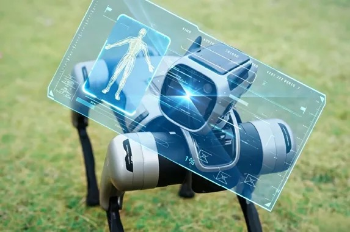
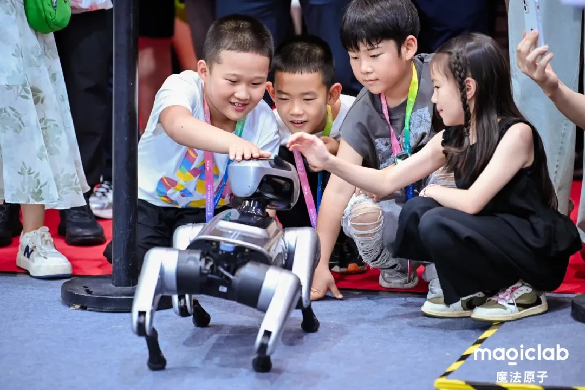
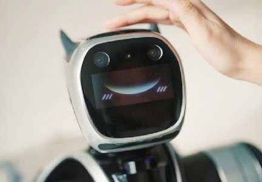
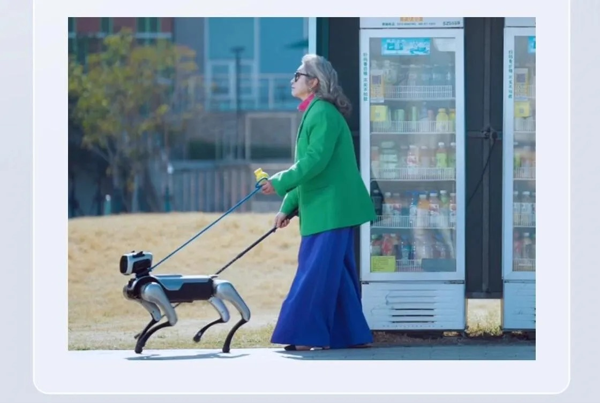
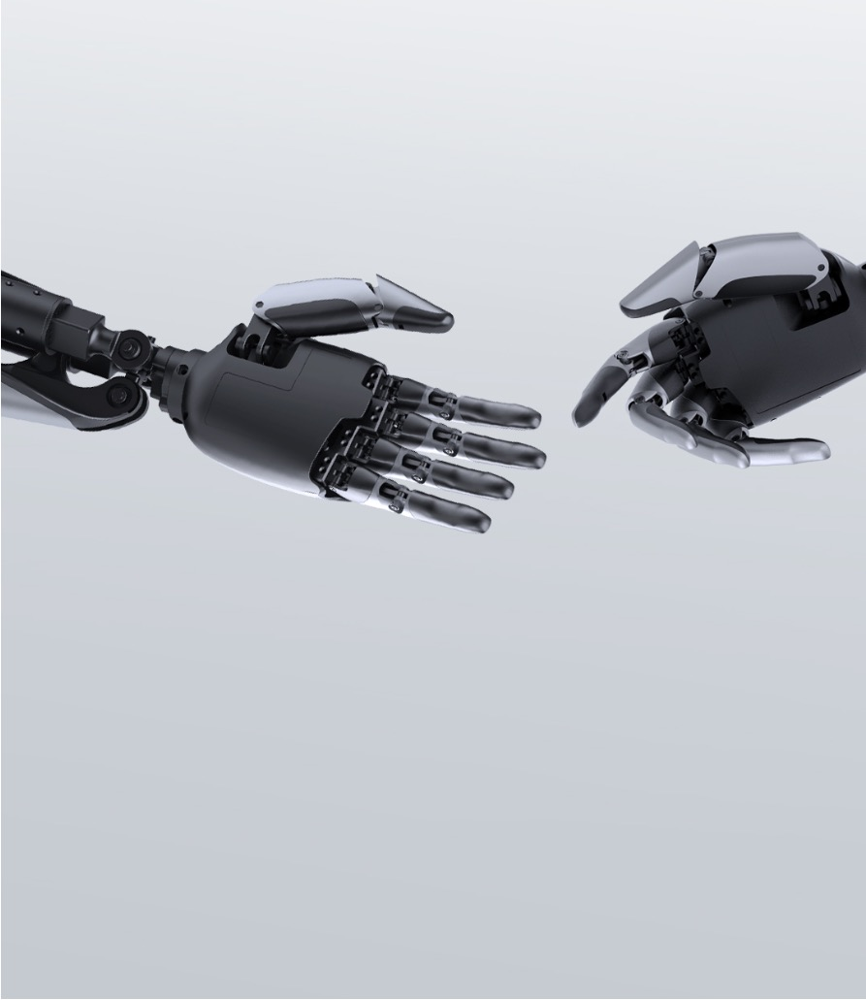
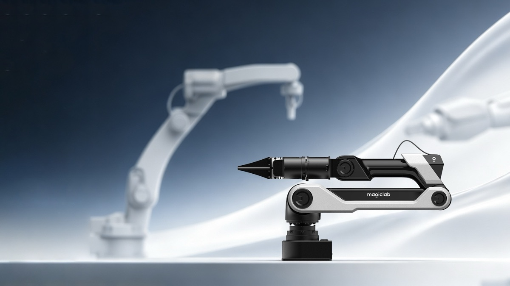

# Magiclab Robotics × T04 — Solutions Register, Projects and Papers

⬆ [Magiclab Robotics profile](../Magiclab.md) · [Brief](Magiclab-T04-1-Brief.md) · [Products and solutions](Magiclab-T04-2-Products-and-Solutions.md) · [Playbook](Magiclab-T04-3-Playbook.md) · [Track overview](../../../Challenges/T04-Elderly-Care-and-Rehabilitation/T04-0-Track-Overview.md)

> **Second-pass audit (2026-11-14):** this register lists **48 items** (23 solutions / capabilities, 9 projects, 9 plans, 7 papers). **38 of them were NOT in the three first-pass T04 docs**, which had concluded "nothing confirmed in elderly care". Most of those 38 were already in the company-level [Solutions and projects register](../Magiclab-Solutions-and-Projects.md); **3 entries are new to the whole knowledge base** (the June 2026 community-robot partnership that names elderly companionship, counted once each as solution, project and plan). **Web search was available:** 2 extended searches (1 English, 1 Chinese) plus about 45 direct page fetches (official global and China sites, Chinese press, arXiv).
> **Bottom line:** Magiclab (魔法原子, "Magic Atom") now markets a **non-clinical "Healthcare & Wellness" vertical** and reports an **RMB 150M home smart-health / companion-care order** (Apr 2026). There is still **no named care-home, hospital or rehab-clinic deployment**, no rehabilitation or mobility-support device, and no health-monitoring product. Nearly all evidence is company-reported.

## Coverage of the official directions

| Direction | What Magiclab Robotics has for it | Evidence | Maturity | Strength |
|---|---|---|---|---|
| T04.1 Daily living assistance for seniors | Household-service demos on MagicBot Gen1 (folding clothes, tidying items, watering plants, supervised drink preparation), reminders and small-item delivery; Gen1 pouring a drink for an elderly guest and Z1 bringing food on national TV; garment-folding / storage skills in the Magic-VLA K02 and Magic-W0 models. Demos only, no home-assistance product. | [Household-services page](https://www.magiclabglobal.com/magiclab-embodied-ai-robotics-for-retail-pharmaceuticals/) · [Spring Festival Gala release](https://www.magiclabglobal.com/news/spring-festival-gala-extreme-validation-magiclab-showcases-a-new-height-of-chinese-intelligent-manufacturing.html) | 🧪 | ◐ |
| T04.2 Smart care robots | No dedicated care robot. A **non-clinical Healthcare & Wellness solution** built from general robots (Gen1, Z1, MagicDog); an **RMB 150M** order for "in-home health management and intelligent companion care" (hardware not disclosed); a community-robot partnership that lists **elderly companionship** as a target service. | [RMB 150M deal release](https://www.magiclabglobal.com/news/magiclab-signs-rmb-150-million-deal.html) · [Community partnership (Sina Tech)](https://finance.sina.com.cn/tech/roll/2026-06-11/doc-iniaztwr0771882.shtml) | 🧪 | ◐ |
| T04.3 Rehabilitation training robots | Nothing dedicated: no rehab robot, exoskeleton, therapy arm or clinical partner. Only marketing mentions of "simple movement / stretching demonstrations", plus open tools to make a Z1 replay a human motion (`Magiclab_GMR`, `magicbot-mimic`) that a team could turn into an exercise coach. | [Healthcare & Wellness page](https://www.magiclabglobal.com/magiclab-embodied-ai-robotics-for-home-healthcare/) (movement demos only) | — | ○ |
| T04.4 Mobility assistance & support | **"Guangyin 001" guide-robot project** for visually impaired people (quadruped on a harness: route guidance, obstacle and crossing warnings, shopping help, ride hailing); MagicDog **person following**. No weight-bearing walking aid, wheelchair, transfer or lifting device. | [Guide-robot case](https://www.magiclabglobal.com/independence-automated-magiclabs-quadruped-guide-robot-helps-visually-impaired-users-navigate-shop-and-hail-rides.html) · [Launch report, 26 Mar 2025](https://www.magiclab.top/news/49) | 🧪 | ◐ |
| T04.5 Human-robot interaction & companionship | **MagicDog** consumer companion (voice, vision and touch interaction, expressive face and motions, following, app); **MagicBot Z1** officially positioned for "home companionship" (head-touch response, voice dialogue); "wellness companion interaction" (conversation, music, movement demos, reminders); JD.com JoyInside interaction work. Not elderly-specific. | [MagicDog companionship case](https://www.magiclabglobal.com/magicdog-brings-companionship-home-consumer-quadruped-debuts-voice-and-app-controlled-family-interaction.html) · [MagicDog product page](https://www.magiclabglobal.com/products/magicdog/) | ✅ | ● |
| T04.6 Automation in care scenarios | Reception, wayfinding and health education for health centres; **closed-route delivery** of sealed supplies and documents; lab bottle / container handling; planned **MagicDog T1 specimen and emergency-medication transport in European hospitals**; "unmanned pharmacy" store format. Capability statements and plans, no named site. | [Healthcare & Wellness page](https://www.magiclabglobal.com/magiclab-embodied-ai-robotics-for-home-healthcare/) · [IFA 2026 release](https://www.magiclabglobal.com/magiclab-brings-physical-ai-to-europes-factory-floors-at-ifa-2026-debuting-full-stack-embodied-intelligence-stack.html) | 🧪 | ◐ |
| T04.7 Smart health monitoring & assistance | Nothing as a product: no vital-sign, fall-detection or medication-adherence function is published. The RMB 150M order mentions "in-home health management" but its content is undisclosed. MagicDog's app-configured indoor patrol could carry a team's own check-in logic (inference). | [RMB 150M deal release](https://www.magiclabglobal.com/news/magiclab-signs-rmb-150-million-deal.html) (wording only) | — | ○ |

## All solutions relevant to T04

"Inference" in the second column means the company does not market the item for care; it is listed because a T04 team can use it.

| Solution / capability | What it does for this track | Direction(s) served | Products used | Maturity | Source link |
|---|---|---|---|---|---|
| 1. Healthcare & Wellness solution (umbrella, **non-clinical**) | One of the company's nine verticals: reception, wayfinding, health education, closed-route supply delivery, lab handling, wellness interaction, research validation. Diagnosis, treatment and clinical decisions are explicitly left to professionals. | T04.2 T04.5 T04.6 | Gen1, Z1, MagicDog, hands | 🧪 solution page; cases are capability statements | [Healthcare & Wellness](https://www.magiclabglobal.com/magiclab-embodied-ai-robotics-for-home-healthcare/) |
| 2. Reception and wayfinding for health centres | Guided-tour stack (autonomous navigation, voice explanation, visitor Q&A, route management) adapted to health centres and medical exhibition areas | T04.6 T04.5 | Gen1, Z1 | 🧪 (✅ in non-health venues) | [Reception and wayfinding case](https://www.magiclabglobal.com/intelligent-reception-and-wayfinding-solution.html) |
| 3. Health education and presentation | Scripted, interactive explanation of health knowledge, equipment or public-welfare content | T04.6 T04.5 | Gen1, Z1 | 🧪 | [Healthcare & Wellness](https://www.magiclabglobal.com/magiclab-embodied-ai-robotics-for-home-healthcare/) |
| 4. Closed-route supply and document delivery | Robot follows fixed, approved routes carrying sealed supplies, documents or daily-use items so an institution can test efficiency, hand-over and safety | T04.6 T04.1 | MagicDog / humanoids (not specified) | 🧪 "workflow validation", no site named | [Supply-delivery validation](https://www.magiclabglobal.com/controlled-supply-delivery-workflow-validation.html) |
| 5. Wellness companion interaction | Conversation, music, simple movement demonstrations, reminders and group activities for community or wellness settings | T04.5 T04.2 (T04.3 marginal) | MagicBot, MagicDog | 🧪 demo | [Wellness companion demo](https://www.magiclabglobal.com/wellness-companion-interaction-demonstration.html) |
| 6. Laboratory bottle / container handling | Repetitive pick, place and transfer of bottles in controlled lab or production settings | T04.6 (marginal) | Gen1 + hand | 🧪 demo | [Healthcare & Wellness](https://www.magiclabglobal.com/magiclab-embodied-ai-robotics-for-home-healthcare/) |
| 7. Home smart-health / companion-care package | Customised smart hardware + home health programme + experience showrooms for in-home health management and companion care; **RMB 150M** order, target **10,000 households** | T04.2 T04.7 T04.5 T04.1 | Not disclosed | 🧪 order signed Apr 2026; delivery status not public | [Deal release](https://www.magiclabglobal.com/news/magiclab-signs-rmb-150-million-deal.html) |
| 8. Community service robots incl. **elderly companionship** (new) | Humanoids and quadrupeds placed in residential communities for security patrol, facility inspection, elderly companionship (老年陪护), convenience delivery, family entertainment; channel and maintenance partners attached | T04.2 T04.5 T04.1 | "Full robot line" (humanoid + quadruped) | 🧪 agreement signed 10 Jun 2026; no site, number or date | [Sina Tech](https://finance.sina.com.cn/tech/roll/2026-06-11/doc-iniaztwr0771882.shtml) |
| 9. Family companionship | Voice commands, touch and vision interaction, expressive head / tail / face, 4K "dog view" camera, app control; Z1 reacts to a head touch | T04.5 | MagicDog, MagicBot Z1, Magic Panda | ✅ consumer product | [Companionship case](https://www.magiclabglobal.com/magicdog-brings-companionship-home-consumer-quadruped-debuts-voice-and-app-controlled-family-interaction.html) |
| 10. Person following | Target recognition + depth positioning to follow a user and avoid obstacles | T04.4 T04.5 | MagicDog | ✅ product feature (SDK access ⚠️ unverified) | [MagicDog product page](https://www.magiclabglobal.com/products/magicdog/) |
| 11. App-configured indoor patrol | User maps rooms and sets a route in the app; robot walks it and observes. Inference: base for night rounds or a check-in patrol | T04.7 T04.6 | MagicDog | ✅ product feature | [Indoor patrol case](https://www.magiclabglobal.com/app-configured-autonomous-indoor-patrol.html) |
| 12. Guide robot for visually impaired people ("Guangyin 001", 光引001) | Leads the user on a harness, warns by voice at obstacles and crossings, helps choose a drink at a vending machine, orders and pays in a shop, hails rides, converses | T04.4 T04.1 | MagicDog-class quadruped | 🧪 project video (Mar 2025); no product, no pilot users | [Guide-robot case](https://www.magiclabglobal.com/independence-automated-magiclabs-quadruped-guide-robot-helps-visually-impaired-users-navigate-shop-and-hail-rides.html) |
| 13. Household services | Folding clothes, moving and sorting daily objects, supervised beverage / kitchen handling, plant watering, reminders, smart-home interface; dance / stretching routines "to encourage participation" | T04.1 (T04.3 marginal) | MagicBot Gen1 + tactile hands | 🧪 controlled demos | [Household-services page](https://www.magiclabglobal.com/magiclab-embodied-ai-robotics-for-retail-pharmaceuticals/) |
| 14. Meal and drink service | Gen1 lifts, drains and serves noodles and **pours a drink for an elderly guest**; Z1 carries the dish to the table | T04.1 | Gen1, Z1 | 🧪 staged TV demo (Feb 2026) | [Gala release](https://www.magiclabglobal.com/news/spring-festival-gala-extreme-validation-magiclab-showcases-a-new-height-of-chinese-intelligent-manufacturing.html) |
| 15. Hospital specimen / emergency-medication transport | Quadruped carries lab samples and urgent medicines inside hospitals | T04.6 | MagicDog T1 | 🔭 planned for Europe | [IFA 2026 release](https://www.magiclabglobal.com/magiclab-brings-physical-ai-to-europes-factory-floors-at-ifa-2026-debuting-full-stack-embodied-intelligence-stack.html) |
| 16. Home-service solution with China Telecom | Joint development of a family service-robot solution; "exploring **in-home elderly care** and daily assistance" | T04.1 T04.2 | Not specified | 🔭 exploratory since 2024–2025; no later update found | [Canton Fair report](https://www.magiclab.top/news/42) |
| 17. Home companion robots with JD.com (JoyInside) | JD's JoyInside interaction layer on MagicDog (since 2025); co-developed next-generation consumer robots for home service and educational companionship | T04.5 | MagicDog, Z1, future models | 🧪 agreement / 🔭 products | [JD.com case](https://www.magiclabglobal.com/magiclab-jd-embodied-ai-commercialization-partnership.html) |
| 18. "Unmanned pharmacy" store format | One format in the robot-run store series (coffee, milk tea, ice cream, pharmacy, bookstore) | T04.6 (marginal) | Humanoids (not specified) | 🧪 announced Jan 2026; no opened pharmacy found ⚠️ unverified | [Partner conference](https://www.magiclab.top/news/57) |
| 19. Household manipulation models | Magic-VLA K02 (long-horizon folding, packing; not released) and **Magic-W0** (open code + weights; clothes folding, object and kitchen storage after fine-tuning) | T04.1 | Software; experiments on table-top arms, not on MagicBot | 🧪 K02 demos · ✅ Magic-W0 open | [Magic-W0 paper](https://arxiv.org/abs/2609.39870) |
| 20. Human-motion retargeting and tracking for Z1 | Inference: turn a recorded physiotherapy movement into a Z1 motion so the robot demonstrates the exercise | T04.3 | Z1 Development Version, `Magiclab_GMR`, `magicbot-mimic` | ✅ open source (needs training time) | [GMR paper](https://arxiv.org/abs/2510.02252) |
| 21. XR whole-body teleoperation | Inference: remote caregiver operates a humanoid ("tele-care avatar"). Published as a data-collection tool, not a care product | T04.2 T04.1 | Gen1, PICO 4 Ultra, `pico_teleoperate` | ✅ open source | [Papers and research](../Magiclab-Papers-and-Research.md) |
| 22. Open development platforms | The health page itself lists "research validation" on open robot platforms: SDKs with audio, RGB-D, LiDAR, SLAM and navigation examples | all (as build platform) | MagicDog EDU, Z1 Development Version | ✅ shipping | [Products and solutions](Magiclab-T04-2-Products-and-Solutions.md) |
| 23. Hands and arm | MagicHand S01 (tactile grasp of cups, pill boxes), MagicArm R1 (joint torque sensing, drag teaching), H01 hand (20 DoF; "caregiving collaboration" named as a target ⚠️ unverified, not found in the summit recap re-read today) | T04.1 T04.6 | Components | ✅ S01 · R1 status ⚠️ · 🧪 H01 | [Products and solutions](Magiclab-T04-2-Products-and-Solutions.md) |

### Healthcare & Wellness solution (non-clinical)

- **What the company claims:** staff relief on routine reception, directions, information, item transport and standard demonstrations; multi-modal interaction (voice, vision, gesture, touch, screen / app) for visitors, patients, residents and staff; indoor mapping and obstacle avoidance in corridors and care facilities.
- **What it explicitly excludes:** diagnosis, treatment and clinical decisions. Delivery is offered only "along approved routes after institutional safety and process validation".
- **Evidence level:** the three healthcare "cases" (rows 2, 4, 5) are one-sentence capability statements with no customer, site or date. Treat as a menu of what the robots can be configured to do, not as references.

### Home smart-health / companion-care package (RMB 150M order)

- **Facts:** procurement agreement of **RMB 150M** (about USD 21M), announced **21 Apr 2026**; company calls it the largest single robot order in China's "big health" sector and its first step into medical / health robotics.
- **Scope:** customised smart hardware, a home health programme and experience showrooms for **in-home health management and intelligent companion care**; plan to connect **10,000 high-net-worth households** and feed usage data back into products. The release ties the sector to China's ageing-population policy.
- **Not disclosed:** customer, robot models, health functions, delivery schedule. No follow-up news found by 14 Nov 2026 ⚠️.

### Community service robots with elderly companionship (new in this pass)

- **Signed 10 Jun 2026 in Suzhou** ("national strategic cooperation" for community robots). Roles: **Magiclab** supplies embodied-AI technology and its full robot line; **Anxing Energy (安行能源)** brings its nationwide community channel and outlet network (smart safe-charging stations) and does sales; **Jingchi Intelligent (憬驰智能)** handles supply, maintenance, spare parts and technical support.
- **Target services named:** community security patrol, public-facility inspection, **elderly companionship**, convenience delivery, parent-child entertainment.
- **Evidence level:** company-supplied press text in Chinese media; no community, unit count, robot model or start date given. Elderly companionship is a stated intention, not a running service.

### Family companionship and person following (MagicDog, Z1)

- **MagicDog:** 13 DoF, 30+ preset motions, voice / vision / touch interaction with responsive expressions, user following by target recognition and depth positioning, 4K camera, app, graphical programming; about **5 kg** payload; PRO and EDU editions (only **EDU** has the SDK).
- **MagicBot Z1:** official positioning includes "home companionship"; a light touch on the head triggers a head-turn response; voice dialogue through the SDK on the Development Version.
- **Limits for T04:** marketed to families and children, not to older users; no dementia, loneliness or care-home study; dialogue language coverage not public.

### Guide robot for visually impaired people ("Guangyin 001")

- Revealed as a surprise project at the launch event on **26 Mar 2025**: outdoor guidance on pavement and grass, voice warnings at obstacles and crossings, drink selection at a vending machine, ordering and QR payment at a nearby shop, ride hailing.
- **Status:** video and case page only — no product, price, pilot users or partner organisation published; no update found since.
- **Hackathon angle:** the closest company precedent for a walking-escort demo with MagicDog EDU (see "Walk Buddy" in the [Playbook](Magiclab-T04-3-Playbook.md)).

### Household services and meal service (MagicBot Gen1)

- Demonstrated: folding clothes, grilling-related handling, watering plants, latte art, and on the 2026 Spring Festival Gala a noodle-serving scene in which Gen1 pours a drink for an elderly guest while Z1 delivers the dish.
- The household page limits itself to "controlled demonstrations" and "supervised" tasks; no in-home trial with older adults is reported.
- Gen1 is a 70 kg-class biped — not something to run within reach of frail people at a hackathon.

### Hospital specimen and medication transport (MagicDog T1, planned)

- Stated at IFA Berlin (Sep 2026): the company "plans to deploy" T1 in **European hospital settings** for specimen and emergency-medication transport. Trade press describes this as prospective; no hospital is named.
- Depends on European certification (CE-RED work targeted for **Q4 2026**).

## Projects, deployments and pilots in this domain

**Read first:** there is **no named deployment in a care home, hospital, rehabilitation clinic or with older users**. The rows below are a commercial order with undisclosed content, partnership signings, staged demos and capability pages.

| Date | Project | Partner / customer | Location | What happened | Direction(s) | Source link |
|---|---|---|---|---|---|---|
| 2026-06-10 | Community-robot national strategic cooperation (new) | Anxing Energy (安行能源), Jingchi Intelligent (憬驰智能) | Suzhou, China (signing) | Three-party agreement to place service robots in residential communities; elderly companionship listed among target services; no sites or volumes | T04.2 T04.5 T04.1 | [Sina Tech](https://finance.sina.com.cn/tech/roll/2026-06-11/doc-iniaztwr0771882.shtml) · [NetEase](https://www.163.com/dy/article/KVNVMB430550B6IS.html) |
| 2026-04-21 | Home smart-health / companion-care order | Not disclosed | China | **RMB 150M** procurement agreement: customised hardware, home health programme, showrooms; 10,000-household target | T04.2 T04.7 T04.5 | [Chinese release](https://www.magiclab.top/news/63) · [English release](https://www.magiclabglobal.com/news/magiclab-signs-rmb-150-million-deal.html) |
| 2026 (n.d.) | Strategic cooperation agreement | JD.com | China | Joint R&D and co-created consumer robots for home service and educational companionship; JoyInside interaction on MagicDog since 2025; **RMB 1B** sales target | T04.5 | [JD.com case](https://www.magiclabglobal.com/magiclab-jd-embodied-ai-commercialization-partnership.html) |
| 2026-02-16 | CCTV Spring Festival Gala service scene | China Media Group | Yibin, Sichuan (sub-venue) | Gen1 serves noodles and pours a drink for an elderly guest; Z1 delivers the dish — staged life-service demo | T04.1 | [Chinese release](https://www.magiclab.top/news/62) · [English release](https://www.magiclabglobal.com/news/spring-festival-gala-extreme-validation-magiclab-showcases-a-new-height-of-chinese-intelligent-manufacturing.html) |
| 2025-08 ⚠️ year inferred | Consumer companionship showcase | — | World Robot Conference, Beijing | MagicDog shown as household companion with voice and app control; Z1 head-touch interaction | T04.5 | [Companionship case](https://www.magiclabglobal.com/magicdog-brings-companionship-home-consumer-quadruped-debuts-voice-and-app-controlled-family-interaction.html) |
| 2025-04-15/19 | Canton Fair statement | China Telecom | Guangzhou | Company says it is developing a home-service solution with China Telecom and exploring in-home elderly care and daily assistance | T04.1 T04.2 | [Canton Fair report](https://www.magiclab.top/news/42) |
| 2025-03-26 | "Guangyin 001" guide-robot project revealed | — | China (launch event video) | Quadruped guides a visually impaired user outdoors, helps shop, pay and hail rides | T04.4 T04.1 | [Launch report](https://www.magiclab.top/news/49) |
| 2024-12-04 | "Beautiful Home robot ecosystem" signing | China Telecom (Tianyi Digital Life) | China | Magiclab joins the operator's family-service-robot partner programme | T04.1 T04.2 | [Signing report](https://www.magiclab.top/news/33) |
| n.d. | Healthcare capability "cases" on the global site | None named | — | Three one-line pages: wellness companion interaction, controlled supply-delivery workflow validation, reception and wayfinding for health centres | T04.5 T04.6 | [Wellness](https://www.magiclabglobal.com/wellness-companion-interaction-demonstration.html) · [Supply delivery](https://www.magiclabglobal.com/controlled-supply-delivery-workflow-validation.html) · [Reception](https://www.magiclabglobal.com/intelligent-reception-and-wayfinding-solution.html) |

## Future projects and announced plans in this domain

| Announced | Planned for | What | Confidence (official / reported / inferred) | Source link |
|---|---|---|---|---|
| 2026-09 | not stated | Deploy **MagicDog T1 in European hospitals** for specimen and emergency-medication transport | official (plan only; no hospital named) | [IFA 2026 release](https://www.magiclabglobal.com/magiclab-brings-physical-ai-to-europes-factory-floors-at-ifa-2026-debuting-full-stack-embodied-intelligence-stack.html) |
| 2026-09 | Q4 2026 | European certification work (CE-RED via TÜV partners) — precondition for any clinic or care use in Europe | official (milestone not confirmed as reached) | [EqualOcean](https://equalocean.com/news/2026090822169-magiclab-targets-european-logistics-robotics-showcase-slovenia-postal) |
| 2026-09 | ongoing | Selected consumer robots sold cross-border through AliExpress Brand+ (route for companion robots into European homes) | reported | [EqualOcean](https://equalocean.com/news/2026090822169-magiclab-targets-european-logistics-robotics-showcase-slovenia-postal) |
| 2026-06-10 | not stated | Roll community robots out through Anxing Energy's community network, incl. **elderly companionship** and convenience delivery; replicate the three-party model nationally | reported (company-supplied press text) | [Sina Tech](https://finance.sina.com.cn/tech/roll/2026-06-11/doc-iniaztwr0771882.shtml) |
| 2026-04-21 | not stated | Reach **10,000 households** with the home smart-health service; push humanoids into health, logistics services, public safety and home life | official | [Chinese release](https://www.magiclab.top/news/63) |
| 2026 | cooperation period | With JD.com: next-generation consumer robots for home service and educational companionship; robots as "household intelligent companions" | official | [JD.com case](https://www.magiclabglobal.com/magiclab-jd-embodied-ai-commercialization-partnership.html) |
| 2026-04-29 | not stated | H01 dexterous hand (20 DoF, dense tactile sensing) — caregiving collaboration named as a target use | reported ⚠️ unverified (taken from the company profile; not in the summit recap re-read today) | [Magiclab Robotics profile](../Magiclab.md) |
| 2026-01-23 | 1–2 years | Robot-run store series including an **unmanned pharmacy** format; 10,000-store ambition | official | [Partner conference](https://www.magiclab.top/news/57) |
| 2025-04 | not stated | Home-service solution with China Telecom, exploring **in-home elderly care** and daily assistance | official (exploratory; no later update found) | [Canton Fair report](https://www.magiclab.top/news/42) |

No plan was found for rehabilitation robots, exoskeletons, walking aids, patient transfer or health-monitoring devices.

## Research papers relevant to T04

No paper by Magiclab or by a third party on elderly care, rehabilitation, fall detection or care-setting safety with Magiclab hardware was found (an arXiv full-text query for "MagicBot", "MagicDog" and "Magiclab Robotics" returned no third-party result). The papers below are relevant by **task type** (household manipulation, smooth motion, exercise demonstration). All seven were opened on arXiv today. Company experiments run on table-top dual-arm rigs, not on MagicBot or MagicDog.

| Paper (title as a link) | Authors / organisation | Venue, year | Why it matters here | Code / data |
|---|---|---|---|---|
| [Toward Real-Time VLAs: Stage-Aware Two-Step Flow Denoising and System-Level Evaluation](https://arxiv.org/abs/2609.39822) | Di Wu, Rongtian Shen, Ping Liu, Yan Shen, Zhenhan Yin, Shun Zuo, Xuhua Chen, He Zheng, Lingfeng Zhang, Jianglin Zhang, Tao Zhang — Magiclab Robotics and university co-affiliations | arXiv preprint, Sep 2026 | T04.1: long-horizon **garment folding** with per-method success rates; shows which execution strategy gives smooth motion — relevant for anything moving near people | [Code (Apache-2.0)](https://github.com/MagiclabRobotics/Inference) |
| [Execution-Aligned Progressive Noise for Consistent Asynchronous Replanning in Generative Robot Policies](https://arxiv.org/abs/2610.06090) | Di Wu, Ping Liu, Xuhua Chen, He Zheng, Lingfeng Zhang, Tao Zhang — Magiclab Robotics | arXiv preprint, Oct 2026 | T04.1: explains why learned policies jerk or switch plan mid-task and one fix; tested on object storage and bimanual cloth folding | No code link found |
| [Magic-W0: A Structured World-Action Foundation Model for Physical Intelligence](https://arxiv.org/abs/2609.39870) | Xuhua Chen, Zhenhan Yin, Yuan Zhang, Lingfeng Zhang, He Zheng, … Tao Zhang (18 authors) — Magic-Lab Team, Magiclab Robotics | arXiv preprint, Sep 2026 | T04.1: open foundation model fine-tuned for household tasks (clothes folding, object and kitchen storage); a starting point if a team collects its own demonstrations | [Code (MIT)](https://github.com/MagiclabRobotics/Magic-W0) · [Weights](https://huggingface.co/XuhuaX/Magic-W0) |
| [Dual-Stream Memory for Vision-Language-Action Policies](https://arxiv.org/abs/2610.13262) | Yang Wang, Ping Liu, Ruiyu Wang, Xuhua Chen, Lingfeng Zhang, Tao Zhang — Magiclab Robotics; UCLA | arXiv preprint, Oct 2026 | T04.1 / T04.7: tasks that need "have I already done this?" — counting repetitions, remembering whether a medication step was completed | [Project page](https://embodied.magiclab.top/works/memory/index.html); no code |
| [Retargeting Matters: General Motion Retargeting for Humanoid Motion Tracking](https://arxiv.org/abs/2510.02252) | Joao Pedro Araujo, Yanjie Ze, Pei Xu, Jiajun Wu, C. Karen Liu — Stanford (third party; ported to Z1 by Magiclab) | arXiv preprint, Oct 2025 | T04.3: route to make a Z1 **demonstrate a physiotherapy movement** recorded from a human | [Magiclab_GMR (MIT)](https://github.com/MagiclabRobotics/Magiclab_GMR) |
| [BeyondMimic: From Motion Tracking to Versatile Humanoid Control via Guided Diffusion](https://arxiv.org/abs/2508.08241) | Qiayuan Liao, Takara E. Truong, Xiaoyu Huang, Yuman Gao, Guy Tevet, Koushil Sreenath, C. Karen Liu — UC Berkeley / Stanford (third party; ported to Z1 by Magiclab) | arXiv preprint, Aug 2025 | T04.3 / T04.5: tracking policy that lets Z1 execute retargeted gestures and exercise motions; needs simulation training | [magicbot-mimic (MIT)](https://github.com/MagiclabRobotics/magicbot-mimic) |
| [TWIST: Teleoperated Whole-Body Imitation System](https://arxiv.org/abs/2505.02833) | Yanjie Ze, Zixuan Chen, João Pedro Araújo, Zi-ang Cao, Xue Bin Peng, Jiajun Wu, C. Karen Liu — Stanford / SFU (third party; cited by Magiclab's retargeting repo) | arXiv preprint, May 2025 | T04.2: background for a tele-operated care-avatar concept | [pico_teleoperate (BSD-3)](https://github.com/MagiclabRobotics/pico_teleoperate) (Magiclab's own Gen1 teleoperation kit) |

- Not listed: *Conditional Trajectory Peaks* (generic manipulation speed-up, no care link) — see [Papers and research](../Magiclab-Papers-and-Research.md).
- A company blog post mentions a 2026 UC Davis study of a humanoid companion robot in memory care, without a link and without saying a Magiclab robot was used — not opened, not counted.

## Media gallery

New pictures saved in this pass (official global-site CDN): `magiclab-t04-senior-companion.jpg` ← `/uploads/image/20260721/robot-hand-kit.jpg` · `magiclab-t04-home-health.jpg` ← `/uploads/image/20260827/home-health-robot.webp` · `magiclab-t04-touch-interaction.jpg` ← `/uploads/image/20260721/dexterous-hand.jpg` (all under `https://www.magiclabglobal.com`).

## What changed versus the first pass

- **Correction — "nothing in care" is wrong.** The first-pass T04 docs state that Magiclab has no care product and nothing in the domain. In fact the company lists healthcare as one of nine verticals, publishes a non-clinical Healthcare & Wellness solution page, and announced an **RMB 150M** home smart-health / companion-care order on 21 Apr 2026. The "What Magiclab already does in this domain" section of [Products and solutions](Magiclab-T04-2-Products-and-Solutions.md) should be read together with this register.
- **New to the whole knowledge base:** the **10 Jun 2026 community-robot partnership** with Anxing Energy and Jingchi Intelligent, which names elderly companionship as a target service.
- **New to the T04 docs (already in the company register):** guide-robot project "Guangyin 001"; China Telecom home-robot programme and in-home elderly-care exploration; JD.com home-companion cooperation; household-service and Gala meal-service demos; healthcare capability pages (reception, supply delivery, wellness interaction, health education); indoor patrol feature; unmanned-pharmacy format.
- **Correction — Z1 positioning:** the first pass says Z1 is positioned for research, exhibitions and entertainment only. The official global product page also lists **"home companionship"**.
- **Correction — T1 hospital transport:** the company's own IFA release words it as a plan to deploy in European hospitals (first pass: "prospective" from trade press only). Still no hospital named.
- **Papers:** the first-pass T04 docs listed none; 7 task-relevant papers are now mapped (4 company preprints, 3 upstream works ported to Z1 / Gen1). Still no care- or rehab-specific paper.
- **Still true:** no named care-facility deployment, no rehabilitation or mobility-support hardware, no health-monitoring product, no safe physical-contact capability, no medical-device certification; CE-RED pending.
- **Fit score: unchanged at 3/5.** The new evidence shows commercial intent and one large order, but adds no care-specific product, no verifiable deployment and nothing for three of the seven directions (T04.3, T04.7, weight-bearing T04.4). Only the wording of the Brief's "**Fit: 3/5**" verdict line was corrected (it said "no care product, no care deployment"); the frontmatter `fit: 3` was left as is.
- **Not confirmed in this pass:** which Magiclab units are on site in Leukerbad; customer and content of the RMB 150M order; any Swiss or European care activity. The Gasgoo English article on the community partnership returned HTTP 468 and was read only as a search snippet.

## Sources

- [MagicLab global site — Healthcare & Wellness (Home & Healthcare) solution page](https://www.magiclabglobal.com/magiclab-embodied-ai-robotics-for-home-healthcare/)
- [MagicLab global site — household-services solution page](https://www.magiclabglobal.com/magiclab-embodied-ai-robotics-for-retail-pharmaceuticals/)
- [MagicLab global site — RMB 150M deal release](https://www.magiclabglobal.com/news/magiclab-signs-rmb-150-million-deal.html)
- [MagicLab China site — News 63, RMB 150M health-sector order (Chinese, 21 Apr 2026)](https://www.magiclab.top/news/63)
- [Sina Tech — Magiclab, Anxing Energy and Jingchi Intelligent community-robot cooperation (Chinese, 11 Jun 2026)](https://finance.sina.com.cn/tech/roll/2026-06-11/doc-iniaztwr0771882.shtml)
- [NetEase — community-robot cooperation (Chinese)](https://www.163.com/dy/article/KVNVMB430550B6IS.html)
- [Gasgoo — MagicLab forms strategic partnership (search snippet only; page returned HTTP 468)](https://autonews.gasgoo.com/articles/icv/magiclab-forms-strategic-partnership-to-advance-large-scale-robot-adoption-2066906832898228225)
- [Case — wellness companion interaction demonstration](https://www.magiclabglobal.com/wellness-companion-interaction-demonstration.html)
- [Case — controlled supply-delivery workflow validation](https://www.magiclabglobal.com/controlled-supply-delivery-workflow-validation.html)
- [Case — intelligent reception and wayfinding solution](https://www.magiclabglobal.com/intelligent-reception-and-wayfinding-solution.html)
- [Case — household task demonstrations](https://www.magiclabglobal.com/household-task-demonstrations.html)
- [Case — all-purpose life assistant showcase](https://www.magiclabglobal.com/all-purpose-life-assistant-showcase.html)
- [Case — MagicDog family interaction experience](https://www.magiclabglobal.com/magicdog-family-interaction-experience.html)
- [Case — MagicDog brings companionship home](https://www.magiclabglobal.com/magicdog-brings-companionship-home-consumer-quadruped-debuts-voice-and-app-controlled-family-interaction.html)
- [Case — quadruped guide robot for visually impaired users](https://www.magiclabglobal.com/independence-automated-magiclabs-quadruped-guide-robot-helps-visually-impaired-users-navigate-shop-and-hail-rides.html)
- [Case — app-configured autonomous indoor patrol](https://www.magiclabglobal.com/app-configured-autonomous-indoor-patrol.html)
- [Case — JD.com partnership](https://www.magiclabglobal.com/magiclab-jd-embodied-ai-commercialization-partnership.html)
- [Case — CCTV noodle-scooping demo and manufacturing accuracy](https://www.magiclabglobal.com/one-model-two-worlds-from-cctv-noodle-scooping-to-90-pick-accuracy-on-a-real-manufacturing-line.html)
- [MagicLab global site — Spring Festival Gala release](https://www.magiclabglobal.com/news/spring-festival-gala-extreme-validation-magiclab-showcases-a-new-height-of-chinese-intelligent-manufacturing.html)
- [MagicLab China site — News 62, Spring Festival Gala (Chinese)](https://www.magiclab.top/news/62)
- [MagicLab China site — News 57, 2026 Global Partner Conference (Chinese)](https://www.magiclab.top/news/57)
- [MagicLab China site — News 49, scenario strategy launch and Guangyin 001 (Chinese)](https://www.magiclab.top/news/49)
- [MagicLab China site — News 42, Canton Fair (Chinese)](https://www.magiclab.top/news/42)
- [MagicLab China site — News 33, China Telecom home-robot ecosystem (Chinese)](https://www.magiclab.top/news/33)
- [MagicLab global site — IFA 2026 release](https://www.magiclabglobal.com/magiclab-brings-physical-ai-to-europes-factory-floors-at-ifa-2026-debuting-full-stack-embodied-intelligence-stack.html)
- [MagicLab global site — GEIS 2026 recap](https://www.magiclabglobal.com/news/event-recap-geis-2026-hosting-the-global-embodied-intelligence-summit-in-silicon-valley.html)
- [MagicLab global site — MagicDog product page](https://www.magiclabglobal.com/products/magicdog/)
- [MagicLab global site — MagicBot Z1 product page](https://www.magiclabglobal.com/products/magicbot-z1/)
- [MagicLab global site — blog: purpose of humanoid robots](https://www.magiclabglobal.com/blog/purpose-of-humanoid-robots-applications-benefits-and-real-world-use-cases.html)
- [MagicLab global site — sitemap](https://www.magiclabglobal.com/sitemap.xml)
- [EqualOcean — MagicLab targets European logistics, Slovenia postal partnership](https://equalocean.com/news/2026090822169-magiclab-targets-european-logistics-robotics-showcase-slovenia-postal)
- [arXiv 2609.39822 — Toward Real-Time VLAs](https://arxiv.org/abs/2609.39822)
- [arXiv 2610.06090 — Execution-Aligned Progressive Noise](https://arxiv.org/abs/2610.06090)
- [arXiv 2609.39870 — Magic-W0](https://arxiv.org/abs/2609.39870)
- [arXiv 2610.13262 — Dual-Stream Memory](https://arxiv.org/abs/2610.13262)
- [arXiv 2510.02252 — General Motion Retargeting](https://arxiv.org/abs/2510.02252)
- [arXiv 2508.08241 — BeyondMimic](https://arxiv.org/abs/2508.08241)
- [arXiv 2505.02833 — TWIST](https://arxiv.org/abs/2505.02833)
- Internal (not re-fetched): [Solutions and projects register](../Magiclab-Solutions-and-Projects.md) · [Papers and research](../Magiclab-Papers-and-Research.md) · [Magiclab Robotics profile](../Magiclab.md)
