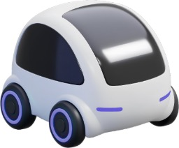

# Omnicor AI — Solutions and Projects Register

⬆ [Omnicor AI profile](Omnicor-AI.md) · [Product portfolio](Omnicor-AI-Products.md) · [Papers and research](Omnicor-AI-Papers-and-Research.md) · [Roadmap and strategy](Omnicor-AI-Roadmap-and-Strategy.md)

> **Coverage note:** The official site [omnicorai.io](https://www.omnicorai.io/) is a **single page** and was walked completely on 2026-11-14: raw HTML (Chinese default text), the full script bundle with all text strings (English, Chinese, French, German, Spanish, Italian — all six say the same thing), every image and logo file. There is **no** sitemap.xml, robots.txt, news, blog, press, case-study or solutions sub-page: every path (`/sitemap.xml`, `/news`, `/blog`, `/llms.txt`) returns the same one page. No separate Chinese-language site exists; `omnicorai.com` (the e-mail domain) and `docs.omnicorai.io` do not resolve. **Web search was available (1 extended query) and returned zero results about this company** — no press, no deployments, no funding news; only unrelated namesakes (ABB OmniCore, Omnicom "Omni", Om AI). LinkedIn returned an error without login. No Hugging Face organisation exists under `OmnicorAI` or `omnicor-ai`. **New in this pass:** the partner logo "HUIXI" on the OmniCor site carries the Chinese name 辉羲智能, which identifies it as **Huixi Technology**, a Chinese embodied-AI compute-chip company (previously marked unverified). Bottom line: this register is short because the public record is short — nothing was padded.

**How to read this:** OmniCor AI ("OmniCor" on its own site) is an **enabler, not a robot vendor**. It has **no named deployment, case study, pilot or dated project** in public. What exists is: 3 deployment domains, 4 "what we build" items, a list of models it deploys, 3 customer logos, 1 partner logo, 3 ecosystem logos.

## Solutions catalogue — everything they offer

Maturity is ⚠️ unverified for every row: the site lists each item but never says whether it is shipping, in pilot or planned. No specs, prices or numbers are published for any of them.

| # | Solution / application | What it does | Products used | Maturity | Tracks | Source link |
|---|---|---|---|---|---|---|
| 1 | **Embodied-AI robot deployment** (deployment domain 1) | Makes perception and control models run on-board the robot, inside the power budget of a moving platform | OC Agent, OC Node, model optimisation | ⚠️ unverified (customer logos AgiBot, Galbot suggest live work) | T01 T02 T03 T04 | [We serve](https://www.omnicorai.io/#about) |
| 2 | **L4 autonomous logistics vehicle deployment** (deployment domain 2) | Continuous multi-sensor inference under automotive thermal and reliability limits | OC Agent, OC Node, model optimisation | ⚠️ unverified (no named customer) | T01 | [We serve](https://www.omnicorai.io/#about) |
| 3 | **Enterprise AI server deployment** (deployment domain 3) | Rack-side inference tuned for throughput per watt (operating cost) | OC Agent, model optimisation | ⚠️ unverified (no named customer) | — | [We serve](https://www.omnicorai.io/#about) |
| 4 | **OC Agent** | "Agentic deployment environment": tooling that automates fitting a trained model to a target hardware platform | — (is the product) | ⚠️ unverified | T01 T02 T03 T04 | [At a glance](https://www.omnicorai.io/#tech) |
| 5 | **OC Node** | "Compute platform designed in-house": OmniCor's own edge compute hardware (form factor, chip, power not public) | — (is the product) | ⚠️ unverified | T01 T02 T03 T04 | [At a glance](https://www.omnicorai.io/#tech) |
| 6 | **Model optimisation** | Service: gets a model inside the power, speed and memory limits of the target device (methods not public) | OC Agent (presumably ⚠️ unverified) | ⚠️ unverified | T01 T02 T03 T04 | [At a glance](https://www.omnicorai.io/#tech) |
| 7 | **European delivery** | "Designed and built in Europe": sourcing / manufacturing / delivery positioning | OC Node (presumably ⚠️ unverified) | ⚠️ unverified | — | [At a glance](https://www.omnicorai.io/#tech) |
| 8 | **On-device language models** (from "Models we deploy") | Deploys open LLMs at the edge: **Apertus** (Swiss), **Mistral AI**, **OpenEuroLLM**, **Qwen**, **DeepSeek**, "and others" | OC Agent, OC Node, model optimisation | ⚠️ unverified (no version, size or speed given) | T01 T02 T04 | [Models](https://www.omnicorai.io/#models) |
| 9 | **On-device robot VLA policies** (from "Models we deploy") | Deploys vision-language-action models on robot compute: **OpenVLA**, **pi0.5** (LeRobot build) | OC Agent, OC Node, model optimisation | ⚠️ unverified (no Hz, latency or robot named) | T01 T02 T03 T04 | [Models](https://www.omnicorai.io/#models) |

Engagement model for all rows (site wording, paraphrased): you tell them your **trained model** and your **target hardware**; they deliver a deployment that meets your power, speed and memory limits. Contact: contact@omnicorai.com.

### Embodied-AI robot deployment

*Generic illustration from the official site — not a photo of a real deployment (none is published).*

- **How it works:** the robot maker supplies model + on-board compute target; OmniCor ports and tunes the model so perception and control run on the robot itself, within its battery / power budget. No cloud link needed at run time.
- **Who uses it:** site lists **AgiBot**, **Galbot** and **"sudo"** as "teams shipping with OmniCor AI". Which robots, which models and what volumes: not public. AgiBot and Galbot are both on site at Leukerbad.
- **Numbers:** none published (no latency, inference rate, watts or accuracy figures).
- **Track use:** the generic "brain runs on the robot" layer for service robots (T01.3, T01.7), rescue / inspection robots when networks fail (T02.1, T02.2, T02.7), sorting manipulators (T03.1) and care robots where data must stay local (T04.1, T04.2, T04.6).
- Official link: [omnicorai.io — We serve](https://www.omnicorai.io/#about)

### L4 autonomous logistics vehicle deployment

*Generic illustration from the official site — not a photo of a real vehicle.*

- **How it works:** continuous multi-sensor (camera / lidar class) inference on vehicle compute, engineered for automotive thermal and reliability constraints.
- **Who uses it:** no customer named. The only "partner" on the site, **Huixi Technology (辉羲智能)**, itself markets compute for "L4 commercial applications" (autonomous logistics, mining trucks, cleaning) — a link between the two offerings is plausible but ⚠️ unverified.
- **Numbers:** none published.
- **Track use:** autonomous delivery and urban logistics (T01.1), navigation stacks (T01.6). No vehicle is known to be on site; treat as background, not a hackathon platform.
- Official link: [omnicorai.io — We serve](https://www.omnicorai.io/#about)

### OC Agent

- **How it works:** described only as an "agentic deployment environment" — software that automates the port-and-tune loop from a trained model to a specific hardware target. Interface (CLI / GUI / API), supported formats and licence: not public.
- **Who uses it:** not stated; unclear whether participants can use it directly or OmniCor engineers run it for you — ask on site.
- **Numbers:** none.
- **Track use:** cross-track enabler — whichever track you pick, this is the path to "runs on the robot, offline" (T01.6, T02.6, T03.3, T04.2).
- Official link: [omnicorai.io — At a glance](https://www.omnicorai.io/#tech)

### OC Node

- **How it works:** OmniCor's in-house compute platform. Chip, AI performance, memory, power draw, interfaces, size: all not public. Do not assume a specific silicon vendor (Qualcomm, NVIDIA, AMD are shown as ecosystem logos; Huixi as partner).
- **Who uses it:** not stated. Whether units are physically at Leukerbad is unknown — first question to ask.
- **Numbers:** none.
- **Track use:** a plug-in offline "brain" beside another vendor's robot — strongest for T02 (works when the network is down: T02.1, T02.4, T02.7), useful for privacy in T04 (T04.7) and for dead zones in T01 (T01.1, T01.6).
- Official link: [omnicorai.io — At a glance](https://www.omnicorai.io/#tech)

### Model optimisation

- **How it works:** service line with a heading only. From the site's framing: fit the model into the device's power, latency and memory envelope. Techniques (quantisation, pruning, distillation, compilation) are not stated.
- **Who uses it:** the same three domains (robots, L4 vehicles, servers).
- **Numbers:** no before / after benchmarks published — ask for one on a model you care about.
- **Track use:** the one OmniCor item that speaks directly to energy: fewer watts per inference (T03.3); also what makes a VLA or LLM fit on robot compute in any track.
- Official link: [omnicorai.io — At a glance](https://www.omnicorai.io/#tech)

### On-device language models

- **How it works:** OmniCor says it deploys open LLMs — Apertus, Mistral AI, OpenEuroLLM, Qwen, DeepSeek, "and others" — onto edge hardware. Model sizes, versions and achieved speed: not public.
- **Who uses it:** not stated. Three of the five are European models (Apertus is the Swiss open LLM), matching the "European delivery" line.
- **Numbers:** none from OmniCor.
- **Track use:** offline multilingual guidance and information (T01.5, T01.7), spoken instructions for responders without connectivity (T02.7), private companion / assistant dialogue in care settings (T04.5, T04.7).
- Official link: [omnicorai.io — Models](https://www.omnicorai.io/#models)

### On-device robot VLA policies

- **How it works:** OmniCor lists OpenVLA and pi0.5 (shown as "PI 0.5 by lerobot") among the models it deploys — i.e. running a manipulation policy on the robot's own compute instead of an off-board GPU server.
- **Who uses it:** not stated; AgiBot and Galbot are the only robot makers shown as customers.
- **Numbers:** none (no control rate, latency or target board published).
- **Track use:** manipulation by service robots (T01.3), waste sorting and recycling picks (T03.1, T03.6), daily-living and care tasks (T04.1, T04.6), handling in hazardous places (T02.2).
- Official link: [omnicorai.io — Models](https://www.omnicorai.io/#models)

## Projects register — past and current

No project in the public record carries a date other than the hackathon itself. Rows marked "2026 (undated)" come from the website, whose only date is its 2026 copyright line. Everything except the hackathon row is **OmniCor's own claim via a logo** — no announcement from the other party was found.

| Date | Project / deployment / pilot / partnership | Partner or customer | Location | What happened (one line) | Tracks | Source link |
|---|---|---|---|---|---|---|
| 2026-11-14 to 16 | Leukerbad Robotics Hackathon 2026 — listed among hardware / development-platform providers | Hackathon organisers | Leukerbad, Switzerland | Named "Omnicor AI" on the public event page (linked to its LinkedIn page); what it brings is not stated | T01 T02 T03 T04 | [Luma event page](https://luma.com/vj13ns00) |
| 2026 (undated) | Customer reference: "Teams shipping with OmniCor AI" | **AgiBot** (humanoid / embodied-AI robot maker) | not public | Logo only; robots, models and volume not public | T01 T02 T03 T04 | [Customers](https://www.omnicorai.io/#customers) |
| 2026 (undated) | Customer reference: "Teams shipping with OmniCor AI" | **Galbot** (embodied-AI robot maker) | not public | Logo only; scope not public | T01 T03 T04 | [Customers](https://www.omnicorai.io/#customers) |
| 2026 (undated) | Customer reference: "Teams shipping with OmniCor AI" | **"sudo"** (identity ⚠️ unverified — logo has no link) | not public | Logo only | — | [Customers](https://www.omnicorai.io/#customers) |
| 2026 (undated) | Partnership: shown as "Our partner" (the only one) | **Huixi Technology / 辉羲智能** (logo reads "HUIXI 辉羲智能") | not public | Logo only; nature and terms of the partnership not public. Huixi's own site does not mention OmniCor | T01 T02 | [Partner section](https://www.omnicorai.io/#partners) · [Huixi official site](https://www.huixi.tech/) |
| 2026 (undated) | Ecosystem: silicon platforms shown under "Ecosystem" | **Qualcomm, NVIDIA, AMD** | — | Logos only; no specific chips, boards or SDKs named; no partner-programme membership confirmed | — | [Ecosystem section](https://www.omnicorai.io/#partners) |

**Not found (checked, nothing exists in public):** named deployments, case studies, pilots, joint labs, government or EU programmes, competitions, trade-show demos, press releases, funding announcements.

### Partner context: Huixi Technology (not OmniCor projects)

Listed because it explains OmniCor's three deployment domains and its AgiBot reference. These are **Huixi's** activities from Huixi's own channels; any role for OmniCor in them is ⚠️ unverified.

| Date | Huixi item | Why it matters for reading OmniCor | Source link |
|---|---|---|---|
| 2026 (undated) | Positions itself as a full-stack compute platform for embodied AI: chips, modules, software toolchain, foundation model (RPU engine, **RISE** computing platform, **RhinoVLA**) | Same layer OmniCor works at (model-to-silicon deployment) | [Huixi official site](https://www.huixi.tech/) |
| 2026 (undated) | Huixi Embodied series launched: **R1 Pro, R1 Max, RCM400, RCM500** | Candidate silicon behind an "in-house" compute node — inference only, ⚠️ unverified | [Huixi launch article](https://mp.weixin.qq.com/s/Qy9gb9fRNZ-Q23lLyBW34Q) |
| 2026 (undated) | Production case: **AGIBOT G2 powered by Huixi** compute | AgiBot is also OmniCor's first customer logo | [Huixi official site](https://www.huixi.tech/index_en.html) |
| 2026-09-04 | Strategic cooperation with XBOT (catering robots): adapting XBOT X1 to Huixi Embodied **R1 MAX (500 TOPS-class)**, incl. on-device VLA deployment | Shows the kind of port-and-optimise work the partner does | [Huixi–XBOT article](https://mp.weixin.qq.com/s/SCYjPLrSH0RKS31yQ9jqMQ) |
| 2026 (undated) | Industry applications: embodied robots · spatial intelligence / edge computing · **L4 commercial** (autonomous logistics, mining trucks, cleaning) | Mirrors OmniCor's three domains (robots · L4 logistics vehicles · AI servers) almost one-to-one | [Huixi official site](https://www.huixi.tech/index_en.html) |

**Inference (not a company statement):** the matching domains, the shared AgiBot reference and the single-partner slot suggest OmniCor acts as a Europe-facing delivery and deployment arm around Huixi-class compute. Confirm on site before using this in a pitch.

## Future projects and announced plans

| Announced | Planned for | What | Confidence (official / reported / inferred) | Tracks | Source link |
|---|---|---|---|---|---|
| — | — | **Nothing announced.** No roadmap, launch date, product teaser, funding round, expansion or hiring plan exists in public (site, search, GitHub all checked 2026-11-14) | official (absence confirmed on the site) | — | [omnicorai.io](https://www.omnicorai.io/) |

Open points that look like "future" but are really unknowns — ask at their table:

- Are **OC Agent** and **OC Node** available today (✅), in pilot (🧪) or planned (🔭)? The site does not say.
- Will there be public docs, an SDK or a self-serve version of OC Agent?
- Which further models hide behind "and others"?

## Solutions by track — quick index

Every entry is an **enabling layer** on top of another vendor's robot. Nothing below is a ready-made track solution.

### T01 Autonomous Urban Services

- **Embodied-AI robot deployment** — on-board perception / control for public-space service robots · T01.3, T01.7
- **On-device language models** (Apertus, Mistral, Qwen …) — offline multilingual guidance and information · T01.5, T01.7
- **L4 autonomous logistics vehicle deployment** — delivery and logistics vehicles, on-vehicle multi-sensor inference · T01.1, T01.6
- **On-device robot VLA policies** (OpenVLA, pi0.5) — manipulation for service tasks without a cloud GPU · T01.3, T01.2
- **OC Node** — offline compute for connectivity dead zones · T01.1, T01.6
- **OC Agent** / **Model optimisation** — porting a navigation or perception model to robot compute · T01.6, T01.4
- Customer references **AgiBot**, **Galbot** — both have robots on site · T01.3

### T02 Resilient & Safe City

- **OC Node** — inference that keeps working when networks are down · T02.1, T02.4, T02.7
- **Embodied-AI robot deployment** — on-board hazard / person detection on rescue or inspection robots · T02.1, T02.2, T02.6
- **On-device language models** — spoken guidance for responders with no connectivity · T02.7
- **Model optimisation** — fitting detection models on small, battery-powered sensor nodes · T02.3, T02.5
- **On-device robot VLA policies** — remote-site manipulation without a link to a server · T02.2
- **OC Agent** — fast re-porting of a model to whichever robot is available · T02.6

### T03 Sustainable City

- **Model optimisation** — fewer watts per inference; measurable energy saving per task · T03.3
- **On-device robot VLA policies** — sorting / picking policies running on the manipulator's own compute · T03.1, T03.6
- **Embodied-AI robot deployment** — on-board perception for waste-sorting or monitoring robots · T03.1, T03.2
- **OC Node** / **OC Agent** — local processing of environmental sensor data instead of cloud upload · T03.7 (weak fit)
- Enterprise AI server deployment (throughput per watt) is energy-related but not robotic — background only

### T04 Elderly Care & Rehabilitation

- **On-device language models** (Apertus, Mistral …) — private, multilingual companion and assistant dialogue; no patient data leaves the room · T04.5, T04.7
- **Embodied-AI robot deployment** — on-board perception / control for care robots · T04.1, T04.2, T04.6
- **On-device robot VLA policies** — daily-living manipulation (fetch, hand over, tidy) on the robot · T04.1, T04.6
- **OC Node** — local compute for vision-based monitoring with data kept on site · T04.7
- **Model optimisation** / **OC Agent** — making pose-estimation or speech models fit on small care devices · T04.3, T04.4 (indirect)
- Customer references **AgiBot**, **Galbot** — candidate care-robot platforms on site · T04.2

## What they do NOT offer

- **No robot, arm, gripper, sensor or vehicle of their own.** Every track project needs another vendor's hardware.
- **No ready-made application** for any track: no delivery, cleaning, inspection, rescue, waste-sorting, monitoring, care or rehabilitation solution.
- **No public SDK, API, docs, GitHub code or simulation assets.** A GitHub account `OmnicorAI` exists but shows no public code (ownership ⚠️ unverified); no Hugging Face organisation.
- **No models or datasets of their own** — all listed models are third-party open models.
- **No published specs or benchmarks** for OC Node or any deployment (no TOPS, watts, latency, control rate).
- **No named deployment or case study** — customer and partner evidence is logos only.
- **No stated ROS 2 integration, navigation stack, fleet management or teleoperation.**
- **No healthcare or safety certifications stated** (medical-device, functional-safety, automotive grade) — relevant for T04 and T02 pitches.
- **No public pricing, availability or support terms.**

## Image credits

Only 2 pictures saved. The official site has no deployment photos, no product photos and no social-preview image; its only solution imagery is three small generic illustrations of the deployment domains (the server one was skipped: no track relevance).

| file | shows | source URL |
|---|---|---|
| assets/omnicor-ai-sol-embodied-robotics.jpg | Generic site illustration for the "Embodied AI Robotics" deployment domain (cartoon robot; not a real deployment) | [omnicorai.io/illustrations/robotics.png](https://www.omnicorai.io/illustrations/robotics.png) |
| assets/omnicor-ai-sol-l4-logistics.jpg | Generic site illustration for the "L4 Autonomous Logistics Vehicles" deployment domain (cartoon vehicle; not a real vehicle) | [omnicorai.io/illustrations/logistics.png](https://www.omnicorai.io/illustrations/logistics.png) |

## Sources

- [OmniCor AI official website](https://www.omnicorai.io/) — full page HTML, script bundle with all six language versions, illustrations and logo files (read 2026-11-14)
- [OmniCor AI — We serve (deployment domains)](https://www.omnicorai.io/#about)
- [OmniCor AI — At a glance (what we build)](https://www.omnicorai.io/#tech)
- [OmniCor AI — Models we deploy](https://www.omnicorai.io/#models)
- [OmniCor AI — Customers](https://www.omnicorai.io/#customers)
- [OmniCor AI — Partner and ecosystem](https://www.omnicorai.io/#partners)
- [OmniCor AI — partner logo file showing "HUIXI 辉羲智能"](https://www.omnicorai.io/logos/huixi.png)
- [Leukerbad Hackathon 2026 event page (Luma)](https://luma.com/vj13ns00) — lists "Omnicor AI" among hardware / development-platform providers
- [Huixi Technology official site (Chinese)](https://www.huixi.tech/) and [English version](https://www.huixi.tech/index_en.html) — partner identity, product names, industry applications, AGIBOT G2 production case
- [Huixi: strategic cooperation with XBOT (2026-09-04)](https://mp.weixin.qq.com/s/SCYjPLrSH0RKS31yQ9jqMQ) — official Huixi WeChat article
- [Huixi: Huixi Embodied series launch](https://mp.weixin.qq.com/s/Qy9gb9fRNZ-Q23lLyBW34Q) — official Huixi WeChat article (title and summary read; date not confirmed)
- [OmnicorAI account on GitHub](https://github.com/OmnicorAI) — account page exists; no public code seen; ownership unverified
- [Omnicor AI on LinkedIn](https://www.linkedin.com/company/omnicor-ai/) — not readable without login (error returned); nothing taken from it in this pass
- Web search (1 extended query on company name, OC Agent, OC Node, customers and partner, 2026 news): no relevant result. Unrelated hits only, e.g. [TechNode on Om AI](https://technode.com/2026/05/27/from-video-understanding-to-edge-deployment-om-ai-targets-real-world-ai/) — a different company, not used
