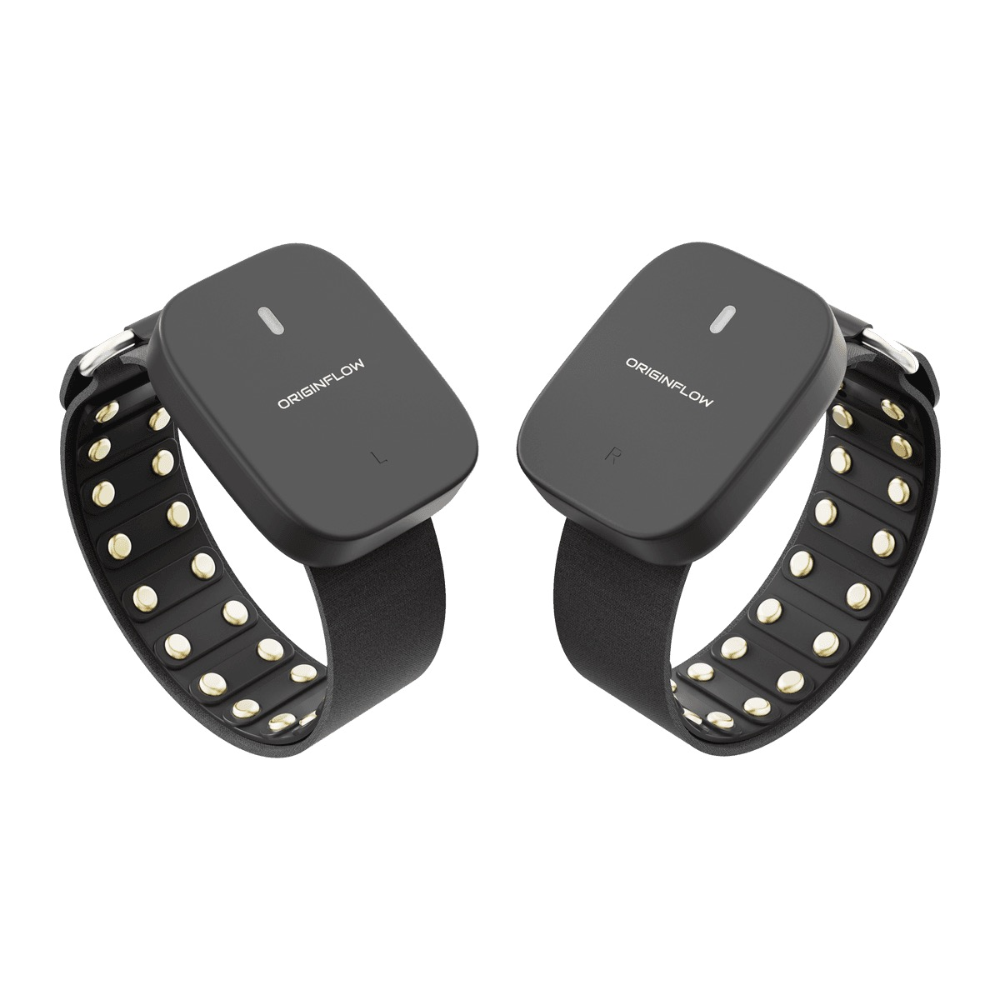
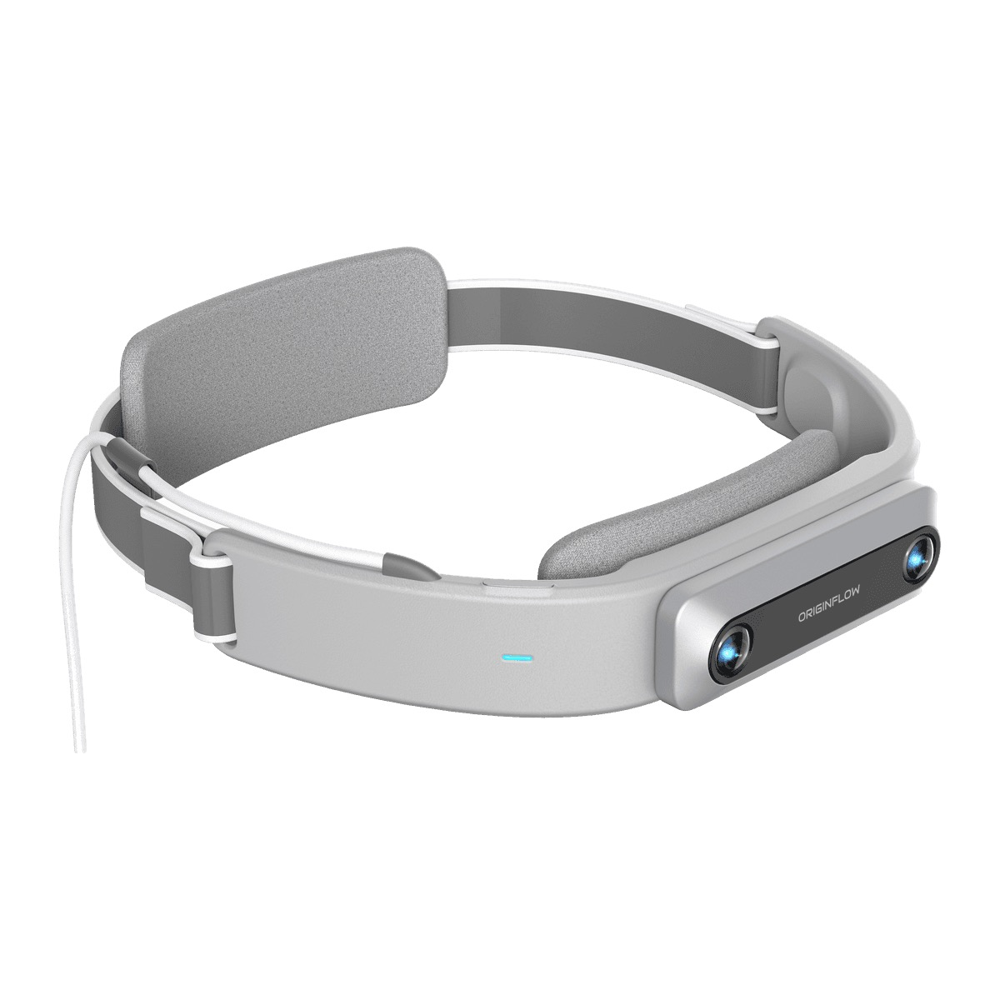
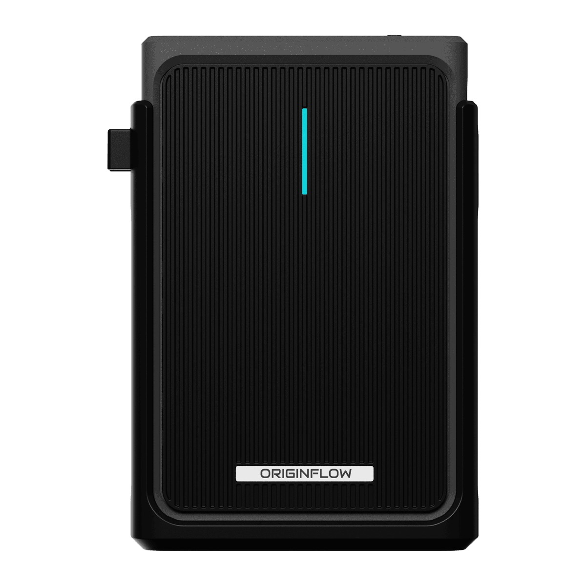

# OriginFlow — Product Portfolio

⬆ [OriginFlow profile](OriginFlow.md) · [Developer guide](OriginFlow-Developer-Guide.md) · [Roadmap and strategy](OriginFlow-Roadmap-and-Strategy.md)

**Decision in 20 seconds**
- OriginFlow sells **one hardware product** (the OriginKitGen 1.0 capture kit) and **one service** (data capture). Everything else is in-house models with no public access.
- It is a **sensing / data layer, not a robot**. You always need another vendor's arm, hand or humanoid to act.
- The unique asset on site is the **16-channel sEMG Band**: muscle activity plus *estimated* hand pose and fingertip force. Nobody else at the hackathon offers that.
- **Hard dependency:** no public SDK, stream API, export format or model weights. Confirm a live data interface at the booth before you commit.
- Spec sheets are **not public**. Most rows below read "not public" on purpose; nothing here is guessed.

## Lineup map

Track relevance: ● strong · ◐ partial · ○ none

| Product | Category | Status | Launched | Price (if public) | Positioning (one line) | T01 | T02 | T03 | T04 |
|---|---|---|---|---|---|---|---|---|---|
| **OriginKitGen 1.0** | Wearable multimodal capture kit (Glass + Band + Space) | ✅ via enquiry | 2026 (exact date not public) | not public; press mentions roughly RMB 1,000 per set ⚠️ unverified | Record a human doing a real task as synchronised video + motion + sEMG | ◐ | ◐ | ◐ | ● |
| **Band** | 16-channel sEMG wristband + wrist motion | ✅ part of kit | 2026 | not public | The muscle-signal sensor; source for pose / force estimation | ◐ | ◐ | ○ | ● |
| **Glass** | Head-worn first-person camera + head motion | ✅ part of kit | 2026 | not public | Egocentric view that ties actions to the scene | ◐ | ◐ | ◐ | ◐ |
| **Space** | Control and local-recording unit | ✅ part of kit | 2026 | not public | Hub: device status, capture control, local storage, preview | ○ | ○ | ○ | ◐ |
| **Data Capture Services** | Service: real-world task data capture | ✅ listed on official site | 2026 | not public | OriginFlow captures task data for robotics / Physical-AI teams | ◐ | ○ | ◐ | ◐ |
| **PULSE** | Foundation model: sEMG to hand pose and force | 🧪 v0.2 demoed (WAIC 2026); v0.3 in development | 2026-07 (demo) | not public | Turns Band signals into continuous hand tracking + fingertip force | ◐ | ◐ | ○ | ● |
| **CHORD** | Omni-modal alignment base model | 🧪 press descriptions only | not public | not public | Aligns sEMG, vision, IMU, language and robot state | ○ | ○ | ○ | ○ |
| **ORACLE** | Auto-annotation system | 🧪 internal infrastructure | not public | not public | Labels action, force, semantics and task segments automatically | ○ | ○ | ○ | ○ |

Why the T04 column is the strongest: surface EMG and grip-force estimation map directly onto rehab-exercise feedback and intent-driven assistive control. Caveat: **not a medical device**, no public clinical validation.

## Products

### OriginKitGen 1.0

*No single official picture of the complete kit was found; see the three device pictures below.*

**What it is:** a three-device wearable kit that records first-person video, head motion, wrist motion and 16-channel surface EMG on **one shared timeline** while a person performs a real task. It is the company's only hardware product.

| Spec | Value |
|---|---|
| Components | **Glass** (head) + **Band** (wrist) + **Space** (control / recording unit) |
| Modalities captured | First-person video · head motion · wrist motion · **16-channel sEMG** |
| Synchronisation | All streams aligned on a unified timeline (official site) |
| Recording | Local recording and storage, managed from Space |
| Derived outputs | Pose, motion intent, force and contact state — **estimated**, "under defined algorithms, calibration, and task conditions" (official wording) |
| Workflow | **5 steps:** device setup → quick calibration → start capture → status feedback → data preview |
| Calibration time | not public |
| Export format / file types | not public |
| Live streaming interface (UDP / WebSocket / ROS 2) | not public |
| Battery / runtime, weight, IP rating | not public |
| Price | not public (press: about RMB 1,000 per set ⚠️ unverified) |

- **Variants:** only "Gen 1.0" is listed. No EDU / developer / enterprise editions are published.
- **Access level:** purchase or demo by enquiry (contact@originflow.ai). No self-service store, no public SDK.
- **Typical applications:** recording human demonstrations for robot-learning datasets (household, kitchen, manufacturing tasks); operator studies where effort and force matter, not just motion.
- **Hackathon use:** demonstration recorder for imitation learning on another vendor's robot; or, if a live stream exists, an input device for teleoperation.
- **Official page:** https://www.originflow.ai/

### Band

**What it is:** the wrist-worn surface-EMG sensor of the kit. It records neuromuscular activity and wrist motion during a task, adding signals a camera cannot see. This is the hackathon-relevant piece.

| Spec | Value |
|---|---|
| sEMG channels | **16** |
| Signal level | Microvolt-level surface EMG (press) |
| Data rate | about **96 KB/s** (press) |
| Other sensing | Wrist motion |
| Form factor | Soft strap with a compact sensor module; press describes the strap as slightly wider than an Apple Watch band and lighter overall |
| Seen in official render | Shown as a **left / right pair** (modules marked L and R); rows of metal contact electrodes on the inside of the strap; one indicator light per module |
| Sampling rate, bit depth | not public |
| Wireless link / protocol | not public |
| Battery / runtime, weight, IP rating | not public |
| Standalone use (without Glass and Space) | not public — ask on site |

- **Variants:** none published.
- **Typical applications:** hand-pose and fingertip-force estimation (via PULSE), effort measurement during manipulation, gesture / intent input.
- **Hackathon ideas:** EMG-driven teleoperation of a dexterous hand (WUJI Hand, Unitree Dex hands); grip-effort feedback for a rehab exercise next to a force-controlled arm (Flexiv, ROKAE); hands-busy command input for a remote robot.
- **Limits to plan around:** force is an estimate, not a measurement; per-user calibration is required and its duration is unknown; no public raw-signal API.
- **Official page:** https://www.originflow.ai/

### Glass

**What it is:** the head-worn unit that records the task from the operator's point of view and tracks head motion, giving visual context to the wrist signals.

| Spec | Value |
|---|---|
| Sensing | First-person video + head motion |
| Seen in official render | Padded **headband** design (not spectacle-style) with a front sensor bar carrying **two forward-facing lenses**; cable exit at the rear; status light on the side |
| Resolution, frame rate, field of view | not public |
| Depth / stereo output | not public ⚠️ unverified (two lenses are visible; their function is not documented) |
| Display | none documented — it is a capture device, not AR glasses |
| Connection | Cabled in the render; protocol not public |
| Weight, battery, IP rating | not public |

- **Variants:** none published.
- **Typical applications:** egocentric video for imitation-learning datasets; linking actions to objects and scene.
- **Hackathon note:** if you need an operator *display*, pair with XREAL glasses; Glass only records.
- **Official page:** https://www.originflow.ai/

### Space

**What it is:** the kit's hub. It shows device status, runs the capture workflow, stores recordings locally and gives operator feedback, so every session can be reviewed and traced.

| Spec | Value |
|---|---|
| Role | Device status · capture-workflow control · local data storage · operator feedback · timeline preview |
| Seen in official render | Pocket-size black unit in a clip / cradle with a front light bar |
| Compute (SoC, RAM) | not public |
| Storage capacity | not public |
| Battery / runtime | not public |
| Connectivity (Wi-Fi, Bluetooth, USB) | not public |
| Weight, IP rating | not public |
| Ability to run your own code on it | not public — assume **no**; bring a laptop or edge board |

- **Variants:** none published.
- **Typical applications:** field recording without a PC; session review.
- **Official page:** https://www.originflow.ai/

### Data Capture Services

**What it is:** OriginFlow runs real-world task capture for robotics and Physical-AI teams and delivers multimodal data. The picture is the official site's sample frame: egocentric video overlaid with per-finger force readouts, hand skeletons, head and wrist pose, and episode / subtask labels.

| Item | Value |
|---|---|
| Output modalities | Video · semantics · pose · force (official site) |
| Underlying capabilities | High-density sEMG capture · multimodal time synchronisation · interaction-state reconstruction |
| Publicly reported scenarios | Home services with 58 Group (clothes organising, cleaning, kitchen work); industrial manufacturing with unnamed manufacturers |
| Data volume, formats, licence terms | not public |
| Open datasets | none released |
| Pricing | not public |

- **Hackathon relevance:** low as a service (48 hours is too short for a contract), but staff may record and export sessions for you on site ⚠️ unverified — ask.
- **Official page:** https://www.originflow.ai/

### PULSE

**What it is:** OriginFlow's foundation model that decodes Band sEMG into hand state. Not offered as a product; shown as a demo.

| Item | Value |
|---|---|
| Input | 16-channel sEMG from the Band |
| Output (v0.2) | Continuous hand tracking + **fingertip-force estimation** (shown at WAIC 2026, July 2026) |
| v0.3 🧪 | In development: tendon force and hand forward kinematics |
| Weights, API, model card, latency figures | not public |
| Independent accuracy validation | none found |

- **Hackathon relevance:** high *if* the team exposes a live output stream; otherwise unusable. This is the first question for the booth.

### CHORD

**What it is:** an omni-modal base model described in press as aligning sEMG, vision, IMU, language and robot state. No public specs, weights, API or demo. 🧪 Not something you can build on this weekend.

### ORACLE

**What it is:** an internal auto-annotation system that labels actions, force, semantics and task segments in captured data. No public interface. 🧪 Relevant only as part of the capture service.

## Accessories and ecosystem

| Item | What it is | Status |
|---|---|---|
| **NeuroScale** | Name of the overall method (capture → physical-quantity reconstruction → action representation → cross-embodiment transfer). A method, not a purchasable product | 🧪 |
| **Human Tokens** | Data representation in three spaces: MotionSpace (hand pose, trajectory), TactileSpace (normal / tangential force, contact), TendonSpace (muscle-tendon force, joint torque) | 🧪 |
| LinkerBot partnership | Joint work on mapping EMG-decoded motion and tactile data onto dexterous hands. LinkerBot is **not** on the hackathon vendor list | ⚠️ unverified (press summary only) |
| SDK, ROS 2 driver, simulator assets | not public | — |
| Chargers, docks, spare straps, sizing options | not public | — |
| Own robots, dexterous hands, data gloves | none | — |

**Pairings on site (your own bridge code required):**

| Pair with | For |
|---|---|
| WUJI Hand / Unitree Dex hands | EMG-to-hand teleoperation |
| Flexiv Rizon / ROKAE xMate | Rehab or assistive motion with muscle-effort feedback |
| XREAL glasses | Operator display alongside Glass capture |
| D-Robotics RDK boards | Edge inference and bridge node, since Space is a closed unit |
| Galaxea / Galbot / AGIBOT manipulators | Target robot for policies trained on recorded demonstrations |

## Legacy and discontinued

None. The company was founded in 2025 and OriginKitGen 1.0 is its first generation.

## Image credits

All pictures are from the official website's own image CDN (Framer), referenced on https://www.originflow.ai/ and converted from PNG to JPEG.

| File | Shows | Source URL |
|---|---|---|
| assets/originflow-band.jpg | Band, left and right wristband pair | https://framerusercontent.com/images/eochdwfY4C8cAHmgxalJvILGwA.png |
| assets/originflow-glass.jpg | Glass head-worn capture unit | https://framerusercontent.com/images/GqvaSAbCLY6dSvgeG8Jj1Uw7Sk.png |
| assets/originflow-space.jpg | Space control and recording unit | https://framerusercontent.com/images/eCm872bw93L1QMP2CL9UDgQcw.png |
| assets/originflow-data-services.jpg | Sample annotated capture frame (finger force, hand pose, head / wrist pose, subtask labels) | https://framerusercontent.com/images/iqMnjmr710Y0RZ5EEpieAeRpI.png |

Not saved: OriginKitGen 1.0 full kit (the site's og:image is a generic website-template placeholder, not a product photo); PULSE, CHORD, ORACLE (no official images found).

## Sources

Research note: web search was unavailable during this pass, so this file relies on the official site (fetched 2026-11-14) and on the press sources already verified in the company profile.

- [OriginFlow official site](https://www.originflow.ai/) — product names, kit composition, workflow, data modalities, wording on estimated outputs, all pictures
- [OriginFlow profile (this repo)](OriginFlow.md) — consolidated press-sourced figures (96 KB/s, strap description, PULSE versions, CHORD, ORACLE, partnerships)
- [TMTPost (EN), 2026-05-21 — funding and commercial scenarios](https://en.tmtpost.com/post/7997613)
- [QbitAI, 2026-08-22 — company profile, PULSE 0.2 / 0.3 (Chinese)](https://www.qbitai.com/2026/08/477094.html)
- [36Kr Europe (EN), 2026-08-24 — republished QbitAI profile](https://eu.36kr.com/en/p/3950735048031365)
- [Gasgoo — LinkerBot and OriginFlow partnership](https://autonews.gasgoo.com/articles/news/2089539854819147777) (search summary only, via profile)
