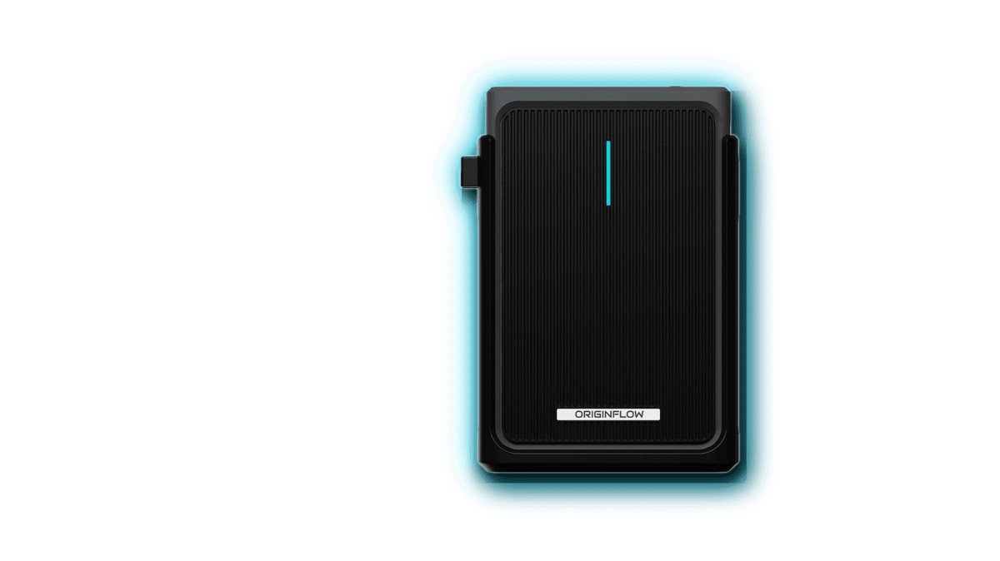
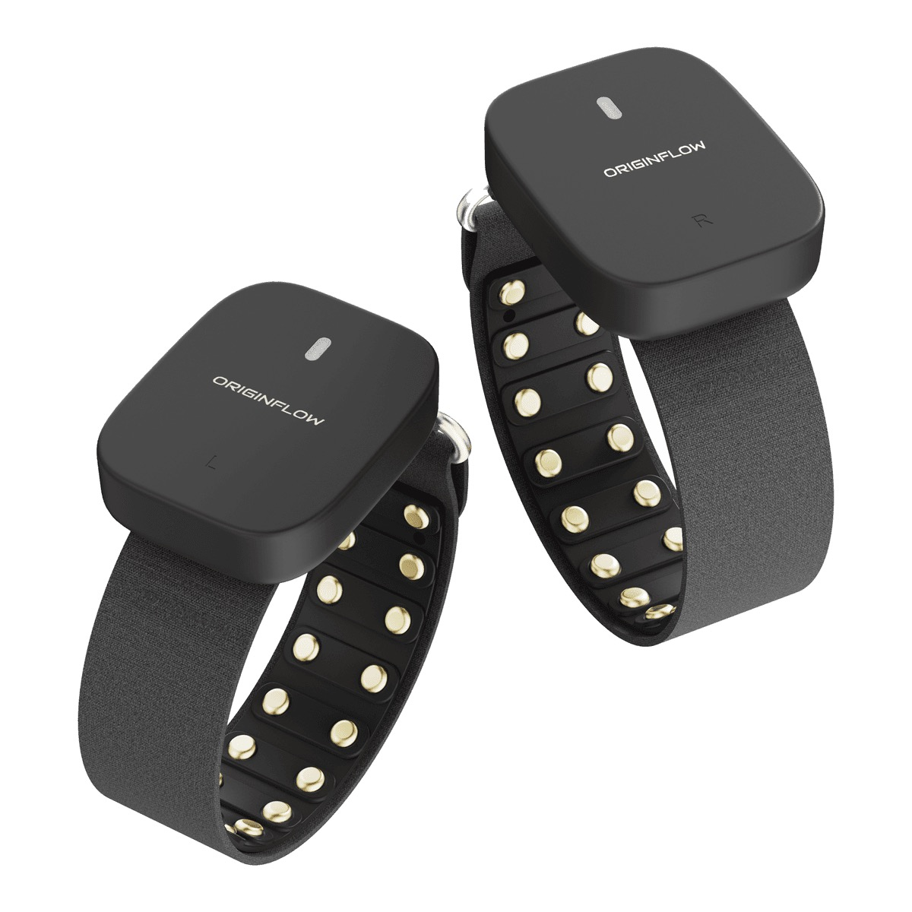

# OriginFlow — Solutions and Projects Register

⬆ [OriginFlow profile](OriginFlow.md) · [Product portfolio](OriginFlow-Products.md) · [Papers and research](OriginFlow-Papers-and-Research.md) · [Roadmap and strategy](OriginFlow-Roadmap-and-Strategy.md)

> **Coverage note:** Walked the whole official site from its `sitemap.xml` (19 URLs, site build stamped **2026-11-11**): home, `/about`, `/neuroscale`, `/portfolio` and its 3 sub-pages, `/career` and all 6 job pages, `/contact`. Privacy and terms pages were not read. **There is no Chinese-language site** (`/zh`, `/zh-CN`, `/cn` return 404), and **no Solutions, Industries, Case-studies, Customers, News or Blog section**. The `/portfolio` sub-pages ("Way Fields", "Raven Studio", "White Stag") are leftover website-template filler about a web-design agency — **not OriginFlow projects** — and the page's FAQ is template text too. Also read: the official Hugging Face org and dataset card (README, licence, API metadata), the `OriginFlow-AI` GitHub org and 3 READMEs, and press (TMTPost, QbitAI, 36Kr Europe, Robotsky/Sohu, Dealroom, Inside China AI, RobotiChina). **Web search was available: 1 extended query**, which surfaced the Baidu Smart Cloud partnership (new versus the first-pass docs). **Could not be opened:** both Gasgoo articles (HTTP 468 / 403), LinkedIn (403), X (402), Zhihu (403), and the gated parts of the Hugging Face dataset (commit log, sub-docs, video posters: 401). News range covered: **2025-08 to 2026-11-14**.

**Read this first**
- OriginFlow markets **two things**: a wearable capture kit and a data-capture service. Everything else is internal technology or a gated dataset.
- It publishes **no named customer case study**. Every deployment below comes from press, the dataset card or event listings.
- It builds **no robot and no actuator**. Every track use needs another vendor's hardware.

## Solutions catalogue — everything they offer

| # | Solution / application | What it does | Products used | Maturity | Tracks | Source link |
|---|---|---|---|---|---|---|
| 1 | **OriginKitGen 1.0** — wear-to-capture multimodal kit | Records first-person video, head motion, wrist motion and **16-channel sEMG** on one timeline during real work; 5-step workflow (setup, calibration, capture, status, preview) | Glass + Band + Space | ✅ via enquiry | T01 T02 T03 T04 | [Official site](https://www.originflow.ai/) |
| 2 | **Band** — neuromuscular signal capture | Wrist-worn surface EMG plus wrist motion; adds muscle signals that cameras cannot see | Band | ✅ part of kit | T02 T04 | [Official site](https://www.originflow.ai/) |
| 3 | **Glass** — first-person vision and head motion | Records the task from the operator's viewpoint; dataset card describes the stream as stereo RGB, nominally 1920 × 1080 per view, about 30 FPS | Glass | ✅ part of kit | T01 T02 | [Official site](https://www.originflow.ai/) · [Dataset card](https://huggingface.co/datasets/OriginFlow-AI/origindata-preview-sample) |
| 4 | **Space** — unified control and local recording | Device status, capture-workflow control, local storage, operator feedback, timeline preview | Space | ✅ part of kit | — | [Official site](https://www.originflow.ai/) |
| 5 | **Data Capture Services** — real-world capture partnerships | OriginFlow captures real tasks for robotics / Physical-AI teams and delivers video, semantics, pose and force data | Kit + internal pipeline | ✅ listed on site | T01 T03 T04 | [Official site](https://www.originflow.ai/) · [Contact page](https://www.originflow.ai/contact) |
| 6 | **Interaction-state reconstruction** | Estimates pose, motion intent, force and contact state from the captured signals "under defined algorithms, calibration, and task conditions" | Band + Glass + models | 🧪 capability, no public interface | T02 T04 | [Official site](https://www.originflow.ai/) |
| 7 | **NeuroScale** — data-capture paradigm | Method: capture sEMG along the chain intent → neuromuscular signal → motion → force → tactile feedback, fuse with vision and IMU. Lists six captured quantities: motion intent, continuous gestures, spatial pose, active force, contact state, slip / tactile feedback | Whole stack | 🧪 method, not a purchasable item | T04 | [NeuroScale page](https://www.originflow.ai/neuroscale) |
| 8 | **OriginData** — human manipulation dataset | Preview: **100.62 h, 7,717 episodes, 10.87M frames**, LeRobot v3.0, stereo video + 21-joint hand pose + head trajectory + per-finger force estimate + 3-level language labels. Full corpus described as **28 domains, 1,170 tasks** | Kit + pipeline | ✅ preview (gated, evaluation-only licence) · 🧪 full corpus | T01 T03 T04 | [Dataset card](https://huggingface.co/datasets/OriginFlow-AI/origindata-preview-sample) |
| 9 | **PULSE** — sEMG foundation model | Decodes Band signals into continuous hand tracking and fingertip-force estimates (v0.2); feeds the "Human Tokens" representation | Band | 🧪 demo only (WAIC 2026); no weights or API | T02 T04 | [QbitAI](https://www.qbitai.com/2026/08/477094.html) |
| 10 | **Fusion2Force** — finger-force estimator | Produces the five-channel per-hand force values (mN) in OriginData by fusing binocular vision, sEMG and IMU | Kit + pipeline | 🧪 named in the dataset card only | T04 | [Dataset card](https://huggingface.co/datasets/OriginFlow-AI/origindata-preview-sample) |
| 11 | **CHORD** — omni-modal alignment base model | Aligns sEMG, vision, IMU, language and robot state; also used in the dataset's contact-label quality report | Internal | 🧪 internal | — | [QbitAI](https://www.qbitai.com/2026/08/477094.html) |
| 12 | **ORACLE** — auto-annotation | Labels actions, force, semantics and task segments automatically | Internal | 🧪 internal | — | [QbitAI](https://www.qbitai.com/2026/08/477094.html) |
| 13 | **Human Tokens + cross-embodiment transfer** | Shared action representation (MotionSpace, TactileSpace, TendonSpace) intended to retarget human skill onto robots with different bodies; backed by a smaller cross-embodiment robot dataset | Internal | 🧪 described, nothing released | T01 | [36Kr Europe](https://eu.36kr.com/en/p/3950735048031365) |
| 14 | **Industrial manufacturing data capture** (scenario) | Capture of factory manipulation skill with unnamed "leading global high-end manufacturers" | Kit + service | ✅ reported active | — | [TMTPost](https://en.tmtpost.com/post/7997613) |
| 15 | **Home-services data capture** (scenario) | Capture of clothes organising, household cleaning and kitchen work for a housekeeping-robot skills database | Kit + service | ✅ reported active | T04 | [TMTPost](https://en.tmtpost.com/post/7997613) |
| 16 | **Customer solutions and technical consulting** | Solution architects design data interfaces, workflow integration and usage specifications with customer engineering teams | Service | 🧪 inferred from an open job role, not a listed offer | — | [Career page, role 1](https://www.originflow.ai/career/1) |

Maturity key: ✅ shipping / available · 🧪 announced / pilot / preview · 🔭 roadmap.

### OriginKitGen 1.0 — wear-to-capture multimodal kit

*Picture: the Space unit, the hub of the kit. No official picture of the complete kit exists.*

- **How it works:** wear Glass, Band and Space; run a quick calibration that confirms connections and timeline alignment; record; check status on Space; review the session on one timeline.
- **Who uses it:** robotics and Physical-AI teams that need human demonstrations with muscle and force information, not only video.
- **Numbers:** **16** sEMG channels; Band data stream about **96 KB/s** (press); capture equipment reported at about **RMB 1,000 per set** ⚠️ unverified.
- **Track use:** a demonstration recorder for any track; a live input device only if the team exposes a stream on site (not documented).
- Official link: https://www.originflow.ai/

### Band — neuromuscular signal capture

- **How it works:** electrodes on the wrist pick up microvolt-level muscle signals while the hand works; wrist motion is recorded alongside.
- **Who uses it:** the same capture customers; it is the only device at the hackathon that senses muscle activity.
- **Numbers:** **16 channels**. Sampling rate, battery life and wireless protocol are not public.
- **Track use:** muscle-effort and grip-force feedback for rehab exercises (T04.3, T04.7); hands-busy command or force-aware teleoperation input (T02.7).
- Official link: https://www.originflow.ai/

### Glass — first-person vision and head motion

- **How it works:** head-worn unit records what the operator sees and how the head moves, tying each action to its scene.
- **Numbers (from the dataset card):** left and right RGB streams, nominally **1920 × 1080** per view, about **30 FPS**; head pose given in a local SLAM frame.
- **Track use:** egocentric view for remote-operation or skill-recording demos (T01.3, T02.7). It records only; it has no display.
- Official link: https://www.originflow.ai/

### Data Capture Services — real-world capture partnerships

*Picture: the official sample frame — egocentric video with hand skeletons, per-finger force readouts, head / wrist pose and subtask labels.*

- **How it works:** OriginFlow designs capture around a task, records it with the kit in the real workplace, then runs clock sync, per-user calibration, artefact handling, segmentation, labelling and quality gates before delivery.
- **Who uses it:** reported partners are **58 Group** (home services) and unnamed high-end manufacturers (industry). No customer is named on the official site.
- **Quality gate (press):** five checks in order — physical validity, task validity, annotation validity, model value, real-robot evaluation.
- **Track use:** too slow as a contract for a 48-hour event; ask whether staff will record and export a session for your team ⚠️ unverified.
- Official link: https://www.originflow.ai/contact

### Interaction-state reconstruction

- **How it works:** models turn synchronised sEMG, vision and motion into estimates of pose, motion intent, force and contact state.
- **Important limit:** the site states these are estimates valid only under defined algorithms, calibration and task conditions.
- **Company-reported accuracy (dataset card):** sync within **3 ms**, joint-angle MAE **3.37°**, finger-joint distance error **4.2 mm**, force magnitude error within **20 %**. No independent validation found.
- **Track use:** the estimated grip force and intent are the T04 hook (T04.3, T04.7) and the T02 teleoperation hook (T02.7).
- Official link: https://www.originflow.ai/

### NeuroScale — data-capture paradigm

- **How it works:** captures the human operating chain at its source (the muscle signal) through a lightweight neuromotor interface, then fuses vision and IMU.
- **Positioning:** pitched against vision-only, teleoperation, motion-capture and simulation data on quality, cost and efficiency; the founder calls it a complement to UMI-style and egocentric capture.
- **Track use:** no direct use; it explains why the kit can report effort and force, which matters for T04.
- Official link: https://www.originflow.ai/neuroscale

### OriginData — human manipulation dataset

- **What is in the preview:** **100.62 h**, **7,717 episodes**, **3,323** task descriptions, **26,117** subtask labels, **101,445** atomic-action labels, 414 GB; episodes average **46.94 s**.
- **Domains shown (8 of the 28 claimed):** Residential Living, Retail, Food & Beverage, Sports, Education, Manufacturing, Office, Personal Services.
- **Example tasks by track:**

| Track | Example tasks in the preview |
|---|---|
| T04 | Buttoning a shirt · wrapping plates and food · demonstrating infant massage (Home Care) · organising sanitised tableware |
| T01 | Packing drinks for pickup · organising takeout bags · restocking and labelling supermarket shelves · packing a parcel for shipping |
| T03 | Repairing a mobile phone · assembling a circuit board · sorting and organising miscellaneous items |

- **Limits:** access is **gated with manual approval**; the licence allows **technical evaluation only** (non-commercial, no redistribution, no reuse). **Raw sEMG is not included** — force is a model output. Contact labels score **F1 72.41 %** against a provisional VLM reference.
- Official link: https://huggingface.co/datasets/OriginFlow-AI/origindata-preview-sample

### PULSE — sEMG foundation model

- **How it works:** takes the 16-channel wristband signal and outputs continuous hand tracking plus fingertip-force estimates; shown detecting force changes during a pinch gesture.
- **Status:** v0.2 demo at WAIC 2026; v0.3 in development (tendon force, hand forward kinematics). No weights, API or model card.
- **Track use:** rehab grip coaching and intent-driven assistance (T04.3, T04.5); force-aware remote manipulation (T02.7). Usable only if a live output is offered on site.
- Source: [QbitAI](https://www.qbitai.com/2026/08/477094.html)

### Fusion2Force — finger-force estimator

- **How it works:** fuses egocentric binocular vision, sEMG and IMU into five force channels per hand (thumb to little finger, in mN) with a validity flag.
- **Status:** named only in the dataset card; relationship to PULSE is not explained ⚠️ unverified.
- **Track use:** the force numbers a T04 rehab or care demo would log (T04.7).
- Official link: https://huggingface.co/datasets/OriginFlow-AI/origindata-preview-sample

### Human Tokens + cross-embodiment transfer

- **How it works:** human actions are encoded in three spaces (motion, tactile, tendon), then mapped onto robots with different degrees of freedom; the company says it does not copy human data straight onto a robot.
- **Status:** described in a founder interview; no released model, mapping tool or robot result.
- **Track use:** the idea behind "show once, robot repeats" service skills (T01.2, T01.3) — you would have to build the retargeting yourself.
- Source: [36Kr Europe](https://eu.36kr.com/en/p/3950735048031365)

### Home-services data capture (scenario)

- **How it works:** workers wear the kit while doing real household jobs; the result is a skills database for domestic robots.
- **Who:** 58 Group, China's large home-services platform and a strategic investor.
- **Tasks named:** clothes organising, household cleaning, kitchen work.
- **Track use:** closest existing work to daily-living assistance (T04.1) and care automation (T04.6). Not elderly-specific.
- Source: [TMTPost](https://en.tmtpost.com/post/7997613)

## Projects register — past and current

| Date | Project / deployment / pilot / partnership | Partner or customer | Location | What happened (one line) | Tracks | Source link |
|---|---|---|---|---|---|---|
| 2026-11-14 to 16 | Leukerbad Robotics Hackathon — listed hardware vendor | Hackathon organisers | Leukerbad, Switzerland | First European appearance found; what they brought is not published | T01 T02 T03 T04 | [Event intel](../../Event/Event-Intel.md) |
| 2026-11-12 | Field-capture force calibration ("wild-few-shot") ⚠️ GitHub affiliation unverified | Internal | not stated | Recalibration cut force error on one test set from **6.53 N to 3.26 N** MAE (experiment branch dated 2026-11-09) | T04 | [GitHub](https://github.com/OriginFlow-AI/wild-few-shot) |
| 2026-11-11 | Official website rebuilt around OriginKitGen 1.0 | — | online | Site build stamp 2026-11-11; kit and capture services become the public offer; 6 job roles posted | — | [Official site](https://www.originflow.ai/) |
| 2026-10-30 | OriginData preview update | — | online | Last dataset change; CHORD-versus-VLM annotation-quality report included | T01 T03 T04 | [Dataset card](https://huggingface.co/datasets/OriginFlow-AI/origindata-preview-sample) |
| 2026-10-20 | OriginData preview update ⚠️ unverified (commit log gated today; date from the first-pass roadmap doc) | — | online | Contact-masked force values pushed | T04 | [Roadmap doc](OriginFlow-Roadmap-and-Strategy.md) |
| about 2026-09 | **OriginData preview sample** released | Research community | online (Hugging Face) | 100.62 h gated preview, sample-data version 2.0; **6,742 downloads** in the last month, 25 likes | T01 T03 T04 | [Hugging Face org](https://huggingface.co/OriginFlow-AI) |
| 2026-08-22 | Founder interview discloses the full stack | QbitAI (media) | Beijing | NeuroScale, PULSE, CHORD, ORACLE, Human Tokens and the three-stage plan made public | — | [QbitAI](https://www.qbitai.com/2026/08/477094.html) |
| 2026-07-28 | Hands-free "capture gate" for the glasses ⚠️ GitHub affiliation unverified | Internal | not stated | Recording starts only when head pose is in range and both hands hold a stable OK gesture; tested with an Orbbec Gemini 335 camera | — | [GitHub](https://github.com/OriginFlow-AI/double_gesture_detect) |
| 2026-07-18 | **Strategic cooperation with Baidu Smart Cloud** | Baidu Smart Cloud | Shanghai (signed at WAIC 2026) | Baidu supplies cloud, storage and AI infrastructure for data capture, post-processing and model training; both to explore joint capture and annotation solutions | — | [Robotsky](http://www.robotsky.cc/news/2026072013869.html) |
| 2026-07 | **PULSE 0.2 live demo** at WAIC 2026 | Public demo | Shanghai | Continuous hand tracking and fingertip-force readout from the 16-channel wristband | T02 T04 | [36Kr Europe](https://eu.36kr.com/en/p/3950735048031365) |
| 2026-07-16 | RGB-D hand-object reconstruction pilot ⚠️ GitHub affiliation unverified | Internal | not stated | First-phase multi-view hand reconstruction pipeline on public datasets; internal R&D | — | [GitHub](https://github.com/OriginFlow-AI/rgbd_hand_object_recon) |
| 2026-05-21 | **Home-service data capture** | 58 Group (strategic investor) | China | Capturing clothes organising, cleaning and kitchen tasks for a domestic-robot skills database | T04 | [TMTPost](https://en.tmtpost.com/post/7997613) |
| 2026-05-21 | **Industrial data capture** | Unnamed "leading global high-end manufacturers" | not stated | Industrial embodied-data capture scenarios set up; customer names not public | — | [TMTPost](https://en.tmtpost.com/post/7997613) |
| 2026-05-21 | Funding disclosed | BlueRun China (Lanchi), Oasis / VitalBridge, 58 Strategic Investment, Puhua Capital, Shuimu Tsinghua seed alumni fund, Monolith Capital | Beijing | **More than RMB 500M** over angel, strategic and Pre-A1 rounds in about five months (Dealroom records about US$69M) | — | [TMTPost](https://en.tmtpost.com/post/7997613) · [Dealroom](https://dealroom.co/news/129473-originflow-founded-by-25-year-old-tsinghua-phd-student-raises-cny-500m-f/) |
| 2026 (date ⚠️ unverified) | Strategic partnership with dexterous-hand maker **LinkerBot** ⚠️ unverified (article not openable; nothing on LinkerBot's own site) | LinkerBot | China | Reported joint work on data acquisition, system adaptation, commercial operation and standards | T04 | [Gasgoo](https://autonews.gasgoo.com/articles/news/2089539854819147777) |
| 2026-04 | Visual odometry / SLAM tooling ⚠️ GitHub affiliation unverified | Internal | not stated | Fork of Princeton's DPVO; earliest visible repository activity | — | [GitHub org](https://github.com/OriginFlow-AI) |
| 2025-08 | Company founded | — | Beijing (Zhongguancun, Haidian) | Founded by Qin Shentao, Tsinghua PhD candidate | — | [QbitAI](https://www.qbitai.com/2026/08/477094.html) |

Not found anywhere: government programmes, joint labs, university collaborations, competition entries, robot-side deployments, or any project in Europe before this hackathon.

## Future projects and announced plans

| Announced | Planned for | What | Confidence (official / reported / inferred) | Tracks | Source link |
|---|---|---|---|---|---|
| 2026-08-22 | No date | 🧪 **PULSE 0.3** — tendon force and hand forward kinematics | official (founder interview) | T04 | [QbitAI](https://www.qbitai.com/2026/08/477094.html) |
| about 2026-09 | No date | 🧪 **OriginData full corpus** — 28 domains, 1,170 tasks; release and access model not announced | official (described) / inferred (release) | T01 T03 T04 | [Dataset card](https://huggingface.co/datasets/OriginFlow-AI/origindata-preview-sample) |
| 2026-07-18 | No date | 🔭 Joint data-capture and annotation solution with Baidu Smart Cloud | reported | — | [Robotsky](http://www.robotsky.cc/news/2026072013869.html) |
| 2026-05-21 | No date | 🧪 Skills database for housekeeping robots, with 58 Group | reported | T04 | [TMTPost](https://en.tmtpost.com/post/7997613) |
| 2026-05-21 | No date | 🔭 New application markets: **medical rehabilitation**, smart hardware, spatial computing, next-generation human-machine interaction | reported | T04 | [TMTPost](https://en.tmtpost.com/post/7997613) |
| 2026-08-22 | No date | 🔭 "With Human" stage — always-on AI hardware that fits daily work and life, **including robots** | official (founder interview) | T04 | [QbitAI](https://www.qbitai.com/2026/08/477094.html) |
| 2026-08-22 | No date | 🔭 Consumer-style capture wearables (glasses, watch, lighter band) meant for long daily wear; current wristband "not the final form" | official (founder interview) | T04 | [QbitAI](https://www.qbitai.com/2026/08/477094.html) |
| 2026-08-22 | No date | 🔭 Data scale-up from tens of millions of hours toward a **trillion hours** of human data | official (ambition) | — | [QbitAI](https://www.qbitai.com/2026/08/477094.html) |
| 2026-08-22 | No date | 🔭 Cross-embodiment dataset and human-to-robot retargeting across robot bodies | official (founder interview) | T01 | [36Kr Europe](https://eu.36kr.com/en/p/3950735048031365) |
| 2026-08-22 | 10 to 30 years | 🔭 "Enhance Human" stage | official (vision) | — | [QbitAI](https://www.qbitai.com/2026/08/477094.html) |
| 2026-11-11 | No date | 🔭 Next capture hardware with **fisheye and ToF / depth cameras**, microsecond-level hardware time sync, **200 MB/s+** data paths, USB 3.0 real-time streaming and OTA updates | inferred (hardware, embedded and algorithm job ads) | T01 T02 | [Career page, role 4](https://www.originflow.ai/career/4) |
| 2026-11-11 | No date | 🔭 Customer-facing **API references and integration guides**; ROS / ROS 2 familiarity asked of solution architects | inferred (job ads) — **no SDK announced** | — | [Career page, role 1](https://www.originflow.ai/career/1) |
| 2026-11-11 | No date | 🔭 In-house **VLA models** that use force and tactile signals; capture pipelines spanning simulation and dexterous teleoperation | inferred (job ad) | — | [Career page, role 5](https://www.originflow.ai/career/5) |
| 2026-11-11 | No date | 🔭 Multi-tenant data platform (capture, storage, annotation, simulation, training) | inferred (job ad) | — | [Career page, role 6](https://www.originflow.ai/career/6) |
| 2026-11-11 | No date | 🔭 Wider footprint: roles open in Beijing, Shanghai, Shenzhen and Hong Kong | inferred (job ads) | — | [Career page](https://www.originflow.ai/career) |
| 2026 ⚠️ unverified | No date | 🔭 Joint data standards and dexterous-hand adaptation with LinkerBot | reported ⚠️ unverified | T04 | [Gasgoo](https://autonews.gasgoo.com/articles/news/2089539854819147777) |

Not announced: a public SDK or stream API, model weights, raw-sEMG release, a medical or rehabilitation product, any European office or distributor.

## Solutions by track — quick index

### T01 Autonomous Urban Services
- **OriginKitGen 1.0 as a skill recorder** — capture a cleaning, restocking or hand-over task for another vendor's robot to learn — **T01.2**, **T01.3**
- **OriginData preview** — retail, café, cafeteria and parcel-packing episodes usable to pre-train or ground a service-task model — **T01.1**, **T01.3**
- **Band + PULSE as an operator input** — gesture / effort input for a service robot, if a live stream exists — **T01.7**
- **Human Tokens / cross-embodiment transfer** — concept only, nothing to download — **T01.3**
- Nothing specific found for **T01.4**, **T01.5**, **T01.6** (no navigation, inspection or guidance offering).

### T02 Resilient & Safe City
- **Band + PULSE for force-aware teleoperation** — hand pose and grip force when hands are occluded or gloved; needs a live stream and another vendor's hand or arm — **T02.7**, **T02.1**
- **Glass** — operator's-eye recording for a human-robot response demo — **T02.7**
- **Interaction-state reconstruction** — intent and contact estimates as a command channel — **T02.7**
- Nothing specific found for **T02.2**, **T02.3**, **T02.4**, **T02.5**, **T02.6**. No safety, rescue or inspection deployment exists.

### T03 Sustainable City
- **OriginData preview** — phone repair, circuit-board assembly and sorting / organising episodes as training data for repair or sorting skills — **T03.6**, **T03.1**
- **Data Capture Services / kit as recorder** — capture an expert sorting or disassembly skill as a small labelled set — **T03.1**, **T03.6**
- Nothing specific found for **T03.2**, **T03.3**, **T03.4**, **T03.5**, **T03.7** (no environmental sensing, energy or water offering).

### T04 Elderly Care & Rehabilitation
- **Band + PULSE / interaction-state reconstruction** — muscle effort and estimated finger force for grip or pinch exercise feedback — **T04.3**, **T04.7**
- **Intent estimation from sEMG** — weak grasp intent as a trigger for an assistive robot or hand — **T04.4**, **T04.5**
- **Home-services data capture with 58 Group** — closest real project to household help — **T04.1**, **T04.6**
- **OriginData preview** — home and home-care episodes (buttoning a shirt, wrapping food, infant massage) — **T04.1**, **T04.2**
- **OriginKitGen 1.0 as a recorder** — capture a carer's task for a robot to imitate — **T04.6**
- **Medical rehabilitation as a named future market** 🔭 — no product yet — **T04.3**
- **LinkerBot dexterous-hand partnership** ⚠️ unverified — EMG to robot hand mapping — **T04.4**

## What they do NOT offer

- **No robot, arm, hand, exoskeleton or mobile base.** Sensing and data only.
- **No navigation, mapping-for-robots, inspection, security or environmental-sensing product** — nothing native to T01.4–T01.6, T02.2–T02.6 or most of T03.
- **No public SDK, live-stream API, ROS 2 driver, export-format spec or model weights.** A real-time interface is the open question for every idea above.
- **No medical-device status and no clinical or elderly-care deployment.** Rehabilitation is a stated future market only; outputs are estimates.
- **No published case studies or named customers** on the official site; the "Portfolio" pages are template filler.
- **No open dataset in the usual sense:** the preview is gated and licensed for technical evaluation only; raw sEMG is not in it. Check the licence before building a demo on it.
- **No independent validation** of pose or force accuracy.
- **No European entity, distributor or support channel.**
- **No Chinese-language site, news page or press room** — future announcements will surface through press and social accounts.

## Image credits

| File | Shows | Source URL |
|---|---|---|
| assets/originflow-sol-capture-hub.jpg | Space control and recording unit (kit hub), official product image | https://framerusercontent.com/images/PaNCY2KEYJ5PadbcBbilZfHwlI.png |
| assets/originflow-sol-emg-band.jpg | Band sEMG wristband, official showcase image | https://framerusercontent.com/images/H6dQrL9thjnl0STTybDQdpwB1xQ.png |
| assets/originflow-sol-data-capture.jpg | Official sample capture frame with hand pose, finger force and task labels | https://framerusercontent.com/images/iqMnjmr710Y0RZ5EEpieAeRpI.png |

All three come from the official website's image CDN (Framer), referenced on https://www.originflow.ai/, converted from PNG to JPEG. Picture content was identified from the page's layer names and layout, not by eye. No deployment photos were saved: the dataset's task posters are behind the Hugging Face access gate, and the company publishes no project photos.

## Sources

- [OriginFlow official site — home](https://www.originflow.ai/)
- [OriginFlow — NeuroScale](https://www.originflow.ai/neuroscale)
- [OriginFlow — About](https://www.originflow.ai/about)
- [OriginFlow — Portfolio](https://www.originflow.ai/portfolio)
- [OriginFlow — Contact](https://www.originflow.ai/contact)
- [OriginFlow — Career](https://www.originflow.ai/career) and roles [1](https://www.originflow.ai/career/1), [2](https://www.originflow.ai/career/2), [3](https://www.originflow.ai/career/3), [4](https://www.originflow.ai/career/4), [5](https://www.originflow.ai/career/5), [6](https://www.originflow.ai/career/6)
- [OriginFlow — sitemap](https://www.originflow.ai/sitemap.xml)
- [Hugging Face org: OriginFlow-AI](https://huggingface.co/OriginFlow-AI)
- [Hugging Face dataset card: OriginData preview sample](https://huggingface.co/datasets/OriginFlow-AI/origindata-preview-sample)
- [Hugging Face dataset licence: Sample Data Use Authorization and Disclaimer](https://huggingface.co/datasets/OriginFlow-AI/origindata-preview-sample/blob/main/LICENSE.md)
- [GitHub org: OriginFlow-AI](https://github.com/OriginFlow-AI) (affiliation unverified)
- [GitHub: wild-few-shot](https://github.com/OriginFlow-AI/wild-few-shot)
- [GitHub: double_gesture_detect](https://github.com/OriginFlow-AI/double_gesture_detect)
- [GitHub: rgbd_hand_object_recon](https://github.com/OriginFlow-AI/rgbd_hand_object_recon)
- [TMTPost (EN), 2026-05-21 — funding and commercial scenarios](https://en.tmtpost.com/post/7997613)
- [Firecat daily news, 2026-05-21 — Chinese summary of the TMTPost report](https://www.firecat-web.com/daily-news/8918)
- [QbitAI, 2026-08-22 — founder interview (Chinese)](https://www.qbitai.com/2026/08/477094.html)
- [36Kr Europe, 2026-08-24 — English republication of the QbitAI profile](https://eu.36kr.com/en/p/3950735048031365)
- [Robotsky, 2026-07-20 — Baidu Smart Cloud and OriginFlow strategic cooperation (Chinese, sourced from Sohu)](http://www.robotsky.cc/news/2026072013869.html)
- [Dealroom — OriginFlow funding note](https://dealroom.co/news/129473-originflow-founded-by-25-year-old-tsinghua-phd-student-raises-cny-500m-f/)
- [Inside China AI, 2026-06-25 — monthly recap mentioning OriginFlow](https://insidechinaai.substack.com/p/chinas-ai-recap-this-month-surrender)
- [RobotiChina — company directory entry](https://www.robotichina.com/companies.html)
- [LinkerBot official site](https://www.linkerbot.cn/) (checked; no mention of the partnership, news page empty)
- [Gasgoo — LinkerBot and OriginFlow partnership](https://autonews.gasgoo.com/articles/news/2089539854819147777) (could not be opened; claim kept as unverified)
- [Event intel (this repo)](../../Event/Event-Intel.md) — hackathon vendor list
- [OriginFlow roadmap and strategy (this repo)](OriginFlow-Roadmap-and-Strategy.md) — dataset commit dates read in the first pass
