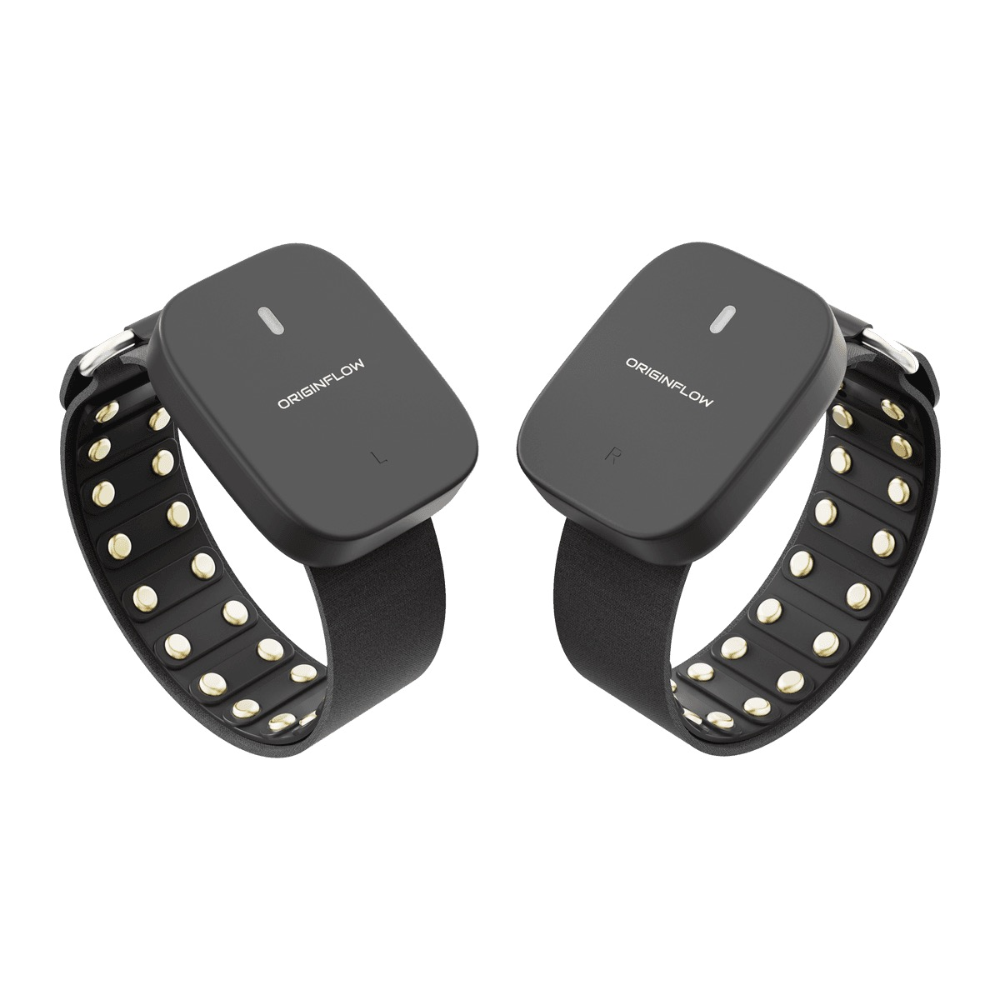
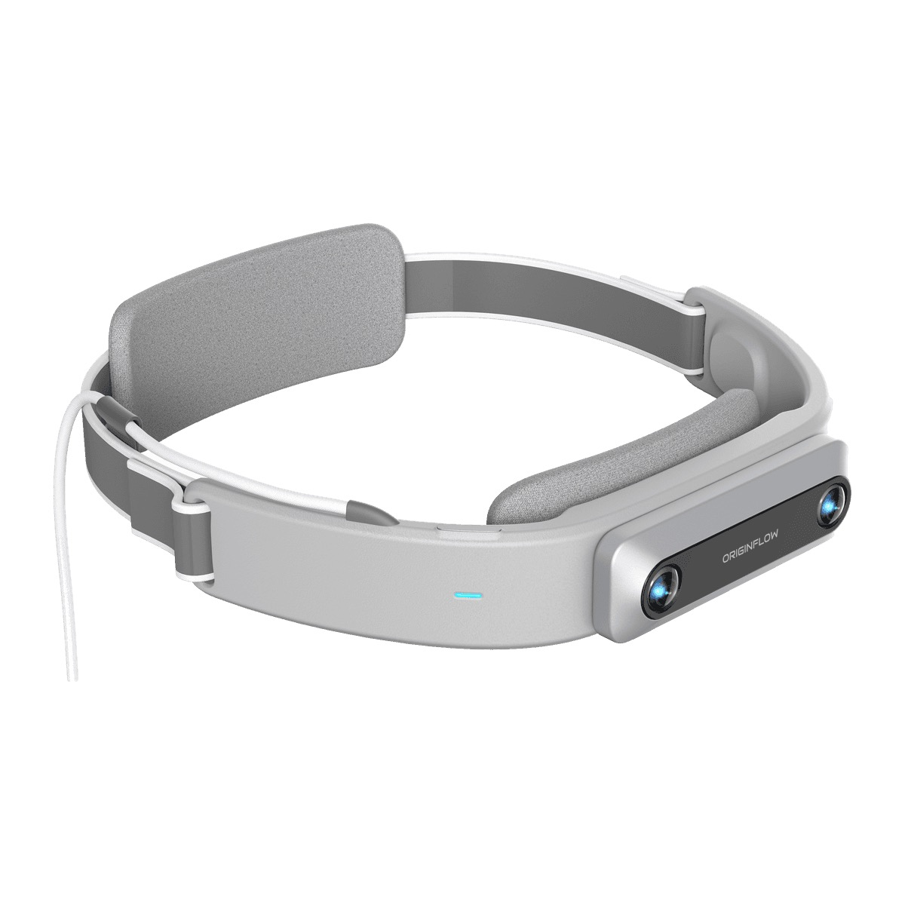
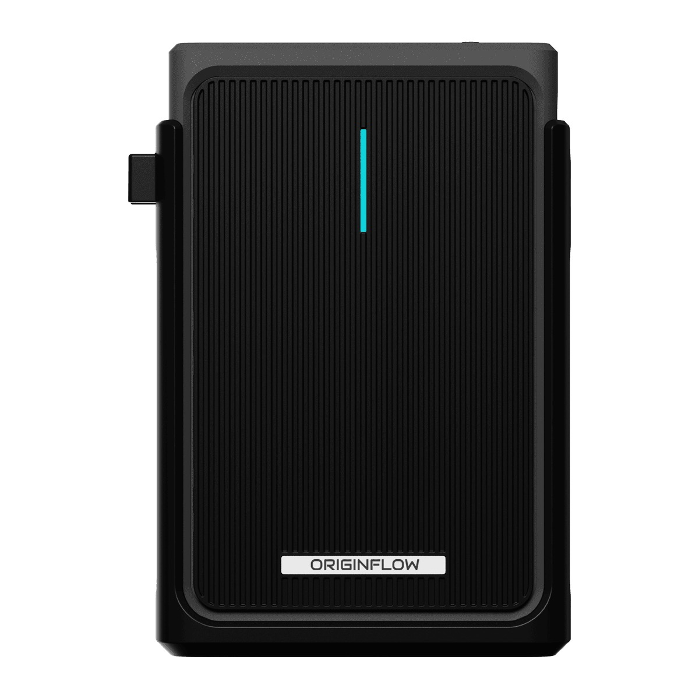

# OriginFlow × T01 — Products and Solutions

⬆ [OriginFlow profile](../OriginFlow.md) · [Brief](OriginFlow-T01-1-Brief.md) · [Playbook](OriginFlow-T01-3-Playbook.md)

**Bottom line for T01:** OriginFlow sells sensing and data, not robots. Nothing here has payload, reach, speed, runtime, an IP rating or an autonomy stack. Its value in this track is as (a) a wearable command / teleoperation input and (b) a demonstration recorder for service skills. Both depend on an interface that is **not public** — confirm at the booth first.

## Relevant products (ranked for this track)

### Band

**Role in T01:** hands-busy command channel for a service robot (gesture commands for a porter / delivery robot) and the sensing front end for EMG teleoperation of a gripper or dexterous hand.

| Spec | Value |
|---|---|
| Sensing | **16-channel** surface EMG (microvolt-level) + wrist motion |
| Data stream | about **96 KB/s** (press-reported) |
| Sampling rate, latency | not public |
| Form factor | strap slightly wider than a smartwatch band (press description) |
| Battery life, wireless link, IP rating | not public |
| Works standalone (without Glass and Space) | not public — ask |
| Use over a sleeve or glove cuff | sEMG needs skin contact at the forearm / wrist; a glove on the hand should not interfere ⚠️ unverified for this device |

- **Status / price / availability:** ✅ part of OriginKitGen 1.0, by enquiry. Price not public.
- **Developer interface:** not public. No documented SDK, ROS 2 driver or streaming protocol. What you can control: nothing on the device side; you only consume data, if a stream or export is offered.

### PULSE

**Role in T01:** turns Band signals into continuous hand pose and estimated fingertip force — the piece that would make force-aware remote grasping possible (for example closing a hand on a parcel or a door handle with a controlled squeeze).

| Spec | Value |
|---|---|
| Inputs | 16-channel sEMG (press also mentions first-person vision and IMU as inputs) |
| Outputs | hand pose, contact force, actuation force — **estimates** under calibration and task conditions |
| Version | **v0.2** demoed at WAIC 2026 (2026-07); v0.3 in development |
| Latency, accuracy, calibration time | not public |
| Weights / API / model card | not public |

- **Status:** 🧪 demo only. Whether it runs on site and can be read out live is unknown.
- **Developer interface:** none documented.

### OriginKitGen 1.0

**Role in T01:** record how a human performs a service task (clearing a tray, folding towels, loading a delivery compartment, pressing a lift button) with video, head motion, wrist motion and sEMG on one timeline — raw material for imitation learning on another vendor's manipulator.

| Spec | Value |
|---|---|
| Components | Glass + Band + Space |
| Modalities | first-person video, head motion, wrist motion, 16-channel sEMG, time-synchronised |
| Workflow | setup → calibration → capture → status → preview; local recording |
| Export format, self-service export | not public |
| Price | not public; press reports roughly **RMB 1,000 per capture set** ⚠️ unverified |

- **Status:** ✅ offered via enquiry on the official site.
- **Developer interface:** not public.

### Glass

**Role in T01:** egocentric view of the task for demonstration data; possible operator-side camera. It is a capture device, not a display — use XREAL if the operator needs to see the robot's view.

| Spec | Value |
|---|---|
| Sensing | first-person video + head motion |
| Resolution, FoV, frame rate, battery | not public |

- **Status:** ✅ part of the kit. **Developer interface:** not public.

### Space

**Role in T01:** the unit you would most likely tap for data (control, device status, local recording, preview). Compute, storage, ports and battery are not public.

- **Status:** ✅ part of the kit. **Developer interface:** not public.

### Data Capture Services

**Role in T01:** not usable inside 48 hours; relevant only as a post-hackathon story ("we would scale this skill dataset through their capture service").

- **Status:** ✅ listed on the official site. Volumes, formats, licence, price: not public.

CHORD and ORACLE (alignment base model, auto-annotation) are internal, press-described only 🧪, and have no hackathon-usable interface — not ranked.

## What OriginFlow already does in this domain

**Nothing specific to urban services is public.** No delivery, navigation, cleaning-robot, hospitality or municipal deployment, pilot or demo was found. The official site names no industries at all.

Adjacent activity:

| Date | What | Relevance to T01 | Source |
|---|---|---|---|
| 2026-05-21 (reported) | Home-service data capture with **58 Group**: clothes organising, household cleaning, kitchen work, toward a skills database for domestic-service robots | Same task family as hotel / clinic housekeeping; data only, no robot deployed | [TMTPost](https://en.tmtpost.com/post/7997613) |
| 2026-05-21 (reported) | Industrial data capture with unnamed high-end manufacturers | Low | [TMTPost](https://en.tmtpost.com/post/7997613) |
| 2026-07 (WAIC 2026) | **PULSE 0.2** live demo: hand tracking + fingertip-force readout from the wristband | Proves real-time decoding exists in some form; no robot was driven in the reported demo | [QbitAI](https://www.qbitai.com/2026/08/477094.html) |
| 2026 (date ⚠️ unverified) | Partnership with LinkerBot (dexterous hands) on mapping EMG-decoded motion / touch data to hands | Suggests EMG-to-hand retargeting is on their agenda; LinkerBot is not on site | see [profile](../OriginFlow.md) |

## What they are building next in this domain

- **PULSE 0.3** 🧪 — tendon force and hand forward kinematics (stated 2026-08).
- **Cross-embodiment transfer** 🔭 — human data for breadth plus a smaller robot dataset as alignment anchors; described as a plan, no public result.
- **"With Human" stage** 🔭 — next-generation always-on AI hardware, "including robots". No product, date or service-robot focus given.
- **Future markets named:** robotics, smart hardware, medical rehabilitation, spatial computing. Urban services, logistics and hospitality are **not** named.
- *Inference:* the 58 Group housekeeping data is the most likely bridge into service robotics; any T01 use today is something you build, not something they roadmap.

## Software, models and data that help for this track

From OriginFlow: **nothing public** (no SDK, repo, weights or dataset).

Third-party shortcuts (not OriginFlow; use only as method references or baselines):

| Resource | What it gives you | Caveat |
|---|---|---|
| [emg2pose](https://github.com/facebookresearch/emg2pose) (Meta) | sEMG-to-hand-pose dataset (about 370 h, 193 users, 2 kHz) + baseline code and pretrained checkpoints | Recorded on Meta's own wristband; **transfer to the OriginFlow Band is not established** (different electrodes, rate unknown). CC-BY-NC-SA-4.0 |
| [generic-neuromotor-interface](https://github.com/facebookresearch/generic-neuromotor-interface) (Meta) | Code + checkpoints for discrete gestures, wrist control and handwriting from wrist sEMG (2 kHz) | Same hardware caveat. CC-BY-NC-4.0. Useful as an architecture and preprocessing template |
| Your own small classifier | With raw 16-channel data, a per-user gesture classifier on windowed amplitude features (4–5 gestures) is a standard, few-hour job | Needs live raw sEMG access and a short per-user training recording |

For navigation, delivery and manipulation software, rely on the robot vendor you pair with.

## Gaps and limits for this track

- **No mobility, manipulation or autonomy.** Every T01 demo needs a second vendor.
- **Interface unknown.** No public stream, export format or SDK; all build plans are conditional.
- **Estimates, not measurements.** Force and pose are model outputs under per-user calibration.
- **Per-user calibration and electrode shift.** sEMG decoding generally degrades when the band moves or a new person wears it; plan one fixed operator for the demo.
- **Outdoor alpine use untested.** No IP rating, cold-temperature or battery data; sweat and cold skin can change signal quality. Keep the demo indoors or short.
- **Adds a human to an "autonomous" track.** Judges may ask why the robot is not autonomous — position it as supervision / exception handling / teaching, not as the core loop.
- **No Europe support or deployment found**; continuity after the event is uncertain.

## Sources
- [OriginFlow official site](https://www.originflow.ai/) (fetched 2026-11-14)
- [TMTPost (EN), 2026-05-21 — funding, 58 Group home-service data, future markets](https://en.tmtpost.com/post/7997613)
- [QbitAI, 2026-08 — PULSE / CHORD / ORACLE, WAIC demo, roadmap (Chinese)](https://www.qbitai.com/2026/08/477094.html)
- [facebookresearch/emg2pose (GitHub)](https://github.com/facebookresearch/emg2pose)
- [facebookresearch/generic-neuromotor-interface (GitHub)](https://github.com/facebookresearch/generic-neuromotor-interface)
- [OriginFlow company profile (this repo)](../OriginFlow.md)

Research note: track-specific web searches could not be run in this pass (search quota exhausted); findings rest on the official site and the press pages above, fetched directly. None of them mentions urban-service, delivery or hospitality work.
