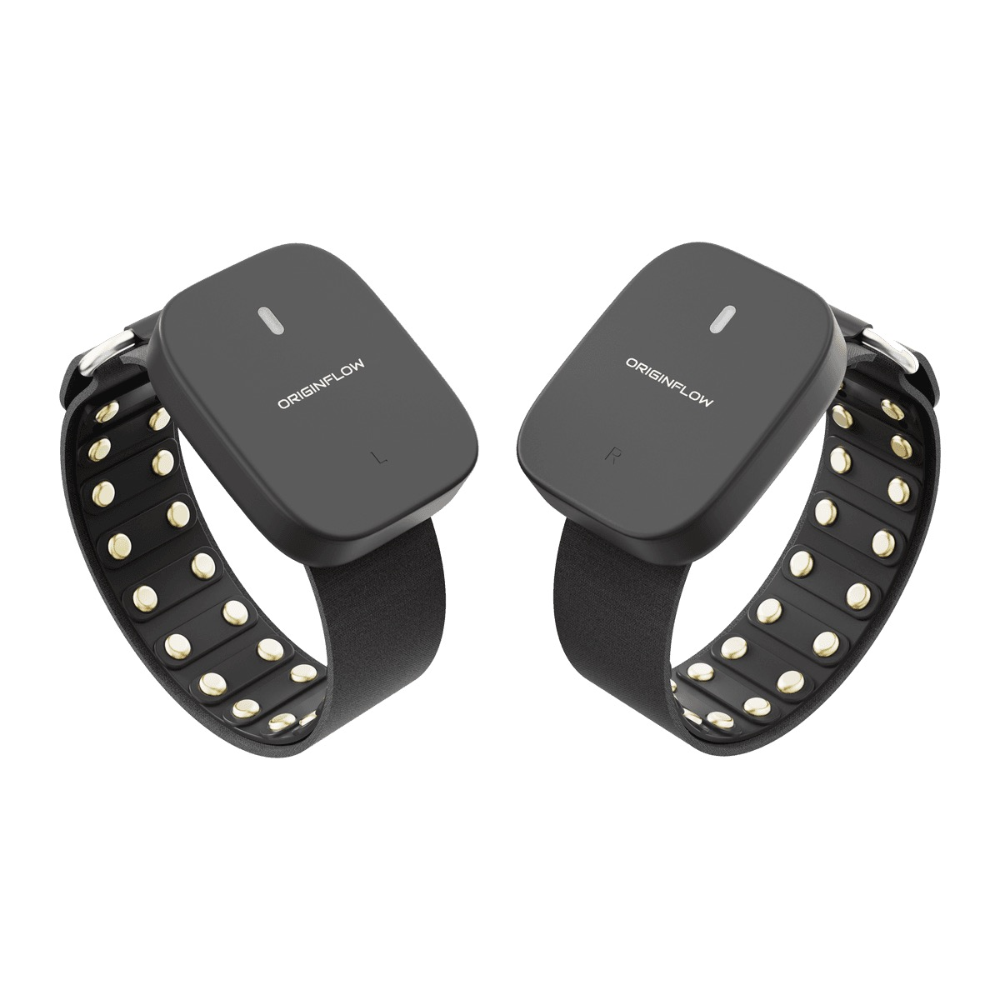
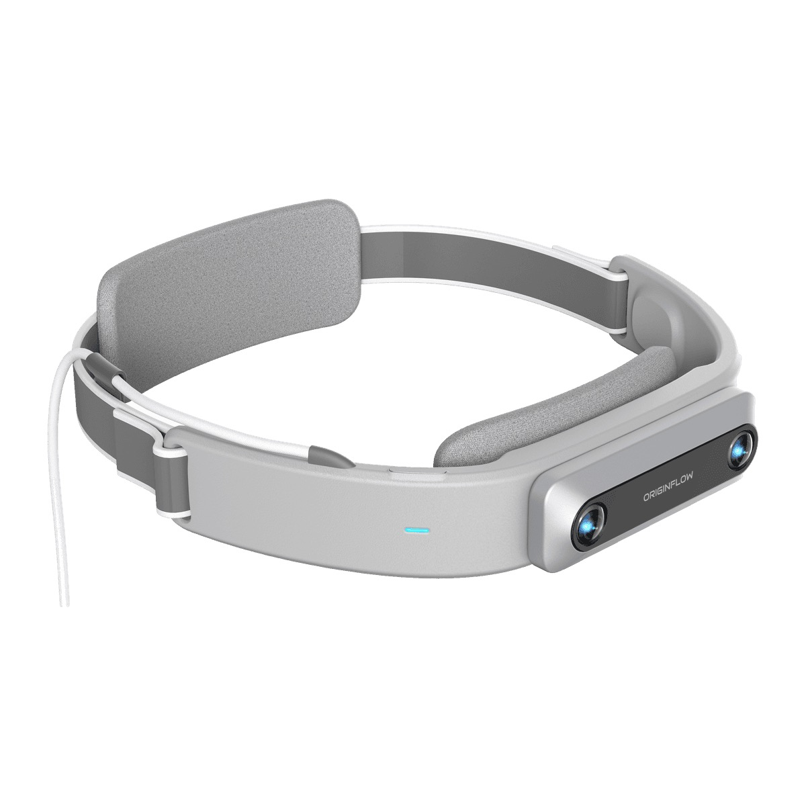
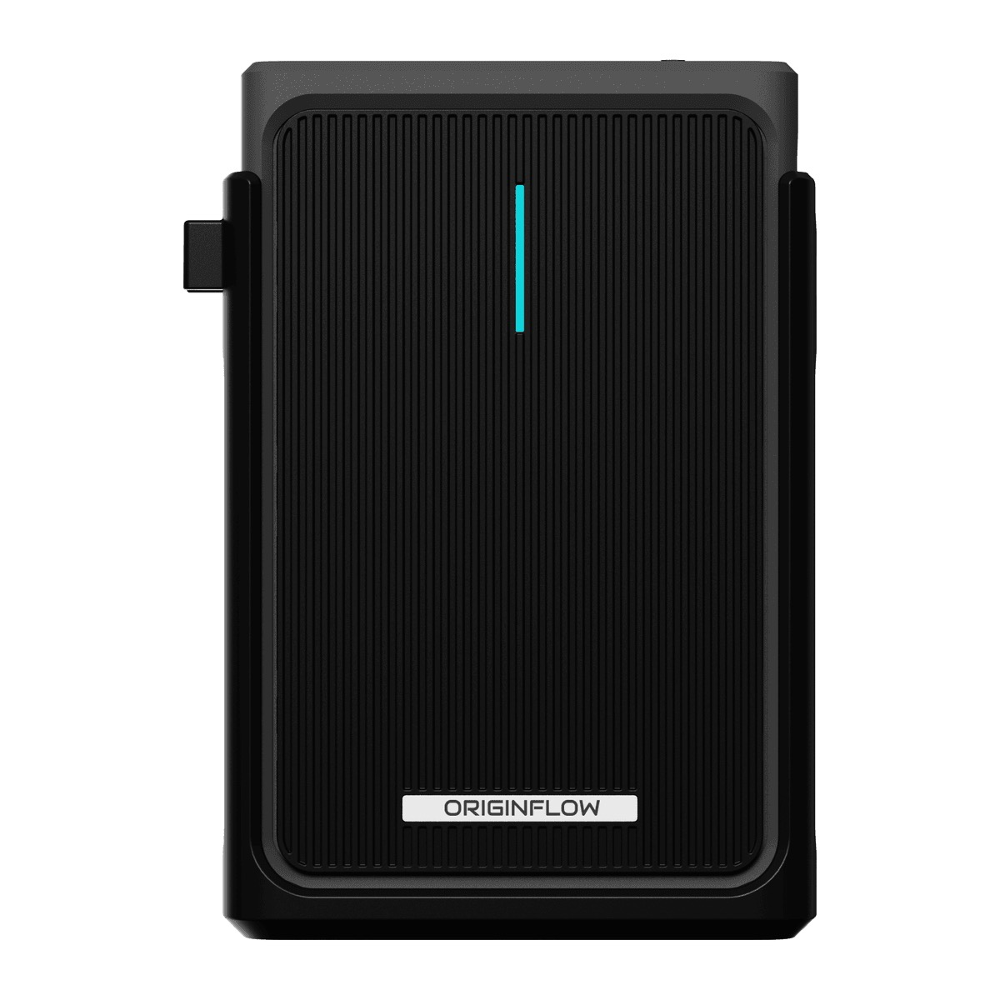
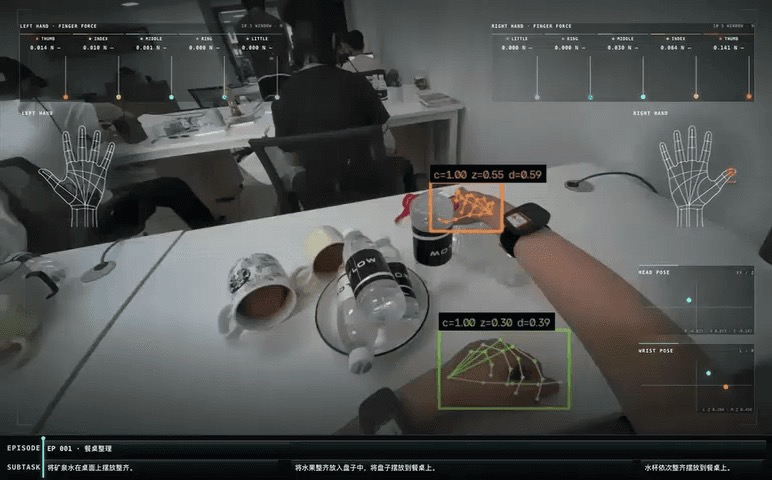

# OriginFlow × T02 — Products and Solutions

⬆ [OriginFlow profile](../OriginFlow.md) · [Brief](OriginFlow-T02-1-Brief.md) · [Playbook](OriginFlow-T02-3-Playbook.md)

**Bottom line:** OriginFlow has **no product, deployment or announcement aimed at emergency response, inspection or public safety.** It sells a wearable human-data capture kit. In T02 it can only be the **human-side input or recording layer** of someone else's robot. There is **no public SDK, API, ROS 2 driver, export-format spec, dataset or model download** — every use below is conditional on what the team exposes on site.

Research note: web search was unavailable for this pass; findings rest on the official site, the two press profiles and the company profile. Nothing T02-specific was found in any of them.

## Relevant products (ranked for this track)

### Band

**Role in T02:** hands-busy command input (wrist / finger gestures decoded from muscle signals) or the hand-pose / grip-force source for remote manipulation. The one item with a plausible live-control use.

| Spec | Value |
|---|---|
| Sensing | **16-channel** surface EMG (microvolt level) + wrist motion |
| Data stream | about **96 KB/s** (press-reported) |
| Sampling rate, latency, battery life | not public |
| Ruggedness (IP rating, cold, wet, over / under gloves) | not public |
| Form factor | strap slightly wider than an Apple Watch band, lighter overall (press) |
| Calibration | per-user calibration is part of the pipeline; duration not public |
| Standalone use (without Glass / Space) | not public |

- **Status / price / availability:** ✅ offered by enquiry as part of OriginKitGen 1.0. Price not public; press reports about **RMB 1,000 per capture set** ⚠️ unverified.
- **Developer interface:** not public. Sensor only — nothing to control. Whether raw sEMG can be streamed live to a laptop is the key open question.

### PULSE

**Role in T02:** turns Band signals into **continuous hand pose and fingertip force** — the signal needed for force-aware teleoperation of a dexterous hand on a hazardous task (valve, breaker, debris).

| Spec | Value |
|---|---|
| Input | 16-channel sEMG from the Band |
| Output (v0.2) | continuous hand tracking + fingertip-force estimate (not discrete gesture classes) |
| Stated scope | pose, contact force, actuation (drive) force |
| Accuracy, latency, cross-user generalisation | not public; no independent validation |
| Runs on | not public |

- **Status:** 🧪 v0.2 demoed at WAIC 2026; v0.3 in development. No weights, API or model card.
- **Developer interface:** not public. Outputs are **estimates under defined calibration and task conditions** (official wording) — do not treat as measured force.

### Glass

**Role in T02:** first-person video + head motion of a responder or inspector; a mission log, or an input for off-line reporting.

| Spec | Value |
|---|---|
| Sensing | egocentric video + head motion |
| Resolution, FoV, frame rate, low-light performance | not public |
| Live video out | not public |
| Display | none documented (it is a camera, not AR glasses) |

- **Status:** ✅ part of OriginKitGen 1.0. Price not public.
- **Developer interface:** not public.

### OriginKitGen 1.0

**Role in T02:** the full kit as a synchronised "task black box" for an inspection round or a drill: video, head motion, wrist motion and sEMG on one timeline.

| Spec | Value |
|---|---|
| Components | Glass + Band + Space |
| Sync | all streams on a shared timeline; multi-device clock alignment |
| Workflow | setup, calibration, capture, status, preview (5 steps) |
| Recording | local |
| Export format, licence on captured data | not public |

- **Status:** ✅ by enquiry. Price not public (about RMB 1,000 per set press-reported ⚠️ unverified).

### Space

**Role in T02:** control and local-recording unit; relevant only as the place a live stream or file export would come from.

| Spec | Value |
|---|---|
| Functions | device status, capture workflow control, local storage, operator feedback |
| Compute, storage, battery, network interfaces | not public |

- **Status:** ✅ part of the kit. **Developer interface:** not public.

### Data Capture Services

**Role in T02:** marginal. A service for robotics teams to have real-world tasks captured; could in principle cover maintenance or emergency procedures, but nothing of the kind is announced and it is not a 48-hour tool.

- **Status:** ✅ listed on the official site. Volumes, formats, pricing not public.

CHORD and ORACLE (🧪, press only) have no hackathon-usable role in T02 and are omitted.

## What OriginFlow already does in this domain

**Nothing public.** No deployment, pilot, demo or partner in emergency response, hazard monitoring, infrastructure inspection, security or hazardous-environment teleoperation.

Adjacent facts only:

| Date | Fact | Relevance to T02 |
|---|---|---|
| 2026-05-21 | Stated commercial focus: **industrial manufacturing** (unnamed "leading global high-end manufacturers") and **home services** (with 58 Group) — both are data capture for robot training ([TMTPost](https://en.tmtpost.com/post/7997613)) | Indirect: industrial skill capture could extend to maintenance procedures |
| 2026-07 (WAIC 2026) | **PULSE 0.2** live demo: continuous hand tracking + fingertip force during pinch ([36Kr Europe](https://eu.36kr.com/en/p/3950735048031365)) | Shows the signal a remote-manipulation demo would need; no robot was reported in the loop |
| 2026, date ⚠️ unverified | Strategic partnership with LinkerBot (dexterous hands) on data acquisition and adaptation (source page not readable; from search summary in the company profile) | Suggests EMG-to-dexterous-hand mapping is on their agenda; LinkerBot is not on site |

Press does **not** claim teleoperation or real-time robot control for OriginFlow. Teleoperation appears only as a competing data-collection method.

## What they are building next in this domain

Nothing announced for safety or resilience. Relevant hints:

- **PULSE 0.3** 🧪 — tendon force and hand forward kinematics (stated 2026-08).
- **"With Human" stage** 🔭 — always-on AI hardware, "including robots".
- **Lighter consumer-like capture devices** 🔭 — glasses, watches, light bands.
- **Named future markets** 🔭 — robotics, smart hardware, medical rehabilitation, spatial computing. Public safety is not among them.
- *Inference (ours):* press describes a "low-latency, low-intermediary" human-machine interaction entry point; EMG command or teleoperation interfaces for field workers would be a natural extension, but the company has not said so.

## Software, models and data that help for this track

From OriginFlow: **nothing public** (no SDK, repo, dataset or weights).

Third-party open resources that shortcut an EMG build — different wristband hardware, so **models will not transfer to the Band without retraining**; use them for architectures, preprocessing and training code:

| Resource | What it gives | Limits |
|---|---|---|
| [emg2pose (Meta FAIR)](https://github.com/facebookresearch/emg2pose) | 16-channel wrist sEMG at 2 kHz paired with mocap hand pose; **193 users, 370 h**; baseline models with checkpoints; 600 MiB mini set | Non-commercial licence (CC-BY-NC-SA 4.0); electrode layout differs from the Band |
| [generic-neuromotor-interface (Meta)](https://github.com/facebookresearch/generic-neuromotor-interface) | Training code and checkpoints for **discrete gestures, wrist control, handwriting** from wrist sEMG; 100 participants per task | Non-commercial licence (CC-BY-NC 4.0); same hardware caveat |

Practical shortcut for 48 hours: if raw sEMG is available, record 5 to 8 gestures from your own operator and train a small per-user classifier on windowed features. This is standard practice and avoids any dependence on PULSE.

## Gaps and limits for this track

- **No interface documented** — the entire track role depends on a live stream or file export being granted on site.
- **No robot, mobility, mapping, hazard sensing or autonomy.** Everything task-facing comes from another vendor.
- **No ruggedness data:** IP rating, cold tolerance (Leukerbad, November, 1,400 m), sweat or wet skin behaviour, use under thick gloves or jackets — all not public. sEMG generally degrades with electrode shift and poor skin contact.
- **Per-user calibration** needed; duration unknown. Plan one fixed operator.
- **Estimates, not measurements:** force and pose are model outputs; not suitable for any safety-rated function.
- **Band gives wrist motion, not arm position** — arm teleoperation needs another tracker.
- **No independent validation** of any performance claim.
- **Data ownership / export licence** of what you record is not public.

## Sources
- [OriginFlow official site](https://www.originflow.ai/)
- [TMTPost (EN), 2026-05-21 — Tsinghua PhD student raises over 500 million yuan in five months](https://en.tmtpost.com/post/7997613)
- [36Kr Europe (EN), 2026-08-24 — OriginFlow profile](https://eu.36kr.com/en/p/3950735048031365)
- [QbitAI, 2026-08-22 — OriginFlow profile (Chinese)](https://www.qbitai.com/2026/08/477094.html)
- [emg2pose — GitHub (facebookresearch)](https://github.com/facebookresearch/emg2pose)
- [emg2pose paper — arXiv 2412.02725](https://arxiv.org/abs/2412.02725)
- [generic-neuromotor-interface — GitHub (facebookresearch)](https://github.com/facebookresearch/generic-neuromotor-interface)
- [OriginFlow company profile (internal)](../OriginFlow.md)
