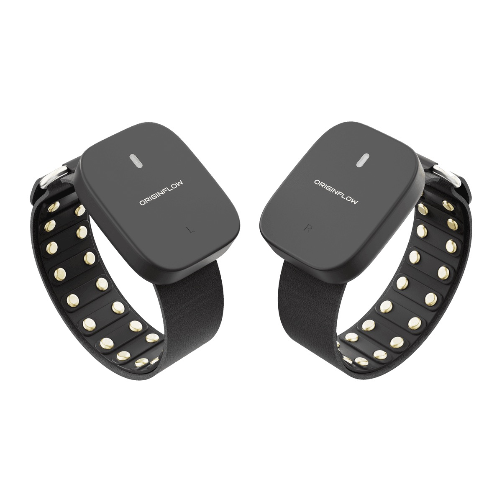
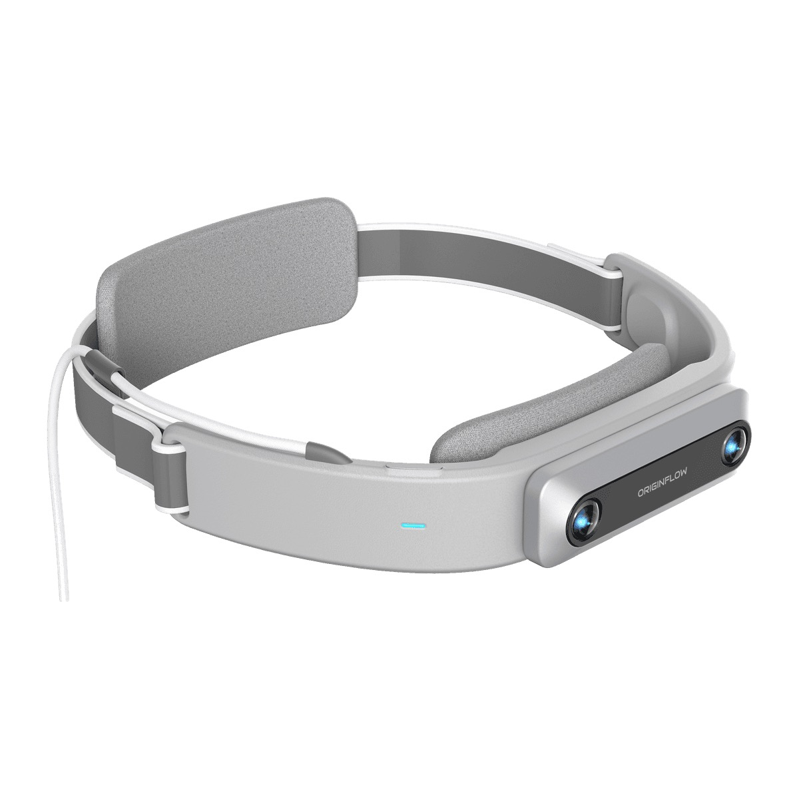
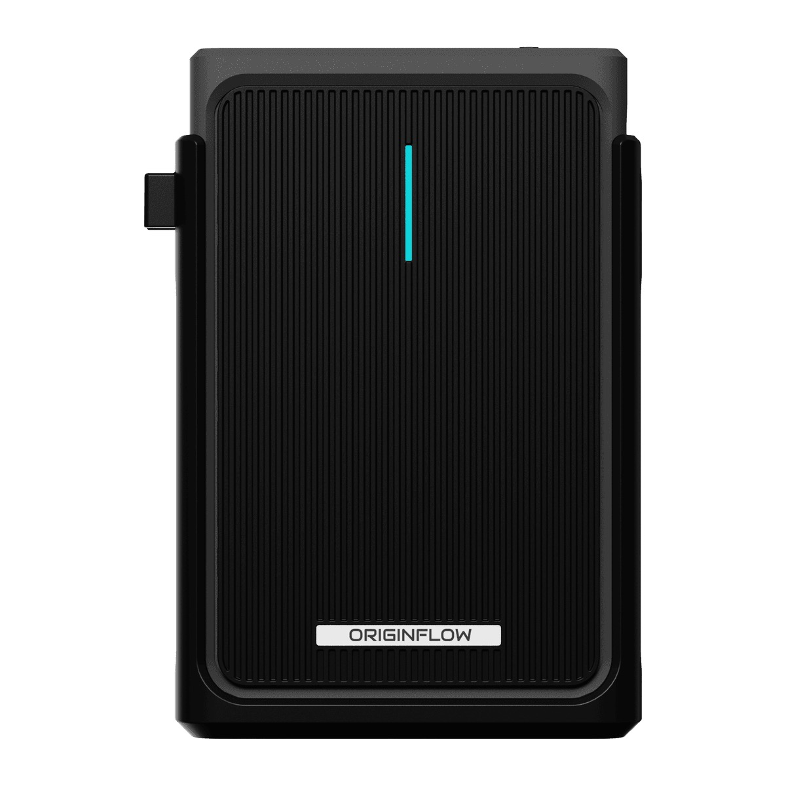

# OriginFlow × T03 — Products and Solutions

⬆ [OriginFlow profile](../OriginFlow.md) · [Brief](OriginFlow-T03-1-Brief.md) · [Playbook](OriginFlow-T03-3-Playbook.md)

**Bottom line:** OriginFlow sells a wearable capture kit and data services. It has **no robot, no actuator, no environmental sensor and no public developer interface**. For T03 it can only supply human-skill data or an operator input to someone else's robot. Fit **1/5**.

**Research limit:** the web-search budget for this pipeline run was exhausted, so no fresh track-specific search could be run. This file rests on direct reads of the official site and three press articles (May and Aug 2026). Nothing sustainability-related appears in any of them.

## Relevant products (ranked for this track)

### OriginKitGen 1.0

**Role in T03:** record a person doing a circular-economy task (sorting recyclables, dismantling a device, repairing equipment) as synchronised first-person video + wrist motion + muscle activity, to teach or tune another vendor's robot.

| Spec | Value |
|---|---|
| Composition | Glass + Band + Space (three devices) |
| Modalities on one timeline | First-person video, head motion, wrist motion, **16-channel sEMG** |
| Workflow | 5 steps: device setup, quick calibration, start capture, status feedback, data preview |
| Derived outputs | Pose, motion intent, force, contact state — **estimated**, "under defined algorithms, calibration and task conditions" |
| Recording | Local, on Space |
| Export format, calibration time, battery life, IP rating | not public |

- **Status:** ✅ offered via enquiry on the official site (contact@originflow.ai).
- **Price:** not public. Press reports about **RMB 1,000 per set** ⚠️ unverified.
- **Developer interface:** not public. No documented SDK, API, ROS 2 driver or file format. You control only the capture workflow through Space, as far as is documented.

### Band

**Role in T03:** the only part with a unique signal. Estimated grip effort during sorting or disassembly (what a camera cannot see), or a hands-busy gesture input for a human-in-the-loop sorting cell.

| Spec | Value |
|---|---|
| sEMG channels | **16**, microvolt-level signals |
| Data stream | about **96 KB/s** (press) |
| Other sensing | Wrist motion |
| Form factor | Strap slightly wider than an Apple Watch band, lighter overall (press) |
| On-device processing | Filtering, differential acquisition, motion-artifact suppression (press) |
| Sampling rate, latency, battery, wireless protocol, standalone use | not public |

- **Status:** ✅ as part of the kit. Standalone sale: not public.
- **Developer interface:** not public. Raw-signal or live-stream access must be confirmed at the booth.

### PULSE

**Role in T03:** turns Band signals into hand pose and fingertip-force estimates. This is what would make "force-aware" disassembly or sorting data possible.

| Spec | Value |
|---|---|
| Inputs | sEMG, first-person vision, IMU (press) |
| Outputs | Hand pose, motion trajectory, contact force, tendon force (press) |
| Shown publicly | **v0.2** at WAIC, **July 2026**: continuous hand tracking + fingertip-force readout |
| Next | **v0.3** 🧪 in development (tendon force, hand forward kinematics) |
| Accuracy, latency, weights, API | not public |

- **Status:** 🧪 demoed; no public weights, API or model card.
- **Developer interface:** none public. Assume it runs on OriginFlow's own machine and you receive whatever they choose to stream or export.

### Glass

**Role in T03:** first-person video of the sorting or repair task; the only modality you could replace with any camera if the kit is unavailable.

| Spec | Value |
|---|---|
| Sensing | First-person video + head motion |
| Resolution, field of view, frame rate, battery | not public |

- **Status:** ✅ as part of the kit. **Developer interface:** not public.

### Data Capture Services

**Role in T03:** the realistic long-term route — a recycler or repair operator commissions OriginFlow to capture workers' skills as robot-training data. Not something a team can consume in 48 hours.

| Spec | Value |
|---|---|
| Offer | Multimodal capture of real-world work for robotics and Physical-AI teams |
| Outputs | Video, semantics, pose, force (official site) |
| Volumes, formats, licence, turnaround | not public |

- **Status:** ✅ listed on the official site; price not public.

### Space

**Role in T03:** infrastructure only — device control, capture workflow and local recording. Compute, storage, ports and battery are not public. Ask whether recordings can be copied off it.

## What OriginFlow already does in this domain

**Nothing found.** No recycling, waste, energy, water, environmental-monitoring or building-automation deployment, pilot, demo, partner or application page.

Closest adjacent activity:

| Date | Activity | Relevance to T03 | Source |
|---|---|---|---|
| 2026-05-21 | Industrial data capture with unnamed "leading global high-end manufacturers" | Factory manual-skill capture; tasks not disclosed | [TMTPost](https://en.tmtpost.com/post/7997613) |
| 2026-05-21 | Home-service capture with 58 Group: clothes organising, household cleaning, kitchen work | Household handling skills; no waste-sorting task named | [TMTPost](https://en.tmtpost.com/post/7997613) |
| 2026-07 | PULSE 0.2 demo at WAIC: hand tracking + fingertip force from the Band | Shows the force-estimation capability a disassembly idea would lean on | [36Kr Europe](https://eu.36kr.com/en/p/3950735048031365) |
| 2026 (date ⚠️ unverified) | Strategic partnership with LinkerBot (dexterous hands) | Human-to-robot-hand mapping; LinkerBot is not on site | see [profile](../OriginFlow.md) |

## What they are building next in this domain

- **Nothing announced for sustainability.**
- Stated direction (Aug 2026): scale up human data, human-to-robot cross-embodiment transfer, lighter consumer-style capture devices (glasses, watch, bracelet) 🔭, PULSE 0.3 🧪.
- Future markets the company names: robotics, smart hardware, medical rehabilitation, spatial computing. Sustainability is not among them.
- **Inference (not a company statement):** capturing skills from people wearing a wristband needs no robot running during data collection, which is a lower-hardware route to robot training data than teleoperation. No energy or cost figures are published, so do not quote numbers.
- **Inference:** press lists occupational ergonomics and strain assessment as an established sEMG use; worker-load monitoring at sorting lines would be a plausible extension, but OriginFlow has not announced it.

## Software, models and data that help for this track

| Item | Owner | Use for T03 | Access |
|---|---|---|---|
| PULSE | OriginFlow | Hand pose + force estimates from the Band | 🧪 not public |
| ORACLE | OriginFlow | Auto-annotation of action, force, semantics, task segments | 🧪 internal, not public |
| CHORD | OriginFlow | Alignment of sEMG, vision, IMU, language, robot state | 🧪 press only, not public |
| [emg2pose](https://github.com/facebookresearch/emg2pose) | Meta (third party) | Reference code and checkpoints for sEMG-to-hand-pose; about 370 hours, 193 participants, 2 kHz | Open, **CC-BY-NC-SA-4.0** (non-commercial) |
| [generic-neuromotor-interface](https://github.com/facebookresearch/generic-neuromotor-interface) | Meta (third party) | Reference code and checkpoints for discrete-gesture and wrist decoding from wrist sEMG | Open, **CC-BY-NC-4.0** (non-commercial) |

- The third-party checkpoints were trained on **different wristband hardware**. Expect them not to transfer to the OriginFlow Band without retraining ⚠️ unverified; treat them as architecture and pipeline references only.
- If you get raw 16-channel sEMG, a small per-user gesture classifier (3–4 gestures, trained on a few minutes of your own data) is the realistic 48-hour model. This is generic practice, not an OriginFlow tool.
- Robot-side learning (imitation policy, waste classifier) must come from the robot vendor's stack or your own code.

## Gaps and limits for this track

- **No actuation, no mobility, no autonomy.** Cannot pick, sort, clean, charge or monitor anything by itself.
- **No public interface at all:** no SDK, API, ROS 2, file-format documentation, dataset or weights.
- **Force is an estimate**, calibration-dependent, with no published accuracy. Do not present it as a measured Newton value.
- **Per-user calibration** is required; duration not public.
- **Ruggedness unknown:** no IP rating or glove-compatibility information. Wet, dirty or gloved waste handling may degrade skin contact ⚠️ unverified.
- **No environmental sensing** (air, water, snow, energy): irrelevant for most of the T03 problem space.
- **No independent validation** and no Europe or Switzerland activity found.
- **48-hour learning loop is tight:** record, export, train, deploy on another vendor's robot needs every hand-off to work first time.

## Sources

- [OriginFlow official site](https://www.originflow.ai/)
- [TMTPost (EN), 2026-05-21 — funding, industrial and home-service scenarios](https://en.tmtpost.com/post/7997613)
- [36Kr Europe (EN), 2026-08-24 — profile: Band, PULSE, CHORD, ORACLE, roadmap](https://eu.36kr.com/en/p/3950735048031365)
- [QbitAI (Chinese), 2026-08-22 — original profile](https://www.qbitai.com/2026/08/477094.html)
- [facebookresearch/emg2pose (GitHub)](https://github.com/facebookresearch/emg2pose)
- [facebookresearch/generic-neuromotor-interface (GitHub)](https://github.com/facebookresearch/generic-neuromotor-interface)
- [OriginFlow company profile (internal)](../OriginFlow.md)
