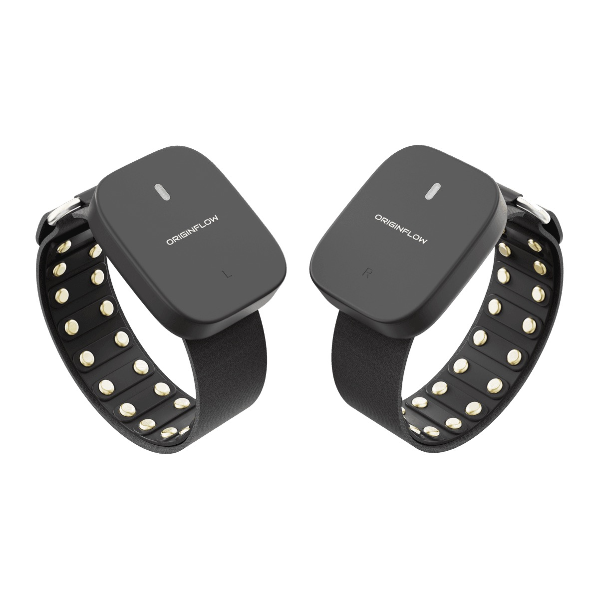
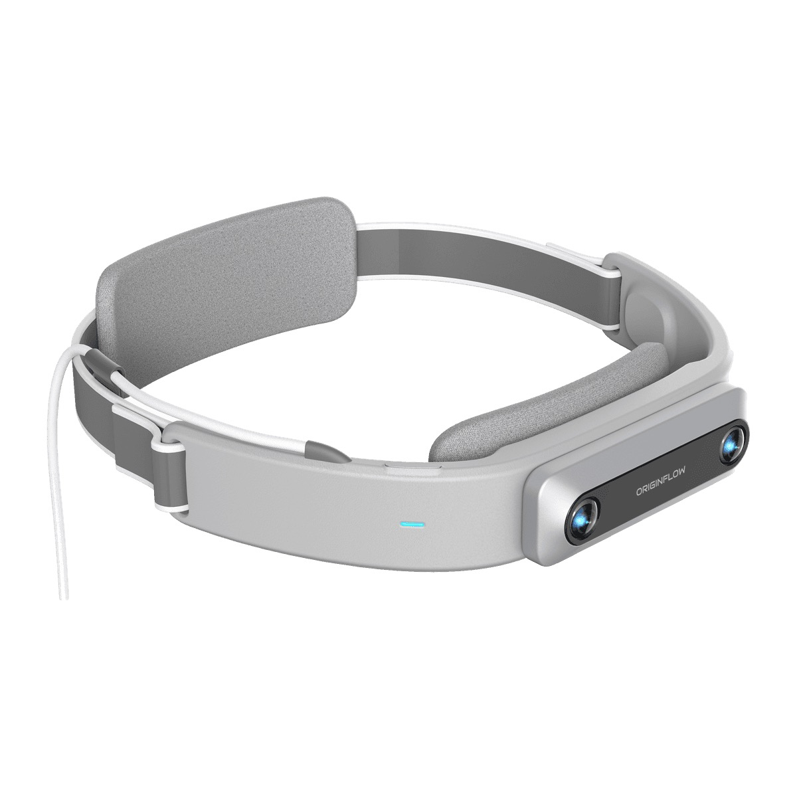
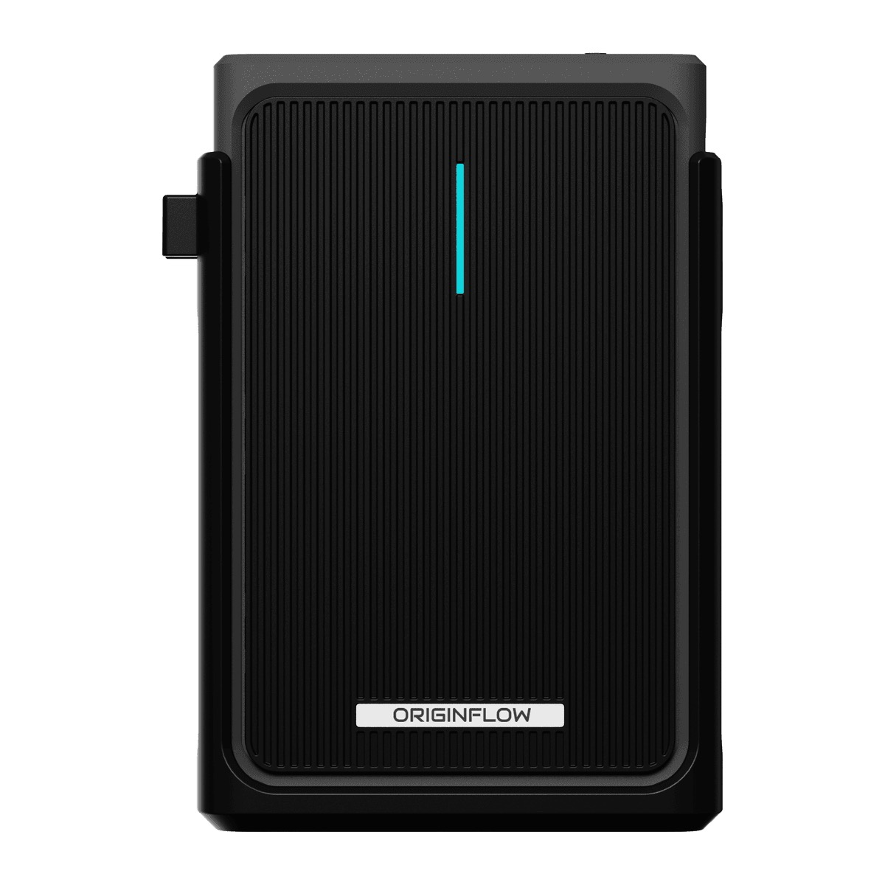

# OriginFlow × T04 — Products and Solutions

⬆ [OriginFlow profile](../OriginFlow.md) · [Brief](OriginFlow-T04-1-Brief.md) · [Playbook](OriginFlow-T04-3-Playbook.md)

**Read first:** OriginFlow sells capture hardware and data services to robot-learning teams. Nothing in its public material targets care or rehabilitation today. **No SDK, API, ROS 2 interface, open dataset or model weights are public** (checked 2026-11-14). Everything below that needs live data is conditional on what the team exposes on site.

## Relevant products (ranked for this track)

### Band

**Role in T04:** the core piece. A wrist-worn sEMG sensor is the natural input for rehab-exercise biofeedback, effort / fatigue monitoring, and intent detection for an assistive arm or hand.

| Spec | Value |
|---|---|
| Sensing | **16-channel** surface EMG (microvolt level) + wrist motion |
| Data stream | about **96 KB/s** (press figure) |
| Sampling rate, bit depth | not public. *Inference:* 96 KB/s over 16 channels suggests roughly 2–3 kHz per channel at 24- or 16-bit — confirm on site |
| Form factor | strap slightly wider than an Apple Watch band, lighter overall; exact size / weight not public |
| Calibration | "quick calibration" step in the workflow; duration not public |
| Battery, wireless link, latency | not public |
| Medical certification | none stated; treat as **not a medical device** |

- **Status / price / availability:** ✅ part of OriginKitGen 1.0, sold by enquiry. Not sold separately as far as public information shows. Price not public (press: about RMB 1,000 per capture set ⚠️ unverified).
- **Developer interface:** not public. Unknown whether raw sEMG can be streamed live or whether the Band works without Glass and Space.

### PULSE

**Role in T04:** turns raw sEMG into something a robot or a therapy app can use directly — continuous hand pose and an estimate of fingertip force.

| Spec | Value |
|---|---|
| Input | 16-channel sEMG from the Band |
| Output (v0.2) | continuous hand tracking + fingertip-force estimate, shown live during pinch |
| v0.3 (in development) | tendon force and hand forward kinematics |
| Accuracy, latency, calibration need | not public |
| Validation on elderly users or patients | none public |

- **Status:** 🧪 v0.2 demoed at WAIC 2026 (July 2026); no weights, API or model card released.
- **Developer interface:** not public. Best case on site: a stream of joint angles and force values you can subscribe to.

### OriginKitGen 1.0

**Role in T04:** records a caregiver or physiotherapist performing a task (first-person video + head motion + wrist motion + sEMG on one timeline) as demonstration data for a care robot.

| Spec | Value |
|---|---|
| Components | Glass + Band + Space |
| Modalities | egocentric video, head motion, wrist motion, 16-channel sEMG, time-synchronised |
| Workflow | device setup → quick calibration → capture → status feedback → data preview |
| Storage | local recording on Space |
| Export format, licence | not public |

- **Status / price:** ✅ offered by enquiry; price not public.
- **Developer interface:** capture workflow is operated through Space; self-service export is not documented.

### Glass

**Role in T04:** minor. First-person video of a therapy or care task for documentation or training data. Resolution, field of view and frame rate are not public. It is a camera, not a display — use XREAL for AR feedback.

- **Status:** ✅ part of the kit. **Developer interface:** not public.

### Space

**Role in T04:** infrastructure only — device status, capture control, local storage. Compute and battery specs not public. Likely the point where any live stream would come from; ask.

- **Status:** ✅ part of the kit. **Developer interface:** not public.

### Data Capture Services

**Role in T04:** not usable inside 48 hours; relevant only as a post-hackathon path (for example capturing caregiver skills at scale). Outputs span video, semantics, pose and force; volumes, formats and licence not public.

- **Status:** ✅ listed on the official site, by enquiry.

CHORD (multimodal alignment model) and ORACLE (auto-annotation) are internal infrastructure with no public access and no direct T04 use during the hackathon.

## What OriginFlow already does in this domain

**Nothing deployed, piloted or demonstrated in elderly care or rehabilitation was found.** The nearest items:

| Date | What | Relevance to T04 |
|---|---|---|
| 2026-05-21 | Funding announcement names **medical rehabilitation** as one of several future application areas (with robotics, smart hardware, spatial computing) | Stated intent only, no project ([TMTPost](https://en.tmtpost.com/post/7997613)) |
| 2026-05-21 | **58 Group** partnership: capture of home-service work (clothes organising, cleaning, kitchen tasks) for a housekeeping-robot skills database | Adjacent: household help is part of ageing-at-home support, but the target is domestic service, not care ([TMTPost](https://en.tmtpost.com/post/7997613)) |
| 2026-07 | **PULSE 0.2** live at WAIC 2026: hand tracking and real-time fingertip force in a pinch demo | Shows the capability a rehab or assistive demo would rely on ([QbitAI](https://www.qbitai.com/2026/08/477094.html)) |
| 2026-08 | Press profile describes general sEMG uses: rehab biofeedback, motion analysis, strain assessment, myoelectric prosthesis control | Background on the technology, not an OriginFlow activity ([QbitAI](https://www.qbitai.com/2026/08/477094.html)) |
| 2026 (date ⚠️ unverified) | LinkerBot partnership to map EMG-decoded motion and tactile data onto dexterous hands | Basis for EMG-driven assistive grasp; LinkerBot is not on site (see [profile](../OriginFlow.md)) |

No clinical partners, no clinical studies, no elderly-user trials, no Europe or Switzerland activity found.

## What they are building next in this domain

- **PULSE 0.3** 🧪 — tendon force and hand forward kinematics (stated August 2026). *Inference:* tendon / joint-torque estimates would be more meaningful for rehab assessment than pose alone, but no such use is announced.
- **Three-stage plan** — From Human (now) → With Human (always-on AI hardware, including robots) 🔭 → **Enhance Human** (10–30 year horizon) 🔭. *Inference:* "Enhance Human" points toward augmentation and assistive use; no detail is public.
- **Everyday form factors** 🔭 — the wristband is described as a current capture terminal; future capture through glasses, watches or bracelets. *Inference:* a consumer-grade band would suit home rehab monitoring.
- **Medical rehabilitation** 🔭 — named as a future market only; no product, timeline or partner.

## Software, models and data that help for this track

From OriginFlow: **nothing public** — no SDK, repo, dataset or weights.

Third-party open resources (not affiliated with OriginFlow; recorded on other sensors, so models will **not** transfer to the Band without retraining — use them as code and architecture references):

| Resource | What it gives you | Caveats |
|---|---|---|
| [emg2pose](https://github.com/facebookresearch/emg2pose) (Meta) | sEMG-to-hand-joint-angle baselines with pretrained checkpoints; about **370 h, 193 participants**, 2 kHz wrist sEMG with motion-capture labels; 600 MiB mini set | Different wristband; CC-BY-NC-SA 4.0 (non-commercial) |
| [generic-neuromotor-interface](https://github.com/facebookresearch/generic-neuromotor-interface) (Meta) | Wrist-control, discrete-gesture and handwriting decoders with checkpoints; 2 kHz sEMG, 100 participants per task | Different wristband; CC-BY-NC 4.0 |
| [NinaPro](https://ninapro.hevs.ch/) | 10 public sEMG datasets for hand / prosthetics research, some with kinematics, force (DB2) and transradial-amputee subjects; Swiss National Science Foundation funded; served from the hevs.ch domain (HES-SO Valais-Wallis; hosting institution ⚠️ unverified on the page) | Different electrodes and placement; cite the papers |

Do-it-yourself signal processing that needs only raw sEMG (standard practice, no vendor model required): rectified RMS envelope per channel, normalisation to the user's maximum voluntary contraction, simple fatigue trend from spectral shift, and a small per-user gesture classifier trained in minutes.

## Gaps and limits for this track

- **Access:** no documented real-time interface. This is the gating question.
- **No actuation:** you must bring another vendor's arm, hand or robot and write the bridge.
- **Not medical:** no certification; outputs are estimates valid "under defined algorithms, calibration, and task conditions". Do not present numbers as clinical measurements.
- **Population:** PULSE's training population is not public. *Inference:* it was built from able-bodied workers doing manipulation tasks; behaviour on elderly users, weak muscles or post-stroke activation patterns is unknown.
- **Body coverage:** wrist / forearm only. No lower-limb, gait, balance or fall sensing.
- **Calibration and donning:** time per user not public; matters for elderly users and for a 3-minute demo.
- **Data protection:** sEMG and first-person video of people are sensitive personal data — get consent and avoid recording real patients.
- **Independent validation:** none found; all performance claims are company-sourced.

## Sources
- [OriginFlow official site](https://www.originflow.ai/)
- [TMTPost (EN), 2026-05-21 — funding announcement and application areas](https://en.tmtpost.com/post/7997613)
- [QbitAI, 2026-08 — OriginFlow profile (Chinese)](https://www.qbitai.com/2026/08/477094.html)
- [36Kr Europe (EN), 2026-08-24 — republished QbitAI profile](https://eu.36kr.com/en/p/3950735048031365)
- [emg2pose — GitHub (facebookresearch)](https://github.com/facebookresearch/emg2pose)
- [generic-neuromotor-interface — GitHub (facebookresearch)](https://github.com/facebookresearch/generic-neuromotor-interface)
- [NinaPro database](https://ninapro.hevs.ch/)
- [OriginFlow company profile (internal)](../OriginFlow.md)
