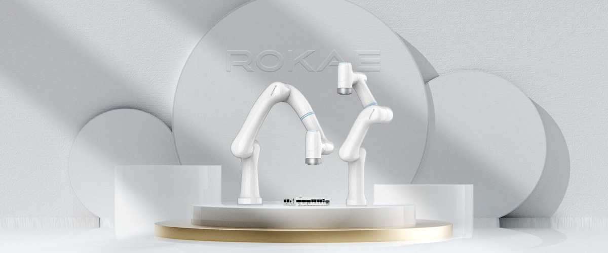
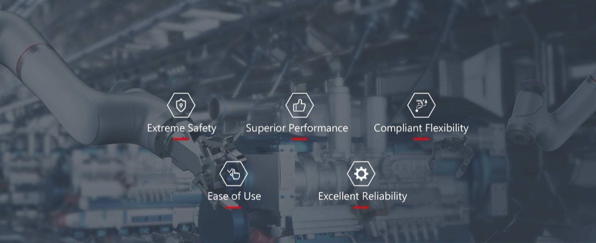
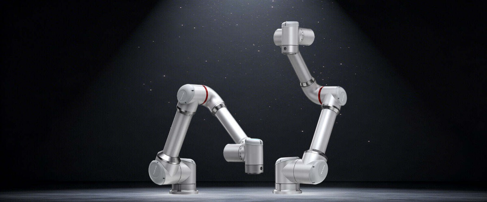
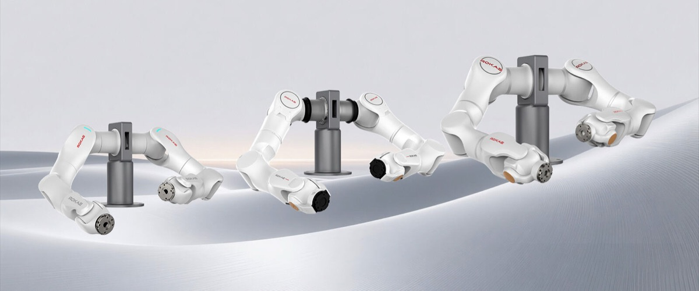
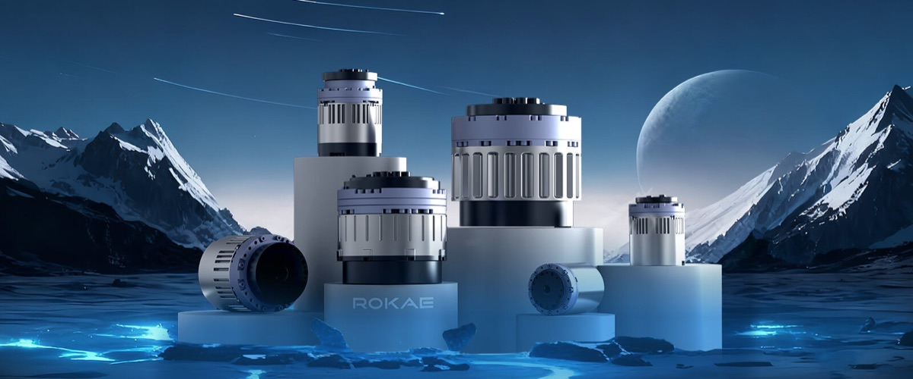
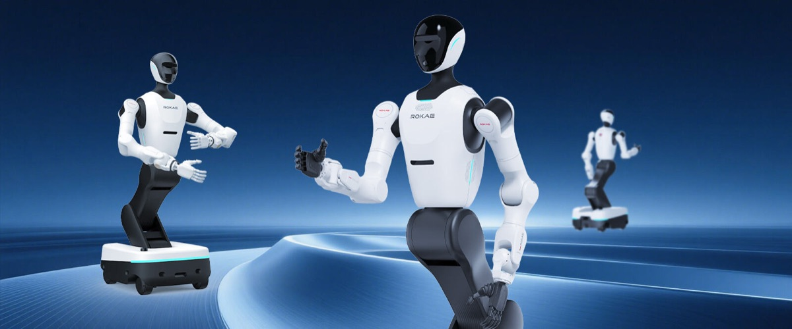
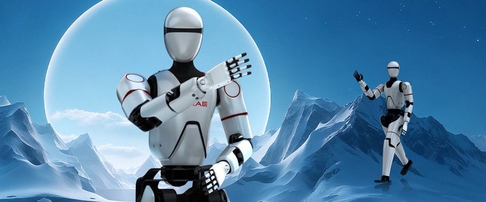
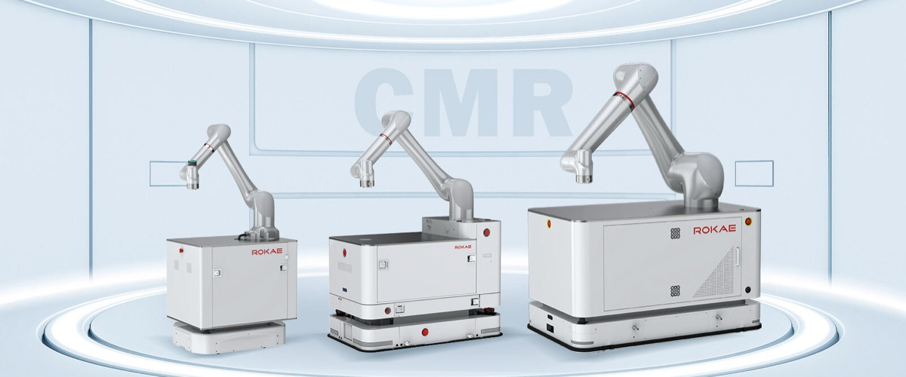
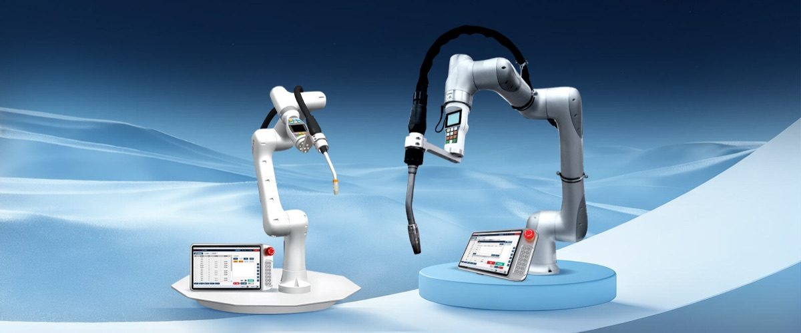
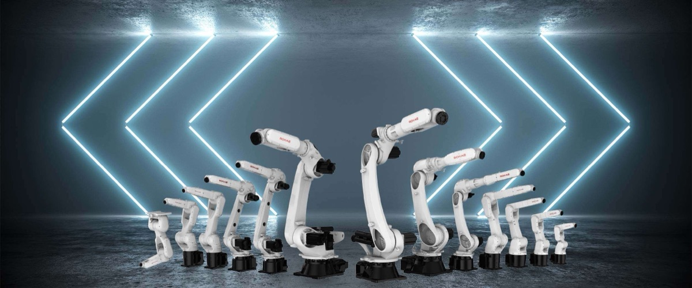

# ROKAE Robotics — Product Portfolio

⬆ [ROKAE Robotics profile](ROKAE.md) · [Developer guide](ROKAE-Developer-Guide.md) · [Roadmap and strategy](ROKAE-Roadmap-and-Strategy.md)

> **Read this first:** every ROKAE cobot and AR arm is a **force-controlled** arm (flange force/torque sensing, adjustable Cartesian stiffness). Pick ROKAE when your build *touches* something — a person, a soft object, an unknown surface. What ROKAE actually brought to Leukerbad is **not confirmed**; the most plausible units are a small SR / CR cobot or AR arms. Prices are **not public** for any product (quote only).

## Lineup map

Track relevance: ● strong · ◐ partial · ○ none. "Launched" is given only where a source supports it.

| Product | Category | Status | Launched | Price | Positioning (one line) | T01 | T02 | T03 | T04 |
|---|---|---|---|---|---|---|---|---|---|
| xMate SR series (SR3, SR5) | Compact 6-axis force-controlled cobot | ✅ | not confirmed (page assets date from 2022) | not public | Lightest ROKAE cobot, 48 V, 1.2 kg controller — the easy bench arm for contact demos | ◐ | ○ | ◐ | ● |
| xMate CR series (CR5 … CR35) | 6-axis (two 5-axis) cobot | ✅ | not confirmed | not public | Workhorse cobot family, **5–45 kg**, mostly IP67, TÜV-certified safety controller | ◐ | ◐ | ● | ◐ |
| xMate ZR series (ZR6) | 6-axis cobot | ✅ | not confirmed (page assets dated Oct 2026) | not public | New-generation cobot built on HSA joints, controller built into the arm | ◐ | ○ | ◐ | ◐ |
| xMate ER Pro (ER3 Pro / ER7 Pro) | 7-DoF cobot with joint torque sensors | ⚠️ unverified (legacy) | not confirmed | not public | Older 7-axis research / medical arm; no longer on the English product pages | ○ | ○ | ○ | ◐ |
| AR series (AR3, AR5, AR10) | 7-DoF humanoid force-controlled arm | ✅ | not confirmed (10,000th unit delivered Oct 2026) | not public | Light human-like arm for humanoids, dual-arm rigs and data collection | ◐ | ◐ | ◐ | ● |
| HSA series (HSA-11 … HSA-32) | Integrated force-controlled joint module | ✅ | not confirmed | not public | Build-your-own-robot actuator with torque sensor, EtherCAT | ○ | ○ | ○ | ◐ |
| Helios (Helios II) | Wheeled dual-arm humanoid | ✅ | not confirmed (data sheet dated Sep 2026) | not public | Only ROKAE platform with mobility + two arms + on-board GPU | ● | ◐ | ◐ | ● |
| Human.X | Full-size bipedal humanoid | 🧪 | ~mid-2026 (⚠️ unverified, single secondary source) | not public | Biped showcase; developer access not public | ◐ | ◐ | ○ | ◐ |
| CMR series (CMR-S, CMR-L, CMR-CR) | Mobile manipulator (AMR + cobot) | ✅ | not confirmed | not public | Factory AMR carrying an SR / CR arm; heavy (150–1500 kg chassis) | ◐ | ○ | ◐ | ○ |
| Intelligent Welding Robot series | Cobot welding package | ✅ | not confirmed | not public | SR / CR arm + welding kit for small-batch welding | ○ | ○ | ○ | ○ |
| NB / XB series | 6-axis industrial robots | ✅ | not confirmed | not public | Fenced industrial arms, **4–220 kg** | ○ | ○ | ◐ | ○ |
| xCore / iNex | Control system / embodied-AI control system | ✅ xCore · 🧪 iNex | not confirmed | bundled | Controller software behind every arm; SDK entry point | ◐ | ◐ | ◐ | ◐ |

## Products

### xMate SR series (SR3, SR5)

Compact 6-axis force-controlled cobot with the controller moved out of the base into a small separate box, so the arm fits tight mounting spots. **Most likely ROKAE arm on site** (best guess, not confirmed).

| Spec | SR3-3/0.7C | SR5-5/0.9C |
|---|---|---|
| DoF | 6 | 6 |
| Payload | **3 kg** | **5 kg** |
| Reach | **705 mm** | **919 mm** |
| Arm weight | about 13.8 kg | about 16.5 kg |
| Repeatability | ±0.03 mm | ±0.03 mm |
| Max tool speed | ≤1.5 m/s | ≤2.0 m/s |
| Joint speed | 180°/s all axes | 180°/s all axes |
| Force sensing (tool flange) | Force x-y-z, torque x-y-z | Force x-y-z, torque x-y-z |
| Relative force-control accuracy (as listed) | 0.5 N / 0.1 Nm | 0.1 N / 0.02 Nm |
| Cartesian stiffness range | 0–3000 N/m, 0–300 Nm/rad | 0–3000 N/m, 0–300 Nm/rad |
| Power | 48 VDC | 48 VDC |
| IP rating (arm) | IP54 | IP54 |
| Mounting | Any angle | Any angle |
| Operating temperature | 0–50 °C | 0–50 °C |

**Controller — xMate SR Cab (MSC):** 203 × 175 × 42 mm, about **1.2 kg**, IP20, 48 VDC input · 5 DI / 5 DO · safety IO (1 safety gate, 1 external e-stop, 1 safety output) · RS232 ×1, RS485 ×1, USB 3.0 ×2, EtherCAT ×1, Gigabit Ethernet ×3 · optional digital / analog IO and encoder modules.

- **Variants:** two models only. No separate EDU / developer edition is listed — SDK access is the same xCore SDK for all cobots (see [Developer guide](ROKAE-Developer-Guide.md)).
- **Typical applications (official cases):** AI massage robot, robotic coffee and ice cream, tomato and grape picking, chemical catalyst preparation, small-part loading, ship-deck welding.
- **Hackathon notes:** 48 V DC supply and a 1.2 kg controller make it portable; the arm is IP54 and the controller IP20 — keep it indoors and dry. No gripper, camera or GPU included.
- Official page: [SR cobots](https://www.rokae.com/en/product/show/349/SR-Cobots.html)

### xMate CR series (CR5, CR7, CR12, CR18, CR20, CR35)

ROKAE's main cobot family: force-position hybrid control on the xCore controller, a separate control cabinet with more IO, and a built-in TÜV-certified safety controller (ISO 13849-1, up to PL d). Nine models.

| Model | DoF | Payload | Reach | Arm weight | Repeatability | Max tool speed | IP (arm) |
|---|---|---|---|---|---|---|---|
| CR5-5/1.4C | 6 | **5 kg** | 1406 mm | ~36 kg | ±0.03 mm | ≤3.0 m/s | IP54 |
| CR7-7/0.98C | 6 | **7 kg** | 988 mm | ~25 kg | ±0.02 mm | ≤3.2 m/s | IP67 |
| CR12-12/1.4C | 6 | **12 kg** | 1434 mm | ~41 kg | ±0.03 mm | ≤3.0 m/s | IP67 |
| CR18-18/1.0C | 6 | **18 kg** | 1062 mm | ~38 kg | ±0.03 mm | ≤3.0 m/s | IP67 |
| CR20-20/1.8C | 6 | **20 kg** | 1798 mm | ~71 kg | ±0.05 mm | ≤3.5 m/s | IP67 |
| CR20-25/1.8C-5 | 5 | **25 kg** | 1798 mm | ~69 kg | ±0.05 mm | ≤3.5 m/s | IP67 |
| CR20-17/2.0C-5 | 5 | **17 kg** | 2047 mm | ~71 kg | ±0.05 mm | ≤4.0 m/s | IP67 |
| CR35-35/2.2C | 6 | **35 kg** | 2246 mm | ~180 kg | ±0.05 mm | not checked | IP67 |
| CR35-45/1.9C | 6 | **45 kg** | 1947 mm (per CMR-L table) | not checked | ±0.05 mm | not checked | not checked |

Common to the models below 35 kg (checked on CR5 / CR7): flange force x-y-z and torque x-y-z sensing · Cartesian stiffness **0–6000 N/m**, 0–1000 Nm/rad · relative force-control accuracy 0.5 N / 0.1 Nm · 48 VDC arm supply · any-angle mounting · 0–50 °C.

| Controller | xMate Control Cab (MCC) | xMate Control Cab Mix (MCCM) |
|---|---|---|
| Used with | CR below 35 kg, ZR | CR 35 kg and above |
| Size / weight | 450 × 250 × 350 mm · ~16.6 kg | 480 × 325 × 360 mm · ~28.4 kg |
| Input power | Single-phase 90–264 V AC (180–264 V AC for CR20) | Single-phase 190–240 V AC |
| IP | IP54 | IP54 |
| IO | 16 DI / 16 DO, 5 safety inputs, 4 safety outputs (dual channel) | same |
| Comms | Gigabit Ethernet ×2, USB ×2, EtherCAT ×1, RS232 or RS485 ×1 | RS232 ×1, Ethernet ×4, USB 3.0 ×1, EtherCAT ×1 |

- **Variants:** the "-5" models are 5-axis long-reach palletizing versions. No EDU edition listed.
- **Typical applications (official cases):** palletizing (food, medical supplies), SMT reel loading, warehouse picking and sorting (CR35), battery cell handling, AI / 3D vision inspection, sand-core finishing.
- **Hackathon notes:** CR7 (25 kg, IP67 arm) and CR12 are the realistic portable sizes; they need the 16.6 kg MCC cabinet and mains power. Plugs into Swiss 230 V without issue (90–264 V AC input).
- Official page: [xMate CR](https://www.rokae.com/en/product/show/545/xMateCR.html)

### xMate ZR series (ZR6)

New-generation full-joint force-controlled cobot built on ROKAE's HSA joint modules; shares the xCore platform and software ecosystem with CR / SR. One model so far.

| Spec | ZR6-6/0.98C |
|---|---|
| DoF | 6 |
| Payload | **6 kg** |
| Reach | **980 mm** |
| Weight | about **20 kg** (with built-in control cabinet) |
| Repeatability | ±0.05 mm |
| Max tool speed | ≤3.0 m/s |
| Force sensing | Flange force x-y-z, torque x-y-z; relative accuracy 0.5 N / 0.1 Nm |
| Cartesian stiffness range | 0–3000 N/m, 0–300 Nm/rad |
| Power | 48 VDC |
| IP rating | IP54 |
| Mounting | Any angle |

- ⚠️ The page lists the weight "with built-in control cabinet" but also shows the generic MCC cabinet table — confirm with the vendor which controller ships.
- Typical applications: same industrial segments as CR (auto parts, electronics, general industry); no specific case studies published yet.
- Official page: [xMate ZR](https://www.rokae.com/en/product/show/626/xMate-ZR.html)

### xMate ER Pro (ER3 Pro / ER7 Pro)

No picture saved (no current official product page).

Older 7-DoF cobot with joint torque sensors. **Status ⚠️ unverified:** not in the current English product navigation (only CR / SR / ZR are listed); still appears in ROKAE Japan case studies, for example a teleoperated ultrasound robot built on ER7 Pro.

| Spec | Value |
|---|---|
| DoF | 7 |
| Payload (ER7 Pro) | **7 kg** (per profile research) |
| Reach (ER7 Pro) | **850 mm** (per profile research) |
| Other specs | not checked — no current official spec page |

- If you need a 7-DoF ROKAE arm today, the **AR series** is the current product.

### AR series (AR3, AR5, AR10)

7-DoF human-like arm with a cross-wrist layout and joint torque sensors as standard. ROKAE's 2026 headline product, sold both as a stand-alone arm and as the arm of Helios and of other makers' humanoids. Aimed explicitly at AI, data collection and training.

| Spec | AR3 | AR5 | AR10 |
|---|---|---|---|
| DoF | 7 | 7 | 7 |
| Rated payload | **3 kg** | **5 kg** | **10 kg** |
| Operating radius | **650 mm** | **683 mm** | **815 mm** |
| Arm weight | **8 kg** | **10 kg** | **19.5 kg** |
| Repeatability | ±0.05 mm | ±0.05 mm | ±0.1 mm |
| Absolute accuracy | ±1 mm | ±1 mm | ±1 mm |
| Max TCP speed | ≥2 m/s | ≥2 m/s | ≥2 m/s |
| Joint hollow bore | 6 mm | 9 mm | 10 mm |
| IP rating | IP54 | IP54 | IP54 |
| Brakes | On joints | On joints | On joints |

Common to all three: joint torque sensors standard · force-control accuracy ≤0.15 N / ≤0.05 Nm and resolution ≤0.05 N / ≤0.02 Nm (reference values) · force sensor sampling ≥5 kHz, overload ≥300% F.S. · torque loop closed in the controller (basic scheme) or in the joint (advanced scheme) · automatic payload identification · **48 V DC (±15%)** · **EtherCAT, 1 ms cycle** · noise ≤60 dB · 0–50 °C.

- **Variants:** three payload sizes. Left / right or dual-arm kits and an EDU edition are not listed publicly. The docs portal has a dedicated SDK branch (0.7.x-AR) — see [Developer guide](ROKAE-Developer-Guide.md).
- **End effectors:** "multiple end-effector interfaces" claimed; specific supported grippers / hands not listed on the page.
- **Typical applications:** humanoid and wheeled dual-arm robots, AI data collection and training, smart warehousing, factory automation.
- **Hackathon notes:** 8–10 kg arm weight means an AR3 / AR5 could ride on another vendor's mobile base, but integration is EtherCAT-level work — only attempt if ROKAE staff supply the controller and mount.
- Official page: [Humanoid Force-Controlled Arm AR](https://www.rokae.com/en/product/show/595/Humanoid-Force-Controlled-Arm-AR.html)

### HSA series (HSA-11 … HSA-32)

Integrated joint module: frameless torque motor, gear, brake option, dual absolute encoders and a torque sensor in one hollow-shaft unit. The building block of the AR arms and the ZR cobot.

| Spec | HSA-11 | HSA-14 | HSA-17 | HSA-20 | HSA-25 | HSA-32 |
|---|---|---|---|---|---|---|
| Diameter / length (mm) | 52 / 68 | 60 / 74 | 72 / 98 | 82 / 107 | 110 / 115 | 142 / 135 |
| Hollow bore (mm) | 6 | 9 | 10 | 13 | 15 | 21 |
| Weight (g) | **450** (no brake) | 600 | 1100 | 1700 | 2950 | **6000** |
| Rated power (W) | 40 | 120 | 160 | 250 | 600 | 950 |
| Gear ratio | 100 | 100 | 100 | 120 | 100 | 120 |
| Rated speed (rpm) | 30 | 30 | 30 | 30 | 30 | 20 |
| Peak torque (Nm) | **11** | 19 | 70 | 113 | 204 | **459** |
| Torque sensor rated torque (Nm) | 12 | 25 | 70 | 110 | 210 | 480 |

Common: 48 V · torque sensor resolution ≤0.05 Nm · force-control bandwidth 100 Hz · impedance control at **1 kHz** · force sampling 32 kHz · 18-bit dual absolute encoders · **EtherCAT**.

- **Hackathon notes:** a component, not a robot. Useful only if a team is building a custom mechanism and ROKAE supplies drivers and an EtherCAT master setup — not a 48-hour starting point.
- Official page: [Integrated Force-Controlled Joint HSA](https://www.rokae.com/en/product/show/598/Integrated-Force-Controlled-Joint-HSA.html)

### Helios (Helios II)

Wheeled dual-arm humanoid: omnidirectional base, lifting torso, two 7-DoF force-controlled arms, LiDAR SLAM navigation. The only ROKAE product that is a complete mobile robot with on-board AI compute. Five units run at Schaeffler's Taicang plant.

| Spec | Helios II – 5 |
|---|---|
| Size (L×W×H) | 750 × 650 × **1493–2000 mm** |
| Weight | **160 kg** |
| DoF | **23** in the spec table (neck 2, arms 7×2, waist 2, legs 2, chassis 3). The intro text says 42 — presumably counting hands; ⚠️ unverified |
| Payload per arm | **5 kg** |
| Force control | Joint force sensors; whole-body force control for arms, waist and neck |
| End effectors (optional) | Electric grippers, dexterous hands, electric vacuum grippers |
| Chassis | Omnidirectional, 4 drive wheels, **1.5 m/s** max, docking ±10 mm |
| Perception | 2× 3D navigation LiDAR · head stereo camera · IMU · optional: 3 fisheye cameras, chest stereo camera, wrist cameras, 4-mic array, 2× 10 W speakers |
| Battery / runtime | 2× 18 Ah (36 Ah total) · **~4 h** runtime · 2 h charge (10–90%) · direct charge, battery swap, optional auto-recharge dock |
| Compute (choose one) | NVIDIA Orin NX 8 GB · AGX Orin 64 GB · Thor T5000 |
| Connectivity | Wi-Fi 2.4 / 5 GHz, Bluetooth, optional 5G · debug ports HDMI, USB 2.0, RJ45 |
| Safety | External e-stop connector; wireless e-stop optional |
| Development | **ROS 2 and Python SDK**; optional gamepad control |
| Operating environment | 0–45 °C, non-condensing |

- **Variants:** only "Helios II – 5" (5 kg arms) is specified. Compute option and most sensors are order-time choices — check what the on-site unit actually has.
- **Typical applications:** parts handling, assembly and inspection in factories; commercial service and education / research are named targets.
- **Hackathon notes:** indoor flat floors only (wheeled, 160 kg) — no stairs, snow or slopes. Strong fit for clinic / hotel corridor scenarios if a unit is on site.
- Official page: [Wheeled Dual-Arm Robot Helios](https://www.rokae.com/en/product/show/596/Wheeled-Dual-Arm-Robot-Helios.html)

### Human.X

Full-size bipedal humanoid with 7-DoF arms and five-finger hands. Marketing describes a VLA-based "intelligent core"; no developer documentation, SDK or availability statement found — treat as a showcase 🧪.

| Spec | Value |
|---|---|
| Height | **1.7 m** |
| Weight | about **75 kg** |
| DoF | Arm 7, leg 6, waist 2, neck 2 (per limb) |
| Hand | 6 DoF, 12 joints, 540 g · grip force 15 N (thumb) / 10 N (other fingers), 0.5 N resolution |
| Payload per arm | **3 kg** (excluding end effector) |
| Joints | Fully force-controlled, dual-encoder; knee peak torque ≥320 Nm; torque / velocity / position hybrid control |
| Walking | ≥0.5 m/s · stairs ≥15° · outdoor cement roads and standard building stairs |
| Battery, compute, sensors | not public |

- Unlikely to be available for hacking; if it is on site, expect vendor-operated demos.
- Official page: [Humanoid Robot Human.X](https://www.rokae.com/en/product/show/597/Humanoid-Robot-Human.X.html)

### CMR series (CMR-S, CMR-L, CMR-CR)

Factory mobile manipulators: a laser-SLAM AMR chassis carrying an SR or CR cobot for machine tending, material flow and inspection between workstations.

| Model | Arm supported | Arm payload / reach | Chassis size / weight | Max speed | Travel | Positioning | Runtime / battery |
|---|---|---|---|---|---|---|---|
| CMR-S-V4SD1 | SR, CR7 | 7 kg / 988 mm | 850 × 560 × 950 mm · **150 kg** | 1.4 m/s | Forward / backward | ±5 mm, ±0.5° | 12 h · 48 V 100 Ah |
| CMR-S-V4SD3 | CR12 | 12 kg / 1434 mm | 1000 × 700 × 950 mm · 300 kg | 1.4 m/s | + traverse | ±5 mm, ±0.5° | 12 h · 48 V 100 Ah |
| CMR-CR-V3SO6 / V3RO6 (omni, battery swap) | 7–20 kg cobots | 12 / 20 kg · 1413 mm | 1200 × 700 × 800 mm · 600 / 500 kg | 1.5 / 1.4 m/s | + traverse | ±10 mm, ±0.5° | 7 h · 100 Ah + 20 Ah, swap |
| CMR-CR-V1SD5 (differential) | 7–20 kg cobots | 12 / 20 kg · 1413 mm | 1100 × 700 × 780 mm · 500 kg | 1.4 m/s | Forward / backward | ±10 mm, ±0.5° | 7 h · 48 V 60 Ah |
| CMR-L-V6SOF | CR35 (35 / 45 kg) | 35 / 45 kg · 2246 / 1947 mm | 1600 × 1000 × 950 mm · **1500 kg** | 1.3 m/s | + traverse | ±10 mm, ±0.5° | 12 h empty / 8 h loaded · 48 V 200 Ah |

- Navigation: laser SLAM with two diagonally mounted LiDARs. CMR-S passes 800 mm aisles.
- **Hackathon notes:** too heavy to expect on site; listed for completeness. Developer interface for the chassis — not public.
- Official page: [Mobile Manipulator CMR](https://www.rokae.com/en/product/show/599/Mobile-Manipulator-CMR.html)

### Intelligent Welding Robot series

Welding package built on four existing cobots (SR3, SR5, CR7, CR12) with drag-teaching for small-batch welding in shipbuilding, steel structures and machinery. Arm specs are identical to the SR / CR tables above; controller is the MCC cabinet (IP54, 16 DI/DO). Welding power source and torch details — not checked. Low hackathon relevance.

- Official page: [Intelligent Welding Robot](https://www.rokae.com/en/product/show/600/Intelligent-Welding-Robot.html)

### NB / XB series

Conventional fenced 6-axis industrial robots — ROKAE's original business. Not collaborative; low hackathon relevance.

| Series | Payload | Reach |
|---|---|---|
| NB4 | 4 kg | 475–580 mm |
| XB7 | 7 kg | 707–906 mm |
| NB12 | 10–16 kg | 953–1602 mm |
| NB12h (hollow wrist) | 10–12 kg | 1473–1648 mm |
| NB25 | 12–35 kg | 1617–2110 mm |
| NB25h, NB80, NB220 | up to **220 kg** across the range | up to **3201 mm** across the range (per-series values not checked) |

- Applications: grinding, deburring, gluing, machine tending, assembly, palletizing, welding, photovoltaics.
- Official page: [Industrial robots](https://www.rokae.com/en/product/183/Industrial-Robots.html)

### xCore / iNex

No picture saved (software; the docs portal offers only a logo).

| Item | Status | What it is |
|---|---|---|
| **xCore** control system | ✅ | ROKAE's own controller software running every arm; user manual on the docs portal and in each product's download list (updated May 2026) |
| **xCore SDK** | ✅ | C++, Python and C# libraries; versions 0.7.x, 0.7.x-AR (AR arms) and 0.8.x listed on the docs portal |
| **ROS 2 package** | ✅ | Official xMate ROS 2 manual and package on the docs portal; supported distros not confirmed |
| **Plugin development** | ✅ | Documented way to extend the controller / pendant |
| **RokaeStudio / HMI software** | ✅ | Offline programming and pendant software ("Software HMI" download, MyROKAE login needed) |
| **iNex** embodied-AI control system | 🧪 | Named in an Oct 2026 press release; no public technical detail or download |

- Details and quick-start: [Developer guide](ROKAE-Developer-Guide.md) · [docs hub](https://docs.rokae.com/en/)

## Accessories and ecosystem

| Item | Status | Notes |
|---|---|---|
| Controllers: MSC (SR), MCC (CR <35 kg, ZR), MCCM (CR ≥35 kg) | ✅ | Specs in the SR / CR sections above |
| Compact multi-joint controller for AR arms / humanoids (drives 7, 14 or 20+ joints) | ✅ | Per profile research on the docs portal; dimensions 213 × 145.5 × 45 mm ⚠️ unverified here |
| IO expansion: digital IO, analog IO, incremental-encoder modules | ✅ | Optional on all cobot controllers |
| Teach pendant with drag teaching and graphical programming | ✅ | Standard cobot workflow |
| Five-finger hand (6 DoF, 12 joints, 540 g) | 🧪 | Specified only as part of Human.X; not listed as a separate product |
| Grippers, vacuum tools, dexterous hands for Helios | ✅ optional | Third-party brands not named — bring or ask |
| Helios auto-recharge dock, wireless e-stop, gamepad, 5G module, extra cameras, mic array | ✅ optional | Order-time options |
| Cameras / vision for cobots | not public | Official cases use vision, but no ROKAE-branded camera is listed |
| Application packages: palletizing, grinding, welding | ✅ | Listed under Applications on the website |
| Pretrained models / datasets | not public | None downloadable |

## Legacy and discontinued

- **xMate ER / ER Pro (7-DoF)** — no longer on the English product pages; status ⚠️ unverified (see above). Still referenced in Japanese healthcare case studies.
- Earlier cobot generations with the controller built into the base (pre-SR / pre-CR xMate models) — implied by the SR page text; model names not confirmed.

## Image credits

All images © ROKAE, downloaded from the official website on 2026-11-14 and converted to JPEG.

| File | Shows | Source URL |
|---|---|---|
| assets/rokae-xmate-sr.jpg | xMate SR series header image | https://www.rokae.com/public/uploads/20261111/b21f485ef496fb8e9ae7ff1d71641a37.jpg |
| assets/rokae-xmate-cr.jpg | xMate CR series banner | https://www.rokae.com/public/uploads/20240129/c5cae36ae4f5beaef1bdb39a766939a7.jpg |
| assets/rokae-xmate-zr.jpg | xMate ZR series banner | https://www.rokae.com/public/uploads/20261029/ac3247c2ddd368ac3bcce4084eec34b3.jpg |
| assets/rokae-ar.jpg | AR humanoid force-controlled arm header image | https://www.rokae.com/public/uploads/20261110/1f3c633ff451f6fe94afc8afd4c7bdd7.jpg |
| assets/rokae-hsa.jpg | HSA joint modules header image | https://www.rokae.com/public/uploads/20260107/22043ea92487d19ca823a3c2fe62123b.jpg |
| assets/rokae-helios.jpg | Helios wheeled dual-arm robot header image | https://www.rokae.com/public/uploads/20260918/14005af60c70ff620c9840a78b81af4b.jpg |
| assets/rokae-human-x.jpg | Human.X humanoid header image | https://www.rokae.com/public/uploads/20251114/c8dc81cd7a77852d4b3c7d7e0bb368e4.jpg |
| assets/rokae-cmr.jpg | CMR mobile manipulator header image | https://www.rokae.com/public/uploads/20261111/154f6d3fb8d9420a5a3614d14bb82fd3.jpg |
| assets/rokae-welding.jpg | Intelligent Welding Robot header image | https://www.rokae.com/public/uploads/20251114/de735fada1f3e6b53a978b4e16c06114.jpg |
| assets/rokae-nb-xb.jpg | Industrial robots (NB / XB) category header | https://www.rokae.com/public/uploads/20230206/8470eecb025b19bfb55cea15e9b8904e.jpg |

Not saved: `rokae-xmate-er-pro` (no current official product page) and `rokae-xcore` (software, no product image).

## Sources

- [ROKAE — SR cobots](https://www.rokae.com/en/product/show/349/SR-Cobots.html)
- [ROKAE — xMate CR](https://www.rokae.com/en/product/show/545/xMateCR.html)
- [ROKAE — xMate ZR](https://www.rokae.com/en/product/show/626/xMate-ZR.html)
- [ROKAE — Humanoid Force-Controlled Arm AR](https://www.rokae.com/en/product/show/595/Humanoid-Force-Controlled-Arm-AR.html)
- [ROKAE — Integrated Force-Controlled Joint HSA](https://www.rokae.com/en/product/show/598/Integrated-Force-Controlled-Joint-HSA.html)
- [ROKAE — Wheeled Dual-Arm Robot Helios](https://www.rokae.com/en/product/show/596/Wheeled-Dual-Arm-Robot-Helios.html)
- [ROKAE — Humanoid Robot Human.X](https://www.rokae.com/en/product/show/597/Humanoid-Robot-Human.X.html)
- [ROKAE — Mobile Manipulator CMR](https://www.rokae.com/en/product/show/599/Mobile-Manipulator-CMR.html)
- [ROKAE — Intelligent Welding Robot](https://www.rokae.com/en/product/show/600/Intelligent-Welding-Robot.html)
- [ROKAE — Industrial Robots](https://www.rokae.com/en/product/183/Industrial-Robots.html)
- [ROKAE — Collaborative Robots overview](https://www.rokae.com/en/product/182/Collaborative-Robots.html)
- [ROKAE documentation hub](https://docs.rokae.com/en/)
- [ROKAE Japan — teleoperated ultrasound robot case (ER7 Pro)](https://www.rokae.com/jp/case/show/1189/%E9%81%A0%E9%9A%94%E6%93%8D%E4%BD%9C%E5%9E%8B%E8%B6%85%E9%9F%B3%E6%B3%A2%E8%A8%BA%E6%96%AD%E3%83%BB%E6%B2%BB%E7%99%82%E3%83%AD%E3%83%9C%E3%83%83%E3%83%88.html)
- [ROKAE Robotics profile (this repo) — deployment, status and SDK facts carried over](ROKAE.md)
