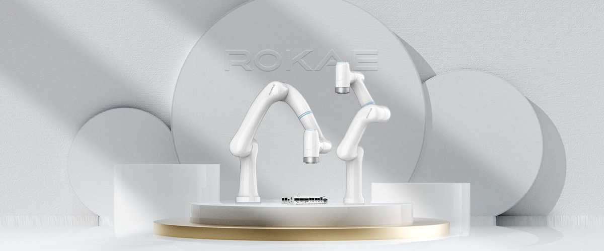
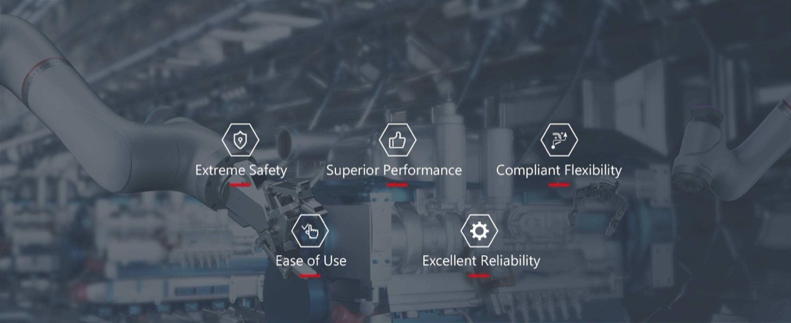
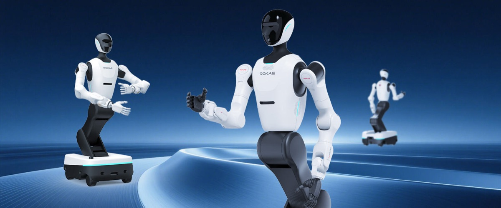
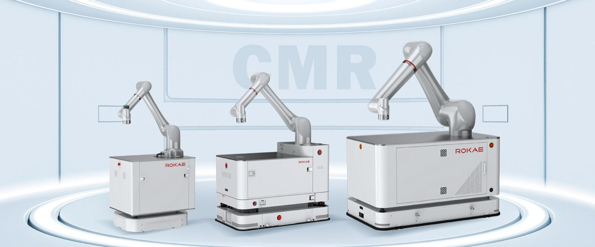
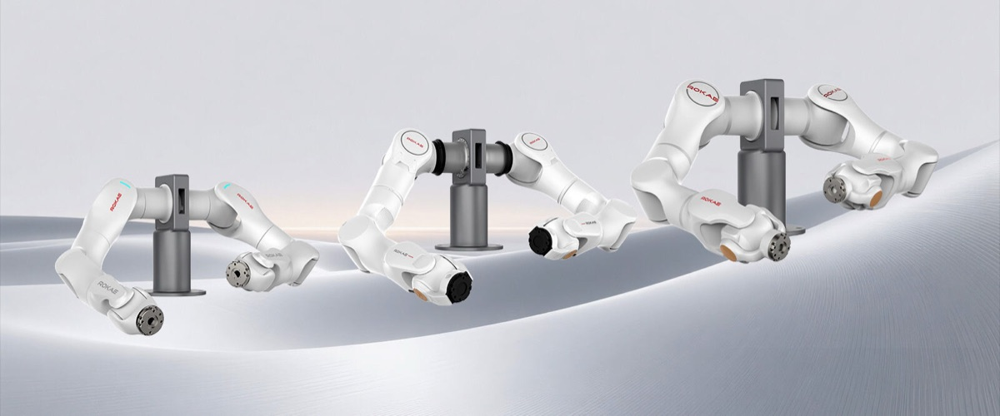

# ROKAE Robotics × T01 — Products and Solutions

⬆ [ROKAE Robotics profile](../ROKAE.md) · [Brief](ROKAE-T01-1-Brief.md) · [Playbook](ROKAE-T01-3-Playbook.md)

> **Read this first:** what ROKAE actually has on site is **⚠️ unverified**. The ranking below assumes the likely case (a small xMate cobot) and treats Helios / CMR as a bonus. Confirm at the vendor table before committing.

## Relevant products (ranked for this track)

### xMate SR series (SR3, SR5)

**Role in T01:** the service-kiosk and hand-off arm. Light enough to mount on a counter, a cart or (with work) another vendor's mobile base; this is the arm ROKAE itself uses in coffee, ice-cream and unmanned-catering cases.

| Spec | SR3 | SR5 |
|---|---|---|
| Payload | **3 kg** | **5 kg** |
| Reach | **705 mm** | **919 mm** |
| Arm weight | ~13.8 kg | ~16.5 kg |
| Max TCP speed | ≤1.5 m/s | ≤2.0 m/s |
| Repeatability | ±0.03 mm | ±0.03 mm |
| Protection | IP54 (arm) · IP20 (controller) | same |
| Power | **48 VDC** | **48 VDC** |
| Operating temperature | 0–50 °C | 0–50 °C |
| Cartesian stiffness (adjustable) | 0–3000 N/m | 0–3000 N/m |
| Force-control accuracy (relative) | 0.5 N / 0.1 Nm | 0.1 N / 0.02 Nm |
| Controller (MSC) | 203 × 175 × 42 mm, ~1.2 kg, 5 DI / 5 DO, EtherCAT, 3× GbE, RS485 | same |

- **Status / price / availability:** ✅ shipping · price not public · on-site availability ⚠️ unverified.
- **Developer control:** xCore SDK (C++ / Python / C#); non-real-time moves, I/O, drag teaching and path replay, collision detection settings; **real-time C++ up to 1 kHz** with joint position, Cartesian position, joint impedance, Cartesian impedance and direct torque. ROS 2 Humble + MoveIt 2 config packages exist for SR3 / SR4 / SR5.

### xMate CR series (CR5, CR7, CR12, CR18, CR20, CR35)

**Role in T01:** the sturdier, wash-down-capable station arm — relevant where the task is wet or dirty (spa surroundings, cleaning, waste handling) or needs more reach than an SR.

| Spec | CR7 | CR12 |
|---|---|---|
| Payload | **7 kg** | **12 kg** |
| Reach | **988 mm** | **1434 mm** |
| Arm weight | ~25 kg | ~41 kg |
| Protection (arm) | **IP67** | **IP67** |
| Max tool speed | ≤3.2 m/s | ≤3.0 m/s |
| Cartesian stiffness (adjustable) | 0–6000 N/m | 0–18000 N/m |
| Force-control accuracy (relative) | 0.5 N / 0.1 Nm | 0.5 N / 0.1 Nm |
| Controller (MCC) | IP54, ~16.6 kg, single-phase 90–264 V AC | same |

- **Note:** CR5 is IP54, not IP67. The 16.6 kg AC-powered cabinet makes a CR harder to put on a small third-party mobile base than an SR.
- **Status / price / availability:** ✅ shipping · price not public · on-site availability ⚠️ unverified.
- **Developer control:** same xCore SDK and real-time modes as SR; MoveIt 2 configs for CR7 / CR12 / CR18 / CR20 / CR35.

### Helios (Helios II)

**Role in T01:** the only ROKAE platform that both drives and manipulates — an indoor concierge / fetch-and-deliver / facility-upkeep robot. Only relevant if one is physically on site.

| Spec | Value |
|---|---|
| Arms | 2 × 7-DoF, **5 kg per arm** |
| DoF (spec table) | 23 (2 neck, 7 + 7 arms, 2 waist, 2 legs, 3 chassis); intro text says 42 — inconsistent on the official page |
| Chassis | Omnidirectional, 4 drive wheels, **1.5 m/s**, docking ±10 mm |
| Size / weight | 750 × 650 × 1493–2000 mm · **160 kg** |
| Runtime | ~**4 h** (2 × 18 Ah); charge 10–90 % in ~2 h; battery swap; optional auto-recharge dock |
| Sensors | 2 × 3D LiDAR, head stereo camera, IMU; optional fisheye ×3, chest and wrist cameras, 4-mic array, speaker |
| Compute (one of) | Jetson Orin NX 8 GB · AGX Orin 64 GB · Thor T5000 |
| Environment | 0–45 °C, non-condensing; IP rating, slope and threshold-crossing ability not listed |
| End effectors (optional) | Electric gripper, dexterous hand, vacuum gripper |

- **Status / price / availability:** ✅ deployed in a factory (Schaeffler, Oct 2026) · price not public · on-site availability ⚠️ unverified.
- **Developer control:** product page states **ROS 2 + Python SDK** and optional gamepad. Public API docs, navigation stack details and simulation assets for Helios — not public / not found. Helios is not among the models in the public `rokae_ros2` repo.

### CMR series (CMR-S, CMR-L, CMR-CR)

**Role in T01:** AMR + cobot for indoor material runs (facility logistics, restocking, machine tending). Conceptually the closest ROKAE product to "robots that move and deliver", but built for factory floors and heavy.

| Spec | CMR-S-V4SD1 (smallest) | Range across series |
|---|---|---|
| Arm payload | 7 kg (SR series, CR7, CR12 compatible) | 7–45 kg |
| Max speed | **1.4 m/s** | 1.3–1.5 m/s |
| Footprint | 850 × 560 × 950 mm, min. aisle 800 mm | up to 1600 × 1000 mm |
| Chassis weight | 150 kg | 150–1500 kg |
| Navigation | Laser SLAM, 2 LiDARs (front / rear diagonal) | same |
| Positioning accuracy | ±5 mm, ±0.5° | ±5 to ±10 mm |
| Runtime | 12 h (48 V, 100 Ah) | 7–12 h |

- **Status / price / availability:** ✅ shipping · price not public · unlikely on site (weight) ⚠️ unverified.
- **Developer control:** not public. The page lists no API, fleet interface, IP rating, slope or obstacle specs.

### AR series (AR3, AR5, AR10)

**Role in T01:** 7-DoF torque-sensing arm designed to be mounted on someone else's robot body — the natural ROKAE part for a cross-vendor mobile manipulator.

| Spec | AR3 | AR5 | AR10 |
|---|---|---|---|
| Payload | 3 kg | 5 kg | 10 kg |
| Reach | 650 mm | 683 mm | 815 mm |
| Arm weight | 8 kg | 10 kg | 19.5 kg |
| Common | 7 DoF · joint torque sensors · force resolution ≤0.05 N · EtherCAT 1 ms · 48 VDC · IP54 | | |

- **Status / price / availability:** ✅ shipping (10,000th unit delivered, Oct 2026) · price not public · on-site availability ⚠️ unverified.
- **Developer control:** dedicated SDK branch (0.7.x-AR); MoveIt 2 configs for AR5L / AR5R in `rokae_ros2`.

### xCore / iNex

**Role in T01:** the software you actually program. xCore (controller **v3.2.1 or later** is required by the public SDK and ROS 2 package) exposes motion, force control and I/O. iNex 🧪 (embodied-AI control system) has no public developer access.

**Lower priority for T01:** Human.X biped 🧪 (availability unclear), HSA joints (component-level, not a 48-hour path), NB / XB industrial arms and welding packages (fenced industrial use), xMate ZR and ER Pro (no track-specific advantage; ER Pro status ⚠️ unverified).

## What ROKAE Robotics already does in this domain

Honest summary: **commercial-service kiosks yes; city-scale mobile service robots no.**

| When | What | Relevance to T01 | Source |
|---|---|---|---|
| Undated case study | xMate SR cobot in **robotic coffee** | Unattended hospitality / retail kiosk | [rokae.com](https://www.rokae.com/en/case/show/1089/xMate-SR-Cobot-in-Robotic-Coffee.html) |
| Undated case study | xMate SR cobot in **robotic ice cream** | Same | [rokae.com](https://www.rokae.com/en/case/show/1090/xMate-SR-Cobot-in-Robotic-Ice-Cream.html) |
| Undated case study | ROKAE cobots in **unmanned catering services** | Staff-free food service | [rokae.com](https://www.rokae.com/en/case/show/1088/ROKAE-Cobots-in-Unmanned-Catering-Services.html) |
| Undated case studies | Tomato and grape **harvesting robots**, AI massage robot, moxibustion robot (all filed under "Commercial Services") | Arms working in unstructured, public or outdoor-adjacent settings via integrators | [Commercial Services cases](https://www.rokae.com/en/case/208/Commercial-Services.html) |
| Undated case study | **CR35** in large-scale warehouse picking and sorting | Logistics handling (fixed arm) | [CR page](https://www.rokae.com/en/product/show/545/xMateCR.html) |
| Oct 2026 | **Five Helios** wheeled humanoids at Schaeffler's Taicang plant: handling, assembly, inspection | Proves Helios mobility + manipulation in production — indoors, in a factory | [TechNode Global / PR Newswire](https://technode.global/?p=996114) |

- Helios' product page lists "Commercial Services" as a target sector, but no public commercial-service Helios deployment was found.
- **Nothing found** for: last-mile or outdoor delivery, street or public-space cleaning, waste collection, guide / wayfinding robots, municipal or tourism services, any Swiss or alpine deployment.
- Research limit: web search was unavailable for this track pass; findings come from ROKAE's own site, docs and GitHub plus the company profile. Third-party news on service pilots may exist and was not checked.

## What they are building next in this domain

- **Embodied-AI line as third business pillar (2026):** Helios, Human.X, AR arms, HSA joints, CMR. Messaging centres on industrial use and on supplying force-controlled arms to other robot makers (80+ partners).
- **iNex embodied-AI control system** 🧪 and a VLA "intelligent core" for Human.X 🔭 — named in marketing; no public developer access.
- **Inference (not announced):** with "Commercial Services" listed as a Helios target sector and autonomous recharging as an option, service deployments outside factories are a plausible next step. No public roadmap for delivery, cleaning or outdoor robots.

## Software, models and data that help for this track

| Asset | What it gives you | Access |
|---|---|---|
| [xCoreSDK-CPP](https://github.com/RokaeRobot/xCoreSDK-CPP) | C++ API for all series; Ubuntu 18.04 / 20.04 / 22.04 (x86_64 and **aarch64**) and Windows; **real-time up to 1 kHz**: joint / Cartesian position, joint / Cartesian impedance, direct torque (cobots); examples in `example/` | ✅ Apache-2.0, v0.7.1 |
| [xCoreSDK-Python](https://github.com/RokaeRobot/xCoreSDK-Python) | Python bindings for all series — fastest route to a scripted demo; whether real-time mode is exposed in Python is ⚠️ unverified | ✅ public |
| [rokae_ros2](https://github.com/RokaeRobot/rokae_ros2) | ROS 2 **Humble** / Ubuntu 22.04; ros2_control hardware plugin, URDF + meshes, Gazebo helpers, **MoveIt 2 configs** for AR5L/R, CR7/12/18/20/35, ER3/7, Pro3/7, SR3/4/5 | ✅ Apache-2.0, stack v0.0.4 |
| xCoreSDK-CSharp / -Android, xCorePlugin-client / -controller | C# and Android SDKs; controller / HMI plugin kits | ✅ public |
| [docs.rokae.com](https://docs.rokae.com/en/) | SDK manuals (0.7.x, 0.7.x-AR, 0.8.x), real-time troubleshooting, ROS 2 manual | ✅ public |
| Pendant drag teaching + path replay | Record a service motion by hand in minutes — the best fallback when planning fails | ✅ on robot |
| Navigation stack, fleet API, VLA models, datasets, MuJoCo / Isaac assets | — | not public / not found |

The `RokaeRobot` GitHub organisation links to rokae.com and carries ROKAE (Beijing) copyright notices; treat it as official, but confirm with the engineers on site which SDK version matches the controller firmware they brought.

## Gaps and limits for this track

- **Mobility:** no outdoor platform. Helios and CMR are indoor, flat-floor machines (no slope, threshold or IP data published); Helios weighs 160 kg, the smallest CMR chassis 150 kg.
- **Not alpine-ready:** SR / CR arms are rated from 0 °C; Helios 0–45 °C non-condensing. Snow or sub-zero outdoor demos are out.
- **No autonomy stack for fixed arms:** perception, task planning and any language / VLA layer are bring-your-own. The cobot controller has no GPU — add a PC or an edge board.
- **Accessories not confirmed:** gripper, camera, mounting plate, 48 V supply for mobile mounting.
- **Mounting an SR on another vendor's base** is real integration work (mechanical plate, 48 VDC power budget, e-stop chain, frame calibration) — budget half a day minimum, and get both vendors' approval.
- **Helios / CMR software** is documented only at headline level publicly; expect to depend on on-site engineers.
- **Public-space safety:** force limiting helps, but a kiosk demo around visitors still needs speed limits, a clear zone and an e-stop.

## Sources
- [ROKAE Robotics profile (internal)](../ROKAE.md)
- [ROKAE — SR cobots](https://www.rokae.com/en/product/show/349/SR-Cobots.html)
- [ROKAE — xMate CR](https://www.rokae.com/en/product/show/545/xMateCR.html)
- [ROKAE — Wheeled Dual-Arm Robot Helios](https://www.rokae.com/en/product/show/596/Wheeled-Dual-Arm-Robot-Helios.html)
- [ROKAE — Mobile Manipulator CMR](https://www.rokae.com/en/product/show/599/Mobile-Manipulator-CMR.html)
- [ROKAE — Humanoid Force-Controlled Arm AR](https://www.rokae.com/en/product/show/595/Humanoid-Force-Controlled-Arm-AR.html)
- [ROKAE — Commercial Services application cases](https://www.rokae.com/en/case/208/Commercial-Services.html)
- [ROKAE — application cases index](https://www.rokae.com/en/case/)
- [ROKAE documentation hub](https://docs.rokae.com/en/) · [SDK docs](https://docs.rokae.com/en/docs/SDK) · [ROS 2 manual](https://docs.rokae.com/en/docs/ROS2)
- [GitHub — RokaeRobot organisation](https://github.com/RokaeRobot)
- [GitHub — RokaeRobot/xCoreSDK-CPP](https://github.com/RokaeRobot/xCoreSDK-CPP)
- [GitHub — RokaeRobot/rokae_ros2](https://github.com/RokaeRobot/rokae_ros2)
- [TechNode Global (PR Newswire) — 10,000th humanoid force-controlled arm, Schaeffler Helios deployment, Oct 2026](https://technode.global/?p=996114)
