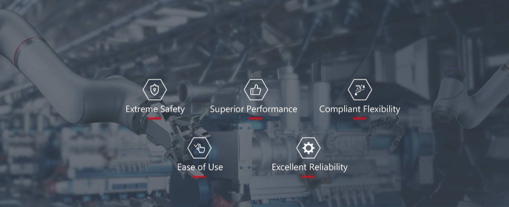
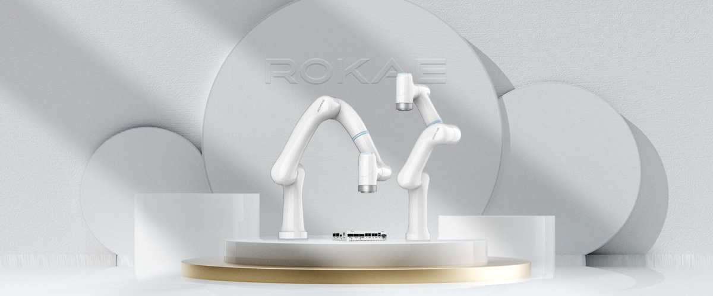
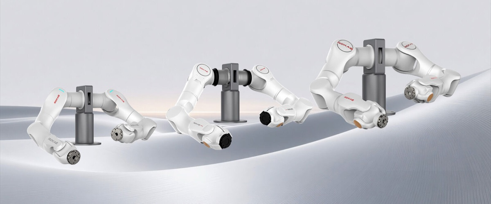
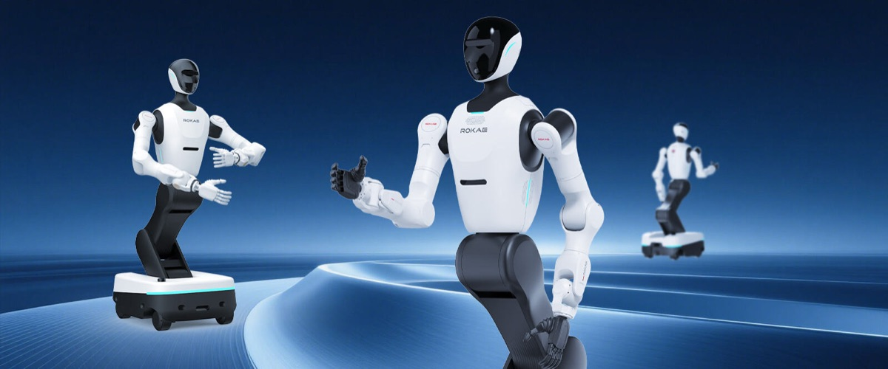
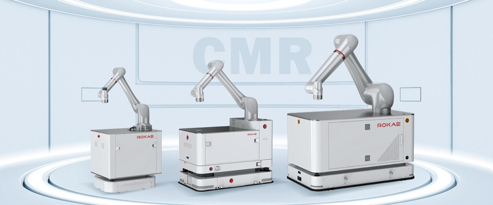

# ROKAE Robotics × T02 — Products and Solutions

⬆ [ROKAE Robotics profile](../ROKAE.md) · [Brief](ROKAE-T02-1-Brief.md) · [Playbook](ROKAE-T02-3-Playbook.md)

> **Bottom line:** ROKAE has no resilience or public-safety product. For T02 it supplies one thing well: a force-controlled arm you can teleoperate or script to touch infrastructure safely (valves, switches, surfaces, probes). Mobility, hazard sensing and mapping must come from other vendors. What ROKAE actually brings on site is **not confirmed** — check the vendor table first.

## Relevant products (ranked for this track)

### xMate CR series (CR5, CR7, CR12, CR18, CR20, CR35)

**Role in T02:** the most rugged ROKAE arm body — fixed-base "remote hands" or contact-inspection arm in a plant room, tunnel niche mock-up or test bench. CR7 / CR12 are the realistic hackathon sizes.

| Spec | CR7 | CR12 | Note |
|---|---|---|---|
| Payload | **7 kg** | **12 kg** | Range across family: 5–45 kg |
| Reach | **988 mm** | **1434 mm** | |
| Arm weight | ~25 kg | ~41 kg | |
| Arm IP rating | **IP67** | **IP67** | CR5 is IP54 |
| Cartesian stiffness (adjustable) | 0–6000 N/m | 0–18000 N/m | |
| Flange force / torque sensing accuracy | **0.5 N / 0.1 Nm** (relative) | same | Collision detection via torque sensing |
| Operating temperature | **0–50 °C** | 0–50 °C | Below-zero outdoor use is outside spec |
| Controller (MCC) | **IP54**, ~16.6 kg, 90–264 V AC | same | Arm runs on 48 V DC |
| Safety | TÜV-certified safety controller, PL d Cat. 3 (ISO 13849-1) per product page | | |

- **Status:** ✅ shipping · **Price:** not public · **On site:** not confirmed.
- **Developer control:** xCore SDK (C++ / Python / C#); real-time mode up to 1 kHz with joint / Cartesian position, joint / Cartesian impedance and direct torque for collaborative models (per the SDK README); ROS 2 Humble + MoveIt 2 configs exist for CR7, CR12, CR18, CR20, CR35.

### xMate SR series (SR3, SR5)

**Role in T02:** the most likely arm on site and the lightest to set up — table-top teleoperation or contact-probing demo.

| Spec | SR3 | SR5 |
|---|---|---|
| Payload | **3 kg** | **5 kg** |
| Reach | **705 mm** | **919 mm** |
| Arm weight | ~13.8 kg | ~16.5 kg |
| IP rating | IP54 | IP54 |
| Cartesian stiffness (adjustable) | 0–3000 N/m | 0–3000 N/m |
| Power | 48 V DC; 1.2 kg MSC controller | same |

- **Status:** ✅ shipping · **Price:** not public · **On site:** best guess, not confirmed.
- **Developer control:** same SDK and real-time modes as CR; ROS 2 MoveIt configs for SR3, SR4, SR5.

### AR series (AR3, AR5, AR10)

**Role in T02:** light 7-DoF torque-sensing arm designed to be mounted on other robots — the only ROKAE arm that is plausible on a third-party mobile base (quadruped or wheeled) for a "go there and operate it" responder.

| Spec | AR3 | AR5 | AR10 |
|---|---|---|---|
| Payload | **3 kg** | **5 kg** | **10 kg** |
| Reach | 650 mm | 683 mm | 815 mm |
| Arm weight | **8 kg** | **10 kg** | 19.5 kg |
| DoF | 7 | 7 | 7 |
| IP rating | IP54 | IP54 | IP54 |
| Force resolution | ≤0.05 N (joint torque sensors standard, sampled ≥5 kHz) | same | same |
| Power / bus | 48 V DC ±15 % · EtherCAT, 1 ms cycle | same | same |
| Shock / temperature | 10 g impact rating · 0–50 °C | same | same |

- **Status:** ✅ shipping (10,000th unit delivered, Sep–Oct 2026) · **Price:** not public · **On site:** plausible, not confirmed.
- **Developer control:** dedicated SDK branch 0.7.x-AR; ROS 2 MoveIt configs for AR5 left / right. Controller model, mass and power draw for a mobile mount: not public — ask on site.

### Helios (Helios II)

**Role in T02:** the only ROKAE platform with mobility plus two arms — an indoor responder for flat floors (plant room, corridor, station hall). Not an outdoor or rough-terrain machine.

| Spec | Value |
|---|---|
| Arms | 2 × 7-DoF, **5 kg** per arm, whole-body force control (arms, waist, neck) |
| DoF | 23 in spec table (intro text says 42 — inconsistent on the official page) |
| Chassis | Omnidirectional, 4 drive wheels, **1.5 m/s**, docking ±10 mm |
| Size / weight | 750 × 650 × 1493–2000 mm · **160 kg** |
| Runtime | **~4 h** (2 × 18 Ah), ~2 h charge 10–90 %, battery swap and auto-recharge supported |
| Sensors | 2 × 3D LiDAR, head stereo camera, IMU; optional fisheye, chest and wrist cameras |
| Compute | Jetson Orin NX 8 GB, AGX Orin 64 GB or Thor T5000 |
| Comms / safety | Wi-Fi, Bluetooth, optional **5G**; optional wireless e-stop |
| Teleoperation | Optional gamepad only (no VR / exoskeleton listed) |
| Environment | 0–45 °C; **IP rating, slope and obstacle limits not listed** |

- **Status:** ✅ shipping (five units at Schaeffler Taicang, Oct 2026) · **Price:** not public · **On site:** possible, heavy to ship.
- **Developer control:** ROS 2 and a Python SDK for secondary development; navigation-stack details not public.

### CMR series (CMR-S, CMR-L, CMR-CR)

**Role in T02:** conceptually an unattended "rounds" robot for technical rooms (read gauges, press buttons), but it is a factory AMR and unlikely to be on site.

| Spec | Value |
|---|---|
| Arm payload | 7–45 kg depending on model (CMR-S carries SR, CR7 or CR12) |
| Speed / navigation | 1.3–1.5 m/s · laser SLAM, 2 LiDARs · positioning ±5 to ±10 mm |
| Runtime | 7–12 h |
| Chassis weight | 150–1500 kg; CMR-S fits aisles down to 800 mm |
| IP / slope / obstacle | not listed |

- **Status:** ✅ shipping · **Price:** not public · **Developer control:** CMR-specific APIs not public.

### xCore / iNex

**Role in T02:** the software layer you will actually build on — see "Software, models and data" below. iNex (embodied-AI control system) is 🧪 with no public developer access.

### Lower relevance
- **HSA joint modules** — only useful if you build a custom mechanism (for example a valve-turning tool); too slow a path for 48 hours.
- **Human.X** 🧪, **NB / XB industrial arms**, **welding package**, **xMate ZR**, **xMate ER Pro** (⚠️ unverified status) — no specific T02 role.

## What ROKAE Robotics already does in this domain

**Nothing specific to emergency response, hazard monitoring, security patrol or infrastructure inspection was found** on ROKAE's official site, docs or GitHub. The closest adjacent evidence:

| Date | What | Relevance to T02 | Source |
|---|---|---|---|
| Oct 2026 | Five Helios robots at Schaeffler's Taicang factory for parts handling, assembly and **inspection** | Proves unattended mobile manipulation indoors; it is factory quality work, not infrastructure | [TechNode Global / PR Newswire](https://technode.global/?p=996114) |
| Undated case study | Teleoperated ultrasound diagnosis robot on xMate ER7 Pro | Proves remote operation with force-controlled contact — the same pattern as remote intervention | [ROKAE Japan case](https://www.rokae.com/jp/case/show/1189/%E9%81%A0%E9%9A%94%E6%93%8D%E4%BD%9C%E5%9E%8B%E8%B6%85%E9%9F%B3%E6%B3%A2%E8%A8%BA%E6%96%AD%E3%83%BB%E6%B2%BB%E7%99%82%E3%83%AD%E3%83%9C%E3%83%83%E3%83%88.html) |
| Undated (product page) | AI and 3D vision inspection of automotive seats and hot-formed parts with CR arms | Arm-held camera inspection, factory context | [xMate CR page](https://www.rokae.com/en/product/show/545/xMateCR.html) |
| Undated (case list) | Chemical catalyst preparation with a cobot; "electric power" named as a general-industry scenario without a case | Hint of lab / utility use, no details public | [General Industry cases](https://www.rokae.com/en/case/343/General-Industry.html) |

Research note: general web search was unavailable during this run, so third-party integrator projects (for example power-utility or explosion-proof cobot applications built on ROKAE arms) could not be checked — ⚠️ unverified whether any exist. Ask the ROKAE engineers.

## What they are building next in this domain

- **Announced:** nothing aimed at resilience or public safety. 2026 messaging is about being a force-control arm and joint supplier to humanoid makers (10,000 AR arms, 80+ partners) and industrial alliances (Northeast Intelligent Manufacturing Alliance, Nov 2026).
- **Inference:** Helios options — 5G, wireless e-stop, autonomous recharging, battery swap — are the building blocks of unattended remote operation, which could later extend to utility or plant-room rounds. This is our reading, not a ROKAE statement.
- **Inference:** iNex 🧪 and the VLA "intelligent core" 🔭 mentioned for Human.X could give higher-level autonomy; no public access today.

## Software, models and data that help for this track

| Asset | What you get | T02 use | Status |
|---|---|---|---|
| [xCoreSDK-CPP](https://github.com/RokaeRobot/xCoreSDK-CPP) | Apache-2.0; Ubuntu 18.04 / 20.04 / 22.04 (x86_64, aarch64) and Windows; needs xCore controller **v3.2.1+**; non-real-time moves (MoveJ / MoveL / MoveC), force-control commands, IO, RS-485 tool comms, drag and path replay, collision detection; **real-time mode up to 1 kHz** with joint / Cartesian position, joint / Cartesian impedance and direct torque on collaborative arms | Teleoperation with compliant contact; force-guarded probing | ✅ (binaries come from the GitHub release, v0.7.1) |
| [xCoreSDK-Python](https://github.com/RokaeRobot/xCoreSDK-Python) | Python interface "for all series" | Fast scripting of motions and force commands | ✅ — whether real-time mode is exposed in Python was not confirmed |
| [rokae_ros2](https://github.com/RokaeRobot/rokae_ros2) | ROS 2 **Humble** / Ubuntu 22.04, `ros2_control` + **MoveIt 2**, URDF and meshes, Gazebo helpers, examples; configs for AR5 L/R, CR7/12/18/20/35, ER3/7, Pro3/7, SR3/4/5; stack v0.0.4 on SDK 0.7.1 | Collision-aware planning in a scanned scene; simulation before hardware time | ✅ — sim-without-robot workflow not confirmed |
| [xCorePlugin-client / -controller](https://github.com/RokaeRobot) | Plugin kits for pendant and controller | Not needed in 48 hours | ✅ |
| Teleoperation toolkit, datasets, pretrained models | — | — | not public — bring your own |

GitHub note: the `RokaeRobot` organization is named "ROKAE Robotics", links to rokae.com and carries a ROKAE (Beijing) copyright; a back-link from rokae.com was not checked, so treat it as very likely official.

## Gaps and limits for this track

- **No mobility for the real world:** nothing from ROKAE handles stairs, snow, gravel or slopes. Helios and CMR publish no IP, slope or obstacle figures.
- **Environment:** arms are rated **0–50 °C**; Leukerbad outdoors in November is below that. CR arm bodies are IP67 but the controller cabinet is IP54 and needs mains AC.
- **No hazard sensing:** no gas, thermal, acoustic or structural sensors; add your own.
- **No T02 autonomy or application software:** no patrol, mapping, anomaly detection or incident tooling.
- **Teleoperation:** only a gamepad option on Helios is listed; you write the teleop layer yourself. Network-loss behaviour is not documented publicly.
- **End-effectors and cameras:** not confirmed as supplied.
- **No Swiss presence or local references** found; prices not public.

## Sources
- [ROKAE — xMate CR series](https://www.rokae.com/en/product/show/545/xMateCR.html)
- [ROKAE — SR cobots](https://www.rokae.com/en/product/show/349/SR-Cobots.html)
- [ROKAE — Humanoid Force-Controlled Arm AR](https://www.rokae.com/en/product/show/595/Humanoid-Force-Controlled-Arm-AR.html)
- [ROKAE — Wheeled Dual-Arm Robot Helios](https://www.rokae.com/en/product/show/596/Wheeled-Dual-Arm-Robot-Helios.html)
- [ROKAE — Mobile Manipulator CMR](https://www.rokae.com/en/product/show/599/Mobile-Manipulator-CMR.html)
- [ROKAE — General Industry cases](https://www.rokae.com/en/case/343/General-Industry.html)
- [ROKAE official site (EN) — navigation and news](https://www.rokae.com/en/)
- [ROKAE SDK documentation](https://docs.rokae.com/en/docs/SDK)
- [ROKAE ROS 2 package manual](https://docs.rokae.com/en/docs/ROS2)
- [GitHub — RokaeRobot organization](https://github.com/RokaeRobot)
- [GitHub — RokaeRobot/xCoreSDK-CPP](https://github.com/RokaeRobot/xCoreSDK-CPP)
- [GitHub — RokaeRobot/rokae_ros2](https://github.com/RokaeRobot/rokae_ros2)
- [TechNode Global (PR Newswire) — 10,000th AR arm and Schaeffler deployment, 27 Oct 2026](https://technode.global/?p=996114)
- [ROKAE Japan — teleoperated ultrasound robot case (ER7 Pro)](https://www.rokae.com/jp/case/show/1189/%E9%81%A0%E9%9A%94%E6%93%8D%E4%BD%9C%E5%9E%8B%E8%B6%85%E9%9F%B3%E6%B3%A2%E8%A8%BA%E6%96%AD%E3%83%BB%E6%B2%BB%E7%99%82%E3%83%AD%E3%83%9C%E3%83%83%E3%83%88.html)
- [ROKAE company profile (this pack)](../ROKAE.md)
