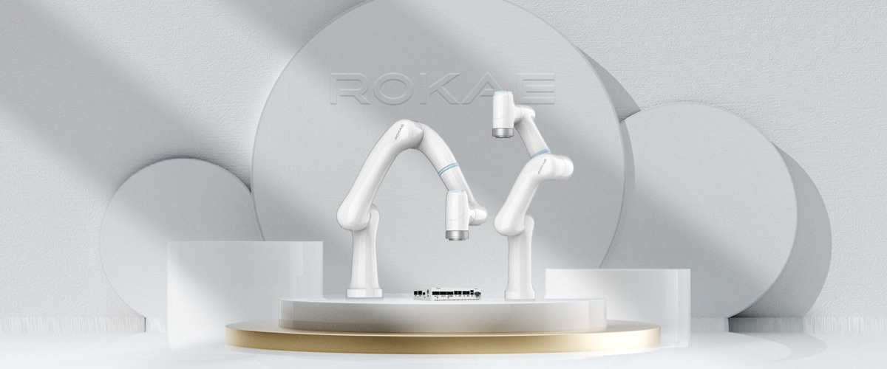
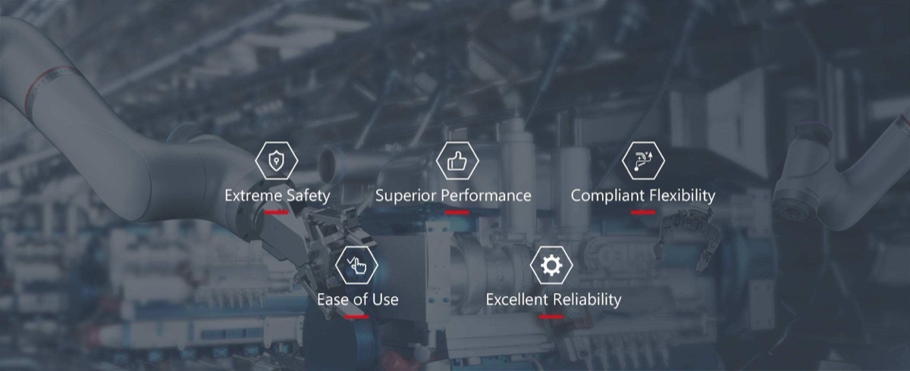
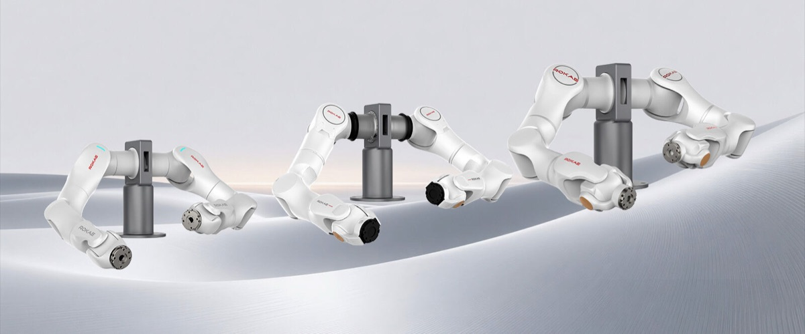
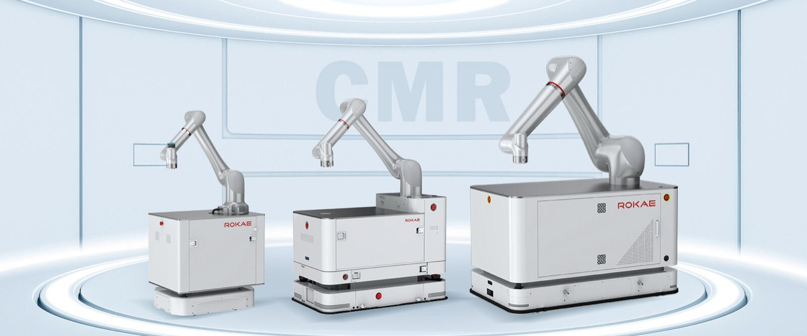
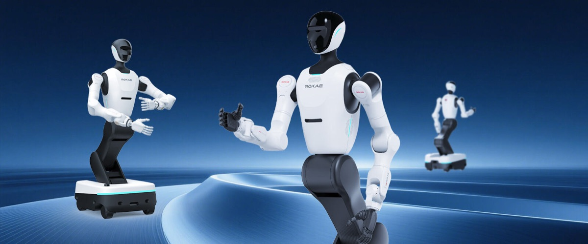

# ROKAE Robotics × T03 — Products and Solutions

⬆ [ROKAE Robotics profile](../ROKAE.md) · [Brief](ROKAE-T03-1-Brief.md) · [Playbook](ROKAE-T03-3-Playbook.md)

**Bottom line:** ROKAE sells arms, not sustainability solutions. For T03 it is the manipulation half of a sorting, disassembly, picking or lab-automation cell. What is physically on site is **not confirmed** — check the vendor table before committing.

## Relevant products (ranked for this track)

### xMate SR series (SR3, SR5)

**Role in T03:** the most likely on-site arm and the easiest to build a desk-sized sorting, repair or plant-care cell around. Light, 48 V, tiny controller.

| Spec | SR3 | SR5 |
|---|---|---|
| Payload | **3 kg** | **5 kg** |
| Reach | **705 mm** | **919 mm** |
| Arm weight | ~13.8 kg | ~16.5 kg |
| Repeatability | ±0.03 mm | ±0.03 mm |
| Max tool speed | ≤1.5 m/s | ≤2.0 m/s |
| Force control accuracy | 0.5 N / 0.1 Nm | 0.1 N / 0.02 Nm |
| Adjustable stiffness | 0–3000 N/m · 0–300 Nm/rad | same |
| Protection / temperature | IP54 · 0–50 °C | same |
| Power | 48 VDC (consumption not public) | same |
| Controller | MSC, 203 × 175 × 42 mm, ~1.2 kg, IP20; 5 DI / 5 DO, EtherCAT, 3× GbE, RS485 | same |

- **Status / price:** ✅ shipping · price not public · on-site availability unconfirmed.
- **Developer control:** xCore SDK (C++ / Python / C#) for motion commands and I/O; drag teaching on the pendant; ROS 2 package. Real-time streaming exists in the C++ SDK (docs list torque-control troubleshooting), but rate and exact modes are ⚠️ unverified.

### xMate CR series (CR5, CR7, CR12, CR18, CR20, CR35)

**Role in T03:** more reach and payload plus **IP67** — the better choice for wet, dirty waste or heavier items (bottle crates, e-waste, battery modules). The CR35 is ROKAE's proven sorting arm but is far too heavy to expect on site.

| Spec | CR7 | CR12 | CR35 (35 kg variant) |
|---|---|---|---|
| Payload | **7 kg** | **12 kg** | **35 kg** |
| Reach | **988 mm** | **1434 mm** | **2246 mm** |
| Arm weight | ~25 kg | ~41 kg | ~180 kg |
| Repeatability | ±0.02 mm | ±0.03 mm | ±0.05 mm |
| Max tool speed | ≤3.2 m/s | ≤3.0 m/s | not stated |
| Protection | IP67 | IP67 | IP67 |
| Adjustable stiffness | 0–6000 N/m | 0–18000 N/m | not listed |
| Power | 48 VDC arm; controller on single-phase AC | same | controller 190–240 V AC |

- CR5 is the exception on protection: **IP54**, 5 kg, 1406 mm.
- **Status / price:** ✅ shipping · price not public.
- **Developer control:** same xCore SDK and ROS 2 path as SR; tool-flange force / torque sensing listed for CR5–CR20.

### AR series (AR3, AR5, AR10)

**Role in T03:** 7-DoF arm with joint torque sensors — best for cluttered bins, reaching around obstacles, and dual-arm disassembly (one arm holds, one unscrews). Used on the JD Logistics picking robot.

| Spec | AR3 | AR5 | AR10 |
|---|---|---|---|
| Payload | **3 kg** | **5 kg** | **10 kg** |
| Reach | 650 mm | 683 mm (JD case page says 700 mm) | 815 mm |
| Arm weight | 8 kg | 10 kg | 19.5 kg |
| DoF | 7 | 7 | 7 |
| Force resolution | ≤0.05 N | same | same |
| Bus / power / protection | EtherCAT 1 ms · 48 VDC · IP54 | same | same |

- **Status / price:** ✅ shipping (10,000th unit delivered, Oct 2026) · price not public.
- **Developer control:** dedicated SDK branch **0.7.x-AR**. Needs a host controller; no on-board perception or GPU.

### CMR series (CMR-S, CMR-L, CMR-CR)

**Role in T03:** resource-efficient intralogistics (one mobile arm serving several stations). Relevant as a concept reference; **unlikely on site** (chassis 150–1500 kg).

| Spec | Value |
|---|---|
| Arm payload / reach | **7–45 kg** / 988–2246 mm (CR arms) |
| Navigation | Laser SLAM, no floor markers, 360° LiDAR coverage |
| Positioning | ±10 mm quoted on oily floors; docking ±5 to ±10 mm by model |
| Speed / runtime | 1.3–1.5 m/s · 7–12 h |
| Vision | 2D / 3D vision options for final positioning |

- **Status / price:** ✅ shipping · price not public. Developer interface for the base: not public.

### Helios (Helios II)

**Role in T03:** the only ROKAE platform with mobility, two arms and on-board GPU in one unit — would enable a roaming recycling or building-service robot. **Possible but not expected on site** (160 kg).

| Spec | Value |
|---|---|
| Arms | 2× AR-class, **5 kg per arm** |
| Base | Omnidirectional, **1.5 m/s**, indoor flat floors |
| Runtime | ~**4 h** |
| Sensors | 2× 3D LiDAR, head stereo camera |
| Compute | Jetson Orin NX 8 GB / AGX Orin 64 GB / Thor T5000 options |
| Dev access | ROS 2 + Python SDK |

- **Status / price:** ✅ (five units at Schaeffler Taicang, Oct 2026) · price not public. DoF count is inconsistent on the product page (23 vs 42).

### xCore / iNex

**Role in T03:** the software you actually program. xCore ✅ is the controller and SDK for all arms; iNex 🧪 is the announced embodied-AI control system with no public developer access.

## What ROKAE Robotics already does in this domain

**Nothing is marketed as "sustainability", recycling, waste sorting or EV charging.** The closest public evidence is adjacent work. All items below are ROKAE case pages with a **listing date of 12 Nov 2026** (deployment dates and most customers are not given):

| Area (T03 link) | What is public | Evidence quality |
|---|---|---|
| Sorting at scale (→ waste / reuse sorting) | **CR35**, ceiling-mounted, combined suction-and-grip tool, warehouse parcel picking and sorting: **13M+ parcel operations**, **99.99%** system stability, **0.01%** grasp-damage rate. Customer not named. [Case](https://www.rokae.com/en/case/show/2629/CR35-Advances-Large-Scale-Warehouse-Picking-&-Sorting.html) | Good numbers, self-reported |
| Embodied picking (→ resource-efficient logistics) | **JD Logistics "Canglang"** picking robot uses **AR5** arms: **99.9%** picking accuracy, **85%+** SKU coverage, 24/7, no warehouse retrofit. [Case](https://www.rokae.com/en/case/show/2630/Embodied-Intelligence-in-Action:-Advancing-the-Future-of-Smart-Warehousin.html) | Named customer; the robot and its AI are JD's, the arms are ROKAE's |
| Battery / energy-storage manufacturing (→ energy transition) | CR35 handling large lithium cell modules; an automated line for liquid-cooled storage module packs (energy-storage use is inferred from the title); an NB220 lithium-battery handling case is referenced. [Cell modules](https://www.rokae.com/en/case/show/2623/Reliable-Cell-Module-Handling-for-Battery-Manufacturing.html) · [Pack line](https://www.rokae.com/en/case/show/2622/Liguid-Cooled-Storage-Module-Pack-Automated-Assembly-Line.html) | Titles and short text only; no numbers |
| Agriculture (→ urban farming) | Tomato-harvesting and grape-harvesting robot cases on cobots. [Tomato](https://www.rokae.com/en/case/show/2627/Fruit-Picking：Tomato-Harvesting-Robot.html) · [Grape](https://www.rokae.com/en/case/show/2626/Fruit-Picking：Grape-Harvesting-Robot.html) | Title only; model, partner and performance not public |
| Lab automation (→ green chemistry, water testing) | "Chemical Catalyst Preparation" cobot case. [Case](https://www.rokae.com/en/case/show/2625/Chemical-Catalyst-Preparation.html) | Title only |
| Shared-resource logistics | CMR mobile manipulators for machine tending and inter-station transfer. [Application page](https://www.rokae.com/en/case/624/CMR-Series-Composite-Robot.html) | Generic application page, no named customer |

Not found in public ROKAE material: recycling or waste-sorting lines, battery **dis**assembly, EV-charging robots, environmental monitoring, building automation.

## What they are building next in this domain

- **No sustainability roadmap is public.**
- Stated direction (Oct 2026 press release): be the force-control arm and joint supplier for embodied-AI robots (AR arms, HSA joints), plus own platforms (Helios, Human.X) and the iNex control system 🧪.
- **Inference:** the JD Logistics and CR35 parcel cases suggest logistics picking and sorting is the embodied-AI application ROKAE pushes hardest; waste or reuse sorting is technically the same problem and a plausible pitch to their engineers.
- **Inference:** battery-manufacturing cases indicate "new energy" is treated as a customer industry, not as a sustainability product line.

## Software, models and data that help for this track

| Asset | Status | Use in a 48-hour T03 build |
|---|---|---|
| xCore SDK — C++, Python, C# (0.7.x, 0.7.x-AR, 0.8.x) | ✅ on docs.rokae.com | Python for pick-and-place and I/O; C++ if you need real-time force behaviour |
| C++ "Scene Examples" and real-time-mode FAQ (incl. torque control) | ✅ listed in the docs index | Starting point for compliant contact; contents not checked in detail |
| "Rokae xMate ROS 2 User Manual" + package | ✅ exists; distro, MoveIt and simulation support ⚠️ unverified | Use only if the on-site engineers confirm a working distro |
| Drag teaching, pendant flow programming, RokaeStudio | ✅ | Teach bin and drop poses in minutes; good fallback |
| Pretrained models (VLA, grasping, waste classes) | not public | Bring your own: open-vocabulary detector + grasp heuristics, or another vendor's model |
| Datasets, simulation assets (MuJoCo / Isaac) | not public / not found | Do not plan around simulation |
| Official GitHub org | not confirmed | Get the SDK from the docs portal or from the engineers on a USB stick |

## Gaps and limits for this track

- **No domain content**: no waste, recycling, EV-charging or environmental product, model or dataset from ROKAE.
- **Arms only (most likely)**: no gripper, camera or GPU confirmed as supplied; no mobility unless Helios or CMR turns up.
- **Indoor hardware**: SR and AR are IP54, 0–50 °C; CR is IP67 but still a fixed-base indoor arm. No outdoor, snow or slope capability.
- **Energy data missing**: power consumption is not published, so "low-energy" claims must be measured on site (bring a plug-in power meter).
- **Developer unknowns**: real-time rate and modes, ROS 2 distro, and simulation assets are unverified.
- **Evidence is thin**: most relevant case pages carry only a title, a short text and a listing date; customers are mostly unnamed.
- **Research limit**: open web search was unavailable for this document; findings rest on ROKAE's own product, case and docs pages plus the company profile. Third-party coverage (for example recycling or charging integrators using ROKAE arms) may exist and was not checked.

## Sources

- [ROKAE — SR cobots product page](https://www.rokae.com/en/product/show/349/SR-Cobots.html)
- [ROKAE — xMate CR product page](https://www.rokae.com/en/product/show/545/xMateCR.html)
- [ROKAE — Humanoid Force-Controlled Arm AR](https://www.rokae.com/en/product/show/595/Humanoid-Force-Controlled-Arm-AR.html)
- [ROKAE — Mobile Manipulator CMR](https://www.rokae.com/en/product/show/599/Mobile-Manipulator-CMR.html)
- [ROKAE — Wheeled Dual-Arm Robot Helios](https://www.rokae.com/en/product/show/596/Wheeled-Dual-Arm-Robot-Helios.html)
- [ROKAE — application cases index](https://www.rokae.com/en/case/)
- [ROKAE — General Industry cases](https://www.rokae.com/en/case/343/General-Industry.html)
- [ROKAE — Commercial Services cases](https://www.rokae.com/en/case/208/Commercial-Services.html)
- [ROKAE — CMR Series Composite Robot application page](https://www.rokae.com/en/case/624/CMR-Series-Composite-Robot.html)
- [ROKAE case — CR35 warehouse picking and sorting](https://www.rokae.com/en/case/show/2629/CR35-Advances-Large-Scale-Warehouse-Picking-&-Sorting.html)
- [ROKAE case — embodied intelligence in smart warehousing (JD Logistics, AR5)](https://www.rokae.com/en/case/show/2630/Embodied-Intelligence-in-Action:-Advancing-the-Future-of-Smart-Warehousin.html)
- [ROKAE case — cell module handling for battery manufacturing](https://www.rokae.com/en/case/show/2623/Reliable-Cell-Module-Handling-for-Battery-Manufacturing.html)
- [ROKAE case — liquid-cooled storage module pack assembly line](https://www.rokae.com/en/case/show/2622/Liguid-Cooled-Storage-Module-Pack-Automated-Assembly-Line.html)
- [ROKAE case — tomato harvesting robot](https://www.rokae.com/en/case/show/2627/Fruit-Picking：Tomato-Harvesting-Robot.html)
- [ROKAE case — grape harvesting robot](https://www.rokae.com/en/case/show/2626/Fruit-Picking：Grape-Harvesting-Robot.html)
- [ROKAE case — chemical catalyst preparation](https://www.rokae.com/en/case/show/2625/Chemical-Catalyst-Preparation.html)
- [ROKAE documentation hub](https://docs.rokae.com/en/)
- [ROKAE SDK documentation index](https://docs.rokae.com/en/docs/SDK)
- [ROKAE ROS 2 package manual](https://docs.rokae.com/en/docs/ROS2)
- [TechNode Global (PR Newswire) — 10,000th AR arm, Schaeffler Helios deployment, Oct 2026](https://technode.global/?p=996114)
- [ROKAE Robotics company profile (this vault)](../ROKAE.md)
