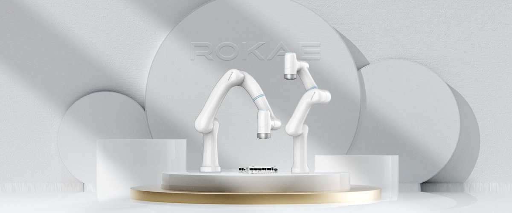
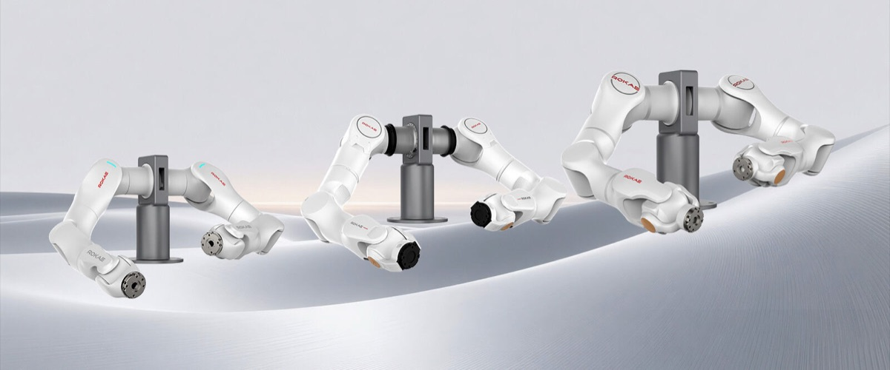
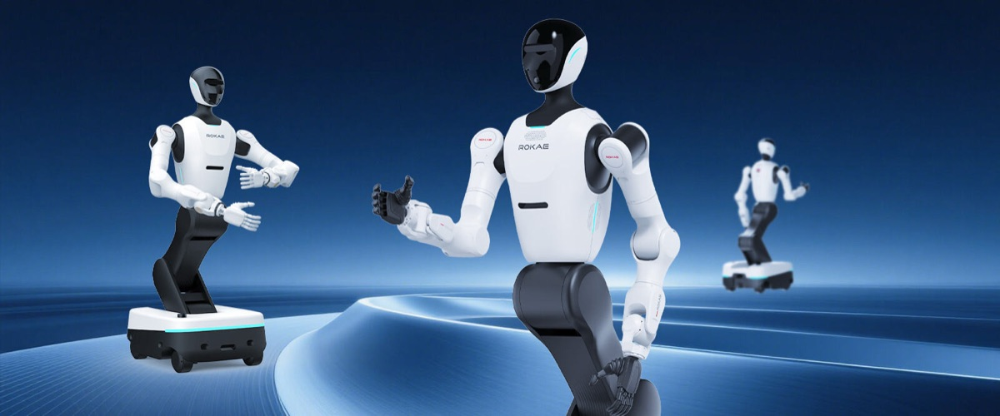
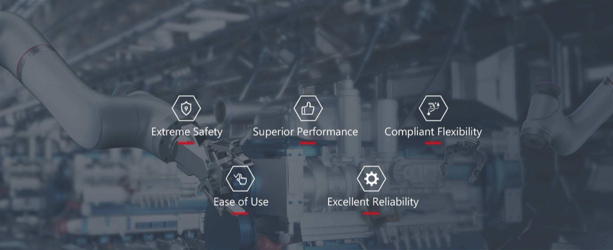

# ROKAE Robotics × T04 — Products and Solutions

⬆ [ROKAE Robotics profile](../ROKAE.md) · [Brief](ROKAE-T04-1-Brief.md) · [Playbook](ROKAE-T04-3-Playbook.md)

**Read this first:** ROKAE sells force-controlled arms, not care robots. Its value for T04 is a compliant arm with an open SDK that is safe enough to build a contact demo on. Which units are in Leukerbad is **not confirmed** — verify at the vendor table before committing.

## Relevant products (ranked for this track)

### xMate SR series (SR3, SR5)

**Role in T04:** first choice for anything that touches or is held by a person — rehab exercise partner, massage / physio stroke, tele-palpation, feeding or handover aid. Light enough to clamp to a table. This is the arm ROKAE itself lists for its "AI Massage Robot" application.

| Spec | SR3 | SR5 |
|---|---|---|
| Payload | **3 kg** | **5 kg** |
| Reach | **705 mm** | **919 mm** |
| Arm weight | ~13.8 kg | ~16.5 kg |
| Max tool speed | ≤1.5 m/s | ≤2.0 m/s |
| Cartesian stiffness range | **0–3000 N/m** | **0–3000 N/m** |
| Rotational stiffness range | 0–300 Nm/rad | 0–300 Nm/rad |
| Force control relative accuracy | 0.5 N, 0.1 Nm | 0.1 N, 0.02 Nm |
| Repeatability | ±0.03 mm | ±0.03 mm |
| Power / protection | 48 VDC · IP54 | 48 VDC · IP54 |
| Controller | MSC box, ~1.2 kg, IP20, 5 DI / 5 DO, external e-stop input | same |
| Safety paperwork | "Function Safety" certificate listed (standard not named on page) | ISO 15066 certificate file listed (covers SR5, CR7, CR12, CR20) |

- **Status:** ✅ shipping · **Price:** not public · **On site:** likely but unconfirmed.
- **Developer interface:** xCore SDK (C++ / Python / C#), ROS 2 Humble + MoveIt 2 config for SR3 / SR4 / SR5. Non-real-time: joint and Cartesian moves, force-control commands, drag teaching and path playback, collision-detection settings, I/O. Real-time (up to **1 kHz**): joint position, Cartesian position, joint impedance, Cartesian impedance, direct torque.

### AR series (AR3, AR5, AR10)

**Role in T04:** 7-DoF, human-arm-like kinematics with torque sensors in every joint. The redundancy lets you keep the elbow away from the patient while the hand follows a path. Best option for a dual-arm or "arm on someone else's mobile base" build.

| Spec | AR3 | AR5 | AR10 |
|---|---|---|---|
| DoF | 7 | 7 | 7 |
| Payload | **3 kg** | **5 kg** | **10 kg** |
| Reach | 650 mm | 683 mm | 815 mm |
| Arm weight | **8 kg** | **10 kg** | 19.5 kg |
| Joint torque sensors | standard | standard | standard |
| Force control resolution (reference) | ≤0.05 N, ≤0.02 Nm | same | same |
| Tool speed | ≥2 m/s | ≥2 m/s | ≥2 m/s |
| Bus / power | EtherCAT 1 ms · 48 VDC | same | same |
| Protection / noise | IP54 · ≤60 dB | same | same |

- **Status:** ✅ shipping (10,000th unit delivered Oct 2026) · **Price:** not public · **On site:** plausible, unconfirmed.
- **Developer interface:** dedicated SDK branch **0.7.x-AR**; the ROS 2 stack ships MoveIt configs for **AR5L / AR5R** (left and right arm). The C++ real-time docs have an AR-specific section — ask what differs. No stiffness range is published for AR.
- **Caution:** ≥2 m/s tool speed is far above what is acceptable next to a frail person. Cap speed in software.

### Helios (Helios II)

**Role in T04:** the only ROKAE platform that moves and manipulates — fetch-and-carry, handover, medication trolley, caregiver logistics. Built for factories, not homes.

| Spec | Value |
|---|---|
| Arms | Dual, **5 kg per arm** (AR-class force-controlled arms) |
| Base | Omnidirectional, **1.5 m/s** |
| Height / weight | 1493–2000 mm · **160 kg** |
| Runtime | ~4 h |
| Sensors | 2× 3D LiDAR, head stereo camera |
| Compute | Jetson Orin NX / AGX Orin / Thor options |
| DoF | 23 in spec table (intro text says 42 — page is inconsistent) |

- **Status:** ✅ deployed in industry (five units at Schaeffler Taicang, Oct 2026) · **Price:** not public · **On site:** possible, unconfirmed.
- **Developer interface:** ROS 2 + Python SDK listed; gamepad control. Navigation stack details not public. Specs above are taken from the company profile.
- **Caution:** 160 kg near elderly people is a safety argument you must address in the pitch (geofence, low speed, keep-out distance).

### xMate CR series (CR5, CR7, CR12, CR18, CR20, CR35)

**Role in T04:** fallback if no SR is available. CR7 / CR12 have the reach for a full-back massage path or a bedside task, but they are heavier arms; keep stiffness and speed low.

| Spec | Value |
|---|---|
| Payload range | **5–45 kg** across the family |
| Reach range | **988–2246 mm** |
| Sensing | Joint torque sensing for collision detection |
| Safety paperwork | ISO 15066 certificate file listed for CR7, CR12, CR20 |

- **Status:** ✅ shipping · **Price:** not public.
- **Developer interface:** same xCore SDK; ROS 2 MoveIt configs for CR7 / CR12 / CR18 / CR20 / CR35.

### xMate ER Pro (ER3 Pro / ER7 Pro)

**Role in T04:** the 7-DoF arm used in ROKAE's remote-ultrasound case (ER7 Pro: 7 kg, 850 mm). ⚠️ unverified status — legacy line, not on the current English product pages. The ROS 2 stack still has configs named ER3, ER7, Pro3, Pro7. Use only if one happens to be on site.

### xCore / iNex

**Role in T04:** xCore is the controller every arm above runs; the SDK talks to it. Requires **xCore v3.2.1 or later** for the current GitHub SDK. iNex (embodied-AI control system) is 🧪 — named in a press release, no public developer access.

**Not relevant for T04:** NB / XB industrial robots (not collaborative), CMR mobile manipulators (factory AMRs, 150–1500 kg chassis), welding package, Human.X (🧪, availability unclear), HSA joints (only if you plan to build a custom rehab device — not realistic in 48 hours).

## What ROKAE Robotics already does in this domain

Nothing elderly-care specific. What exists is a set of **medical and wellness applications built by integrators on ROKAE arms**. All case pages are undated, name no partner, and none is a certified ROKAE medical device.

| Application | Arm | Type | Source |
|---|---|---|---|
| AI massage robot | SR series | Wellness — force-controlled contact with the body | [SR product page](https://www.rokae.com/en/product/show/349/SR-Cobots.html) |
| Moxibustion therapy robot | xMate + vision | Wellness / traditional therapy | [ROKAE Japan case](https://www.rokae.com/jp/case/show/1196/%E3%81%8A%E7%81%B8%E6%B2%BB%E7%99%82%E3%83%AD%E3%83%9C%E3%83%83%E3%83%88.html) (via profile) |
| Remote ultrasonic diagnosis robot | ER7 Pro per Japanese case page | Tele-examination under teleoperation | [EN case](https://www.rokae.com/en/case/show/1028/Remote-Ultrasonic-Diagnosis-Robot.html) |
| Ward auscultation and ultrasound robot | cobot, model not named | Bedside examination | [EN case](https://www.rokae.com/en/case/show/1030/Ward-Auscultation-&-Ultrasound-Robot.html) |
| Total knee arthroplasty assisted robot | cobot, model not named | Surgery assistance | [EN case](https://www.rokae.com/en/case/show/995/Total-Knee-Arthroplasty-Assisted-Robot.html) |
| Tumor biopsy navigation and positioning robot | cobot, model not named | Surgery positioning | [EN case](https://www.rokae.com/en/case/show/1029/Tumor-Biopsy-Navigation-and-Positioning-Robot.html) |

- The healthcare case index has filter categories for **"Rehabilitation" and "Nursing" but shows no cases under them** — an honest signal that rehab and care are intended markets without a published reference.
- No pilot in a care home, rehab clinic or home setting was found. No European or Swiss healthcare deployment was found.

## What they are building next in this domain

- **No announced elderly-care or rehabilitation product or roadmap.** Everything below is inference.
- *Inference:* ROKAE positions itself as a force-control component supplier (10,000 AR arms, 80+ partners integrating them). Care robots from other makers may end up using ROKAE arms or HSA joints; ROKAE itself is unlikely to ship a care robot soon.
- *Inference:* Helios and Human.X are aimed at factories (Schaeffler deployment). A service or care variant has not been announced.
- iNex 🧪 and a VLA "intelligent core" 🔭 are named in marketing; no developer access, no care-specific skills.

## Software, models and data that help for this track

| Asset | What you get | T04 use | Status |
|---|---|---|---|
| [xCoreSDK-CPP](https://github.com/RokaeRobot/xCoreSDK-CPP) | Apache-2.0. Ubuntu 18.04 / 20.04 / 22.04 (x86_64, aarch64), Windows 10/11. Non-real-time motion, force-control commands, drag and path playback, collision detection, I/O. Real-time up to **1 kHz**: joint / Cartesian position, joint / Cartesian impedance, direct torque | Assist-as-needed rehab, constant-force massage, tele-operation | ✅ |
| [xCoreSDK-Python](https://github.com/RokaeRobot/xCoreSDK-Python) | Apache-2.0. Python **3.8–3.12**, binaries from GitHub Releases (v0.7.1), `base_example.py` | Fast scripting with vision and LLM code. ⚠️ unverified whether real-time impedance is exposed in Python | ✅ |
| [rokae_ros2](https://github.com/RokaeRobot/rokae_ros2) | Apache-2.0, v0.0.4. **ROS 2 Humble / Ubuntu 22.04**, MoveIt 2 configs for 14 models (incl. SR3 / SR5, CR7 / CR12, AR5L / AR5R), ros2_control hardware plugin, URDF + meshes, Gazebo helpers | Plan and simulate before you get arm time; collision-aware motion around a person model | ✅ |
| [SDK docs](https://docs.rokae.com/en/docs/SDK) | Quick start, API reference, real-time troubleshooting (network, torque control, AR models), FAQ | Setup and debugging | ✅ |
| Pendant drag teaching | Hand-guide and record a path without code | Therapist "teaches" an exercise or massage stroke in seconds | ✅ |
| Pretrained models, datasets, teleoperation toolkit | — | — | not public |

**Real-time mode prerequisites (from the SDK introduction):** PC wired directly to the controller's control LAN port (no switch), Linux real-time kernel, CPU governor set to performance, total loop under 1 ms. Realtek network cards are recommended over Intel. Budget half a day for this, or stay in non-real-time mode.

## Gaps and limits for this track

- **Hardware on site is unknown.** The whole plan depends on an SR, CR or AR arm being available to your team.
- **Not a medical device.** No CE-MDR or similar clearance is claimed for any ROKAE arm or application. Pitch as a research prototype.
- **Human contact safety is your job.** An ISO 15066 certificate file is listed for some models, but your tool, path and force limits are untested. Use a phantom or a healthy volunteer's forearm, low stiffness, capped speed, e-stop in hand.
- **No perception, speech or AI stack included.** Cobots have no GPU and no camera — bring a PC, depth camera and your own models.
- **No gripper or therapy end-effector confirmed.** Plan to 3D-print or tape a handle or soft roller.
- **No mobility** unless Helios is on site; no fall detection, companionship or medication-management features.
- **Thin English support content** for care use cases; case pages give no technical detail to copy from.
- **Web search quota was exhausted during this research** — findings rely on official ROKAE pages, docs and GitHub fetched directly; third-party 2026 news on ROKAE in elder care could not be searched.

## Sources
- [ROKAE Robotics company profile (internal)](../ROKAE.md)
- [ROKAE — SR cobots](https://www.rokae.com/en/product/show/349/SR-Cobots.html)
- [ROKAE — Humanoid Force-Controlled Arm AR](https://www.rokae.com/en/product/show/595/Humanoid-Force-Controlled-Arm-AR.html)
- [ROKAE — Wheeled Dual-Arm Robot Helios](https://www.rokae.com/en/product/show/596/Wheeled-Dual-Arm-Robot-Helios.html) (specs via company profile)
- [ROKAE — Healthcare case index](https://www.rokae.com/en/case/206/Healthcare.html)
- [ROKAE — official site (EN)](https://www.rokae.com/en/)
- [ROKAE docs — SDK index](https://docs.rokae.com/en/docs/SDK)
- [ROKAE docs — xCore SDK introduction](https://docs.rokae.com/en/docs/SDK/SDK_Intro)
- [GitHub — ROKAE Robotics org](https://github.com/RokaeRobot)
- [GitHub — xCoreSDK-CPP](https://github.com/RokaeRobot/xCoreSDK-CPP)
- [GitHub — xCoreSDK-Python](https://github.com/RokaeRobot/xCoreSDK-Python)
- [GitHub — rokae_ros2](https://github.com/RokaeRobot/rokae_ros2)
- [ROKAE Japan — moxibustion therapy robot case](https://www.rokae.com/jp/case/show/1196/%E3%81%8A%E7%81%B8%E6%B2%BB%E7%99%82%E3%83%AD%E3%83%9C%E3%83%83%E3%83%88.html) (via company profile)
- [ROKAE Japan — teleoperated ultrasound robot case (ER7 Pro)](https://www.rokae.com/jp/case/show/1189/%E9%81%A0%E9%9A%94%E6%93%8D%E4%BD%9C%E5%9E%8B%E8%B6%85%E9%9F%B3%E6%B3%A2%E8%A8%BA%E6%96%AD%E3%83%BB%E6%B2%BB%E7%99%82%E3%83%AD%E3%83%9C%E3%83%83%E3%83%88.html) (via company profile)
- [TechNode Global (PR Newswire) — 10,000th AR arm, Oct 2026](https://technode.global/?p=996114) (via company profile)
