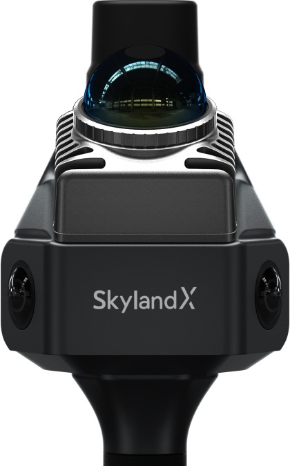
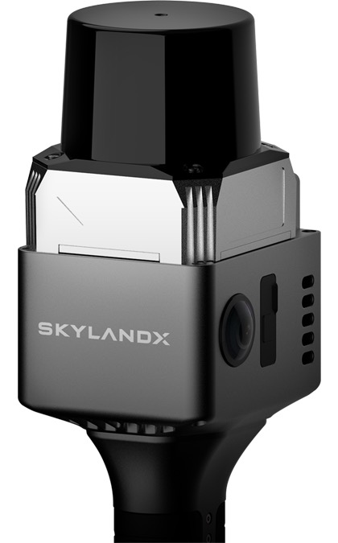
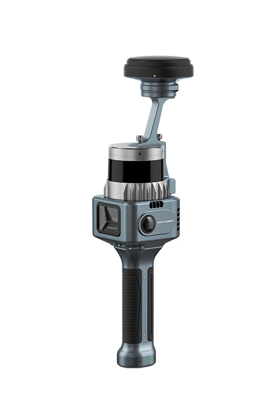
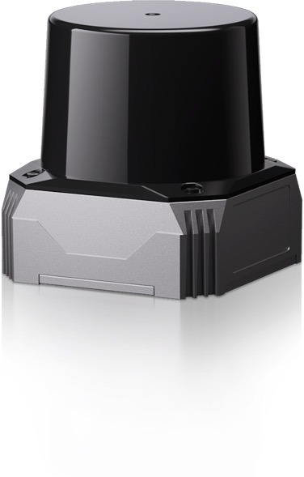
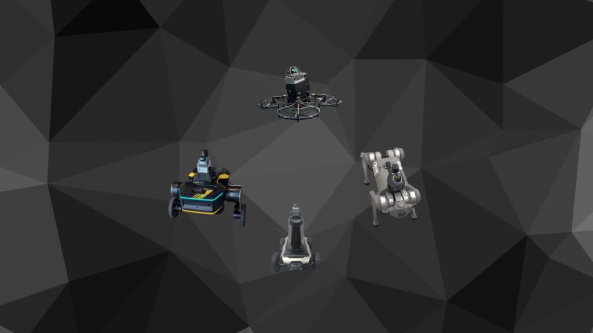
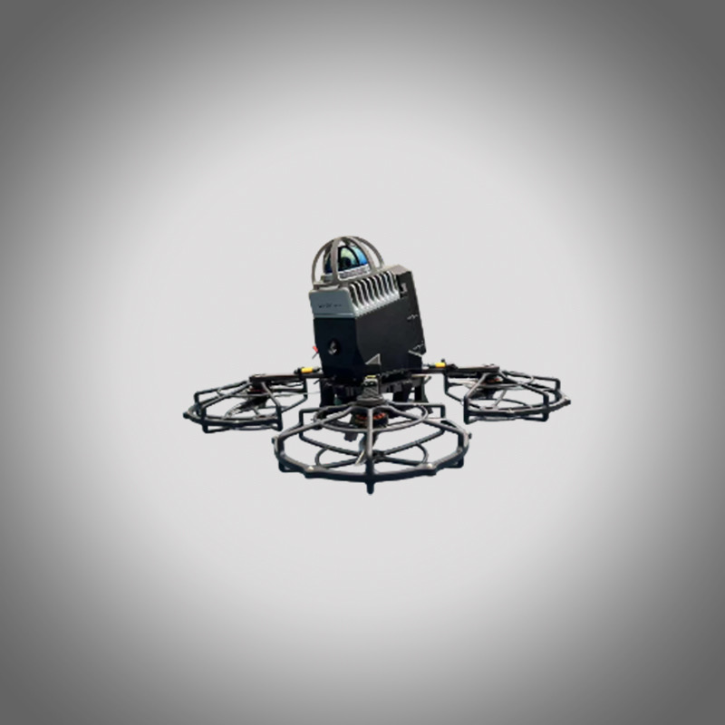
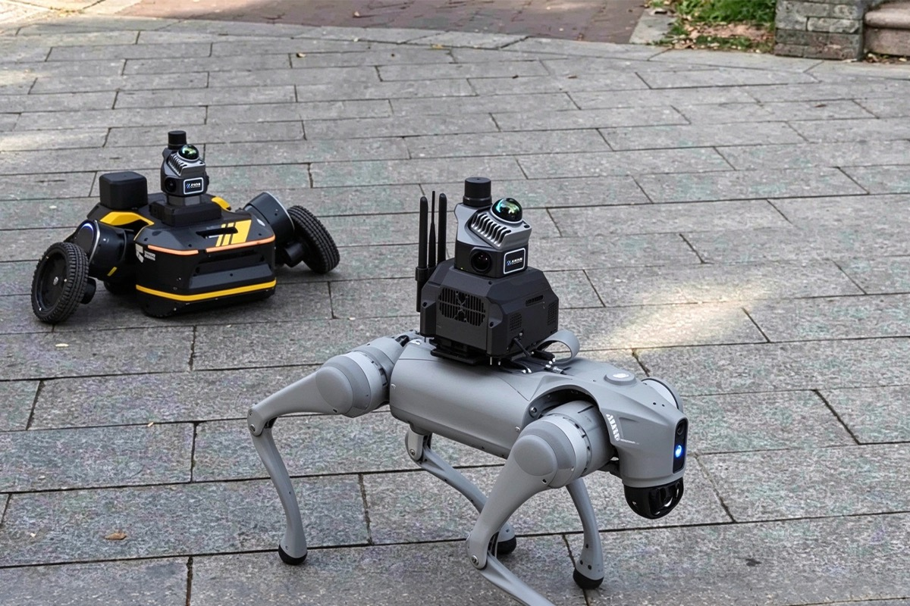
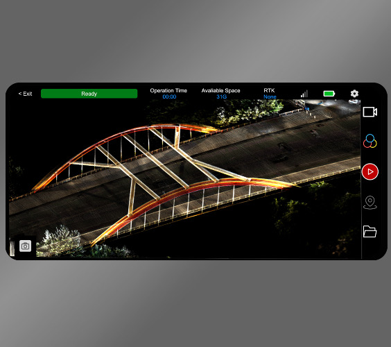
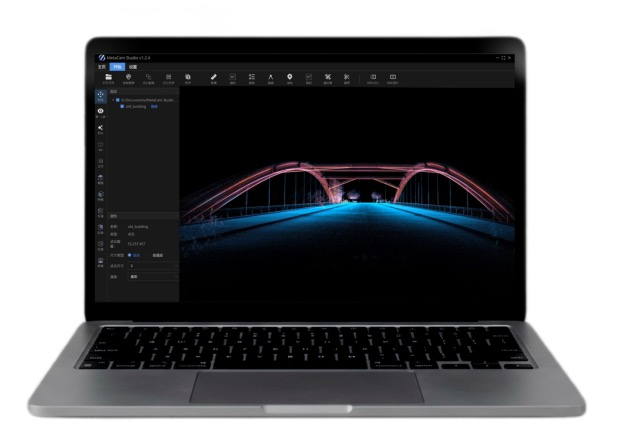
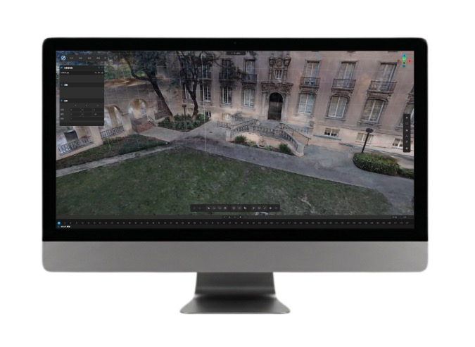

# SKYLANDX — Product Portfolio

⬆ [SKYLANDX profile](SKYLANDX.md) · [Developer guide](SKYLANDX-Developer-Guide.md) · [Roadmap and strategy](SKYLANDX-Roadmap-and-Strategy.md)

> **Read this first:** SKYLANDX sells **sensors and mapping software, not robots**. You carry a MetaCam by hand (or bolt it on another vendor's robot) and get a centimetre-level 3D map, 360° imagery and a 3DGS scene. Pick it when your idea needs a map, a digital twin, GPS-denied localization or a before / after comparison.
> **Spec source:** values below come from the official product pages and the official brochure spec sheets (Sept 2026 editions). Where the web page and the brochure disagree, both are shown.

## Lineup map

Track relevance: ● strong · ◐ partial · ○ none

| Product | Category | Status | Launched | Price (if public) | Positioning (one line) | T01 | T02 | T03 | T04 |
|---|---|---|---|---|---|---|---|---|---|
| MetaCam Air 2 | Handheld / robot-mount scanner | ✅ | not public | not public (about USD 5,000 at one reseller ⚠️ unverified) | All-round workhorse: LiDAR + dual 48 MP panoramic + built-in RTK, **619 g** main unit | ● | ● | ● | ◐ |
| MetaCam Air 3 | Handheld survey-grade scanner | 🧪 | Unveiled 2026-10 (INTERGEO, Munich) | not public | Next generation with in-house LiDAR, **360° × 240°** FOV, removable RTK | ◐ | ● | ◐ | ○ |
| MetaCam Lite | Entry handheld scanner | ✅ | 2026 (exact date not public) | not public | Interiors and compact sites; no RTK; **8 mm** relative accuracy | ◐ | ◐ | ● | ● |
| MetaCam Pro | Survey-grade scanner (hand, backpack, vehicle, robot, drone) | ✅ | 2026 (brochure dated 2026-08 ⚠️ unverified as launch date) | not public | Flagship: 128-channel LiDAR, up to **5.24 M pts/s**, **5 mm** relative accuracy | ◐ | ● | ● | ○ |
| C01 LiDAR | 3D SLAM LiDAR module | ✅ | not public | not public | **420 g**, IP67, 360° × 65° LiDAR + IMU for AMRs, quadrupeds, humanoids | ● | ● | ◐ | ◐ |
| Spatial Perception Robots / Modular Perception Kit | Robot perception kits and turnkey robots | ✅ (via sales; no model names) | not public | not public | MetaCam-based sensing + SLAM / navigation APIs on drones, UGVs, quadrupeds, humanoids | ● | ● | ◐ | ○ |
| MetaCam Fly | Drone scanning platform | 🔭 | in development | not public | Autonomous-flight scanning; only named in the inquiry form | ○ | ◐ | ◐ | ○ |
| MetaCam Hub | Robot-mount accessory | ✅ | not public | not public | The official way to mount a MetaCam on a robot platform | ● | ● | ◐ | ◐ |
| MetaCam Go | Mobile app (iOS / Android) | ✅ | not public | not public (download link on site) | Start scan, live colorized preview, coverage check | ● | ● | ● | ● |
| MetaCam Studio | Desktop software (Windows) | ✅ | not public | not public (download link on site) | Optimize, edit, measure, georeference, export | ● | ● | ● | ● |
| Skyland Cloud (also written MetaCam Cloud) | Web cloud platform | ✅ | not public | not public | Cloud processing, **3DGS** generation, browser viewer, sharing | ◐ | ● | ● | ● |

**Fast pick**

| If you need… | Use |
|---|---|
| A map of a clinic corridor, hotel floor or apartment in minutes | MetaCam Lite or Air 2 + MetaCam Go |
| Georeferenced outdoor scan (street, slope, avalanche gallery) | MetaCam Air 2 (built-in RTK) or Pro |
| Live pose / point cloud into a robot's ROS stack | MetaCam Air 2 + MetaCam Hub (Rosbridge WebSocket), or C01 LiDAR (UDP) |
| A photorealistic scene for simulation or a demo video | Any MetaCam + Skyland Cloud (3DGS, PLY) |
| Bare LiDAR to run your own SLAM | C01 LiDAR |

## Products

### MetaCam Air 2

Compact handheld scanner combining one LiDAR, two 48 MP fisheye cameras, IMU and built-in RTK, with SLAM running on the device. The same unit mounts on robots through MetaCam Hub. Most likely loaner unit on site (best guess, not confirmed).

| Spec | Value |
|---|---|
| Weight | **619 g** main unit · 363 g battery · **982 g** total |
| Dimensions | 104 × 105 × 133.2 mm (main unit) · 104 × 140 × 305.7 mm (overall) |
| LiDAR | 1 unit · Class 1, 905 nm · **200,000 pts/s** · 10 Hz typical |
| LiDAR range | 0.1–**40 m** @ 10 % reflectivity · 0.1–**70 m** @ 80 % |
| LiDAR FOV | 360° (H) × 59° (V) (-7° to +52°) |
| Cameras | 2 × 48 MP, 1/2" sensor, 200° × 200° each (default output 12 MP) |
| RTK | Built in · 0.8 cm + 1 ppm (H), 1.5 cm + 1 ppm (V) · raw observation logging · GPS, BDS, GLONASS, Galileo, QZSS, NavIC, SBAS |
| Accuracy (post-processed, lab conditions) | **< 1 cm** relative · **5 cm** absolute · point-cloud thickness < 1 cm |
| Battery / runtime | 45.36 Wh (3150 mAh), swappable · **150 min** operating · USB-C PD 30 W, 120 min charge |
| Power draw | < 20 W |
| Storage | TF card, 256 GB included, up to 1 TB |
| Connectivity | Wi-Fi 6 (2.4 / 5 GHz, 20 m) · Bluetooth |
| Ingress protection | IP5X (dust only — no water rating stated) |
| Temperature | -20 °C to +55 °C operating |
| Outputs | Point cloud LAS / PCD / PLY / RCP / E57 · 3DGS PLY · mesh OBJ · images JPEG |
| On-device features | Real-time colorized point cloud, scan resumption across sessions / battery swaps, TimeSync 3.0 hardware sync |

- **Variants:** none published. No EDU / developer edition; API access is granted per customer ("eligible customers"), not by SKU.
- **Typical applications:** as-built capture, interior renovation, facility digital twins, underground passages, forestry, real-to-sim for robotics.
- **Hackathon notes:** 150 min per battery and scan resumption cover a whole building; IP5X means keep it out of snow and rain; -20 °C rating is fine for Leukerbad in November.
- Official page: [skylandx.com/metacam-air-2](https://skylandx.com/metacam-air-2/)

### MetaCam Air 3

No official image could be retrieved (no product page on skylandx.com yet; trade-press pages blocked).

Next-generation handheld scanner, unveiled at INTERGEO 2026 (Munich, October 2026). First MetaCam built around SKYLANDX's own survey-oriented LiDAR. 🧪 — price, configurations and regional availability not announced.

| Spec | Value |
|---|---|
| LiDAR | In-house design, smaller laser spot · FOV **360° (H) × 240° (V)** (floor and ceiling in one pass) |
| Cameras | 2 × **50 MP** panoramic · 1 × 48 MP forward-facing · 1 global-shutter camera for visual SLAM |
| Positioning | RTK via NTRIP (mobile data) or UHF radio from a local base · PPK · removable RTK module, magnetic UHF radio |
| Usability | One-button start · status ring ("Mars Ring") showing live system / SLAM state |
| Range, point rate, accuracy, weight, battery, IP rating | not public |

- **Hackathon notes:** treat as a showcase unit at best; do not plan a build around it.
- Reference page: [Unmanned Systems Technology — MetaCam Air 3](https://www.unmannedsystemstechnology.com/company/skylandx/metacam-air-3/) (could not be opened during research; specs above from 3D Mag)

### MetaCam Lite

Entry-level handheld scanner for interiors and compact sites. Same LiDAR figures as the C01 module (FOV, point rate, range) and the same camera pair as Air 2, **without RTK** (georeferencing via ground control points only).

| Spec | Value |
|---|---|
| Weight | **760 g** main unit · **1,123 g** with battery |
| Dimensions | 83.7 × 85 × 139.8 mm (main unit) · 83.7 × 140 × 316.4 mm (with battery and mounting plate) |
| LiDAR | 1 unit · Class 1, 905 nm · **216,000 pts/s** · 10 Hz typical |
| LiDAR range | 0.05–40 m @ 10 % reflectivity · 0.05–70 m @ 80 % |
| LiDAR FOV | 360° (H) × 65° (V) (-20° to +45°) |
| Cameras | 2 × 48 MP, 1/2" sensor, 200° × 200° each (default output 12 MP) |
| RTK | None listed (processing supports GCPs) |
| Accuracy (post-processed, lab conditions) | **8 mm** relative · 5 cm absolute · point-cloud thickness 8 mm |
| Battery / runtime | 45.36 Wh (3150 mAh) · **150 min** · USB-C PD 30 W, 120 min charge |
| Power draw | < 20 W |
| Storage | TF card, 128 GB included, up to 1 TB |
| Connectivity | Wi-Fi 6 (2.4 / 5 GHz, 20 m) · Bluetooth |
| Ingress protection | IP5X |
| Temperature | -20 °C to +55 °C operating |
| Outputs | Point cloud LAS / PCD / PLY / RCP / E57 · 3DGS PLY · mesh OBJ · images JPEG |

- **Variants:** none published.
- **Typical applications:** interior renovation, BIM / as-built, facility management, utility tunnels, robotic simulation, heritage.
- **Hackathon notes:** the 5 cm minimum range and downward-tilted FOV suit tight rooms — good for T04 clinic / apartment twins. MetaCam Hub is listed as an optional accessory, so robot mounting is possible.
- Official page: [skylandx.com/metacam-lite](https://skylandx.com/metacam-lite/)

### MetaCam Pro

Survey-grade flagship with a 128-channel LiDAR, four cameras and optional RTK module. One sensor core used handheld, on a backpack, vehicle, robot / quadruped or drone.

| Spec | Value |
|---|---|
| Weight | **1,160 g** without RTK · 1,325 g with RTK |
| Dimensions | 104.6 × 112.5 × 134.4 mm (main unit) · 105 × 168 × 424 mm (overall) |
| LiDAR | 1 unit, 128 channels, fixed-scan architecture · Class 1, 865 nm · 2.62 M pts/s, up to **5.24 M pts/s** · 20 Hz |
| LiDAR range | Brochure: 0.5–90 m @ 10 % reflectivity, 0.5–170 m @ 80 % · product page headline: "up to 200 m" (⚠️ the two official figures differ) |
| LiDAR FOV | 360° (H) × 42.4° (V) (-21.2° to +21.2°) |
| Cameras | 2 × 48 MP panoramic (200° × 200°) · 1 × 48 MP HD camera (67.2° × 53.2°, f/1.8, 4.7 mm) · 1 × 1.3 MP V-SLAM camera (110° × 80°) |
| RTK | 0.8 cm + 1 ppm (H), 1.5 cm + 1 ppm (V) · RTK / PPK / GCP workflows · multi-constellation |
| Accuracy (post-processed, lab conditions) | **5 mm** relative · **< 3 cm** absolute · point-cloud thickness 5 mm |
| Battery / runtime | 45.36 Wh (3150 mAh) · **60 min** · USB-C PD 30 W, 120 min charge |
| Power draw | < 26 W |
| Storage / export | 1 TB built-in SSD · USB 3.0 Type-C |
| Connectivity | Wi-Fi 6 (2.4 / 5 GHz, up to 20 m) · Bluetooth |
| Ingress protection | IP5X |
| Temperature | -20 °C to +55 °C operating |
| Outputs | Point cloud LAS / PCD / PLY / RCP / E57 · 3DGS PLY · mesh OBJ · images JPEG |

- **Variants:** with or without RTK module. Compatible accessories: MetaCam Hub, backpack kit, vehicle mount. Open API for raw data and custom workflows (details not public).
- **Typical applications:** bridges, tunnels, dams, substations, mining and stockpiles, urban renewal / Scan-to-BIM, dense forestry.
- **Hackathon notes:** only 60 min per battery; 0.5 m minimum range makes it a poor choice indoors at close quarters. Unlikely to be lent out.
- Official page: [skylandx.com/metacam-pro](https://skylandx.com/metacam-pro/)

### C01 LiDAR

Stand-alone 3D LiDAR with built-in IMU, designed for SLAM, measurement and obstacle avoidance on robots. No on-board SLAM: you get raw points + IMU over UDP and run your own algorithm (advertised as plug-and-play with mainstream open-source SLAM).

| Spec | Value |
|---|---|
| Weight | **420 g** |
| Dimensions | 73 × 73.75 × 77.8 mm |
| Laser | 905 nm · Class 1 (IEC 60825-1:2014) |
| Range | max **40 m** @ 10 % reflectivity · **70 m** @ 80 % · min **5 cm** |
| FOV | 360° (H) × 65° (V) (-20° to +45°) |
| Point rate | **216,000 pts/s** (dual-line) · 108,000 pts/s (single-line) |
| Range precision (1σ) | < 1 cm @ 10 m |
| Angular resolution | 0.3° (H) × 0.36° (V) @ 1 s integration · 0.15° × 0.36° @ 2 s |
| Scan rate / pattern | 10 Hz typical, up to 30 Hz · non-repetitive |
| IMU | 3-axis accelerometer + 3-axis gyroscope, 200 Hz |
| Interface | UDP (physical connector not stated) |
| Power | 12–30 V DC · 15 W max |
| Ingress protection | **IP67** |
| Temperature | -20 °C to +55 °C operating |
| Ambient light | 100 klux |

- **Variants:** none published. No official ROS driver found (not public) — ask staff for the SDK / packet format.
- **Typical applications:** autonomous forklifts, latent AMRs, service robots, humanoids, quadrupeds, handheld scanners.
- **Hackathon notes:** the only weather-proof item in the range (IP67) and it runs from a robot's 12–30 V rail — the right part if you want LiDAR on a quadruped outdoors in snow. Budget time for driver and SLAM integration.
- Official page: [skylandx.com/c01-slam-lidar](https://skylandx.com/c01-slam-lidar/)

### Spatial Perception Robots / Modular Perception Kit

A service offering rather than a catalogue product: MetaCam-based perception delivered three ways. No model names, specs or prices are public.

| Option | What you get |
|---|---|
| Ready-to-deploy robotic solutions | Aerial and ground robots with sensing and software integrated |
| Modular Perception Kit with full API access | Live sensor data (images, LiDAR, IMU, RTK), SLAM and navigation APIs, post-processing tools |
| Tailored solutions | Co-designed hardware, software and algorithms for a specific mission |

- **Platforms shown:** drones, wheeled UGVs, quadrupeds, embodied-AI / humanoid robots.
- **Integration depths (official FAQ):** (1) scanning payload — robot navigates itself; (2) real-time perception layer — MetaCam streams pose and map to your autonomy stack; (3) full navigation module — MetaCam outputs navigation commands, robot executes motion. Depths 1–2 are for "eligible customers"; depth 3 is for ecosystem partners.
- **ROS:** live point clouds, images, IMU and pose via a WebSocket interface using the Rosbridge protocol; supported ROS versions and message types not public.
- **Typical applications:** GPS-denied tunnels and mines, construction progress vs BIM, indoor safety patrol (cracks, leaks, hazards), 3D data collection for embodied-AI training.
- Official pages: [Spatial Perception Robots](https://skylandx.com/spatial-intelligence-robots/) · [Robotics & Physical AI](https://skylandx.com/industry/robotics-simulation/)

### MetaCam Fly

Drone scanning solution, 🔭 in development. It appears only as "MetaCam Fly – Drone Solutions" in the official inquiry form; there is no product page and no specs. **Image caveat:** the picture is the caged drone carrying a MetaCam shown on the official Spatial Perception Robots page — ⚠️ unverified that this exact airframe is MetaCam Fly.

| Spec | Value |
|---|---|
| All specs, price, date | not public |

- Not a hackathon building block.

### MetaCam Hub

Accessory that mounts a MetaCam scanning module on a robot platform. Listed as an optional accessory for Air 2 and Lite and as a compatible accessory for Pro. **Image caveat:** the picture shows MetaCam units mounted on a quadruped and a wheeled robot (official robotics page); no stand-alone photo of the Hub is published.

| Spec | Value |
|---|---|
| Compatible scanners | MetaCam Air 2, MetaCam Lite, MetaCam Pro |
| Mechanical interface, power, data connectors, on-board compute | not public |

- **Hackathon notes:** ask on arrival whether a Hub is on site and which robots it fits (the official photo shows a quadruped and a tracked / wheeled UGV). Without it, mounting is DIY.
- Official page: [Robotics & Physical AI](https://skylandx.com/industry/robotics-simulation/)

### MetaCam Go

Mobile companion app for all MetaCam scanners.

| Item | Detail |
|---|---|
| Platforms | iOS, Android |
| Functions | One-tap scan start · live colorized point cloud · coverage check · loop-closure notifications · device status · scan settings · upload to cloud |
| Connection to scanner | Wi-Fi 6 / Bluetooth on the scanner (about 20 m) |
| Price / licence | not public |

- Official page: [Software platforms](https://skylandx.com/software-platforms/)

### MetaCam Studio

Desktop post-processing software.

| Item | Detail |
|---|---|
| Platform | Windows |
| Functions | Point-cloud optimization, editing, measurement · RTK / control-point calibration · alignment and coordinate conversion · one-step merge of resumed scans · side-by-side point cloud, floor plan and site photos · forestry and spatial analysis |
| Export | LAS / PCD / PLY / RCP / E57, CAD formats (per Pro page) |
| Minimum PC specs, price / licence | not public |

- **Hackathon notes:** bring a Windows laptop with a decent GPU if you want to process locally; otherwise use the cloud.
- Official page: [Software platforms](https://skylandx.com/software-platforms/)

### Skyland Cloud (also written MetaCam Cloud)

Web platform for processing, viewing and sharing scans.

| Item | Detail |
|---|---|
| Access | Browser (web-based); demo on request |
| Functions | Upload and cloud processing · point cloud and **3DGS** generation and online preview · web 3D viewer · sharing and collaborative review · third-party system integration (API details not public) |
| Processing time, quotas, price | not public |

- **Hackathon notes:** this is the route to a 3DGS scene without a local GPU; check venue upload bandwidth and ask staff about turnaround time before you depend on it.
- Official page: [Software platforms](https://skylandx.com/software-platforms/)

## Accessories and ecosystem

| Item | Type | For | Notes |
|---|---|---|---|
| MetaCam Hub | Robot mount | Air 2, Lite, Pro | See above; specs not public |
| Backpack kit | Carry system | Pro | Listed in Pro brochure; specs not public |
| Vehicle mount | Mount | Pro | Listed in Pro brochure; specs not public |
| RTK module | GNSS | Pro (adds 165 g); built into Air 2; removable on Air 3 | Lite has no RTK |
| Swappable battery | Power | Air 2, Lite, Pro | 45.36 Wh, 363 g (Air 2 figure), USB-C PD 30 W |
| TF card | Storage | Air 2 (256 GB incl.), Lite (128 GB incl.) | Up to 1 TB; Pro uses a 1 TB internal SSD |
| Open API / Rosbridge WebSocket | Software interface | MetaCam scanners | Pose, map, structured spatial model, raw sensor streams; documentation on request only |
| TimeSync 3.0 / SOTA-SLAM | Built-in tech | All MetaCam | Microsecond hardware sync and on-device LiDAR-visual-inertial SLAM |

**Sensor comparison (official brochure values)**

| | Air 2 | Lite | Pro | C01 (sensor only) |
|---|---|---|---|---|
| Main-unit weight | 619 g | 760 g | 1,160 g | 420 g |
| Point rate | 200 k pts/s | 216 k pts/s | 2.62–5.24 M pts/s | 216 k pts/s |
| Range @ 80 % | 70 m | 70 m | 170 m | 70 m |
| Min range | 0.1 m | 0.05 m | 0.5 m | 0.05 m |
| Vertical FOV | 59° | 65° | 42.4° | 65° |
| Relative accuracy | < 1 cm | 8 mm | 5 mm | n/a (range precision < 1 cm @ 10 m) |
| RTK | built in | no | optional module | no |
| Runtime | 150 min | 150 min | 60 min | external 12–30 V |
| IP rating | IP5X | IP5X | IP5X | IP67 |

## Legacy and discontinued

- An earlier MetaCam generation shipped from **2023** (the brochure download form is still labelled "MetaCam Air"); model details and status are not public.

## Image credits

All images © Shenzhen Skyland Innovation Technology Co., Ltd., taken from the official website and converted to JPEG.

| File | Shows | Source URL |
|---|---|---|
| assets/skylandx-metacam-air-2.jpg | MetaCam Air 2 scanner head | https://skylandx.com/wp-content/uploads/2025/05/hero-metacam-air-2.png |
| assets/skylandx-metacam-lite.jpg | MetaCam Lite | https://skylandx.com/wp-content/uploads/lite-product-hero.png |
| assets/skylandx-metacam-pro.jpg | MetaCam Pro with RTK antenna | https://skylandx.com/wp-content/uploads/pro-solution.png |
| assets/skylandx-c01-lidar.jpg | C01 LiDAR module | https://skylandx.com/wp-content/uploads/c01-lidar-product.png |
| assets/skylandx-spatial-perception-robots.jpg | MetaCam on a drone, two UGVs and a quadruped | https://skylandx.com/wp-content/uploads/2025/05/robot-ready-web-1024x576.jpg |
| assets/skylandx-metacam-fly.jpg | Caged drone carrying a MetaCam (not confirmed as MetaCam Fly) | https://skylandx.com/wp-content/uploads/2025/05/fly-web-1.jpg |
| assets/skylandx-metacam-hub.jpg | MetaCam units mounted on a quadruped and a UGV (mount context, not the Hub alone) | https://skylandx.com/wp-content/uploads/robotics-use-1.png |
| assets/skylandx-metacam-go.jpg | MetaCam Go app on a phone | https://skylandx.com/wp-content/uploads/2025/05/go-phone-square.jpg |
| assets/skylandx-metacam-studio.jpg | MetaCam Studio desktop software | https://skylandx.com/wp-content/uploads/2025/05/software-pc.png |
| assets/skylandx-cloud.jpg | Cloud platform viewer | https://skylandx.com/wp-content/uploads/2025/05/software-cloud.png |

MetaCam Air 3: no image saved (no official image source reachable).

## Sources

- [SKYLANDX — MetaCam Air 2](https://skylandx.com/metacam-air-2/)
- [SKYLANDX — MetaCam Air 2 brochure, spec sheet (PDF)](https://skylandx.com/wp-content/uploads/MetaCam_Air_2_EN.pdf)
- [SKYLANDX — MetaCam Lite](https://skylandx.com/metacam-lite/)
- [SKYLANDX — MetaCam Lite brochure, spec sheet (PDF)](https://skylandx.com/wp-content/uploads/MetaCam_Lite_EN.pdf)
- [SKYLANDX — MetaCam Pro](https://skylandx.com/metacam-pro/)
- [SKYLANDX — MetaCam Pro brochure, spec sheet (PDF)](https://skylandx.com/wp-content/uploads/MetaCam_Pro_EN_260818.pdf)
- [SKYLANDX — C01 SLAM LiDAR](https://skylandx.com/c01-slam-lidar/)
- [SKYLANDX — C01 LiDAR brochure, spec sheet (PDF)](https://skylandx.com/wp-content/uploads/EN_C01_LiDAR_BROCHURE.pdf)
- [SKYLANDX — Spatial Perception Robots](https://skylandx.com/spatial-intelligence-robots/)
- [SKYLANDX — Robotics & Physical AI (FAQ: MetaCam Hub, Rosbridge, export formats; inquiry form listing MetaCam Fly and Air 3)](https://skylandx.com/industry/robotics-simulation/)
- [SKYLANDX — Software platforms](https://skylandx.com/software-platforms/)
- [3D Mag — SKYLANDX launches MetaCam Air 3 (2026-10-07)](https://www.3dmag.com/?p=14376)
- [SKYLANDX company profile in this vault (reseller price and launch-timing notes)](SKYLANDX.md)
