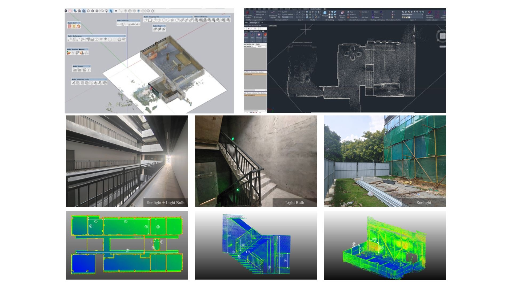
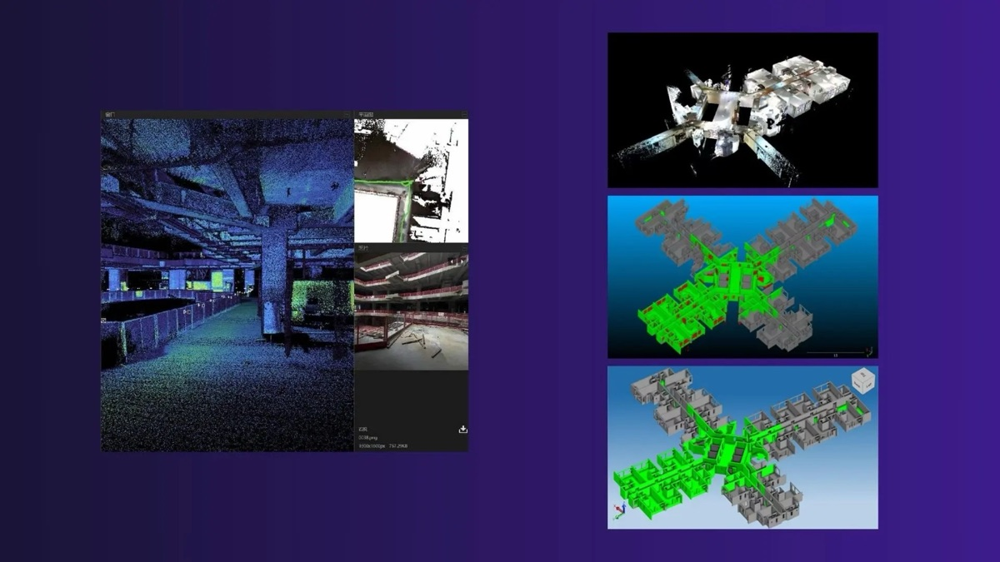
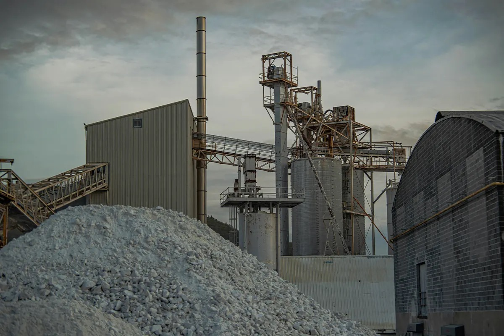
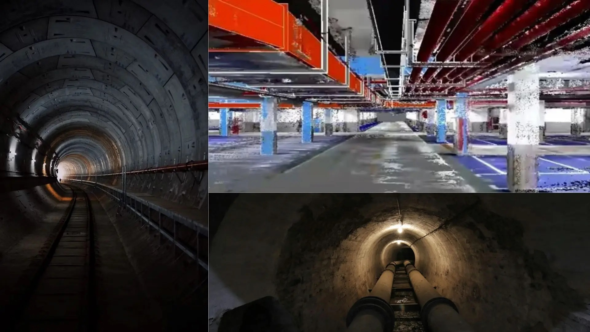
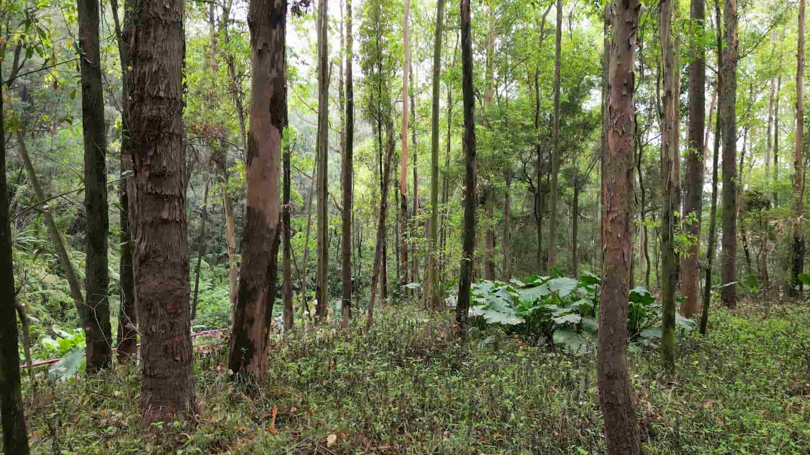
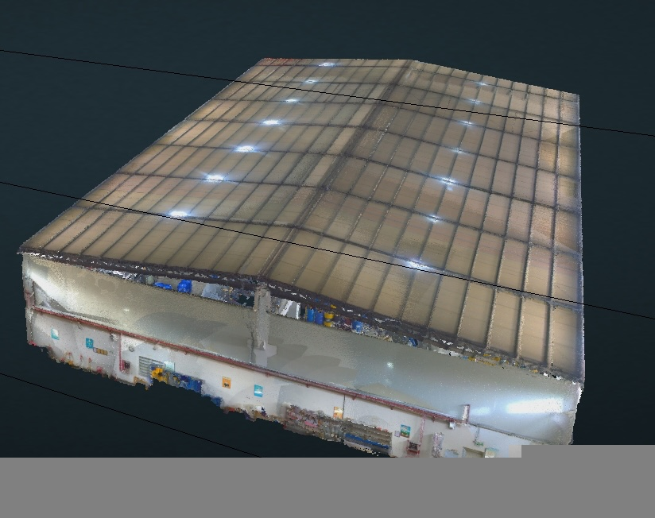
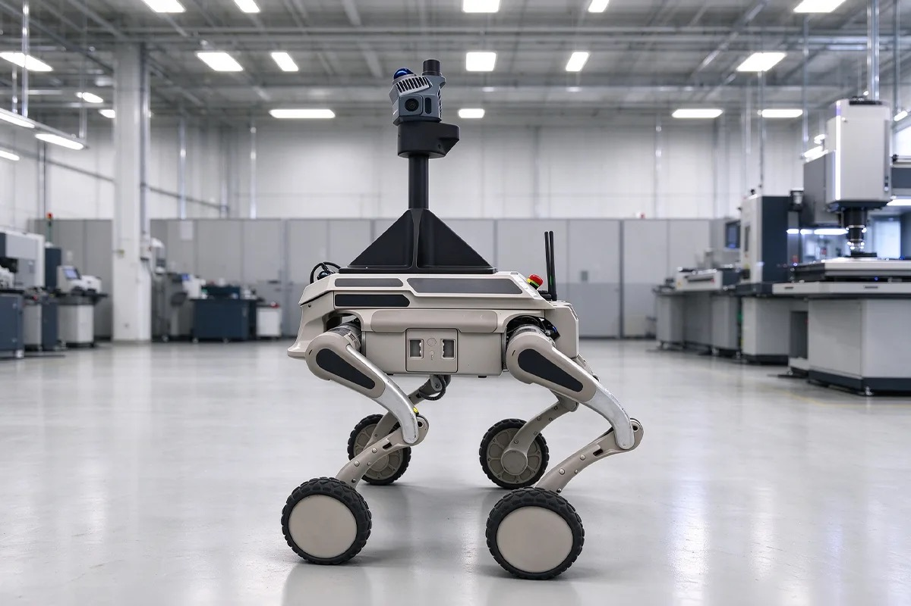
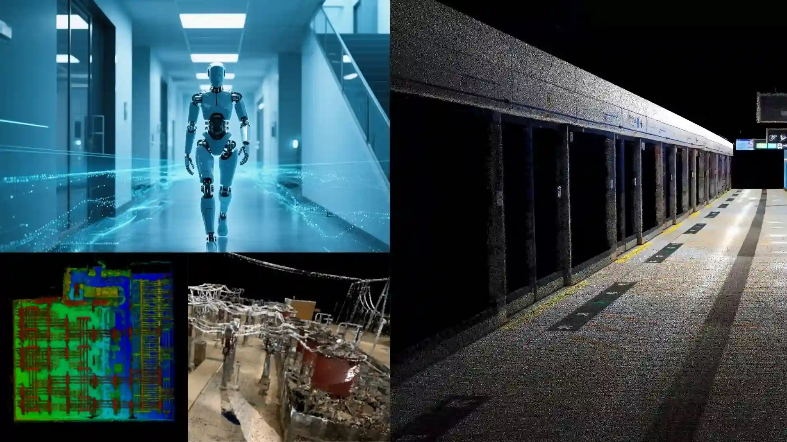
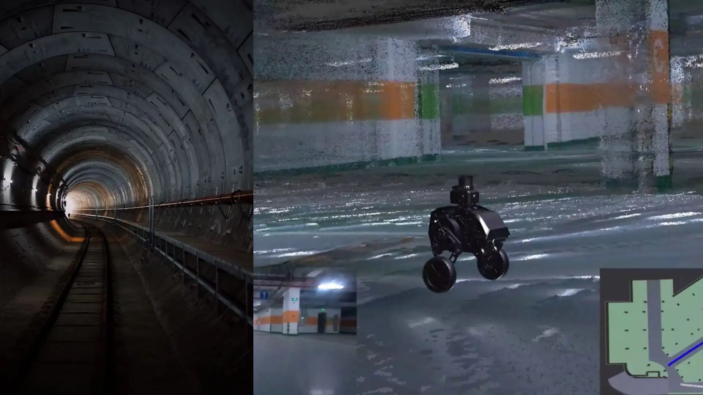
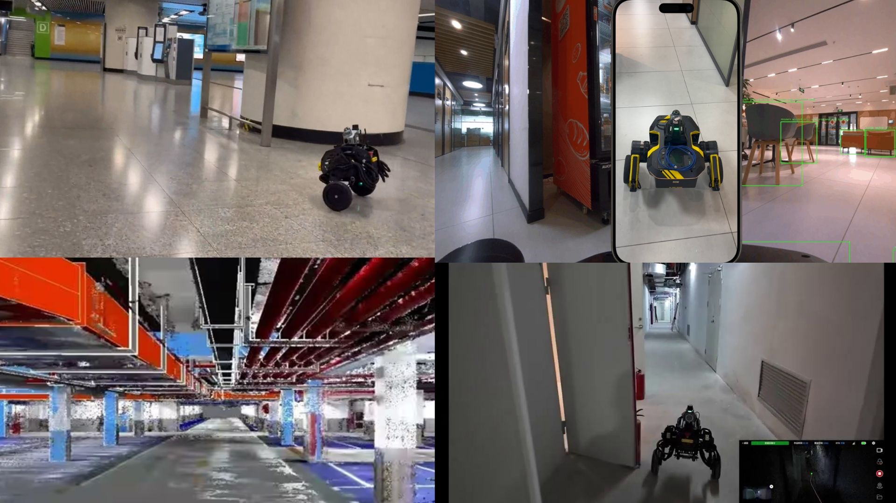

# SKYLANDX — Solutions and Projects Register

⬆ [SKYLANDX profile](SKYLANDX.md) · [Product portfolio](SKYLANDX-Products.md) · [Papers and research](SKYLANDX-Papers-and-Research.md) · [Roadmap and strategy](SKYLANDX-Roadmap-and-Strategy.md)

> **Coverage note:** Walked on 2026-11-14: the full official sitemap (all 6 sub-sitemaps), every public page (home, 5 product pages, legacy MetaCam Air page, Air 3 preview, software, robots, the 6 new `/industry/` solution pages, the 6 older `case-studies-*` pages, about, contact, exhibition form), the complete News section (**1 item**, 2026-09-15) and Blog (**1 post**, 2026-09-20), plus the WordPress page / post listings to catch unlinked pages. **Chinese-language site:** the `/zh/` alternate advertised by the site returns "page not found" — there is no Chinese content on this domain, and no separate Chinese domain was found. **Web search was available** (2 calls, both used): it returned only MetaCam Air 3 launch coverage — no new deployments, partnerships or funding. **Could not be opened:** Unmanned Systems Technology pages (HTTP 403), DirectIndustry listing pages beyond the press release (403), the GEOSURF Japan page (timeout — carried over from the profile), YouTube channel (consent wall), LinkedIn (not readable without login).
> **Bottom line:** SKYLANDX names only **two customers** publicly (Deluke Chemical, and the game *Black Myth: Wukong*). Everything else is an unnamed use case. All percentages below are company claims without published methodology.
> **Date correction:** the official press release dates the MetaCam Air 3 unveiling **2026-09-15** (INTERGEO ran 15–17 Sept). Other docs in this vault say October 2026, which is the date of the 3D Mag article.

## Solutions catalogue — everything they offer

Maturity: ✅ marketed and available · 🧪 offered to selected partners / preview · 🔭 planned. "Go / Studio / Cloud" = MetaCam Go app, MetaCam Studio desktop, MetaCam (Skyland) Cloud.

| # | Solution / application | What it does | Products used | Maturity | Tracks | Source link |
|---|---|---|---|---|---|---|
| 1 | AEC · Site assessment and existing-conditions survey | One walk-through gives a measurable indoor + outdoor point cloud for feasibility and early planning | Air 2, Lite, Pro · Go / Studio | ✅ | T03 | [AEC](https://skylandx.com/industry/aec/) |
| 2 | AEC · Scan-to-BIM / Scan-to-CAD and indoor 3D modelling | Georeferenced point cloud exported as RCP (Revit, AutoCAD, Navisworks) or E57; CAD floor plans and BIM of existing interiors | Air 2, Lite, Pro · Studio | ✅ | T03 T04 | [AEC](https://skylandx.com/industry/aec/) |
| 3 | AEC · Bid preparation and cost estimation | Shared browser model so owners and contractors price from measured geometry | Any MetaCam · Cloud | ✅ | — | [AEC](https://skylandx.com/industry/aec/) |
| 4 | AEC · Construction verification and progress monitoring | Repeat scans (handheld, or by autonomous mobile robot) give dated, time-stamped site models | Air 2, Pro, robot mount · Cloud | ✅ | T01 T03 | [AEC](https://skylandx.com/industry/aec/) |
| 5 | AEC · BIM model comparison | Point cloud aligned to the BIM; colour-coded built vs unbuilt zones, deviation detection | Any MetaCam · Studio / Cloud | ✅ | T03 | [AEC case studies](https://skylandx.com/case-studies-aec/) |
| 6 | AEC · As-built documentation and closeout | Final point cloud + 3DGS as the owner's record; works in GPS-free garages and large halls | Any MetaCam · Studio / Cloud | ✅ | T03 | [AEC case studies](https://skylandx.com/case-studies-aec/) |
| 7 | AEC · Facility management, inspection and digital twin | Re-scan whenever the building changes; "living" twin for maintenance and space planning | Any MetaCam · Cloud | ✅ | T01 T03 T04 | [AEC](https://skylandx.com/industry/aec/) |
| 8 | Interior renovation | Complete room capture for design and renovation planning | Lite, Air 2 · Studio | ✅ | T03 T04 | [MetaCam Lite](https://skylandx.com/metacam-lite/) |
| 9 | Surveying · Topographic and site surveys | RTK-georeferenced terrain, structures and vegetation in one walk; base for contours, DTM, site plans | Air 2, Pro · Studio | ✅ | T03 | [Surveying](https://skylandx.com/industry/surveying/) |
| 10 | Surveying / Industrial · Stockpile measurement, inventory and mining | Walk around piles (open yards or sheds); Studio computes volumes; also open-pit / underground mine mapping | Air 2, Pro · Studio | ✅ | T03 | [Surveying](https://skylandx.com/industry/surveying/) |
| 11 | Surveying · Tunnels and underground utilities | GNSS-free mapping of metro lines, utility and cable tunnels, culverts; control points tie it to the surface network | Air 2, Lite, Pro · Studio | ✅ | T02 T03 | [Surveying](https://skylandx.com/industry/surveying/) |
| 12 | Surveying · Civil infrastructure and streetscape | Roads, bridges, rail corridors, platforms, footpaths, narrow lanes; Pro adds highways, dams, tunnels | Air 2, Pro (hand, vehicle) | ✅ | T01 T02 | [Surveying](https://skylandx.com/industry/surveying/) |
| 13 | Surveying · Forestry and ecological surveys | Sub-canopy plots: stems, stands, terrain; biomass, canopy cover, seasonal comparison | Air 2, Pro · Studio (forestry analysis) | ✅ | T03 | [Surveying](https://skylandx.com/industry/surveying/) |
| 14 | Surveying · Map updates | Fast resurvey with SLAM + RTK where drones or vehicles cannot work; CAD-ready output (e.g. CASS) | Air 2, Pro | ✅ | T01 T03 | [Surveying case studies](https://skylandx.com/case-studies-surveying/) |
| 15 | Power and utility | Substations, transmission corridors, utility networks, power-plant sites digitised for maintenance and compliance | Pro, Air 2 | ✅ | T02 T03 | [MetaCam Pro](https://skylandx.com/metacam-pro/) |
| 16 | Urban renewal | Streets and existing buildings captured for renovation design and Scan-to-BIM | Pro, Air 2 | ✅ | T01 T03 | [MetaCam Pro](https://skylandx.com/metacam-pro/) |
| 17 | Industrial · Facility documentation and digital twins | As-built point cloud + 3DGS of plant rooms, mechanical spaces, platforms; base of a plant twin | Any MetaCam · Studio / Cloud | ✅ | T01 T03 | [Industrial facilities](https://skylandx.com/industry/industrial-facilities/) |
| 18 | Industrial · Modification and turnaround planning | Scan while the plant runs; check clashes, access routes and scaffold positions before a shutdown | Any MetaCam · Studio | ✅ | — | [Industrial facilities](https://skylandx.com/industry/industrial-facilities/) |
| 19 | Industrial · Routine plant inspection | Inspector carries MetaCam on rounds; review corrosion, deformation, insulation damage in the data; partner robots / drones for areas people rarely enter | Any MetaCam, robot mount · Cloud | ✅ | T01 T02 | [Industrial facilities](https://skylandx.com/industry/industrial-facilities/) |
| 20 | Industrial · Remote review and inspection | Distributed teams walk the site in the browser, measure, compare scans from different dates | Cloud (point cloud + 3DGS) | ✅ | T02 | [Industrial facilities](https://skylandx.com/industry/industrial-facilities/) |
| 21 | Robotics · Robot-mounted 3D scanning | MetaCam rides as a scanning payload on a robot that navigates itself | Air 2 / Lite / Pro + MetaCam Hub | ✅ (eligible customers) | T01 T02 | [Robotics & Physical AI](https://skylandx.com/industry/robotics-simulation/) |
| 22 | Robotics · Real-time localization and mapping | On-board SLAM streams pose, map and raw sensor data to the robot's own autonomy stack; relocalization against an earlier capture | MetaCam + Hub · open API / Rosbridge | ✅ (eligible customers) | T01 T02 | [Robotics & Physical AI](https://skylandx.com/industry/robotics-simulation/) |
| 23 | Robotics · Autonomous navigation module | MetaCam does SLAM + scene understanding + path planning and outputs navigation commands; robot only executes motion | MetaCam + Hub | 🧪 (ecosystem partners, tailored per platform) | T01 T02 | [Robotics & Physical AI](https://skylandx.com/industry/robotics-simulation/) |
| 24 | Physical AI · Real2Sim simulation and benchmarking | One walk builds a simulation environment: 3DGS + measured point cloud + mesh; also a ground-truth benchmark | Any MetaCam · Studio / Cloud | ✅ | T01 T04 | [Robotics & Physical AI](https://skylandx.com/industry/robotics-simulation/) |
| 25 | Physical AI · Training data at scale | Consistent-format scene libraries (offices, factories, warehouses, retail, homes) for perception models, policies, world models | Any MetaCam, perception kit | ✅ | T01 T04 | [Robotics & Physical AI](https://skylandx.com/industry/robotics-simulation/) |
| 26 | Physical AI · Spatial grounding and spatial APIs | Structured semantic spatial model (zones, paths, obstacles, waypoints) queryable by robots and task planners | MetaCam captures · API | ✅ (API docs on request) | T01 T04 | [Robotics & Physical AI](https://skylandx.com/industry/robotics-simulation/) |
| 27 | Robots · Autonomous exploration in GPS-denied environments | Drones and ground robots map tunnels, mines and underground spaces with no human entry | Spatial perception robots, perception kit | ✅ (via sales; no specs) | T02 | [Spatial perception robots](https://skylandx.com/spatial-intelligence-robots/) |
| 28 | Robots · Autonomous safety patrols across indoor facilities | Patrol robots map in real time and are claimed to detect cracks, leaks and hazards | Spatial perception robots | ✅ (via sales; no specs) | T01 T02 | [Spatial perception robots](https://skylandx.com/spatial-intelligence-robots/) |
| 29 | Robots · Autonomous inspection in high-risk zones | Robots scan tanks, tunnels, boiler rooms; data syncs to the cloud for remote review, annotation, live mission tracking | Spatial perception robots · Cloud | ✅ (via sales; no specs) | T02 | [Industrial inspection case studies](https://skylandx.com/case-studies-industrial-inspection/) |
| 30 | Robots · Ready-to-deploy and tailored robotic solutions | Complete aerial and ground robots (press text: indoor autonomous UAVs, autonomous mobile robots, quadrupeds), or co-designed hardware + software + algorithms | Spatial perception robots | ✅ (via sales; no model names) | T01 T02 | [Spatial perception robots](https://skylandx.com/spatial-intelligence-robots/) |
| 31 | Robots · Modular Perception Kit with full API access | Live images, LiDAR, IMU, RTK + SLAM and navigation APIs + post-processing tools for your own robot | Modular Perception Kit | ✅ (via sales) | T01 T02 | [Spatial perception robots](https://skylandx.com/spatial-intelligence-robots/) |
| 32 | Sensor · C01 SLAM LiDAR for robots | Stand-alone LiDAR + IMU for autonomous forklifts, latent AMRs, service robots, humanoids, quadrupeds, handheld scanners | C01 LiDAR | ✅ | T01 T02 T04 | [C01 LiDAR](https://skylandx.com/c01-slam-lidar/) |
| 33 | Multi-platform mobile mapping | Same sensor core vehicle-mounted, on a backpack, on a robot / quadruped or integrated on a drone | Pro + mounts | ✅ | T01 T02 | [MetaCam Pro](https://skylandx.com/metacam-pro/) |
| 34 | Game & XR · Location reference | Explorable 3D record of real locations for art teams | Any MetaCam · Cloud | ✅ | — | [Game & XR](https://skylandx.com/industry/game-xr/) |
| 35 | Game & XR · Environment building | Meshes and 3DGS scenes at true scale as the base for streets, districts, interiors | Any MetaCam · Studio / Cloud | ✅ | — | [Game & XR](https://skylandx.com/industry/game-xr/) |
| 36 | Game & XR · VR / AR experiences and virtual tours | Immersive tours and location-based attractions on captured scenes | Any MetaCam · Cloud | ✅ | — | [Game & XR](https://skylandx.com/industry/game-xr/) |
| 37 | Spatial memory | Immersive record of homes, schools, theatres before demolition | Any MetaCam · Cloud | ✅ | — | [Game & XR case studies](https://skylandx.com/case-studies-game-virtual-content/) |
| 38 | Heritage · Baseline documentation | Contact-free measured record of a historic site; reference of last resort if the site is damaged | Any MetaCam · Studio | ✅ | T02 | [Cultural heritage](https://skylandx.com/industry/cultural-heritage/) |
| 39 | Heritage · Condition assessment | Check tilt, sag and floor levels in the point cloud; read cracks and weathering in close-up photos | Any MetaCam (Pro for detail photos) · Studio | ✅ | T02 | [Cultural heritage](https://skylandx.com/industry/cultural-heritage/) |
| 40 | Heritage · Conservation and restoration design | Plans, sections, elevations in CAD / HBIM from the survey | Any MetaCam · Studio | ✅ | T03 | [Cultural heritage](https://skylandx.com/industry/cultural-heritage/) |
| 41 | Heritage · Works and change monitoring | Re-scan before, during and after each phase; compare captures | Any MetaCam · Studio / Cloud | ✅ | T02 T03 | [Cultural heritage](https://skylandx.com/industry/cultural-heritage/) |
| 42 | Heritage · Public access and digital exhibition | 3DGS of closed interiors for online, museum and immersive display | Any MetaCam · Cloud | ✅ | — | [Cultural heritage](https://skylandx.com/industry/cultural-heritage/) |

**Company headline claims per segment (not independently verified):** AEC **80 %** fewer field hours, **30 %** less rework · Surveying **85 %** less time on site, fieldwork **5–8×** faster than conventional tools, up to **5 mm** relative / **3 cm** absolute accuracy · Industrial **80 %** less time on site, **50 %** fewer site visits · Robotics **≤ 1 cm** relative accuracy, **619 g** payload.

### AEC · Site assessment and existing-conditions survey
- One continuous indoor + outdoor walk replaces manual survey; live preview avoids return visits; Scan Resumption covers battery swaps.
- Users: architects, engineers, contractors before design starts.
- Official link: [AEC solution](https://skylandx.com/industry/aec/)

### AEC · Scan-to-BIM / Scan-to-CAD and indoor 3D modelling
- Studio processes, georeferences and exports **RCP** (Autodesk) and **E57** (open); imagery travels with the cloud.
- Relative accuracy **5 mm to 1 cm** depending on model (company figure, post-processed).
- Applied "across office buildings and public facilities" (no names). T04 use — a clinic, care-home or apartment as-built — is an inferred fit, not a marketed one.
- Official link: [AEC solution](https://skylandx.com/industry/aec/) · [AEC case studies](https://skylandx.com/case-studies-aec/)

### AEC · Construction verification and progress monitoring

- Repeat scans are compared against BIM models and drawings; point cloud and 3DGS hosted in the cloud as a shared reference.
- Robot variant: autonomous mobile robots scan job sites "with centimeter precision" for BIM comparison and deviation detection.
- Older case-study text claims models "uploaded daily" on a regular schedule (no named site).
- Official link: [AEC solution](https://skylandx.com/industry/aec/) · [Spatial perception robots](https://skylandx.com/spatial-intelligence-robots/)

### AEC · BIM model comparison

- Dense point cloud is aligned to the BIM automatically; missing or incomplete areas are highlighted.
- Colour-coded maps show built vs unbuilt zones before milestones such as topping out.
- Official link: [AEC case studies](https://skylandx.com/case-studies-aec/)

### AEC · As-built documentation and closeout
- Final capture = measurable point cloud + 3DGS, kept in the browser for owners and facility teams.
- Works without GPS in parking garages and large enclosed venues; reference case: **7,000 m²** garage in **under 1 hour** (company claim, "5× faster").
- Official link: [AEC case studies](https://skylandx.com/case-studies-aec/)

### AEC · Facility management, inspection and digital twin
- Facility is re-captured whenever conditions change, updating both point cloud and 3DGS.
- Supports maintenance, inspection, renovation, space planning.
- Official link: [AEC solution](https://skylandx.com/industry/aec/)

### Interior renovation
- Listed as an application of MetaCam Lite and Air 2: full room capture for design and renovation planning; Lite reads down to **5 cm** range for tight rooms.
- T04 relevance (home adaptation, accessibility audit) is inferred — SKYLANDX does not market it for care.
- Official link: [MetaCam Lite](https://skylandx.com/metacam-lite/) · [MetaCam Air 2](https://skylandx.com/metacam-air-2/)

### Surveying · Topographic and site surveys
- With integrated RTK every point is georeferenced as you walk; LAS / E57 export for contours, terrain models, site plans.
- Used from greenfield land to expansion sites at power plants.
- Official link: [Surveying solution](https://skylandx.com/industry/surveying/)

### Surveying / Industrial · Stockpile measurement, inventory and mining

- Walk around each pile; positioning holds inside sheds and domes without satellites; Studio calculates volume from the scan.
- Materials named: aggregates, port bulk, scrap metal, coal, power-plant ash. MetaCam Pro page adds open-pit and underground mine mapping.
- Official link: [Surveying solution](https://skylandx.com/industry/surveying/) · [Industrial facilities](https://skylandx.com/industry/industrial-facilities/)

### Surveying · Tunnels and underground utilities

- Holds trajectory underground with no satellite signal: metro lines, utility tunnels, cable tunnels, cooling-water culverts.
- Repeat scans build a measurable record over time; **after an incident the real-time point cloud supports on-the-spot assessment**.
- Older case study: spatial data linked to asset codes and exported for municipal infrastructure systems.
- Official link: [Surveying solution](https://skylandx.com/industry/surveying/) · [Surveying case studies](https://skylandx.com/case-studies-surveying/)

### Surveying · Civil infrastructure and streetscape
- Covers the stretches survey vehicles cannot reach: pedestrian bridges, footpaths, station platforms, narrow lanes — in one georeferenced record.
- Feeds infrastructure design, asset registers, clearance checks, urban planning. MetaCam Pro targets bridges, tunnels, highways and dams for as-built verification and structural assessment.
- Official link: [Surveying solution](https://skylandx.com/industry/surveying/) · [MetaCam Pro](https://skylandx.com/metacam-pro/)

### Surveying · Forestry and ecological surveys

- Captures stems, stands and the ground under the canopy where GNSS and aerial imagery fail; repeat plots show change over time.
- Older case study: point clouds separate trees, shrubs and terrain for biomass, canopy cover and carbon-sink modelling.
- Official link: [Surveying solution](https://skylandx.com/industry/surveying/) · [Surveying case studies](https://skylandx.com/case-studies-surveying/)

### Surveying · Map updates
- One operator resurveys changed urban areas with SLAM + RTK where airspace, obstructions or weather block drones.
- Output in CAD-ready formats (CASS named) for map revision.
- Official link: [Surveying case studies](https://skylandx.com/case-studies-surveying/)

### Power and utility
- MetaCam Pro application: substations, transmission corridors and utility networks digitised for maintenance planning, compliance and lifecycle asset management.
- Surveying page also names power-plant ash yards, cable tunnels and cooling-water culverts.
- Official link: [MetaCam Pro](https://skylandx.com/metacam-pro/)

### Urban renewal
- MetaCam Pro application: streets and existing buildings captured as they stand for renovation design and Scan-to-BIM.
- Official link: [MetaCam Pro](https://skylandx.com/metacam-pro/)

### Industrial · Facility documentation and digital twins

- Colorized point cloud + 3DGS of plant rooms and elevated platforms; rescan after any change keeps the twin current.
- Named reference: **Deluke Chemical** factory twin (picture above).
- Official link: [Industrial facilities](https://skylandx.com/industry/industrial-facilities/) · [Industrial inspection case studies](https://skylandx.com/case-studies-industrial-inspection/)

### Industrial · Routine plant inspection
- Scheduled rounds produce a 3D point cloud with imagery at walking pace; teams review corrosion, deformation and insulation damage in the data — the review is manual, no automatic defect detection is described here.
- For hot, elevated or confined areas MetaCam mounts on partner robots and drones.
- Official link: [Industrial facilities](https://skylandx.com/industry/industrial-facilities/)

### Industrial · Remote review and inspection
- Engineers and auditors walk the scanned site in the browser, measure, and view scans from different dates side by side.
- Official link: [Industrial facilities](https://skylandx.com/industry/industrial-facilities/)

### Robotics · Robot-mounted 3D scanning

- Integration depth 1 of 3: the robot navigates with its own system, MetaCam captures; mounted through the MetaCam Hub accessory.
- Aimed at tunnels, industrial facilities and underground works that need frequent documentation.
- Official link: [Robotics & Physical AI](https://skylandx.com/industry/robotics-simulation/)

### Robotics · Real-time localization and mapping
- Depth 2: on-board SLAM, no prior map, no external infrastructure; pose, map and raw sensor streams go to your autonomy stack through open APIs (WebSocket, Rosbridge protocol).
- A returning robot can localize against the earlier capture instead of remapping.
- Official link: [Robotics & Physical AI](https://skylandx.com/industry/robotics-simulation/)

### Robotics · Autonomous navigation module
- Depth 3: perception + localization + path planning in one module that outputs navigation commands.
- Offered only to ecosystem partners and tailored per platform — not something a hackathon team can expect off the shelf.
- Official link: [Robotics & Physical AI](https://skylandx.com/industry/robotics-simulation/)

### Physical AI · Real2Sim simulation and benchmarking
- Environment pairs photorealistic 3DGS with LiDAR-measured point cloud and mesh, so it doubles as ground truth for navigation and reconstruction methods.
- Exports: point cloud PLY / PCD / LAS / E57 / RCP, 3DGS PLY, mesh OBJ. No USD or simulator-specific export is mentioned.
- Official link: [Robotics & Physical AI](https://skylandx.com/industry/robotics-simulation/)

### Physical AI · Training data at scale

- One operator, no tripods, consistent format: scene libraries of offices, factories, warehouses, retail spaces and **residential interiors**.
- Older case study: point clouds, meshes and labels formatted for SLAM, path-planning and vision training.
- No public dataset is released.
- Official link: [Robotics & Physical AI](https://skylandx.com/industry/robotics-simulation/) · [Robotics case studies](https://skylandx.com/case-studies-robotics/)

### Physical AI · Spatial grounding and spatial APIs
- Captures become structured semantic models: obstacles, navigable paths, waypoints, zones at true scale.
- Older case study describes "data as service": robots query the environment, find paths and check state through standard APIs. API documentation is on request only.
- Official link: [Robotics & Physical AI](https://skylandx.com/industry/robotics-simulation/) · [Robotics case studies](https://skylandx.com/case-studies-robotics/)

### Robots · Autonomous exploration in GPS-denied environments

- Drones and ground robots navigate tunnels, mines and underground spaces with real-time SLAM and 3D mapping; no human entry.
- Platform notes from the same page: drones for tunnels and towers; quadrupeds for slopes, bridges and **rubble**.
- No robot model names, specs or prices are public.
- Official link: [Spatial perception robots](https://skylandx.com/spatial-intelligence-robots/)

### Robots · Autonomous safety patrols across indoor facilities

- Patrol robots map in real time and optimise path coverage; the page claims detection of cracks, leaks and hazards.
- ⚠️ unverified: no detail on the detection method, sensors or accuracy is published.
- Official link: [Spatial perception robots](https://skylandx.com/spatial-intelligence-robots/)

### Robots · Autonomous inspection in high-risk zones
- For heat, gas or low-oxygen spaces (tanks, tunnels, boiler rooms): LiDAR + visual SLAM self-navigation without external signals.
- Data syncs to the cloud for remote review, annotation and live mission tracking.
- Official link: [Industrial inspection case studies](https://skylandx.com/case-studies-industrial-inspection/)

### Robots · Ready-to-deploy and tailored robotic solutions
- Three delivery options: complete aerial / ground robots, the Modular Perception Kit, or a co-designed mission-specific system.
- Press boilerplate (Sept 2026) lists indoor autonomous UAVs, autonomous mobile robots and quadrupeds in the portfolio; none has a public product page.
- Official link: [Spatial perception robots](https://skylandx.com/spatial-intelligence-robots/)

### Robots · Modular Perception Kit with full API access
- Real-time images, LiDAR, IMU and RTK plus commercial SLAM, navigation APIs and post-processing tools.
- Customer quote on the home page: mounted on a quadruped "within minutes" through the standard interface (customer not named).
- Official link: [Spatial perception robots](https://skylandx.com/spatial-intelligence-robots/)

### Sensor · C01 SLAM LiDAR for robots
- For teams that already have an autonomy stack: raw points + 200 Hz IMU, advertised as plug-and-play with mainstream open-source SLAM.
- Target robots named: autonomous forklifts, latent AMRs, service robots, humanoids, quadrupeds. **IP67**, 420 g.
- Official link: [C01 LiDAR](https://skylandx.com/c01-slam-lidar/)

### Multi-platform mobile mapping
- MetaCam Pro "one sensor core": vehicle-mounted, backpack, robot / quadruped, drone integration, open API for raw data.
- Official link: [MetaCam Pro](https://skylandx.com/metacam-pro/)

### Heritage · Baseline documentation
- Whole site inside and out as a measured record; explicitly positioned as the record to fall back on if the site is damaged.
- Official link: [Cultural heritage](https://skylandx.com/industry/cultural-heritage/)

### Heritage · Condition assessment
- Tilt, sag and floor levels measured on the point cloud; cracks and weathering read from close-up shots.
- Official link: [Cultural heritage](https://skylandx.com/industry/cultural-heritage/)

### Heritage · Conservation and restoration design
- Survey goes into CAD and HBIM (Revit named) for plans, sections, elevations, scaffolding and service routing.
- Official link: [Cultural heritage](https://skylandx.com/industry/cultural-heritage/)

### Heritage · Works and change monitoring
- Re-scan before, during and after each work phase; comparing captures shows what was removed, repaired or uncovered.
- The comparison tooling itself is not described — plan to build your own diff.
- Official link: [Cultural heritage](https://skylandx.com/industry/cultural-heritage/)

## Projects register — past and current

Only two customers are named anywhere. Rows marked "page date" are dated by when the official page was published; the project's own date is not public.

| Date | Project / deployment / pilot / partnership | Partner or customer | Location | What happened (one line) | Tracks | Source link |
|---|---|---|---|---|---|---|
| 2026-11-14 to 16 | Leukerbad Robotics Hackathon | Hackathon organizers | Leukerbad, Switzerland | On site as one of 20 companies; equipment brought is not confirmed publicly | T01 T02 T03 T04 | [Profile](SKYLANDX.md) |
| 2026-11-05 | Relaunch of the six "MetaCam Solution" industry pages | — | Website | AEC, Industrial Facilities, Robotics & Physical AI, Game & XR, Cultural Heritage pages published (Surveying: 2026-10-20) | — | [Solutions hub](https://skylandx.com/industry/) |
| 2026-10-21 | MetaCam Air 3 "First Look" page | — | Website | Preview page with sign-up for availability updates | — | [Air 3 preview](https://skylandx.com/metacam-air-3-preview/) |
| 2026-09-30 to 2026-10 | Trade-press coverage of Air 3 | GIM International (09-30), 3D Mag (10-07), Unmanned Systems Technology (10, title only — page blocked) | — | Repeats the release; no new customers or dates | — | [GIM International](https://www.gim-international.com/news/skylandx-sharpens-focus-on-surveying-with-in-house-lidar-scanner) |
| 2026-09-15 to 17 | INTERGEO 2026, booth C6G118 | Trade fair | Munich, Germany | **MetaCam Air 3 unveiled** (in-house 360° × 240° LiDAR); company states 5,000+ devices delivered, 1 billion+ m² captured | T02 T03 | [Official news](https://skylandx.com/news/metacam-air-3/) |
| 2026-09 | Directory listings | Geo-matching, GIM International, DirectIndustry; Unmanned Systems Technology (per profile) | — | Supplier profiles; GIM lists an office at Hong Kong Science Park | — | [GIM company page](https://www.gim-international.com/company/skylandx) |
| 2026-07 to 2026-09 | Current product pages published | — | Website | Air 2 (07-10), Pro (08-06), C01 LiDAR (08-17), Lite (09-09) — page creation dates, not confirmed launch dates | — | [MetaCam Pro](https://skylandx.com/metacam-pro/) |
| 2026-05-25 | Japan distribution ⚠️ unverified today | GEOSURF | Japan | Distributor starts selling SKYLANDX products (source page could not be re-opened; carried from the profile) | — | [Profile](SKYLANDX.md) |
| 2025-05 (page date) | Plant digital twin | **Deluke Chemical** | Not public | MetaCam Air used for a high-resolution twin of layout, equipment and workflows, used for simulation and optimisation | T01 T03 | [Industrial inspection case studies](https://skylandx.com/case-studies-industrial-inspection/) |
| 2025-05 (page date) | Heritage-site digitisation for a AAA game | ***Black Myth: Wukong*** (studio not named on the site) | China ⚠️ unverified (sites not listed) | **36 heritage sites** digitised with MetaCam Air; modelling efficiency claimed **3×** | — | [Game & XR case studies](https://skylandx.com/case-studies-game-virtual-content/) |
| 2025-05 (page date) | As-built scan of a parking garage | Not named | Not public | **7,000 m²** garage scanned in **< 1 hour**, no rescans | T03 | [AEC case studies](https://skylandx.com/case-studies-aec/) |
| 2025-05 (page date) | Indoor modelling for CAD / BIM | Office buildings and public facilities (not named) | Not public | One-operator capture to floor plans and BIM | T03 | [AEC case studies](https://skylandx.com/case-studies-aec/) |
| 2025-05 (page date) | Utility-tunnel and service-corridor mapping | Municipal infrastructure users (not named) | Not public | Colour point clouds linked to asset codes for municipal systems | T02 T03 | [Surveying case studies](https://skylandx.com/case-studies-surveying/) |
| 2025-03 (page date) | Construction digitisation | "Major construction firms" (not named) | Not public | MetaCam Air used for site capture, modelling and progress tracking | T03 | [MetaCam Air (legacy)](https://skylandx.com/metacam-air/) |
| 2025-03 (page date) | Demo datasets on the legacy page | XbotPark building, a "dragon wall" heritage scan ⚠️ unverified (names from image file names only) | Not public | Sample point clouds shown as "Captured with MetaCam Air" | — | [MetaCam Air (legacy)](https://skylandx.com/metacam-air/) |
| 2023 | First integrated, cable-free handheld 3D scanner | — | — | Start of the MetaCam line (first-generation MetaCam Air: 680 g, built-in RTK) | — | [Official news](https://skylandx.com/news/metacam-air-3/) |
| 2020 | Company start and incubation | HKCRC initiative of Prof. Li Zexiang; team from the HKUST–DJI Joint Innovation Lab | Hong Kong / Shenzhen | Begins building spatial perception, localization and path-planning technology; "first team incubated" by HKCRC | — | [About](https://skylandx.com/about/) |

**Not found (after site walk and two searches):** government programmes, joint labs, university collaborations under the SKYLANDX name, competitions, funding rounds, named robot-maker partners, any European or Swiss customer.

## Future projects and announced plans

| Announced | Planned for | What | Confidence (official / reported / inferred) | Tracks | Source link |
|---|---|---|---|---|---|
| 2026-09-15 | Not dated ("announced separately") | 🧪 MetaCam Air 3 commercial release: configurations, regional availability, pricing | official | T02 T03 | [Official news](https://skylandx.com/news/metacam-air-3/) |
| 2026-10-21 | Not dated | 🧪 Air 3 availability updates through the preview-page sign-up | official | — | [Air 3 preview](https://skylandx.com/metacam-air-3-preview/) |
| 2026 (inquiry forms; "in development" per May 2026 distributor news) | Not dated | 🔭 **MetaCam Fly — Drone Solutions**: drone scanning product, listed as a selectable product in the sales and INTERGEO forms; no page, no specs | official (name only) / reported (status) | T02 | [Exhibition form](https://skylandx.com/exhibitionregistration/) |
| 2026-11-05 | Per partner | 🧪 Full navigation module for third-party robots, tailored per platform for ecosystem partners | official | T01 T02 | [Robotics & Physical AI](https://skylandx.com/industry/robotics-simulation/) |
| 2026-09-15 | Not announced | 🔭 Public product pages / specs for the indoor autonomous UAV, autonomous mobile robot and quadruped named in the press boilerplate | inferred | T01 T02 | [Official news](https://skylandx.com/news/metacam-air-3/) |
| 2026-07-02 | Open-ended | 🔭 Joint R&D and dealer / agent recruitment — both are selectable categories in the trade-fair lead form ("robot deployment" too) | inferred | — | [Exhibition form](https://skylandx.com/exhibitionregistration/) |
| Undated | Not dated | 🔭 Skyland Cloud "AI-driven analysis" and third-party system integration — claimed on the home and software pages, no public API or feature list | official (claim only) | T02 T03 | [Software platforms](https://skylandx.com/software-platforms/) |

No other dated roadmap item, pilot or expansion plan is public. Whether Air 3 will support MetaCam Hub / the robot APIs is not stated.

## Solutions by track — quick index

### T01 Autonomous Urban Services
- **Real-time localization and mapping for third-party robots** (#22) — T01.6 · prior-map relocalization for delivery or service robots (T01.1, T01.3)
- **C01 SLAM LiDAR** (#32) — T01.6 · sensor for service robots and AMRs (T01.1, T01.3)
- **Modular Perception Kit** (#31) — T01.6
- **Autonomous navigation module** (#23, partners only) — T01.6
- **Spatial grounding and spatial APIs** (#26) — T01.5, T01.7 · queryable map with zones, paths, waypoints for guidance robots
- **Autonomous safety patrols across indoor facilities** (#28) — T01.2, T01.4
- **Robot-mounted 3D scanning** (#21) and **multi-platform mobile mapping** (#33) — T01.4
- **Civil infrastructure and streetscape survey** (#12) — T01.4 · footpaths, platforms, narrow lanes
- **Facility management and digital twin** (#7, #17) — T01.2
- **Routine plant inspection** (#19) — T01.4 (method transfers to public buildings)
- **Map updates** (#14) and **urban renewal** (#16) — T01.4
- **Construction progress tracking by AMR** (#4) — T01.4
- **Real2Sim and training data** (#24, #25) — T01.6 · simulate the service area before deployment
- **Ready-to-deploy robots** (#30) — T01.3, T01.4 (no public specs)

### T02 Resilient & Safe City
- **Autonomous exploration in GPS-denied environments** (#27) — T02.1, T02.4, T02.6 · tunnels, mines, underground; quadrupeds for slopes, bridges, rubble
- **Autonomous inspection in high-risk zones** (#29) — T02.2, T02.7 · remote oversight and live mission tracking
- **Tunnels and underground utilities** (#11) — T02.3, T02.4 · post-incident assessment with the live point cloud
- **Autonomous safety patrols** (#28) — T02.5, T02.3 · claimed crack / leak / hazard detection ⚠️ unverified
- **Civil infrastructure survey** (#12) — T02.3 · bridges, dams, highways, rail
- **Power and utility** (#15) — T02.3 · substations, transmission corridors
- **Routine plant inspection** (#19) — T02.2, T02.3
- **Real-time localization and mapping** (#22), **navigation module** (#23), **perception kit** (#31), **C01 LiDAR** (#32) — T02.6
- **Robot-mounted 3D scanning** (#21) and **multi-platform mapping** (#33) — T02.2, T02.3
- **Remote review and inspection** (#20) — T02.7 · dated scans side by side for a command post
- **Heritage condition assessment and change monitoring** (#39, #41) — T02.3 · tilt, sag, cracks, before / after
- **Heritage baseline documentation** (#38) — T02.4 · pre-disaster record
- **Ready-to-deploy robots** (#30) — T02.1, T02.2 (no public specs)

### T03 Sustainable City
- **Scan-to-BIM / Scan-to-CAD** (#2) and **site assessment** (#1) — T03.4 · retrofit of existing buildings
- **Forestry and ecological surveys** (#13) — T03.2, T03.7 · biomass, canopy, carbon-sink inputs
- **Stockpile measurement and inventory** (#10) — T03.6 · scrap metal, aggregates, ash volumes
- **Facility documentation and digital twins** (#17, #7) — T03.4
- **Power and utility; tunnels and culverts** (#15, #11) — T03.5 · utility networks, cooling-water culverts
- **Topographic surveys** (#9) and **map updates** (#14) — T03.7
- **Urban renewal** (#16) and **interior renovation** (#8) — T03.4
- **Construction verification, BIM comparison, as-built** (#4, #5, #6) — T03.4 · less rework and material waste
- **Heritage conservation design and change monitoring** (#40, #41) — T03.4
- Nothing specific found for T03.1 (waste sorting) or T03.3 (energy-efficient robots).

### T04 Elderly Care & Rehabilitation
Nothing care-specific is marketed. Supporting pieces only:
- **Training data at scale** (#25) — T04.2 · residential interiors are named as a target scene type
- **Real2Sim simulation** (#24) — T04.2, T04.6 · simulate a care robot in the real room before deployment
- **Spatial grounding and spatial APIs** (#26) — T04.5, T04.1 · true-scale semantic map for an assistive agent
- **C01 SLAM LiDAR** (#32) — T04.4, T04.2 · sensor for service and humanoid robots
- **Scan-to-BIM / indoor 3D modelling** (#2), **interior renovation** (#8), **facility digital twin** (#7) — T04.1, T04.6 · inferred use: accessibility and fall-hazard audit of a clinic or apartment
- Nothing specific found for T04.3 (rehabilitation training) or T04.7 (health monitoring).

## What they do NOT offer

- **No actuation.** No arm, gripper or manipulation; the robots mentioned are mapping / inspection platforms without public specs, model names or prices.
- **No care, rehabilitation or health product** of any kind (T04) — only maps, twins and sensors.
- **No waste, water or energy product** (T03.1, T03.5, T03.6 beyond volume measurement) and **no environmental sensing** — no gas, air-quality, thermal or acoustic payload; LiDAR + RGB + IMU + GNSS only.
- **No published defect-detection or change-detection software.** Crack / leak detection is claimed for patrol robots in one sentence; plant inspection and heritage monitoring are described as manual review or "compare scans". Expect to build analytics yourself.
- **Not a deformation-monitoring tool.** The surveying FAQ leaves stakeout, boundary work and deformation monitoring to conventional instruments.
- **No public SDK, API docs, GitHub or dataset.** API / Rosbridge documentation is on request; the full navigation module is partner-only.
- **No named deployments in Europe or Switzerland,** no public government, rescue-service or utility reference, no joint lab.
- **No weatherproof scanner.** MetaCam units are IP5X (dust only); only the C01 LiDAR is IP67.
- **No direct simulator export** (USD, Isaac, Gazebo) — PLY / OBJ / E57 and similar only.
- **No Chinese-language site** to cross-check claims; news archive holds a single item.

## Image credits

All images © Shenzhen Skyland Innovation Technology Co., Ltd., from the official website, converted to JPEG. Several are marketing composites or illustrative photos rather than documented deployments.

| File | Shows | Source URL |
|---|---|---|
| assets/skylandx-sol-gps-denied.jpg | Tunnel and a wheeled-legged robot mapping an underground garage (GPS-denied exploration) | https://skylandx.com/wp-content/uploads/2025/06/underground-case-webp.webp |
| assets/skylandx-sol-safety-patrol.jpg | Patrol robots in indoor public and industrial spaces with live map views | https://skylandx.com/wp-content/uploads/2025/05/inspection-case.jpg |
| assets/skylandx-sol-construction-progress.jpg | Construction site scans, CAD / BIM views and deviation heat maps | https://skylandx.com/wp-content/uploads/2025/05/construction-case.jpg |
| assets/skylandx-sol-bim-compare.jpg | Point cloud vs BIM comparison with colour-coded built areas | https://skylandx.com/wp-content/uploads/2025/05/BIM-compare-view-webp.webp |
| assets/skylandx-sol-facility-twin.jpg | 3D model of the Deluke factory hall | https://skylandx.com/wp-content/uploads/2025/05/deluke-factory.jpg |
| assets/skylandx-sol-underground-utilities.jpg | Metro tunnel, pipe gallery point cloud and utility tunnel | https://skylandx.com/wp-content/uploads/2025/06/underground-pipe-webp.webp |
| assets/skylandx-sol-forestry.jpg | Forest plot (forestry / ecological survey) | https://skylandx.com/wp-content/uploads/2025/05/forest-web.jpg |
| assets/skylandx-sol-stockpile.jpg | Aggregate stockpile at an industrial plant (illustrative photo) | https://skylandx.com/wp-content/uploads/industrial-use-3.webp |
| assets/skylandx-sol-robot-mounted.jpg | MetaCam mounted on a wheeled-legged robot in a plant (illustrative render) | https://skylandx.com/wp-content/uploads/industrial-solution-4.webp |
| assets/skylandx-sol-embodied-ai-data.jpg | Humanoid in a corridor, scanned station platform and scene data (embodied-AI training data) | https://skylandx.com/wp-content/uploads/2025/06/human-robot-case-webp.webp |

## Sources

- [SKYLANDX — sitemap](https://skylandx.com/sitemap.xml)
- [SKYLANDX — home](https://skylandx.com/)
- [SKYLANDX — Solutions hub](https://skylandx.com/industry/)
- [SKYLANDX — AEC solution](https://skylandx.com/industry/aec/)
- [SKYLANDX — Surveying solution](https://skylandx.com/industry/surveying/)
- [SKYLANDX — Industrial Facilities solution](https://skylandx.com/industry/industrial-facilities/)
- [SKYLANDX — Robotics & Physical AI solution](https://skylandx.com/industry/robotics-simulation/)
- [SKYLANDX — Game & XR solution](https://skylandx.com/industry/game-xr/)
- [SKYLANDX — Cultural Heritage solution](https://skylandx.com/industry/cultural-heritage/)
- [SKYLANDX — Case studies: AEC](https://skylandx.com/case-studies-aec/)
- [SKYLANDX — Case studies: Surveying](https://skylandx.com/case-studies-surveying/)
- [SKYLANDX — Case studies: Industrial inspection](https://skylandx.com/case-studies-industrial-inspection/)
- [SKYLANDX — Case studies: Robotics](https://skylandx.com/case-studies-robotics/)
- [SKYLANDX — Case studies: Game & XR](https://skylandx.com/case-studies-game-virtual-content/)
- [SKYLANDX — Case studies: Cultural heritage](https://skylandx.com/case-studies-cultural-heritage/)
- [SKYLANDX — Spatial perception robots](https://skylandx.com/spatial-intelligence-robots/)
- [SKYLANDX — Software platforms](https://skylandx.com/software-platforms/)
- [SKYLANDX — MetaCam Air (legacy page)](https://skylandx.com/metacam-air/)
- [SKYLANDX — MetaCam Air 2](https://skylandx.com/metacam-air-2/)
- [SKYLANDX — MetaCam Lite](https://skylandx.com/metacam-lite/)
- [SKYLANDX — MetaCam Pro](https://skylandx.com/metacam-pro/)
- [SKYLANDX — C01 LiDAR](https://skylandx.com/c01-slam-lidar/)
- [SKYLANDX — MetaCam Air 3 First Look](https://skylandx.com/metacam-air-3-preview/)
- [SKYLANDX — News: MetaCam Air 3 unveiled (2026-09-15)](https://skylandx.com/news/metacam-air-3/)
- [SKYLANDX — Blog: What makes a SLAM scanner (2026-09-20)](https://skylandx.com/blog/slam-scanner-algorithm/)
- [SKYLANDX — About](https://skylandx.com/about/)
- [SKYLANDX — Exhibition registration form (INTERGEO 2026)](https://skylandx.com/exhibitionregistration/)
- [GIM International — SkylandX sharpens focus on surveying with in-house Lidar scanner (2026-09-30)](https://www.gim-international.com/news/skylandx-sharpens-focus-on-surveying-with-in-house-lidar-scanner)
- [GIM International — SkylandX company page](https://www.gim-international.com/company/skylandx)
- [Geo-matching — SKYLANDX company page](https://geo-matching.com/companies/skylandx)
- [Geo-matching — MetaCam Air 3](https://geo-matching.com/products/metacam-air3)
- [DirectIndustry — SKYLANDX Unveils MetaCam Air 3 (press release copy)](https://trends.directindustry.com/skylandx/project-4623723-1186390.html)
- [3D Mag — SKYLANDX launches MetaCam Air 3 handheld LiDAR scanner (2026-10-07)](https://www.3dmag.com/news/skylandx-launches-metacam-air-3-handheld-lidar-scanner/)
- [Unmanned Systems Technology — SKYLANDX Introduces MetaCam Air 3 (2026-10; title from search, page returned 403)](https://www.unmannedsystemstechnology.com/2026/10/skylandx-introduces-metacam-air-3-for-survey-grade-reality-capture/)
- [SKYLANDX profile in this vault (GEOSURF Japan distribution, UST listing — earlier research)](SKYLANDX.md)
