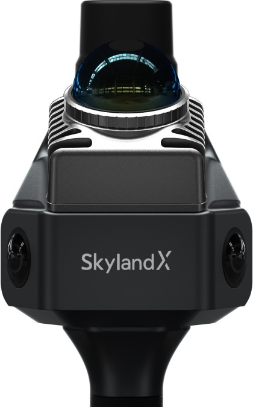
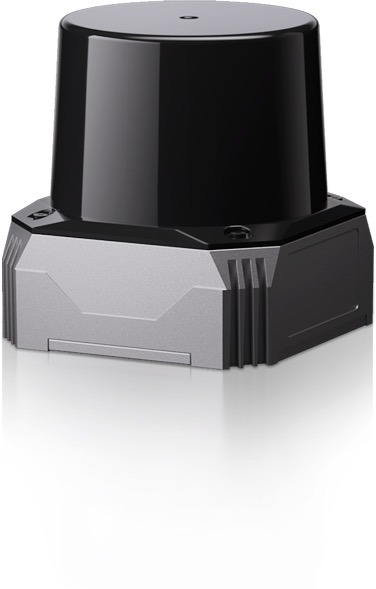
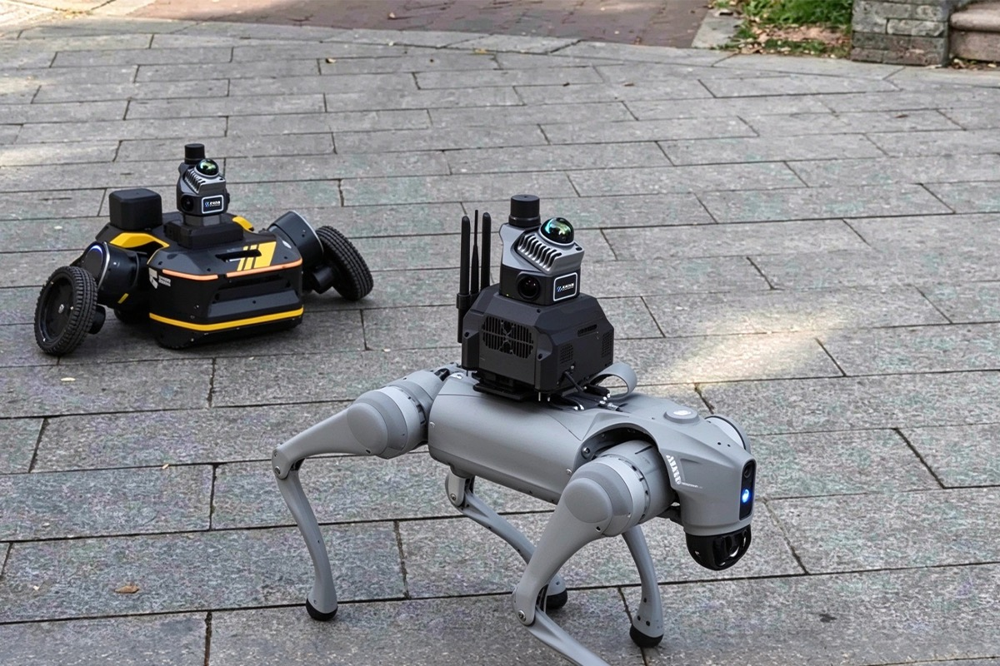
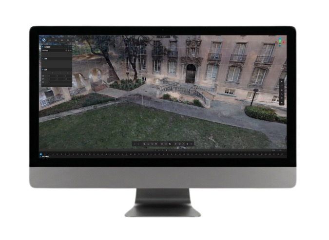
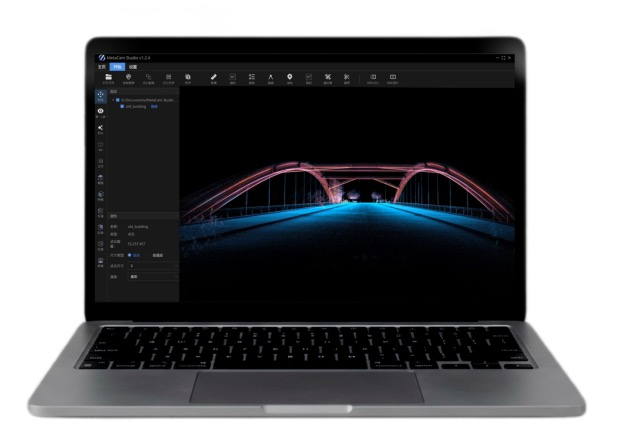
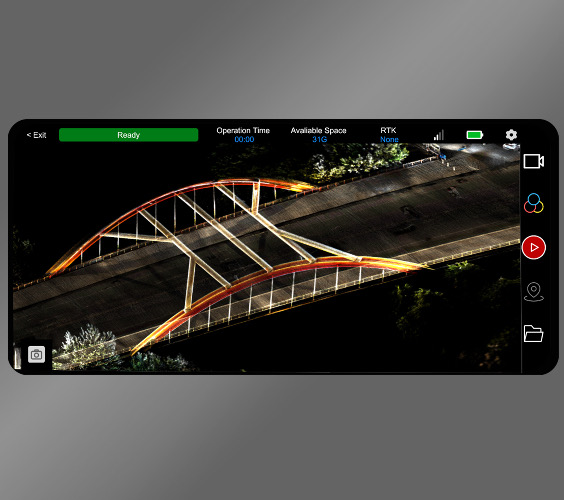
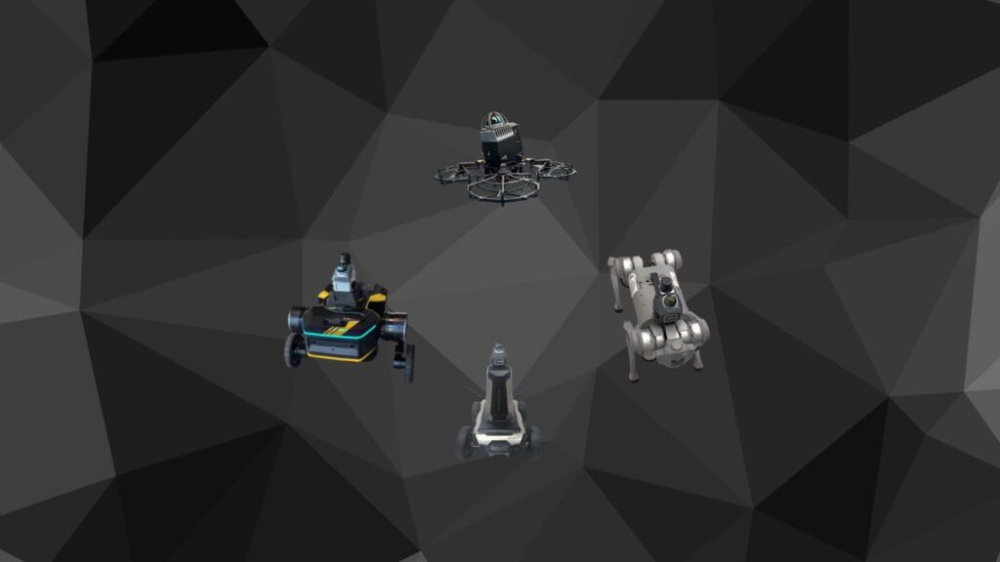
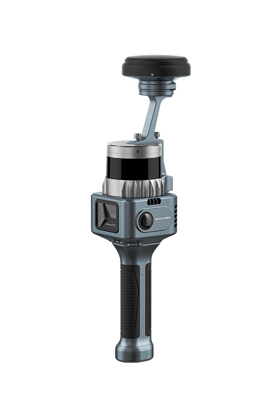

# SKYLANDX × T01 — Products and Solutions

⬆ [SKYLANDX profile](../SKYLANDX.md) · [Brief](SKYLANDX-T01-1-Brief.md) · [Playbook](SKYLANDX-T01-3-Playbook.md)

**Read this first:** SKYLANDX sells perception, not robots. For T01 its products do three jobs: (1) build the prior map a service robot navigates in, (2) give a robot live pose where GNSS fails, (3) produce a digital twin for planning, simulation or wayfinding. What is on site is **not confirmed** — check the booth before committing.

## Relevant products (ranked for this track)

### MetaCam Air 2

**Role in T01:** map a delivery / patrol route in one walk; or ride on a robot (via MetaCam Hub) as a live SLAM + RTK localization payload.

| Spec (official brochure) | Value |
|---|---|
| Weight | **982 g** total (main unit 619 g + battery 363 g) |
| Runtime | **150 min** per battery (45.36 Wh), USB-C PD 30 W, 120 min charge |
| LiDAR | 1 unit, Class 1 / 905 nm, **200,000 pts/s**, 10 Hz typical |
| Range | 0.1–**40 m @ 10 %** reflectivity · 0.1–70 m @ 80 % |
| LiDAR FOV | 360° × 59° (−7° to +52°) |
| Cameras | 2 × 48 MP (12 MP default output), 200° × 200° each |
| RTK | **0.8 cm + 1 ppm (H)**, 1.5 cm + 1 ppm (V); GPS, Galileo, GLONASS, BDS, QZSS, NavIC, SBAS |
| Accuracy (post-processed, lab) | Relative **< 1 cm**, absolute 5 cm |
| Environment | **IP5X** (dust only), **−20 °C to +55 °C** operating |
| Connectivity / storage | Wi-Fi 6 (20 m), Bluetooth, TF card 256 GB (up to 1 TB) |
| Features | Real-time colorized point cloud, **scan resumption**, 3DGS and mesh output |
| Outputs | LAS / PCD / PLY / RCP / E57 · 3DGS PLY · OBJ · JPEG |

- **Status / price:** ✅ shipping. Official price not public (about USD 5,000 at one reseller ⚠️ unverified). Loaner availability on site: not confirmed.
- **Developer interface:** high-level only. Live pose, point cloud, images, IMU over a **WebSocket using the Rosbridge protocol**; "open APIs" for pose, map, sensor streams and navigation commands. Topic names, message types, ROS version: not public. You do not control any actuator through it.

### C01 LiDAR

**Role in T01:** the rugged, robot-native sensor — a 3D LiDAR + IMU you bolt on a delivery base or quadruped and feed into your own (open-source) SLAM / Nav stack. Better than the Air 2 for outdoor winter runs (IP67).

| Spec (official brochure) | Value |
|---|---|
| Weight / size | **420 g** · 73 × 73.75 × 77.8 mm |
| FOV | 360° × 65° (−20° to +45°) |
| Range | **40 m @ 10 %** · 70 m @ 80 % · minimum 5 cm |
| Point rate | **216,000 pts/s** (dual-line) · 108,000 (single-line) |
| Scan | Non-repetitive pattern, 10 Hz typical, up to 30 Hz |
| Range precision | < 1 cm (1σ @ 10 m) |
| IMU | 6-axis, 200 Hz |
| Interface | **UDP** |
| Power | 12–30 V DC, **15 W** max |
| Environment | **IP67**, **−20 °C to +55 °C**, 100 klux ambient light |
| Laser safety | Class 1 (eye-safe) |

- **Status / price:** ✅ listed with brochure and "Contact Sales"; price not public. On-site unit: not confirmed.
- **Developer interface:** raw UDP point + IMU stream; advertised as plug-and-play with "mainstream open-source algorithms". No official ROS driver or packet spec found publicly — ask for it at the booth.

### MetaCam Hub

**Role in T01:** the accessory that mounts a MetaCam on a robot (listed as the Air 2's optional accessory). Mechanical, power and data interface specs: **not public**. Needed for any "scanner rides the robot" concept — confirm one is on site, otherwise plan a 3D-printed or strap mount.

### Skyland Cloud (also written MetaCam Cloud)

**Role in T01:** turns a scan into a photorealistic **3DGS** scene and a shareable browser viewer — the "digital twin of the route" for wayfinding, operator dashboards or demo visuals. Web-based; processing time and account access for hackathon teams: not public.

### MetaCam Studio

**Role in T01:** desktop step between scan and robot map — optimization, editing (remove people / moving objects), RTK or control-point alignment, export. **Windows only** per the Air 2 brochure; bring a Windows laptop.

### MetaCam Go

**Role in T01:** phone app (iOS / Android) to start a scan, watch the live point cloud and check coverage on site.

### Spatial Perception Robots / Modular Perception Kit

**Role in T01:** SKYLANDX's own packaged answer for robots — sensing kit with "full API access" (images, LiDAR, IMU, RTK, SLAM, navigation APIs) and ready-made aerial / ground robots. ✅ sold via sales, but no model names, specs or prices are public, and the "full navigation module" tier is offered to ecosystem partners only. Unlikely to be a hackathon loaner.

### MetaCam Pro, MetaCam Air 3, MetaCam Lite (lower priority)

- **MetaCam Pro** ✅ — 200 m range, 5.24 M pts/s, 1.16 kg, vehicle / robot mountable, open API. Overkill for a 48-hour service-robot demo; useful only for mapping a whole street or valley section.
- **MetaCam Air 3** 🧪 — unveiled Oct 2026 (360° × 240° LiDAR FOV, 2 × 50 MP cameras); price and availability not announced. Do not plan around it.
- **MetaCam Lite** ✅ — interiors-only entry scanner; fine as a substitute for indoor route mapping if that is what the booth has.

## What SKYLANDX already does in this domain

**Honest summary: no named delivery, cleaning, concierge or municipal-service deployment is public.** What exists is generic robot-perception positioning:

| When | What | Source |
|---|---|---|
| 2026 (page undated) | Robotics & Physical AI page: three integration depths — scanning payload, real-time perception layer (SLAM on the MetaCam, data streamed to your stack), full navigation module (perception + localization + path planning, robot keeps motion control). Robots can relocalize in an existing map without remapping | [Robotics & Physical AI](https://skylandx.com/industry/robotics-simulation/) |
| 2026 (page undated) | Spatial Perception Robots page: wheeled UGVs for facility patrol and site tracking, quadrupeds for slopes / rubble, drones for GPS-denied tunnels; "indoor safety patrols" with path-coverage optimization | [Spatial perception robots](https://skylandx.com/spatial-intelligence-robots/) |
| Brochure (undated, retrieved 2026-11-14) | C01 LiDAR targets: autonomous forklifts, latent AMRs, **service robots**, humanoids, quadrupeds | [C01 brochure](https://skylandx.com/wp-content/uploads/EN_C01_LiDAR_BROCHURE.pdf) |
| 2026-09 | Listed on Unmanned Systems Technology for 3D mapping and navigation for UAVs / autonomous systems | [UST](https://www.unmannedsystemstechnology.com/2026/09/3d-mapping-navigation-solutions-for-uavs-autonomous-systems/) |
| 2026-10 | INTERGEO Munich: Air 3 launch; 5,000+ units shipped since 2023 (company claim) — survey market, not service robotics | [3D Mag](https://www.3dmag.com/?p=14376) |

- Named customers, robot OEM partners, pilots in cities or resorts: **not public**.
- Swiss or alpine deployments: none found.

## What they are building next in this domain

- **In-house LiDAR for robots** — C01 ✅ and the Air 3's own sensor 🧪 show a move from buying LiDAR to making it (stated by the CTO for Air 3).
- **Navigation as a product** — the "full navigation module" tier (partners only) and navigation-command APIs suggest SKYLANDX wants to sell autonomy, not just maps. *Inference:* a public SDK would be the logical next step; none is announced.
- **MetaCam Fly** 🔭 — autonomous-flight drone scanning platform, in development (May 2026 distributor note); no date or specs.
- **Real2Sim** — LiDAR-grounded 3DGS environments pitched as training / benchmark scenes for embodied AI. *Inference:* relevant to T01 as a way to test delivery navigation in a twin before the robot moves.
- No urban-service-specific roadmap item is public.

## Software, models and data that help for this track

**From SKYLANDX**

- On-device real-time SLAM ("SOTA-SLAM"), scan resumption, relocalization against an existing map.
- Rosbridge-protocol WebSocket stream (pose, point cloud, images, IMU) — documentation on request only.
- MetaCam Go / Studio / Cloud pipeline; exports PCD / PLY / LAS / E57 / RCP, OBJ, 3DGS PLY.
- Sample data: request form on product pages. Pretrained models, public datasets, GitHub org: **none**.

**Third-party open source that shortcuts the build (not SKYLANDX products; compatibility with SKYLANDX data untested ⚠️)**

| Tool | Use in T01 |
|---|---|
| [roslibpy](https://github.com/gramaziokohler/roslibpy) / [rosbridge_suite](https://github.com/RobotWebTools/rosbridge_suite) | Subscribe to a Rosbridge WebSocket from plain Python, no ROS install needed on the laptop |
| [Nav2](https://github.com/ros-navigation/navigation2) | Planner + controller on the carrier robot; takes a 2D occupancy map and a pose source |
| [Open3D](https://github.com/isl-org/Open3D) | Load PCD / PLY, crop, slice by height into an occupancy grid, ICP, cloud-to-cloud distance |
| [pointcloud_to_laserscan](https://github.com/ros-perception/pointcloud_to_laserscan) | Flatten a live 3D cloud into a 2D scan for standard costmaps |
| [FAST-LIO](https://github.com/hku-mars/FAST_LIO) | LiDAR-inertial odometry for a raw LiDAR + IMU such as the C01 (needs a driver / packet parser first) |
| [CloudCompare](https://github.com/CloudCompare/CloudCompare) | GUI inspection and change detection between two scans |
| [VINS-Fusion](https://github.com/HKUST-Aerial-Robotics/VINS-Fusion) · [A-LOAM](https://github.com/HKUST-Aerial-Robotics/A-LOAM) | The HKUST SLAM lineage the team cites — background, not a SKYLANDX SDK |

## Gaps and limits for this track

- **No mobility, no manipulation.** Every T01 build needs a second vendor's robot.
- **Developer access is gated.** No public SDK, docs, topic list or sample code; payload / perception integration is for "eligible customers", full navigation for partners. Your build depends on what the on-site engineers hand over.
- **ROS 2 support unverified** ⚠️; the Rosbridge route works around this but adds latency and bandwidth limits for point clouds over Wi-Fi.
- **Weather:** Air 2 is IP5X — dust-protected, no water-ingress rating. Snow, slush and spa steam are a risk; C01 (IP67) is the outdoor option.
- **Range:** 40 m @ 10 % is fine for streets and corridors, thin for open squares or slopes with few features.
- **Studio is Windows-only;** 3DGS needs cloud processing (turnaround not public) — venue connectivity matters.
- **No semantics.** Maps are geometry + colour; detecting doors, bins, people or kerbs is your code.
- **No direct sim export** (USD / Isaac Sim not mentioned) — convert OBJ / PLY yourself.
- **MetaCam Hub** interface not public; mounting on another vendor's robot may need improvisation.

## Sources
- [SKYLANDX — MetaCam Air 2 brochure (PDF, official)](https://skylandx.com/wp-content/uploads/MetaCam_Air_2_EN.pdf)
- [SKYLANDX — C01 LiDAR brochure (PDF, official)](https://skylandx.com/wp-content/uploads/EN_C01_LiDAR_BROCHURE.pdf)
- [SKYLANDX — MetaCam Air 2](https://skylandx.com/metacam-air-2/)
- [SKYLANDX — C01 LiDAR](https://skylandx.com/c01-slam-lidar/)
- [SKYLANDX — Robotics & Physical AI](https://skylandx.com/industry/robotics-simulation/)
- [SKYLANDX — Spatial Perception Robots](https://skylandx.com/spatial-intelligence-robots/)
- [SKYLANDX — Software platforms](https://skylandx.com/software-platforms/)
- [3D Mag — SKYLANDX launches MetaCam Air 3 (2026-10)](https://www.3dmag.com/?p=14376)
- [Unmanned Systems Technology — 3D mapping and navigation solutions (2026-09; via company profile, page blocked today)](https://www.unmannedsystemstechnology.com/2026/09/3d-mapping-navigation-solutions-for-uavs-autonomous-systems/)
- [SKYLANDX company profile (this vault)](../SKYLANDX.md)
- Open-source repositories (existence checked 2026-11-14, contents from general knowledge): [roslibpy](https://github.com/gramaziokohler/roslibpy) · [rosbridge_suite](https://github.com/RobotWebTools/rosbridge_suite) · [Nav2](https://github.com/ros-navigation/navigation2) · [Open3D](https://github.com/isl-org/Open3D) · [pointcloud_to_laserscan](https://github.com/ros-perception/pointcloud_to_laserscan) · [FAST-LIO](https://github.com/hku-mars/FAST_LIO) · [CloudCompare](https://github.com/CloudCompare/CloudCompare) · [VINS-Fusion](https://github.com/HKUST-Aerial-Robotics/VINS-Fusion) · [A-LOAM](https://github.com/HKUST-Aerial-Robotics/A-LOAM)
