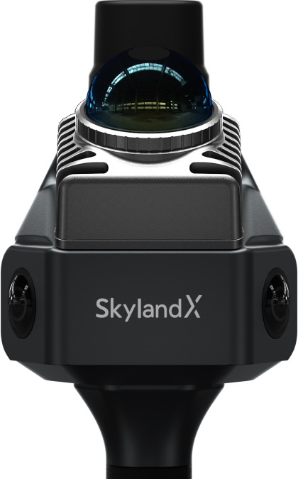
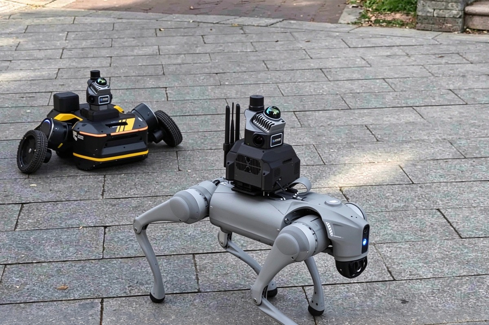
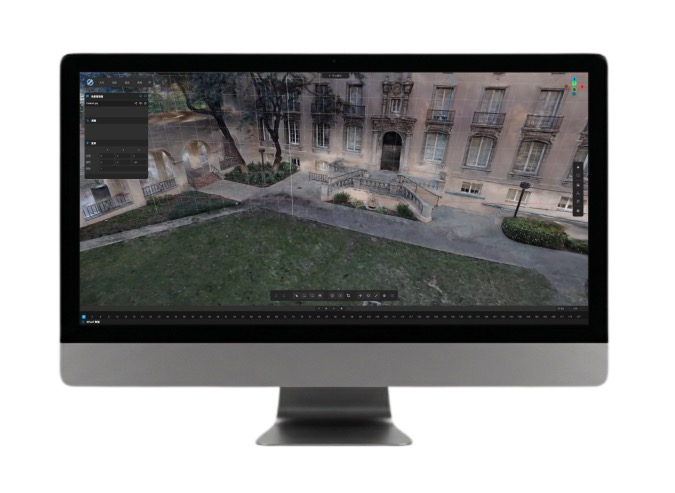
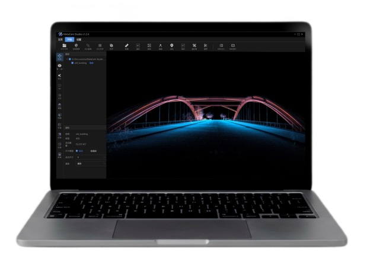
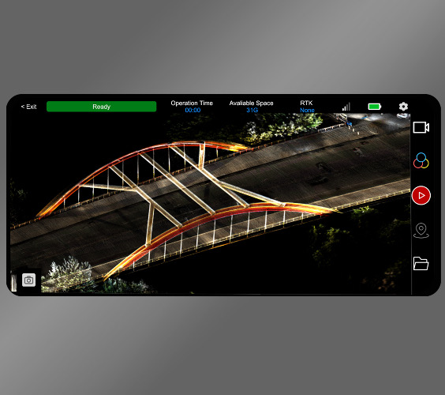
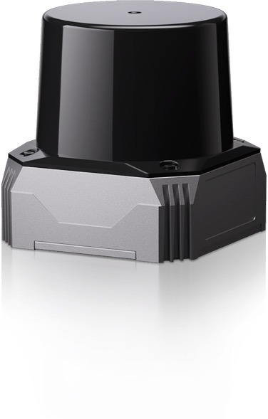
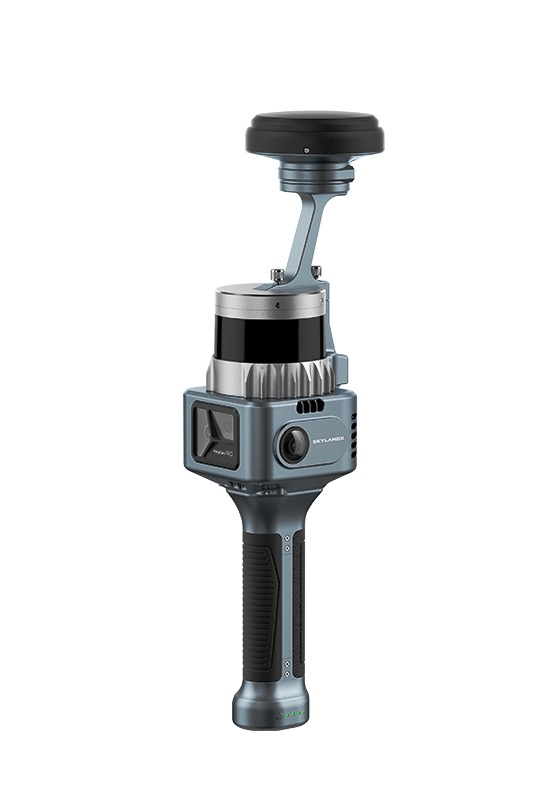
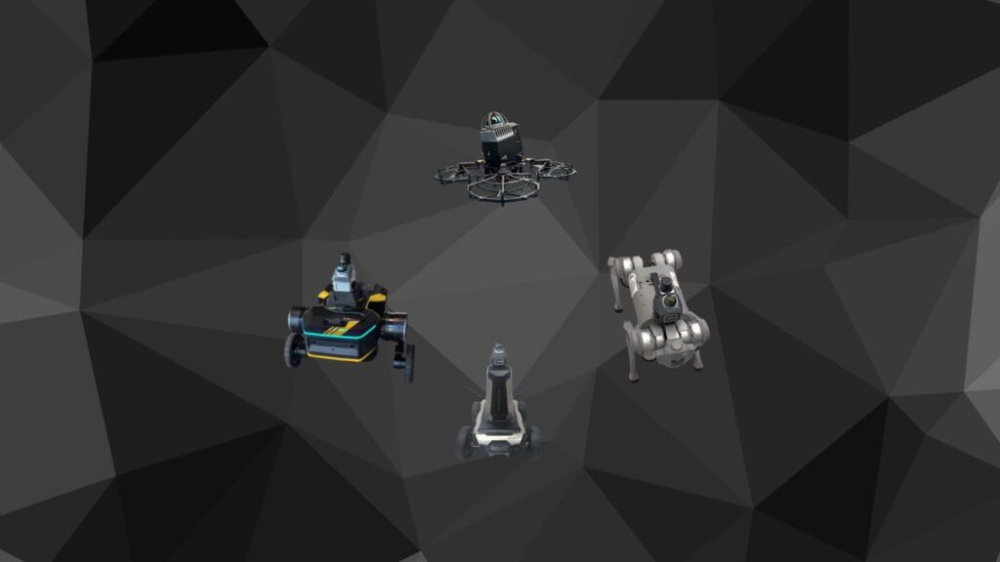
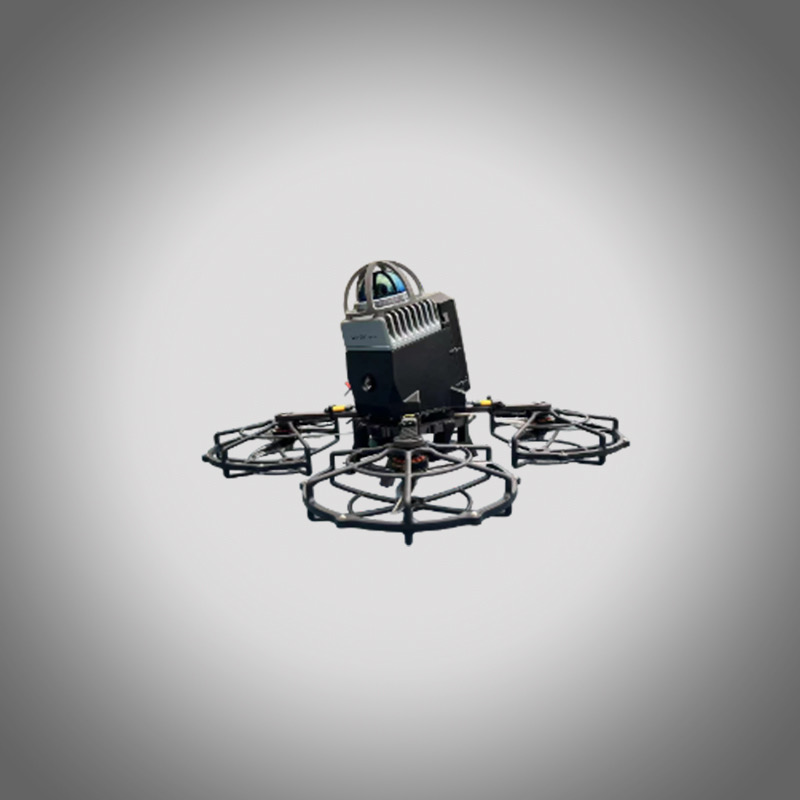

# SKYLANDX × T02 — Products and Solutions

⬆ [SKYLANDX profile](../SKYLANDX.md) · [Brief](SKYLANDX-T02-1-Brief.md) · [Playbook](SKYLANDX-T02-3-Playbook.md)

> **Read this first:** SKYLANDX sells perception (scanners, a SLAM LiDAR, mapping software), not robots you can drive. For T02 its value is **3D situational awareness**: map a site fast, localize without GNSS, re-scan and compare. What is physically on site is **not confirmed** — the MetaCam Air 2 is the most likely loaner. Research note: web search quota was exhausted during this pass, so findings come from official SKYLANDX pages and the company profile only; third-party coverage of safety deployments could not be searched.

## Relevant products (ranked for this track)

### MetaCam Air 2

**Role in T02:** the workhorse. Walk (or let a quadruped carry it) through a tunnel, plant room, corridor or along a slope and get a colorized cm-level 3D model in minutes; repeat later and compare.

| Spec | Value |
|---|---|
| Weight | **619 g** (handheld) |
| Relative accuracy | **< 1 cm**; point-cloud thickness < 1 cm |
| Positioning | On-device LiDAR + visual + inertial SLAM, no prior map; built-in RTK (per company profile) |
| Sync | TimeSync 3.0 hardware sync |
| Live feedback | Real-time colorized point cloud in MetaCam Go; scans can be paused, resumed and split across sessions |
| Outputs | Point cloud (PLY / PCD / LAS / E57 / RCP), OBJ mesh, 3DGS (PLY), 360° panoramas |
| LiDAR range, points/s, battery runtime | Not on the product page (brochure PDF only) — not public here |
| IP rating / operating temperature | Not public — ask before using it in snow |

- **Status / price:** ✅ shipping. Official price not public; about USD 5,000 at one reseller ⚠️ unverified.
- **Developer interface:** file export (always works) · live streams over a **WebSocket interface using the Rosbridge protocol** (point clouds, images, IMU, pose) · "open APIs" for pose, map and raw sensor data. Message types, ROS versions and access terms are **on request** — ROS 2 ⚠️ unverified.

### MetaCam Hub

**Role in T02:** the adapter that turns a handheld MetaCam into a robot payload, so a quadruped or wheeled robot can enter the hazard zone instead of a person.

| Item | Value |
|---|---|
| Integration depths (official) | 1) scanning payload · 2) real-time perception layer · 3) full navigation module |
| Who gets what | Payload and perception layer: "eligible customers". Full navigation: tailored per platform, **ecosystem partners only** |
| Mechanical / electrical specs, supported robots | Not public; no robot models named |

- **Status / price:** ✅ referenced on the official robotics page; details and price not public ⚠️ unverified availability on site.
- **Developer interface:** same Rosbridge / API path as the scanner. MetaCam can output navigation commands (it does SLAM + path planning, the robot does motion control) — but treat that as partner-level, not hackathon-ready, unless staff enable it.

### Skyland Cloud (also written MetaCam Cloud)

**Role in T02:** turns a capture into a shareable digital twin for an incident commander: browser 3D viewer, team sharing, 3DGS generation.

| Item | Value |
|---|---|
| Functions | Cloud processing, **3DGS generation**, web viewer, sharing and collaborative review |
| Processing time, quotas, offline use | Not public — needs connectivity; test turnaround on day 1 |
| API for third-party systems | "Seamless integration with third-party systems" claimed; no public API docs |

- **Status / price:** ✅ available; pricing not public.

### MetaCam Studio

**Role in T02:** the offline step between scan and analysis — optimize, align two scans into one frame, convert coordinates, measure, export.

| Item | Value |
|---|---|
| Functions | Point-cloud optimization, editing, measurement · **point-cloud alignment** · coordinate conversion · RTK / control-point calibration · one-click processing and merging |
| Change detection / scan comparison | **Not listed** as a feature — build it yourself (see software section) |
| Platform | PC |

- **Status / price:** ✅ available; pricing not public.

### MetaCam Go

**Role in T02:** field capture app — one-tap scan, live point cloud, **coverage check** so nothing is missed. Android / iOS. ✅ available. No developer interface documented.

### C01 LiDAR

**Role in T02:** a raw 3D LiDAR + IMU you bolt on a robot and run your own SLAM / obstacle avoidance with. Relevant only if a unit is on site and you have ROS skills.

| Spec | Value |
|---|---|
| FOV | 360° × 65° ⚠️ unverified (brochure-derived, not on the product page) |
| Point rate | 216,000 pts/s ⚠️ unverified |
| Range | 40 m @ 10 % reflectivity ⚠️ unverified (resellers list other values) |
| IMU / output / power | 200 Hz 6-axis IMU · UDP · 12–30 V, max 15 W ⚠️ unverified |
| Stated on the official page | Close-range detection; "plug-and-play" with mainstream open-source SLAM algorithms; targets AMRs, service robots, humanoids, quadrupeds |

- **Status / price:** ✅ shipping; price not public. No official ROS driver found.

### MetaCam Pro

**Role in T02:** the long-range option for outdoor infrastructure (bridges, dams, slopes, corridors). Unlikely to be a loaner.

| Spec | Value |
|---|---|
| LiDAR | **128-channel**, up to **5.24 M pts/s**, up to **200 m** |
| Accuracy | **5 mm** relative · **3 cm** absolute · horizontal 0.8 cm + 1 ppm · vertical 1.5 cm + 1 ppm |
| Weight | **1.16 kg** |
| Mounting | Handheld, backpack, vehicle, robot / quadruped, drone |
| Positioning | RTK / PPK / ground control points |
| IP rating, temperature, runtime | Not on the page ("all-day operation" with battery swaps) |

- **Status / price:** ✅ shipping; price not public. "Open API" for raw data and custom workflows; no details public.

### MetaCam Air 3

**Role in T02:** next-generation handheld; wider vertical coverage helps in tunnels and shafts. 🧪 unveiled at INTERGEO, Oct 2026 — LiDAR FOV **360° × 240°**, 2 × **50 MP** panoramic cameras, RTK (NTRIP or UHF) and PPK. Range, weight, price and availability not public. Do not plan a build around it.

### Spatial Perception Robots / Modular Perception Kit

**Role in T02:** SKYLANDX's own packaged answer for hazardous sites — drones, UGVs and quadrupeds with its sensing, sold through sales. ✅ offered, but no model names, specs or prices are public, and it is unlikely to be on site. Useful as proof of direction, not as hackathon hardware.

### MetaCam Fly

**Role in T02:** autonomous-flight drone scanning. 🔭 in development; no specs, no date. Not usable.

## What SKYLANDX already does in this domain

Honest summary: **use-case pages, not named safety deployments.** No emergency-service, civil-protection or Swiss customer is public, and none of the official "case studies" carries a date or numbers.

| What | Detail | Date | Source |
|---|---|---|---|
| Autonomous scanning in high-risk zones | Robots with LiDAR + visual SLAM repeat-scan tanks, tunnels, boiler rooms; cloud sync, remote mission tracking, anomaly flagging. Customer and robot type not named | Undated | [Case studies: Industrial inspection](https://skylandx.com/case-studies-industrial-inspection) |
| Facility mapping — Deluke Chemical | Handheld + robot capture of plant structure, piping and equipment into interactive 3D models. The only named project | Undated | [Case studies: Industrial inspection](https://skylandx.com/case-studies-industrial-inspection) |
| Subsurface surveying | Handheld scans of utility tunnels, service corridors and shafts; 3D reference for maintenance and **emergency response** | Undated | [Case studies: Surveying](https://skylandx.com/case-studies-surveying) |
| GPS-denied autonomous exploration | Drones / robots in tunnels, mines, underground spaces — "no human entry required" (offered solution) | Current | [Spatial Perception Robots](https://skylandx.com/spatial-intelligence-robots/) |
| Autonomous indoor safety patrols | Robots map in real time, detect cracks, leaks and hazards, optimize coverage (offered solution) | Current | [Spatial Perception Robots](https://skylandx.com/spatial-intelligence-robots/) |
| Quadruped mapping in rough terrain | Slopes, bridges, rubble (platform category, no model named) | Current | [Spatial Perception Robots](https://skylandx.com/spatial-intelligence-robots/) |
| Infrastructure and utilities scanning | Bridges, tunnels, highways, dams, substations, transmission corridors, underground mines (MetaCam Pro applications) | Current | [MetaCam Pro](https://skylandx.com/metacam-pro/) |
| UAV / autonomous-systems supplier listing | Listed on Unmanned Systems Technology for 3D mapping and navigation | 2026-09 | [UST (via company profile)](https://www.unmannedsystemstechnology.com/2026/09/3d-mapping-navigation-solutions-for-uavs-autonomous-systems/) |
| Scale claim | 5,000+ units shipped since 2023, 1 billion+ m² captured (company claim) | 2026-10 | [3D Mag (via company profile)](https://www.3dmag.com/?p=14376) |

- **Not found:** search-and-rescue, avalanche / rockfall / flood monitoring, firefighting, police or forensics references; partnerships with a named robot maker.

## What they are building next in this domain

- **MetaCam Air 3** 🧪 (Oct 2026): in-house LiDAR with 360° × 240° FOV — better ceiling / floor coverage for tunnels and shafts. Availability to be announced.
- **MetaCam Fly** 🔭: autonomous-flight scanning drone, in development — the obvious vehicle for "no human entry" inspection of towers, shafts and tunnels (*inference from the product name and the official drone use cases*).
- **Navigation module for partner robots** ✅/🧪: MetaCam doing SLAM + path planning and emitting navigation commands; today limited to ecosystem partners.
- **Relocalization + structured spatial models** (zones, paths, obstacles, waypoints behind an API): the basis for repeat patrol and rerouting without human intervention.
- **Real2Sim**: LiDAR-grounded 3DGS + mesh environments for robot training and evaluation — *inference:* a path to rehearsing emergency scenarios in simulation.
- *Inference overall:* the company is moving from surveyor tool to robot perception supplier; safety inspection is one of its main pitches, but no dated safety roadmap is public.

## Software, models and data that help for this track

**From SKYLANDX**

| Asset | Use in T02 | Access |
|---|---|---|
| On-device SLAM | Mapping and pose with no GNSS and no prior map | Built in |
| Relocalization against an existing map | Repeat patrol in the same frame | API, on request |
| Rosbridge WebSocket streams | Live point cloud, images, IMU, pose into ROS or a dashboard | On request; docs not public |
| MetaCam Studio alignment + coordinate conversion | Put two scans in one frame before comparing | Software licence — ask staff |
| Skyland Cloud 3DGS + web viewer | Shareable responder twin | Account — ask staff |
| Sample data | Start coding before you get a scanner | "Get Sample Data" form on product pages |
| Pretrained models / datasets / GitHub | None public | — |

**Open-source shortcuts (third-party, not SKYLANDX; from general knowledge, not re-verified in this pass)**

| Tool | Why |
|---|---|
| [Open3D](https://www.open3d.org/) | Load PLY / PCD, ICP registration, cloud-to-cloud distance, clustering — the core of change detection in Python |
| [CloudCompare](https://www.cloudcompare.org/) | GUI + CLI for C2C / M3C2 distance maps; fastest way to a convincing "what changed" picture |
| [rosbridge_suite](https://github.com/RobotWebTools/rosbridge_suite) and [roslibpy](https://github.com/gramaziokohler/roslibpy) | Speak the Rosbridge protocol from ROS or plain Python without a driver |
| [VINS-Fusion](https://github.com/HKUST-Aerial-Robotics/VINS-Fusion) / [A-LOAM](https://github.com/HKUST-Aerial-Robotics/A-LOAM) | Open SLAM from the lab lineage SKYLANDX cites; fallback for C01 or raw streams (research code, not the product's SLAM) |
| [SuperSplat](https://github.com/playcanvas/supersplat) | View / edit the exported 3DGS PLY in a browser |

## Gaps and limits for this track

- **No actuation.** Every "robot responds" story needs another vendor's platform and your own bridge.
- **Developer access is gated.** No public SDK, docs or GitHub; Rosbridge details "on request"; full navigation for partners only.
- **No named safety deployments, no dates, no numbers** in official case material.
- **Environmental limits unknown:** IP rating, operating temperature and battery runtime are not public for any MetaCam — matters at 1,400 m in November. LiDAR also degrades in falling snow, fog and on wet / dark surfaces (general LiDAR physics).
- **Sensing is geometry + RGB only:** no thermal, gas or radar; finding people behind smoke or under snow is out of scope.
- **No built-in change detection or semantic hazard detection** exposed to users — the "cracks, leaks, hazards" patrol is a solution offering, not a downloadable model.
- **Cloud dependence** for 3DGS; processing times not public.
- **Air 2 range not public** — do not promise long-range slope monitoring without checking; MetaCam Pro (200 m) probably is not available to teams.

## Sources
- [SKYLANDX — Spatial Perception Robots](https://skylandx.com/spatial-intelligence-robots/)
- [SKYLANDX — Robotics & Physical AI (MetaCam Hub, Rosbridge, APIs, Real2Sim, export formats)](https://skylandx.com/industry/robotics-simulation/)
- [SKYLANDX — MetaCam Air 2](https://skylandx.com/metacam-air-2/)
- [SKYLANDX — MetaCam Pro](https://skylandx.com/metacam-pro/)
- [SKYLANDX — C01 LiDAR](https://skylandx.com/c01-slam-lidar/)
- [SKYLANDX — Software platforms](https://skylandx.com/software-platforms/)
- [SKYLANDX — Case studies: Industrial inspection](https://skylandx.com/case-studies-industrial-inspection)
- [SKYLANDX — Case studies: Surveying](https://skylandx.com/case-studies-surveying)
- [SKYLANDX — Case studies: Robotics](https://skylandx.com/case-studies-robotics)
- [SKYLANDX — official site (navigation, industries)](https://skylandx.com/)
- [SKYLANDX company profile (this vault; source for Air 3, C01 brochure values, UST and 3D Mag items)](../SKYLANDX.md)
- [3D Mag — SKYLANDX launches MetaCam Air 3, 2026-10-07 (via company profile)](https://www.3dmag.com/?p=14376)
- [Unmanned Systems Technology — 3D mapping and navigation solutions, 2026-09 (via company profile)](https://www.unmannedsystemstechnology.com/2026/09/3d-mapping-navigation-solutions-for-uavs-autonomous-systems/)
