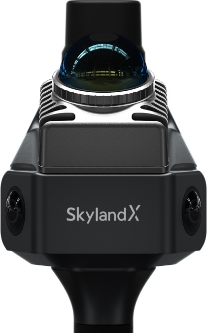
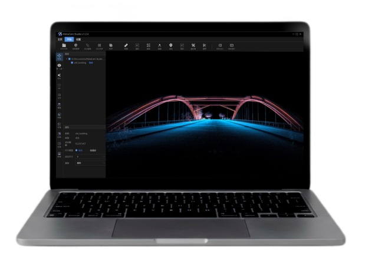
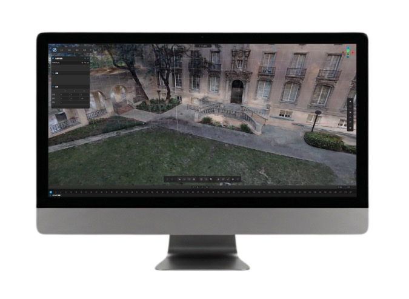
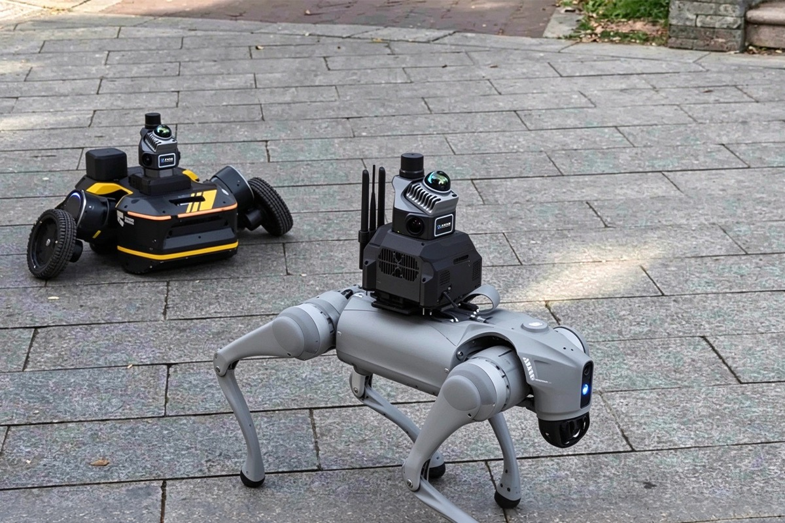
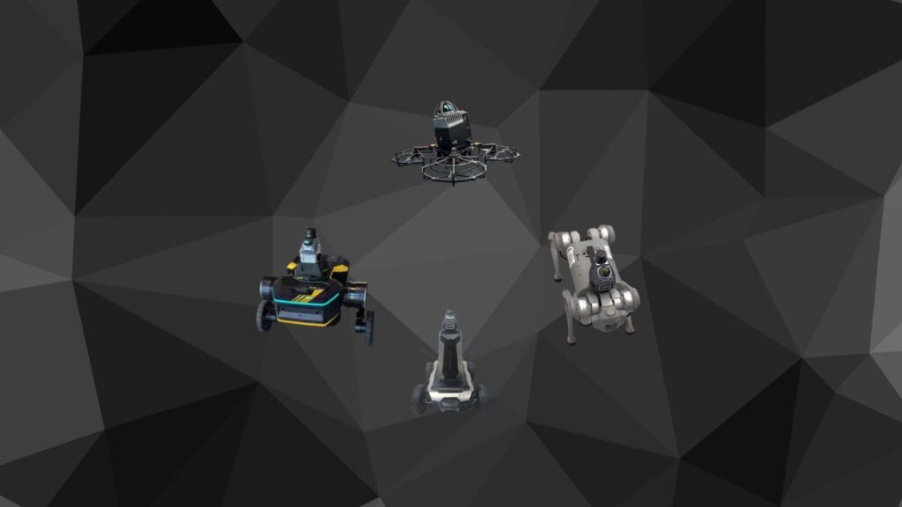
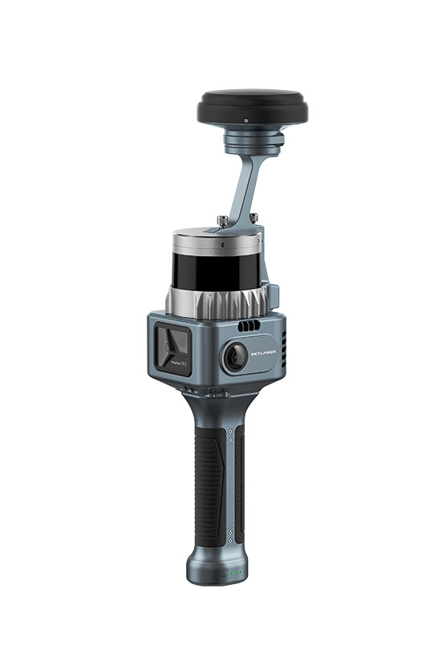
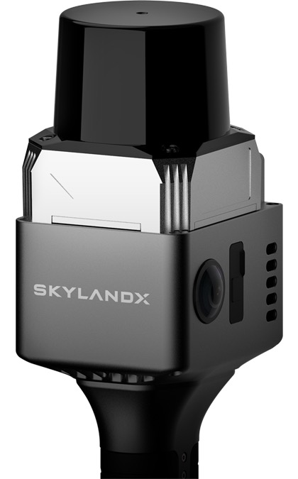
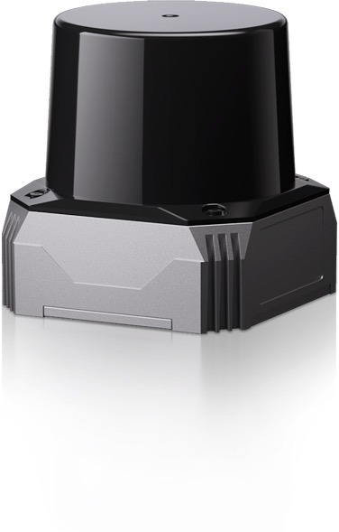

# SKYLANDX × T03 — Products and Solutions

⬆ [SKYLANDX profile](../SKYLANDX.md) · [Brief](SKYLANDX-T03-1-Brief.md) · [Playbook](SKYLANDX-T03-3-Playbook.md)

**In one line:** SKYLANDX supplies the *measurement* half of a sustainability solution (geometry, volume, change over time, a 3D twin). It has no actuators, no environmental sensors and no public SDK. What is on site is not confirmed — check before you commit.

## Relevant products (ranked for this track)

### MetaCam Air 2

**Role in T03:** the default tool. Walk a building, depot, recycling yard or forest plot and get a coloured, centimetre-accurate point cloud you can turn into volumes, areas and before / after differences.

| Track-relevant spec | Value |
|---|---|
| Weight | **619 g** handheld |
| Accuracy | **< 1 cm** relative; point-cloud thickness < 1 cm |
| Positioning | Real-time SLAM on the device, no prior map; RTK for outdoor georeferencing (per company profile) |
| Runtime | Up to **150 min** per battery at walking pace, "depending on model" (official surveying FAQ — not stated per model) |
| Workflow aids | Live coloured preview on phone, coverage check, scan resumption across sessions |
| Outputs | Point cloud (LAS / E57 / PLY / PCD / RCP), 360° panoramas, 3DGS via cloud |
| LiDAR range, points per second, IP rating, operating temperature | Not public on the official page |

- **Status / price:** ✅ shipping. Price not public officially (about USD 5,000 at one reseller ⚠️ unverified).
- **Official T03-type applications listed on the product page:** forestry (sub-canopy terrain capture for inventory and forest management), AEC as-built and BIM verification, interior renovation planning, digital factory twins.
- **Developer control:** start / stop and preview via MetaCam Go; processed data via file export. Live streams (pose, point cloud, images, IMU) over a WebSocket that speaks the Rosbridge protocol — documentation only on request.

### MetaCam Studio

**Role in T03:** where raw scans become numbers.

| Capability | Detail |
|---|---|
| Volumes | **Stockpile volume calculation** from point clouds (official industrial and surveying pages) |
| Alignment | Scan-to-scan alignment, coordinate conversion, RTK and control-point calibration — the basis for repeat-scan comparison |
| Measurement and editing | Point cloud optimization, editing, measurement; side-by-side view of point cloud, floor plan and site photos |
| Export | LAS, E57, PLY, PCD, native RCP (Revit, AutoCAD, Navisworks); E57 for ArchiCAD, Bentley and others |

- **Status / price:** ✅ available with the scanners; licence terms and price not public.
- **Developer control:** desktop GUI. No scripting interface or CLI is mentioned publicly — plan to do custom analysis in your own code on exported files.

### Skyland Cloud (also written MetaCam Cloud)

**Role in T03:** shareable result. Generates the photorealistic 3D Gaussian-splat scene and hosts a browser viewer for jury and stakeholders (remote review instead of site visits).

| Capability | Detail |
|---|---|
| Processing | Cloud upload and automatic processing, **3DGS generation** |
| Viewing | Browser 3D viewer, sharing, collaborative review |
| Integration | "Integration with third-party systems" claimed; no API documented |

- **Status / price:** ✅ available; access via "Request a demo". Price and processing time not public — ask how long a 3DGS job takes before you plan a demo around it.

### MetaCam Hub + Spatial Perception Robots / Modular Perception Kit

**Role in T03:** makes the audit autonomous and repeatable — the same scanner rides on a quadruped, wheeled robot or drone so that weekly "resource rounds" need no person.

| Integration depth (official wording, paraphrased) | Who does what | Availability |
|---|---|---|
| 1. Scanning payload | Robot navigates itself; MetaCam only records | "Eligible customers" |
| 2. Real-time perception layer | MetaCam runs SLAM on board and streams pose + map to your autonomy stack | "Eligible customers" |
| 3. Full navigation module | MetaCam does perception, localization and path planning; robot executes motion | Ecosystem partners, tailored per platform |

- **Relocalization:** a robot returning to a scanned site can localize in the existing map instead of remapping — useful for repeat rounds.
- **Status / price:** ✅ sold via sales. Hub mechanics, mass, power and connector not public. ⚠️ unverified whether a Hub or a ready-made robot is on site.

### MetaCam Pro

**Role in T03:** only if large outdoor areas matter (whole street, slope, forest stand, district-heating plant).

| Track-relevant spec | Value |
|---|---|
| LiDAR | **128-channel**, up to **5.24 M pts/s**, up to **200 m** |
| Accuracy | **5 mm** relative, **3 cm** absolute; georeferenced 0.8 cm + 1 ppm horizontal, 1.5 cm + 1 ppm vertical |
| Weight | **1.16 kg** |
| Carriers | Handheld, backpack, vehicle, robot / quadruped, drone |
| IP rating, battery, temperature | Not public |

- **Status / price:** ✅ shipping; price not public. Unlikely as a loaner (profile researcher's guess).
- **Official T03-type applications:** mining and stockpiles, power and utilities (substations, transmission corridors), urban renewal / Scan-to-BIM, forestry and terrain, industrial digital twins for retrofit planning.

### MetaCam Lite

**Role in T03:** indoor-only alternative for room and apartment retrofit scans.

| Spec | Value |
|---|---|
| Cameras | Dual **48 MP**, 360° panoramas |
| Outputs | Point cloud (LAS / PCD / PLY / RCP / E57), 3DGS, OBJ mesh |
| Weight, range, RTK | Not stated on the product page |

- **Status / price:** ✅ (announced May 2026); price not public.

### C01 LiDAR

**Role in T03:** minor. A raw SLAM LiDAR for a team that already has its own autonomy stack and wants a low-power navigation sensor on a small robot.

| Spec | Value |
|---|---|
| FOV / rate | 360° × 65°, 216,000 pts/s ⚠️ unverified (brochure-derived, product page gives no numbers) |
| Range | 40 m @ 10 % reflectivity ⚠️ unverified (resellers conflict) |
| Power / interface | 12–30 V DC, max 15 W, UDP ⚠️ unverified |
| Software | "Compatible with mainstream open-source algorithms"; no official ROS driver found |

- **Status / price:** ✅; price via sales.

### Not useful for T03 this weekend
- **MetaCam Air 3** 🧪 (unveiled Oct 2026, availability not announced) and **MetaCam Fly** 🔭 (drone, in development) — do not plan on them.

## What SKYLANDX already does in this domain

**No named customer, pilot or dated deployment in sustainability is public.** Everything below comes from official application pages (undated, © 2026) and is the company's own description:

| Domain | What the official pages say | Source |
|---|---|---|
| Stockpile / material inventory | Volumes of scrap metal, coal, ash and similar piles calculated from point clouds in MetaCam Studio; works indoors without satellite signal | [Industrial facilities](https://skylandx.com/industry/industrial-facilities/) · [Surveying](https://skylandx.com/industry/surveying/) |
| Building retrofit and renovation | Scan-to-BIM / CAD of existing buildings; retrofit and shutdown plans checked against as-is scans; interior renovation capture | [AEC](https://skylandx.com/industry/aec/) · [Industrial facilities](https://skylandx.com/industry/industrial-facilities/) |
| Forestry | Stems, stands and ground under the canopy; biomass estimation; repeat plot surveys | [Surveying](https://skylandx.com/industry/surveying/) · [MetaCam Air 2](https://skylandx.com/metacam-air-2/) |
| Energy and utilities assets | Substations, transmission corridors and utility networks for maintenance planning (MetaCam Pro) | [MetaCam Pro](https://skylandx.com/metacam-pro/) |
| Fewer site trips | Company claims: 80–85 % less time on site, 50 % fewer site visits, 30 % less rework (no method or sample given) | [AEC](https://skylandx.com/industry/aec/) · [Industrial facilities](https://skylandx.com/industry/industrial-facilities/) · [Surveying](https://skylandx.com/industry/surveying/) |
| Robot-based repeat scanning | Wheeled robots for construction tracking and facility patrol; quadrupeds for slopes and rough terrain | [Spatial perception robots](https://skylandx.com/spatial-intelligence-robots/) |

- **Not found anywhere:** waste sorting, litter, EV charging, air / water monitoring, snow, agriculture, thermal-energy work.
- **Switzerland / Alps:** no deployment or distributor public.
- **Research limit:** only official pages were checked for this track file; a trade-press search for case studies could not be run in this pass.

## What they are building next in this domain

- **Nothing announced that is specific to sustainability.**
- 🧪 **MetaCam Air 3** (Oct 2026): in-house LiDAR with 360° × 240° FOV and 2 × 50 MP panoramic cameras — denser, more complete captures for the same survey and retrofit workflows. Price and availability not announced.
- 🔭 **MetaCam Fly**: autonomous-flight scanning drone, in development — *inference:* would extend roof, stockpile and forest capture to places a person cannot walk.
- **Direction (inference from official pages):** from handheld scanner toward a perception and navigation layer for robots (Hub, perception kit, relocalization, Real2Sim with 3DGS). For T03 this points to autonomous, repeated resource audits rather than new sustainability products.

## Software, models and data that help for this track

**From SKYLANDX**
- MetaCam Go (capture, coverage check), MetaCam Studio (alignment, volumes, export), Skyland Cloud (3DGS, web sharing).
- Open APIs: pose, map, structured spatial model, raw LiDAR / image / IMU / RTK streams; Rosbridge-protocol WebSocket. Docs on request only; ROS 2 ⚠️ unverified.
- No public SDK, GitHub org, pretrained model or dataset. A "Get sample data" form exists on product pages.

**Open-source shortcuts (third party, not SKYLANDX products)**

| Need | Tool | Why it saves time |
|---|---|---|
| Load LAS / PLY / PCD, crop, plane-fit, mesh, compute volumes | [Open3D](https://github.com/isl-org/Open3D) | Python, runs on a laptop |
| Before / after change maps and volume difference without code | [CloudCompare](https://www.cloudcompare.org/) | Cloud-to-cloud distance and 2.5D volume tools in a GUI |
| Batch filtering, ground classification, format conversion | [PDAL](https://pdal.io/) | Pipelines for LAS / E57 |
| Read the live stream from Python without a ROS install | [roslibpy](https://github.com/gramaziokohler/roslibpy) · [rosbridge_suite](https://github.com/RobotWebTools/rosbridge_suite) | Rosbridge clients / reference protocol |
| Tree stems and diameters from ground-based point clouds | [3DFin](https://github.com/3DFin/3DFin) | Forest-inventory metrics from a walk-through scan |
| View or train Gaussian splats locally | [SuperSplat](https://github.com/playcanvas/supersplat) · [gsplat](https://github.com/nerfstudio-project/gsplat) | Viewer / editor and training library for 3DGS PLY |
| Baseline terrain and surface of Leukerbad | [swissALTI3D](https://www.swisstopo.admin.ch/en/height-model-swissalti3d) · [swissSURFACE3D](https://www.swisstopo.admin.ch/en/height-model-swisssurface3d) | Official Swiss elevation / LiDAR products to compare your scan against |
| SLAM on a raw LiDAR (C01 only) | [A-LOAM](https://github.com/HKUST-Aerial-Robotics/A-LOAM) · [VINS-Fusion](https://github.com/HKUST-Aerial-Robotics/VINS-Fusion) | HKUST research code from the lineage SKYLANDX cites; C01 compatibility with these specific repos ⚠️ unverified |

## Gaps and limits for this track

- **No actuation.** Cannot sort, pick, clean, plug in or repair. Needs another vendor's robot for any physical action.
- **Geometry and colour only.** No thermal, gas, particulate, moisture or water-quality sensing. Energy-loss claims need a separate thermal camera and your own fusion.
- **Analysis layer is yours.** Out of the box you get point clouds, volumes and a viewer — not energy models, fill-level alerts, carbon estimates or change detection reports.
- **Developer access is the main uncertainty.** No public docs; live API is "contact SKYLANDX" and worded as for "eligible customers". File export is the only path you can count on.
- **Processing latency.** Colourization, alignment and 3DGS happen after capture in Studio / Cloud; duration not public. Not a real-time perception sensor for manipulation.
- **Environmental limits unknown.** IP rating and operating temperature are not public — relevant for snow, wet and sub-zero work at 1,400 m in November.
- **Surfaces.** *General LiDAR caveat, not a SKYLANDX statement:* water, glass, wet snow and steam (thermal baths) return poorly — test before building a demo on them.
- **No named references** in sustainability; impact numbers are unaudited company claims.

## Sources
- [SKYLANDX — MetaCam Air 2](https://skylandx.com/metacam-air-2/)
- [SKYLANDX — MetaCam Pro](https://skylandx.com/metacam-pro/)
- [SKYLANDX — C01 LiDAR](https://skylandx.com/c01-slam-lidar/)
- [SKYLANDX — Software platforms](https://skylandx.com/software-platforms/)
- [SKYLANDX — Spatial Perception Robots](https://skylandx.com/spatial-intelligence-robots/)
- [SKYLANDX — Robotics & Physical AI](https://skylandx.com/industry/robotics-simulation/)
- [SKYLANDX — Industry: AEC](https://skylandx.com/industry/aec/)
- [SKYLANDX — Industry: Industrial facilities](https://skylandx.com/industry/industrial-facilities/)
- [SKYLANDX — Industry: Surveying](https://skylandx.com/industry/surveying/)
- [SKYLANDX company profile (this vault; general research and its sources)](../SKYLANDX.md)
- Third-party tools (reachability checked, content not reviewed in depth): [Open3D](https://github.com/isl-org/Open3D) · [CloudCompare](https://www.cloudcompare.org/) · [PDAL](https://pdal.io/) · [roslibpy](https://github.com/gramaziokohler/roslibpy) · [rosbridge_suite](https://github.com/RobotWebTools/rosbridge_suite) · [3DFin](https://github.com/3DFin/3DFin) · [SuperSplat](https://github.com/playcanvas/supersplat) · [gsplat](https://github.com/nerfstudio-project/gsplat) · [swissALTI3D](https://www.swisstopo.admin.ch/en/height-model-swissalti3d) · [swissSURFACE3D](https://www.swisstopo.admin.ch/en/height-model-swisssurface3d) · [A-LOAM](https://github.com/HKUST-Aerial-Robotics/A-LOAM) · [VINS-Fusion](https://github.com/HKUST-Aerial-Robotics/VINS-Fusion)
