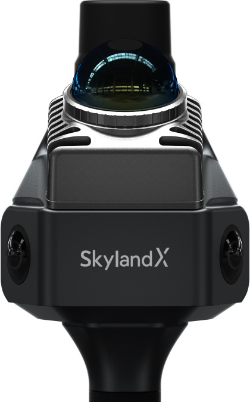
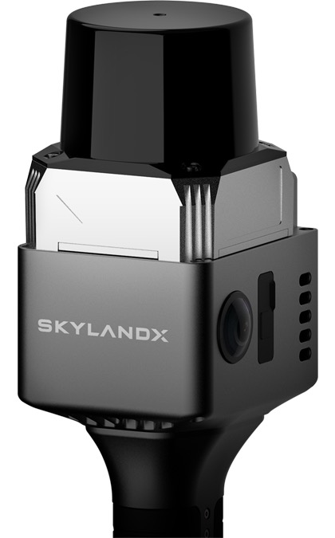
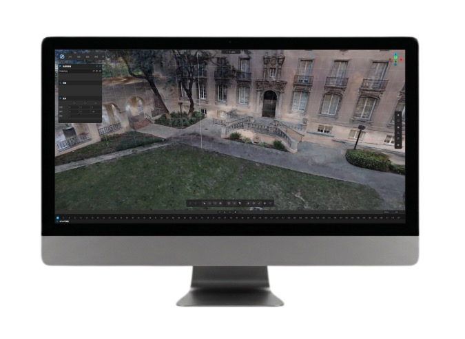
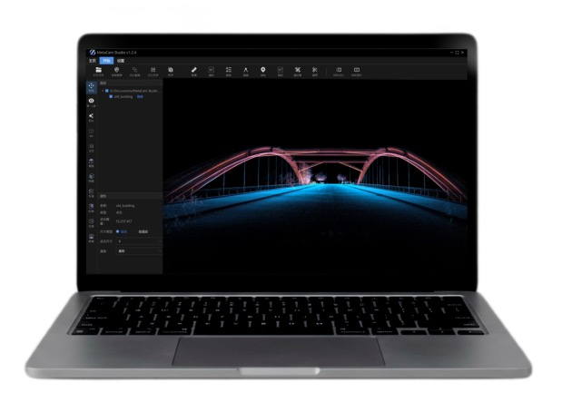
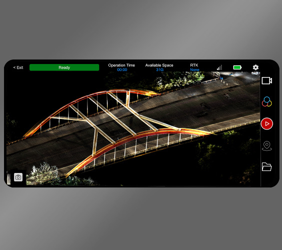
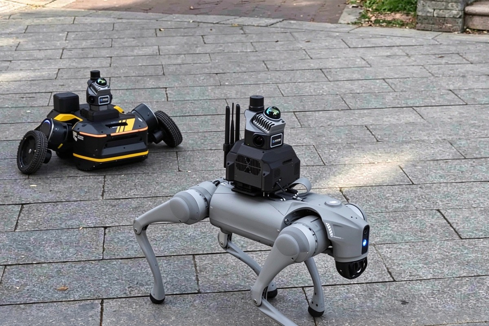
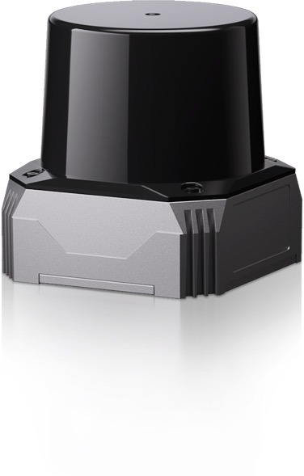
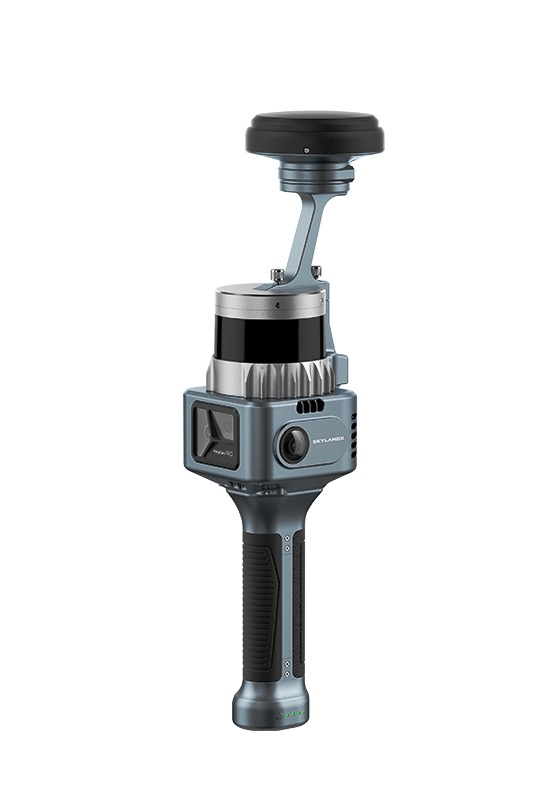
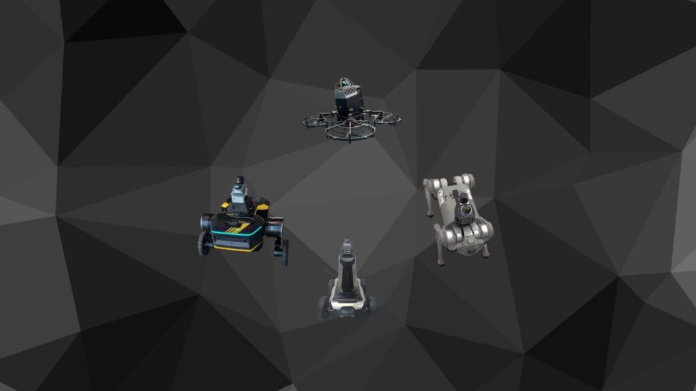

# SKYLANDX × T04 — Products and Solutions

⬆ [SKYLANDX profile](../SKYLANDX.md) · [Brief](SKYLANDX-T04-1-Brief.md) · [Playbook](SKYLANDX-T04-3-Playbook.md)

> **Bottom line:** SKYLANDX sells 3D scanners and spatial software, not assistive robots. For T04 it is an **environment layer**: a measured 3D model of the room, ward or apartment that (a) a care robot navigates in, (b) a therapist inspects remotely, or (c) your code audits for fall hazards. Nothing below touches, lifts or monitors a person.

## Relevant products (ranked for this track)

### MetaCam Air 2

**Role in T04:** the practical capture tool — walk a rehab corridor, therapy room or apartment once and get a colorized point cloud + 3DGS scene. Also the unit most likely on site (best guess, not confirmed).

| Track-relevant spec | Value |
|---|---|
| Weight | **619 g** handheld (one person, one hand — no tripod, no setup in the room) |
| Relative accuracy | **< 1 cm**; point-cloud thickness < 1 cm (enough for door widths, thresholds, step heights) |
| Sensors | LiDAR + panoramic vision + IMU, hardware-synced (TimeSync 3.0); built-in RTK (irrelevant indoors) |
| On-device SLAM | Real time, no prior map or infrastructure needed; live colorized preview in MetaCam Go |
| Outputs | Point cloud (PLY / PCD / LAS / E57 / RCP), OBJ mesh, 3DGS (PLY), 360° panoramas |
| Robot mounting | Via MetaCam Hub accessory (details not public) |
| LiDAR range / FOV / battery runtime / IP rating | Not stated on the official page |

- **Status / price:** ✅ shipping. Official price not public; about USD 5,000 at one reseller ⚠️ unverified.
- **Developer interface:** offline exports (always available) · live streams over a WebSocket using the Rosbridge protocol (point clouds, images, IMU, pose) and "open APIs" for pose / map — **undocumented publicly; ask staff**. High-level only: it reports where it is and what the space looks like; it does not drive a robot.

### MetaCam Lite

**Role in T04:** the model SKYLANDX itself describes as made for interiors and compact sites — the best conceptual match for rooms, bathrooms and apartments, if a unit is on site.

| Track-relevant spec | Value |
|---|---|
| Cameras | Dual **48 MP**, 360° panoramas |
| Outputs | Point cloud (LAS / PCD / PLY / RCP / E57), 3DGS built on LiDAR geometry, OBJ mesh, 360° panorama |
| Official applications | Interior renovation, facility management, robotics, AEC, underground, heritage |
| Weight / range / accuracy figure / battery / API | Not stated on the product page (brochure only) |

- **Status / price:** ✅ (introduced with Japan distribution, May 2026). Price not public. On-site availability unknown.
- **Developer interface:** same software chain (MetaCam Go → Studio → Cloud). Live API on Lite specifically: not stated.

### Skyland Cloud (also written MetaCam Cloud)

**Role in T04:** turns a capture into a photorealistic **3DGS scene** and a **browser viewer** you can share — the basis for a remote "home visit" by a therapist or a jury-friendly visual.

| Capability | Detail |
|---|---|
| Processing | Cloud processing and model rendering; 3DGS generation |
| Viewer | Web-based 3D viewer; sharing and collaborative review |
| Export | 3DGS as PLY |
| Processing time, quotas, pricing, API, annotation tools | Not stated |

- **Status:** ✅. Account / access for hackathon teams: ask staff.
- **Watch out:** uploading scans of care rooms to a cloud service is a data-protection decision — scan empty rooms only.

### MetaCam Studio and MetaCam Go

**Role in T04:** the unavoidable workflow tools. Go (Android / iOS): one-tap scan, live colorized preview, coverage check. Studio (PC): point-cloud optimization, editing, **measurement**, alignment / coordinate conversion, merge of resumed scans, multi-format export, side-by-side view of point cloud, floor plan and site photos.

- **Status:** ✅. Pricing / licensing not public. No scripting API mentioned — do your analysis on the exported files.

### MetaCam Hub

**Role in T04:** mounts the scanner on a robot (wheeled base, quadruped, humanoid) so a care robot or night-round robot carries its own SLAM payload.

- **Status:** ✅ ⚠️ details unverified — mechanical interface, power and data connections not public; on-site availability unknown.
- **Integration depths (official):** scanning payload → real-time perception layer → full navigation module. Payload and perception layers are offered to "eligible customers"; full navigation is tailored per platform for ecosystem partners. The host robot always keeps motion control and task execution.

### C01 LiDAR

**Role in T04:** a SLAM LiDAR module for a self-built assistive mobile base (official target categories include service robots and humanoids). Only relevant if you build your own platform — most on-site robots already carry a LiDAR.

| Track-relevant spec | Value |
|---|---|
| FOV | 360° × 65° ⚠️ brochure-derived, not on the product page |
| Points / range | 216,000 pts/s · 40 m @ 10 % reflectivity ⚠️ brochure-derived; resellers list other ranges |
| IMU / interface / power | 200 Hz 6-axis IMU · UDP · 12–30 V, max 15 W ⚠️ brochure-derived |
| SLAM compatibility | "Plug-and-play" with mainstream open-source SLAM algorithms (which ones: not stated) |
| ROS driver / SDK / eye-safety class / IP rating | Not public |

- **Status / price:** ✅, "contact sales".

### MetaCam Air 3, MetaCam Pro and Spatial Perception Robots (low priority for T04)

- **MetaCam Air 3** 🧪 (unveiled Oct 2026): 360° × 240° LiDAR FOV would capture ceilings and tight bathrooms well, but availability is not announced — treat as a showcase, not a build tool.
- **MetaCam Pro** ✅: 200 m range, 1.16 kg, survey-grade — overkill for rooms.
- **Spatial Perception Robots / Modular Perception Kit** ✅: "full API access" kit (images, LiDAR, IMU, RTK, SLAM and navigation APIs) aimed at tunnels, construction and indoor safety patrol; no model names or specs public, unlikely on site.

## What SKYLANDX already does in this domain

**Nothing public in elderly care, rehabilitation, hospitals or home care.** Evidence:

- The official site has six industry pages — AEC, surveying, industrial facilities, cultural heritage, game / XR, robotics and Physical AI — and **no healthcare or care vertical** (checked 2026-11-14).
- No named customers of any kind are published; none in care.

Adjacent, reusable capabilities (all from official pages, undated, no named clients):

| Capability | Why it transfers to T04 | Source |
|---|---|---|
| Residential interiors listed as a capture target for robot training data and Real2Sim | A scanned apartment or ward becomes a test / simulation environment for an assistive robot | [Robotics & Physical AI](https://skylandx.com/industry/robotics-simulation/) |
| Relocalization against an existing map, no remapping | Care robot returns to the same ward every day | [Robotics & Physical AI](https://skylandx.com/industry/robotics-simulation/) |
| Indoor safety patrol (cracks, leaks, hazards) with coverage-optimized routes | Template for a night round that looks for trip hazards | [Spatial Perception Robots](https://skylandx.com/spatial-intelligence-robots/) |
| Interior renovation / facility management capture | Same workflow as a barrier-free home adaptation survey | [MetaCam Lite](https://skylandx.com/metacam-lite/) |
| VR / AR experiences and virtual tours on scanned interiors | Remote walk-through of a patient's home; AR therapy scenes | [Game & XR](https://skylandx.com/industry/game-xr/) |

## What they are building next in this domain

- **No care-specific roadmap is public.**
- Announced, general: MetaCam Air 3 🧪 (Oct 2026, in-house LiDAR), MetaCam Fly 🔭 (drone, in development).
- **Inference (not a company statement):** the push into "spatial grounding for Physical AI" — structured semantic spatial models for scene graphs and task planners, 3DGS Real2Sim environments, C01 for service robots and humanoids — means home and care robots are a plausible downstream customer group, as consumers of maps and training environments rather than through a dedicated care product.

## Software, models and data that help for this track

**From SKYLANDX**

| Item | Use in a 48-hour build | Access |
|---|---|---|
| Exports: PLY / PCD / LAS / E57 point cloud, OBJ mesh, 3DGS PLY | Feed any open-source geometry or simulation tool | ✅ via Studio / Cloud |
| Rosbridge-protocol WebSocket (live point cloud, images, IMU, pose) | Live pose / map into a ROS robot or a plain Python client | Undocumented — ask staff; ROS 2 ⚠️ unverified |
| Sample data request form on product pages | Start coding before your own scan is processed | Request-based; turnaround unknown |
| Pretrained models, datasets, public SDK, GitHub org | — | **None public** |

**Third-party open source that pairs with the exports (not SKYLANDX products)**

| Tool | What it shortcuts |
|---|---|
| [Open3D](https://github.com/isl-org/Open3D) | Floor-plane fitting, clustering, height maps, cloud-to-cloud distance in Python |
| [CloudCompare](https://www.cloudcompare.org/) | Manual inspection, cropping, change detection between two scans |
| [rosbridge_suite](https://github.com/RobotWebTools/rosbridge_suite) / [roslibpy](https://github.com/gramaziokohler/roslibpy) | Reference for the Rosbridge protocol; Python client without a ROS install |
| [Nav2](https://github.com/ros-navigation/navigation2) | Navigation on a 2D occupancy grid you slice from the point cloud |
| [SuperSplat](https://github.com/playcanvas/supersplat) | Browser viewer / editor for 3DGS PLY files if the cloud viewer is not enough |
| [VINS-Fusion](https://github.com/HKUST-Aerial-Robotics/VINS-Fusion) | Academic SLAM code from the HKUST group the team comes from (company claims authorship lineage); **not** the MetaCam product engine |
| [FAST-LIO](https://github.com/hku-mars/FAST_LIO) | Example of a mainstream open-source LiDAR-inertial SLAM for a C01-style sensor; C01 compatibility with this specific package ⚠️ unverified |

## Gaps and limits for this track

- **No actuation, no human contact:** no arm, gripper, force control, mobility aid or exoskeleton. Every T04 concept needs another vendor or is software-only.
- **Not a people sensor:** no public fall-detection, pose-estimation or vital-sign capability. SLAM scanners treat moving people as noise.
- **Developer access is the bottleneck:** no public SDK, docs or GitHub; live APIs are positioned for "eligible customers" / partners. Plan an offline-export path from hour 0.
- **Processing latency unknown:** cloud 3DGS turnaround, upload size and venue Wi-Fi are open questions.
- **No simulator-ready export:** OBJ / PLY only; no USD or Isaac Sim export mentioned — conversion is your job.
- **Privacy:** panoramic cameras capture faces and personal belongings; scanning occupied care rooms needs consent and probably blurring. Use empty or mock rooms.
- **Clinical evidence:** none — any health-benefit claim in your pitch is yours to justify.
- **Research caveat:** web search was unavailable during this write-up; the "nothing in care" finding rests on the official site and the earlier profile research, not on a fresh news sweep.

## Sources
- [SKYLANDX — Robotics & Physical AI (industry page)](https://skylandx.com/industry/robotics-simulation/)
- [SKYLANDX — Spatial Perception Robots](https://skylandx.com/spatial-intelligence-robots/)
- [SKYLANDX — MetaCam Air 2](https://skylandx.com/metacam-air-2/)
- [SKYLANDX — MetaCam Lite](https://skylandx.com/metacam-lite/)
- [SKYLANDX — MetaCam Pro](https://skylandx.com/metacam-pro/)
- [SKYLANDX — C01 LiDAR](https://skylandx.com/c01-slam-lidar/)
- [SKYLANDX — Software platforms](https://skylandx.com/software-platforms/)
- [SKYLANDX — Game & XR (industry page)](https://skylandx.com/industry/game-xr/)
- [SKYLANDX — home page (industry list)](https://skylandx.com/)
- [3D Mag — SKYLANDX launches MetaCam Air 3 (2026-10-07), via company profile](https://www.3dmag.com/?p=14376)
- [SKYLANDX company profile (this repo)](../SKYLANDX.md)
- Third-party tools (links checked, pages not analysed in depth): [Open3D](https://github.com/isl-org/Open3D) · [CloudCompare](https://www.cloudcompare.org/) · [rosbridge_suite](https://github.com/RobotWebTools/rosbridge_suite) · [roslibpy](https://github.com/gramaziokohler/roslibpy) · [Nav2](https://github.com/ros-navigation/navigation2) · [SuperSplat](https://github.com/playcanvas/supersplat) · [VINS-Fusion](https://github.com/HKUST-Aerial-Robotics/VINS-Fusion) · [FAST-LIO](https://github.com/hku-mars/FAST_LIO)
