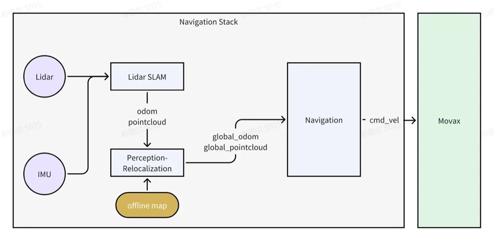
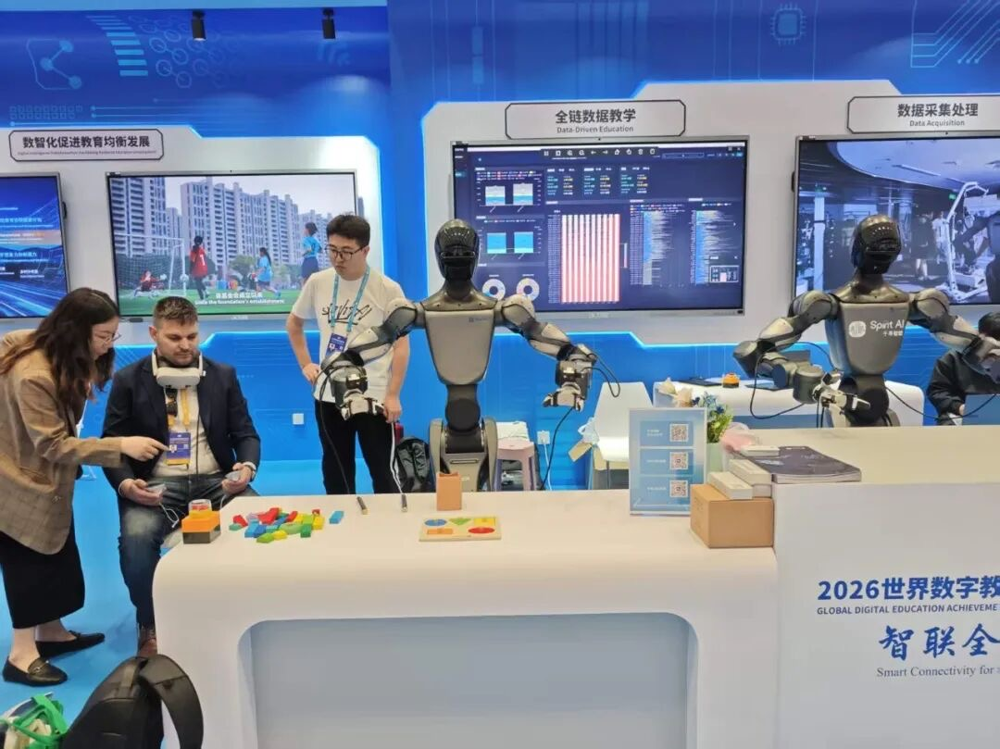

# Spirit AI — Developer Guide (hackathon edition)

⬆ [Spirit AI profile](Spirit-AI.md) · [Product portfolio](Spirit-AI-Products.md) · [Roadmap and strategy](Spirit-AI-Roadmap-and-Strategy.md)

> **Scope:** everything here is for **Moz1** (the only Spirit AI robot with public manuals, SDK and simulation assets) and the open **Spirit v1.5** model. Moz2, Spirit v1.6 and uDAS have **no public developer material**.
> **How this was checked (2026-11-14):** the docs portal (v2.7), the GitHub organisation, the Hugging Face organisation and the model README were opened directly. SDK archives and the navigation interface package were **not** downloaded or unpacked, so anything "inside the package" is quoted from the docs, not inspected.

## TL;DR — how you program it

- **One Python SDK, on top of ROS 2 Humble.** `mozrobot` (Python ≥ 3.10, Ubuntu 22.04, x86_64 or aarch64) gives you `connect → enable_external_following_mode → capture_observation / send_action`. Commands are dictionaries of joint or Cartesian **position** targets plus a base **velocity**, streamed at **120 Hz**.
- **No public torque or impedance API.** The robot is force-controlled internally (joint torque sensors, collision detection), but the SDK exposes position streaming only. Force and impedance settings live in the HMI (MovaXHelper).
- **Fastest path to a working demo: VR teleop + scripted SDK skills + Nav2 goals.** Quest teleop, a data-collection app and a Dockerised lidar SLAM / Nav2 stack ship with the robot.
- **The learning path is π0.5 first, Spirit v1.5 second.** The docs give a full openpi (`pi05_moz`) fine-tune and deploy recipe for Moz1; the Spirit v1.5 repo only documents RoboChallenge inference and multi-GPU fine-tuning, with **no Moz1 config**.
- **Several pieces are gated by after-sales support:** the openpi adaptation, the sample dataset, the Isaac Sim asset pack and the navigation package. Ask the Spirit AI staff on site for them on day 1.

## SDKs and interfaces

| SDK / repo | Language | What it controls | Link | Notes |
|---|---|---|---|---|
| **MozRobot SDK** (`mozrobot`) ✅ | Python ≥ 3.10 (system interpreter) | Moz1 arms, torso, grippers, base velocity; reads joint and Cartesian state and 3 RealSense streams | [Quick start](https://docs.spirit-ai.com/zh/sdk/get-started.html) · [API](https://docs.spirit-ai.com/zh/sdk/api.html) · [Downloads](https://docs.spirit-ai.com/zh/download/moz-resources.html) | Versions: **0.1.0** (2025-09-25, x86_64 + aarch64), **0.1.1** (2025-10-27, x86_64), **0.1.2** (2025-11-11, x86_64). Wheel + `requirements.txt` + `deps/robot_interface` |
| `robot_interface` / `mc_core_interface` ✅ | ROS 2 messages and services | Message definitions the SDK needs; build with `colcon build --packages-select mc_core_interface` | inside the SDK zip (`deps/`) | Must be built and sourced before `import mozrobot` works |
| Raw ROS 2 topics ✅ | any ROS 2 Humble client | Monitoring: `/cart_states` (state), `/mx_mix_command` (commands) | [Debug page](https://docs.spirit-ai.com/zh/sdk/debug.html) | Only these two topic names are documented. Message layouts are not published; inspect with `ros2 interface show` |
| Navigation stack (`nav_stack`) ✅ | Docker + shell scripts, ROS 2 | Lidar mapping, relocalisation, Nav2 navigation of the base | [SLAM navigation](https://docs.spirit-ai.com/zh/slam-nav/slam_navigation.html) | Goal service uses custom types from `navigation_interfaces.tar` (example in `scripts/example.py`); service name not printed in the docs |
| Teleop + data collection (MovaXHelper, `HMI`, `moz_teleop`) ✅ | GUI apps | Whole-robot VR teleop, episode recording, one-key policy inference | [Teleop quick start](https://docs.spirit-ai.com/zh/teleop/get-started.html) | Teleop service port **40030**; data-collection HMI v1.0.3 |
| openpi adaptation (`pi05_moz`) 🧪 | Python (uv, PyTorch) | π0.5 fine-tuning and a policy server / Moz1 client | [Pi0.5 adaptation](https://docs.spirit-ai.com/zh/open-resources/pi.html) | Source and sample dataset need a storage key from after-sales; not on public GitHub |
| **spirit-v1.5** ✅ | Python 3.10+, PyTorch | Spirit v1.5 VLA: inference runner for RoboChallenge, FSDP fine-tuning | [GitHub](https://github.com/Spirit-AI-Team/spirit-v1.5) | MIT, **671 stars**, 20 commits, last commit **2026-05-29**, no releases |
| Moz1 URDF (`spirit01_model.zip`) ✅ | URDF + meshes (ROS package) | Kinematic / dynamic model, 26 DoF | [Download page](https://docs.spirit-ai.com/zh/download/moz-resources.html) | Also contains `launch/` and `rviz/` files |
| `issac_moz1` 🔭 | — | Isaac simulation for Moz1 | [GitHub](https://github.com/Spirit-AI-Team/issac_moz1) | Public repo is a placeholder (0 stars, last touched 2025-11-27); the real pack is shared via Feishu / support |
| Forks: `PI_Official` (openpi), `lerobot`, `ByteCheckpoint` | Python | Upstream code the company builds on | [GitHub organisation](https://github.com/Spirit-AI-Team) | No Spirit-specific changes confirmed in the public forks |

**Not available:** C++ SDK, REST / gRPC / WebSocket API, MCP server, cloud API, public Moz2 SDK, hosted Spirit model endpoint (Hugging Face lists no inference provider).

## Control levels

| Level | Interface | What you send | Rate | Notes |
|---|---|---|---|---|
| Operator | Gamepad + tablet, MovaXHelper (PC) or SpiritAI MovaX (tablet) | Jog, home, power units on / off, speed scaling | manual | Four user levels (normal, data collector, developer, super administrator); developer and above unlock parameters, diagnostics, calibration |
| Teleoperation | Quest headset + controllers | Relative Cartesian hand poses, gripper, base via thumbstick, waist / legs follow the headset | real time | Default mode: **Relative + Cartesian** |
| Navigation | RViz "Nav2 Goal" or ROS service | Pose list in `moz1/map` (one pose = go there; several = via-points) | — | Base limits per manual: **500 mm/s**, **60 °/s** |
| **High-level streaming (SDK)** | `send_action(dict)` | Cartesian pose `[x, y, z, rx, ry, rz]` per arm or torso (rotation vector, SI units) | **120 Hz** | One mode per unit at a time: joint **or** Cartesian |
| **Joint streaming (SDK)** | `send_action(dict)` | Joint positions: 7 per arm, 6 torso; gripper opening in metres; base `[vx, vy, wz]` | **120 Hz** | Trajectory must be smooth (no jumps in acceleration or jerk) |
| Torque / impedance | — | Not exposed in the public SDK | — | ⚠️ unverified whether a private interface exists; ask staff |

**SDK command and observation keys (from the data-format page):**

| Unit | Command keys | Observation keys |
|---|---|---|
| Left / right arm | `leftarm_cmd_joint_pos`, `rightarm_cmd_joint_pos` (7), `leftarm_cmd_cart_pos`, `rightarm_cmd_cart_pos` (6) | `leftarm_state_joint_pos`, `leftarm_state_cart_pos`, right-arm equivalents |
| Grippers | `leftarm_gripper_cmd_pos`, `rightarm_gripper_cmd_pos` (1, metres) | `leftarm_gripper_state_pos`, `rightarm_gripper_state_pos` |
| Torso (waist + leg) | `torso_cmd_joint_pos` (6), `torso_cmd_cart_pos` (6) | `torso_state_joint_pos`, `torso_state_cart_pos` |
| Base | `base_cmd_speed` `[vx, vy, wz]` (only in velocity mode) | `base_state_speed` |
| Cameras | — | `cam_high`, `cam_left_wrist`, `cam_right_wrist` (H×W×3 uint8 RGB, 30 Hz) |

- **Structures:** `dualarm`, `wholebody_without_base`, `wholebody` (default).
- **Gaps in the documented API:** no neck command key (the neck has 2 DoF), no joint torque / external force in the observation (the HMI shows both), no depth images (RGB only in the documented keys).
- **Reset helper:** `reset_robot_positions(...)` is asynchronous — sleep **3–5 s** afterwards.
- **"EDU / developer edition":** there is no separate edition. What changes access is the HMI user level and what after-sales hands over (openpi code, dataset, Isaac pack, nav stack).

## ROS 2 and middleware

- **Distribution:** ROS 2 **Humble** on Ubuntu 22.04. `ROS_DOMAIN_ID=33` (must match the robot's MovaX control system).
- **Network (SDK page):** wired Ethernet, host in `172.16.0.x` (for example `172.16.0.100`), robot at `172.16.0.20`.
- **Network (manual and teleop pages):** controller **LAN 1** has fixed IP `172.16.1.20` for the HMI. The two pages disagree on the subnet — check which port and address your unit uses before debugging anything else.
- **DDS:** the SDK troubleshooting page uses a **Fast DDS** profile (interface whitelist via `FASTRTPS_DEFAULT_PROFILES_FILE`) to cure jitter; the navigation service requires **CycloneDDS** (`RMW_IMPLEMENTATION=rmw_cyclonedds_cpp`). Keep these in separate shells.
- **Controller process:** `mc_core` (shown as "Mccore" in MovaXHelper). If it is not "Running", nothing on ROS will respond.
- **Navigation frames:** `moz1/map` → `moz1/base_link`. Read the pose with `ros2 run tf2_ros tf2_echo moz1/map moz1/base_link`.
- **Bring-your-own navigation:** the `control_bridge` package in the nav stack converts Nav2 `/cmd_vel` into the base's own frame and topics — reuse it rather than publishing velocities blindly.
- **Lidar driver:** `livox_ros_driver2` is preinstalled on the robot (`ros2 launch livox_ros_driver2 msg_MID360_launch.py`).
- **Not found:** MoveIt configuration, ros2_control hardware interface, public message definitions.



## Simulation and digital twins

| Asset | Status | What you get | Where | Caveats |
|---|---|---|---|---|
| Moz1 URDF | ✅ public download | `spirit01_model` ROS package: URDF, meshes, launch, RViz | [Downloads](https://docs.spirit-ai.com/zh/download/moz-resources.html) | Licence not stated |
| Moz1 3D model | ✅ link | CAD-style model on Feishu | [Downloads](https://docs.spirit-ai.com/zh/download/moz-resources.html) | Feishu access may need an account |
| MuJoCo | 🧪 guide only | Convert with `urdf2mjcf`, load in MuJoCo 3.x, optional MJX | [MuJoCo page](https://docs.spirit-ai.com/zh/simulation/mujoco.html) | No ready MJCF. The page's `dm_control`, Playground and noise snippets are placeholders — only the load-and-view loop is usable as written |
| Isaac Sim 5.1.0 pack (`ISAAC_MOZ1`) | 🧪 via support | Docker image `nvcr.io/nvidia/isaac-sim:5.1.0`, `Moz1_*` USD files, one kitchen scene (Lightwheel assets), pre-mounted gripper, `start_isaac.sh`, `check_isaac.sh`, `docker compose` headless mode | [Isaac page](https://docs.spirit-ai.com/zh/simulation/issac.html) | Needs **RTX 4080 / 16 GB VRAM / 32 GB RAM** minimum. No tasks, no RL environments, no teleop-in-sim documented |
| `issac_moz1` GitHub repo | 🔭 | — | [GitHub](https://github.com/Spirit-AI-Team/issac_moz1) | Empty placeholder |

**Practical use at the hackathon:** load the URDF in RViz or MuJoCo to check reach and joint limits before moving the real arm. There is no validated sim-to-real pipeline, so do not plan on training in simulation.

**Joint map (A0–A25) for your own kinematics:**

| Unit | Joints | Range (°) | Max speed (°/s) |
|---|---|---|---|
| Base | A0–A3 (4) | continuous | 205 |
| Waist + leg | A4–A9 (6) | A4 ±30 · A5 ±90 · A6 −145…1 · A7 −10…80 · A8 ±30 · A9 ±180 | 65 |
| Left arm | A10–A16 (7) | −180…120 · −170…9 · ±175 · −129…10 · ±175 · ±95 · ±90 | 210 / 240 / 300 |
| Right arm | A17–A23 (7) | −120…180 · −170…9 · ±175 · −10…129 · ±175 · ±95 · ±90 | 210 / 240 / 300 |
| Neck | A24–A25 (2) | ±65 · −3…50 | 114.6 |

## AI stack

| Component | Status | Detail | Hackathon usability |
|---|---|---|---|
| **Spirit v1.5** (base checkpoint) | ✅ open | Qwen3-VL-4B-Instruct backbone + diffusion-transformer action head, **~5B parameters**, F32 safetensors; default action chunk **60**. GitHub licence **MIT**, Hugging Face card **apache-2.0** | Needs data-centre GPUs: tested on **A100 80 GB**; fine-tune defaults **8 GPUs × batch 32 × 40,000 steps**. Inference is only documented through the RoboChallenge runner; no Moz1 embodiment config, no standalone inference example |
| Spirit v1.5 fine-tuned checkpoint | ✅ open | RoboChallenge Table30 "move objects into box" | Reference only (benchmark arms, not Moz1) |
| **π0.5 on Moz1** (`pi05_moz`) | 🧪 via support | openpi fork; LeRobot-style dataset `spirit-ai/pickplace`; norm-stats script; PyTorch training (docs example: 4 GPUs); policy server + `examples/moz1_real/main.py` client; Docker compose | The one documented model-to-robot path. Policy returns **50 actions at 30 Hz**, interpolated to **200 steps at 120 Hz**; recommended `action-horizon` **100–200**; structure `wholebody_without_base` |
| Spirit v1.6 / "Spirit Omni Model" | 🧪 closed | VLA + world model; inputs instruction, images, proprioception; outputs text, motion tokens, action chunks | Not downloadable. Only via a company-run demo |
| Agent layer | 🧪 closed | Turns vague speech into VLA-ready instructions; dialogue and gestures | No API published |
| Teleop data collection | ✅ ships with Moz1 | Quest teleop + `HMI` collection app: **B** collect, **C** reset, **D** discard, **E** save, **A** run deployed policy (pedal or keyboard) | Ready on day 1. Save path is fixed; success / failure episodes are not auto-split (script from support) |
| uDAS wearable capture + data platform | 🧪 internal | Seven hardware generations, 200k+ hours (company figures) | No public spec, SDK or dataset |
| Datasets | — | No public dataset on Hugging Face; `spirit-ai/pickplace` comes with the openpi pack | Collect your own |
| LeRobot | ⚠️ partial | The company forked `lerobot` and the openpi recipe reads from the LeRobot cache path | Episode format written by the collection app is not documented ⚠️ unverified; no official LeRobot robot plugin for Moz1 found |



**Teleop controller map (Quest):**

| Control | Left controller | Right controller |
|---|---|---|
| Trigger (hold) | Left arm follows | Right arm follows |
| Grip | Close left gripper | Close right gripper |
| Buttons | **Menu** start teleop · **X** (hold) waist / legs follow headset · **Y** switch base mode | **A** reset waist / legs · **B** reset both arms · system button opens the Quest menu |
| Thumbstick | — | Drive the base |

**Realistic 48-hour model plan:** (1) teleoperate to prove the task is physically feasible; (2) script it with the SDK plus an off-the-shelf detector or VLM; (3) only if staff supply the openpi pack and you have ≥ 1 strong GPU with a prepared checkpoint, record 50–100 episodes and try a π0.5 fine-tune overnight.

## Compute, sensors and connectivity

| Item | Detail (source: Moz1 manual unless noted) |
|---|---|
| Degrees of freedom | **26**: base 4, waist + leg 6, arms 2 × 7, neck 2 |
| End effectors | 2 × two-finger gripper, opening range **0–12 cm**; other grippers need technical support. End-effector port has a Type-C / CAN-RS485 switch |
| Head camera | Intel RealSense **D455**, tilted 50° down by default |
| Wrist cameras | 2 × Intel RealSense **D405** |
| Lidar | Livox **Mid-360** (manual writes MID-360S), mounted horizontally on the base, with IMU |
| Force sensing | Torque sensor in every joint; model-based collision detection with adjustable sensitivity |
| On-board compute | Industrial PC (controller) + inference host; CPU / GPU models not published |
| External ports | USB, HDMI, DisplayPort, 2.5 GbE, LAN |
| Wireless | Robot Wi-Fi hotspot `MOZ1-0900x` for the tablet app; default password and user-level passwords are in the [quick-start manual](https://docs.spirit-ai.com/zh/moz1/get-started.html) |
| Developer host | Ubuntu 22.04, 8 GB+ RAM, 3 × USB 3.0 for cameras, 1 × RJ45 to the robot |
| Hand controller | GameSir G8+ gamepad with a Redmi 8.8-inch Android tablet over Bluetooth (keep within 3 m) |
| Emergency stops | 3: back of robot, mobile platform, wireless handheld (cuts power to all units; brakes engage) |
| Battery / charging | Lithium pack, charger **54.8 V / 10 A** through a 3-pin socket on the platform; capacity and runtime not published |
| Environment | **−10 to 50 °C**, ≤ 75 % RH, **IP40** — indoor, dry, flat floors |
| Edge AI option | Spirit v1.5 has been ported to D-Robotics **Sunrise S600** (560 TOPS); on-robot testing was "next step" in May 2026. D-Robotics is also at Leukerbad |
| Not published | Height, weight, arm reach, payload, battery runtime |

## First 60 minutes checklist

1. **Ask staff (minute 0):** which IP / port your laptop uses, whether the nav stack and openpi pack are on the robot, and which gripper is fitted. Get the wireless emergency stop in your hand.
2. **Safety check:** all three emergency stops released; ≥ 2 m clear around the robot; speed scaling low (JOG < 10).
3. **Power on:** main switch at the rear of the platform → short-press the power button (1 s) → wait for the blue light to go solid (controller and inference host booted).
4. **HMI link:** on Windows run `MovaXHelper.exe` (path without Chinese characters) → Connect Monitor (Mccore green, "Running") → Connect Controller. Or join the robot hotspot with the tablet app.
5. **Health check:** System Monitor values updating; Safety / Motion / System lights green; test one emergency stop and reset it; power one unit on and off.
6. **Developer host network:** set a static IP on the robot's subnet, then:
   ```bash
   ping 172.16.0.20            # or 172.16.1.20 — see the subnet note above
   export ROS_DOMAIN_ID=33
   source /opt/ros/humble/setup.bash
   ros2 topic list && ros2 topic hz /cart_states
   ```
7. **Install the SDK:** unzip, build `robot_interface` (`colcon build --packages-select mc_core_interface`), source it, `pip3 install -r packages/requirements.txt`, `pip install packages/mozrobot-*.whl`, using **system Python**.
8. **Verify:** `python3 -c "from mozrobot import MOZ1Robot, MOZ1RobotConfig"` then `python3 example/example_usage.py --no-camera`.
9. **Read sensors:** set the three RealSense serials (head, left wrist, right wrist), call `capture_observation()` and save `cam_high` to disk; print `leftarm_state_joint_pos`.
10. **Hello-world motion** (sketch below): a slow 0.1 rad wrist wiggle at 120 Hz.
11. **Teleop:** start the teleop service in MovaXHelper → Connect → Relative + Cartesian → Start; put on the headset, press left **Menu**, hold a trigger to move an arm.
12. **Navigation (optional):** start the lidar driver, `./run_mapping.sh`, drive around with the gamepad (follow switch off), `./run_save_map.sh`, `./stop_all.sh`, then `./run_nav.sh` with the follow switch on and speed at 50 %.

```python
# Untested sketch assembled from the documented API — review with Spirit AI staff before running.
import time, numpy as np
from mozrobot import MOZ1Robot, MOZ1RobotConfig

cfg = MOZ1RobotConfig(no_camera=True, structure="dualarm", robot_control_hz=120)
with MOZ1Robot(cfg) as robot:
    robot.enable_external_following_mode()          # required before send_action
    q0 = np.array(robot.capture_observation()["leftarm_state_joint_pos"], dtype=float)
    dt, T = 1.0 / robot.control_hz, 4.0
    for k in range(int(T / dt)):
        q = q0.copy()
        q[6] += 0.1 * 0.5 * (1 - np.cos(2 * np.pi * k * dt / T))   # smooth out-and-back, last joint
        robot.send_action({"leftarm_cmd_joint_pos": q})
        time.sleep(dt)
```

## Known gotchas and safety

**Software**
- **Conda / venv breaks `rclpy`.** Use `/usr/bin/python3`; run models in a separate environment and talk to the robot process over a socket (the openpi server / client split does exactly this).
- **`send_action` is a stream, not a goal.** Call it at the configured rate, start from the current pose, and never jump. Missing `enable_external_following_mode()` means commands are silently ignored.
- **Jitter** usually means unstable DDS discovery over several network interfaces: apply the Fast DDS whitelist profile from the troubleshooting page and check `ros2 topic hz /cart_states`.
- **Subnet confusion** (`172.16.0.20` vs `172.16.1.20`) and a wrong `ROS_DOMAIN_ID` are the top two causes of "Failed to connect to robot".
- **Version drift:** the SDK quick-start page still offers 0.1.0, the downloads page has 0.1.2, and the openpi Docker recipe expects `mozrobot-0.1.2.zip`.
- **First policy request times out** with the openpi server (`torch.compile` warm-up) — resend.
- **Teleop quirks:** controllers must stay below headset height; USB cable and headset battery are the usual culprits; accept the headset pop-up on first use each day.
- **Navigation:** people walking during mapping become ghost obstacles (clean the PLY / PCD in MeshLab or CloudCompare). Default controller speed is 10 %, but the planner was tuned at 100 %.
- **MuJoCo page** contains non-working placeholder code; treat it as an outline.
- **Licences:** Spirit v1.5 is MIT on GitHub but apache-2.0 on Hugging Face. The MozRobot SDK disclaimer forbids commercial use and publishing SDK code in open-source projects without written permission — ask before pushing a repo that vendors the SDK.
- **Language:** the Chinese docs are the most complete; English pages exist at the same paths without `/zh` but several loaded empty or slowly in this check.

**Safety (from the manual)**
- Keep **≥ 2 m** away during commissioning, emergency stop within reach, no maintenance while powered.
- Do not use the quick power-on (lightning) button on first use; power units off when not teleoperating to avoid accidental controller input.
- Hard collisions can damage the joint torque sensors and disable force control.
- Power on only when the robot is stationary, unloaded and untouched.
- The manual **forbids dangerous work** (work at height, heavy handling, sharp tools) and states the robot is **not suitable as a main companion** for children, older people or people with cognitive impairment — relevant for T02 and T04 demos: keep people at a distance or use a mock-up.
- Indoor only: IP40, avoid slippery floors, strong light, strong electromagnetic fields, high humidity.
- Data protection: the SDK disclaimer puts GDPR responsibility for recorded camera data on the developer — do not record bystanders without consent.

## Community resources

| Resource | Link | Note |
|---|---|---|
| Docs portal (ZH, v2.7 and v2.6) | [docs.spirit-ai.com/zh](https://docs.spirit-ai.com/zh) | Manual, SDK, teleop, SLAM, simulation, Pi0.5 |
| SDK troubleshooting | [Troubleshooting](https://docs.spirit-ai.com/zh/sdk/troubleshooting.html) | Connection, cameras, DDS, conda |
| GitHub organisation | [Spirit-AI-Team](https://github.com/Spirit-AI-Team) | 5 repos, no public members |
| Spirit v1.5 issues | [Issues](https://github.com/Spirit-AI-Team/spirit-v1.5/issues?q=is%3Aissue) | 12 issues, all closed; mostly RoboChallenge submission and real-robot deployment questions (Franka) |
| Hugging Face | [Spirit-AI-robotics](https://huggingface.co/Spirit-AI-robotics) | 2 models, 0 datasets, 0 spaces |
| Model contacts | listed in the [spirit-v1.5 README](https://github.com/Spirit-AI-Team/spirit-v1.5) | Two engineers' e-mail addresses |
| Support | `support@spirit-ai.com` (SDK disclaimer) | Gatekeeper for openpi code, dataset, Isaac pack, split script |
| Research background | [Papers and research](Spirit-AI-Papers-and-Research.md) | Point-VLA, Legato, OneTwoVLA and the Spirit v1.5 blog |
| Demo ideas per track | [Solutions and projects](Spirit-AI-Solutions-and-Projects.md) | What the company has already shown |

- **No public forum, Discord or Slack found.** Expect support in person from the on-site team.

## Sources

- [Spirit AI docs — MozRobot SDK quick start](https://docs.spirit-ai.com/zh/sdk/get-started.html)
- [Spirit AI docs — SDK API reference](https://docs.spirit-ai.com/zh/sdk/api.html)
- [Spirit AI docs — SDK examples](https://docs.spirit-ai.com/zh/sdk/examples.html)
- [Spirit AI docs — SDK data format](https://docs.spirit-ai.com/zh/sdk/data-format.html)
- [Spirit AI docs — SDK debug and monitoring](https://docs.spirit-ai.com/zh/sdk/debug.html)
- [Spirit AI docs — SDK troubleshooting](https://docs.spirit-ai.com/zh/sdk/troubleshooting.html)
- [Spirit AI docs — SDK disclaimer](https://docs.spirit-ai.com/zh/sdk/disclaimer.html)
- [Spirit AI docs — teleoperation and data collection](https://docs.spirit-ai.com/zh/teleop/get-started.html)
- [Spirit AI docs — SLAM navigation](https://docs.spirit-ai.com/zh/slam-nav/slam_navigation.html)
- [Spirit AI docs — Pi0.5 adaptation](https://docs.spirit-ai.com/zh/open-resources/pi.html)
- [Spirit AI docs — Nvidia Isaac simulation](https://docs.spirit-ai.com/zh/simulation/issac.html)
- [Spirit AI docs — MuJoCo simulation](https://docs.spirit-ai.com/zh/simulation/mujoco.html)
- [Spirit AI docs — Moz resource downloads](https://docs.spirit-ai.com/zh/download/moz-resources.html)
- [Spirit AI docs — third-party accessories](https://docs.spirit-ai.com/zh/download/accessories.html)
- [Spirit AI docs — Moz1 quick start](https://docs.spirit-ai.com/zh/moz1/get-started.html)
- [Spirit AI docs — Moz1 mechanics](https://docs.spirit-ai.com/zh/moz1/mechanics.html)
- [Spirit AI docs — Moz1 HMI interface](https://docs.spirit-ai.com/zh/moz1/interface.html)
- [Spirit AI docs — Moz1 hand controller](https://docs.spirit-ai.com/zh/moz1/controller.html)
- [Spirit AI docs — Moz1 safety](https://docs.spirit-ai.com/moz1/safety.html)
- [Spirit AI docs — Moz1 product introduction](https://docs.spirit-ai.com/zh/moz1/product-intro.html)
- [GitHub — Spirit-AI-Team organisation](https://github.com/Spirit-AI-Team)
- [GitHub — spirit-v1.5 README](https://github.com/Spirit-AI-Team/spirit-v1.5)
- [GitHub — spirit-v1.5 commit history](https://github.com/Spirit-AI-Team/spirit-v1.5/commits/main/)
- [GitHub — spirit-v1.5 issues](https://github.com/Spirit-AI-Team/spirit-v1.5/issues?q=is%3Aissue)
- [GitHub — issac_moz1](https://github.com/Spirit-AI-Team/issac_moz1)
- [Hugging Face — Spirit-AI-robotics organisation](https://huggingface.co/Spirit-AI-robotics)
- [Hugging Face — Spirit-v1.5 model card](https://huggingface.co/Spirit-AI-robotics/Spirit-v1.5)
- [Spirit AI — product page (EN)](https://www.spirit-ai.com/en/product)
- [Spirit AI news — D-Robotics partnership, Spirit v1.5 on Sunrise S600](https://www.spirit-ai.com/news/32) (carried over from the solutions register, not re-opened in this run)
