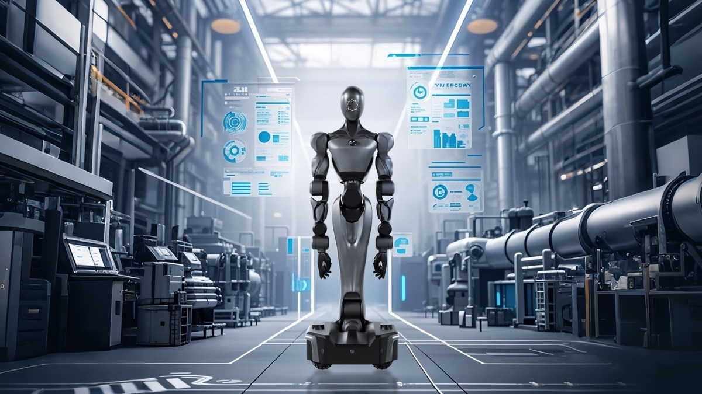
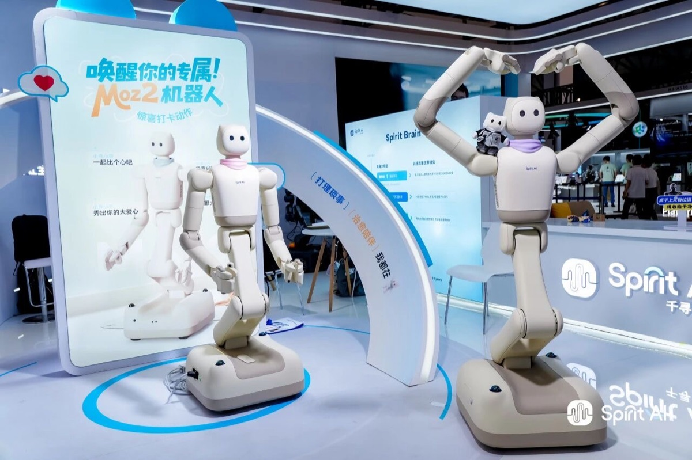
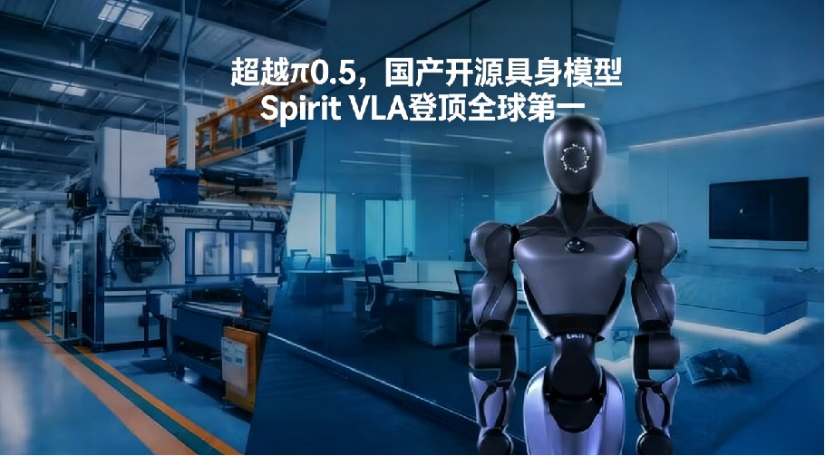
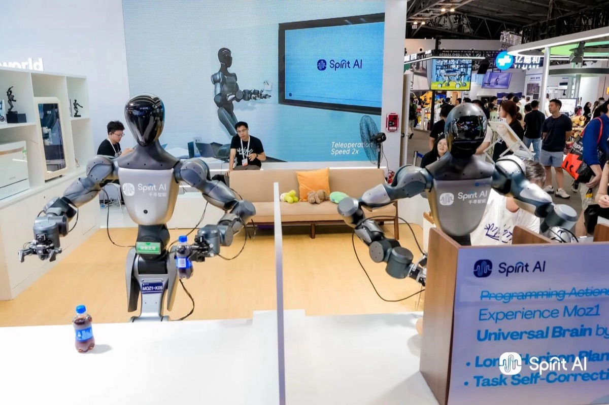
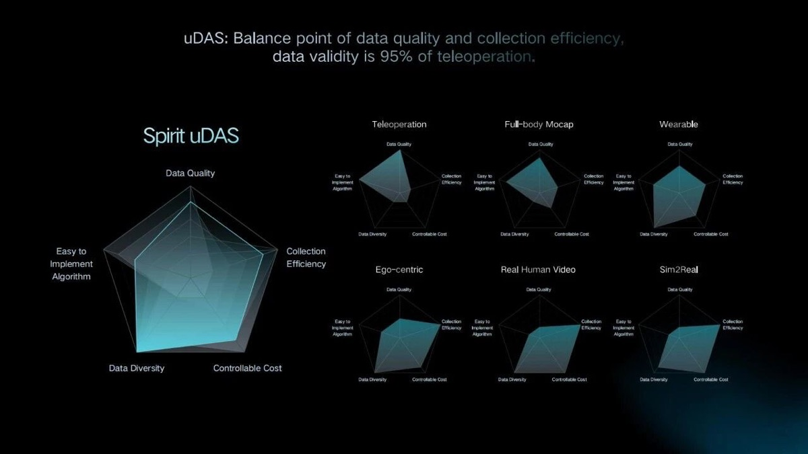
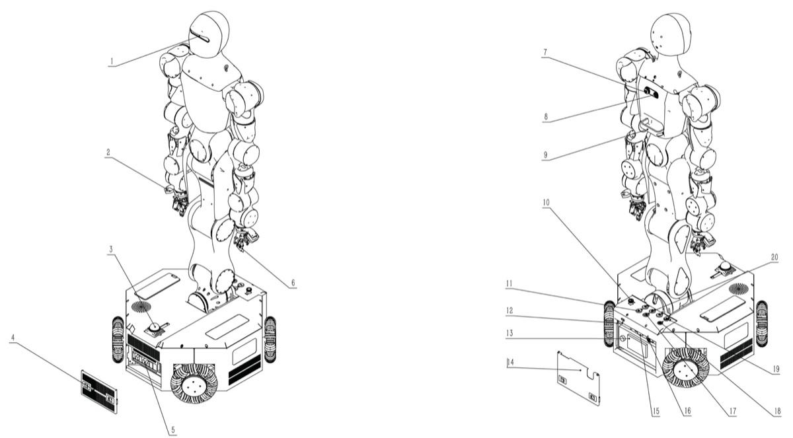

# Spirit AI — Product Portfolio

⬆ [Spirit AI profile](Spirit-AI.md) · [Developer guide](Spirit-AI-Developer-Guide.md) · [Roadmap and strategy](Spirit-AI-Roadmap-and-Strategy.md) · [Solutions and projects](Spirit-AI-Solutions-and-Projects.md)

> **In one look:** two robots (Moz1 shipping, Moz2 preview), two foundation models (Spirit v1.5 open, Spirit v1.6 closed), one data-collection wearable (uDAS, internal) and one SDK (MozRobot, for Moz1). The only product with public manuals, a spec sheet and an SDK is **Moz1** — that is what a team can realistically build on in Leukerbad.
> **Not published anywhere official (as of 2026-11-14):** prices, Moz1 weight, payload, battery capacity and runtime, on-board CPU / GPU model, any Moz2 dimensions.

## Lineup map

Track relevance: ● strong · ◐ partial · ○ none

| Product | Category | Status | Launched | Price (if public) | Positioning (one line) | T01 | T02 | T03 | T04 |
|---|---|---|---|---|---|---|---|---|---|
| [Moz1](#moz1) | Wheeled dual-arm humanoid, whole-body force control | ✅ shipping | 2025 (announced Mar 2025, shown Jun 2025; exact launch day ⚠️ unverified) | not public | Industrial / research mobile manipulator; the company's data and deployment workhorse | ● | ◐ | ◐ | ● |
| [Moz2](#moz2) | Commercial service robot | 🧪 preview | 2026-07-17 (WAIC debut) | not public | Friendly service robot for retail, hotels, office buildings | ● | ◐ | ○ | ◐ |
| [Spirit v1.5](#spirit-v15) | Open-source VLA foundation model | ✅ available | 2026-01 (fine-tuning code 2026-04) | free | Open weights + code; the model developers can actually run | ◐ | ○ | ◐ | ◐ |
| [Spirit v1.6](#spirit-v16) | Closed VLA + world-model foundation model | 🧪 demo only | mid-2026 | not public | Long-horizon autonomy on Moz1; company-run demos only | ◐ | ○ | ◐ | ◐ |
| [uDAS](#udas) | Wearable data-collection device | 🧪 internal tool, shown publicly in 2026 | 7 hardware generations over ~2 years (company talk, 2026) | not public | Cheap human-demonstration capture feeding the Spirit models | ○ | ○ | ○ | ○ |
| [MozRobot SDK](#mozrobot-sdk) | Python SDK for Moz1 | ✅ available to Moz1 users | 2025-09-25 (v0.1.0) | bundled | ROS 2 Humble based control + data-collection API | ● | ◐ | ◐ | ● |

**Where each product meets the official directions**

| Direction | What fits | How strong |
|---|---|---|
| T01.1 delivery / T01.3 public-space service / T01.5 guidance | Moz1 (indoor fetch and hand-over), Moz2 (hotel delivery, exhibition guidance — planned) | Moz1 ● indoor only · Moz2 🔭 |
| T01.2 cleaning and facility maintenance | Moz1 + Spirit v1.5 / v1.6 tidy-up skills (desk, living room, bin) | ◐ demo level |
| T01.4 urban inspection / T02.3 infrastructure monitoring / T02.5 security | Moz1 patrol mode on the CATL line; Moz2 inspection module (planned) | ◐ indoor, flat floor |
| T01.6 navigation and path planning | Moz1 SLAM + Nav2 package (Livox Mid-360) | ● documented |
| T01.7 / T04.5 human-robot interaction | Moz2 voice + gesture interaction; agent layer on Moz1 / Moz2 | ◐ |
| T02.1 rescue / T02.4 disaster response / T02.6 complex terrain | none — IP40, flat-floor wheels, no hazard rating | ○ |
| T02.2 hazardous inspection / T02.7 collaborative response | Moz1 VR whole-body teleoperation (remote hands); high-voltage connector plugging at CATL | ◐ |
| T03.1 waste sorting / T03.6 recycling | Moz1 dual-arm sorting; v1.6 demo bins thrown paper, loads dishwasher | ◐ demo level |
| T03.2 / T03.7 environmental data, T03.5 water and energy | none | ○ |
| T03.3 energy-efficient robotics | Spirit v1.5 on D-Robotics Sunrise S600 edge chip (integration done) | ◐ indirect |
| T04.1 daily living / T04.6 care automation | Moz1 + v1.6: living-room tidy, pill sorting, dishwasher loading, food heating (robot games) | ● demo level, no care deployment |
| T04.2 care robots / T04.5 companionship | Moz2 "approachable" design; Moz1 manual explicitly says it is **not** meant as a primary companion for elderly people | ◐ |
| T04.3 rehabilitation / T04.4 mobility support / T04.7 health monitoring | none (force control would allow compliant contact, but no product or certification) | ○ |

Track detail: [T01](T01-Autonomous-Urban-Services/Spirit-AI-T01-2-Products-and-Solutions.md) · [T02](T02-Resilient-and-Safe-City/Spirit-AI-T02-2-Products-and-Solutions.md) · [T03](T03-Sustainable-City/Spirit-AI-T03-2-Products-and-Solutions.md) · [T04](T04-Elderly-Care-and-Rehabilitation/Spirit-AI-T04-2-Products-and-Solutions.md)

## Products

### Moz1

**What it is:** a wheeled humanoid — two 7-DoF force-controlled arms, a 6-DoF leg-waist column and a 2-DoF neck on a four-wheel omnidirectional base. Spirit AI calls it its first commercial-grade humanoid and China's first high-precision whole-body force-controlled embodied robot. ✅ Shipping; deployed on a CATL battery PACK line; JD retail use is reported by press (see profile) ⚠️ unverified. **Most likely unit on site** (not confirmed by the organisers).

| Spec | Value (official docs unless marked) |
|---|---|
| Degrees of freedom | **26** (excluding end-effectors): base 4 (A0–A3) · leg-waist 6 (A4–A9) · left arm 7 (A10–A16) · right arm 7 (A17–A23) · neck 2 (A24–A25) |
| Height | **1,850 mm** standing (dimension drawing) |
| Footprint | Base **650 × 650 mm**; shoulder width **536 mm**; base body about 292 mm high (drawing) |
| Ground clearance | about **39 mm** ⚠️ unverified (my reading of the dimension drawing) — expect trouble with door sills and thick cables |
| Arm geometry | Upper arm ≈ 300 mm, forearm ≈ 260 mm, wrist to gripper tip ≈ 300 mm ⚠️ unverified (read from drawing; no official reach figure) |
| Weight | not published |
| Payload | not published. Launch graphic claims a "1:1 payload-to-weight ratio" (scope unclear — joint or arm level) ⚠️ unverified |
| Joints | In-house integrated force-controlled joints with a **joint-side torque sensor in every joint**; company claims 15 % higher power density than Tesla Optimus joints ⚠️ company claim |
| Arm joint speed limits | **210 / 240 / 300 °/s** (shoulder → wrist) |
| Leg-waist speed limit | **65 °/s** per joint; ranges include −145…1° (A6) and ±180° (A9) — the robot can squat to a compact shipping pose |
| Neck | ±65° yaw, −3…50° pitch, **114.6 °/s** |
| Base | Four omnidirectional wheels (wheel joints 205 °/s); Cartesian limit **500 mm/s** linear, **60 °/s** rotation |
| Tool speed in manual jog | capped at **250 mm/s** TCP for safety |
| End-effectors | 2 × two-finger gripper, max opening **12 cm**; factory default is an AgiBot (智元) gripper per the HMI manual; a selector switches the tool bus between **CAN and RS485** for other grippers (contact support) |
| Cameras | Head: **1 × Intel RealSense D455** (default 50° downward tilt) · Wrists: **2 × Intel RealSense D405** |
| LiDAR | **1 × Livox Mid-360** (listed as MID-360S) on the base, with IMU, used for SLAM |
| Compute | Industrial PC (motion controller, "mc_core") + separate inference / data-collection host. Host I/O: 1 × USB 3.2 Gen 2x2 Type-C, 1 × USB 3.2 Gen 2 Type-A, 3 × USB 3.2 Gen 1, 4 × USB 2.0, HDMI, DisplayPort, **2.5 GbE**. CPU / GPU model not published |
| Connectivity | RJ45 LAN to the controller, robot Wi-Fi hotspot (`MOZ1-0900x`), 3 × USB 2.0 (VR headset, keyboard, mouse), HDMI |
| Network addresses | SDK page: robot `172.16.0.20`, host in `172.16.0.x`, `ROS_DOMAIN_ID=33`. Quick-start and teleop pages name `172.16.1.20` for the wired HMI connection — check on the actual unit |
| Power | Lithium battery in the base; charger **54.8 V / 10 A** CC-CV, manual plug (LP20 3-pin); **≥ 1,000** charge cycles. Capacity and runtime not published |
| Environment | **−10 … 50 °C**, ≤ 75 % RH non-condensing, **IP40**. Manual forbids rain, snow and open-air use |
| Safety | Whole-body STO, collision detection with adjustable sensitivity, force-compliant mode, overheat / overload shutdown, **3 emergency stops** (base, back, wireless handheld), brake-release button, hand-guiding (drag) mode. Manual asks for **≥ 2 m** distance while debugging and suggests a hoist frame |
| Control | MovaX controller; whole-body control (WBC); SDK loop up to **120 Hz**; user control, external control (VR / remote) and autonomous navigation modes |
| Simulation | URDF download (26 DoF), MuJoCo guide, NVIDIA Isaac Sim resource pack |

**Variants and access levels**
- No separate EDU / developer / pro edition is published. One hardware model; the SDK supports **dual-arm** and **whole-body (with or without base)** configurations.
- Access is role-based in the HMI: user → data collector → developer → super admin. Joint impedance appears from "data collector" up; collision detection, drag mode, force-control and tool parameters need "developer". Default credentials are in the official quick-start manual.
- Normally shipped in a crate with ramp together with a VR headset, controllers, handheld gamepad and tablet (packing list in the transport manual).
- 🧪 Education offer: with China Educational Instrument & Equipment Corp. (CEIEC), a "technology + scenarios + data" package for universities (three Moz1 units shown at the World Digital Education Conference, Hangzhou, May 2026).

**Typical applications (documented)**
- Industry: battery test-connector insertion and harness checks at CATL (success rate reported **> 99 %**), patrol inspection between tasks.
- Commercial: office "comprehensive service" and catering workflows (World Humanoid Robot Games, Aug 2026: gold and silver, fully autonomous).
- Home-style demos: tidy the living room, load a dishwasher, sort pills, tidy a desk, dispose of trash.
- Research: teleoperation data collection, VLA fine-tuning (Spirit v1.5, Pi0.5 adaptation).
- The manual's own scope list: home service, office assistance, education, "medical companionship" — but the same manual says the robot is not suitable as the main companion for children, elderly or cognitively impaired people.

**Hackathon notes**
- Flat, dry indoor floors only. Sportarena thresholds, ramps and snow at the entrance are no-go.
- Keep the wireless e-stop in hand; nav stack is tuned at 100 % speed but ships at 10 % — start at 50 %.
- Official pages: [product page](https://www.spirit-ai.com/en/product) · [mechanical structure (EN)](https://docs.spirit-ai.com/moz1/mechanics.html) · [quick start (ZH)](https://docs.spirit-ai.com/zh/moz1/get-started.html)

### Moz2

**What it is:** Spirit AI's first commercial service robot, shown for the first time at WAIC Shanghai on **17 July 2026**. Cream-coloured, rounded body with a scarf, built for places with many people. 🧪 Early validation of interaction and user experience; no ship date, price or manual. **Unlikely to be on site.**

| Spec | Value (official news, WAIC 2026) |
|---|---|
| Degrees of freedom | **32** |
| Chassis | Omnidirectional steering-wheel chassis |
| Lower body | Foldable leg structure |
| Arms | 2 × **7-DoF** biomimetic arms |
| Hands | **4-DoF three-finger** dexterous hands |
| Sensors | LiDAR + vision + ultrasonic ("will be equipped") for mapping and dynamic obstacle avoidance |
| Interaction | Natural voice conversation, physical / gesture interaction |
| Modularity | Magnetic expansion points for brand skins and accessories such as **delivery racks** and **inspection modules** |
| Design approach | Co-designed with the uDAS collection device so human demonstration data maps directly to the robot body |
| Dimensions, weight, payload, battery, compute | not published |

- **Variants:** none announced.
- **Target applications (🔭 planned):** retail shelf stocking, hotel delivery, building inspection, exhibition guidance. The company says Moz2 will "progressively inherit" Moz1's manipulation and long-horizon capabilities.
- **Official page:** [WAIC 2026 news](https://www.spirit-ai.com/en/news/48) (no product page yet)

### Spirit v1.5

**What it is:** an open-source vision-language-action (VLA) model: camera images + text instruction in, next action chunk out. ✅ Weights, inference code and fine-tuning code are public. It is the model behind most 2026 Moz1 show demos before v1.6.

| Spec | Value |
|---|---|
| Architecture | VLM backbone **Qwen3-VL-4B-Instruct** + **DiT** (diffusion transformer) action head + policy API |
| Size | **≈ 5.40 B** parameters (F32 safetensors, about 21.6 GB on Hugging Face) |
| Output | Action chunks; default used chunk size **60** in the RoboChallenge runner |
| Licence | Code: **MIT** (GitHub). Model card on Hugging Face is tagged **Apache-2.0** — two different tags, both permissive |
| Released | 2026-01 (blog, inference code, base checkpoint, one fine-tuned checkpoint) · 2026-04 fine-tuning code |
| Checkpoints | `Spirit-v1.5` (base) · `Spirit-v1.5-for-RoboChallenge-move-objects-into-box` (fine-tuned) |
| Inference hardware | Tested on **NVIDIA A100 80 GB**; Python 3.10+ (model card recommends 3.11+) |
| Fine-tuning | Recommended **8 × A100 80 GB**, batch 32 per GPU, **40,000** steps default, FSDP distributed training |
| Benchmark | **#1 on RoboChallenge Table30** as of 11 Jan 2026 (README) |
| Edge ports | D-Robotics **Sunrise S600** (**560 TOPS** INT8): stable end-to-end inference reported May 2026 🧪 · earlier VLA port to a HiSilicon Ascend edge platform (late 2025, date inferred ⚠️) 🧪 |
| Borrowed code | openpi, Qwen-VL, RoboChallengeInference (acknowledged in README) |

- **Variants:** base model and task-specific fine-tunes; no smaller distilled version published.
- **Typical applications shown:** candied-fruit skewer making, capsule-toy hand-over, desk tidying, trash disposal, chair repositioning; company positions it for industrial assembly, precision manipulation and material handling.
- **Hackathon reality:** no public Moz1 checkpoint. Without Spirit AI staff supplying one, fine-tuning in 48 hours is not realistic (8 × A100 class).
- **Official pages:** [GitHub](https://github.com/Spirit-AI-Team/spirit-v1.5) · [Hugging Face](https://huggingface.co/Spirit-AI-robotics/Spirit-v1.5) · [technical blog](https://www.spirit-ai.com/en/blog/spirit-v1-5)

### Spirit v1.6

**What it is:** the current closed foundation model, combining a VLA with a world model in one end-to-end pipeline (perception → task understanding → planning → state prediction). A company talk names the model family "Spirit Omni Model". 🧪 Runs on Moz1 in company demos; **no weights, API or licence terms published.**

| Spec | Value (company news and talk) |
|---|---|
| Architecture | VLA + world model, natively multimodal. Inputs: instruction, visual state, proprioceptive state. Outputs: text, motion tokens, action chunks |
| Headline capability | One instruction ("tidy up the living room") → **four chained sub-tasks**; newly thrown objects are added to the task list |
| Demo set (WAIC, Jul 2026) | Long-horizon tidy-up · dynamic task replanning · **millimetre-level pill sorting** · capsule-toy machine operation |
| Competition | World Humanoid Robot Games, 23–25 Aug 2026: **gold** (office "comprehensive service") and **silver** (catering, three tasks in **20 min**) on Moz1, fully autonomous inference |
| Benchmark | Company announced #1 on RoboArena (mid-2026). The profile records later press reports of a delisting — treat as disputed ⚠️ unverified |
| Training data | Company target of **1 M hours** of real-world interaction data in 2026 |
| Availability | Closed. Expect it only as a Spirit AI-run demo |

- **Variants:** none published.
- **Official pages:** [WAIC demo news](https://www.spirit-ai.com/en/news/48) · [RoboArena + funding news (ZH)](https://www.spirit-ai.com/news/34) · [robot games news (ZH)](https://www.spirit-ai.com/news/49)

### uDAS

**What it is:** Spirit AI's self-developed **wearable data-collection device** (also written UDAS). Collectors wear it while doing everyday tasks; the recorded human manipulation data is the middle layer of the company's data pyramid (web video → uDAS → teleoperation). 🧪 Internal tool; shown to universities in May 2026. Not sold, no public spec. The picture is the company's own comparison slide, not a hardware photo — no clear official photo of the device was found.

| Item | Value (company talk, news/41, unless marked) |
|---|---|
| Form | Wearable capture device; hardware details not published. Chinese press calls it a UMI-type device ⚠️ unverified |
| Maturity | **7 generations in ~2 years** |
| Data collected | **> 200,000 hours** of real-world data |
| Efficiency claim | Data validity **95 %** of teleoperation at **1/20** of the cost (company claim) |
| Deployment | With strict task and action-space rules the data can drive a robot zero-shot; otherwise a small, hour-level amount of teleop data is added |
| Pipeline | Next-day ("T+1") cleaning, labelling and training; recordings must be replayable in simulation |
| Robots | Demonstrated with Moz1 (May 2026); Moz2 body co-designed around it |

- **Typical use:** large-scale pre-training data, not an end-user product.
- **Official pages:** [pre-training talk (ZH)](https://www.spirit-ai.com/news/41) · [education conference news](https://www.spirit-ai.com/en/news/44)

### MozRobot SDK

**What it is:** the Python SDK for controlling Moz1 and collecting data, built on ROS 2. ✅ Distributed to Moz1 users from the docs portal. The picture shows the Moz1 component diagram from the manual (cameras, LiDAR, host ports the SDK works with).

| Spec | Value (official docs) |
|---|---|
| Version | **0.1.0**, 2025-09-25, wheels for **x86_64** and **aarch64** |
| Language / runtime | Python **≥ 3.10** (system interpreter advised) |
| OS / middleware | Ubuntu 22.04 LTS, **ROS 2 Humble**; needs the bundled `robot_interface` ROS package built first |
| Host requirements | 3 × USB 3.0 (RealSense), 1 × RJ45, **8 GB+** RAM |
| Network | Host in `172.16.0.x`, robot `172.16.0.20`, `ROS_DOMAIN_ID=33` |
| Control rate | Up to **120 Hz** |
| Configurations | Dual-arm · whole-body with base · whole-body without base |
| Commands | Arm joint or Cartesian targets, gripper position, torso joint or Cartesian targets, base velocity `[vx, vy, wz]` (only in base speed mode) |
| Observations | Arm joint and Cartesian state, gripper state, camera images (multi-RealSense) |
| Docs versions | v2.6 and v2.7 (latest), Chinese and English |

- **Variants:** none; one package per CPU architecture.
- **Typical use:** scripted skills, policy roll-out, dataset recording (LeRobot-style paths appear in the Pi0.5 guide).
- **Official pages:** [SDK quick start (ZH)](https://docs.spirit-ai.com/zh/sdk/get-started.html) · [data format (ZH)](https://docs.spirit-ai.com/zh/sdk/data-format.html) · more in the [Developer guide](Spirit-AI-Developer-Guide.md)

## Accessories and ecosystem

| Item | Type | Status | What it does | Source |
|---|---|---|---|---|
| Quest VR teleoperation kit | Hardware (headset + 2 controllers + cable) | ✅ ships with Moz1 | Whole-body teleop: triggers move arms, grips close grippers, X key makes leg-waist follow the headset, thumbstick drives the base; relative and Cartesian modes; teleop port 40030 | [teleop docs](https://docs.spirit-ai.com/zh/teleop/get-started.html) |
| Handheld controller + tablet | GameSir G8+ gamepad with a Redmi 8.8-inch Android tablet (Bluetooth) | ✅ ships with Moz1 | Local jogging, power on / off, speed and acceleration; gamepad charge time about 1.5 h; tablet can replace the gamepad | [controller docs](https://docs.spirit-ai.com/zh/moz1/controller.html) |
| Wireless handheld e-stop | Safety hardware | ✅ ships with Moz1 | Self-resetting emergency stop, in addition to two mushroom buttons | [quick start](https://docs.spirit-ai.com/zh/moz1/get-started.html) |
| MovaXHelper | Windows HMI software | ✅ | Connect, power units, jog, zero calibration, force / collision settings, teleop start | [quick start](https://docs.spirit-ai.com/zh/moz1/get-started.html) |
| SpiritAI MovaX | Tablet app | ✅ | Same HMI over the robot's Wi-Fi hotspot | [quick start](https://docs.spirit-ai.com/zh/moz1/get-started.html) |
| Capture-X | Data-collection software | ✅ (named in docs) | Recording demonstrations during teleop; not needed for teleop alone | [teleop docs](https://docs.spirit-ai.com/zh/teleop/get-started.html) |
| SLAM navigation package | Software (Docker image, ROS 2 workspace) | ✅ | Lidar SLAM mapping, relocalisation in an offline point-cloud map, Nav2 goals from rviz or a ROS service (pose sequences, CycloneDDS); `control_bridge` adapts `/cmd_vel` for custom planners | [SLAM docs](https://docs.spirit-ai.com/zh/slam-nav/slam_navigation.html) |
| Simulation assets | URDF, MuJoCo guide, Isaac Sim pack (`ISAAC_MOZ1`), GitHub `issac_moz1` | ✅ | Isaac Sim needs RTX 4080 class GPU minimum; MuJoCo via `urdf2mjcf` | [Isaac docs](https://docs.spirit-ai.com/zh/simulation/issac.html) · [MuJoCo docs](https://docs.spirit-ai.com/zh/simulation/mujoco.html) |
| Pi0.5 / openpi adaptation | Fine-tune + deploy guide (`pi05_moz` config) | ✅ source and sample dataset via after-sales support, not public | Run a third-party VLA on Moz1 | [Pi0.5 docs](https://docs.spirit-ai.com/zh/open-resources/pi.html) |
| GitHub organisation | Repos: `spirit-v1.5`, `issac_moz1`, `lerobot` (LeRobot fork), `PI_Official`, `ByteCheckpoint` | ✅ public | Contents of the last two not reviewed ⚠️ unverified | [GitHub](https://github.com/Spirit-AI-Team) |
| Third-party sensors | Intel RealSense D400 series, Livox Mid-360 | ✅ fitted | Vendor documentation linked from the docs portal | [accessories docs](https://docs.spirit-ai.com/zh/download/accessories.html) |
| Grippers | Two-finger gripper (AgiBot by default), CAN / RS485 tool bus | ✅ | Other end-effectors through technical support | [interface docs](https://docs.spirit-ai.com/zh/moz1/interface.html) |
| Quanta data platform | Internal data platform | 🧪 shown to universities | Scene reconstruction, annotation, automated training and testing in one loop, paired with uDAS | [news/44](https://www.spirit-ai.com/en/news/44) |
| Agent layer ("Spirit Claw" on a company slide ⚠️ name unverified) | Software | 🧪 on show robots | Dialogue and gestures on Moz1 / Moz2; turns vague requests into instructions the VLA can execute | [news/41](https://www.spirit-ai.com/news/41) |
| HiSilicon stereo depth module | Perception hardware (Hi3519DV500 based) | 🧪 integration announced late 2025 | **720p30** depth with sub-pixel refinement, tuned for thin objects and weak texture | [news/20](https://www.spirit-ai.com/en/news/20) |
| D-Robotics Sunrise S600 | Edge AI compute (partner, also at Leukerbad) | 🧪 | Spirit v1.5 end-to-end inference at **560 TOPS**; on-robot packages are the stated next step | [news/45](https://www.spirit-ai.com/en/news/45) |
| Self-developed collection devices | VR, motion capture, "homomorphic" (same-structure) rigs | ⚠️ named only in the Moz1 launch graphic | Basis for "hourly model iteration" claim | [news/13](https://www.spirit-ai.com/en/news/13) |

## Legacy and discontinued

| Item | Status | Note |
|---|---|---|
| Spirit v1 | superseded by v1.5 | In-house VLA disclosed as an "early version" in March 2025 with a full laundry-folding demo; a formal release was announced as upcoming. No public weights found |
| Discontinued hardware | none found | Moz1 is the first robot; no earlier model is listed on official pages |

## Image credits

| File | Shows | Source URL |
|---|---|---|
| assets/spirit-ai-moz1.jpg | Moz1 full-body render (launch news cover), resized to 1920 px | https://www.spirit-ai.com/upfiles/news/202509/ISC73R274RGX.jpg |
| assets/spirit-ai-moz2.jpg | Two Moz2 robots on the Spirit AI stand, WAIC 2026 | https://www.spirit-ai.com/upfiles/files/20260814804632.jpg |
| assets/spirit-ai-spirit-v1-5.jpg | Spirit v1.5 announcement cover (Moz1 render, RoboChallenge headline) | https://www.spirit-ai.com/upfiles/news/202601/YEDX73G21431.png |
| assets/spirit-ai-spirit-v1-6.jpg | Two Moz1 robots running the Spirit v1.6 "universal brain" demo, WAIC 2026 | https://www.spirit-ai.com/upfiles/files/20260814119185.jpg |
| assets/spirit-ai-udas.jpg | Company slide comparing uDAS with other data sources (no hardware photo) | https://www.spirit-ai.com/upfiles/files/20260814858352.jpg |
| assets/spirit-ai-mozrobot-sdk.jpg | Moz1 component diagram from the manual (sensors, ports, e-stops), resized to 1920 px | https://docs.spirit-ai.com/content_img/moz/3-2.webp |

All pictures © Spirit AI (千寻智能), taken from the company website and docs portal; converted to JPEG.

## Sources

- [Spirit AI — product page (EN)](https://www.spirit-ai.com/en/product)
- [Spirit AI — product page (ZH)](https://www.spirit-ai.com/product)
- [Spirit AI news: Moz1 launch (EN, infographic)](https://www.spirit-ai.com/en/news/13)
- [Spirit AI news: Pre-A round, Spirit v1 and Moz1 preview (ZH)](https://www.spirit-ai.com/news/6)
- [Spirit AI news: Huawei Developer Conference 2025 with Moz1 (ZH)](https://www.spirit-ai.com/news/9)
- [Spirit AI news: HiSilicon partnership (EN)](https://www.spirit-ai.com/en/news/20)
- [Spirit AI news: CATL production-line deployment (EN)](https://www.spirit-ai.com/en/news/23)
- [Spirit AI news: Spirit v1.5 tops RoboChallenge, open-sourced (EN)](https://www.spirit-ai.com/en/news/25)
- [Spirit AI news: Spirit v1.6 RoboArena and A+ round (ZH)](https://www.spirit-ai.com/news/34)
- [Spirit AI news: pre-training lead talk — data pyramid, uDAS, Spirit Omni Model (ZH)](https://www.spirit-ai.com/news/41)
- [Spirit AI news: World Digital Education Conference (EN)](https://www.spirit-ai.com/en/news/44)
- [Spirit AI news: D-Robotics partnership, Sunrise S600 (EN)](https://www.spirit-ai.com/en/news/45)
- [Spirit AI news: WAIC 2026, Moz2 debut and Spirit v1.6 demos (EN)](https://www.spirit-ai.com/en/news/48)
- [Spirit AI news: World Humanoid Robot Games (ZH)](https://www.spirit-ai.com/news/49)
- [Docs: Moz1 introduction (ZH)](https://docs.spirit-ai.com/zh/moz1/product-intro.html)
- [Docs: Moz1 mechanical structure (ZH)](https://docs.spirit-ai.com/zh/moz1/mechanics.html)
- [Docs: Moz1 mechanical structure (EN)](https://docs.spirit-ai.com/moz1/mechanics.html)
- [Docs: Moz1 quick start (ZH)](https://docs.spirit-ai.com/zh/moz1/get-started.html)
- [Docs: Moz1 safety requirements (ZH)](https://docs.spirit-ai.com/zh/moz1/safety.html)
- [Docs: Moz1 user interface (ZH)](https://docs.spirit-ai.com/zh/moz1/interface.html)
- [Docs: Moz1 controller and tablet (ZH)](https://docs.spirit-ai.com/zh/moz1/controller.html)
- [Docs: Moz1 packing and transport (ZH)](https://docs.spirit-ai.com/zh/moz1/transportation.html)
- [Docs: MozRobot SDK quick start (ZH)](https://docs.spirit-ai.com/zh/sdk/get-started.html)
- [Docs: MozRobot SDK data format (ZH)](https://docs.spirit-ai.com/zh/sdk/data-format.html)
- [Docs: teleoperation and data collection (ZH)](https://docs.spirit-ai.com/zh/teleop/get-started.html)
- [Docs: SLAM navigation (ZH)](https://docs.spirit-ai.com/zh/slam-nav/slam_navigation.html)
- [Docs: NVIDIA Isaac simulation (ZH)](https://docs.spirit-ai.com/zh/simulation/issac.html)
- [Docs: MuJoCo simulation (ZH)](https://docs.spirit-ai.com/zh/simulation/mujoco.html)
- [Docs: Pi0.5 adaptation (ZH)](https://docs.spirit-ai.com/zh/open-resources/pi.html)
- [Docs: third-party accessories (ZH)](https://docs.spirit-ai.com/zh/download/accessories.html)
- [GitHub: Spirit-AI-Team organisation](https://github.com/Spirit-AI-Team)
- [GitHub: Spirit-AI-Team/spirit-v1.5 (README, LICENSE)](https://github.com/Spirit-AI-Team/spirit-v1.5)
- [Hugging Face: Spirit-AI-robotics/Spirit-v1.5 model card](https://huggingface.co/Spirit-AI-robotics/Spirit-v1.5)
