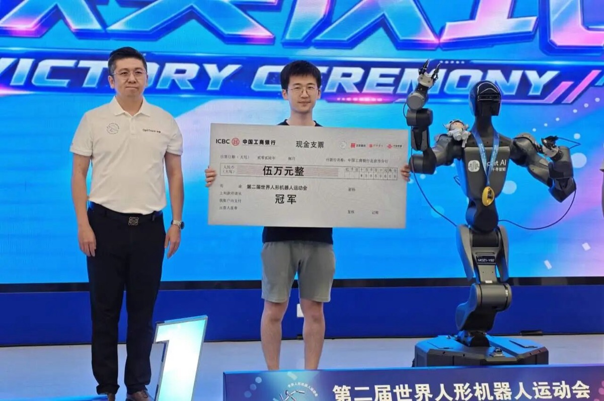
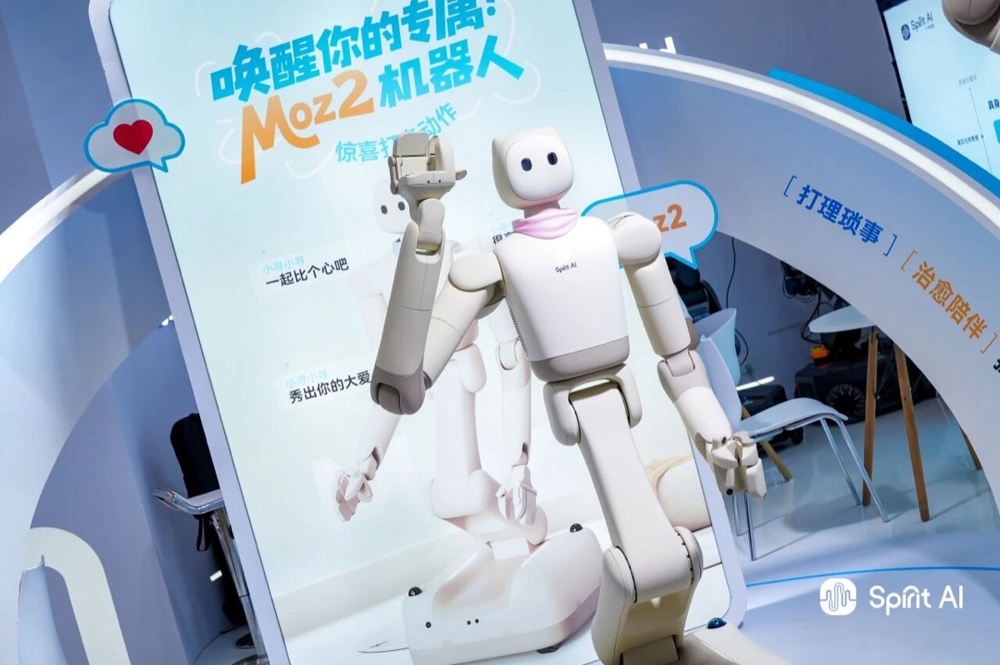

# Spirit AI — Roadmap and Strategy

⬆ [Spirit AI profile](Spirit-AI.md) · [Product portfolio](Spirit-AI-Products.md) · [Developer guide](Spirit-AI-Developer-Guide.md) · [Solutions and projects](Spirit-AI-Solutions-and-Projects.md)

> **Identity:** the embodied-AI company 千寻智能 (Spirit AI, `spirit-ai.com`), not the UK game-AI firm.
> **Freshness (2026-11-14):** the official news page was re-read today — its newest item is still the World Humanoid Robot Games report (events of 23–25 Aug 2026); news IDs above 49 are empty. The one web search allowed for this file returned nothing dated September–November 2026. **So the last ~10 weeks are a blind spot, not proof that nothing happened.**

**In one paragraph:** Spirit AI is a model-first humanoid company. It spends most of its money on data and foundation models (Spirit v1 → v1.5 open → v1.6 closed), uses its own wheeled robot Moz1 as the carrier, and sells "capability" to a few anchor customers who are also shareholders (CATL, JD.com). Its published sequence is **industry first, commercial services next, home last**. 2026 brought ~**RMB 4.5–5B** of fresh funding, a second robot (Moz2) and strong benchmark and competition results, but still only pilot-scale deployments.

## Company trajectory

| Date | Milestone | Source |
|---|---|---|
| Early 2024 | Founded by **Han Fengtao** (CEO; previously co-founder and CTO of the industrial-robot maker 珞石 / ROKAE, which is also at Leukerbad) and **Gao Yang** (chief scientist; Tsinghua IIIS, UC Berkeley PhD) | [Tencent News](https://news.qq.com/rain/a/20260223A06BN100) |
| 2024-08 / 2024-11 | Seed + angel (~**RMB 200M**) and angel+ rounds | [news/8](https://www.spirit-ai.com/news/8) (via solutions register) |
| 2025-03-31 | **RMB 528M** Pre-A led by Prosperity7; early Spirit v1 (laundry folding) | [news/6](https://www.spirit-ai.com/news/6) |
| 2025-06 ⚠️ | **Moz1** launched (26 DoF, whole-body force control); shown at Huawei Developer Conference, 20–22 June 2025 (the launch article itself is undated; month inferred) | [news/10](https://www.spirit-ai.com/news/10) |
| 2025-07 | ~**RMB 600M** Pre-A+ led by JD.com | [news/11](https://www.spirit-ai.com/news/11) |
| 2025-09-25 | **MozRobot SDK 0.1.0** published (0.1.1 on 2025-10-27, 0.1.2 on 2025-11-11) | [Docs downloads](https://docs.spirit-ai.com/zh/download/moz-resources.html) |
| 2025-11 ⚠️ | Shanghai HiSilicon compute / stereo-vision partnership; The Information "most promising start-ups" list | [news/16](https://www.spirit-ai.com/news/16) |
| 2025-12 | Moz1 in routine operation on a **CATL** battery PACK line (connector plugging, **99 %+** success) | [news/22](https://www.spirit-ai.com/news/22) |
| 2026-01-11 | **Spirit v1.5** open-sourced; #1 on RoboChallenge Table30 at that date | [GitHub](https://github.com/Spirit-AI-Team/spirit-v1.5) |
| 2026-02-24 | ~**RMB 2B** over two rounds; valuation above **RMB 10B** (press) | [news/26](https://www.spirit-ai.com/news/26) |
| 2026-03 | Strategic agreement with JD.com (JD MALL retail scenarios) | NBD, via [solutions register](Spirit-AI-Solutions-and-Projects.md) ⚠️ not re-opened |
| 2026-04-07 | **RMB 1B** round co-led by Shunwei Capital and Yunfeng Fund | [news/34](https://www.spirit-ai.com/news/34) |
| 2026-04-23 | Spirit v1.5 fine-tuning code merged | [Commit history](https://github.com/Spirit-AI-Team/spirit-v1.5/commits/main/) |
| 2026-05 | Bosch China two-year factory data programme; education package launch (11 May); **D-Robotics** S600 port (20 May) | [news/28](https://www.spirit-ai.com/news/28), [news/32](https://www.spirit-ai.com/news/32) |
| 2026-06-03 | **RMB 1.5B** A+ round; Spirit v1.6 announced as #1 on RoboArena; Schaeffler cooperation | [news/34](https://www.spirit-ai.com/news/34), [news/35](https://www.spirit-ai.com/news/35) |
| 2026-06-14 | RoboArena entry reported as delisted for too few valid evaluations | Huxiu, via [solutions register](Spirit-AI-Solutions-and-Projects.md) ⚠️ unverified (page timed out today) |
| 2026-07-17 | WAIC Shanghai: **Moz2** debut; Spirit v1.6 long-horizon demos on Moz1 | [news/39](https://www.spirit-ai.com/news/39) |
| 2026-08-23 to 25 | 2nd World Humanoid Robot Games: **gold** (office service) and **silver** (catering), fully autonomous on Moz1 + Spirit v1.6 | [news/49](https://www.spirit-ai.com/news/49) |
| 2026-11-14 to 16 | Listed among the 20 companies at the Leukerbad Robotics Hackathon — first Europe appearance found | event listing (organiser information in this knowledge base) |

## Current focus projects

| Focus | What is happening | Status | Evidence |
|---|---|---|---|
| **Foundation model race** | Spirit v1.6 (VLA + world model, "Spirit Omni Model") is the shared brain for Moz1 and Moz2; a next-generation model is funded | 🧪 closed, demo and competition only | [news/39](https://www.spirit-ai.com/news/39), [news/34](https://www.spirit-ai.com/news/34) |
| **Data infrastructure** | Three-tier "data pyramid": ~**300k h** internet video, **200k+ h** wearable (uDAS, 7 hardware generations, ~95 % of teleop effectiveness at **1/20** the cost), teleop on top; T+1 cleaning-to-training pipeline; target **1M h** in 2026 | ✅ running internally | [news/41](https://www.spirit-ai.com/news/41), [news/26](https://www.spirit-ai.com/news/26) |
| **Industrial anchor: CATL** | Battery PACK end-of-line plugging in routine operation; plan to extend to more battery types and process steps | ✅ pilot line, 🔭 expansion | [news/26](https://www.spirit-ai.com/news/26) |
| **Factory data loops: Bosch, Schaeffler** | Collect data and train inside partner plants and logistics centres in China; partners supply actuators, sensors, components | 🧪 programmes started mid-2026 | [news/28](https://www.spirit-ai.com/news/28), [news/35](https://www.spirit-ai.com/news/35) |
| **Retail: JD.com** | Product explanation, demos and coffee making in JD stores; exploring JD Cloud and the JoyInside language model | 🧪 live pilot | [news/26](https://www.spirit-ai.com/news/26) |
| **Commercial service robot: Moz2** | Interaction and user-experience validation; manipulation skills to migrate from Moz1 | 🧪 early validation | [news/39](https://www.spirit-ai.com/news/39) |
| **Autonomy proof points** | Office and catering workflows with no teleoperation at the World Humanoid Robot Games | ✅ done (Aug 2026) | [news/49](https://www.spirit-ai.com/news/49) |
| **Edge inference** | Spirit v1.5 running on D-Robotics Sunrise S600; on-robot testing was the next step | 🧪 | [news/32](https://www.spirit-ai.com/news/32) |

**Reality check:** press describes the CATL and Bosch work as benchmark pilots rather than volume orders (NBD, via the solutions register ⚠️ not re-opened). Official releases give no unit counts, revenue or delivery numbers.

## Announced and upcoming products

| Item | Status | What is known | Date | Source |
|---|---|---|---|---|
| **Moz2** commercial service robot | 🧪 | **32 DoF**, omnidirectional steering-wheel chassis, folding legs, 7-DoF arms, 4-DoF three-finger hands, lidar + vision + ultrasonic, magnetic mounts for add-on modules. Targets: shelf restocking, hotel delivery, building inspection, exhibition guiding | Debut 2026-07-17; **no ship date, no price** | [news/39](https://www.spirit-ai.com/news/39) |
| **Spirit v1.6** | 🧪 | Closed VLA + world model; long-horizon tasks from one instruction, replanning, pill sorting | Announced 2026-06-03; no release plan | [news/34](https://www.spirit-ai.com/news/34) |
| **Next-generation foundation model** | 🔭 | Named as the first use of the A+ money; no version name or date | 2026-06-03 statement | [news/34](https://www.spirit-ai.com/news/34) |
| **Spirit v1.5 + Sunrise S600 package** | 🔭 | Joint hardware-software offer for industry, retail, commercial service after on-robot tests | Announced 2026-05-20; no date | [news/32](https://www.spirit-ai.com/news/32) |
| **Education and research package** | 🧪 | Moz1 + uDAS + data platform + Spirit v1.5 for universities and vocational colleges | Launched 2026-05-11 | [news/31](https://www.spirit-ai.com/news/31) (via solutions register) |
| **Moz1 Isaac Sim pack** | 🧪 | Isaac Sim 5.1.0 assets distributed by support; public GitHub repo still empty | Docs v2.7 | [Isaac page](https://docs.spirit-ai.com/zh/simulation/issac.html) |
| **Ego-centric data report** | 🔭 | Detailed public write-up of the wearable-data pipeline promised in a company talk | No date | [news/41](https://www.spirit-ai.com/news/41) |
| **Tactile sensing** | 🔭 | Pre-research only; waiting for sensors that do not drift over long runs | No date | [news/41](https://www.spirit-ai.com/news/41) |
| **"State-free policy" paper** | 🧪 | Removes proprioceptive state input to cut over-fitting; under submission | 2026 | [news/41](https://www.spirit-ai.com/news/41) |
| **Large-scale deployment** | 🔭 | CEO quoted as treating 2026 as a model-performance year, with volume deployment in **H2 2027–2028**; ambition of **100,000 robots a year** | reported | Huxiu, via [solutions register](Spirit-AI-Solutions-and-Projects.md) ⚠️ unverified |
| **Consumer / home robot** | 🔭 | Last stage of the stated sequence; no product announced | — | [news/39](https://www.spirit-ai.com/news/39) |

**Not announced anywhere found:** Moz2 SDK, Spirit v1.6 weights, a public dataset, a legged robot, pricing for any product, a European distributor.

## Strategic direction and markets

**Strategy in five points**
- **Model-driven, hardware as carrier.** The CEO's stated goal is a "universal embodied brain"; robots, the uDAS capture device and the model are co-designed.
- **"Dirty data" thesis.** Diversity of data beats cleanliness; pre-train on internet video and cheap wearable capture, fine-tune with teleop and on-robot data.
- **Sell capability, not boxes.** Full-stack perception-decision-execution adapted per production line, with shareholders as first customers.
- **Sequence:** industry → commercial services → home. Elder care and home assistance are explicitly late.
- **Selective openness.** Spirit v1.5 is open; v1.6, datasets and the agent layer are closed.

**Markets and customers**

| Segment | Named partners | Stage |
|---|---|---|
| Battery / advanced manufacturing | CATL (also shareholder) | ✅ line in operation |
| Industrial components and factories | Bosch China, Schaeffler (China) | 🧪 data and component programmes |
| Retail | JD.com (also shareholder) | 🧪 store pilot |
| Education and research | 中教仪 (China Educational Instrument and Equipment) | 🧪 package launched |
| Compute / chips | D-Robotics, Shanghai HiSilicon | 🧪 integration |
| Commercial services (hotels, offices, exhibitions) | — | 🔭 Moz2 targets |
| Home / care | — | 🔭 last stage |

**Funding**

| Round | Date | Size | Lead / notable investors |
|---|---|---|---|
| Seed + angel, angel+ | 2024-08, 2024-11 | ~RMB 200M | Honghui, Fortune Capital, Shunwei, Oasis; Bairui Capital |
| Pre-A | 2025-03-31 | RMB 528M | Prosperity7 Ventures |
| Pre-A+ | 2025-07 | ~RMB 600M | JD.com |
| Two rounds | 2026-02-24 | ~RMB 2B | Yunfeng Fund, Hundun Investment, TCL Ventures, state funds (Chongqing, Hangzhou); existing: Shunwei, Prosperity7 and others |
| — | 2026-04-07 | RMB 1B | Shunwei Capital, Yunfeng Fund |
| A+ | 2026-06-03 | RMB 1.5B | Unnamed USD funds, industrial investors, state funds |

- **2026 total:** "nearly **RMB 5B** in four rounds within three months" (company wording). Valuation above **RMB 10B** after the February rounds (press).
- **Industrial shareholders named by the company:** CATL, Inovance, TCL, JD.com, China Merchants Venture, Huawei, Xiaomi.
- **IPO, revenue, headcount:** nothing official found.

**Europe and Switzerland**
- **No office, distributor, customer or pilot in Europe found.** The careers page lists no locations outside China; Bosch and Schaeffler ties are with the groups' China organisations.
- **Global intent is stated, not detailed:** the A+ release names "global real-world data infrastructure" as a use of funds and "global industry, China retail, high-end manufacturing" as commercial focus; the February release says the production-line capability can be "replicated globally".
- **Leukerbad is therefore the first European developer-facing appearance found** — likely a scouting and visibility trip rather than a sales launch (inference).
- **Possible European hooks (inference):** German industrial partners (Bosch, Schaeffler) could become the route into EU factories; the SDK disclaimer already mentions GDPR.

## Research and open-source activity

| Area | State on 2026-11-14 |
|---|---|
| GitHub organisation | 5 repos: `spirit-v1.5` (MIT, **671 stars**, 41 forks), `issac_moz1` (empty), forks of openpi, LeRobot and ByteCheckpoint. No public members |
| Release cadence | Spirit v1.5 inference + weights 2026-01-11 → fine-tuning code 2026-04-23 → last commit **2026-05-29**. Nothing public since; no v1.6 code |
| Hugging Face | 2 model checkpoints (~5B parameters), **0 datasets**, 0 spaces; base model ~151 downloads in the last month |
| Developer docs | Docs portal v2.7 (Moz1 manual, SDK 0.1.x, teleop, SLAM, Isaac, MuJoCo, π0.5 adaptation); SDK last updated 2025-11-11 |
| Papers | Published mainly through Gao Yang's Tsinghua group with Spirit AI co-affiliation: OneTwoVLA (ICLR 2026), Legato (RSS 2026), Point-VLA (IROS 2026), HuMI and OpenHLM (CoRL 2026), plus the legacy-data transfer paper (July 2026). Full list: [Papers and research](Spirit-AI-Papers-and-Research.md) |
| Research directions named by the company | Cross-embodiment alignment (Moz1 ↔ Franka transfer **30 % → 85 %** in one direction), state-free policies, training-time action-chunk continuity, ego-centric data, tactile (pre-research) |
| Benchmarks | RoboChallenge Table30 #1 (Jan 2026, v1.5); RoboArena #1 claim for v1.6 (June 2026) later reported as delisted ⚠️ unverified |

**Reading the pattern:** each model generation is opened only after its successor exists internally (v1.5 opened in January, v1.6 shown in June). A v1.6 release is therefore plausible once a newer model lands, but **nothing has been announced** (inference).

## What would impress this company at the hackathon

*Inference from the strategy above — not statements by Spirit AI.*

**General**
- **Autonomy over teleop.** Their proudest 2026 result is "only team running fully on model inference". A demo that runs from **one spoken instruction** with no joystick will land better than a polished teleop show.
- **Long-horizon, with recovery.** Chain 3–4 sub-tasks and survive a disturbance (someone moves an object) — this mirrors their WAIC demos.
- **Data that scales.** Show a cheap, diverse data-collection idea (many environments and objects, not many repeats) — it speaks directly to the "dirty data" thesis and the 1M-hour goal.
- **Reusable capability, not a one-off script.** Frame the result as a skill that transfers across scenes or robots.
- **Edge deployment.** Running a policy on a D-Robotics board (D-Robotics is on site) matches an announced joint roadmap item.

| Track | Demo angle that fits their roadmap | Why it resonates | Watch out |
|---|---|---|---|
| **T01 Autonomous Urban Services** | Hotel / office concierge: navigate to a room with the Nav2 stack, deliver an item, hand over; or shelf restocking (T01.1, T01.3, T01.5) | Exactly Moz2's stated target jobs — you would be prototyping their next product on Moz1 | Indoor flat floor only; base limited to 0.5 m/s |
| **T02 Resilient & Safe City** | Remote-operated manipulation with assisted autonomy: operator points, robot plugs a connector or turns a valve; indoor inspection round with anomaly report (T02.2, T02.7) | Builds on the CATL high-voltage plugging skill and the "inspection mode" they mention; Moz2 lists building inspection | Manual forbids hazardous work; IP40, no rugged hardware — present it as a mock-up |
| **T03 Sustainable City** | Dual-arm sorting of recyclables from a cluttered table into bins, with pointed or spoken targets; power-aware inference on the S600 (T03.1, T03.3, T03.6) | Close to their "tidy the living room and bin the paper" demo and the public "move objects into box" fine-tune example | No sustainability product exists; keep claims modest |
| **T04 Elderly Care & Rehabilitation** | Assisted-living chores: fetch-and-hand-over on request, medication sorting into a weekly box, table clearing; caregiver telepresence via VR teleop (T04.1, T04.6) | Uses their shown pill-sorting and tidying skills and the force-controlled arms | Home is the **last** stage of their roadmap and the manual says the robot is not a primary companion for older people — keep the person at a safe distance and frame it as caregiver support |

## Sources

- [Spirit AI — news index (CN)](https://www.spirit-ai.com/news)
- [Spirit AI — news index (EN)](https://www.spirit-ai.com/en/news)
- [Spirit AI — sitemap](https://www.spirit-ai.com/sitemap.xml)
- [Spirit AI news 49 — World Humanoid Robot Games, gold and silver](https://www.spirit-ai.com/news/49)
- [Spirit AI news 41 — pre-training lead talk: data stack, model architecture, research](https://www.spirit-ai.com/news/41)
- [Spirit AI news 39 — WAIC 2026, Moz2 debut, Spirit v1.6 demos](https://www.spirit-ai.com/news/39)
- [Spirit AI news 34 — RoboArena claim and RMB 1.5B A+ round](https://www.spirit-ai.com/news/34)
- [Spirit AI news 26 — nearly RMB 2B funding and commercial progress](https://www.spirit-ai.com/news/26)
- [Spirit AI — careers page (EN)](https://www.spirit-ai.com/en/career)
- [Spirit AI — product page (EN)](https://www.spirit-ai.com/en/product)
- [Tencent News — funding, valuation and founder backgrounds (2026-02-23)](https://news.qq.com/rain/a/20260223A06BN100)
- [GitHub — Spirit-AI-Team organisation](https://github.com/Spirit-AI-Team)
- [GitHub — spirit-v1.5 README](https://github.com/Spirit-AI-Team/spirit-v1.5)
- [GitHub — spirit-v1.5 commit history](https://github.com/Spirit-AI-Team/spirit-v1.5/commits/main/)
- [Hugging Face — Spirit-AI-robotics organisation](https://huggingface.co/Spirit-AI-robotics)
- [Spirit AI docs — Moz resource downloads (SDK versions and dates)](https://docs.spirit-ai.com/zh/download/moz-resources.html)
- [Spirit AI docs — Nvidia Isaac simulation](https://docs.spirit-ai.com/zh/simulation/issac.html)
- [Spirit AI docs — SDK disclaimer](https://docs.spirit-ai.com/zh/sdk/disclaimer.html)
- Carried over from the first-pass [solutions register](Spirit-AI-Solutions-and-Projects.md) and [profile](Spirit-AI.md), not re-opened in this run: [news/6](https://www.spirit-ai.com/news/6), [news/8](https://www.spirit-ai.com/news/8), [news/10](https://www.spirit-ai.com/news/10), [news/11](https://www.spirit-ai.com/news/11), [news/16](https://www.spirit-ai.com/news/16), [news/22](https://www.spirit-ai.com/news/22), [news/28](https://www.spirit-ai.com/news/28), [news/31](https://www.spirit-ai.com/news/31), [news/32](https://www.spirit-ai.com/news/32), [news/35](https://www.spirit-ai.com/news/35), [NBD 2026-04-07](https://www.nbd.com.cn/articles/2026-04-07/4328144.html), [NBD 2026-06-03](https://www.nbd.com.cn/articles/2026-06-03/4416899.html), [Huxiu feature](https://www.huxiu.com/article/4872028.html) (timed out today)
