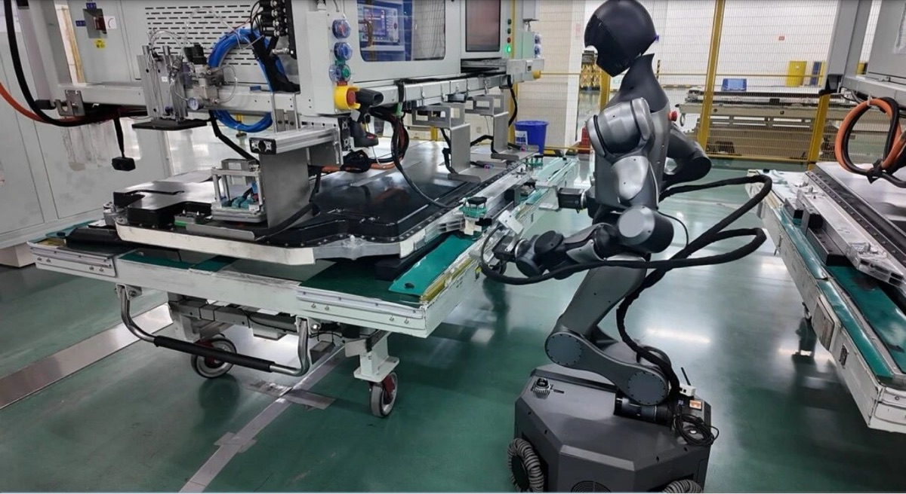
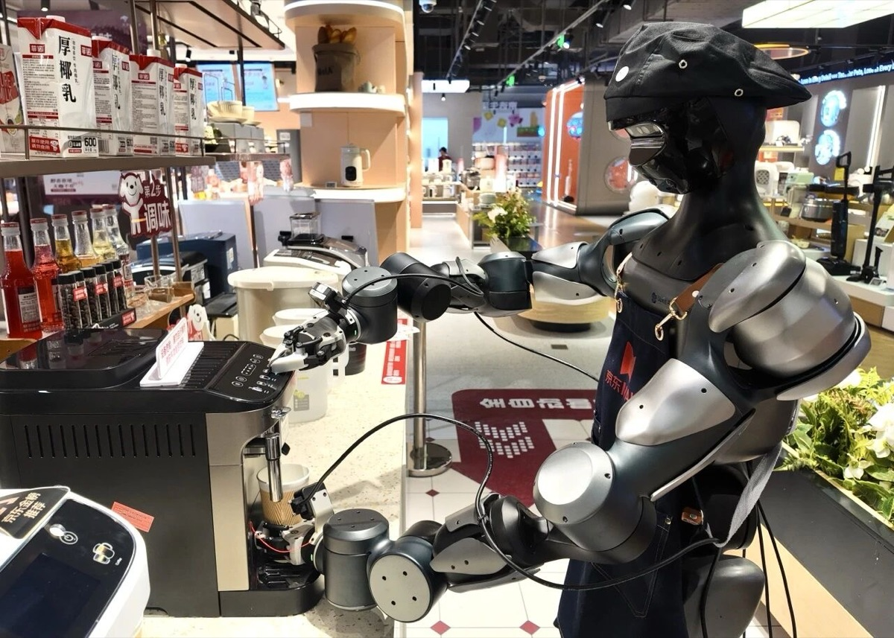
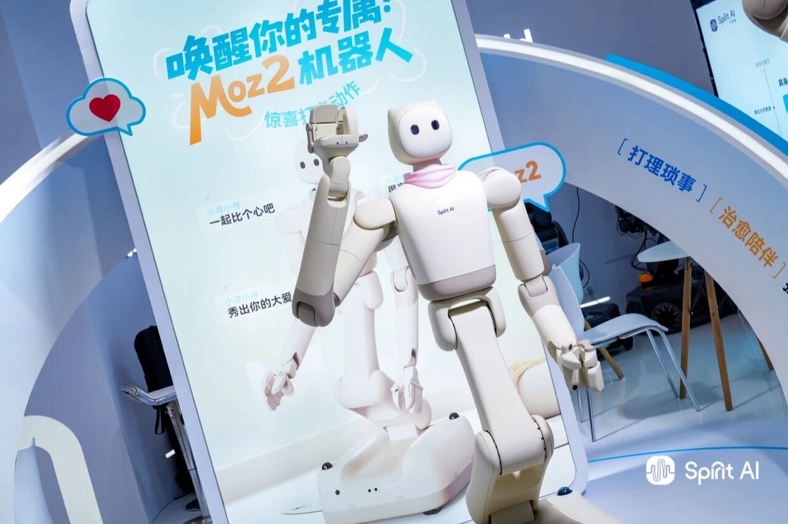
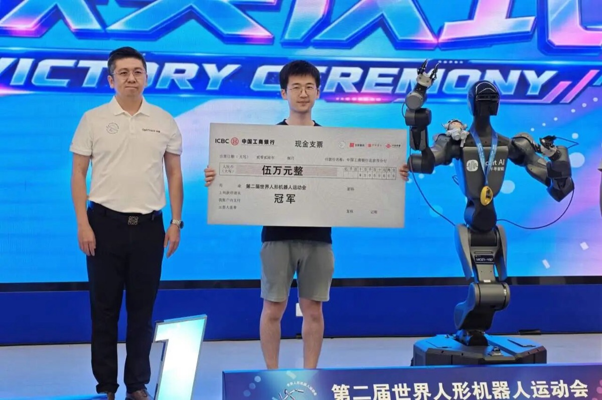
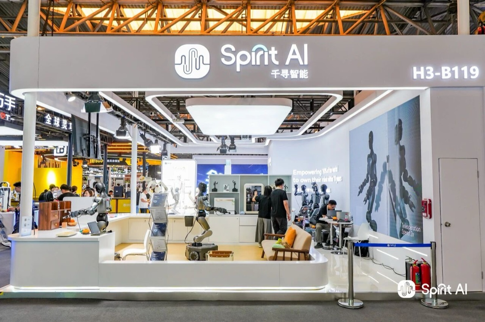
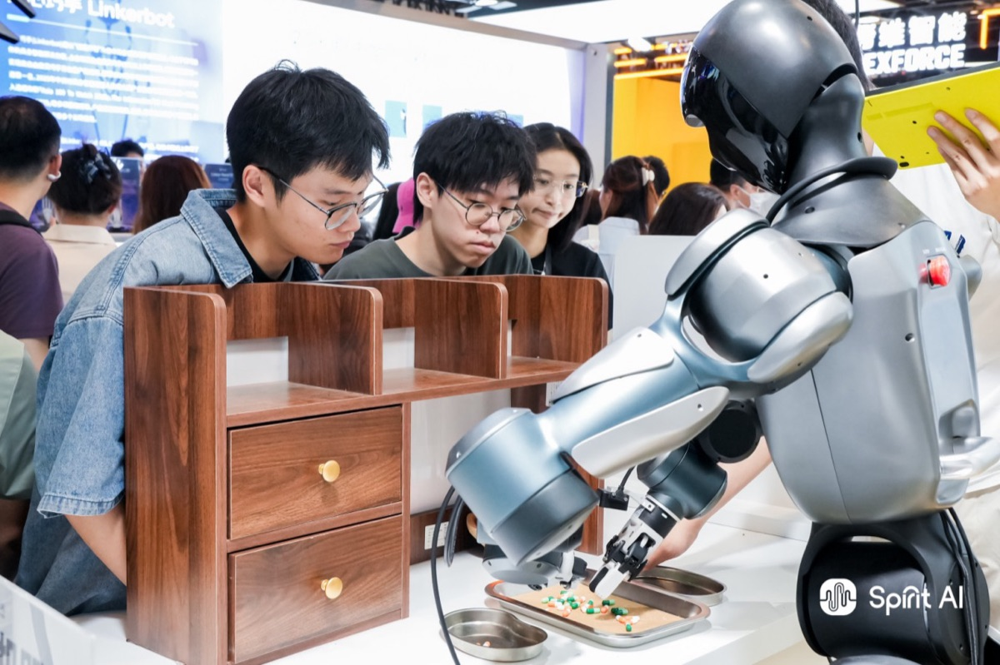
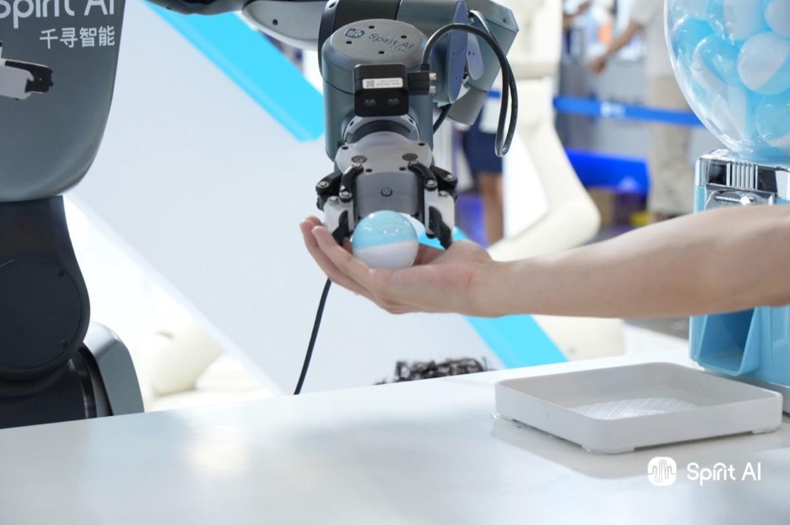
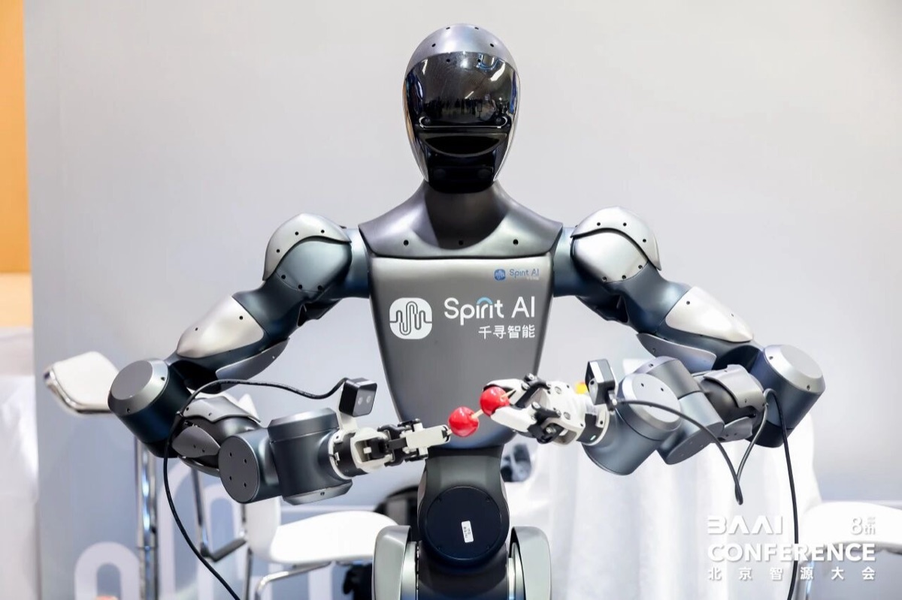
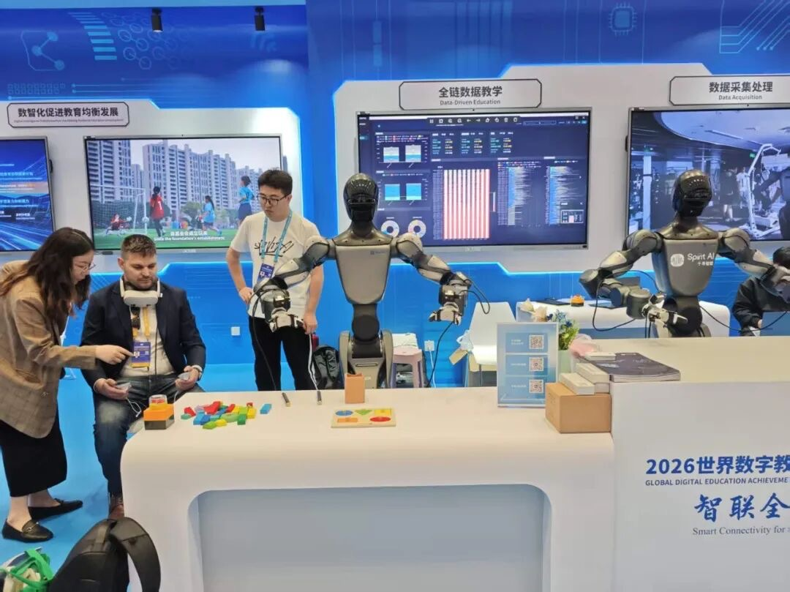
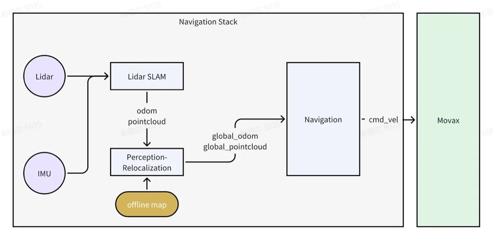

# Spirit AI — Solutions and Projects Register

⬆ [Spirit AI profile](Spirit-AI.md) · [Product portfolio](Spirit-AI-Products.md) · [Papers and research](Spirit-AI-Papers-and-Research.md) · [Roadmap and strategy](Spirit-AI-Roadmap-and-Strategy.md)

> **Coverage note:** Spirit AI (千寻智能) has **no Solutions / Applications / Industries / Case-studies section** on its site — the menu is only Home, Product, Blog, Docs, Company profile, News, Careers. This register is therefore built from a full walk of: `sitemap.xml`; the Chinese news index (**28 articles, IDs 5–49, March 2025 to late August 2026**) and the English news index (**19 articles**); the Product and About pages (CN + EN); the blog (**1 post**); the docs portal navigation (v2.7) incl. the Moz1 manual intro, SLAM navigation and accessories pages; the GitHub organisation (**5 repos**); two arXiv pages; and three press articles (NBD ×2, Huxiu). **Not accessed:** open-web search was unavailable in this pass (shared search budget exhausted), so there was no fresh news sweep — anything published **after late August 2026** (the newest item on the official site) and anything that exists only on WeChat, LinkedIn or third-party media is missing. News IDs 50+ return empty pages. Dates marked ⚠️ are inferred (several official articles carry no date).

**Bottom line for the four tracks:** every confirmed deployment is **industrial (CATL battery line)** or **retail (JD MALL)**. Everything that maps to city services, safety, sustainability or elderly care is a **demo, a competition result, a product intention (Moz2) or a developer capability (teleop, SLAM, open VLA)** — not a packaged solution.

## Solutions catalogue — everything they offer

| # | Solution / application | What it does | Products used | Maturity | Tracks | Source link |
|---|---|---|---|---|---|---|
| 1 | Battery PACK end-of-line connector plugging (EOL / DCR test) | Plugs high-voltage test connectors and flexible harnesses into battery packs; adapts to position offsets; **99 %+** success, skilled-worker cycle time | Moz1 ("Xiao Mo"), Spirit VLA | ✅ in routine operation at CATL | T03 (indirect) · T02 (indirect) | [news/22](https://www.spirit-ai.com/news/22) |
| 2 | Line-side inspection and anomaly reporting | Checks harness connection state, reports faults, switches to patrol / inspection mode between jobs | Moz1 | ✅ part of the CATL deployment | T02 | [news/22](https://www.spirit-ai.com/news/22) |
| 3 | "Capability export" line adaptation and factory data loop | Sells perception–decision–execution capability adapted per production line, instead of hardware only; real data → model → real scene loop inside partner plants and logistics centres | Moz1, Spirit models, uDAS | 🧪 benchmark pilots (CATL, Bosch, Schaeffler) | — | [news/26](https://www.spirit-ai.com/news/26) |
| 4 | Industrial assembly, precision operation, material handling | Claimed task coverage of Spirit v1.5; the Moz1 manual also lists transport and sorting in warehouses, factory floors and hospital distribution centres as mobile-platform uses | Moz1, Spirit v1.5 | 🧪 claimed scope, no named case beyond CATL | T01 (indirect) | [news/32](https://www.spirit-ai.com/news/32) |
| 5 | Retail store assistant | Product explanation, product-operation demos and coffee making in a live shop | Moz1, Spirit VLA | 🧪 live pilot at JD MALL | T01 | [NBD 2026-04-07](https://www.nbd.com.cn/articles/2026-04-07/4328144.html) |
| 6 | Moz2 commercial service robot | Target jobs: supermarket shelf stocking, hotel delivery, building inspection, exhibition guiding; magnetic mounts for delivery tray or inspection module | Moz2 | 🧪 debut July 2026; 🔭 target jobs not yet shipped | T01 · T02 | [news/39](https://www.spirit-ai.com/news/39) |
| 7 | Moz2 voice interaction and companion persona | Natural voice dialogue plus gestures; booth signage reads "handle chores" and "healing companionship" | Moz2, agent layer | 🧪 interaction being validated | T04 · T01 | [news/39](https://www.spirit-ai.com/news/39) |
| 8 | Office "comprehensive service" workflow | Meeting-room set-up, print-and-deliver, document shredding — fully autonomous from one instruction | Moz1, Spirit v1.6 | 🧪 competition-proven (gold, Aug 2026) | T01 | [news/49](https://www.spirit-ai.com/news/49) |
| 9 | Catering "make and sell" workflow | Order pick-up, food heating, drink making in **20 min**, no teleoperation | Moz1, Spirit v1.6 | 🧪 competition-proven (silver, Aug 2026) | T01 | [news/49](https://www.spirit-ai.com/news/49) |
| 10 | Long-horizon home tidying ("tidy the living room") | One spoken instruction → four chained sub-tasks (store cans, load dishwasher, bin paper); adds newly thrown litter to the task list | Moz1, Spirit v1.6 | 🧪 public demo (WAIC, WRC 2026) | T04 · T03 · T01 | [news/39](https://www.spirit-ai.com/news/39) |
| 11 | Desk tidying with dynamic replanning | "Tidy the desk": opens drawer, sorts stationery, fruit, drinks; re-plans when a human undoes or pre-empts a step | Moz1, Spirit v1.5 / v1.6 | 🧪 public demo | T04 · T01 | [news/36](https://www.spirit-ai.com/news/36) |
| 12 | Pill sorting | Vision-located capsules picked and sorted by type with millimetre-level placement | Moz1, Spirit v1.6 | 🧪 public demo | T04 | [news/39](https://www.spirit-ai.com/news/39) |
| 13 | Household and office chore skills | Laundry folding, microwave heating, trash disposal, chair repositioning, coffee brewing | Moz1, Spirit v1 / v1.5 | 🧪 demos since 2025 | T04 · T01 | [news/17](https://www.spirit-ai.com/news/17) |
| 14 | Interactive hand-over demos | Capsule-toy machine operation and hand-over to visitors, candied-fruit skewering, flower hand-over | Moz1, Spirit v1.5 / v1.6 | 🧪 trade-show demos | T01 | [news/36](https://www.spirit-ai.com/news/36) |
| 15 | Whole-body VR teleoperation | Low-latency whole-body teleop (WBC) with a VR headset; visitors stack blocks and pick-and-place | Moz1, Quest VR kit | ✅ ships with Moz1 | T02 · T04 | [docs: teleop](https://docs.spirit-ai.com/zh/teleop/get-started.html) |
| 16 | SLAM mapping and autonomous navigation | Lidar SLAM, relocalisation in an offline point-cloud map, Nav2 goal sending via rviz or ROS service | Moz1, Livox Mid-360 | ✅ documented nav package (Docker) | T01 · T02 | [docs: SLAM nav](https://docs.spirit-ai.com/zh/slam-nav/slam_navigation.html) |
| 17 | Spirit v1.5 open-source VLA (+ Pi0.5 adaptation) | Open weights and code; LeRobot fork and openpi adaptation for Moz1 | Spirit v1.5, MozRobot SDK | ✅ available | T01 · T03 · T04 (enabler) | [GitHub](https://github.com/Spirit-AI-Team/spirit-v1.5) |
| 18 | Spirit v1.6 / "Spirit Omni Model" | Closed VLA + world model; inputs instruction, vision, proprioception; outputs text, motion tokens, action chunks | Spirit v1.6 | 🧪 demo only, not released | — | [news/41](https://www.spirit-ai.com/news/41) |
| 19 | Agent layer | Turns vague spoken requests into VLA-readable instructions; handles dialogue, "emotional companionship", gestures on Moz1 and Moz2 | Agent software | 🧪 running on show robots | T04 · T01 | [news/41](https://www.spirit-ai.com/news/41) |
| 20 | Edge inference on D-Robotics Sunrise S600 | Spirit v1.5 runs end-to-end on a **560 TOPS** edge chip; joint hardware-software package planned for industry, retail, commercial service | Spirit v1.5, S600 | 🧪 adaptation done, on-robot tests next | T03 | [news/32](https://www.spirit-ai.com/news/32) |
| 21 | Domestic compute and stereo perception with Shanghai HiSilicon | Hi3519DV500 stereo module (**720p30** depth) and Ascend-architecture compute base integrated into Moz | Moz1 | 🧪 integration announced 2025 | T03 (indirect) | [news/16](https://www.spirit-ai.com/news/16) |
| 22 | uDAS wearable data collection + Quanta data platform | Wearable capture of human manipulation; T+1 cleaning, labelling, training, test-dispatch pipeline | uDAS, Quanta | ✅ internal; 🧪 shown to universities | — | [news/41](https://www.spirit-ai.com/news/41) |
| 23 | Education and research package | "Technology + scenario + data" offer for universities and vocational colleges | Moz1, uDAS, Quanta, Spirit v1.5 | 🧪 launched at an education expo | — | [news/31](https://www.spirit-ai.com/news/31) |
| 24 | Simulation assets | Isaac simulation repo for Moz1, URDF for MuJoCo | Moz1 URDF | ✅ available | — | [GitHub: issac_moz1](https://github.com/Spirit-AI-Team/issac_moz1) |

### Battery PACK end-of-line connector plugging (EOL / DCR test)

- Moz1 replaces manual plugging of test connectors carrying **several hundred volts** — a job with arcing risk and high product variety.
- Reported results: **99 %+** plug-in success, cycle time equal to a skilled worker, **3×** daily workload, nearly **1,000** packs produced without fault. The robot runs on a CATL battery.
- Track link is indirect: it is EV-battery manufacturing, but the skill (compliant high-voltage plug insertion with position uncertainty) is the same skill an EV-charging robot needs.
- Caveat: press describes the CATL and Bosch work as benchmark pilots, with no large recurring purchase orders yet.
- Official link: [news/22](https://www.spirit-ai.com/news/22) · [EN version](https://www.spirit-ai.com/en/news/23)

### Line-side inspection and anomaly reporting
- Between plugging jobs the robot checks harness connection state, reports anomalies and switches to an inspection (patrol) mode.
- Only described in one sentence of the CATL release; no separate inspection product, sensor payload or report format is documented.
- Official link: [news/22](https://www.spirit-ai.com/news/22)

### Industrial assembly, precision operation, material handling
- Listed as the scenario coverage of Spirit v1.5 in the D-Robotics release; no customer case is named apart from CATL.
- The Moz1 manual describes the mobile platform as suitable for material transport and sorting in warehouses, factory floors and **hospital distribution centres** — a stated use, not a deployment.
- Official link: [news/32](https://www.spirit-ai.com/news/32) · [docs: Moz1 intro](https://docs.spirit-ai.com/zh/moz1/product-intro.html)

### Retail store assistant

- Moz robots work in JD's retail stores: explaining products, demonstrating appliances and making coffee with a real machine.
- Timeline: retail entry reported for late 2025; strategic agreement signed March 2026 with Moz connected to **JD MALL** scenarios; the store doubles as a data-collection site.
- Next step named by the company: exploring JD Cloud and the JoyInside language model across JD's retail network.
- Official link: [news/26](https://www.spirit-ai.com/news/26) · press detail: [NBD](https://www.nbd.com.cn/articles/2026-04-07/4328144.html)

### Moz2 commercial service robot

- **32 DoF**, omnidirectional steering-wheel chassis, foldable legs, 7-DoF arms, 4-DoF three-finger hands; lidar + vision + ultrasonic for mapping and obstacle avoidance among crowds.
- Magnetic expansion points take a delivery tray, an inspection module or a brand-specific skin.
- Stated targets: supermarket shelf stocking, hotel delivery, **building inspection**, exhibition guiding. Today it only does interaction; Moz1's manipulation skills are to be migrated step by step.
- Official link: [news/39](https://www.spirit-ai.com/news/39) · [EN version](https://www.spirit-ai.com/en/news/48)

### Moz2 voice interaction and companion persona
- Wake-word voice dialogue with gestures; soft, rounded "approachable" design aimed at public spaces.
- The WAIC booth signage advertises "handle chores" and "healing companionship" — a positioning statement, not a care product.
- Official link: [news/39](https://www.spirit-ai.com/news/39)

### Office "comprehensive service" workflow

- Three chained jobs: lay out name cards, water and pads for a meeting; load paper, print and deliver to a desk; feed documents into a shredder.
- Spirit AI states it was the **only team running fully on model inference** (no teleoperation) and won **gold**.
- Useful template for a concierge / front-desk demo in T01.
- Official link: [news/49](https://www.spirit-ai.com/news/49)

### Catering "make and sell" workflow
- Order pick-up, food heating and drink making completed in **20 minutes**, again with no teleoperation; **silver** medal.
- Same model (Spirit v1.6) as the office event — the company's evidence for cross-scenario reuse.
- Official link: [news/49](https://www.spirit-ai.com/news/49)

### Long-horizon home tidying ("tidy the living room")

- One instruction triggers four sub-tasks, including putting away cola cans and loading dirty bowls into a dishwasher.
- Staff throw paper balls onto the table mid-task; the robot adds them to its plan and bins them — the closest thing to a litter / waste-handling demo.
- Shown at WAIC (July 2026) and WRC (August 2026) on a full-size living-room set.
- Official link: [news/39](https://www.spirit-ai.com/news/39)

### Desk tidying with dynamic replanning
- Four-word instruction ("tidy the desk"); the plan is shown live on a screen.
- If a person takes the fruit back out, the robot re-does the step; if a person closes the drawer early, it skips that step.
- Official link: [news/36](https://www.spirit-ai.com/news/36) · [EN version](https://www.spirit-ai.com/en/news/43)

### Pill sorting

- Two-finger grippers pick individual capsules from a tray and sort them by colour / type into dishes.
- Demonstrates fine manipulation only: no dispensing workflow, patient identification or medical certification.
- Official link: [news/39](https://www.spirit-ai.com/news/39)

### Household and office chore skills
- Spirit v1 (2025): laundry folding from a crumpled T-shirt, desk tidying, microwave heating, coffee brewing.
- Office set: trash disposal and chair repositioning, repeated with Spirit v1.5 in 2026.
- Official link: [news/17](https://www.spirit-ai.com/news/17) · [news/14](https://www.spirit-ai.com/news/14)

### Interactive hand-over demos

- Capsule-toy machine: the number of knob turns is random, so the robot watches the outlet and stops when the capsule drops, then hands it to the visitor and corrects for a moving hand.
- Also: candied-fruit skewering and handing a flower to a guest.
- Official link: [news/36](https://www.spirit-ai.com/news/36)

### Whole-body VR teleoperation

- Operator wears a VR headset with two controllers; whole-body control maps poses with millisecond-level latency.
- Used for data collection, visitor try-outs (block stacking, pick-and-place) and as the fallback when a policy fails.
- For T02 this is the only route to "hazardous-environment" operation — but the manual forbids hazardous work (see gaps).
- Official link: [docs: teleop](https://docs.spirit-ai.com/zh/teleop/get-started.html) · [news/31](https://www.spirit-ai.com/news/31)

### SLAM mapping and autonomous navigation

- Each robot ships with a **Livox Mid-360** lidar; the nav package (Docker image) has scripts for mapping, saving the map, navigating and stopping.
- Goals are sent by clicking in rviz or through a ROS service; maps are point clouds (ply / pcd) that can be cleaned in MeshLab or CloudCompare.
- Indoor, flat-floor only; moving people during mapping create ghost obstacles.
- Official link: [docs: SLAM nav](https://docs.spirit-ai.com/zh/slam-nav/slam_navigation.html)

### Spirit v1.5 open-source VLA (+ Pi0.5 adaptation)
- Open weights and inference code (January 2026); the GitHub organisation also holds a LeRobot fork, an openpi fork (`PI_Official`), `ByteCheckpoint` and the Isaac repo.
- Company claim: zero-shot wiping, hinge operation and deformable-object handling.
- Official link: [GitHub](https://github.com/Spirit-AI-Team/spirit-v1.5) · [blog post](https://www.spirit-ai.com/blog) · [docs: Pi0.5 adaptation](https://docs.spirit-ai.com/zh/open-resources/pi.html)

### Agent layer
- Two jobs: front-end interaction (dialogue, companionship, matching gestures) and translating vague requests into instructions the VLA can act on.
- The company says this layer only became systematic during the past year.
- Official link: [news/41](https://www.spirit-ai.com/news/41)

### Edge inference on D-Robotics Sunrise S600
- Spirit v1.5 runs stable end-to-end inference on the S600 (**560 TOPS**, INT8); the two firms plan a mass-producible hardware-software package.
- Relevant at Leukerbad because D-Robotics is also on site; on-robot testing was still "next step" in May 2026.
- Official link: [news/32](https://www.spirit-ai.com/news/32) · [EN version](https://www.spirit-ai.com/en/news/45)

### Domestic compute and stereo perception with Shanghai HiSilicon
- Low-power stereo depth module with hardware acceleration; tuned for thin objects and weak textures.
- Ascend-based edge compute validated for running the VLA on Moz.
- Official link: [news/16](https://www.spirit-ai.com/news/16) · [EN version](https://www.spirit-ai.com/en/news/20)

## Projects register — past and current

| Date | Project / deployment / pilot / partnership | Partner or customer | Location | What happened (one line) | Tracks | Source link |
|---|---|---|---|---|---|---|
| 2026-08-23 to 25 | 2nd World Humanoid Robot Games — scenario events | Games organisers | not stated in release | **Gold** in office "comprehensive service", **silver** in catering "make and sell", both fully autonomous with Spirit v1.6 on Moz1 | T01 | [news/49](https://www.spirit-ai.com/news/49) |
| 2026-08 ⚠️ | World Robot Conference (WRC) 2026 | — | not stated in release | "Tidy the living room" demo repeated | T04 · T01 | [news/49](https://www.spirit-ai.com/news/49) |
| 2026-07/08 ⚠️ | Public talk "Building Generalist Robot Policies — from Data to Deployment" | Tanyue Physical AI series | online | Disclosed data stack: ~**300k h** internet video, **200k+ h** uDAS data, uDAS at **95 %** of teleop effectiveness for **1/20** of the cost, 7 device generations | — | [news/41](https://www.spirit-ai.com/news/41) |
| 2026-07-28 | Paper: emergent transfer of legacy data across hardware generations | Gao Yang group | arXiv | Old-hardware data helps only after the new robot passes a competence threshold (flower insertion **23.3 % → 86.7 %**) | — | [arXiv 2607.25593](https://arxiv.org/abs/2607.25593) |
| 2026-07-24 | Visit by Beijing Party Secretary and Mayor | Beijing municipal government | Beijing | Official summary: Moz1 in routine deployment at CATL (**99 %+**), data network in **100+ cities**, **1,000+** devices online, **1,500+** collectors | — | [news/40](https://www.spirit-ai.com/news/40) |
| 2026-07-17 | WAIC 2026 — Moz2 debut, Spirit v1.6 demos | — | Shanghai | Moz2 shown; living-room tidying, desk replanning, pill sorting, capsule-toy demos | T01 · T04 | [news/39](https://www.spirit-ai.com/news/39) |
| 2026-07 ⚠️ | RSS 2026 participation; Legato paper accepted | RSS | not read from official page | Legato: pouring task **95.07 s → 75.73 s**, validated on five real tasks | — | [news/33](https://www.spirit-ai.com/news/33) |
| 2026-06-14 | RoboArena delisting (reported) | RoboArena | — | Press: Spirit v1.6 removed after only **25** valid evaluations against a **100** threshold; no company response reported ⚠️ unverified | — | [Huxiu](https://www.huxiu.com/article/4872028.html) |
| 2026-06-12 to 13 | 8th BAAI Conference | BAAI | Beijing | Moz1 + Spirit v1.6: desk tidying, capsule-toy machine, zero-latency teleop; CEO round-table and chief-scientist keynote | T01 · T04 | [news/36](https://www.spirit-ai.com/news/36) |
| 2026-06-03 | Strategic cooperation: data collection, humanoid core components, industrial scenarios | Schaeffler (China; Schaeffler embodied-robot unit in Taicang) | China | Long-term component purchasing plus joint component R&D and data collection in Schaeffler plants | — | [news/35](https://www.spirit-ai.com/news/35) |
| 2026-06-03 | RoboArena #1 claim + **RMB 1.5B** A+ round | — | — | Company announced top RoboArena rank for Spirit v1.6 (later disputed, see above) and fourth round in three months (~**RMB 5B** total) | — | [news/34](https://www.spirit-ai.com/news/34) |
| 2026-05-20 | Strategic cooperation: Spirit v1.5 on Sunrise S600 | D-Robotics | China | Adaptation complete; joint package for industry, retail, commercial service; release also names Huawei among served customers | T03 | [news/32](https://www.spirit-ai.com/news/32) |
| 2026-05-11 | World Digital Education Conference — education package launch | China Educational Instrument and Equipment Co. (中教仪) | Hangzhou | **3** Moz1 on stand: data flywheel (uDAS + Quanta), autonomous demos, public teleop | — | [news/31](https://www.spirit-ai.com/news/31) |
| 2026-05 | Strategic cooperation: factory data loop + components | Bosch China | China | **Two-year** programme of data collection and model training in Bosch plants and logistics centres; Bosch supplies actuators and sensors | — | [news/28](https://www.spirit-ai.com/news/28) |
| 2026-04 | Spirit v1.5 fine-tuning code released | open source | GitHub | Carried over from the profile; not re-checked in this pass ⚠️ unverified | — | [GitHub](https://github.com/Spirit-AI-Team/spirit-v1.5) |
| 2026-04-07 | **RMB 1B** round | Shunwei Capital, Yunfeng Fund (co-leads) | — | Third round in about 30 days | — | [NBD](https://www.nbd.com.cn/articles/2026-04-07/4328144.html) |
| 2026-03 | Strategic agreement, JD MALL smart retail | JD.com | China | Moz connected to JD MALL; coffee making run as a live data-collection and model-iteration loop | T01 | [NBD](https://www.nbd.com.cn/articles/2026-04-07/4328144.html) |
| 2026-02-25 | ~**RMB 2B** (USD 280M) over two rounds | Yunfeng, Chaos Investment, TCL Capital, state funds and others | — | Release lists CATL, Inovance, TCL, JD, Huawei, Xiaomi as industrial shareholders | — | [news/26](https://www.spirit-ai.com/news/26) |
| 2026-02-13 | Legato paper posted | Gao Yang group | arXiv | "Learning Native Continuation for Action Chunking Flow Policies" | — | [arXiv 2602.12978](https://arxiv.org/abs/2602.12978) |
| 2026-01-11 | Spirit v1.5 open-sourced; #1 on RoboChallenge Table30 | RoboChallenge | — | Blog post argues for diverse "dirty" data in pre-training | — | [news/24](https://www.spirit-ai.com/news/24) |
| 2025-12 | First humanoid deployment on a battery PACK line | CATL | CATL Zhongzhou base (city not stated in release) | Moz1 takes over EOL / DCR connector plugging; **99 %+** success | T03 (indirect) · T02 (indirect) | [news/22](https://www.spirit-ai.com/news/22) |
| 2025-12 ⚠️ | The Information "50 Most Promising Startups 2025" | The Information | — | Ranked second in the Asia section; release says batch commercial delivery expected in 2026 | — | [news/17](https://www.spirit-ai.com/news/17) |
| late 2025 | Retail pilot | JD.com | JD retail stores, China | Moz gives product explanations, operation demos and coffee service (press) | T01 | [NBD](https://www.nbd.com.cn/articles/2026-04-07/4328144.html) |
| 2025-11 ⚠️ | Compute and perception partnership | Shanghai HiSilicon | China | Stereo module and Ascend compute base adapted to Moz; follows Huawei Hubble's June 2025 investment | T03 (indirect) | [news/16](https://www.spirit-ai.com/news/16) |
| 2025 autumn ⚠️ | 10th "Maker China" Beijing SME competition | Beijing municipal bureaus | Beijing | Three top prizes, advance to national final | — | [news/15](https://www.spirit-ai.com/news/15) |
| 2025-09-25 | Strategic signing at Global Digital Trade Expo | Zhejiang Sci-Tech Innovation Mother Fund | Hangzhou | Agreement to build demonstration applications in Zhejiang; live laundry-folding demo | — | [news/14](https://www.spirit-ai.com/news/14) |
| 2025-07 | ~**RMB 600M** Pre-A+; WAIC and WRC 2025 exhibitions | JD.com (lead) | Shanghai / Beijing | JD becomes investor before becoming customer | — | [news/11](https://www.spirit-ai.com/news/11) |
| 2025-06-20 to 22 | Huawei Developer Conference 2025 — teleop booth | Huawei | Dongguan | Public Moz1 teleoperation try-outs; Huawei described as investor | T02 (indirect) | [news/9](https://www.spirit-ai.com/news/9) |
| 2025-06 | Moz1 launch | — | — | 26 DoF whole-body force-controlled wheeled humanoid with Spirit v1 | — | [EN news/13](https://www.spirit-ai.com/en/news/13) |
| 2025-04-24 | Hangzhou unicorn lists | Wanwu Shengzhang conference | Hangzhou | Three list entries; CEO award | — | [news/5](https://www.spirit-ai.com/news/5) |
| 2025-04-15 | 2nd China Humanoid Robot and Embodied AI Industry Conference | LeadeRobot | Beijing | Algorithm innovation award; talk on the robot data bottleneck | — | [news/7](https://www.spirit-ai.com/news/7) |
| 2025-03-31 | **RMB 528M** Pre-A; Spirit v1 early version | Prosperity7 Ventures (lead) | — | Laundry-folding video; talent programmes with Tsinghua, Peking, Zhejiang universities and CAS | — | [news/6](https://www.spirit-ai.com/news/6) |
| 2024-08 and 2024-11 | Seed + angel (~**RMB 200M**) and angel+ rounds | Honghui, Fortune Capital, Shunwei, Oasis; Bairui Capital | — | Bairui was founded by a CATL co-founder — origin of the CATL link | — | [news/8](https://www.spirit-ai.com/news/8) |
| 2024-07 | Coffee-making video (first end-to-end model) | — | — | Reported by press only ⚠️ unverified | T01 | [Huxiu](https://www.huxiu.com/article/4872028.html) |
| undated | Cooperation with JD Pharmacy | JD Pharmacy (京东药房) | China | Named once in press alongside Bosch and CATL; no detail, no official confirmation ⚠️ unverified | T04 (speculative) | [Huxiu](https://www.huxiu.com/article/4872028.html) |

## Future projects and announced plans

| Announced | Planned for | What | Confidence (official / reported / inferred) | Tracks | Source link |
|---|---|---|---|---|---|
| 2026-07 | no date | 🔭 Moz2 to inherit Moz1's long-horizon and fine-manipulation skills; target jobs: shelf stocking, hotel delivery, building inspection, exhibition guiding | official | T01 · T02 | [news/39](https://www.spirit-ai.com/news/39) |
| 2026-07 | staged | 🔭 Sequence "industry first, commercial services next, home last" | official | T04 (home is last) | [news/39](https://www.spirit-ai.com/news/39) |
| 2026-02 / 06 | end of 2026 | 🔭 **1M hours** of real-world interaction data | official | — | [news/34](https://www.spirit-ai.com/news/34) |
| 2026-06 | ongoing | 🔭 Use of A+ funds: next-generation foundation model, global real-data infrastructure, multi-industry roll-out | official | — | [news/34](https://www.spirit-ai.com/news/34) |
| 2026-05 | to ~2028 | 🧪 Bosch two-year factory data and training programme; Bosch components into Spirit AI products | official | — | [news/28](https://www.spirit-ai.com/news/28) |
| 2026-06 | no date | 🔭 Joint humanoid-component R&D and data collection with Schaeffler; shared industry standards | official | — | [news/35](https://www.spirit-ai.com/news/35) |
| 2026-05 | no date | 🔭 Spirit v1.5 + S600 on-robot testing, then packaged solutions for industry, retail, commercial service | official | T03 | [news/32](https://www.spirit-ai.com/news/32) |
| 2026-02 | no date | 🔭 CATL work to extend to more battery types and process steps, replicated globally | official | T03 (indirect) | [news/26](https://www.spirit-ai.com/news/26) |
| 2026-02 | no date | 🔭 JD Cloud and JoyInside language model explored for JD's retail network | official | T01 | [news/26](https://www.spirit-ai.com/news/26) |
| 2026-05 | no date | 🔭 Education offer for "Double High" vocational colleges with 中教仪 | official | — | [news/31](https://www.spirit-ai.com/news/31) |
| 2025-09 | no date | 🔭 Demonstration applications in Zhejiang province with the provincial fund | official | — | [news/14](https://www.spirit-ai.com/news/14) |
| 2025-11 ⚠️ | no date | 🔭 More HiSilicon chips (perception, MCU, NearLink, Bluetooth, RedCap) into embodied-AI use | official | — | [news/16](https://www.spirit-ai.com/news/16) |
| 2026-07/08 ⚠️ | no date | 🔭 Detailed public report on ego-centric data processing | official (talk) | — | [news/41](https://www.spirit-ai.com/news/41) |
| 2026-07/08 ⚠️ | no date | 🔭 Tactile sensing: pre-research only, waiting for stable sensors | official (talk) | T04 (indirect) | [news/41](https://www.spirit-ai.com/news/41) |
| 2026-07/08 ⚠️ | under review | 🧪 "State-free policy" paper (drop proprioceptive state to stop over-fitting) and Point-VLA (IROS 2026) | official (talk) | — | [news/41](https://www.spirit-ai.com/news/41) |
| 2025-12 ⚠️ | 2026 | 🧪 Batch commercial delivery of robots | official (2025 statement) | — | [news/17](https://www.spirit-ai.com/news/17) |
| 2026-07 | H2 2027 – 2028 | 🔭 Large-scale deployment; 2026 treated as a model-performance year | reported | — | [Huxiu](https://www.huxiu.com/article/4872028.html) |
| 2026-07 | no date | 🔭 Ambition to sell **100,000 robots a year** before large tech firms enter | reported | — | [Huxiu](https://www.huxiu.com/article/4872028.html) |
| 2026-04 | no date | 🔭 Consumer market later, with Xiaomi marketing and supply-chain help | reported (CEO quote) | T04 (indirect) | [NBD](https://www.nbd.com.cn/articles/2026-04-07/4328144.html) |
| 2026-07 | no date | 🔭 Successor to Spirit v1.6: no name or date published | inferred | — | [news/39](https://www.spirit-ai.com/news/39) |

## Solutions by track — quick index

### T01 Autonomous Urban Services
- **Office "comprehensive service" workflow** (#8) — autonomous meeting set-up, print-and-deliver, shredding; gold medal, August 2026.
- **Catering "make and sell" workflow** (#9) — order, heat, make drinks in 20 minutes.
- **Retail store assistant at JD MALL** (#5) — the only live service deployment: product explanation and coffee.
- **Moz2 commercial service robot** (#6) — hotel delivery, shelf stocking, exhibition guiding; intentions, not yet shipped.
- **SLAM mapping and navigation** (#16) — the practical base for any indoor delivery or guiding demo on Moz1.
- **Interactive hand-over demos** (#14) and **agent layer** (#19) — concierge-style interaction and object hand-over.
- **Home / desk tidying** (#10, #11, #13) — reusable for room-service or housekeeping demos.
- Project evidence: World Humanoid Robot Games 2026, JD agreement (March 2026), WAIC 2026.

### T02 Resilient & Safe City
- **Whole-body VR teleoperation** (#15) — the only remote-operation capability; indoor, tethered to the local network.
- **SLAM mapping** (#16) — lidar point-cloud maps of indoor spaces (a basic 3D map, not a digital-twin product).
- **Line-side inspection and anomaly reporting** (#2) — one-line mention inside the CATL deployment.
- **Moz2 building inspection** (#6) — a stated future use with an attachable inspection module.
- **High-voltage connector plugging** (#1) — removes people from an arcing-risk task (indirect).
- Nothing specific found for emergency response, search and rescue, hazard monitoring or security patrol.

### T03 Sustainable City
- **Edge inference on D-Robotics Sunrise S600** (#20) — low-power on-board VLA; partner is also at Leukerbad.
- **Long-horizon tidying with litter binning** (#10) — closest to litter picking / waste handling; not a sorting system.
- **Battery PACK connector plugging at CATL** (#1) — EV-battery manufacturing; the plug-insertion skill transfers to EV charging (indirect).
- **HiSilicon low-power stereo perception** (#21) — indirect.
- **Spirit v1.5 open VLA** (#17) — the tool for training a sorting policy, given data and GPUs.
- Nothing specific found for recycling, energy or building automation, environmental monitoring, agriculture or green-space care.

### T04 Elderly Care & Rehabilitation
- **Pill sorting** (#12) — fine manipulation of capsules; demo only.
- **Long-horizon home tidying and chore skills** (#10, #11, #13) — dishwasher loading, laundry folding, microwave heating, desk tidying.
- **Agent layer and Moz2 companion persona** (#19, #7) — dialogue and "companionship" positioning.
- **Whole-body VR teleoperation** (#15) — usable as telepresence / caregiver remote assistance.
- **JD Pharmacy cooperation** — press mention only ⚠️ unverified.
- Nothing specific found for mobility support, fall detection, physiotherapy, rehabilitation, massage, exoskeletons, prosthetics, EMG or AR-guided therapy.

## What they do NOT offer

- **No packaged solutions at all.** No solutions page, no price list, no case-study library; commercial work is a handful of benchmark pilots.
- **No elderly-care or medical product.** The Moz1 manual states the robot is **not suitable as a main companion for children, older people or people with cognitive impairment**, and that it has no emotion recognition. No medical certification. Home use is the last stage of the roadmap.
- **No hazardous-duty capability.** The manual **forbids dangerous work** (work at height, heavy lifting, high-risk experiments, sharp tools) and asks for a ≥ 2 m safety distance during commissioning. No IP rating, no explosion-proof or radiation-tolerant variant.
- **Indoor, flat floor only.** Wheeled base; no stairs, snow, kerbs or outdoor navigation; no outdoor deployment found.
- **No emergency-response, security-patrol, environmental-monitoring, cleaning, waste-sorting, EV-charging, agriculture or rehabilitation offering.**
- **No inspection payloads today** (thermal, gas, acoustic). The Moz2 inspection module is an announced attachment point only.
- **No tactile sensing** in the product; the company calls it pre-research.
- **Spirit v1.6 is closed**, and its headline RoboArena result is reported as delisted. Only Spirit v1.5 is usable by developers.
- **No Europe or Switzerland activity** in any source read; Bosch and Schaeffler ties are with their China organisations.

## Image credits

| file | shows | source URL |
|---|---|---|
| assets/spirit-ai-sol-catl-line.jpg | Moz1 at a battery-pack test station on a CATL production line | https://www.spirit-ai.com/upfiles/files/20260618233093.png |
| assets/spirit-ai-sol-jd-retail-coffee.jpg | Moz1 in a JD MALL apron operating a coffee machine in a store | https://www.spirit-ai.com/upfiles/files/20260814521178.jpg |
| assets/spirit-ai-sol-moz2-service.jpg | Moz2 commercial service robot at WAIC 2026 | https://www.spirit-ai.com/upfiles/files/20260814181793.jpg |
| assets/spirit-ai-sol-robot-games.jpg | Award ceremony at the 2nd World Humanoid Robot Games with Moz1 | https://www.spirit-ai.com/upfiles/files/20260902962162.jpg |
| assets/spirit-ai-sol-living-room-tidy.jpg | WAIC 2026 booth with the living-room set used for the tidying demo | https://www.spirit-ai.com/upfiles/files/20260814206317.jpg |
| assets/spirit-ai-sol-pill-sorting.jpg | Moz1 sorting capsules in front of visitors at WAIC 2026 | https://www.spirit-ai.com/upfiles/files/20260814561407.png |
| assets/spirit-ai-sol-gashapon.jpg | Gripper handing a capsule toy to a visitor | https://www.spirit-ai.com/upfiles/files/20260814575703.png |
| assets/spirit-ai-sol-tanghulu.jpg | Moz1 holding a candied-fruit skewer at the BAAI Conference | https://www.spirit-ai.com/upfiles/files/20260814376472.jpg |
| assets/spirit-ai-sol-teleop.jpg | Visitor teleoperating Moz1 with a VR headset at the World Digital Education Conference | https://www.spirit-ai.com/upfiles/files/20260814134227.jpeg |
| assets/spirit-ai-sol-slam-nav.jpg | Architecture diagram of the Moz1 navigation stack | https://docs.spirit-ai.com/content_img/slam_nav/1-1.webp |

## Sources

- [Spirit AI — sitemap](https://www.spirit-ai.com/sitemap.xml)
- [Spirit AI — news index (CN)](https://www.spirit-ai.com/news)
- [Spirit AI — news index (EN)](https://www.spirit-ai.com/en/news)
- [Spirit AI — product page (EN)](https://www.spirit-ai.com/en/product)
- [Spirit AI — about page (CN)](https://www.spirit-ai.com/about)
- [Spirit AI — blog](https://www.spirit-ai.com/blog)
- [News 49: World Humanoid Robot Games, gold and silver](https://www.spirit-ai.com/news/49)
- [News 42: legacy-data transfer paper](https://www.spirit-ai.com/news/42)
- [News 41: pre-training lead talk, data stack and research](https://www.spirit-ai.com/news/41)
- [News 40: Beijing leadership visit](https://www.spirit-ai.com/news/40)
- [News 39: WAIC 2026, Moz2 debut and Spirit v1.6 demos](https://www.spirit-ai.com/news/39)
- [News 36: BAAI Conference 2026](https://www.spirit-ai.com/news/36)
- [News 35: Schaeffler strategic cooperation](https://www.spirit-ai.com/news/35)
- [News 34: RoboArena claim and A+ round](https://www.spirit-ai.com/news/34)
- [News 33: Legato accepted at RSS 2026](https://www.spirit-ai.com/news/33)
- [News 32: D-Robotics strategic cooperation](https://www.spirit-ai.com/news/32)
- [News 31: World Digital Education Conference](https://www.spirit-ai.com/news/31)
- [News 28: Bosch China strategic cooperation](https://www.spirit-ai.com/news/28)
- [News 26: nearly RMB 2B funding, commercial progress](https://www.spirit-ai.com/news/26)
- [News 24: Spirit v1.5 open-sourced](https://www.spirit-ai.com/news/24)
- [News 22: CATL battery line deployment](https://www.spirit-ai.com/news/22)
- [News 17: The Information list](https://www.spirit-ai.com/news/17)
- [News 16: Shanghai HiSilicon partnership](https://www.spirit-ai.com/news/16)
- [News 15: Maker China competition](https://www.spirit-ai.com/news/15)
- [News 14: Zhejiang Sci-Tech Innovation Mother Fund signing](https://www.spirit-ai.com/news/14)
- [News 11: Pre-A+ round led by JD.com](https://www.spirit-ai.com/news/11)
- [News 9: Huawei Developer Conference 2025](https://www.spirit-ai.com/news/9)
- [News 8: company introduction and history](https://www.spirit-ai.com/news/8)
- [News 7: industry conference awards](https://www.spirit-ai.com/news/7)
- [News 6: Pre-A round](https://www.spirit-ai.com/news/6)
- [News 5: Hangzhou unicorn lists](https://www.spirit-ai.com/news/5)
- [EN news 30: USD 280M funding release](https://www.spirit-ai.com/en/news/30)
- [EN news 13: Moz1 launch](https://www.spirit-ai.com/en/news/13)
- [Docs: Moz1 manual introduction (intended uses and warnings)](https://docs.spirit-ai.com/zh/moz1/product-intro.html)
- [Docs: SLAM navigation](https://docs.spirit-ai.com/zh/slam-nav/slam_navigation.html)
- [Docs: third-party accessories](https://docs.spirit-ai.com/zh/download/accessories.html)
- [Docs: teleoperation quick start](https://docs.spirit-ai.com/zh/teleop/get-started.html)
- [Docs: Pi0.5 adaptation](https://docs.spirit-ai.com/zh/open-resources/pi.html)
- [GitHub organisation: Spirit-AI-Team](https://github.com/Spirit-AI-Team)
- [GitHub: spirit-v1.5](https://github.com/Spirit-AI-Team/spirit-v1.5)
- [GitHub: issac_moz1](https://github.com/Spirit-AI-Team/issac_moz1)
- [arXiv 2602.12978: Learning Native Continuation for Action Chunking Flow Policies](https://arxiv.org/abs/2602.12978)
- [arXiv 2607.25593: When Does Legacy Data Start to Help?](https://arxiv.org/abs/2607.25593)
- [NBD 2026-04-07: funding round, JD MALL and CATL detail](https://www.nbd.com.cn/articles/2026-04-07/4328144.html)
- [NBD 2026-06-03: A+ round, pilots versus orders](https://www.nbd.com.cn/articles/2026-06-03/4416899.html)
- [Huxiu 2026-07-02: feature on Spirit AI, RoboArena dispute, targets](https://www.huxiu.com/article/4872028.html)
