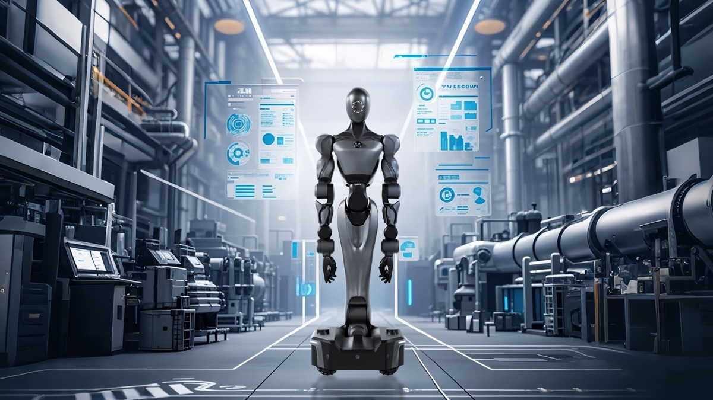
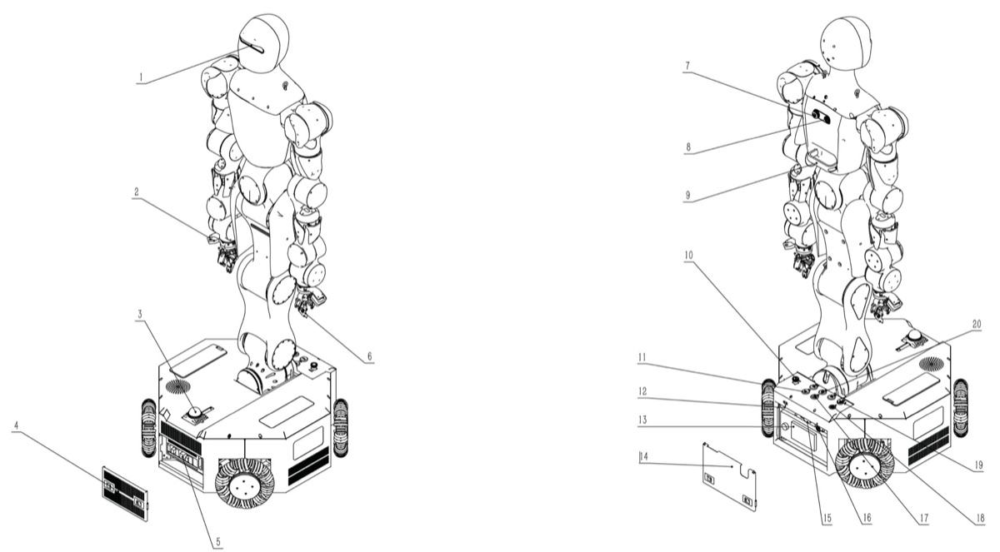
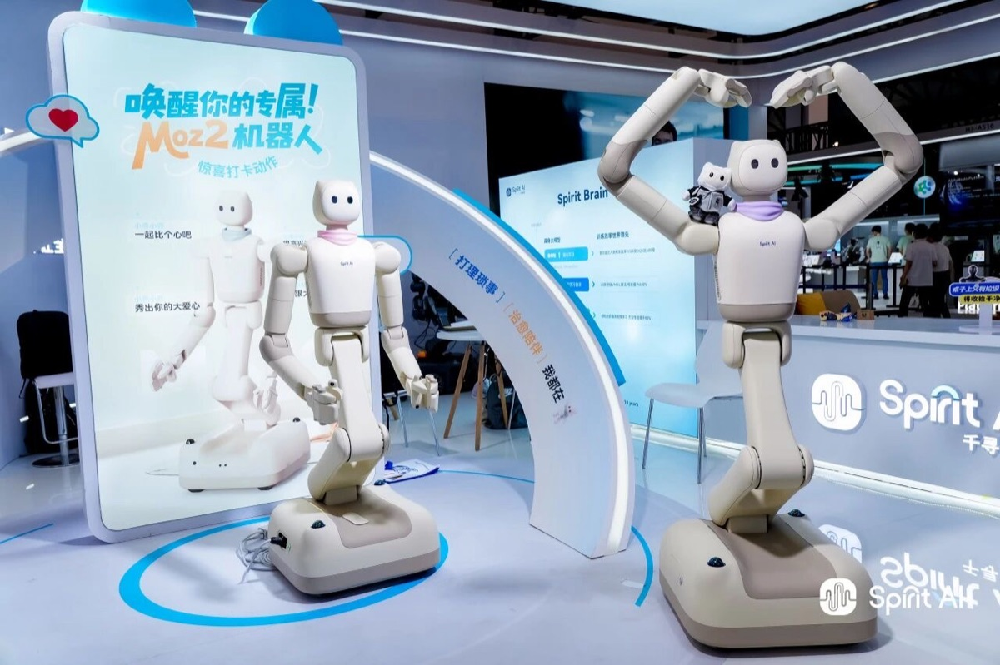
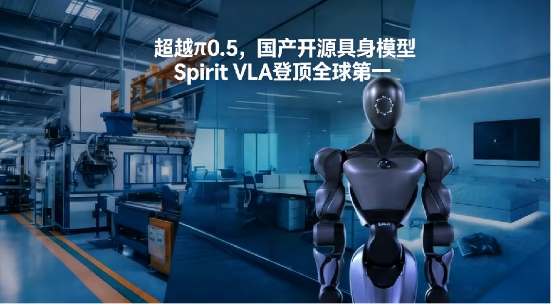
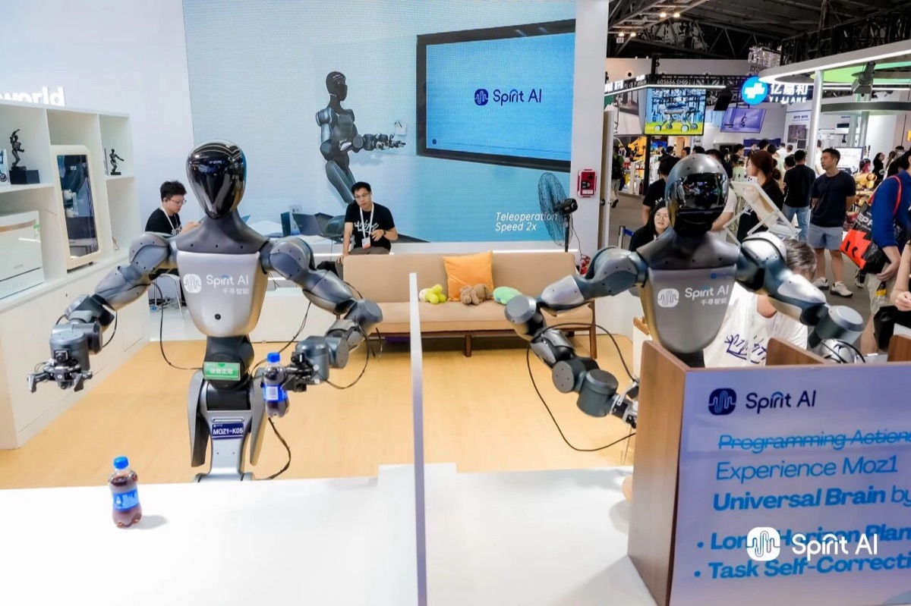
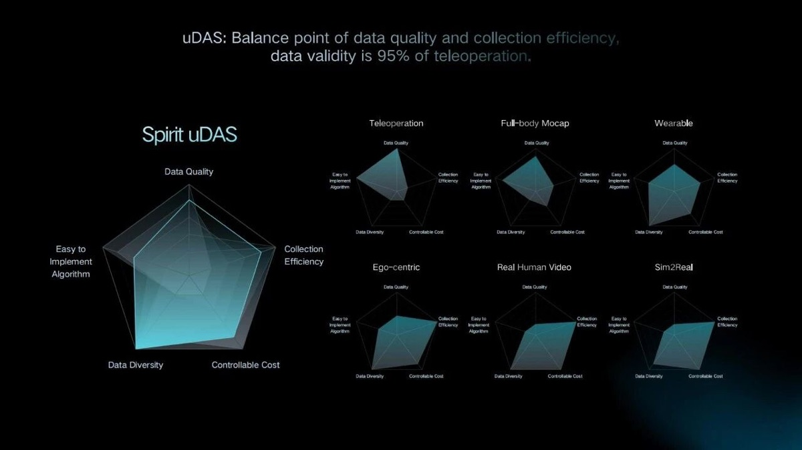

# Spirit AI × T01 — Products and Solutions

⬆ [Spirit AI profile](../Spirit-AI.md) · [Brief](Spirit-AI-T01-1-Brief.md) · [Playbook](Spirit-AI-T01-3-Playbook.md)

**Bottom line for T01:** Spirit AI gives you an **indoor service robot that can drive itself to a saved point and use two arms there**. It gives you nothing for streets, snow or stairs. Only **Moz1** is realistically buildable this weekend; Moz2 is the product that actually targets this track but is still in early validation.

## Relevant products (ranked for this track)

### Moz1

**Role in T01:** the indoor "last 50 metres" worker — drive along a hotel, clinic or shop floor, then pick, place, hand over or tidy with two arms.

| Track-relevant spec | Value (official docs unless marked) |
|---|---|
| Degrees of freedom | **26**: base 4 · leg-waist (torso) 6 · arms 7 + 7 · neck 2 |
| Base | Omnidirectional wheeled platform; Cartesian limit **500 mm/s**, rotation **60 °/s** |
| Navigation sensor | **Livox MID-360S** LiDAR (with IMU), mounted horizontally on the base |
| Cameras | Head: Intel RealSense **D455** ×1 (default 50° down-tilt) · wrists: RealSense **D405** ×2 |
| End effectors | Two-finger grippers ×2 (end-effector bus switchable CAN / RS-485) |
| Force sensing | Torque sensor in every joint; collision stop; overload and over-temperature shutdown |
| Environment | **IP40** · **−10 to 50 °C** · ≤ **75 % RH** non-condensing · docs say **not to run in rain, snow or open-air conditions**, and to avoid smooth or wet floors |
| Charging | Manual plug-in, **54.8 V / 10 A**; battery rated ≥ 1,000 cycles. Runtime in hours: not public |
| Emergency stops | Back, mobile base, and wireless handheld (handheld per company profile) |
| Payload, reach, height, weight, slope / threshold limits, lift / door capability | not public |

- **Status:** ✅ shipping to industrial and research customers. **Price:** not public. **On site at Leukerbad:** ⚠️ unverified (profile's best guess: one Moz1 + Quest teleop kit).
- **What the developer interface lets you control (MozRobot SDK, Python):**
  - Three configurations: `dualarm`, `wholebody_without_base`, `wholebody` (arms + torso + base).
  - Arms and torso: joint-space **or** Cartesian targets (one mode per unit at a time); grippers by position in metres.
  - Base: velocity command `[vx, vy, wz]` (only in base velocity mode).
  - Observations: joint and Cartesian states, gripper state, base velocity, and **RGB** images from `cam_high`, `cam_left_wrist`, `cam_right_wrist` (cameras refresh at 30 Hz). Depth in the SDK observation dict: not documented.
  - You must stream commands at a **stable rate (default 120 Hz)** with smooth trajectories — you write the trajectory generator; the docs show no built-in motion planner.
  - Direct torque / impedance API: not documented publicly.
- **Autonomy caveat (from the manual):** the robot has no built-in decision-making; every action must be commanded by your code, teleop, or a policy you deploy.

### Moz1 SLAM navigation stack (part of the Moz1 docs)

**Role in T01:** the fastest route to "robot goes from A to B on its own". This is the single most useful asset for this track.

| Item | Detail |
|---|---|
| Pipeline | MID-360S LiDAR + IMU → LiDAR SLAM (mapping) → relocalisation in an offline map → **Navigation2**-based planner → `control_bridge` converts `/cmd_vel` for the chassis |
| Delivery | Tarball `nav_stack.tar` with an offline **Docker** image and scripts: `run_mapping.sh`, `run_save_map.sh`, `run_nav.sh`, `stop_all.sh` |
| Sending goals | RViz "Nav2 Goal", or a **ROS 2 service** that accepts a pose sequence (one pose = go there; several = via-points then final). Custom interface package + `example.py` provided |
| Helpers | `record_pose.sh` (save waypoints), `run_circle.sh` (loop test), `single_pose.py` |
| Frames | Global pose = `moz1/map` → `moz1/base_link` (read with `tf2_echo`) |
| Middleware | CycloneDDS (`rmw_cyclonedds_cpp`) for the service interface |
| Speed setting | Tuned at 100 % controller speed; default is 10 %; docs suggest **50 %** for first runs. The controller's "follow" switch must be on or the base ignores nav commands |
| Map hygiene | Map while the area is empty — people create ghost obstacles. Point clouds can be trimmed in MeshLab / CloudCompare; relocalisation reads **.ply and .pcd** |

- **Status:** ✅ documented for Moz1 (docs v2.7). The tarball is not a public download — ask the on-site team. Whether it is pre-installed on the event robot: ⚠️ unverified.

### MozRobot SDK

**Role in T01:** scripted manipulation at each stop (pick tray, place parcel, press, hand over).

- ✅ Available to customers; Python ≥ 3.10, Ubuntu 22.04, ROS 2 Humble, `ROS_DOMAIN_ID=33`, wired link on `172.16.0.x` (details in the [profile](../Spirit-AI.md)).
- Useful calls: `connect()`, `enable_external_following_mode()` (mandatory before commands), `send_action(dict)`, `capture_observation()`, `reset_robot_positions(...)` (asynchronous — wait 3–5 s).
- Price: bundled with the robot. Public pip package: not public.

### Moz2

**Role in T01:** the company's purpose-built answer to this track — but treat it as roadmap evidence for your pitch, not as a build platform.

| Spec | Value (Spirit AI WAIC article) |
|---|---|
| DoF | **32** |
| Base | Omnidirectional steering-wheel chassis, foldable leg structure |
| Arms / hands | 7-DoF arms, **4-DoF three-finger** hands |
| Sensing | LiDAR + vision + ultrasonic; mapping and dynamic obstacle avoidance in crowded shared spaces |
| Modularity | Magnetic mounting points; named accessories: **delivery rack**, **inspection module** |
| Target uses | Retail shelf stocking, **hotel delivery**, **building inspection**, exhibition guiding; voice conversation |

- **Status:** 🧪 first shown at WAIC Shanghai (opened 17 July 2026); stage = interaction refinement and user-experience validation. Price, ship date, SDK: not public. On site: unlikely.

### Spirit v1.5

**Role in T01:** optional learned manipulation skill; strong pitch material, weak 48-hour tool.

| Item | Detail (GitHub README) |
|---|---|
| Architecture | VLA: Qwen3-VL backbone + DiT action head; outputs action chunks (default chunk **60**) |
| Released | Base checkpoint + one fine-tuned RoboChallenge checkpoint ("move objects into box"); inference code (Jan 2026); fine-tuning code (Apr 2026) |
| Licence | **MIT** |
| Compute | Inference tested on **A100 80 GB**; fine-tuning recommended on **8× A100 80 GB** (defaults: batch 32, 40,000 steps) |
| Moz1 checkpoint for service tasks | not public |

- **Status:** ✅ available, free. No Moz1 deployment recipe in the public repo — the repo's runtime wrapper targets RoboChallenge.

### Spirit v1.6

- 🧪 Closed VLA + world-model system; ran the WAIC "tidy up the living room" chain on Moz1. Not downloadable; only relevant if staff run it for you. Its RoboArena ranking is disputed (see profile).

### uDAS

- 🧪 Data-collection device mentioned with Moz2 (human operation data transferred to the robot). No public spec; no T01 role this weekend.

## What Spirit AI already does in this domain

**Honest summary: no confirmed urban-service deployment (delivery, cleaning, concierge, municipal) was found.** What exists is adjacent:

| Date | What | Relevance to T01 | Source |
|---|---|---|---|
| Dec 2025 | Moz robots deployed at scale on a CATL battery production line | Proves multi-unit operation, but industrial, structured, indoor | [profile](../Spirit-AI.md) |
| Mar 2026 | JD.com strategic agreement; Moz robots reportedly linked to JD MALL retail scenes (e.g. coffee) ⚠️ unverified | Only retail-service hint; the NBD article read for this doc lists JD merely as a pilot partner | [NBD](https://www.nbd.com.cn/articles/2026-06-03/4416899.html) |
| 20 May 2026 | D-Robotics partnership: Spirit v1.5 runs end-to-end on Sunrise S600 (**560 TOPS**); demo tasks include handing over capsule toys and tidying cluttered desks; retail and commercial services named as focus sectors | Edge compute for a service robot without a GPU server | [Spirit AI news](https://www.spirit-ai.com/en/news/45) |
| July 2026 | WAIC: Moz1 + Spirit v1.6 "tidy up the living room" from one instruction (cans away, dishes into dishwasher, thrown-in waste paper binned), replanning after disturbance, capsule-toy machine operation | Closest public demo to tidying / facility upkeep | [Spirit AI news](https://www.spirit-ai.com/en/news/48) |
| July 2026 | Moz2 debut for retail, hospitality, office buildings | First product aimed at this domain | [Spirit AI news](https://www.spirit-ai.com/en/news/48) |

- Chinese business press (June 2026) describes the CATL, JD and Bosch projects as mainly **pilots**, with no large recurring orders yet, and notes weak purchase economics for supermarket and home service robots.
- No outdoor, last-mile, cleaning-fleet, tourism or Europe activity found.

## What they are building next in this domain

- **Stated sequence:** "Industry first, commercial services next, home last" — T01-type services are the declared second step.
- **Moz2** 🧪 will "progressively inherit" Moz1's long-horizon planning and fine manipulation; accessories point to delivery and inspection duty. No dates.
- **Edge inference** 🔭: next steps with D-Robotics are on-robot testing, lower latency, and packaged solutions for manufacturing, retail and commercial services.
- **Data-efficiency goal** (press): fine-tune a new task with about **1 hour** of data to **95 %** success ⚠️ unverified target, not a shipped capability.
- **Inference (ours):** hotel delivery and building inspection on Moz2 imply elevator, door and multi-floor handling will be needed; nothing public shows these today.

## Software, models and data that help for this track

| Asset | Use in a T01 build | Access |
|---|---|---|
| Nav stack (Docker, Navigation2) | Mapping + waypoint navigation in hours, not days | From vendor (not a public repo) |
| MozRobot SDK + examples | Scripted arm / torso / base skills | From vendor |
| Quest VR teleop + collection app | Fallback for any manipulation step; record demonstrations | Ships with Moz1 (per docs) |
| Moz1 URDF; MuJoCo and Isaac notes | Rehearse trajectories off-robot while another team has the hardware | docs.spirit-ai.com |
| Pi0.5 / openpi adaptation for Moz1 | A second learned-policy route with lighter requirements than v1.5 fine-tuning ⚠️ unverified effort | After-sales channel (per profile) |
| [spirit-v1.5 repo](https://github.com/Spirit-AI-Team/spirit-v1.5) | Reference VLA; usable only with A100-class GPU and a suitable checkpoint | Public, MIT |
| Public datasets from Spirit AI for service tasks | — | not public |

## Gaps and limits for this track

- **Indoor only.** IP40, explicit ban on rain / snow / open-air use, wheeled base: no Leukerbad streets, ramps with ice, stairs or kerbs.
- **No building integration shown:** elevators, automatic doors, multi-floor maps, fleet management, charging dock (charging is manual).
- **Slow by design:** 0.5 m/s cap; nav defaults to 10 % speed until changed.
- **People in the map** degrade navigation quality; dynamic-crowd behaviour of the Moz1 stack is not documented (crowd avoidance is a Moz2 claim).
- **Perception is yours to build:** SDK returns RGB frames; no object detection, grasp planning or task planner is provided publicly.
- **Key numbers missing:** payload, reach, runtime, weight — ask before designing a carry task.
- **Docs are Chinese-first**; software artefacts (SDK wheel, nav tarball, Pi0.5 adaptation) depend on the on-site team.
- **Hardware scarcity:** likely a single unit shared across teams.
- Web search was unavailable during this track-specific pass; findings rest on official pages and docs read directly plus the company profile.

## Sources
- [Spirit AI news: WAIC 2026, Moz1 demos and Moz2 debut](https://www.spirit-ai.com/en/news/48)
- [Spirit AI news: D-Robotics partnership, Spirit v1.5 on Sunrise S600](https://www.spirit-ai.com/en/news/45)
- [Spirit AI news index](https://www.spirit-ai.com/en/news)
- [Docs: Moz1 mechanical structure (environment, sensors, joint limits, charging)](https://docs.spirit-ai.com/zh/moz1/mechanics.html)
- [Docs: Moz1 SLAM navigation](https://docs.spirit-ai.com/zh/slam-nav/slam_navigation.html)
- [Docs: MozRobot SDK API reference](https://docs.spirit-ai.com/zh/sdk/api.html)
- [Docs: MozRobot SDK data format](https://docs.spirit-ai.com/zh/sdk/data-format.html)
- [Docs: MozRobot SDK examples](https://docs.spirit-ai.com/zh/sdk/examples.html)
- [Docs: Moz1 product introduction](https://docs.spirit-ai.com/zh/moz1/product-intro.html)
- [Docs: Moz1 safety requirements](https://docs.spirit-ai.com/zh/moz1/safety.html)
- [GitHub: Spirit-AI-Team/spirit-v1.5](https://github.com/Spirit-AI-Team/spirit-v1.5)
- [NBD: A+ round and Spirit v1.6, 2026-06-03](https://www.nbd.com.cn/articles/2026-06-03/4416899.html)
- [Spirit AI company profile (general research and further sources)](../Spirit-AI.md)
