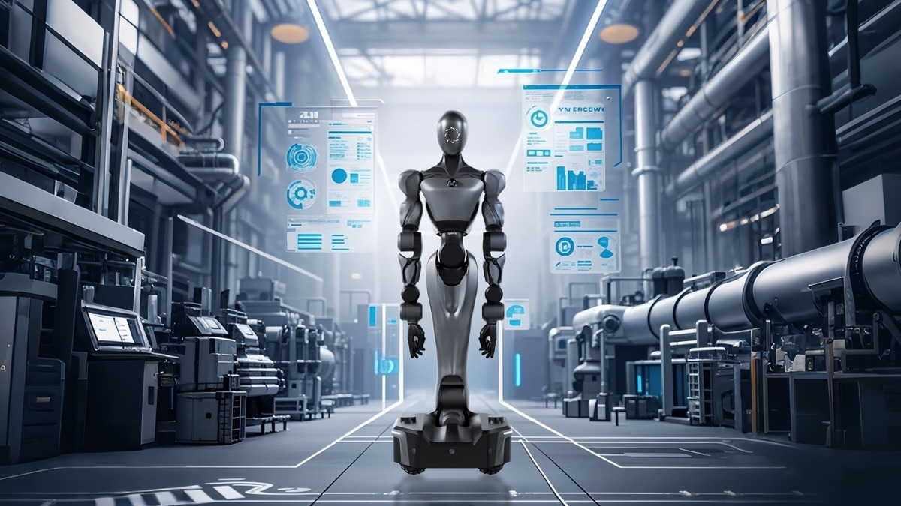
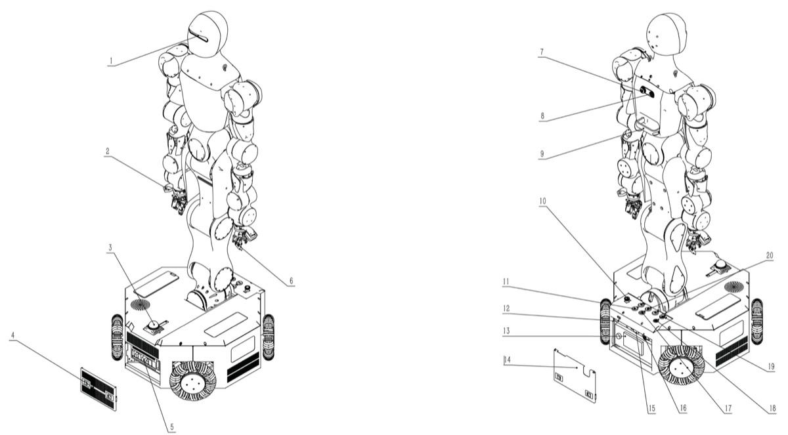
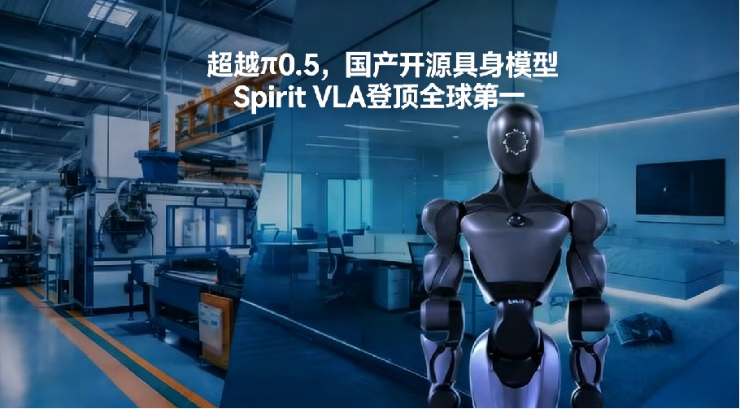
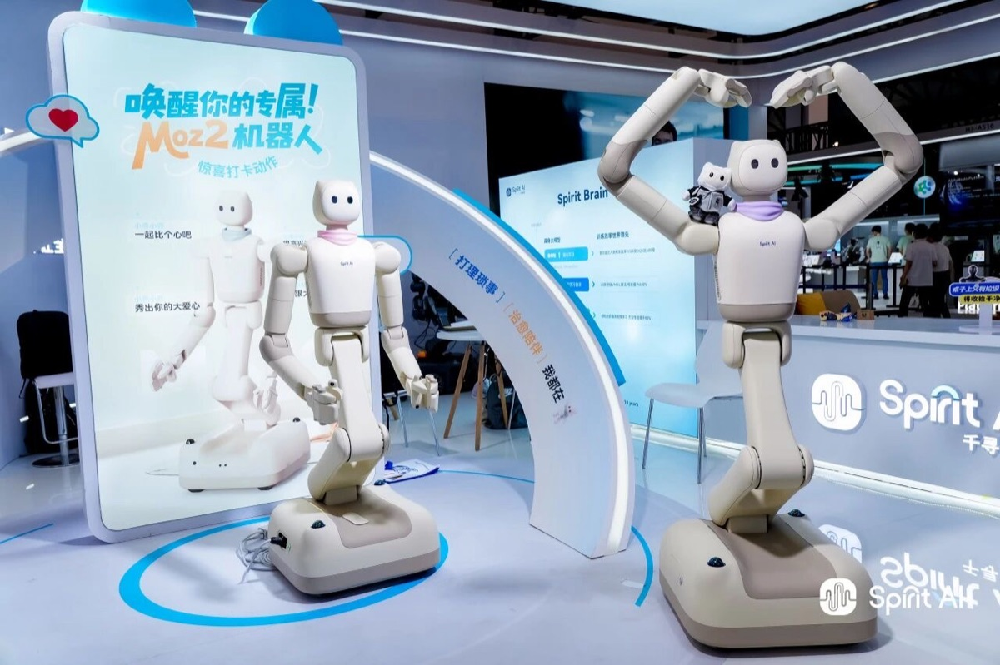
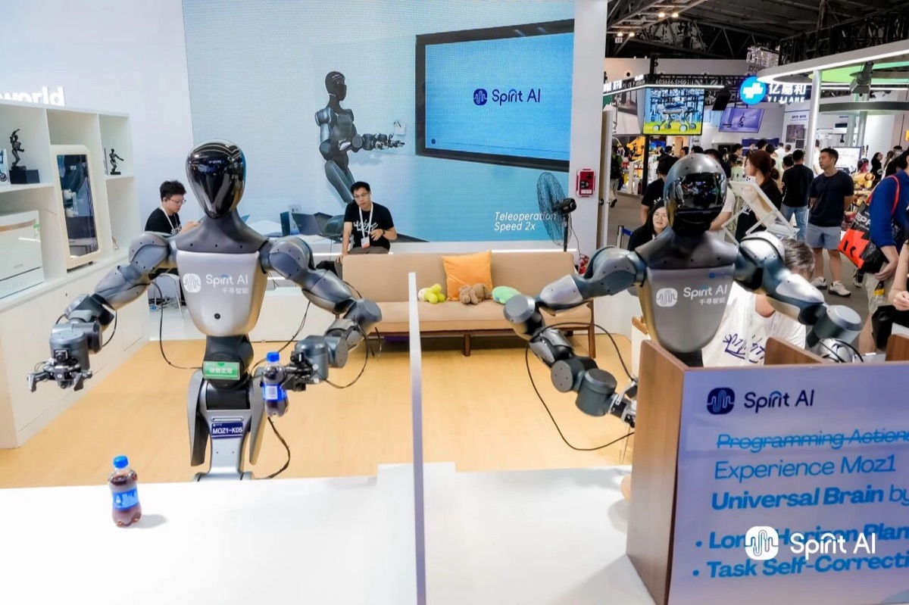
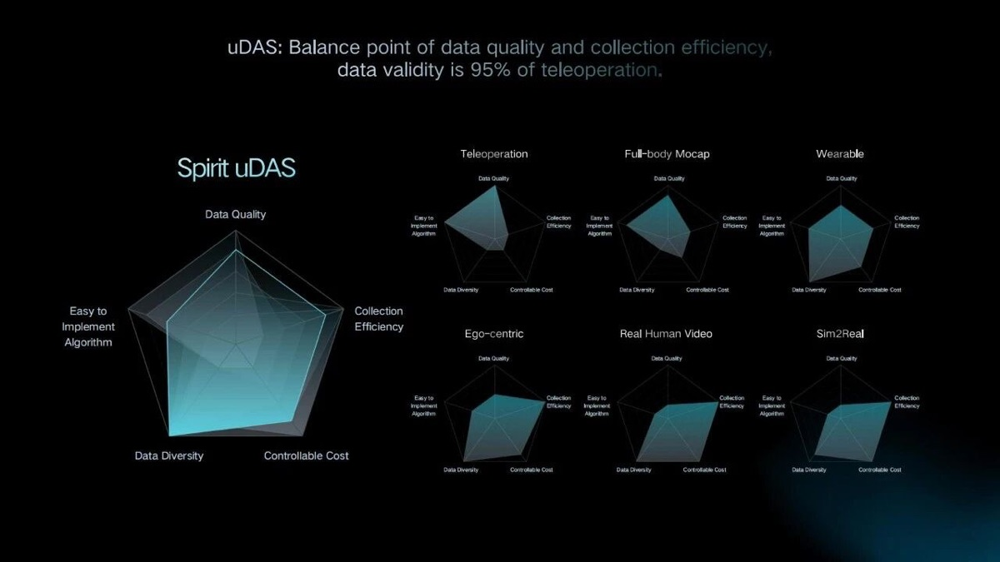

# Spirit AI × T02 — Products and Solutions

⬆ [Spirit AI profile](../Spirit-AI.md) · [Brief](Spirit-AI-T02-1-Brief.md) · [Playbook](Spirit-AI-T02-3-Playbook.md)

**Bottom line:** Spirit AI has no safety, emergency or infrastructure product. For T02 its value is one thing — a mobile robot with two force-controlled arms that can *act* (turn, press, pull, carry) inside a dry, flat, indoor technical space, driven by teleop or scripted SDK motions.

**Research note:** web search was unavailable during this track pass. Everything below comes from Spirit AI's official docs and news pages plus the company profile; a targeted press search for safety or inspection pilots could not be run, so "nothing found" means "nothing on official pages".

## Relevant products (ranked for this track)

### Moz1

**Role in T02:** indoor "remote hands" — operate valves, switches, breakers, doors and small loads in a plant room, tunnel service room or machine room while people stay out; secondary role as an indoor inspection-round robot using its LiDAR navigation and head camera.

| Track-relevant spec | Value (official docs unless marked) |
|---|---|
| Degrees of freedom | **26**: base 4 · torso (leg-waist) 6 · arms 2 × 7 · head 2 |
| End effectors | 2 × two-finger gripper |
| Arm joint speed limits | **210–300 °/s** per joint |
| Torso | 6 joints, **65 °/s**; lets the robot bend and reach low or high (reach in metres: not public) |
| Base | Omnidirectional wheeled platform, velocity control `[vx, vy, wz]`. A **500 mm/s** Cartesian limit is listed in the base row of the joint table ⚠️ unverified that this is travel speed |
| Cameras | Head: 1 × Intel RealSense **D455** · wrists: 2 × RealSense **D405** (30 Hz) |
| LiDAR | 1 × Livox **MID-360S** (LiDAR + IMU), mounted horizontally on the base, used for SLAM |
| Ingress protection | **IP40** — no water protection |
| Operating temperature | **-10 °C to 50 °C** |
| Humidity | ≤ **75 % RH**, non-condensing |
| Environment exclusions | Not for rain, snow or outdoor use; avoid wet or slippery floors, dust, strong electromagnetic fields (high-voltage lines, radio base stations) |
| Duty | Docs recommend no more than **8 h per day** |
| Battery | 1 lithium pack, charging **54.8 V / 10 A**, manual plug-in only; capacity and runtime: not public |
| Safety | 3 emergency stops (back, base, wireless module) · collision detection with adjustable sensitivity · over-temperature / overload protection · keep **2 m** clearance while debugging |
| Payload, reach, height, weight, slope and step limits | not public |
| Thermal, gas or acoustic sensors | none listed |

- **Status / price / availability:** ✅ shipping to industrial and research customers; price not public. Units on site at Leukerbad: ⚠️ unverified (profile guess: one Moz1 with VR teleop kit).
- **Developer interface (MozRobot SDK, Python):**
  - `MOZ1Robot.send_action()` streams commands at the control rate (default **120 Hz**); joint-space or Cartesian-space per limb (left arm, right arm, torso), not both at once.
  - `reset_robot_positions()` moves arms, torso and grippers to a stored posture — handy for scripted "approach" poses.
  - `capture_observation()` returns joint states, Cartesian poses, gripper state, camera images and chassis velocity.
  - Chassis: velocity control in `wholebody` mode; exact command keys are not shown on the API page.
  - **Not documented:** force / torque read-out, Cartesian impedance settings, head command, base odometry. Ask on site before designing around force feedback.
- **Navigation stack (separate from the SDK):** LiDAR SLAM + relocalisation + **Navigation2** in a Docker image (ROS 2 Humble, Cyclone DDS). Map by driving with the gamepad, save, then send goals from rviz or through a ROS 2 service that takes a sequence of map-frame poses (custom `navigation_interfaces` package, `scripts/example.py`). Relocalisation maps are **PLY / PCD** point clouds. Tuned at 100 % controller speed; docs suggest 50 % for first use.
- **Teleoperation:** Quest VR headset + two controllers. Triggers make the arms follow, grip buttons close the grippers, the headset drives the waist-legs, the right thumbstick drives the base. The documented setup is **cabled** (headset harness to the robot, CAT6 from PC to the robot's industrial PC) or via the robot's own Wi-Fi hotspot. Camera feed inside the headset: not stated. Remote (off-LAN) teleop and latency: not documented.
- **Manual driving:** Bluetooth gamepad + tablet, about **3 m** range.

### MozRobot SDK

**Role in T02:** the only supported way to script Moz1 — replay recorded arm trajectories for "close valve" or "press button", read the three cameras for inspection, and combine with the navigation service for a patrol.

| Item | Value |
|---|---|
| Language / OS | Python ≥ 3.10, Ubuntu 22.04, ROS 2 Humble (`ROS_DOMAIN_ID=33`) |
| Connection | Ethernet to the robot subnet (`172.16.0.20`; the teleop page also shows `172.16.1.20` — check on site) |
| Control rate | up to **120 Hz**; optional soft real-time and CPU pinning |
| Cameras | 3 × RealSense by serial number, default **320 × 240** per stream (configurable) |
| Public examples | 3: basic loop, context manager, Cartesian circle trajectory for one arm |

- **Status:** ✅ available to customers (v0.1.0); distributed as a wheel, not a public repo.
- **Control level:** position streaming in joint or Cartesian space. No public torque-level API.

### Spirit v1.5

**Role in T02:** optional. A learned manipulation policy could replace scripted motions for a skill such as "close the valve" — only realistic if Spirit AI staff supply a working Moz1 checkpoint or cloud GPUs.

| Item | Value |
|---|---|
| Licence | MIT, weights + inference + fine-tuning code public |
| Compute | Tested on NVIDIA A100 80 GB; fine-tuning recommended on **8 × A100** |
| Track-specific checkpoints | none (public fine-tuned checkpoint targets a tabletop benchmark) |

- **Status:** ✅ available, free.
- **Alternative in the docs:** a Pi0.5 / openpi adaptation for Moz1 (policy server + robot client); source via after-sales support, not public.

### Moz2

**Role in T02:** direction of travel only. It is the first Spirit AI robot for which the company names **building inspection** as a use and an attachable **inspection module** as an accessory.

| Item | Value |
|---|---|
| DoF / hands | **32** DoF, 7-DoF arms, 4-DoF three-finger hands |
| Mobility | Omnidirectional steering-wheel chassis, foldable legs |
| Sensing | LiDAR + vision + ultrasonic for mapping and obstacle avoidance in crowded public spaces |
| Accessories | Magnetic mounting points (delivery rack, inspection module) — no details published |

- **Status:** 🧪 public debut at WAIC, Shanghai, July 2026; early user-experience validation. No price, ship date or SDK. Do not plan on it being at Leukerbad.

### Spirit v1.6 and uDAS

- **Spirit v1.6** 🧪 closed model (VLA + world model). Relevant idea for T02: replanning when the scene is disturbed mid-task. Not available to developers.
- **uDAS** 🧪 data-collection device; no public spec. No T02 role.

## What Spirit AI already does in this domain

**Nothing confirmed.** No emergency-response, search-and-rescue, hazard-monitoring, security-patrol or infrastructure-inspection deployment, pilot or demo appears on the official site or docs.

Closest adjacent facts:

| Date | Fact | Relevance to T02 |
|---|---|---|
| Dec 2025 | Company reports Moz1 deployed at scale on a CATL battery production line | Shows the robot runs in a real industrial facility; not a safety task |
| May 2026 | Bosch China partnership (factories and logistics centres, sensors and actuators) | Industrial data and components; no inspection scope stated |
| Jul 2026 | Moz2 debut: "building inspection" listed among future applications, "inspection module" as accessory | First explicit inspection hint; no product detail |
| Ongoing | Moz1 user manual: robot takes no independent decisions; all commands come from the user | Positions the robot as an operated tool — consistent with a teleop "remote hands" role |

## What they are building next in this domain

- **Announced:** Moz2 as a commercial service robot for retail, hotels and office buildings, with building inspection and an inspection module on the list 🧪. No timeline.
- **Stated priority order:** industry first, commercial services next, home last. Public safety and emergency response are not on that list.
- **Inference (not announced):** the inspection use case is likely routine facility rounds in commercial buildings (the LiDAR + ultrasonic sensing is described for crowded public spaces), not hazardous-environment response.
- **Inference:** the D-Robotics Sunrise S600 port of Spirit v1.5 🔭 points to on-board policy inference, which would matter for robots working where the network is down — a real T02 concern, but not a shipped feature.

## Software, models and data that help for this track

| Asset | What it gives a T02 team | Access |
|---|---|---|
| MozRobot SDK examples | Starting loop for scripted arm motions and camera capture | Wheel from Spirit AI staff; docs public |
| Navigation Docker stack (`nav_stack`, Nav2) | Map a room, send pose-sequence goals from Python → patrol route in hours | On the robot / from staff |
| Quest VR teleop app | Day-1 manipulation without any model; also records demonstrations | Ships with Moz1 |
| Moz1 URDF (26 DoF) | Simulation in MuJoCo or Isaac, reach checks for valve heights | Docs download page |
| Spirit v1.5 (GitHub, MIT) | Base VLA + fine-tuning code | Public; needs data-centre GPUs |
| Pi0.5 / openpi Moz1 adaptation | Policy server + client pattern for a learned skill | After-sales, not public |
| Track-specific datasets (valves, gauges, hazards) | none from Spirit AI | — |

Perception for inspection (gauge reading, leak or obstruction detection) is not provided; run an off-the-shelf vision or vision-language model on your own laptop against the RealSense frames.

## Gaps and limits for this track

- **Environment:** IP40, no rain, snow, wet floors or outdoor use; humidity ≤ 75 % RH. That excludes most real Leukerbad hazards (snow, slopes, flood) and may exclude steamy thermal-bath plant areas.
- **Terrain:** wheeled base; stairs, kerbs and slopes are not specified — assume flat indoor floors only.
- **Hazard sensing:** no thermal camera, gas sensor or microphone array listed. Bring your own or use another vendor.
- **Remote operation:** teleop is documented as cabled / local network. Long-range or through-wall operation, operator video and latency are undocumented.
- **Force feedback:** force control is a headline feature, but no force read-out or impedance API is public.
- **Payload and runtime:** not public — do not promise "carries X kg for Y hours".
- **Autonomy:** no ready inspection or anomaly-detection software; navigation goals are set by hand.
- **Learning:** VLA fine-tuning is out of reach on a laptop in 48 hours.
- **Support:** docs are Chinese-only; SDK is v0.1.x; likely a single robot shared between teams ⚠️ unverified.

## Sources

- [Spirit AI news: WAIC 2026, Spirit v1.6 demos and Moz2 debut](https://www.spirit-ai.com/en/news/48)
- [Docs: Moz1 mechanical structure (DoF, joint limits, sensors, IP rating, environment)](https://docs.spirit-ai.com/zh/moz1/mechanics.html)
- [Docs: Moz1 safety requirements](https://docs.spirit-ai.com/zh/moz1/safety.html)
- [Docs: Moz1 product introduction](https://docs.spirit-ai.com/zh/moz1/product-intro.html)
- [Docs: Moz1 remote controller](https://docs.spirit-ai.com/zh/moz1/controller.html)
- [Docs: MozRobot SDK quick start](https://docs.spirit-ai.com/zh/sdk/get-started.html)
- [Docs: MozRobot SDK API reference](https://docs.spirit-ai.com/zh/sdk/api.html)
- [Docs: MozRobot SDK examples](https://docs.spirit-ai.com/zh/sdk/examples.html)
- [Docs: SLAM navigation](https://docs.spirit-ai.com/zh/slam-nav/slam_navigation.html)
- [Docs: teleoperation quick start](https://docs.spirit-ai.com/zh/teleop/get-started.html)
- [Spirit AI company profile in this vault (CATL, Bosch, D-Robotics, Spirit v1.5 facts and their sources)](../Spirit-AI.md)
