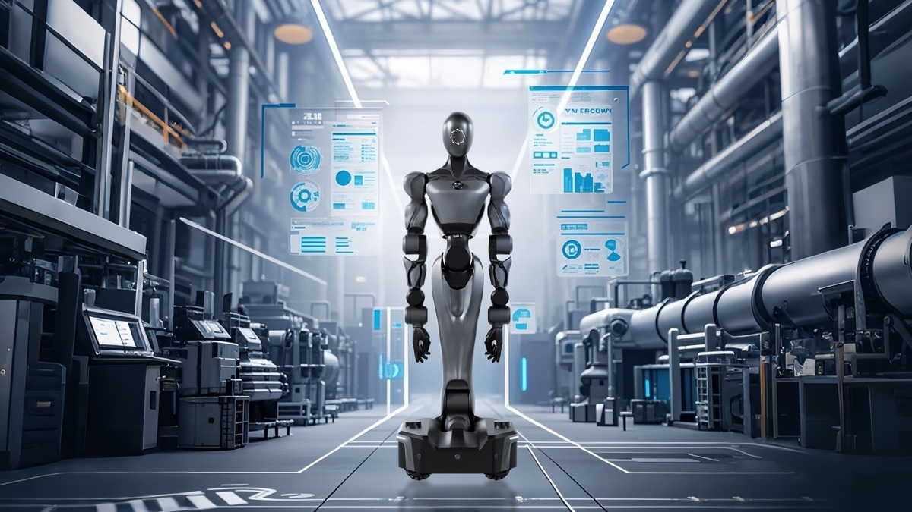
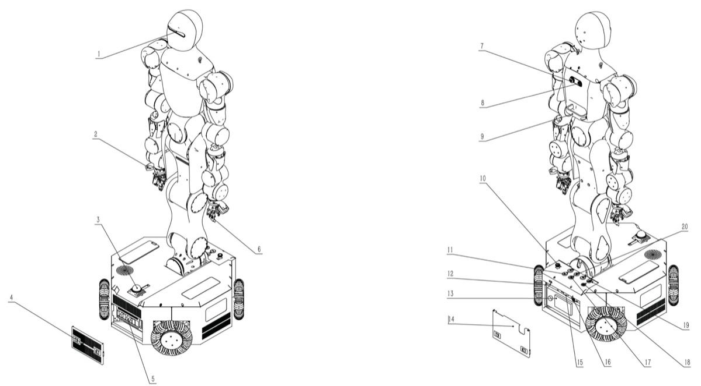
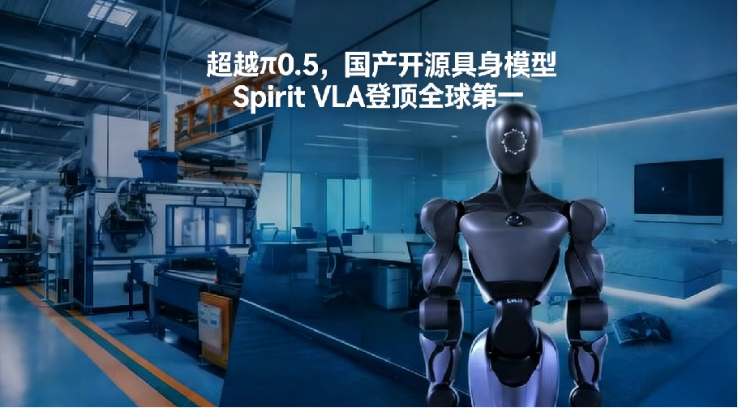
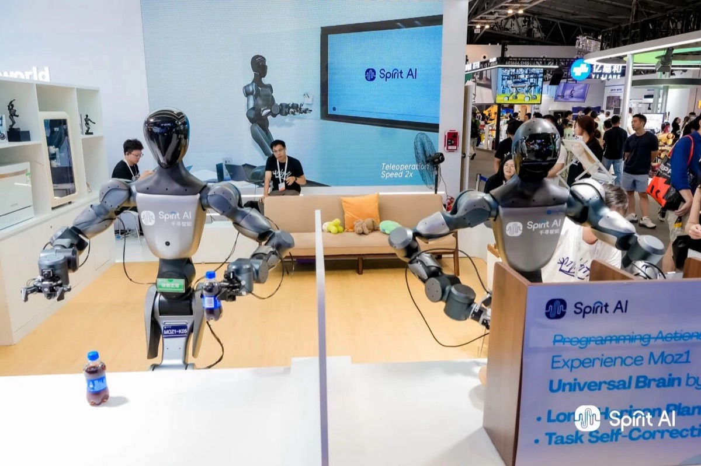
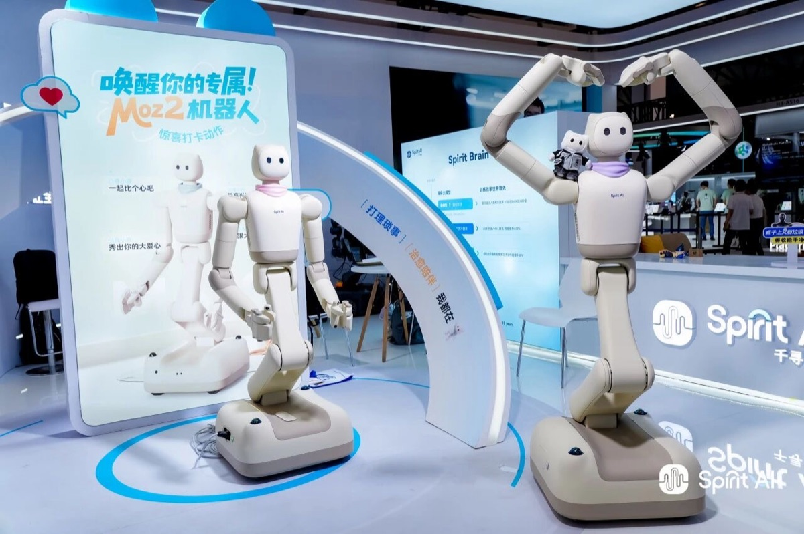
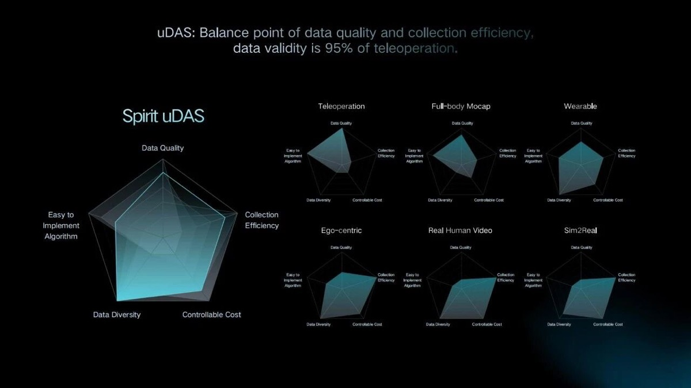

# Spirit AI × T03 — Products and Solutions

⬆ [Spirit AI profile](../Spirit-AI.md) · [Brief](Spirit-AI-T03-1-Brief.md) · [Playbook](Spirit-AI-T03-3-Playbook.md)

**Bottom line:** Spirit AI has **no sustainability-specific product, pilot or partner**. What it offers T03 is general indoor dual-arm manipulation (sort, tidy, load, plug) plus an open VLA model. Treat it as the manipulator inside your own sustainability concept.

## Relevant products (ranked for this track)

### Moz1

**Role in T03:** the only Spirit AI robot a team can realistically program — dual-arm sorting of recyclables, separating reusables from waste, loading a dishwasher, operating knobs / plugs / switches indoors.

| Track-relevant spec | Value |
|---|---|
| Form | Wheeled humanoid: two arms, head, omnidirectional wheeled base |
| Degrees of freedom | **26** (URDF on the docs site) |
| Arms | **7-DoF**, force / position hybrid control, collision detection, whole-body STO |
| Cameras used by SDK | **3** Intel RealSense over USB 3.0 |
| Control loop | up to **120 Hz** |
| Other sensing (docs glossary) | radar, microphone, force sensors |
| Payload, reach, gripper type / stroke | not public |
| Battery, runtime, base speed | not public (the CATL article says the deployed robots run on CATL batteries) |
| IP rating, temperature range | not public. Docs warn perception can fail in strong light, strong EMI or **high humidity** |
| Intended environments (docs) | homes, offices, medical, education — indoor, flat floor |
| Safety | three emergency stops (base, back, wireless); docs recommend **≥ 2 m** distance while debugging |

- **Status / price / availability:** ✅ shipping to industrial customers and labs · price not public · presence at Leukerbad ⚠️ unverified.
- **What you can control:** dual-arm or whole-body configurations, with or without the base, from Python; teleoperate in relative or Cartesian mode with a Quest headset; record demonstrations; run a deployed policy from the collection app. Low-level torque API: not documented publicly.

### MozRobot SDK

**Role in T03:** the path to a scripted sorting or patrol skill in hours rather than days.

| Item | Value |
|---|---|
| Language / version | Python ≥ 3.10 only · **v0.1.0** (2025-09-25) |
| Host | Ubuntu 22.04, x86_64 or aarch64 |
| Middleware | ROS 2 **Humble**, `ROS_DOMAIN_ID=33`; build the `mc_core_interface` package first |
| Network | Ethernet, static IP in `172.16.0.x`; robot at `172.16.0.20` |
| Entry points | `MOZ1Robot`, `MOZ1RobotConfig`; `example/example_usage.py` (flags `--no-camera`, `--enable-soft-realtime`, `--bind-cpu`) |
| Method-level API | on a separate API reference page — not reviewed, ask on site |

- **Status:** ✅ delivered to customers as a wheel file; not on PyPI or a public repo.
- **aarch64 support** means an ARM edge board can be the control host (relevant for a low-power story).

### Spirit v1.5

**Role in T03:** optional learned-policy layer for "put object X in bin Y" behaviours; also the open-model talking point.

| Item | Value |
|---|---|
| Licence | MIT (GitHub) |
| Public checkpoints | base model; one fine-tune for RoboChallenge **"move objects into box"** (Hugging Face) |
| Inference hardware | tested on NVIDIA **A100 80 GB** |
| Fine-tuning hardware | recommended **8× A100 80 GB** (FSDP, gradient checkpointing) |
| Benchmark | #1 on RoboChallenge Table30 as of 2026-01-11 |
| Moz1 embodiment support in the public repo | not stated — the public runner targets RoboChallenge robots ⚠️ unverified for Moz1 |

- **Status:** ✅ weights + inference code (Jan 2026), fine-tuning code (Apr 2026) · free.
- **Edge:** 🧪 integrated on D-Robotics Sunrise S600 (**560 TOPS**), 2026-05-20; no latency or power figures published; on-robot testing was "next".

### Spirit v1.6

**Role in T03:** proof that the stack can do long-horizon tidying with waste disposal; **not something you can build on**.

| Item | Value |
|---|---|
| Type | Closed VLA + world model, end-to-end |
| Shown | WAIC, July 2026: four chained subtasks from "tidy up the living room"; binning paper thrown in mid-task; dynamic replanning; pill sorting |
| Access | not released; company-run demo only, if at all |

- **Status:** 🧪 demo · price not public.

### Moz2

**Role in T03:** roadmap only. Its named accessory "inspection module" and the target scenario "building inspection" are the closest Spirit AI comes to resource / facility monitoring.

| Item | Value |
|---|---|
| DoF | **32** |
| Base / body | omnidirectional steering-wheel chassis, foldable leg structure |
| Hands | **4-DoF** three-finger |
| Sensing | LiDAR + vision + ultrasonic |
| Accessories | magnetic mounting points; delivery rack, inspection module |

- **Status:** 🧪 debuted July 2026, early user-experience validation · no price or ship date · unlikely on site.

### uDAS

**Role in T03:** none directly. Data-collection device meant to transfer human operation data to the robot. 🧪 No public spec, price or developer access.

## What Spirit AI already does in this domain

**Nothing sustainability-specific was found.** Adjacent evidence only:

| Date | What | Relevance to T03 | Source |
|---|---|---|---|
| Dec 2025 (reported) | Moz robots on a CATL battery-pack line (Zhongzhou base): plugging high-voltage test connectors at EOL / DCR stations, **>99 %** insertion success, harness inspection, patrol inspection between tasks | Clean-energy supply chain; force-controlled plugging is the same skill class as connector or charger handling. It is manufacturing, not city sustainability | [Spirit AI news](https://www.spirit-ai.com/en/news/23) |
| 2026-05-07 | Bosch China alliance: data loop in Bosch's China factories and logistics centres | Logistics data only; no sorting or energy task named | [Spirit AI news](https://www.spirit-ai.com/en/news/29) |
| 2026-05-20 | Spirit v1.5 running on D-Robotics Sunrise S600 | Edge inference without a GPU workstation; efficiency numbers not published | [Spirit AI news](https://www.spirit-ai.com/en/news/45) |
| 2026-07-17 (WAIC) | Moz1 + Spirit v1.6: cans put away, dishes into dishwasher, stray paper detected and binned | Closest public demo to waste handling — one bin, no material sorting | [Spirit AI news](https://www.spirit-ai.com/en/news/48) |

No waste-sorting, recycling, EV-charging, building-energy, environmental-monitoring or urban-farming deployment, pilot or partner is public.

## What they are building next in this domain

- **Stated order:** industry first, commercial services next, home last. Sustainability is not named as a target.
- **Moz2 "building inspection"** 🔭 with a clip-on inspection module — *inference:* this could later cover facility checks (leaks, lights, doors), but no sensor list or energy use case is published.
- **Edge deployment** 🧪 with D-Robotics: aims are lower latency, lower deployment cost. *Inference:* lower-power on-board inference follows, but no wattage target is stated.
- **Retail / hospitality** (JD.com tie-up, Moz2): shelf stocking and hotel delivery — *inference:* back-of-house tasks such as returns or bussing are plausible extensions, none announced.

## Software, models and data that help for this track

| Asset | What it gives you in 48 h | Access |
|---|---|---|
| MozRobot SDK + `example_usage.py` | Scripted pick-and-place baseline | From Spirit AI staff (not public) |
| Quest VR teleop + collection app | Day-1 working demo by teleop; demonstration data; inference mode for a deployed policy | Ships with the robot per docs |
| Spirit v1.5 repo | Inference + fine-tuning code, `move_objects_into_box` checkpoint | [GitHub](https://github.com/Spirit-AI-Team/spirit-v1.5), MIT |
| RoboChallenge Table30 dataset (`task_table30_move_objects_into_box`) | Reference data for a box-placing task | Hugging Face (named in the repo README) |
| Pi0.5 / openpi adaptation (`pi05_moz`) | Policy server + robot client for Moz1, Docker compose | Docs describe it; source via after-sales support |
| Moz1 URDF (+ MuJoCo / Isaac notes) | Reach checks and motion planning in simulation before touching the robot | Docs download page |
| SLAM navigation section | Base navigation for a patrol concept | Docs; contents not reviewed |

Not provided: any waste / material classifier, recycling dataset, energy or environmental sensor integration. Bring your own perception model.

## Gaps and limits for this track

- **No domain track record** — every T03 claim must come from your concept, not from Spirit AI references.
- **Indoor only:** wheeled base, no public IP rating, humidity warning in the docs. Keep it away from spa pool areas, snow and wet floors.
- **Key specs missing:** payload, reach, gripper, runtime and energy draw are not public — you cannot compute energy-per-item without measuring it yourself.
- **Compute appetite:** Spirit v1.5 is specified for data-centre GPUs; the low-power edge port has no public numbers.
- **Developer friction:** Chinese-first docs, SDK v0.1.0, wheel distributed by hand, API reference not reviewed.
- **Availability:** number of units and even presence on site are unconfirmed; one shared robot is the likely best case.
- **Research limit:** the web-search quota for this run was exhausted, so this page relies on official pages fetched directly (news, docs, GitHub). A sustainability-related item in third-party press could have been missed.

## Sources

- [Spirit AI news: WAIC 2026, Moz1 + Spirit v1.6 demos, Moz2 debut](https://www.spirit-ai.com/en/news/48)
- [Spirit AI news: CATL battery-pack line deployment](https://www.spirit-ai.com/en/news/23)
- [Spirit AI news: Bosch China partnership](https://www.spirit-ai.com/en/news/29)
- [Spirit AI news: D-Robotics partnership, Spirit v1.5 on Sunrise S600](https://www.spirit-ai.com/en/news/45)
- [Docs: MozRobot SDK quick start](https://docs.spirit-ai.com/zh/sdk/get-started.html)
- [Docs: Moz1 product introduction](https://docs.spirit-ai.com/zh/moz1/product-intro.html)
- [Docs portal (ZH)](https://docs.spirit-ai.com/zh)
- [GitHub: Spirit-AI-Team/spirit-v1.5](https://github.com/Spirit-AI-Team/spirit-v1.5)
- [Spirit AI company profile (this repo)](../Spirit-AI.md)
