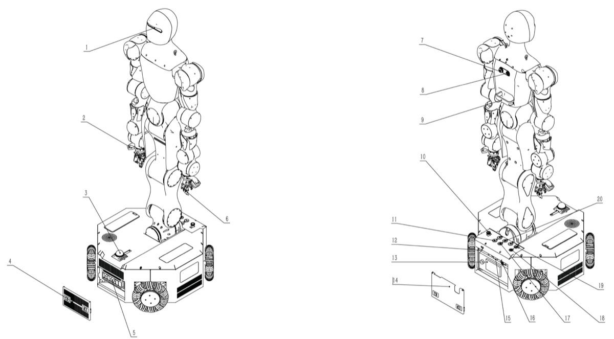
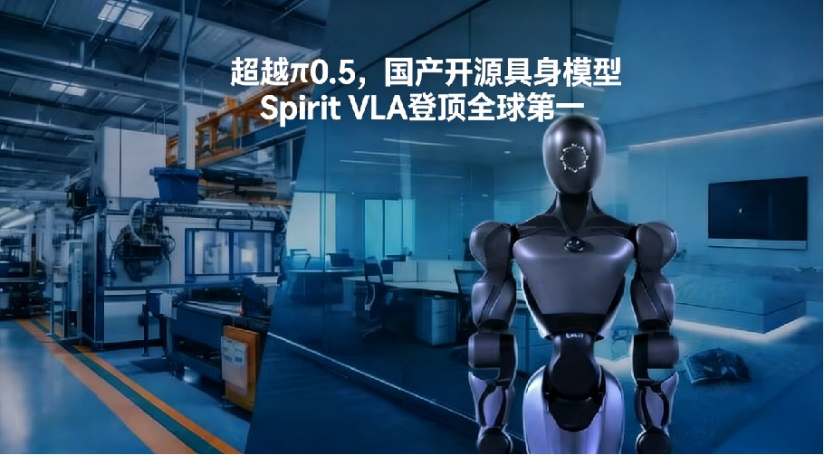
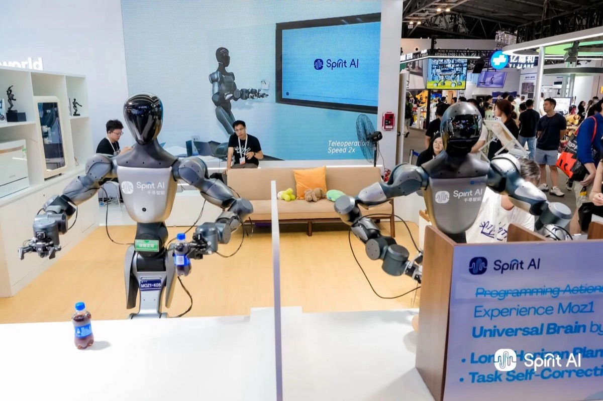
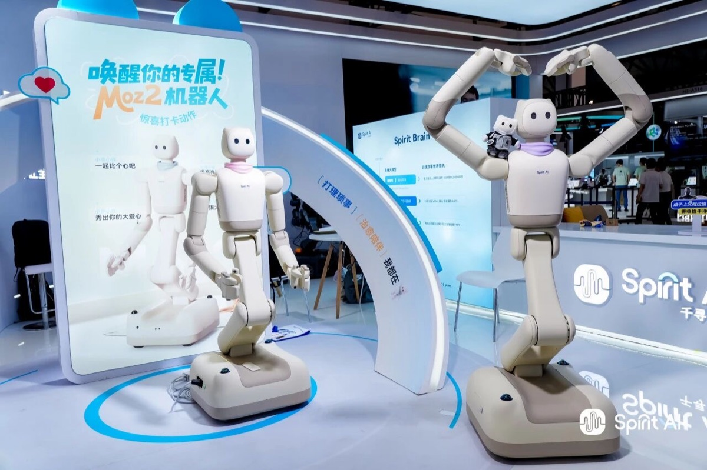
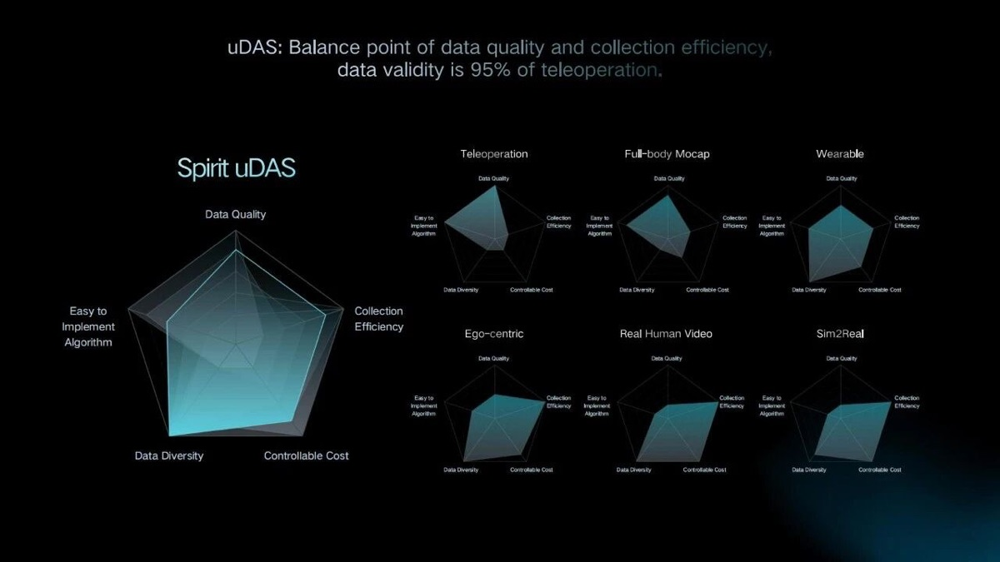

# Spirit AI × T04 — Products and Solutions

⬆ [Spirit AI profile](../Spirit-AI.md) · [Brief](Spirit-AI-T04-1-Brief.md) · [Playbook](Spirit-AI-T04-3-Playbook.md)

**Research note:** this file rests on the official site, docs portal and GitHub repo (read today) plus the company profile. A dedicated web search for care-sector news could not be run in this pass, so "nothing found" below means "nothing on official pages or in the profile research", not a full press sweep.

## Relevant products (ranked for this track)

### Moz1

**Role in T04:** the only Spirit AI robot you can realistically program on site. Use it as a mobile dual-arm helper for care logistics — fetch and bring, medication and drink delivery to a table, tidying trip hazards, caregiver tele-operation. Not for hands-on patient contact.

| Track-relevant spec | Value | Source |
|---|---|---|
| Degrees of freedom | **26**: base 4, leg/waist 6, arms 7 + 7, neck 2 | docs (mechanics) |
| End effectors | 2 × two-finger gripper; stroke and grip force not public | docs |
| Arm payload / reach, height, weight | not public (dimension drawing only) | — |
| Base speed | **500 mm/s** linear, **60 °/s** rotation; omnidirectional wheeled base | docs |
| Force sensing | Torque sensor in every joint; collision detection with adjustable sensitivity; compliant mode selectable for left arm, right arm, waist/legs | docs (safety) |
| Safety stops | 3 E-stops (back, mobile base, wireless module); whole-body STO per product page | docs, product page |
| Cameras | Head: 1 × RealSense **D455**; wrists: 2 × RealSense **D405**; images at 30 Hz through the SDK | docs |
| Navigation sensor | Livox **MID-360S** LiDAR (with IMU) on the base | docs |
| Environment | **IP40**, −10 to 50 °C, ≤ 75 % RH non-condensing, dry non-slip floor | docs |
| Battery | Lithium, ≥ 1000 cycles, charge 54.8 V / 10 A by manual plug-in; capacity and runtime not public | docs |
| Microphone / speaker | not documented — plan voice I/O on a laptop | — |

- **Status:** ✅ shipping (industrial customers). **Price:** not public. **On site at Leukerbad:** ⚠️ unverified, likely one unit.
- **Developer interface (MozRobot SDK, Python, ROS 2 Humble):**
  - `MOZ1Robot` / `MOZ1RobotConfig`; structures `dualarm`, `wholebody_without_base`, `wholebody`.
  - `send_action()` streams joint-space **or** Cartesian targets per arm / torso group at a fixed rate (up to **120 Hz**); `capture_observation()` returns joint state, end-effector pose, gripper state, base velocity and camera images; `reset_robot_positions()` for homing.
  - Base: velocity-controlled in `wholebody` mode; goal-based driving through the Nav2 stack.
  - **Not documented:** torque or impedance commands, force / torque readings, head control, a dedicated gripper method. Ask the engineers before designing anything force-based.

### MozRobot SDK

**Role in T04:** the fastest route to scripted care skills (pick a labelled box, place on a tray, hand-over pose).

| Item | Value |
|---|---|
| Language / OS | Python ≥ 3.10, Ubuntu 22.04, ROS 2 Humble (`ROS_DOMAIN_ID=33`) |
| Connection | Ethernet, host on `172.16.0.x`, robot at `172.16.0.20`; 3 × USB 3.0 for the RealSense cameras |
| Host requirement | x86_64 or aarch64, 8 GB+ RAM |
| Shipped examples | basic usage, context-manager pattern, circular Cartesian trajectory (5 cm radius) |
| Navigation add-on | Docker-based LiDAR SLAM + Nav2: `run_mapping.sh`, `run_save_map.sh`, `run_nav.sh`; goals from rviz or a ROS service that accepts a list of waypoints |

- **Status:** ✅ available to customers (v0.1.0). **Price:** bundled with the robot. Docs are in Chinese.

### Spirit v1.5

**Role in T04:** optional learned-skill layer for one repetitive care chore (for example clearing a meal tray). Treat as a stretch goal.

| Item | Value |
|---|---|
| Licence | MIT; weights on Hugging Face (`Spirit-AI-robotics/Spirit-v1.5`) |
| Released | Inference code + base checkpoint Jan 2026; fine-tuning code Apr 2026 |
| Compute | Inference tested on **A100 80 GB**; fine-tuning recommended on **8× A100 80 GB** |
| Ready-made checkpoint | One fine-tune for a RoboChallenge "move objects into box" task |
| Moz1 integration | Not described in the public repo — the public runner targets the RoboChallenge service |

- **Status:** ✅ available, free. No care-specific checkpoint or dataset.

### Spirit v1.6

**Role in T04:** proof that the pill-sorting and room-tidying behaviours are possible on Moz1; not something you can build on.

- **Status:** 🧪 closed, demo only (WAIC, July 2026). VLA + world model, long tasks from one instruction, replanning after disturbances. Price and access: not public.

### Moz2

**Role in T04:** the friendlier-looking service robot (soft rounded body, voice conversation, **32 DoF**, 4-DoF three-finger hands, LiDAR + vision + ultrasonic, magnetic accessory mounts such as a delivery rack). Its target sectors are retail, hospitality and office buildings — hotel delivery is the nearest neighbour to care-home logistics.

- **Status:** 🧪 public debut 17 July 2026, user-experience validation phase. No SDK, price or ship date public. Unlikely to be on site.

### uDAS

**Role in T04:** data-collection device mentioned with Moz2 (human operation data transfers to the robot body). Could in principle capture caregiver demonstrations.

- **Status:** 🧪 named only; no public spec, price or developer access.

## What Spirit AI already does in this domain

**Nothing care-specific was found.** No elderly-care, rehabilitation, hospital or home deployment, pilot or partner appears on the official site, in the docs or in the profile research.

Adjacent evidence:

| Date | What | Relevance |
|---|---|---|
| Jul 2026 | WAIC demo: Moz1 + Spirit v1.6 sorts multiple pill types with controlled grasp force — [news](https://www.spirit-ai.com/en/news/48) | Medication handling skill; presented as fine manipulation, with no patient or clinical context |
| Jul 2026 | Same event: "tidy up the living room" in four chained subtasks (cans, dishwasher, thrown paper) | Household chores for people who cannot do them |
| Jul 2026 | Moz2 debut for hotel delivery, guidance, building rounds | Service logistics close to care-home needs |
| 2025–2026 | Moz1 on CATL battery lines; JD.com retail scenarios | Reliability evidence, industrial only |
| Product page | Safety features described as making "companionship" closer | Only care-adjacent wording on the site |

## What they are building next in this domain

- **Stated order:** industry first, commercial services next, **home last** — so home and care use sits at the far end of the plan.
- **Moz2** 🧪 will progressively take over Moz1 capabilities for commercial service settings.
- **Edge inference** 🔭: Spirit v1.5 ported to D-Robotics Sunrise S600 (May 2026), on-robot testing announced as the next step.
- **Inference (ours):** a care-home or clinic logistics role for Moz2 is plausible after hospitality, but nothing has been announced. No medical-device certification effort is public.

## Software, models and data that help for this track

| Asset | Use in a T04 build | Access |
|---|---|---|
| MozRobot SDK examples | Cartesian pick-and-place skeleton | Customer package (ask on site) |
| Quest VR teleop app | Tele-care demo; data collection; has an inference mode for deployed policies | Ships with Moz1 |
| SLAM + Nav2 stack | Room-to-room rounds with waypoint lists | Docker bundle from Spirit AI |
| Moz1 URDF (26 DoF) + MuJoCo / Isaac notes | Rehearse motions without the robot | Docs download |
| Pi0.5 / openpi adaptation (`pi05_moz`) | Policy server + robot client pattern for a learned skill | Source and sample data via after-sales, not public |
| Spirit v1.5 repo + weights | Fine-tune on your own teleop data if cloud GPUs are available | [GitHub](https://github.com/Spirit-AI-Team/spirit-v1.5), MIT |
| Care datasets | none public | — |

## Gaps and limits for this track

- **People in the work area:** the Moz1 manual asks for **≥ 2 m** distance during commissioning and says children, pregnant women and people with chronic illnesses must not enter the operating area. Plan demos with hand-over via a table or tray and an actor as the "resident".
- **No documented force API:** torque sensing exists in hardware, but the public SDK shows position and Cartesian targets only. Physio assistance, massage or guided-motion ideas depend on undocumented access.
- **Grippers:** two-finger only on Moz1; loose pills, cutlery and clothing are hard without a learned policy.
- **Environment:** IP40, dry flat floors, ≤ 75 % RH — no thermal-bath areas, no stairs, no outdoor snow.
- **No voice hardware documented**, no fall-detection or vital-sign function, no medical certification.
- **Model compute:** the open VLA needs data-centre GPUs; the closed v1.6 behind the WAIC demos is not available.
- **Docs in Chinese; probably one robot** shared across teams.

## Sources

- [Spirit AI news: WAIC 2026 demos and Moz2 debut](https://www.spirit-ai.com/en/news/48)
- [Spirit AI product page](https://www.spirit-ai.com/en/product)
- [Spirit AI news: Moz1 launch](https://www.spirit-ai.com/en/news/13)
- [Docs: Moz1 product introduction](https://docs.spirit-ai.com/zh/moz1/product-intro.html)
- [Docs: Moz1 mechanics](https://docs.spirit-ai.com/zh/moz1/mechanics.html)
- [Docs: Moz1 safety](https://docs.spirit-ai.com/zh/moz1/safety.html)
- [Docs: MozRobot SDK quick start](https://docs.spirit-ai.com/zh/sdk/get-started.html)
- [Docs: MozRobot SDK API reference](https://docs.spirit-ai.com/zh/sdk/api.html)
- [Docs: MozRobot SDK examples](https://docs.spirit-ai.com/zh/sdk/examples.html)
- [Docs: SLAM navigation](https://docs.spirit-ai.com/zh/slam-nav/slam_navigation.html)
- [Docs: Pi0.5 adaptation (via profile research)](https://docs.spirit-ai.com/zh/open-resources/pi.html)
- [GitHub: Spirit-AI-Team/spirit-v1.5](https://github.com/Spirit-AI-Team/spirit-v1.5)
- [Spirit AI company profile (internal)](../Spirit-AI.md)
