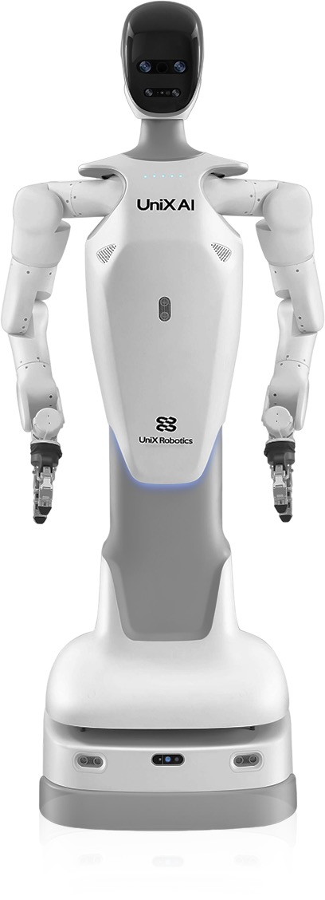
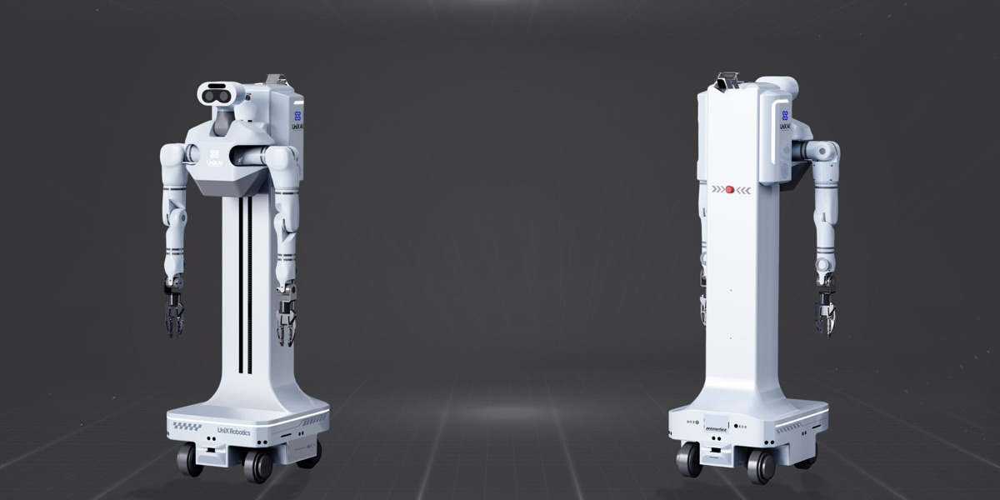
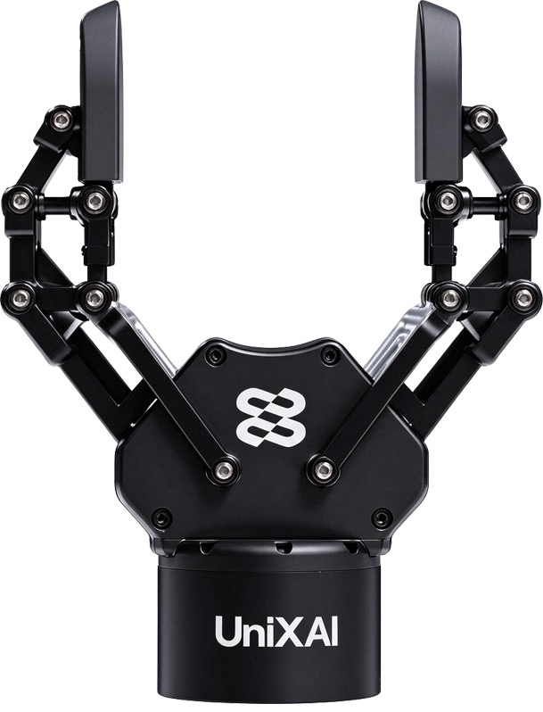
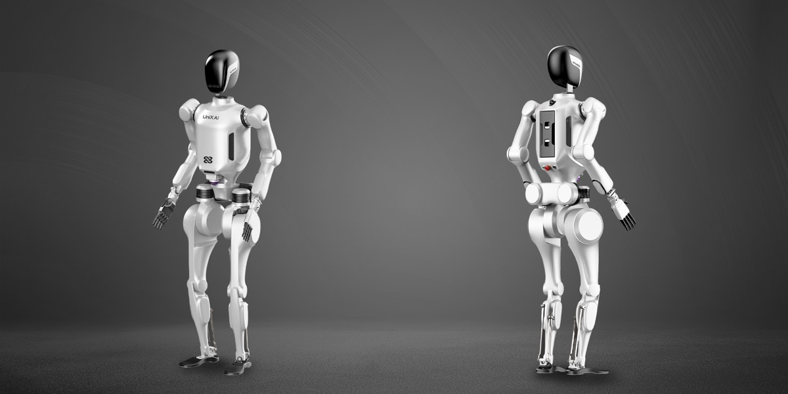

# UniX AI × T01 — Products and Solutions

⬆ [UniX AI profile](../UniX-AI.md) · [Brief](UniX-AI-T01-1-Brief.md) · [Playbook](UniX-AI-T01-3-Playbook.md)

> **Read this first:** specs below come from official product pages; application claims come from official application pages and press releases (vendor claims, no named sites unless stated). **Nothing about an SDK is public.** Which robot is physically in Leukerbad is a best guess — confirm at the booth.

## Relevant products (ranked for this track)

### Wanda 2.0

**Role in T01:** the default pick — indoor service robot for concierge / guiding, room and table delivery, restocking, wiping and tidying in hotels, baths, clinics and shops. Most likely model on site (⚠️ unverified).

| Track-relevant spec | Value |
|---|---|
| Base | Differential drive, hub motors |
| Max speed | **1.5 m/s** |
| Min. passage width | **75 cm** |
| Height / torso lift | 1.40–1.68 m / 280 mm (touch height up to 1.8 m) |
| Arms | 2 × 8-DoF, **982 mm** reach, ±0.5 mm repeatability |
| Payload | **6 kg per arm, 12 kg dual-arm** |
| Battery life | **8–16 h** (charging method and time not public) |
| Navigation sensors | 360° LiDAR, ultrasonic, base RGBD camera |
| Head sensors | Dual RGB + RGBD, 2-DoF head (yaw ±90°, pitch ±30°) |
| Voice hardware | 6-mic circular array |
| On-board compute | Up to **275 TOPS** (chip not public) |
| Slope / threshold / IP rating / weight | not public |

- **Status:** ✅ shipping (mass production since 2025; company claims 100+ units/month across its line).
- **Price:** not public.
- **Developer interface:** not public. Page mentions pre-loaded "L4-level" applications and fast learning by imitation. No API, SDK or ROS 2 statement. Expect skill-level control via vendor engineers unless told otherwise.

### Panther

**Role in T01:** the better base for tight public interiors and floor-level work (picking up litter, low shelves, bins) thanks to the omnidirectional chassis and long torso lift. Shorter runtime than Wanda 2.0.

| Track-relevant spec | Value |
|---|---|
| Base | **4WS + 4WD omnidirectional** |
| Max speed | **2 m/s** |
| Min. passage width | **65 cm** |
| Height / torso lift | 1.62–1.72 m / **800 mm** (works down to floor level) |
| Arms | 2 × 8-DoF, 982 mm reach, ±0.5 mm; **34 DoF** total |
| Payload | **12 kg dual-arm** |
| Battery life | **4–8 h**, 48 V platform |
| Navigation sensors | Front + rear 360° LiDAR; optional top 3D LiDAR and RGBD |
| Head sensors | Dual RGB, 2-DoF head (pitch +20° / −86°) |
| Voice hardware | 6-mic array, dual speakers |
| On-board compute | Optional up to **2070 TOPS** |
| End effector | UniPicker Pro; dexterous-hand compatible (interface not public) |
| Slope / threshold / IP rating / weight | not public |

- **Status:** ✅ launched 8 Apr 2026, deliveries started (company statement).
- **Price:** not public.
- **Developer interface:** not public; same situation as Wanda 2.0.

### UniPicker Pro

**Role in T01:** the hand that does the delivery and upkeep work — grasping bottles, towels, parcels, amenity items, litter.

| Track-relevant spec | Value |
|---|---|
| Type | Underactuated adaptive gripper |
| Max grip force | **100 N** |
| Payload | up to **10 kg** |
| Open / close time | 0.2 s |
| Mass | 400 g / 600 g (variants not specified) |
| Control | Hybrid force / velocity / position |

- **Status:** ✅ ships on the robots. **Price:** not public.
- **Developer interface:** not public as a stand-alone part (bus, protocol and mounting flange not published) — assume it is usable only on UniX robots.

### UniFlex / UniTouch / UniCortex

**Role in T01:** the on-robot skill engine. This is what makes "fetch that, bring it there, wipe this" work without you writing manipulation code.

| Component | What it does | What you can touch |
|---|---|---|
| UniFlex | Imitation learning from demonstrations (multimodal semantic keypoints + trajectory imitation) | Teaching a new skill on site — tooling not public, ask |
| UniTouch | Vision-tactile manipulation model | not public |
| UniCortex | Long-horizon task planner that chains skills | Whether an external planner can call skills — not public, ask |

- **Status:** ✅ runs on the robots; not released separately. No weights, code, benchmarks or datasets are public.

### Martian

**Role in T01:** marginal. Bipedal (148 cm, 40 kg, 5 kg payload) and rarely shown in service demos. Listed here only because it is the **one product whose page promises high- and low-level APIs for secondary development** (CAN FD, OTA). Unlikely to be on site (⚠️ unverified).

- **Status:** ✅ listed ("contact us"). **Price:** not public.

## What UniX AI already does in this domain

| Date | What | Evidence level |
|---|---|---|
| Aug 2025 | Wanda won **2 golds + 1 silver** in hotel room service and reception challenges, World Humanoid Robot Games, Beijing | Company site + 36Kr Japan |
| Dec 2025 | ~100 units/month shipped, backlog above 1,000 units; customer sectors: hotels, property management, security, retail, food and beverage | 36Kr Japan; customer names not public |
| Jan 2026 | CES 2026 demos with Wanda 2.0 / 3.0: app-ordered drink mixing, bed-making, surface wiping, **amenity restocking, waste sorting** | Company press release |
| 31 Mar 2026 | Fully autonomous tea-making by Panther at Morgan Stanley China Summit, Shenzhen | Company press release |
| 8 Apr 2026 | Company states Wanda 2.0 is operating in **security, hospitality and retail food service** | Company press release; no named customers |
| 20 Aug 2026 | WRC 2026, Beijing: Panther reported as deployed in **JD.com Seven Fresh Coffee's 24-hour unmanned store**; live tea service including delivery of cups | ⚠️ unreviewed event notes, single source |

**Application pages on the official site (undated vendor claims, no named sites):**
- **Reception & Guiding** — visitor reception and voice Q&A, exhibition tours with planned routes, **item delivery through "complex buildings" including elevator riding**, lobby patrol with alerts to building security systems. Target sites: office buildings, hotels, exhibition halls.
- **Household & Hotel** — 24/7 room maintenance; remote teleoperation over public networks; "open software and hardware interfaces with modular expansion" (no details).
- **Security** — multi-floor patrol of corridors, pantries and restrooms; fire-equipment cabinet checks; operating fire doors to test self-closing; cloud scheduling of several robots; data sync to a property-management platform.
- **Retail** — micro-fulfilment order picking linked to a WMS; pharmacy assistant by day, **unattended night attendant** fulfilling delivery orders.
- Homepage clips are labelled: delivery, bed-making, exhibition, fire hydrant inspection, toilet cleaning, retail replenishment, tea making.

**Nothing found for:** outdoor or street operation, last-mile delivery, waste-collection logistics, any deployment in Europe or Switzerland.

## What they are building next in this domain

- 🔭 Scale-up to **1,000 units/month** (Apr 2026 release).
- 🔭 "Productisation, globalisation and ecosystem development" as stated strategy; Panther global deliveries started in Apr 2026.
- 🧪 Unmanned retail (JD.com Seven Fresh Coffee, pharmacy night attendant) looks like the commercial spearhead for public-facing service — **inference** from the WRC report and the retail page.
- 🔭 Multi-robot cloud scheduling and property-platform integration are described on the security page — **inference:** a fleet / facility-management layer is in the product plan; no public API.
- Household service is the headline next market, not outdoor urban work. **No outdoor, all-terrain or delivery-vehicle product is announced.**
- Developer programme, open SDK or model release: **nothing announced.**
- No news for Sep–Nov 2026 was found (web search was unavailable during this track research; only known pages were re-read).

## Software, models and data that help for this track

| Need | What exists | Status |
|---|---|---|
| Manipulation skills (pour, wipe, pick, place, restock) | Pre-loaded applications on the robot | ✅ on-robot, list not public |
| Indoor navigation, obstacle avoidance | On-robot, LiDAR-based | ✅ on-robot; map format and goal API not public |
| Elevator riding / multi-floor | Claimed on application page | ⚠️ unverified; needs building integration, unrealistic in 48 h |
| New skill by demonstration | UniFlex imitation learning | Tooling not public — ask if you can record demos |
| Teleoperation | Local and remote, claimed low latency | Access not public — useful as a demo fallback |
| Fleet scheduling, WMS / property-platform links | Described on application pages | not public |
| Public SDK, ROS 2 packages, URDF / sim assets, datasets, model weights, GitHub | **None found** | not public |

**Practical shortcut:** bring your own layer. Speech-to-text, an LLM task router, a web / QR ordering page and a dashboard all run on a laptop and need only a thin "call skill / go to waypoint / get status" hook from the robot.

## Gaps and limits for this track

- **Developer access is the deciding unknown.** No public documentation of any interface on Wanda 2.0 or Panther.
- **Indoor only.** Wheeled bases; slope, threshold, kerb and IP ratings not published. Not for Leukerbad's streets, snow or stairs.
- **Small carry capacity.** 6 kg per arm, no documented tray or cargo bay — one or two items per trip.
- **Elevators and doors** need venue integration or a human helper.
- **Voice interaction languages** are not published; German / French support is unknown — plan your own speech layer.
- **Safety in public space:** no published safety certification or collision-force data; keep demos supervised and speeds low.
- **Evidence quality:** deployments are vendor claims without named customers, except the JD.com Seven Fresh Coffee report (single unreviewed source).
- **Prices and weights** are not public, so a cost-per-task argument has to be labelled as an estimate.

## Sources
- [UniX AI official site (homepage, "Robots In Action" labels)](https://www.unix-group.ai)
- [Wanda 2.0 product page](https://www.unix-group.ai/Wanda)
- [Panther product page](https://www.unix-group.ai/Panther)
- [Martian product page (specs taken via the company profile)](https://www.unix-group.ai/Martian)
- [UniPicker Pro product page (specs taken via the company profile)](https://www.unix-group.ai/UniPicker)
- [Applications overview](https://www.unix-group.ai/Applications)
- [Reception & Guiding application page](https://www.unix-group.ai/Reception-Guiding)
- [Household & Hotel application page](https://www.unix-group.ai/Household-Hotel)
- [Security Service application page](https://www.unix-group.ai/Security)
- [Retail application page](https://www.unix-group.ai/lspicture/1852/detail/51)
- [About UniX AI (via the company profile)](https://www.unix-group.ai/About-Unix-AI)
- [Press release, 2 Jan 2026: Wanda 2.0 at CES 2026 (via Webull / PR Newswire)](https://www.webull.com/news/14134140025406464)
- [Press release, 8 Apr 2026: Panther launch (TechNode Global / PR Newswire Asia)](https://technode.global/prnasia/unix-ai-introduces-panther-the-worlds-first-service-humanoid-robot-to-enter-real-household-deployment-powered-by-its-differentiated-wheeled-dual-arm-architecture/)
- [36Kr Japan, 21 Dec 2025: funding and shipments (via the company profile)](https://36kr.jp/449686/)
- [WRC 2026 live report, 20 Aug 2026 (iTiger)](https://www.itiger.com/news/1101359561)
- [UniX AI company profile (this repo)](../UniX-AI.md)
