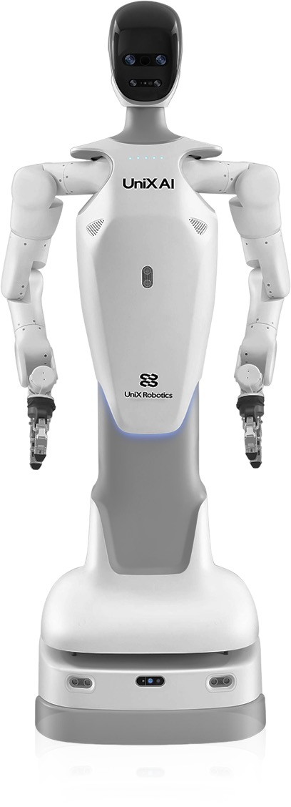
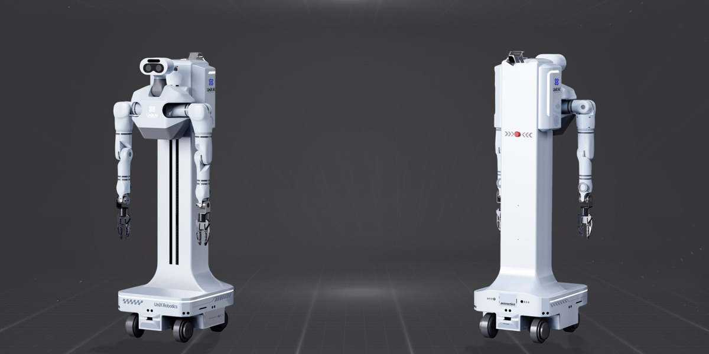
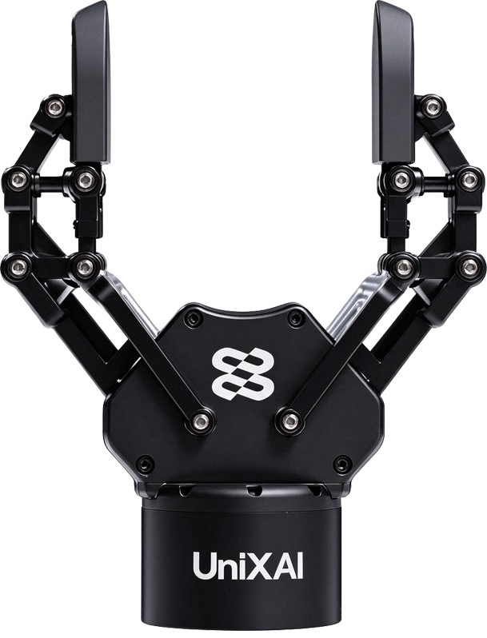
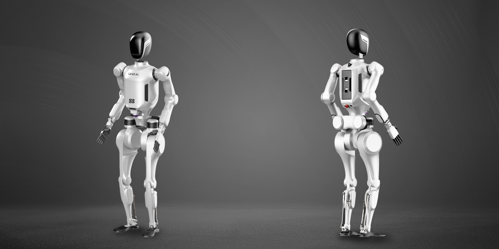

# UniX AI × T02 — Products and Solutions

⬆ [UniX AI profile](../UniX-AI.md) · [Brief](UniX-AI-T02-1-Brief.md) · [Playbook](UniX-AI-T02-3-Playbook.md)

**Bottom line:** UniX AI covers one slice of T02 well — **indoor building safety** (patrol, fire-safety checks, teleoperated intervention). Everything outdoors or on rough terrain needs another vendor. What is on site and which interfaces are exposed is **not confirmed**.

## Relevant products (ranked for this track)

### Wanda 2.0

**Role in T02:** long-endurance indoor patrol and inspection robot that can also *act* — open and test doors, move an obstruction, press a button, carry a kit. Most likely unit on site (best guess).

| Track-relevant spec | Value (official pages) |
|---|---|
| Runtime | **8–16 h** |
| Speed | **1.5 m/s** |
| Base | Differential drive, hub motors; min. passage **75 cm** |
| Reach / touch height | 982 mm single-arm reach; up to **1,800 mm** touch height; 280 mm torso lift (height 1.40–1.68 m) |
| Payload | **12 kg** dual-arm, 6 kg single-arm; ±0.5 mm repeatability |
| Sensors | 360° LiDAR, head dual RGB + RGBD, ultrasonic, 6-mic array |
| Compute | up to **275 TOPS** on board |
| Slope, obstacle crossing, stairs, IP rating | **not published** — assume flat, dry, indoor floors |
| Connectivity (Wi-Fi / 4G / 5G) | not published |

- **Status:** ✅ shipping (mass production since 2025). **Price:** not public. **Availability at the hackathon:** best guess, not confirmed.
- **Developer interface:** the Applications page claims "fully open software and hardware interfaces" for customisation in research, education and industry. No SDK, docs, ROS 2 statement or GitHub is public — ⚠️ unverified what this means in practice. Expect at minimum: vendor-run skills, navigation to waypoints and the proprietary teleoperation system.

### Panther

**Role in T02:** same job as Wanda 2.0 with more reach and agility — picks things up from the floor, moves sideways in tight corridors. Better manipulator, shorter patrol shift.

| Track-relevant spec | Value (official pages) |
|---|---|
| Runtime | **4–8 h** |
| Speed | **2 m/s** |
| Base | 4-wheel-steer + 4-wheel-drive omnidirectional; min. passage **65 cm** |
| Reach | **800 mm** torso lift, works down to floor level; height 1.62–1.72 m; head pitch +20° / −86° |
| Payload | **12 kg** dual-arm; 982 mm reach; ±0.5 mm |
| Sensors | Front + rear 360° LiDAR, dual RGB head cameras; **optional** top 3D LiDAR and RGBD |
| Compute | optional up to **2070 TOPS** |
| Slope, obstacle crossing, IP rating | **not published** |

- **Status:** ✅ launched 8 Apr 2026, deliveries started. **Price:** not public. On-site presence: plausible, not confirmed.
- **Developer interface:** nothing published. The launch release lists "security patrols" among target uses.

### UniPicker Pro

**Role in T02:** the hand that makes intervention possible — door handles, valves, extinguisher, first-aid kit, debris.

| Spec | Value |
|---|---|
| Grip force | up to **100 N** |
| Payload | up to **10 kg** |
| Open / close | 0.2 s |
| Control | hybrid force / velocity / position |

- **Status:** ✅ ships on the robots. Price not public. Standalone interface not public.

### Martian

**Role in T02:** only UniX product with **legs** and the only one whose page promises **high- and low-level APIs** for secondary development (CAN FD, OTA). In principle the route to stairs and thresholds; in practice rarely demoed, 5 kg payload, and unlikely to be on site.

| Spec | Value |
|---|---|
| Size | 148 cm, 40 kg |
| Speed | up to 4 m/s (company figure) |
| Payload | 5 kg |
| Sensors | depth camera, 2 RGB, IMU |
| Battery | 48 V / 9 Ah; runtime not published |

- **Status:** ✅ listed ("contact us"). Price not public.

### UniFlex / UniTouch / UniCortex

**Role in T02:** on-robot stack behind the pre-loaded skills (imitation learning, vision-tactile model, long-horizon planner). Not downloadable. Relevant only if the on-site team lets you teach a new skill by demonstration (for example "push fire door and watch it close").

### Wanda 3.0

🧪 CES 2026 preview with no specs; probably superseded by Panther (⚠️ unverified). Not relevant for planning.

## What UniX AI already does in this domain

| When | What | Evidence level |
|---|---|---|
| On the company website, Nov 2026 | **Security Service solution page**: autonomous route planning and **multi-floor** patrol; **fire-equipment cabinet checks**; **fire-door inspection** (robot operates the door to verify automatic closing); **corridor risk detection** (abnormal persons, unattended objects); environmental monitoring, facial recognition and abnormal-behaviour analysis in parallel; multi-robot patrols with cloud scheduling; inspection data synced to a property-management platform | Official marketing page; robot model not named; no customer named |
| Same page | ROI claims: 24/7 coverage, operating cost −50 %, human-to-robot ratio 1:3 | Vendor claims, no methodology — ⚠️ unverified |
| On the company website, Nov 2026 | **Proprietary remote teleoperation system**, local and remote, "millisecond-level" latency over public networks; positioned for hazardous-material handling, rescue and industrial inspection | Official marketing page; no demo video or deployment found |
| Dec 2025 | Shipments (~100 units/month) go to hotels, property management, **security**, retail, food service | 36Kr Japan; no named customer |
| 8 Apr 2026 | Launch release: Wanda 2.0 "operating in security, hospitality and retail food service"; Panther aimed at security patrols | Company press release |
| Product pages | "Patrol & Security" and "Emergency & Rescue" appear in the scenario list on Wanda 2.0 and Panther pages | Scenario labels only |

**Nothing found** for: named security or emergency-services customers, outdoor operation, search-and-rescue trials, infrastructure (tunnel, bridge, power, cable-car) inspection, or any Europe / Switzerland safety deployment. The "High-Risk Operation" menu entry on the website has no page behind it.

## What they are building next in this domain

- **Stated (Apr 2026):** scale to 1,000 units/month, "productisation, globalisation and ecosystem development". No safety-specific roadmap item. 🔭
- **Inference:** the Security page describes multi-robot cloud scheduling and property-platform integration, which points at fleet patrol for commercial buildings rather than emergency response.
- **Inference:** "High-Risk Operation" as a menu placeholder plus the teleoperation pitch suggests a planned teleoperated hazardous-work offering. Nothing announced. 🔭
- No news found for Sep–Nov 2026.

## Software, models and data that help for this track

| Need | From UniX AI | Bring yourself |
|---|---|---|
| Navigation / patrol | On-robot LiDAR navigation and route planning (interface not public) | Waypoint list and mission logic on a laptop |
| Manipulation skills | Pre-loaded skills; possibly demonstration teaching via UniFlex (tooling not public) | Scripted or teleoperated fallback |
| Teleoperation | Proprietary system (hardware and protocol not public) | Operator UI, AR view (XREAL) |
| Hazard perception | Claimed on Security page; not released | Open VLM / detector on laptop for extinguisher present, door closed, exit blocked, person down, smoke |
| Reporting | Property-platform sync claimed; API not public | Simple web dashboard, incident log, floor-plan overlay |
| Sim assets, datasets, model weights, GitHub | **none public** | — |

There is **no open-source shortcut** from UniX AI for a 48-hour build. The shortcut is the vendor engineers and whatever security skills already run on the robot.

## Gaps and limits for this track

- **Terrain:** wheeled, indoor. No published slope, threshold, stair or IP figures. Not usable outdoors in Leukerbad in November.
- **Hazard sensing:** no thermal camera, gas or smoke sensor listed. Add your own (USB sensor on a carried payload) if the concept needs it.
- **Developer access:** unknown until you ask. "Fully open interfaces" is a website claim; no documentation exists publicly.
- **Proof:** security use is described, not evidenced — no named site, video or numbers from a deployment.
- **Multi-floor:** claimed on the Security page; lift integration method not public and will not work with venue lifts in 48 hours.
- **Research caveat:** web search was unavailable for this track pass; findings rest on the official site, two press sources and the company profile. Chinese-language coverage of security deployments was not checked.

## Sources
- [UniX AI — Security Service application page](https://www.unix-group.ai/Security)
- [UniX AI — Applications page](https://www.unix-group.ai/Applications)
- [Wanda 2.0 product page](https://www.unix-group.ai/Wanda)
- [Panther product page](https://www.unix-group.ai/Panther)
- [Martian product page](https://www.unix-group.ai/Martian)
- [UniPicker Pro product page](https://www.unix-group.ai/UniPicker)
- [UniX AI news index](https://www.unix-group.ai/article/1962)
- [36Kr Japan, 21 Dec 2025: shipments and sectors](https://36kr.jp/449686/)
- [Panther launch release, 8 Apr 2026 (TechNode Global / PR Newswire Asia)](https://technode.global/prnasia/unix-ai-introduces-panther-the-worlds-first-service-humanoid-robot-to-enter-real-household-deployment-powered-by-its-differentiated-wheeled-dual-arm-architecture/)
- [UniX AI company profile (this repo)](../UniX-AI.md)
