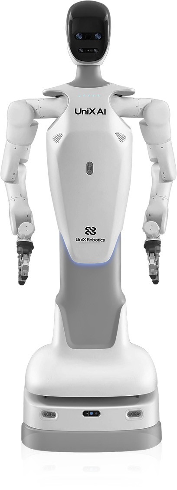
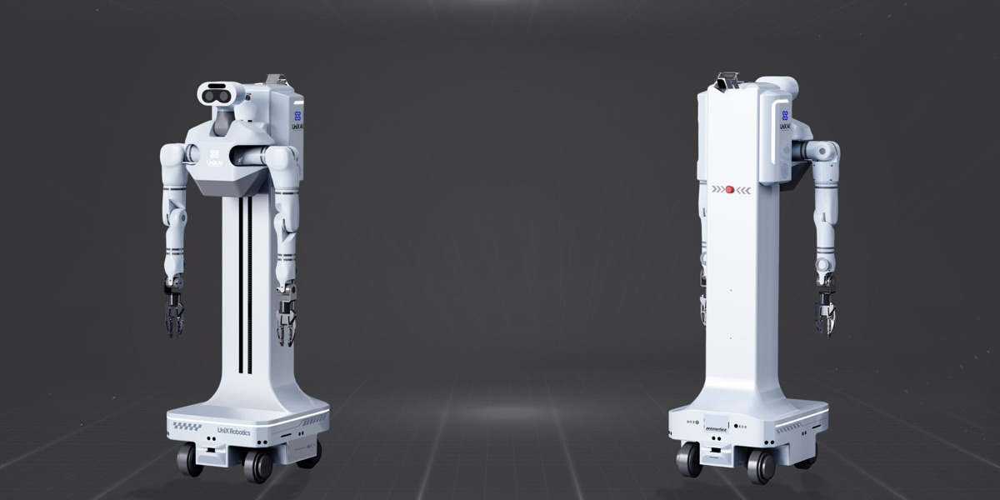
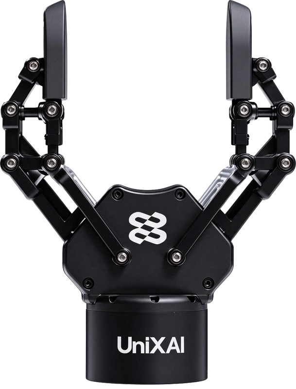
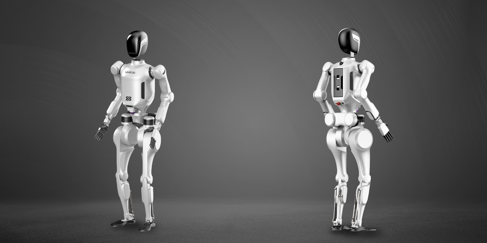

# UniX AI × T03 — Products and Solutions

⬆ [UniX AI profile](../UniX-AI.md) · [Brief](UniX-AI-T03-1-Brief.md) · [Playbook](UniX-AI-T03-3-Playbook.md)

**Bottom line:** UniX AI sells indoor service humanoids for hotels, retail and homes. It has **no sustainability-specific product, deployment or software**. Its use in T03 is as the "hands" of a sorting, reuse or resource-audit system that you design around it.

> Research note: this file is based on the official product pages and the company's 2026 press releases. Web search was not available during this run, so 2026 news after August and third-party coverage could not be re-checked.

## Relevant products (ranked for this track)

### Wanda 2.0

**Role in T03:** the most likely robot on site and the best match for long-running indoor work — sorting recyclables at a station, collecting reusables, auditing rooms for wasted energy.

| Track-relevant spec | Value (official page) |
|---|---|
| Battery life | **8–16 h** |
| Payload | **12 kg** dual-arm · 6 kg single-arm |
| Arm reach / repeatability | 982 mm · ±0.5 mm |
| Working height | Body 1.40–1.68 m (280 mm torso lift) — floor-level picking not stated |
| Base | Wheeled, **1.5 m/s** max, obstacle avoidance, min. passage **75 cm** |
| Sensors | 360° LiDAR · head dual RGB + RGBD · base RGBD · ultrasonic · 6-mic array |
| On-board compute | up to 275 TOPS |
| IP rating / slope / outdoor use | not public |
| Auto-recharge / charging time | not public |
| Energy consumption (W) | not public |

- **Status:** ✅ shipping (mass production since 2025). **Price:** not public. **Availability at the hackathon:** best guess, not confirmed.
- **Developer interface:** not public. The page mentions only pre-loaded "L4-level" applications and fast learning / rapid deployment. Assume skill-level control via the vendor team until told otherwise.

### Panther

**Role in T03:** better manipulator for waste and reuse tasks because the **800 mm torso lift reaches floor level** (bins, crates, dropped items) and the omnidirectional base positions precisely in tight rooms. Shorter runtime.

| Track-relevant spec | Value (official page) |
|---|---|
| Battery life | **4–8 h** |
| Payload | **12 kg** dual-arm |
| Arm reach / repeatability | 982 mm · ±0.5 mm |
| Working height | Body 1.62–1.72 m, **800 mm** torso lift, ground-level operation |
| Base | 4-wheel-steer + 4-wheel-drive omnidirectional, **2 m/s**, min. passage **65 cm** |
| Sensors | Front and rear 360° LiDAR · head dual RGB · optional top 3D LiDAR · optional RGBD |
| On-board compute | optional, up to 2070 TOPS |
| Power platform | 48 V |
| IP rating / slope / outdoor use | not public |

- **Status:** ✅ launched 8 Apr 2026, deliveries started. **Price:** not public. **On site:** plausible, not confirmed.
- **Developer interface:** not public (same wording as Wanda 2.0).

### UniPicker Pro

**Role in T03:** the end effector that touches the waste. An underactuated adaptive gripper tolerates the shape variety of real rubbish (crushed cans, bottles, cartons) better than a rigid parallel jaw.

| Track-relevant spec | Value (official page) |
|---|---|
| Max grip force | **100 N** |
| Max payload | up to **10 kg** |
| Open / close time | 0.2 s per stroke |
| Weight | 400 g / 600 g (variants not explained) |
| Control | Hybrid force / velocity / position |
| Opening width, tactile sensing, interface, IP rating | not public |

- **Status:** ✅ shipping, mounted on Wanda 2.0 and Panther. **Price:** not public.
- **Developer interface:** not public. Thin films, wet items, glass shards and very small objects are untested — ⚠️ unverified either way.

### UniFlex / UniTouch / UniCortex

**Role in T03:** the on-robot software that would let you teach a new sorting or handling skill by demonstration (UniFlex), handle varied objects by touch (UniTouch) and chain long tasks (UniCortex).

- **Status:** ✅ running on the robots; **not released separately** — no weights, code, benchmarks or docs.
- **What you can control:** not public. Whether hackathon teams can record demonstrations and train a new skill within 48 hours is the single most important question for the booth.

### Martian (low relevance)

- Bipedal humanoid, 5 kg payload. The only product whose page states **high- and low-level APIs for secondary development** — but legs add nothing to a sustainability task, and it is unlikely to be on site. Consider it only if it is the one robot with an open interface.

## What UniX AI already does in this domain

Very little, and nothing deployed.

| Date | What | Relevance to T03 | Source |
|---|---|---|---|
| Jan 2026 | CES 2026 hotel-zone demo listed **waste sorting**, surface wiping and amenity replenishment (Wanda 2.0 and 3.0 shown together; the release does not say which robot sorted) | Only direct evidence of a waste-handling skill. Demo, not a product | [CES press release](https://www.webull.com/news/14134140025406464) |
| Jan 2026 | Same event, household zone: dishwashing, clothes organising | Shows handling of varied household objects | [CES press release](https://www.webull.com/news/14134140025406464) |
| Aug 2026 | Panther reported as deployed with JD.com Seven Fresh Coffee in a 24-hour unmanned store | Retail automation, not a sustainability case; source is unreviewed event notes ⚠️ unverified | [WRC 2026 report](https://www.itiger.com/news/1101359561) |

- **No** recycling, energy, environmental-monitoring, EV-charging or green-space projects, pilots, partners or application pages were found.
- The official application list (hospitality, household, retail, autonomous store, patrol and security, elder care, culture and tourism, catering, emergency and rescue) contains no sustainability category.

## What they are building next in this domain

- **Announced:** nothing sustainability-specific. Stated direction (Apr 2026) is scale-up to **1,000 units/month**, global deliveries, household deployment and "ecosystem development". 🔭
- **Inference:** household and hotel deployments make everyday waste handling (sorting, taking out rubbish, restocking instead of replacing) a natural skill to productise — but the company has not said so.
- **Inference:** "ecosystem development" could mean developer access later; no programme, SDK or date is announced.

## Software, models and data that help for this track

- **From UniX AI:** nothing downloadable — no SDK, ROS 2 package, simulation model, dataset or model weights are public.
- **What you will have to bring yourself** (generic, not UniX-specific):
  - A waste / material image classifier running on a laptop or edge board, fed by your own camera or, if exposed, the robot's RGB / RGBD stream.
  - A task layer (state machine or LLM planner) that maps "item class → bin" and calls whatever interface the booth exposes.
  - A dashboard for the impact numbers (items per stream, contamination rate, estimated savings).
- Plan for a **fixed external camera over the sorting table** so perception does not depend on robot sensor access.

## Gaps and limits for this track

- **Developer access unknown** — the dominant risk. Skills-only access turns the robot into a demo prop that you trigger.
- **Indoor, flat floors only** as far as published data goes: no IP rating, slope, kerb or temperature specs. Not for Leukerbad's streets, snow or outdoor litter.
- **No energy data**: power draw, charging method and battery capacity for Wanda 2.0 / Panther are not public, so "low-emission robot" claims cannot be backed with numbers.
- **Throughput**: a humanoid sorting one item at a time is far slower than an industrial sorting line; position it for small, decentralised points (hotel floor, spa, clinic ward), not a recycling plant.
- **Hygiene / wet waste**: gripper sealing and cleanability are not documented.
- **No domain track record**: one trade-show demo; no customer, no measured results.

## Sources
- [Wanda 2.0 product page](https://www.unix-group.ai/Wanda)
- [Panther product page](https://www.unix-group.ai/Panther)
- [UniPicker Pro product page](https://www.unix-group.ai/UniPicker)
- [Martian product page](https://www.unix-group.ai/Martian)
- [Press release, 2 Jan 2026: Wanda series at CES 2026 (via Webull / PR Newswire)](https://www.webull.com/news/14134140025406464)
- [Press release, 8 Apr 2026: Panther launch (via TechNode Global / PR Newswire Asia)](https://technode.global/prnasia/unix-ai-introduces-panther-the-worlds-first-service-humanoid-robot-to-enter-real-household-deployment-powered-by-its-differentiated-wheeled-dual-arm-architecture/)
- [WRC 2026 live report, 20 Aug 2026 (iTiger)](https://www.itiger.com/news/1101359561)
